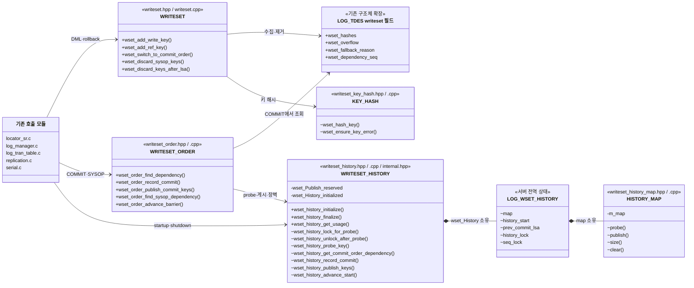
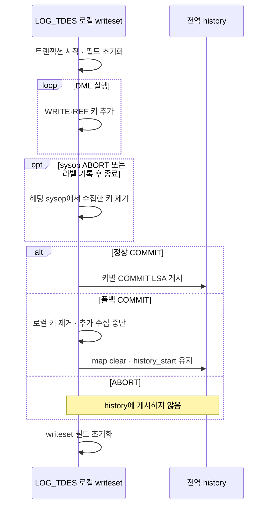
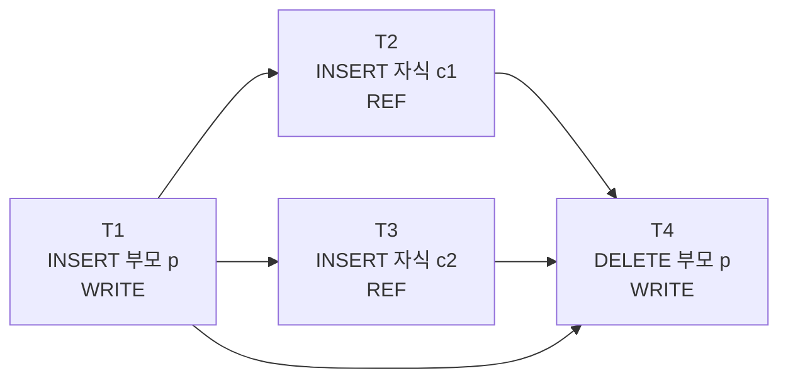
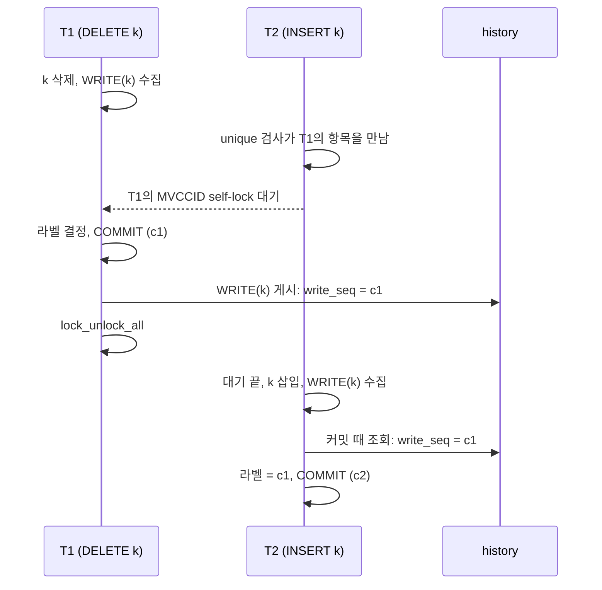

# 마스터 writeset 설계

마스터의 writeset은 슬레이브가 트랜잭션을 병렬로 적용해도 마스터와 같은 결과가 나오도록, 각 트랜잭션이 먼저 끝나기를 기다려야 할 이전 트랜잭션을 커밋 때 정해 로그에 남긴다. 슬레이브는 이 기록만 보고 적용 순서를 정한다.

## 1. 전체 처리 흐름

이 장은 일반 복제 대상 트랜잭션이 DML에서 키를 수집하고, COMMIT에서 dependency를 기록한 뒤 history에 게시하는 전체 흐름을 먼저 설명한다. 한도 초과·statement 폴백과 독립 top operation은 뒤에서 별도로 설명한다. 전체 흐름에서 사용하는 핵심 용어는 다음과 같다.

- **writeset**: 트랜잭션 하나가 DML 중에 모은 키 목록이다(`LOG_TDES.wset_hashes`). 커밋하면 history에 게시하고, ABORT하면 버린다.
- **history**: 서버 전역에 하나 있는 map이다(`wset_History`). 키별로 마지막 WRITE와 REF의 COMMIT LSA를 기억하며, 커밋 때 조회하고 커밋 뒤 갱신한다.
- **`dependency_seq`**: 현재 적용 단위보다 먼저 완료돼야 하는 범위를 나타내는 마스터 로그 위치다. 슬레이브는 이 위치까지 앞에서부터 빠짐없이 적용한 뒤 현재 적용 단위를 실행한다. 일반 트랜잭션에서는 이전 트랜잭션의 COMMIT LSA가 주로 들어가지만, 독립 적용되는 `LOG_SYSOP_END`의 LSA나 마스터 재시작 시 복구된 로그의 끝도 들어갈 수 있다. 선행 조건이 없으면 NULL이다.

```text
[DML 중 — 행마다 반복]
행 INSERT·UPDATE·DELETE
  → 행 잠금 획득
  → locator_add_or_remove_index_internal() 또는 locator_update_index()
     → 인덱스 키 추출
     → [추가] wset_add_write_key()           PK·UNIQUE 키를 WRITE로 수집
     → [추가] locator_wset_collect_fk_ref()
        → [추가] wset_add_ref_key()          자식 FK의 부모 키를 REF로 수집
     → B-tree 변경, repl_log_insert()
  (모은 키는 writeset에 쌓이고, 커밋 전까지 history는 건드리지 않음)

[커밋 — 트랜잭션당 한 번]
log_commit_local()
  → log_append_repl_info_and_commit_log()
     → prior_lsa_mutex 획득
     → log_append_repl_info_with_lock()             복제 레코드 기록
     → [추가] wset_order_find_dependency()   dependency 결정
     → [추가] log_append_wset_label_with_lock()     WSET_LABEL 로그 기록
     → log_append_commit_log_with_lock()            COMMIT 로그 기록
     → [추가] wset_order_record_commit()      커밋 순서 기준 갱신
     → prior_lsa_mutex 해제
  → [추가] wset_order_publish_commit_keys()         writeset을 history에 게시
  → lock_unlock_all()                               행 잠금과 MVCCID self-lock 해제
```

*그림 1-1. DML에서 WRITE·REF 키를 수집하고, COMMIT에서 dependency를 기록한 뒤 확정된 COMMIT LSA를 history에 게시하는 전체 흐름*

위 흐름에서 적용 순서를 보존하기 위해 확인할 설계 지점은 다음 네 가지다.

- **수집**: 일반 인덱스의 키는 모으지 않는다.
- **dependency 결정**: 정상 writeset은 같은 키를 앞서 바꾸거나 참조한 트랜잭션 중 가장 늦은 COMMIT LSA를 고른다. 키를 안전하게 모을 수 없어 commit-order로 폴백한 트랜잭션은 키별 history를 조회하지 않고 `prev_commit_lsa`와 `history_start` 중 더 늦은 위치를 고른다. `prior_lsa_mutex` 안에서 정하므로, 결정과 COMMIT 사이에 다른 커밋이 끼지 않는다.
- **기록**: 슬레이브는 라벨의 LSA까지 빈틈없이 적용된 뒤에 그 트랜잭션을 실행한다.
- **게시**: 결정 때는 아직 자기 COMMIT LSA가 없어서 COMMIT 뒤에 한다. 잠금(행 잠금과 MVCCID self-lock)을 풀기 전에 끝나야, 같은 행이나 키를 기다리던 다음 트랜잭션이 잠금을 얻었을 때 이 커밋을 history에서 찾는다(5.3절).

### 1.1 소스 구성

writeset 코드는 `src/transaction/writeset/`에 모은다.

```text
src/transaction/
├─ writeset/
│  ├─ writeset.hpp / .cpp
│  ├─ writeset_order.hpp / .cpp
│  ├─ writeset_history.hpp / .cpp
│  ├─ writeset_history_internal.hpp
│  ├─ writeset_key_hash.hpp / .cpp
│  ├─ writeset_history_map.hpp / .cpp
│  ├─ writeset_config.hpp / .cpp
│  ├─ writeset_trace.hpp / .cpp
│  ├─ writeset_types.hpp
│  └─ writeset_stat.hpp / .cpp
├─ locator_sr.c
├─ log_manager.c
├─ log_tran_table.c
├─ log_impl.h
├─ log_record.hpp
├─ log_append.cpp
├─ log_recovery.c
└─ replication.c
src/query/serial.c
src/query/show_scan.c
src/parser/show_meta.c
```

*그림 1-2. writeset 핵심 모듈과 writeset을 호출하는 기존 서버 파일의 소스 구성*

`writeset/`는 이번 기능이 새로 만든 디렉토리이며, 파일마다 맡은 일은 다음과 같다.

- `writeset.hpp / .cpp`: 트랜잭션 로컬 키 수집, commit-order 전환, rollback·SYSOP에 따른 키 폐기를 맡는다.
- `writeset_order.hpp / .cpp`: 로컬 writeset과 전역 history를 연결해 COMMIT·SYSOP의 dependency를 결정하고 게시를 지시한다. 로컬·전역 상태를 직접 소유하지 않는다.
- `writeset_history.hpp / .cpp`: 전역 history의 초기화·종료와 map·하한·직전 COMMIT 상태를 소유한다. 서버에는 생명주기와 상태 조회 API만 공개한다.
- `writeset_history_internal.hpp`: `writeset_order`와 단위 테스트만 사용하는 history 내부 상태와 probe·publish 원시 인터페이스다.
- `writeset_key_hash.hpp / .cpp`: 제약 키를 인덱스가 비교하는 방식대로 해시한다(`wset_hash_key()`). WRITE와 REF가 함께 쓴다.
- `writeset_history_map.hpp / .cpp`: 키별 write_seq와 ref_seq를 담는 동시성 map. TBB `concurrent_hash_map`을 감싼다.
- `writeset_config.hpp / .cpp`: 서버 시작 때 키 수 한도와 trace 수준을 한 번 읽어 로컬 수집·history·trace가 공유하게 한다.
- `writeset_trace.hpp / .cpp`: `[WSET]` trace의 수준 판정과 공통 출력 형식을 제공한다.
- `writeset_types.hpp`: 공용 타입. 키 해시, WRITE와 REF 구분, 트랜잭션 writeset 항목. `log_impl.h`가 LOG_TDES 필드 때문에 이 헤더를 직접 include한다.
- `writeset_stat.hpp / .cpp`: master 통계와 `SHOW WRITESET STATUS`. `show_scan.c`가 이 헤더를 직접 include한다.

나머지 파일은 writeset을 부르는 기존 모듈이며, 바뀐 내용은 다음과 같다.

- `locator_sr.c`: INSERT·DELETE·UPDATE의 인덱스 갱신 경로에서 키 수집, FK REF 수집(분할 테이블 부모는 키가 있는 파티션으로 옮김).
- `log_manager.c`: 1PC·2PC 커밋 경로의 dependency 결정, 라벨 기록, 게시. sysop 끝의 라벨과 ABORT된 sysop의 키 제거. 재시작 하한.
- `log_tran_table.c`: history 초기화와 해제, 트랜잭션 descriptor의 writeset 필드 초기화와 복사.
- `log_impl.h`: `LOG_TDES`의 writeset 필드, sysop 스택의 `wset_mark`·`repl_flushed`.
- `log_record.hpp`, `log_append.cpp`, `log_recovery.c`: `LOG_DUMMY_WSET_LABEL` 레코드 정의와 기록 크기, 복구에서 건너뛰기.
- `replication.c`: statement 복제 시 commit-order 폴백.
- `serial.c`: serial 갱신의 키 수집, serial 인덱스를 아직 모를 때의 폴백.
- `show_scan.c`, `show_meta.c`: `SHOW WRITESET STATUS` 등록과 컬럼 정의.

### 1.2 설정

writeset이 읽는 파라미터는 둘이며, 둘 다 `cubrid_ha.conf`에 두고 서버가 시작할 때 읽는다. 실행 중에는 바꿀 수 없다.

- **`ha_writeset_history_size`** (새 파라미터): 전역 history의 키 수 상한이자 트랜잭션 하나의 키 수 상한이다. 기본값 1,000,000, 범위 1~10,000,000. `wset_config_initialize()`가 한 번 읽고, 트랜잭션별 한도 검사(`wset_append_entry()`, 4.4절)와 map 용량 검사(`wset_history_has_capacity()`, `wset_history_reserve_capacity()`, 6.1절)가 같은 값을 쓴다.
- **`ha_writeset_trace_level`** (새 파라미터, 슬레이브와 같이 씀): `[WSET]` trace 수준이다. 기본값 0, 범위 0~3(8.3절). `wset_config_initialize()`가 서버 시작 시 한 번 읽고, 마스터의 키 수집·dependency·history·SYSOP trace는 모두 `wset_trace_is_enabled()`를 통해 같은 캐시값을 사용한다.

## 2. 핵심 자료구조와 WSET_LABEL

마스터의 writeset 정보는 세 단계에 걸쳐 사용된다. DML 중에는 트랜잭션 로컬 writeset에 키를 모으고, COMMIT에서는 전역 history를 조회해 dependency를 정하며, 그 결과를 WSET_LABEL로 슬레이브에 전달한다. 이 장은 세 자료구조의 역할과 서로 연결되는 방식을 설명한다.

다음 그림은 현재 구현된 핵심 모듈과 상태의 소유 관계를 보여 준다. 트랜잭션 로컬 상태는 `writeset`, COMMIT·SYSOP의 순서 결정은 `writeset_order`, 서버 전역 이력은 `writeset_history`가 맡는다. `+`는 기존 서버 모듈이 호출하는 공개 API, `~`는 writeset 하위 모듈과 단위 테스트만 사용하는 내부 인터페이스, `-`는 해당 구현 파일 안에서만 사용하는 상태다. 이 그림의 박스는 C++ 클래스가 아니라 모듈·자료구조의 경계를 나타낸다. 설정·trace·통계·SHOW 모듈은 핵심 흐름에서 제외하고 8장에서 설명한다.



*그림 2-1. 핵심 실행 모듈의 구현 구조. `writeset_order`는 로컬 writeset을 입력으로 받아 전역 history를 조회·갱신하지만 두 상태를 소유하지 않는다. `wset_Publish_reserved`와 `wset_History_initialized`는 `LOG_WSET_HISTORY`의 필드가 아니라 `writeset_history.cpp`의 module-private 상태다.*

### 2.1 트랜잭션 로컬 writeset

로컬 writeset은 충돌 키의 해시와 WRITE·REF 종류를 vector에 담는다. 한 행에서 PK·UNIQUE·FK 키가 각각 나올 수 있고, UPDATE는 변경 전후의 키를 모두 수집하므로 항목 수는 행 수와 같지 않다(4.1절). 같은 키와 종류가 반복돼도 목록에는 그대로 남긴다(4.4절).

COMMIT 직전에 이 목록을 전역 history map과 비교해 dependency를 계산한다(5.1절). COMMIT된 트랜잭션의 키는 이후 트랜잭션의 dependency 계산을 위해 게시하며, ABORT한 트랜잭션의 키는 history에 게시하지 않는다(5.3절). 한도를 넘었을 때의 폴백은 아래 `wset_overflow`와 4.4절에서 설명한다.

그림 2-1의 로컬 writeset 쪽 필드를 설명한다. 트랜잭션 descriptor(`LOG_TDES`)에 더한 필드는 다음과 같다.

- `wset_hashes`: 이 트랜잭션이 모은 키 목록(`LOG_WSET_ENTRY`의 vector).
- `wset_overflow`: writeset을 버리고 commit-order 폴백을 쓰는지 여부. 키 수가 한도를 넘거나, 변경이 statement로 복제되거나, NaN 키를 만나거나, serial 인덱스를 아직 찾지 못했을 때 켜진다. 일부 키만 남기면 안전하지 않으므로 목록 전체를 버린다. 키를 만들다 실패한 것은 DML 오류로 돌려주며 이 값을 켜지 않는다.
- `wset_dependency_seq`: 커밋 때 history에서 고른 dependency. COMMIT 바로 앞의 WSET_LABEL에 실린다.
- `wset_fallback_reason`: `wset_overflow`를 켠 이유. 커밋 때 통계로만 센다.

키 항목(`LOG_WSET_ENTRY`)은 다음을 담는다.

- `hash`: 충돌 키의 해시(3.1절).
- `kind`: WRITE 또는 REF.
- `lsa`: 키를 모은 시점의 트랜잭션 마지막 로그 LSA. sysop이 ABORT되면 sysop 시작 위치 뒤에 모은 키를 이 값으로 찾아 지운다(7절).

PoC는 트랜잭션 COMMIT의 병렬 적용만 다뤘지만, 구현에서는 복제 레코드를 남기는 sysop도 처리해야 한다. 이를 위해 sysop 스택 항목(`LOG_TOPOPS_ADDRESSES`)에 두 필드를 더했다. 둘 다 `log_sysop_start()`에서 정하며, sysop 처리는 7장에서 설명한다.

- `wset_mark`: sysop을 시작할 때의 `wset_hashes` 크기. 그 뒤에 모은 키가 이 sysop의 키다(7.3절).
- `repl_flushed`: 이 sysop이 가장 안쪽에 열려 있는 동안 복제 레코드가 로그에 기록됐는지 여부. 켜져 있으면 그 `LOG_SYSOP_END`에 라벨을 단다(7.2절).

writeset의 로컬 생명주기와 COMMIT 뒤의 전역 history 처리는 다음과 같다.



*그림 2-2. 로컬 writeset과 전역 history를 분리한 생명주기. 정상 COMMIT은 키를 전역 history에 게시하고, 폴백 COMMIT은 전역 history를 비운 뒤 하한을 유지한다.*

### 2.2 트랜잭션 descriptor의 초기화와 복사

writeset 필드는 descriptor를 다시 쓸 때마다 비워야 한다. 이전 트랜잭션의 키나 폴백 표시가 남으면 다음 트랜잭션이 엉뚱한 키를 게시하거나 commit-order로 떨어진다.

- `logtb_initialize_tdes()`: descriptor를 처음 만들 때 네 필드를 비운다.
- `logtb_clear_tdes()`: 트랜잭션이 끝나 descriptor를 돌려줄 때 네 필드를 비운다. 커밋과 ABORT가 모두 이 경로를 지난다.
- `log_tdes::copy_to()`: 2PC loose end를 새 descriptor로 옮길 때(`log_complete_for_2pc()`) 네 필드를 함께 복사한다. 키는 그 키가 설명하는 복제 레코드와 같이 움직여야, 새 descriptor에서 나중에 쓰는 COMMIT이 dependency를 찾고 키를 게시한다.
- `logtb_realloc_topops_stack()`(sysop 스택 확장): 새 칸을 0으로 채운다. 복구 분석은 `log_sysop_start()` 없이 칸을 채우므로, `wset_mark`와 `repl_flushed`에 쓰레기 값이 남으면 안 된다.

### 2.3 전역 history

전역 history는 키 해시마다 마지막 WRITE COMMIT LSA와 REF COMMIT LSA의 최댓값을 보관한다. 각 트랜잭션은 COMMIT 직전에 해당 키를 조회하고, 본인 COMMIT LSA가 확정된 뒤 WRITE·REF 슬롯을 갱신한다. 서로 다른 키는 동시에 처리할 수 있도록 해시 맵의 키별 접근을 보호한다.

history를 비우거나 서버가 재시작하면 이전 키별 이력을 조회할 수 없으므로 이력을 비운 시점의 하한을 함께 관리한다. commit-order 폴백에 쓰는 직전 COMMIT LSA도 전역으로 유지한다. dependency 계산은 5절, history 게시와 동시성은 6절에서 설명한다.

그림 2-1의 전역 history 쪽 필드를 설명한다. 전역 history(`LOG_WSET_HISTORY`, 서버에 하나 있는 `wset_History`)의 필드는 다음과 같다.

- `map`: 키 해시마다 slot(`write_seq`, `ref_seq`)을 담는 `wset_history_map`. 키별 조회(probe), 갱신(publish), 전체 비우기(clear)를 제공한다. TBB `concurrent_hash_map`을 감싸며, 키 하나씩 잠그므로 서로 다른 키의 probe와 publish는 동시에 돈다.
  - `write_seq`: 이 키를 마지막으로 WRITE한 트랜잭션의 COMMIT LSA.
  - `ref_seq`: 이 키를 REF한 트랜잭션들의 COMMIT LSA 중 최댓값.
- `history_start`: 키별 이력을 볼 수 없는 구간의 하한. 서버 재시작, history 비우기, 폴백 커밋, 독립 top operation에서 올린다. 모든 dependency는 이 값 이상이 된다.
- `prev_commit_lsa`: 지금까지 기록된 COMMIT 중 가장 큰 LSA. commit-order 폴백의 dependency와 history를 비울 때의 하한으로 사용한다.
- `history_lock`: map을 보호하는 읽기/쓰기 잠금. probe와 publish는 공유로, map을 비우는 clear는 배타로 잡는다. TBB의 clear는 다른 접근과 동시에 돌면 안전하지 않기 때문이다.
- `seq_lock`: `prev_commit_lsa`와 `history_start`를 함께 지키는 mutex. 두 값을 읽거나 올리는 곳은 모두 이 잠금을 잡는다.
`ha_writeset_history_size`는 history 구조체 필드가 아니라 `writeset_config`가 보관한다. 로컬 writeset과 전역 history는 `wset_config_get_key_limit()`으로 같은 상한을 읽는다.

경로마다 필요한 잠금만 잡는다. 여러 잠금을 함께 잡을 때의 획득 순서는 `prior_lsa_mutex` → `seq_lock` → `history_lock` → 키별 accessor이며, 반대 순서로 획득하는 경로는 없다. COMMIT dependency 조회는 이 순서의 필요한 단계를 사용하고, 일반 게시는 `history_lock`과 accessor만, history 비우기는 `seq_lock`과 배타 `history_lock`만 사용한다. 각 함수가 어느 잠금을 잡는지는 해당 의사코드에 행으로 표시했다(5.1절, 5.2절, 6.1절).

`LOG_WSET_HISTORY` 밖에는 `writeset_history.cpp`만 소유하는 상태가 두 개 있다. `wset_Publish_reserved`(atomic)는 공유 잠금으로 게시 중인 트랜잭션들이 예약한 키 수를 보관해 동시 게시가 용량 한도를 넘지 않게 한다(6.1절). `wset_History_initialized`는 초기화·종료 경로에서 잠금과 map을 중복 생성하거나 해제하지 않게 한다(8.1절).

### 2.4 WSET_LABEL

WSET_LABEL은 슬레이브가 현재 적용 단위를 언제 실행할 수 있는지 알리는 복제 로그 레코드다(레코드 종류 `LOG_DUMMY_WSET_LABEL`, 내용 `LOG_REC_WSET_LABEL`). 일반 트랜잭션에서는 COMMIT 바로 앞에, 독립 적용되는 top operation에서는 `LOG_SYSOP_END` 바로 앞에 기록한다. 라벨의 `dependency_seq`는 현재 적용 단위보다 먼저 완료돼야 하는 마스터 로그 위치다. writeset과 history는 마스터 메모리에만 있으므로, 슬레이브는 이 라벨을 통해 마스터가 정한 실행 순서를 전달받는다.

**담는 값**

- `dependency_seq`: 현재 적용 단위가 기다려야 할 마스터 로그 위치다(`LOG_TDES.wset_dependency_seq`). 자세한 정의는 1장에서 설명했다.
- 선행 조건이 없으면 NULL이다.

**기록 시점과 위치**
- 서버에서 변경을 수행한 트랜잭션이 복제 로그를 기록하며 COMMIT할 때 남긴다. 1PC(`log_commit_local()`)와 2PC 완료(`log_complete_for_2pc()`)가 모두 `log_append_repl_info_and_commit_log()`를 사용한다. 로그 applier가 적용 중인 트랜잭션과 복제가 비활성화된 경우에는 기록하지 않는다. 읽기 전용 트랜잭션은 변경 로그가 없어 이 경로에 들어오지 않는다.
- 같은 트랜잭션의 복제 레코드 뒤, COMMIT 바로 앞에 둔다. 복제 레코드를 로그에 남긴 독립 top operation이면 종료 유형과 상관없이 `LOG_SYSOP_END` 바로 앞에 둔다(7절).
- 라벨과 COMMIT은 같은 `prior_lsa_mutex` 구간에서 기록되므로, 둘 사이에 다른 레코드가 끼지 않는다(5.2절).

슬레이브는 라벨 값을 같은 트랜잭션의 COMMIT(또는 `LOG_SYSOP_END`)에 붙여, 그 값 이하의 커밋이 모두 적용된 뒤에 적용한다. 자세한 처리는 slave 설계 문서의 [3장](./02-slave-implementation-design.md#3-복제-로그에서-task-구성)과 [4장](./02-slave-implementation-design.md#4-dependency-gate와-완료-처리)에서 설명한다.

컨셉 설계는 라벨에 `dependency_is_ref`를 함께 실어, WRITE에서 온 라벨은 그 트랜잭션 한 건이 끝나면 통과시키게 했다. 그런데 라벨에는 여러 키의 선행자 가운데 가장 늦은 하나만 실리므로(5.1절), 한 건만 보고 통과시키면 다른 키의 선행자를 건너뛸 수 있다. 그래서 슬레이브는 모든 라벨에서 그 위치까지 빈틈없이 적용되기를 기다리고, 레코드에는 `dependency_seq`만 싣는다.

컨셉 설계에서는 레코드에 버전 판별 방법을 두라고 했지만 구현은 두지 않았다. 이 기능은 다음 버전으로만 내고 이전 버전으로는 옮기지 않으며, master와 slave의 버전이 다른 HA 구성은 지원하지 않는다.

### 2.5 라벨이 지켜야 할 조건

슬레이브는 dependency가 있는 트랜잭션끼리는 master의 커밋 순서대로 적용해야 한다. 이를 위해 master는 트랜잭션 T가 커밋할 때 T의 dependency를 라벨 값으로 정해 로그에 남긴다. 슬레이브는 빈틈없이 적용한 마지막 위치가 이 라벨 값에 이르면 T를 적용한다. 키 충돌로 선택한 위치는 이전 트랜잭션의 COMMIT LSA이며, `LOG_SYSOP_END`와 재시작 장벽은 1장에서 정의한 별도의 로그 위치를 사용한다. 기다리는 동안 coordinator는 뒤의 로그를 계속 읽어 다른 트랜잭션을 적용한다(slave 설계 문서 [4장](./02-slave-implementation-design.md#4-dependency-gate와-완료-처리)).

**어떤 트랜잭션을 기다려야 하는가**

부모 키 p 하나를 두고 네 트랜잭션이 차례로 커밋하는 경우를 보자.

```text
T1: INSERT 부모 p           WRITE(p)
T2: INSERT 자식 c1 → p      REF(p)    T1을 기다린다
T3: INSERT 자식 c2 → p      REF(p)    T1을 기다린다. T2는 기다리지 않는다
T4: DELETE 부모 p           WRITE(p)  T1, T2, T3를 기다린다
```

*예제 2-1. 하나의 부모 키에 WRITE와 REF로 접근하는 네 트랜잭션의 선행 조건*



*그림 2-3. 같은 부모 키를 다루는 네 트랜잭션. 화살표는 "앞이 적용된 뒤에 뒤를 적용한다"는 뜻이다. T2와 T3 사이에는 화살표가 없으므로 슬레이브에서 동시에 적용할 수 있다.*

규칙은 하나다. 같은 키를 다룬 두 트랜잭션 중 하나라도 WRITE이면, 뒤에 커밋한 트랜잭션은 앞의 트랜잭션을 기다려야 한다. 둘 다 REF이면, 즉 같은 부모를 참조하는 자식끼리이면 기다리지 않는다.

**라벨 값의 조건**

슬레이브는 라벨 값까지 빈틈없이 적용된 뒤에 T를 적용하므로, 라벨 값은 다음 두 조건을 만족해야 한다.

- 기다려야 할 앞선 커밋 중 가장 늦은 것과 같거나 그보다 뒤여야 한다. 하나라도 그보다 앞에 두면, 슬레이브가 그 커밋보다 T를 먼저 또는 동시에 적용할 수 있다. 그림 2-3에서 T4의 라벨은 T3의 커밋 위치 이상이어야 한다.
- T 자신의 커밋보다 앞이어야 한다. 그렇지 않으면 T가 자기 적용을 기다리게 된다.

**master가 라벨 값을 정하는 방법**

master는 키마다 그 키를 마지막으로 WRITE한 커밋과 REF한 커밋을 기억해 두고(2.3절), T의 키 종류에 따라 다음을 기다리게 한다.

```text
T의 키가 WRITE → 그 키의 마지막 WRITE 커밋과 마지막 REF 커밋 중 늦은 것
T의 키가 REF   → 그 키의 마지막 WRITE 커밋
```

*알고리즘 2-1. 현재 키의 WRITE·REF 종류에 따른 선행 COMMIT 후보 선택 규칙*

T의 키 전체에서 나온 값 중 가장 늦은 것이 라벨 값이 된다. 자세한 계산은 5.1절에서 설명한다.

**라벨 값이 필요보다 큰 경우**

라벨 값이 첫 번째 조건보다 뒤여도 순서는 지켜진다. 필요 없는 커밋까지 기다리게 되어 병렬성만 줄어든다. 그래서 키별 이력을 볼 수 없을 때(폴백, 하한 아래)는 직전 커밋이나 하한을 라벨 값으로 쓴다.

## 3. 충돌 키와 해시

충돌 키의 해시는 모두 이번 기능에서 추가한 함수 `wset_hash_key()`(`writeset_key_hash.cpp`)에서 만든다. 이 장은 이 함수가 키 종류에 따라 바이트를 만들고 해시하는 방법을 설명한다. 이 함수를 부르는 곳은 4장에서 설명한다.

### 3.1 충돌 키

충돌 키는 (index VFID, 정규화한 키)이다. 이 둘을 이어 FNV-1a 64비트로 해시하고(`wset_hash_key()`), `LOG_WSET_ENTRY`에 `{hash, kind}`로 넣는다.

```text
hash = FNV-1a64 ( index VFID | 정규화한 키 바이트 )
```

*식 3-1. 인덱스 식별자와 정규화한 제약 키 값으로 구성한 writeset 충돌 해시*

해시는 master 메모리 안에서만 비교하므로 바이트 배치는 정해진 형식이 아니다.

인덱스는 표현이 달라도 같은 키로 보는 값이 있다(예: `'a'`와 `'a '`, -0.0과 +0.0). 이런 값이 같은 바이트가 되도록 키를 정규화한다. 타입별 정규화 규칙은 다음과 같다.

- 문자열: collation별 ELF 해시(`mht2str()`)에 태그를 붙인 5바이트. 인덱스가 무시하는 끝 공백은 자르고, NUL은 공백으로 바꾼다(binary 콜레이션은 끝 NUL만 자른다). (`wset_pack_string_key()`)
- TIMESTAMPTZ·DATETIMETZ: UTC 부분만 (`wset_strip_zone()`)
- FLOAT·DOUBLE: -0.0을 +0.0으로 (`wset_unsign_zero()`)
- MONETARY: 화폐 단위 없이 금액만 (`wset_strip_currency()`)
- VARBIT: 비트 길이를 바이트 단위로 올림 (`wset_round_bit_length()`)
- 복합 키: 원소마다 같은 규칙 (`wset_midxkey_hash()`)
- 그 밖의 타입: 패킹한 값 그대로
- NaN: 모든 키와 같아 해시할 수 없으므로 그 트랜잭션을 commit-order로 보낸다. (`wset_value_is_nan()`)
- 확인하지 못한 것: locale·UCA 콜레이션의 가중치 0 글자(실측 환경 없음)

컨셉 설계와 PoC는 해시에 행의 class OID를 넣었지만, 구현에서는 뺐다. 상속 계층의 상위 클래스와 하위 클래스는 물려받은 PRIMARY KEY와 UNIQUE에 B-tree 하나를 함께 쓰는데, class OID를 넣으면 같은 키라도 클래스마다 해시가 달라진다.

- 상위 클래스에서 키 1을 DELETE한 T1 뒤에, 하위 클래스로 키 1을 INSERT한 T2는 T1을 기다리지 않는다. 슬레이브에서 T2가 먼저 적용되면 unique 위반으로 실패하고, 뒤이어 T1이 적용되어 행이 사라진다.
- 상위 클래스 PK를 참조하는 FK에서 부모 행이 하위 클래스에 있으면, 자식의 REF가 부모의 WRITE와 만나지 않는다.

class OID를 빼서 생기는 부작용은 작다. 지워진 B-tree의 VFID가 다시 쓰이면 해시가 겹쳐 의존이 하나 더 생길 뿐이다. 또 인덱스를 지우는 DDL은 문장 복제라서 커밋 때 history를 비운다.

타입별 처리는 3.2절(문자열), 3.3절(그 밖 타입), 3.4절(복합 키), 3.5절(NaN과 키 생성 오류)에서 설명한다.

FNV-1a 64비트 해시(`wset_fnv1a()`)에 넣는 바이트는 index VFID 6바이트(fileid 4바이트, volid 2바이트) 다음에 정규화한 키 바이트다.

해시가 우연히 겹치면 서로 무관한 두 트랜잭션 사이에 dependency가 하나 더 생길 뿐이다. 반대로 같은 키가 다른 해시가 되면 순서를 놓친다. 정규화를 고칠 때는 항상 "다른 키가 합쳐지는 것"은 허용하고 "같은 키가 갈라지는 것"은 막아야 한다.

### 3.2 문자열 키

인덱스는 문자열을 collation 기준으로 비교하므로, 저장 바이트가 달라도 같은 키일 수 있다(대소문자 무시 collation, 끝 공백 등). 그래서 문자열은 다음 순서로 해시한다(`wset_string_hash()`, `wset_pack_string_key()`).

```text
 1  s = 문자열 바이트
 2  if 콜레이션이 binary:
 3      s 끝의 NUL을 자른다
 4  else:
 5      s 안의 NUL을 모두 공백으로 바꾼다
 6  if CHAR 또는 ignore_trailing_space가 켜진 VARCHAR:
 7      s 끝의 공백을 자른다
 8  h = lc->mht2str (s)                        -- ELF 해시, 4바이트(실제 28비트)
 9  key = 0xC5 + h의 little endian 4바이트      -- 5바이트
10  hash = FNV-1a64 (index VFID 6바이트 + key)
```

*알고리즘 3-1. 인덱스의 collation·공백·NUL 동등성을 반영한 문자열 키 정규화와 해시 순서*

2~7행은 인덱스 비교가 무시하거나 같게 보는 바이트를 해시 전에 정리한다. 규칙은 콜레이션마다 두 값을 같은 unique 컬럼에 넣어, 인덱스가 같은 키로 보는지(unique 위반이 나는지) 시험한 결과에 맞췄다.

- **2~3행**: binary 콜레이션은 끝의 NUL만 무시한다. `'ab'`와 `'ab'||NUL`은 같은 키이고, `'ab'`와 `'ab '`, `'a b'`와 `'a'||NUL||'b'`는 다른 키였다.
- **4~5행**: 그 밖의 콜레이션은 NUL을 공백과 같게 본다. iso88591_bin·utf8_bin·utf8_ko_cs에서 `'a b'`와 `'a'||NUL||'b'`가 같은 키였다. NUL을 공백으로 보지 않는 콜레이션에서는 다른 두 키가 같은 해시가 될 뿐이다.
- **6~7행**: CHAR에서는 `'a'`와 `'a '`가 같은 키였고, 기본 설정의 VARCHAR에서는 다른 키였다.
- **8행**: develop의 collation별 해시 함수다. collation이 같다고 보는 문자열은 같은 값이 된다. 반환형은 `unsigned int`지만 위 4비트가 항상 0이라 실제 정보는 28비트다. euckr_bin의 `lang_mht2str_ko()`는 끝의 공백과 전각 공백(0xA1A1)을 더 자르고, 중간의 0xA1A1은 공백과 같은 값으로 계산한다. 그래서 euckr VARCHAR에서 인덱스가 다르게 보는 `'a'`와 `'a '`도 같은 해시가 되지만, 키가 합쳐질 뿐이다.
- **9행**: 태그 `0xC5`는 다른 타입의 패킹 값과 구분하기 위한 것이다(`wset_pack_string_key()`).
- **10행**: 다른 타입과 같은 마지막 단계다(`wset_string_hash()` → `wset_fnv1a()`).

`mht2str()`는 develop에서 해시 파티션·해시 GROUP BY·해시 조인의 버킷을 고를 때 쓰는 함수다(`mht_get_hash_number()`). 버킷용이라 서로 다른 문자열도 쉽게 같은 값이 되고, 최종 해시가 64비트여도 문자열 구별력은 8행의 28비트에 묶인다. 겹치면 관계없는 트랜잭션이 기다릴 뿐 순서를 놓치지는 않는다.

### 3.3 그 밖 타입의 값 정규화

문자열도 복합 키도 아닌 값은 다음 순서로 해시한다(`wset_hash_key()`).

1. **값 정규화**: 인덱스가 같은 키로 보는 값이 같은 패킹 바이트가 되도록 다음 네 함수를 차례로 거친다. 바꿀 필요가 없는 값은 그대로 지나간다.
   - `wset_strip_zone()`: TIMESTAMPTZ·DATETIMETZ에서 UTC 부분만 남긴다. 인덱스는 UTC 시각만 비교하므로, 같은 순간을 다른 시간대로 쓴 두 값은 같은 키다.
   - `wset_unsign_zero()`: FLOAT·DOUBLE의 -0.0을 +0.0으로 바꾼다. 인덱스는 숫자로 비교해 둘을 같게 보지만, 패킹 바이트는 부호 비트가 다르다.
   - `wset_strip_currency()`: MONETARY의 화폐 단위를 DOLLAR로 통일한다. 인덱스는 금액만 비교하므로 $100과 \100은 같은 키다. 금액 -0.0도 0.0으로 바꾼다.
   - `wset_round_bit_length()`: VARBIT의 비트 길이를 바이트 단위로 올린다. 인덱스는 바이트만 비교하므로, 같은 바이트 수 안에서 끝의 0 비트만 다른 두 값(예: 7비트와 8비트)은 같은 키다.
2. **패킹**: `or_pack_mem_value()`로 패킹한다. 버퍼는 0으로 채워 둔다. 정렬 때문에 건너뛴 바이트도 해시에 들어가므로, 쓰레기 값이 남으면 같은 키가 다른 해시가 된다.
3. **FNV-1a**: index VFID 6바이트 뒤에 패킹 바이트를 이어 FNV-1a 64비트로 해시한다.

새 타입을 키로 쓸 수 있게 되면, 그 타입의 인덱스 비교가 같다고 보는 값들이 같은 패킹 바이트가 되는지 확인해야 한다. 다르면 1에 정규화 함수를 하나 더 넣고, 3.4절의 복합 키 갈래에도 같은 함수를 넣어야 한다.

### 3.4 복합 키

컨셉 설계에서는 복합 키(MIDXKEY)의 패킹한 전체 이미지를 해시했다. 구현은 그렇게 하지 않는다. 패킹 이미지에는 문자열 원소가 저장 바이트 그대로 들어 있어, collation상 같은 두 키가 다른 바이트가 되기 때문이다. 그래서 다음 순서로 해시한다(`wset_midxkey_hash()`).

1. **원소별 변환**: 원소를 하나씩 꺼내 태그 1바이트와 함께 버퍼에 이어 쓴다.
   - NULL: `0xC0`만 쓴다.
   - 문자열: 3.2절 의사코드 1~9행의 5바이트(`0xC5`와 ELF 해시 4바이트)를 쓴다. collation은 원소 도메인에서 가져온다.
   - 그 밖: `0xC1`을 쓰고, 다음 정렬 위치(`MAX_ALIGNMENT`)부터 3.3절 1~2단계로 정규화하고 패킹한 값을 정렬 크기(`OR_VALUE_ALIGNED_SIZE`)만큼 쓴다. 남는 바이트는 0이다.
2. **FNV-1a**: index VFID 6바이트 뒤에 이 버퍼를 이어 FNV-1a 64비트로 해시한다.

태그는 종류가 다른 원소가 같은 바이트로 이어져 해시가 겹치지 않게 한다. 원소 길이를 실제 패킹 길이가 아니라 정렬 크기로 잡으므로, 같은 값이면 배치가 항상 같다. 원소 중 하나라도 NaN이면 끝까지 계산한 뒤 호출자가 폴백한다(3.5절).

```text
예: (VARCHAR 'ab', INT 7, NULL), MAX_ALIGNMENT = 8

offset 0      C5
offset 1..4   ELF 해시('ab') 4바이트
offset 5      C1
offset 6..7   0 (정렬)
offset 8..    INT 7을 패킹한 값, OR_VALUE_ALIGNED_SIZE 크기 (남는 바이트는 0)
그 다음       C0
```

*예제 3-1. 문자열·정수·NULL로 구성된 복합 키의 원소별 정규화 버퍼 배치*

복합 키에는 도메인이 있어야 한다. 원소를 꺼내려면 도메인이 필요하고, 도메인 없이 패킹하면 그 인덱스의 모든 키가 같은 머리만 남아 같은 해시가 되며, 같은 행을 도메인이 있는 상태로 모은 해시와도 달라진다. 그래서 `wset_hash_key()`는 도메인이 없는 MIDXKEY를 오류로 돌려준다. INSERT·DELETE 경로의 `heap_attrvalue_get_key()`는 복합 키를 도메인 없이 돌려주므로, 호출자가 키를 모으는 동안만 도메인을 넣어 준다(4.1절).

### 3.5 NaN과 키 생성 오류

FLOAT·DOUBLE·MONETARY의 NaN은 해시로 나타낼 수 없다. 인덱스는 이 타입들을 `MR_CMP`로 비교하는데, NaN은 어떤 값보다 작지도 크지도 않으므로 모든 키와 같다고 판정된다. 한 키가 모든 키와 같으면 해시 하나로 그 관계를 표현할 수 없다.

- `wset_hash_key()`는 NaN이면 해시를 만들지 않고 NaN임을 알린다. 복합 키는 원소 중 하나라도 NaN이면 같다.
- `wset_add_write_key()`와 `wset_add_ref_key()`는 이 값을 보면 `wset_switch_to_commit_order (tdes, WSET_FALLBACK_NAN_KEY)`를 부르고 정상 반환한다. NaN 키가 있는 트랜잭션은 commit-order로 적용된다.
- NaN 키 뒤의 트랜잭션은 따로 처리하지 않는다. NaN 트랜잭션이 커밋하면 하한이 그 COMMIT으로 올라가므로, 뒤의 모든 트랜잭션이 그것을 기다린다.

키를 만들다 실패한 경우는 폴백하지 않고 DML 오류로 돌려준다. 실패한 키를 빼고 진행하면 그 키의 순서를 놓치기 때문이다.

- 메모리 할당 실패: `ER_OUT_OF_VIRTUAL_MEMORY`.
- 키 모양이 맞지 않음(도메인 없는 복합 키, 원소를 꺼내지 못함, 부모 PK와 FK의 컬럼 수가 다름 등): `wset_ensure_key_error()`가 하위 모듈이 설정한 오류를 그대로 넘기고, 없으면 `ER_HA_WRITESET_KEY_BUILD_FAILED`를 설정한다. `locator_sr.c`에는 같은 규칙의 `locator_wset_ensure_key_error()`가 있다.

## 4. 행 변경에서 WRITE·REF 수집

행이 바뀌면 바뀐 제약 키를 해시해, 해시와 종류(WRITE 또는 REF)를 로컬 writeset에 모은다. 키를 모으는 함수는 종류별로 하나씩이며, 둘 다 `wset_hash_key()`를 불러 3장에서 설명한 해시를 만든 뒤 로컬 writeset에 넣는다(4.4절). 4.1절은 어느 경로에서 모으는지, 4.2절과 4.3절은 WRITE와 REF 키를 만드는 방법, 4.4절은 로컬 writeset에 넣는 단계와 한도·폴백, 4.5절은 인덱스 루프를 지나지 않는 serial 갱신과 statement 복제를 다룬다.

- **WRITE** (`wset_add_write_key()`): PK·UNIQUE·REVERSE UNIQUE를 바꾼 행의 index VFID와 인덱스 키를 해시한다.
- **REF** (`wset_add_ref_key()`): 자식 FK가 참조하는 부모 PK의 VFID와, 부모 PK 도메인으로 바꾼 FK 값을 해시한다. 복합 FK는 부모 PK 순서의 MIDXKEY 하나로 만든다(4.3절).
- 일반 인덱스는 수집하지 않는다.

**NULL 처리**는 WRITE와 REF가 다르다.

- UNIQUE·REVERSE UNIQUE 단일 키의 NULL은 NULL의 패킹 값으로 WRITE를 수집한다. 같은 인덱스의 NULL은 모두 같은 해시가 되어 서로 기다린다(보수적 처리). 복합 키의 NULL 원소는 `0xC0` 태그로 나타낸다(3.4절).
- FK 구성 값 중 하나라도 NULL이면 REF를 수집하지 않는다.

### 4.1 수집 조건과 호출 경로

키는 다음 조건을 모두 만족할 때만 모은다. 하나라도 어긋나면 그 행의 키는 수집하지 않는다.

- 행이 복제 대상이다(`need_replication`, INSERT·DELETE 경로는 `datayn`도).
- 로그 applier의 스레드가 아니다(`!LOG_CHECK_LOG_APPLIER`). 슬레이브가 적용하는 변경은 다시 복제하지 않는다.
- 복제가 허용된 상태다(`log_does_allow_replication()`).
- 트랜잭션이 복제를 억제하고 있지 않다(`suppress_replication == 0`). writeset 함수 안에서 확인한다.
- 이미 폴백한 트랜잭션이 아니다(`!wset_overflow`). writeset 함수 안에서 확인한다.

키는 B-tree를 바꾸기 전에 모은다.

INSERT·DELETE에서 키를 모으는 위치는 다음과 같다. AS-IS(develop)와 TO-BE를 나란히 두고, 이번에 더한 단계는 `[추가]`로 표시했다.

**AS-IS — INSERT·DELETE**

```text
locator_add_or_remove_index_internal()
└─ 인덱스별 반복
   ├─ 현재 행에서 인덱스 키 추출
   ├─ B-tree INSERT 또는 DELETE
   └─ PK이면 FK action 확인 후 repl_log_insert()
```

*그림 4-1. develop의 INSERT·DELETE 인덱스 처리와 복제 레코드 생성 흐름*

**TO-BE — INSERT·DELETE**

```text
locator_add_or_remove_index_internal()
└─ 인덱스별 반복
   ├─ 현재 행에서 인덱스 키 추출 (collect_wset이면 key_domain도 받음)
   ├─ [추가] PK·UNIQUE·REVERSE UNIQUE
   │  ├─ 복합 키면 key_domain을 잠시 넣음
   │  └─ wset_add_write_key()
   ├─ [추가] 자식 FOREIGN KEY
   │  └─ locator_wset_collect_fk_ref()
   │     └─ wset_add_ref_key()
   ├─ B-tree INSERT 또는 DELETE
   └─ PK이면 FK action 확인 후 repl_log_insert()
```

*그림 4-2. INSERT·DELETE 인덱스 처리에 WRITE·REF 키 수집을 추가한 흐름*

INSERT는 새 행, DELETE는 지우기 전 행이 현재 행이다. 복합 키는 `heap_attrvalue_get_key()`가 도메인 없이 돌려주므로, `wset_add_write_key()`를 부르는 동안만 인덱스의 키 도메인을 넣었다가 다시 뺀다(3.4절).

UPDATE도 같은 방식으로 develop과 비교한다.

**AS-IS — UPDATE**

```text
locator_update_index()
├─ 인덱스별 old key·new key 추출과 비교
├─ B-tree DELETE·INSERT 또는 UPDATE
└─ PK old key로 repl_log_insert()
```

*그림 4-3. develop의 UPDATE 인덱스 갱신과 복제 레코드 생성 흐름*

**TO-BE — UPDATE**

```text
locator_update_index()
├─ 인덱스별 old key·new key 추출과 비교
├─ [추가] PK·UNIQUE·REVERSE UNIQUE: 값이 바뀌었는지와 상관없이
│  ├─ old key → wset_add_write_key()
│  └─ new key → wset_add_write_key()
├─ [추가] 자식 FOREIGN KEY: 값이 바뀌었는지와 상관없이
│  ├─ old key → locator_wset_collect_fk_ref()
│  └─ new key → locator_wset_collect_fk_ref()
├─ B-tree DELETE·INSERT 또는 UPDATE
└─ PK old key로 repl_log_insert()
   └─ [추가] PK 인덱스 순회를 건너뛴 경로이면, 오류 확인 뒤 old PK → wset_add_write_key()
```

*그림 4-4. UPDATE의 old·new key에 WRITE·REF 수집을 추가한 흐름*

UPDATE에서 키가 바뀌지 않았어도 old·new를 모두 모으는 이유는, 인덱스의 같음 판정에 기대지 않기 위해서다. 같은 값이면 같은 해시가 두 번 들어갈 뿐이다.

PK 인덱스 순회를 건너뛴 경로는 MVCC를 쓰지 않는 클래스(예: `db_serial`)를 PK 컬럼을 건드리지 않고 제자리에서 고치는 UPDATE다. 인덱스 루프에서 PK를 모으지 않았으므로, 복제 레코드를 남긴 뒤 old PK 하나를 WRITE로 모은다. 루프 안의 수집과 동시에 일어나지 않으므로 같은 키를 두 번 세지 않는다.

### 4.2 WRITE 키 만들기

4.1절의 INSERT·DELETE·UPDATE 경로에서 인덱스가 PK·UNIQUE·REVERSE UNIQUE이면 `wset_add_write_key()`를 부른다. UPDATE는 old 키와 new 키로 한 번씩 부른다.

**`wset_add_write_key()`**: 키를 해시해 WRITE로 넣는다.

```text
1  if 이미 폴백 또는 복제 억제:
2      return
3  hash = wset_hash_key (index VFID, key)
4  if NaN:
5      commit-order 폴백
6  else:
7      wset_append_entry (hash, WRITE)
```

*알고리즘 4-1. PK·UNIQUE·REVERSE UNIQUE 키를 WRITE 항목으로 만드는 절차*

### 4.3 REF 키 만들기

자식 행의 FK는 부모 PK의 WRITE와 같은 해시가 되어야 서로를 찾는다. 그래서 REF는 자식 FK 인덱스가 아니라 부모 PK 인덱스의 VFID로, 자식 값이 아니라 부모 PK 도메인으로 바꾼 값으로 해시한다. 4.1절의 INSERT·DELETE·UPDATE 경로에서 인덱스가 자식 FK이면 `locator_wset_collect_fk_ref()`를 부른다. UPDATE는 old 행과 new 행에서 한 번씩 부른다. REF 키는 두 함수가 나눠 만든다.

**`locator_wset_collect_fk_ref()`**: 자식 행에서 FK 값을 꺼내 넘긴다.

```text
1  parent_domain = 부모 PK B-tree의 키 도메인
2  fk = 자식 행의 FK 값
3  if fk에 NULL이 있음:
4      return (수집하지 않음)
5  if 부모가 분할 테이블:
6      btid = 키가 들어 있는 파티션의 PK B-tree
7  wset_add_ref_key (btid, fk, parent_domain)
```

*알고리즘 4-2. 자식 행에서 FK 값과 참조 대상 부모 PK 정보를 추출하는 절차*

- **2행**: 복합 키는 도메인 없이 돌아오므로 FK 인덱스의 도메인을 넣어 준다(3.4절).
- **5~6행**: 부모의 WRITE도 파티션의 PK B-tree로 모이기 때문이다. FK 검사가 부모 행을 찾는 방식(`partition_prune_unique_btid()`)과 같다(`locator_wset_resolve_ref_partition()`).

**`wset_add_ref_key()`**: 부모 도메인으로 바꿔 해시한다.

```text
1  casted = fk를 부모 PK 도메인으로 바꾼 값
2  hash = wset_hash_key (btid, casted)
3  if NaN:
4      commit-order 폴백
5  else:
6      wset_append_entry (hash, REF)
```

*알고리즘 4-3. FK 값을 부모 PK 도메인으로 변환해 REF 항목으로 만드는 절차*

- **1행**: 자식 컬럼의 타입이나 collation이 부모와 달라도 부모의 WRITE와 같은 바이트가 되게 하려는 것이다. 복합 키는 원소마다 바꿔 MIDXKEY 하나로 만든다(`wset_make_parent_midxkey()`).
- **2~6행**: WRITE와 같다(4.2절). 해시는 3장, NaN 폴백은 3.5절, 로컬 writeset에 넣는 것은 4.4절에서 설명한다.

변환에 실패하면 DML 오류로 돌려준다. 컬럼 수가 다르거나, 변환이 넘치거나 맞지 않거나(`ER_TP_CANT_COERCE_OVERFLOW`, `ER_TP_CANT_COERCE`), NULL이 아니던 값이 NULL이 되는 경우다.

### 4.4 로컬 writeset에 넣기와 한도·폴백

4.2절과 4.3절에서 만든 해시는 모두 `wset_append_entry()`로 로컬 writeset에 들어간다.

**`wset_append_entry()`**: 로컬 writeset에 항목 하나를 넣는다. WRITE와 REF가 함께 쓴다.

```text
1  if 항목 수 ≥ ha_writeset_history_size:
2      commit-order 폴백
3      return
4  wset_hashes에 {hash, kind, lsa = 트랜잭션 마지막 로그 LSA} 추가
```

*알고리즘 4-4. 트랜잭션 로컬 writeset에 충돌 키 항목을 추가하고 한도 초과를 처리하는 절차*

- **1~3행**: 전역 history의 크기 설정을 트랜잭션 로컬 writeset의 항목 상한에도 쓴다.
- **4행**: 원래 키 값 대신 해시와 종류만 보관하며, 같은 `{hash, kind}`도 중복 제거하지 않는다. 메모리 할당에 실패하면 DML 오류로 돌려준다.

**`wset_switch_to_commit_order()`**: 모은 키를 버리고 폴백을 표시한다.

```text
1  if 이미 폴백:
2      return (처음 폴백 이유를 유지)
3  wset_overflow = true, 폴백 이유 기록
4  wset_hashes를 비우고 메모리도 돌려준다
```

*알고리즘 4-5. 부분 writeset을 남기지 않고 트랜잭션 전체를 commit-order로 전환하는 절차*

- 폴백을 부르는 곳은 한도 초과, NaN(3.5절), statement 복제(`replication.c`의 `repl_log_insert_statement()`), serial 인덱스를 아직 찾지 못한 serial 갱신(`serial.c`의 `serial_update_serial_object()`, 4.5절)이다.
- 일부 키만 남기면 안전하지 않으므로 목록 전체를 버리고, 그 뒤로는 키를 더 모으지 않는다.
- 폴백한 트랜잭션은 COMMIT에서 키별 dependency를 계산하지 않고, 커밋 뒤 전역 history를 비운다(5장).
- 폴백은 되돌리지 않는다. 같은 트랜잭션 안에서 폴백한 문장이 ABORT되어도 `wset_overflow`는 켜진 채로 남는다(7.3절). 커밋이 조금 늦게 적용될 뿐이다.

### 4.5 serial 갱신과 statement 복제

인덱스 루프를 지나지 않는 변경 두 가지는 따로 처리한다.

**serial 갱신** (`serial_update_serial_object()`): serial 값 갱신은 `db_serial`을 힙에서 바로 고치므로 인덱스 루프의 수집을 거치지 않는다. 그래서 복제 레코드를 남긴 뒤 `db_serial`의 PK 키를 직접 WRITE로 모은다.

```text
 1  if 로그 applier이거나 복제가 허용되지 않음:
 2      return
 3  복제 레코드를 남긴다
 4  if lock_mode != X_LOCK:
 5      if 이미 폴백:
 6          return
 7      if serial_Cached_btid를 아직 모름:
 8          commit-order 폴백
 9      else:
10          wset_add_write_key (db_serial PK, serial 키)
```

*알고리즘 4-6. 인덱스 루프를 거치지 않는 serial 갱신의 WRITE 키 수집과 폴백 절차*

- **4행**: X 잠금이면 이 트랜잭션이 serial을 만들거나 고친 DDL 안이다. develop은 이 경우 sysop과 flush mark를 쓰지 않는다. 그 DDL은 statement로 복제되므로(`do_replicate_statement()`) 트랜잭션이 이미 commit-order로 폴백되어, 키를 따로 모을 필요가 없다.
- **7~8행**: `db_serial` PK 인덱스(`serial_Cached_btid`)를 아직 모르면 키를 만들 수 없으므로 폴백한다. 폴백 이유는 `STATEMENT_REPLICATION`으로 기록된다.
- **10행**: 키 생성이 실패하면 일반 DML처럼 오류로 돌려준다.
- serial 갱신은 보통 독립 top operation 안에서 일어나므로, 모은 키는 그 sysop의 `LOG_SYSOP_END`에서 버려지고 순서는 sysop 라벨로 지킨다(7.2절).

**statement 복제** (`repl_log_insert_statement()`)
- DDL처럼 행 이미지 없이 문장으로 복제하는 변경은 키를 만들 수 없다. 복제 레코드를 남기기 전에 `wset_switch_to_commit_order (STATEMENT_REPLICATION)`을 부른다. `suppress_replication`이 켜져 있어 로그를 남기지 않으면 부르지 않는다.
- 인덱스를 지우는 DDL도 이 경로이므로, 커밋 뒤 history를 비우고 하한을 올린다. 지워진 B-tree의 VFID가 다시 쓰여도 이전 이력과 섞이지 않는 이유다(3.1절).

## 5. 커밋 시 충돌 검사와 게시

트랜잭션이 커밋하면 master는 다음 순서로 라벨을 정하고 키를 게시한다.

1. `prior_lsa_mutex`를 잡는다.
2. 로컬 writeset의 키로 history를 조회해(probe) 라벨 값을 정한다(5.1절).
3. 복제 레코드, WSET_LABEL, COMMIT을 이어서 기록한다(5.2절).
4. 직전 COMMIT 위치(`prev_commit_lsa`)를 이 COMMIT으로 올리고, 폴백한 트랜잭션이면 하한(`history_start`)도 올린다(5.2절).
5. `prior_lsa_mutex`를 푼다.
6. 확정된 COMMIT LSA로 키를 history에 게시한다. 폴백한 트랜잭션이면 map을 비운다(5.3절).
7. 행 잠금을 푼다(5.3절).

1~5는 다른 트랜잭션의 COMMIT이 끼어들지 못하는 한 구간이다. 2PC 커밋도 같은 순서를 밟는다(5.4절).

### 5.1 history probe 규칙과 라벨 값

probe는 키 해시로 전역 history map의 slot(`write_seq`, `ref_seq`)을 찾아 읽기만 하는 조회다(`wset_history_map::probe()`). 아직 자기 COMMIT LSA가 없으므로 map을 바꾸지 않는다. 라벨 값은 2.5절의 규칙(WRITE는 그 키의 마지막 WRITE와 REF 중 늦은 것, REF는 마지막 WRITE)을 로컬 writeset의 키마다 적용해 정한다.

**`wset_order_find_dependency()`**

```text
 1  if 폴백:
 2      return max(prev_commit_lsa, history_start)

 3  prev_commit = prev_commit_lsa
 4  start = history_start
 5  dependency = start
 6  dependency_from_ref_seq = false

 7  for 로컬 writeset의 각 항목 (hash, kind):
 8      slots = history에서 hash를 찾음
 9      if slots가 없음:
10          continue

11      if kind == REF:
12          candidate = slots.write_seq
13          candidate_from_ref_seq = false
14      else:  // kind == WRITE
15          if slots.ref_seq > slots.write_seq:
16              candidate = slots.ref_seq
17              candidate_from_ref_seq = true
18          else:
19              candidate = slots.write_seq
20              candidate_from_ref_seq = false

21      if candidate > dependency:
22          dependency = candidate
23          dependency_from_ref_seq = candidate_from_ref_seq

24  if dependency_from_ref_seq:
25      return dependency

26  dependency = min(dependency, prev_commit)
27  return max(dependency, start)
```

*알고리즘 5-1. 폴백·하한과 키별 WRITE·REF 충돌 후보를 합쳐 트랜잭션 dependency를 결정하는 절차*

- NULL인 `prev_commit`은 비교할 값이 없는 것으로 처리하므로 26행에서는 `dependency`가 유지된다.
- **1~2행**: 폴백한 트랜잭션은 map을 보지 않으므로 `seq_lock`만 잡고 두 값을 읽는다. 직전 커밋만 쓰지 않고 하한과 비교하는 이유는 두 가지다.
  - 서버 재시작 직후에는 직전 커밋이 없어(NULL), 재시작 뒤 첫 DDL이 아무것도 기다리지 않게 된다.
  - 라벨을 단 sysop은 COMMIT이 아니어서 직전 커밋은 그대로 두고 하한만 자기 `LOG_SYSOP_END`로 올린다(7.2절). 그 직후의 폴백 트랜잭션이 직전 커밋만 보면 그 sysop보다 먼저 적용될 수 있다.
- **3~6행**: 실제 코드는 `prev_commit_lsa`·`history_start`와 map을 같은 세대로 읽기 위해 `seq_lock`을 쥔 채로 `history_lock`을 공유로 잡은 뒤 두 값을 복사한다. clear는 `seq_lock`과 배타 잠금을 함께 쥐고 map과 하한을 바꾸므로, probe는 "clear 전의 map과 clear 전의 하한" 또는 "clear 뒤의 map과 clear 뒤의 하한" 둘 중 하나만 본다. 공유 잠금을 쥔 동안에는 map을 비우는 clear가 끼어들지 못한다(6.1절 9~11행).
- **11~13행 — 현재 REF**: 같은 키를 앞서 변경한 WRITE만 기다린다. 같은 부모를 참조한 이전 REF끼리는 서로 기다리지 않으므로 `ref_seq`는 조회하지 않는다.
- **14~20행 — 현재 WRITE**: 같은 키의 상태를 앞서 변경한 WRITE와 그 상태를 전제로 작업한 REF를 모두 기다려야 한다. 따라서 `write_seq`와 `ref_seq` 중 더 늦은 값을 선택한다.
- **21~23행 — 트랜잭션 전체 후보**: 각 키에서 구한 선행 위치 중 가장 늦은 값을 선택한다. `dependency_from_ref_seq`는 현재 항목이 REF라는 뜻이 아니라, 최종 후보가 history의 `ref_seq`에서 왔다는 뜻이다.
- **24~25행 — `ref_seq` 후보**: `ref_seq`는 서로 독립적으로 실행할 수 있는 여러 REF가 게시한 COMMIT LSA의 최댓값이다. 이 값은 해당 위치까지의 완료 범위를 나타내므로 줄이지 않고 그대로 사용한다.
- **26~27행 — 나머지 후보**: `dependency`와 직전 COMMIT 중 이른 값을 사용하되, 삭제된 history를 대신하는 `history_start` 아래로는 내리지 않는다.

라벨에는 dependency가 WRITE 슬롯과 REF 슬롯 중 어디서 왔는지 기록하지 않는다. 슬레이브는 출처와 상관없이, 라벨 값까지 빈틈없이 적용되기 전에는 그 트랜잭션만 미뤄 둔다(2.5절). 그래서 출처를 알 필요가 없다.

```text
history_start = 50
prev_commit_lsa = 140

키 k1: write_seq = 100, ref_seq = 130
키 k2: write_seq = 120, ref_seq = NULL

현재 트랜잭션: WRITE(k1), REF(k2)

WRITE(k1)
  → max(write_seq=100, ref_seq=130)
  → candidate=130, 출처=ref_seq

REF(k2)
  → write_seq만 조회
  → candidate=120, 출처=write_seq

트랜잭션 전체에서 가장 늦은 후보
  → dependency=130, 출처=ref_seq

ref_seq에서 선택된 후보이므로
  → 최종 dependency_seq=130
```

*예제 5-1. 두 충돌 키의 slot 후보 중 `ref_seq=130`이 최종 dependency로 선택되는 과정*

### 5.2 `prior_lsa_mutex` 안의 순서

커밋할 때 복제 레코드와 COMMIT 로그는 `prior_lsa_mutex`를 잡은 한 구간에서 이어서 기록된다. develop에서도 그렇다. 이번 기능은 이 구간 안에 라벨 결정, WSET_LABEL 기록, commit-order 기준 갱신을 넣었다. develop과 비교하면 다음과 같고, 이번에 더한 단계는 `[추가]`로 표시했다.

**AS-IS**

```text
log_commit_local()
├─ log_append_repl_info_and_commit_log()
│  └─ prior_lsa_mutex 안
│     ├─ log_append_repl_info_with_lock()
│     └─ log_append_commit_log_with_lock()
├─ lock_unlock_all()
└─ log_change_tran_as_completed()
```

*그림 5-1. develop의 1PC 로컬 COMMIT 로그 기록과 잠금 해제 순서*

**TO-BE**

```text
log_commit_local()
├─ log_append_repl_info_and_commit_log()
│  └─ prior_lsa_mutex 안
│     ├─ log_append_repl_info_with_lock()
│     ├─ [추가] wset_order_find_dependency()    라벨 결정
│     ├─ [추가] log_append_wset_label_with_lock()
│     ├─ log_append_commit_log_with_lock()
│     └─ [추가] wset_order_record_commit()       prev_commit_lsa 전진, 폴백이면 history_start 올림
├─ [추가] assert_release(dependency ≤ commit_lsa)
├─ [추가] wset_order_publish_commit_keys(commit_lsa)  키 게시, 폴백·용량 초과면 map 비움
├─ lock_unlock_all()
└─ log_change_tran_as_completed()
```

*그림 5-2. 1PC COMMIT에 dependency 결정·WSET_LABEL·history 게시를 추가한 순서*

복제 레코드·WSET_LABEL·COMMIT이 한 구간에서 이어서 기록되므로, 그 사이에 다른 트랜잭션의 COMMIT이 끼어들지 않는다. 키 목록은 로그로 보내지 않는다. probe 때는 아직 본인 COMMIT LSA가 없으므로 history를 조회만 하고, 게시에는 확정된 COMMIT LSA를 사용한다.

라벨 결정과 commit-order 기준 갱신(`prev_commit_lsa`, `history_start`)도 이 구간 안에서 한다. 라벨은 "내 앞에 어떤 커밋이 있는가"를 보고 정한다. 그 정보를 읽는 시점과 COMMIT을 쓰는 시점 사이에 틈이 있으면, 그 틈에 들어온 커밋을 라벨이 놓친다.

라벨 결정과 하한 올리기가 같은 `prior_lsa_mutex` 구간에 있어야 하는 이유는 다음과 같다.

- **라벨 결정**: 구간 밖에서 미리 정해 두면, 정한 뒤 내 COMMIT을 쓰기 전에 다른 트랜잭션이 커밋할 수 있다. 내 라벨은 그 커밋을 모른다.
- **하한 올리기**: statement 복제는 "내 뒤의 트랜잭션은 모두 나를 기다려라"는 표시로 하한을 자기 COMMIT까지 올린다. 이 표시를 COMMIT보다 늦게 올리면, 그 사이에 라벨을 정한 트랜잭션은 표시를 보지 못해 statement를 기다리지 않는다.

하한 올리기를 구간 밖에 두면 다음 순서로 틈이 생긴다.

```text
S: statement 복제 (폴백), T: S 뒤에 커밋하는 일반 트랜잭션

1. S가 mutex 안에서 라벨을 정하고 COMMIT(s) 기록, mutex 해제
2. T가 mutex 안에서 라벨을 정함: 하한이 아직 s보다 아래라 키 후보만으로 라벨이 s보다 작음
3. S가 mutex 밖에서 하한을 s로 올림 (이미 늦음)
→ 슬레이브에서 T가 S를 기다리지 않고 S와 함께 적용됨
```

*예제 5-2. 폴백 COMMIT의 하한 갱신을 `prior_lsa_mutex` 밖으로 두었을 때 생기는 순서 누락*

대신 이 구간에서 history map을 조회하므로, 키가 많은 트랜잭션이나 map을 비우는 동안 다른 모든 로그 기록이 기다린다.

하한 올리기는 `wset_order_record_commit()`이 COMMIT 기록 바로 뒤, 같은 구간에서 한다.

**`wset_order_record_commit()`** (`seq_lock` 안)

```text
1  prev_commit_lsa = max(prev_commit_lsa, commit_lsa)
2  if 폴백:
3      history_start = max(history_start, commit_lsa)
```

*알고리즘 5-2. COMMIT 로그 기록 뒤 commit-order 기준과 폴백 하한을 전진시키는 절차*

이 함수와 라벨 결정의 폴백 갈래(5.1절 1~2행), sysop 경로의 하한 올리기(7.2절)는 `prior_lsa_mutex` 안에서 불리므로 `seq_lock`만 잡고 `history_lock`은 잡지 않는다. map을 읽지 않으니 필요도 없고, 여기서 `history_lock`을 기다리면 모든 로그 기록이 멈춘다.

이 함수는 하한만 올리고 map은 비우지 않는다. map을 비우는 일은 mutex 밖의 게시 단계가 한다. 그 사이 map에 남아 있는 값은 모두 새 하한 아래라 라벨을 낮추지 못한다.

### 5.3 게시 시점과 잠금 해제

키 게시는 COMMIT LSA가 정해진 뒤, 행 잠금을 풀기 전에 한다(5.2절 TO-BE 트리의 `wset_order_publish_commit_keys()` → `lock_unlock_all()`). 같은 키를 건드리는 뒤 트랜잭션은 이 잠금이 풀릴 때까지 기다리므로, 잠금이 풀렸을 때는 게시가 이미 끝나 있다. 그래서 뒤 트랜잭션이 커밋에서 history를 조회하면 앞 트랜잭션의 COMMIT LSA를 반드시 찾는다. ABORT한 트랜잭션은 COMMIT LSA가 없으므로 게시하지 않는다.

이 순서로 충분한 이유는, 충돌하는 두 트랜잭션 가운데 뒤의 것이 앞의 것을 반드시 기다리기 때문이다. 기다림은 writeset이 만드는 것이 아니라 develop의 잠금과 MVCC 검사가 만든다. writeset은 그 기다림이 끝나는 시점보다 게시를 앞에 두기만 한다.

- **T1이 아직 잠금을 쥐고 있을 때 T2가 같은 행이나 키에 닿으면**: T2는 T1의 잠금(행 잠금 또는 MVCCID self-lock)이 풀릴 때까지 기다린다. T1은 게시를 마친 뒤 잠금을 풀므로, T2가 커밋에서 history를 조회할 때 T1이 이미 들어 있다.
- **T1이 이미 잠금을 풀었으면**: T1의 게시도 이미 끝났다.

뒤 트랜잭션이 커밋 중인 앞 트랜잭션(MVCCID self-lock)을 기다리는 것은 develop CBRD-27034의 동작이다.



*그림 5-3. 같은 UNIQUE 키를 지우고 다시 넣는 두 트랜잭션. 게시가 self-lock 해제보다 앞이므로 T2의 조회는 c1을 찾는다.*

게시 직전에는 라벨이 자기 COMMIT보다 앞인지 `assert_release()`로 확인한다(2.5절 두 번째 조건).

COMMIT WORK RETAIN LOCK으로 커밋해도 self-lock은 게시보다 늦게 풀리므로 위의 근거는 그대로 성립한다.

### 5.4 2PC 경로

**AS-IS — 2PC 커밋**

```text
log_commit()
└─ log_2pc_commit()
   ├─ log_2pc_commit_first_phase()
   └─ log_2pc_commit_second_phase()
      ├─ log_commit_local(is_local_tran = false)
      └─ log_complete_for_2pc(LOG_COMMIT)
         ├─ log_tdes::copy_to()
         ├─ log_append_repl_info_and_commit_log()
         ├─ log_change_tran_as_completed()
         └─ lock_unlock_all()
```

*그림 5-4. develop의 2PC COMMIT과 loose-end 트랜잭션 완료 경로*

2PC는 COMMIT을 쓰는 단계가 1PC와 다르다. 1PC는 `log_commit_local()`에서 COMMIT을 쓰고 잠금을 풀지만, 2PC는 두 번째 단계에서 `log_commit_local()`을 부르되 COMMIT을 쓰지 않고(`is_local_tran = false`) `log_complete_for_2pc()`로 미룬다. COMMIT 기록, 트랜잭션 완료 처리, 잠금 해제는 모두 `log_complete_for_2pc()`에서 한다. 참여자의 응답을 다 받지 못하면 트랜잭션을 loose end로 새 descriptor에 옮겨(`copy_to()`) 나중에 마무리한다. 서버 재시작 뒤 2PC 복구(`log_2pc_recovery_commit_decision()` 등)도 이 함수로 커밋한다.

**TO-BE — 2PC 커밋**

```text
log_commit()
└─ log_2pc_commit()
   ├─ log_2pc_commit_first_phase()
   └─ log_2pc_commit_second_phase()
      ├─ log_commit_local(is_local_tran = false)
      └─ log_complete_for_2pc(LOG_COMMIT)
         ├─ log_tdes::copy_to()                      [변경] writeset 필드도 복사
         ├─ log_append_repl_info_and_commit_log()    [변경] 안에서 라벨 결정·WSET_LABEL·기준 갱신
         ├─ [추가] assert_release(dependency ≤ commit_lsa)
         ├─ [추가] wset_order_publish_commit_keys(commit_lsa)
         ├─ log_change_tran_as_completed()
         └─ lock_unlock_all()
```

*그림 5-5. 2PC 완료 경로에 writeset 필드 복사·dependency 기록·history 게시를 추가한 흐름*

writeset의 커밋 단계는 COMMIT을 쓰는 자리에 붙어야 하므로, 2PC에서는 `log_commit_local()`이 아니라 `log_complete_for_2pc()`에서 한다. 라벨 결정과 기준 갱신은 1PC와 같은 `log_append_repl_info_and_commit_log()` 안에서 하고(5.2절), 게시는 COMMIT 뒤 `lock_unlock_all()` 전에 한다(5.3절). loose end로 옮길 때는 writeset 필드 네 개도 함께 복사해, 새 descriptor에서 나중에 쓰는 COMMIT이 원래 트랜잭션의 키로 라벨을 정하고 게시하게 한다(2.2절).

초기 컨셉 설계와 PoC에는 2PC 경로가 반영되지 않았다. 정식 구현에서도 이 경로를 처리하지 않으면 라벨이 NULL로 남아 슬레이브가 해당 COMMIT을 독립 작업으로 처리하고, 키도 history에 게시되지 않아 뒤 트랜잭션이 이 COMMIT을 찾지 못한다.

## 6. history 게시

게시는 커밋한 트랜잭션이 자기 키마다 history의 slot에 COMMIT LSA를 적는 일이다. 같은 키를 나중에 건드린 트랜잭션이 커밋할 때 5.1절의 조회로 찾는 값이 바로 이것이다. 이 장은 게시가 어디서 실행되는지, 진입 함수가 무엇을 하는지, history 용량을 어떻게 지키는지를 설명한다.

게시는 `prior_lsa_mutex` 밖에서 한다. 트랜잭션은 커밋할 때 `prior_lsa_mutex`를 잡고, 그 안에서 history를 조회해 라벨을 정하고(5.1절), 복제 레코드와 라벨과 COMMIT을 이어서 기록하고, `prev_commit_lsa`와 하한을 올린 뒤 mutex를 놓는다(5.2절). 게시는 그다음, 행 잠금을 풀기 전에 한다(5.3절). mutex 안에서 하지 않는 것은, 이 mutex가 서버의 모든 로그 기록이 거치는 잠금이라 키 수만큼 map을 갱신하는 동안 다른 트랜잭션의 로그 기록이 모두 멈추기 때문이다. 그래서 mutex 안에는 라벨 결정과 COMMIT 기록처럼 순서를 위해 붙어 있어야 하는 것만 둔다(5.2절).

밖에서 해도 되는 것은 행 잠금 때문이다. 트랜잭션은 바꾼 행의 잠금을 게시를 마친 뒤에야 풀므로(5.3절), 같은 키를 건드리는 트랜잭션은 아직 자기 DML에서 멈춰 있고 이 트랜잭션의 게시가 끝난 뒤에야 커밋에 온다. 게시가 끝나기 전에 COMMIT을 쓰고 라벨을 정할 수 있는 것은 키가 겹치지 않는 트랜잭션뿐이고, 그런 트랜잭션은 이 트랜잭션을 기다릴 필요가 없으므로 놓쳐도 된다. 키가 없는 statement 복제는 잠금에 걸리지 않으므로, mutex 안에서 올리는 하한이 그 순서를 지킨다(5.2절).

결과적으로 여러 트랜잭션이 동시에 게시하고, 게시가 끝나는 순서는 COMMIT 순서와 다를 수 있다. 6.1절의 용량 예약과, map을 비울 때 하한을 `prev_commit_lsa`로 올리는 규칙은 여기서 나온다.

게시의 진입 함수는 다음과 같다.

**`wset_order_publish_commit_keys()`**

```text
1  커밋 통계를 센다
2  if 폴백:
3      map을 비운다 (wset_history_clear_for_commit_order)
4      return
5  if 키가 없음:
6      return
7  키를 게시한다 (wset_history_publish_with_capacity, 6.1절)
```

*알고리즘 6-1. 일반 COMMIT과 폴백 COMMIT을 구분해 history 게시 또는 map 비우기를 선택하는 절차*

- **2~4행**: 폴백한 트랜잭션은 키를 버렸으므로 게시할 것이 없다. 하한은 이미 5.2절에서 자기 COMMIT까지 올라갔다. map을 비울 때 하한을 그 시점의 `prev_commit_lsa`까지 올리므로, map에 남아 있던 값은 모두 하한 아래가 되어 라벨을 낮추지 못한다.

### 6.1 용량 예약과 history 비우기

키 게시는 `wset_history_publish_with_capacity()`가 한다. 아래에서 "비우기"는 `wset_history_clear_locked()`로, map을 비우고 하한을 `prev_commit_lsa`까지 올리는 것이다.

```text
 1  history_lock 공유로 잡기
 2  if 용량 예약 성공:
 3      키를 게시한다 (키마다 accessor로 slot 하나를 갱신하고 바로 놓음)
 4      예약 반환
 5      history_lock 풀기
 6      if 게시 성공:
 7          return
 8  else:
 9      history_lock 풀기
10  seq_lock 잡기
11  history_lock 배타로 잡기
12  if 3행이 메모리 부족으로 실패:
13      비우기
14  else:
15      if 용량이 모자람:
16          비우기
17      키를 게시한다, 메모리 부족으로 실패하면 비우기
18  history_lock 풀기
19  seq_lock 풀기
```

*알고리즘 6-2. 병렬 게시의 용량을 예약하고, 용량 부족·메모리 실패 시 history를 보수적으로 비우는 절차*

- **2행**: 용량은 map 크기, 공유 잠금으로 게시 중인 다른 트랜잭션의 예약량(`wset_Publish_reserved`), 내 키 수의 합이 `ha_writeset_history_size` 이하인지로 본다. 게시는 공유 잠금 아래에서 여러 트랜잭션이 동시에 하므로, 각자 map 크기와 자기 키 수만 보면 하나하나는 상한 안이어도 함께 들어가 상한을 넘을 수 있다. 그래서 게시를 시작할 때 자기 키 수를 예약량에 먼저 더하고, 끝나면 뺀다(4행). 배타 잠금으로 게시를 한 줄로 세우면 이 문제가 없지만 커밋마다 게시가 직렬화되므로, 예약으로 상한을 지키면서 게시는 병렬로 둔다.
- **3행**: accessor는 한 번에 하나만 잡는다. 키 하나의 slot을 갱신하면 바로 놓고 다음 키로 간다.
- **9~11행**: 공유 잠금을 놓은 뒤 배타 잠금을 잡으므로, 그 사이 다른 게시가 끝났을 수 있다. 그래서 15행에서 용량을 다시 본다. 배타 잠금 아래에서는 게시 중인 트랜잭션이 없으므로 예약량은 0이고 map 크기만 본다.
- **12~13행**: COMMIT은 이미 로그에 있으므로 되돌릴 수 없고, 일부 키만 게시된 상태일 수 있다. 비우기로 하한을 올리면 뒤의 모든 트랜잭션이 이 커밋을 기다리므로, 빠진 키가 있어도 순서를 놓치지 않는다.
- **비우기의 하한**: 컨셉 설계에서는 map을 비우는 트랜잭션의 COMMIT LSA를 새 하한으로 했다. 그런데 게시는 COMMIT 순서와 다르게 끝날 수 있어서, 지워지는 slot에는 그 트랜잭션보다 늦은 COMMIT LSA가 있을 수 있다. 그 값들이 하한 위에 있다가 지워지면 뒤 트랜잭션이 그 커밋을 놓친다. 그래서 하한을 `prev_commit_lsa`로 올린다. `prev_commit_lsa`는 기록된 COMMIT 가운데 가장 늦은 것이므로 그것들을 모두 덮는다.

용량이 꽉 찬 상태에서 게시가 이어지면 매번 map을 비우게 된다. 비운 뒤에는 하한이 직전 커밋까지 올라가므로 그동안의 트랜잭션은 사실상 commit-order로 적용된다. `ha_writeset_history_size`는 동시에 살아 있어야 할 키 수보다 넉넉히 잡아야 한다.

## 7. 하한(history_start)과 독립 top operation

키로 순서를 잡을 수 없는 작업은 "이 위치 앞의 작업을 모두 기다리라"는 하한(`history_start`)으로 순서를 지킨다. 폴백 커밋과 map 비우기가 하한을 올리는 것은 5장과 6장에서 보았다. 이 장은 하한을 올리는 곳을 한자리에 모으고, 하한으로만 순서를 잡는 가장 큰 경우인 독립 top operation의 라벨과, sysop이 ABORT됐을 때 그 키를 버리는 처리를 설명한다.

### 7.1 하한을 올리는 곳

모든 라벨이 하한 이상이 되므로, 하한을 올리면 그 뒤에 커밋하는 트랜잭션은 하한 앞의 작업을 모두 기다린다. 하한은 내려가지 않으며(`seq_lock` 안에서 더 클 때만 바꾼다), 올리는 곳은 네 곳이다. 서버가 시작할 때 한 번 올리고, 나머지 셋은 운영 중에 올린다. 컨셉 설계에서는 map을 비울 때만 올렸고, 나머지 세 곳은 구현에서 더했다.

- **서버가 시작할 때**: 서버가 뜰 때마다 복구된 로그 끝까지 올린다. history는 프로세스 메모리에 있어 시작 직후에는 비어 있으므로, 그 뒤의 커밋이 슬레이브에서 시작 전 작업을 모두 기다리게 하기 위해서다(8.1절, `wset_order_advance_barrier()`).
- **폴백한 트랜잭션이 커밋할 때**: 키가 없어 뒤 트랜잭션이 history에서 찾을 수 없으므로, 자기 COMMIT LSA까지 올린다. COMMIT을 쓴 직후 같은 mutex 구간에서 한다(5.2절, `wset_order_record_commit()`).
- **map을 비울 때**: 지워지는 slot의 값을 모두 덮도록 `prev_commit_lsa`까지 올린다(6.1절, `wset_history_clear_locked()`).
- **라벨을 단 sysop이 끝날 때**: sysop의 키는 게시하지 않으므로, 뒤 트랜잭션이 이 sysop을 기다리도록 그 `LOG_SYSOP_END` LSA까지 올린다(7.2절, `wset_order_advance_barrier()`).

### 7.2 독립 top operation의 라벨

이 절에서 말하는 독립 top operation은 바깥 트랜잭션과 별도로 결과가 유지되는 system operation이다. 마스터는 이 변경의 복제 레코드를 `LOG_SYSOP_END` 경계에서 기록하며, 이후 바깥 트랜잭션이 ABORT해도 해당 변경은 남는다. 따라서 슬레이브도 `LOG_SYSOP_END`를 바깥 COMMIT과 별개의 적용 단위로 처리해야 한다. serial과 AUTO_INCREMENT의 `db_serial` 행 갱신, INCR·DECR의 행 증감, checksumdb의 checksum 기록이 이 경로를 사용한다.

독립 top operation을 바깥 COMMIT까지 보류하면 바깥 트랜잭션이 ABORT할 때 함께 폐기되어 마스터와 결과가 달라진다. 슬레이브는 `LOG_SYSOP_END`까지 기록된 복제 항목을 별도 적용 단위로 확정하고, 이후 COMMIT 또는 ABORT는 바깥 트랜잭션에 남은 항목에만 적용해야 한다.

독립 top operation은 serial, INCR·DECR, checksumdb, writeset overflow처럼 완전한 충돌 키를 제공하지 못하는 경로까지 공통으로 처리해야 한다. 또한 키 단위 처리는 같은 바깥 트랜잭션에 속한 여러 SYSOP의 순서와 재시작 시 중복 적용 문제를 추가로 해결해야 한다. 따라서 현재 설계는 `prev_commit_lsa`와 `history_start` 중 더 늦은 위치를 dependency로 사용하고, 완료된 `SYSOP_END`까지 `history_start`를 올리는 commit-order 방식을 적용한다. 병렬성은 일부 제한되지만 키 수집 여부와 무관하게 SYSOP 전후의 실행 순서를 보존할 수 있다.

SYSOP 종료 경로를 develop과 비교하면 다음과 같다. `[추가]`는 writeset 병렬화를 위해 새로 들어간 처리다.

**AS-IS**
```text
log_sysop_commit_internal()
├─ 대기 중인 복제 레코드 기록
└─ LOG_SYSOP_END 기록
```

*그림 7-1. develop에서 독립 top operation의 복제 레코드와 `LOG_SYSOP_END` 기록 흐름*

**TO-BE**
```text
log_sysop_start()
└─ [추가] 현재 writeset 위치와 복제 레코드 기록 여부 초기화

log_append_repl_info_internal()
└─ [추가] 가장 안쪽 SYSOP의 repl_flushed 표시

log_sysop_commit_internal()
├─ 대기 중인 복제 레코드 기록
└─ [추가] 라벨 필요 여부 판정 (repl_item_count > 0 || repl_flushed)
   ├─ false
   │  └─ LOG_SYSOP_END 기록
   └─ true
      ├─ [추가] dependency 계산
      ├─ [추가] WSET_LABEL 기록
      ├─ LOG_SYSOP_END 기록
      ├─ [추가] history_start 전진
      └─ [추가] SYSOP의 writeset 키 폐기
```

*그림 7-2. 복제 레코드를 남긴 독립 top operation에 dependency 라벨·하한·키 폐기를 추가한 흐름*

복제 레코드는 SYSOP 종료 시점에 기록될 수도 있고, 해당 SYSOP가 가장 안쪽에 열린 동안 앞서 기록될 수도 있다. 전자는 `repl_item_count`, 후자는 `repl_flushed`로 확인한다. serial/AUTO_INCREMENT와 대기 중인 INCR·DECR 레코드는 주로 전자에 해당하고, SYSOP 종료 전에 statement 복제 레코드를 기록하는 checksumdb는 후자에 해당한다. 어느 한쪽이라도 참이면 해당 `LOG_SYSOP_END`를 독립 적용 경계로 보고 `WSET_LABEL`을 기록한다.

라벨이 필요하다고 판정한 경우, 실제 로그 기록 순서는 다음과 같다.

```text
log_append_wset_label_and_sysop_end()   [추가]
└─ prior_lsa_mutex
   ├─ dependency = max(prev_commit_lsa, history_start)
   ├─ WSET_LABEL 기록
   ├─ LOG_SYSOP_END 기록
   └─ history_start를 LOG_SYSOP_END LSA까지 전진
```

*그림 7-3. 하나의 `prior_lsa_mutex` 구간에서 WSET_LABEL과 `LOG_SYSOP_END`를 연속해 기록하는 호출 흐름*

`log_append_wset_label_and_sysop_end()`는 `prev_commit_lsa`와 `history_start` 중 더 늦은 위치를 dependency로 선택하고, 같은 `prior_lsa_mutex` 구간에서 `WSET_LABEL`과 `LOG_SYSOP_END`를 연속으로 기록한다. 슬레이브는 바로 뒤에 있는 같은 `trid`의 `LOG_SYSOP_END`와 라벨을 한 쌍으로 읽으므로, 두 레코드 사이에 다른 트랜잭션의 라벨이나 COMMIT이 들어가서는 안 된다.

commit-order 장벽은 SYSOP 전후의 실행 순서를 보존한다. SYSOP의 dependency를 `max(prev_commit_lsa, history_start)`로 정해 앞선 작업이 모두 끝난 뒤 실행되게 하고, `LOG_SYSOP_END`가 기록되면 `history_start`를 그 위치까지 올려 이후 작업이 SYSOP를 건너뛰지 못하게 한다.

```text
앞선 모든 작업
      ↓ dependency
  독립 SYSOP
      ↓ history_start
이후 모든 작업
```

*그림 7-4. 독립 SYSOP 앞은 dependency, 뒤는 `history_start`로 보존하는 commit-order 장벽*

이때 history map은 비우지 않는다. 하한보다 오래된 slot은 이후 dependency를 낮출 수 없고, 하한보다 최신인 slot은 계속 키별 충돌 판정에 사용할 수 있다. 따라서 SYSOP마다 map을 비우는 비용 없이 이후 작업이 SYSOP를 건너뛰는 것만 막는다.

### 7.3 sysop 키 폐기와 ABORT

라벨이 붙은 SYSOP는 키별 history가 아니라 commit-order 장벽으로 순서를 보존한다. SYSOP에서 변경한 행의 잠금도 `LOG_SYSOP_END`에서 해제되므로, 해당 키를 바깥 COMMIT 시점에 게시하면 실제보다 늦은 순서를 history에 기록하게 된다. 이를 막기 위해 SYSOP 시작 시 현재 writeset 위치를 `wset_mark`로 저장하고, 종료 후 그 뒤에 수집된 키를 폐기한다. 라벨이 없는 SYSOP는 바깥 트랜잭션의 적용 단위로 남으므로 키를 폐기하지 않는다.

```text
log_sysop_start()
└─ [추가] wset_mark = 현재 wset_hashes 크기

SYSOP 내부
└─ writeset 키 수집

라벨이 붙은 SYSOP 종료
└─ [추가] wset_mark 이후의 키 폐기
```

*그림 7-5. SYSOP 시작 시점의 `wset_mark`를 기준으로 라벨이 붙은 SYSOP의 키만 폐기하는 흐름*

SYSOP가 ABORT되면 `wset_discard_keys_after_lsa()`가 SYSOP 시작 LSA 뒤에서 수집된 키를 로컬 writeset에서 제거한다. 같은 LSA를 사용하는 `repl_log_abort_after_lsa()`도 복제 레코드를 제거하므로, 되돌려진 변경의 키와 복제 정보가 함께 사라진다. 이 경로는 SYSOP ABORT뿐 아니라 문장 rollback과 savepoint까지의 부분 rollback에도 적용된다.

```text
log_sysop_abort()
├─ repl_log_abort_after_lsa(start_lsa)
│  └─ start_lsa 뒤의 복제 레코드 제거
└─ [추가] wset_discard_keys_after_lsa(start_lsa)
   └─ start_lsa 뒤에서 수집한 writeset 키 제거
```

*그림 7-6. SYSOP ABORT·문장 rollback·savepoint rollback에서 복제 레코드와 writeset 키를 같은 LSA 기준으로 제거하는 흐름*

- SYSOP가 로그를 기록하기 전에 수집된 키는 부모 LSA와 같아 남을 수 있지만, 불필요한 대기만 만들 뿐 정합성을 깨뜨리지는 않는다.
- SYSOP 안에서 설정된 commit-order 폴백은 ABORT 후에도 되돌리지 않는다. 안전성을 위해 해당 바깥 트랜잭션 전체를 계속 보수적으로 처리한다.

## 8. 초기화와 관측

이 장은 writeset 상태가 서버와 트랜잭션의 수명에 따라 언제 준비되고 초기화되는지 설명하고, 설정·통계·trace를 통해 동작을 확인하는 방법을 정리한다.

### 8.1 초기화·종료·재시작

전역 history와 트랜잭션 로컬 writeset은 수명이 다르다. 전역 history는 transaction table과 함께 준비하고 최종 종료 시 해제한다.

```text
전역 writeset history

logtb_define_trantable_log_latch()
└─ [추가] wset_history_initialize()

logtb_undefine_trantable()
└─ [추가] wset_history_finalize()
```

*그림 8-1. transaction table의 수명에 맞춘 전역 writeset history 초기화와 종료 경로*

`wset_history_initialize()`는 history map, `history_start`, `prev_commit_lsa`, `history_lock`, `seq_lock`을 초기화하고 설정값과 통계 시작 상태를 준비한다. `wset_history_finalize()`는 map과 LSA 상태를 비우고 잠금 객체를 해제한다. 복구 과정에서 transaction table을 재사용할 때도 `logtb_undefine_trantable()`은 호출될 수 있지만, `logtb_Reuse_boot_managers`가 참이면 history를 포함한 관리자 객체의 종료 처리를 건너뛴다. 이후 초기화 경로가 다시 호출되더라도 `wset_History_initialized`가 잠금과 map의 중복 생성을 막는다.

트랜잭션별 writeset은 `LOG_TDES`를 처음 만들 때와 COMMIT·ABORT 후 descriptor를 재사용하기 전에 초기화한다.

```text
트랜잭션 로컬 writeset

LOG_TDES 최초 생성
└─ logtb_initialize_tdes()
   └─ [추가] writeset 상태 초기화

COMMIT·ABORT 후 descriptor 재사용
└─ logtb_clear_tdes()
   └─ [추가] writeset 상태 초기화
```

*그림 8-2. `LOG_TDES` 생성·재사용 시 트랜잭션 로컬 writeset 상태를 초기화하는 경로*

두 함수는 `wset_hashes`를 비우고 `wset_overflow`, 폴백 이유, dependency LSA를 초기화한다. 이전 트랜잭션의 키와 dependency가 다음 트랜잭션으로 넘어가지 않게 하기 위해서다.

전역 history는 프로세스 메모리에만 있으므로 서버 프로세스가 다시 시작되면 재시작 이전 트랜잭션의 키별 이력을 복원할 수 없다. 이를 보완하기 위해 로그 복구가 끝난 위치를 새로운 dependency 하한으로 설정한다.

```text
log_initialize_internal()
└─ 로그 복구 완료
   ├─ restart_lsa = log_Gl.hdr.append_lsa
   └─ [추가] wset_order_advance_barrier(restart_lsa, "RESTART")
```

*그림 8-3. 마스터 재시작 시 복구된 로그의 끝을 새 dependency 하한으로 설정하는 경로*

이 값은 별도의 장벽 로그 레코드로 기록하지 않는다. 재시작 이후 트랜잭션의 dependency가 `history_start`보다 낮아지지 않으므로, 이후 기록되는 `WSET_LABEL`을 통해 슬레이브로 전달된다.

```text
마스터 재시작
      ↓
history_start = 복구된 로그의 끝
      ↓
재시작 이후 COMMIT의 dependency ≥ history_start
      ↓
WSET_LABEL에 dependency 기록
      ↓
슬레이브의 연속 완료 경계가 해당 위치에 도달한 뒤 실행
```

*그림 8-4. 재시작 이전 작업을 건너뛰지 않도록 `history_start`가 이후 WSET_LABEL에 전파되는 흐름*

따라서 슬레이브는 재시작 전에 기록된 작업이 빠짐없이 완료된 뒤 재시작 이후 작업을 실행한다. 일반 키별 probe, commit-order 폴백과 SYSOP 폴백이 모두 이 하한을 반영한다.

### 8.2 통계

`SHOW WRITESET STATUS`는 현재 history 사용량과 서버 시작 이후 누적된 writeset 처리 결과를 한 행으로 보여 준다.

```text
SHOW WRITESET STATUS
├─ metadata_of_writeset_status()
│  └─ 결과 컬럼 정의
└─ wset_status_start_scan()
   ├─ wset_history_get_usage()
   │  └─ history 상한과 현재 키 수 조회
   └─ 메모리의 atomic 카운터로 한 행 구성
```

*그림 8-5. `SHOW WRITESET STATUS`가 history 사용량과 누적 카운터를 한 행으로 구성하는 호출 흐름*

통계는 용도에 따라 네 묶음으로 나뉜다.

- **history 사용량**
  - `History_size`: history의 키 수 상한
  - `History_entry_count`: 현재 저장된 키 수
- **COMMIT과 폴백**
  - `Commit_count`: writeset 라벨을 기록한 COMMIT 수
  - `Commit_fallback_count`: commit-order로 처리한 COMMIT 수
  - `Fallback_key_limit_count`: 트랜잭션 키 한도 초과로 폴백한 COMMIT 수
  - `Fallback_statement_count`: statement 복제로 폴백한 COMMIT 수. serial 인덱스를 아직 찾지 못한 serial 갱신도 현재 이 원인으로 분류한다.
  - `Fallback_nan_count`: NaN 제약 키로 폴백한 COMMIT 수
- **충돌과 게시**
  - `Conflict_ref_count`·`Conflict_write_count`: dependency가 `ref_seq` 또는 `write_seq`에서 선택된 횟수
  - `Write_publish_count`·`Ref_publish_count`: history에 게시한 WRITE·REF 키 수
- **한도와 history 초기화**
  - `Key_limit_exceeded_count`: 키 한도를 넘은 트랜잭션 수
  - `Fallback_count`: COMMIT 여부와 관계없이 폴백으로 전환한 트랜잭션 수
  - `Clear_capacity_count`: 용량 부족으로 history를 비운 횟수
  - `History_clear_count`: commit-order 폴백, 용량 부족, 게시 중 메모리 실패로 운영 중 history 전체를 비운 횟수. 기동·종료 시 초기화는 제외한다.

`Start_time`은 카운터를 세기 시작한 시각이다. 값은 프로세스 메모리의 atomic 카운터에만 보관되며 서버 재시작 시 초기화된다. 운영 데이터가 아니라 현재 프로세스의 동작을 확인하는 진단 정보이므로 별도 테이블에 영속하지 않는다. 상세한 트랜잭션·키·LSA 추적은 통계가 아니라 trace에서 다룬다.

### 8.3 trace

현재 trace는 정식 모니터링 인터페이스가 아니라 writeset 병렬화의 정확성을 검증하기 위한 관측 수단이다. 마스터가 계산한 dependency와 슬레이브의 task 배정·worker 적용·완료 순서를 `trid`와 LSA로 연결해, 의존성 위반이나 순서 역전이 없는지 확인하는 데 사용한다. 검증이 끝난 뒤에는 필요한 항목만 유지하거나 trace 수준을 축소할 수 있으며, 전체 trace가 제거될 수도 있다. 따라서 현재 메시지 형식과 수준 구분은 호환성을 보장하는 외부 인터페이스로 보지 않는다.

```text
ha_writeset_trace_level
└─ WSET_TRACE(level, ...)
   └─ _er_log_debug()
      └─ 서버 오류 로그에 [WSET] 행 기록
```

*그림 8-6. `ha_writeset_trace_level`에 따라 `[WSET]` 검증 로그를 서버 오류 로그에 남기는 호출 흐름*

다음 수준 구분은 현재 검증 구현을 기준으로 한다.

- **수준 0 — 출력하지 않음**
- **수준 1 — 트랜잭션과 dependency 결정 추적**
  - `INITIALIZE`: history 크기와 trace 설정
  - `FALLBACK`: commit-order 전환 이유
  - `DEPENDENCY`: 선택한 dependency와 출처
  - `COMMIT`: COMMIT LSA, dependency, 키 수, 폴백 여부
  - `CLEAR`·`HISTORY_START`: history 초기화와 하한 변경
  - commit-order로 처리한 SYSOP와 serial 키 수집
- **수준 2 — 모든 SYSOP 경계 추적**
  - 라벨을 붙이지 않은 SYSOP까지 포함해 종료 유형과 복제 항목 수를 기록
- **수준 3 — 키 단위 충돌 재구성**
  - `SOURCE`: 테이블·행·제약조건
  - `COLLECT`: 해시와 WRITE·REF 종류
  - `PROBE`: 기존 slot과 선택 후보
  - `PUBLISH`: COMMIT 뒤 게시한 키와 LSA

모든 행은 `[WSET]`로 시작한다. 마스터의 dependency·COMMIT LSA와 슬레이브의 task 배정·worker 적용·완료 LSA를 연결해 실제 반영 순서를 검증한다. 수준 3은 키 값과 테이블 정보까지 출력하고 로그 양도 크므로 충돌 원인을 상세히 재구성할 때만 사용한다. 검증이 완료되면 운영에 필요한 최소 항목만 남길지 별도로 결정한다.
