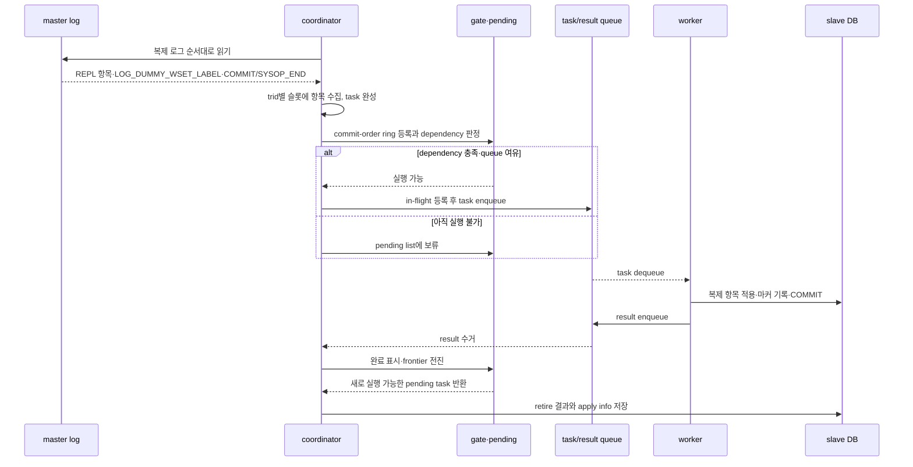
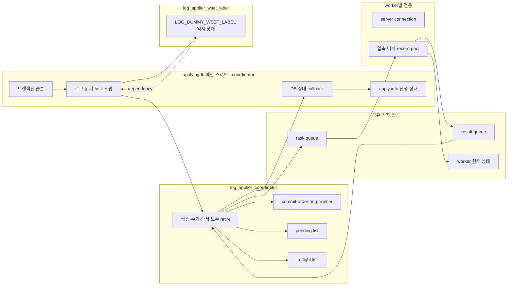
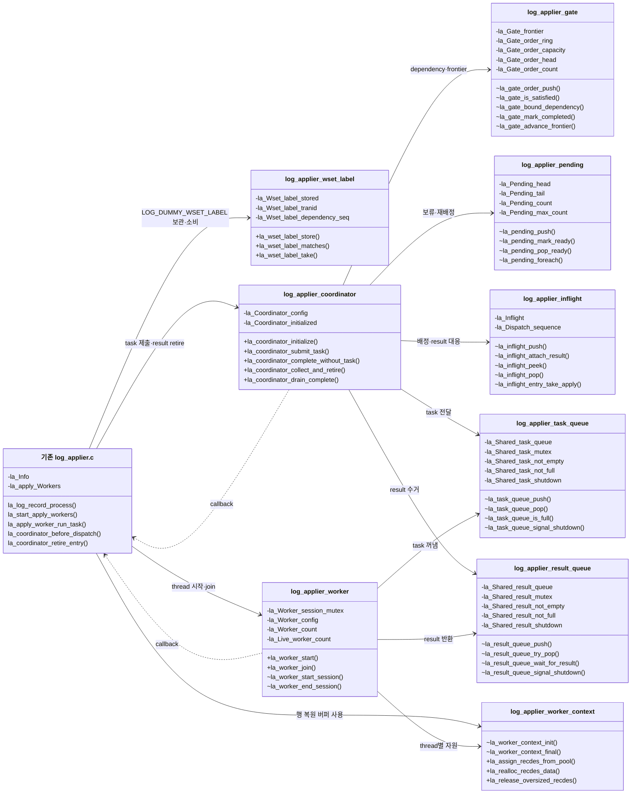
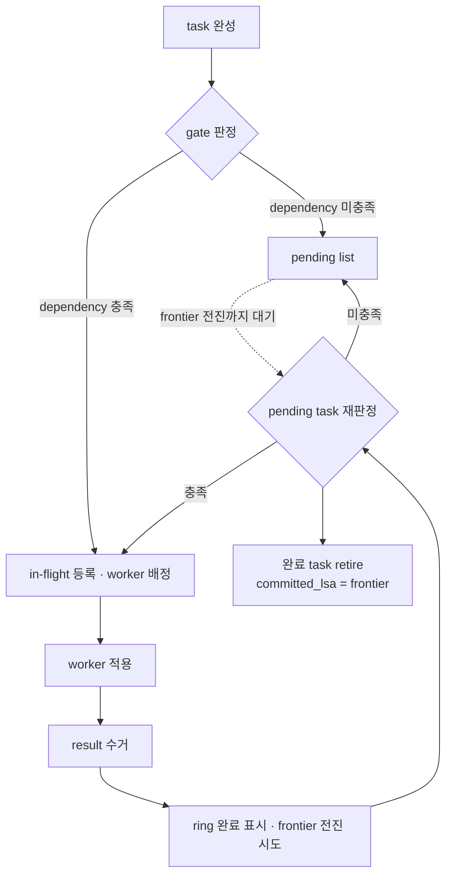
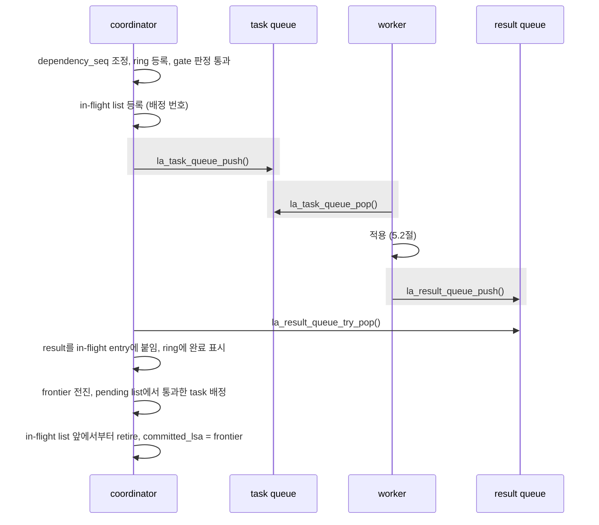
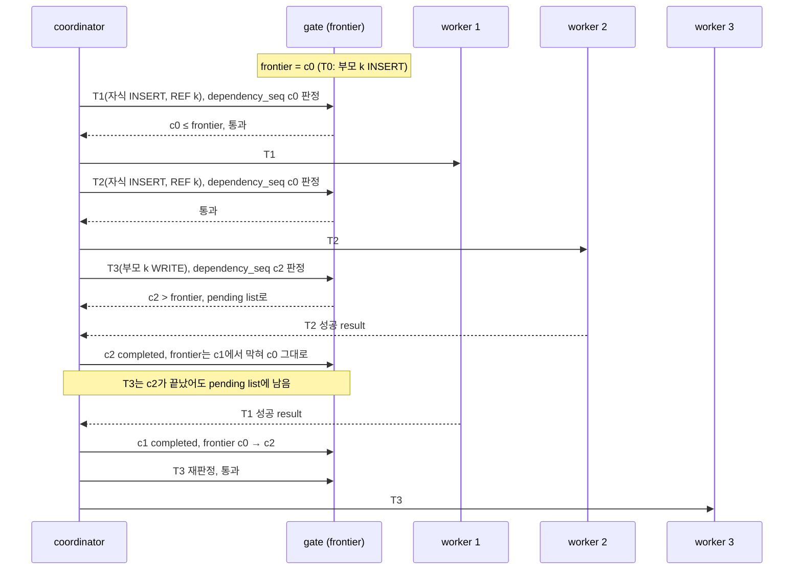
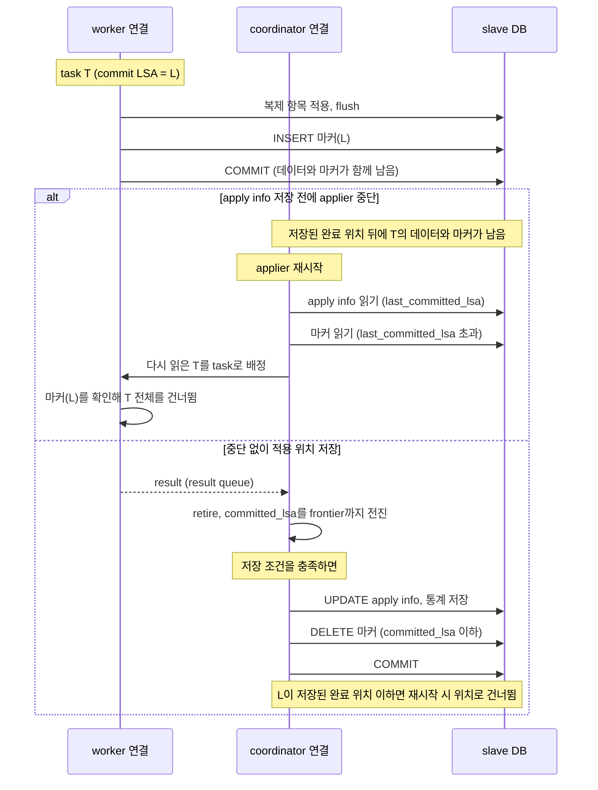
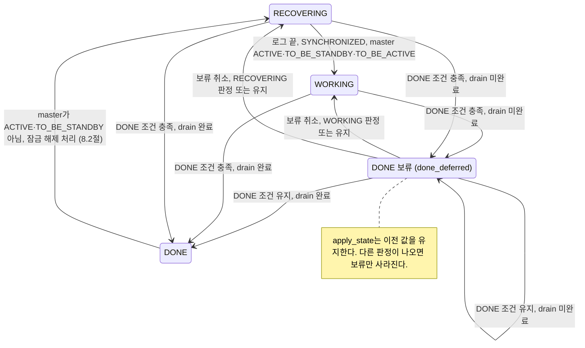

# 슬레이브 writeset 병렬 적용 설계

슬레이브의 applylogdb는 master가 `LOG_DUMMY_WSET_LABEL` 로그로 전달한 `dependency_seq`([01 2.4절](./01-master-implementation-design.md#24-log_dummy_wset_label))를 보고 트랜잭션의 적용 순서를 정한다. 충돌하는 트랜잭션은 master의 커밋 순서대로 적용하고, 서로 독립인 트랜잭션은 병렬로 적용한다. applylogdb 프로세스의 메인 스레드는 coordinator 역할을 맡아 복제 로그를 읽고 task를 만들며 적용 순서를 판정한다. worker 스레드 여러 개는 각자의 서버 connection으로 task를 적용하고 COMMIT한다.

## 1. 전체 처리 흐름

이 장은 coordinator와 worker가 복제 로그 한 건을 슬레이브에 적용하기까지 거치는 단계를 한 번에 보인다. 먼저 문서 전체에서 쓰는 이름을 정리한다. 이어서 처리 단계와 develop 대비 바뀐 호출 흐름, `log_applier.c`가 새 모듈을 부르는 곳을 차례로 보인다. 각 단계의 자세한 규칙은 2장부터 설명한다.

전체 흐름을 읽는 데 필요한 핵심 이름만 먼저 정리한다. 자료구조와 수명 규칙은 2장, task 생성은 3장에서 세부적으로 정의한다.

- **coordinator**: applylogdb 프로세스의 메인 스레드가 맡는 역할이다. `log_applier.c`에서 복제 로그를 읽어 task를 만들고, `log_applier_coordinator.cpp`에서 task 배정·result 수거·순서 보존 retire를 수행한다. apply info 갱신과 저장은 coordinator 모듈이 호출하는 callback으로 기존 `log_applier.c` 상태에 반영한다.
- **worker**: task의 복제 항목을 적용하고 slave DB에 COMMIT하는 스레드다. 여러 worker가 task queue를 공유한다.
- **task·result**: task(`LA_TASK`)는 coordinator가 worker에 넘기는 트랜잭션 적용 단위고, result(`LA_RESULT`)는 worker가 적용 결과와 통계를 담아 돌려주는 값이다.
- **`dependency_seq`**: 현재 task보다 먼저 적용을 끝내야 하는 범위의 master 로그 위치다. NULL이면 대기할 선행 범위가 없다. slave는 이 위치까지 앞에서부터 빈틈없이 적용했을 때 task를 배정한다.
- **commit-order ring·frontier**: ring은 읽은 COMMIT과 앞에 `LOG_DUMMY_WSET_LABEL`이 기록된 SYSOP_END를 로그 순서로 보존한다. frontier는 ring의 앞에서부터 빈틈없이 적용된 마지막 위치다.
- **pending·in-flight**: pending list는 아직 배정할 수 없는 task를 보관하고, in-flight list는 worker에 배정한 뒤 아직 retire하지 않은 task를 보존한다.
- **retire**: in-flight list 앞의 task를 result와 함께 정리하고, 트랜잭션 슬롯과 통계를 반영하며, `committed_lsa`를 안전한 frontier까지 옮기는 절차다.
- **applied-tx 마커**: worker가 복제 데이터와 같은 slave 트랜잭션에 남기는, COMMIT LSA를 담은 행이다. worker의 데이터 COMMIT과 coordinator의 apply info COMMIT 사이에 장애가 나도 이미 적용한 트랜잭션을 다시 적용하지 않게 한다.

복제 로그 한 건이 적용되는 전체 순서는 다음 스윔레인으로 먼저 잡는다. 세부 자료구조는 2장, task 구성은 3장, 배정과 완료는 4장, worker 내부는 5장에서 확대한다.



*그림 1-1. 마스터의 `LOG_DUMMY_WSET_LABEL`부터 coordinator의 task 구성·배정과 worker 결과 retire까지 이어지는 전체 처리 순서*

이 흐름에서 지켜야 할 기준은 세 가지다.

- coordinator만 master 로그 순서를 commit-order ring에 기록하고, task의 대기·배정·완료·retire 상태를 변경한다. worker는 받은 task만 적용한다.
- dependency를 통과하지 못한 task는 pending list에 남지만, coordinator는 뒤의 로그를 계속 읽는다.
- `committed_lsa`는 가장 멀리 끝난 worker가 아니라, commit-order ring의 앞에서부터 빠짐없이 완료된 frontier까지만 전진한다.

develop과 비교하면 호출 흐름은 다음과 같다. 이번에 더한 단계는 `[추가]`, 바뀐 단계는 `[변경]`으로 표시했다.

**AS-IS**

```text
la_apply_log_file() 메인 루프
├─ la_release_all_page_buffers()
├─ la_decache_page_buffers()
├─ check_reinit_copylog()
├─ 아카이브 삭제·로그 헤더 복사
├─ HA 상태에 따라 la_unlock_dbname()
├─ DONE이고 master가 ACTIVE가 아니면
│  └─ committed_lsa를 final_lsa로 옮김, la_log_commit()
├─ la_get_page_buffer()
├─ la_log_record_process()
│  ├─ LOG_REPLICATION_DATA/STATEMENT: la_set_repl_log()
│  ├─ LOG_SYSOP_END, LOG_COMMIT
│  │  ├─ la_add_node_into_la_commit_list()
│  │  ├─ la_apply_commit_list()
│  │  │  └─ la_apply_repl_log()
│  │  └─ committed_lsa를 이 레코드의 LSA로 옮김
│  └─ LOG_ABORT: la_add_node_into_la_commit_list()
├─ la_check_time_commit()
│  └─ la_log_commit()
├─ la_change_state()
├─ la_unlock_dbname()
└─ 100ms sleep
```

*그림 1-2. develop의 단일 applier가 한 루프에서 로그 페이지 해제부터 적용·COMMIT까지 수행하는 호출 흐름*

그림 1-2에서는 단일 스레드라는 점을 보이기 위해 세부 조건을 빼고 호출 순서만 남겼다.

- 모든 복제 항목은 `la_apply_commit_list()`에서 동기적으로 적용된다.
- `la_apply_repl_log()`가 dbname 잠금을 잡고, 항목별 `last_committed_rep_lsa`를 보고 재적용 여부를 판정한다.
- `la_log_commit()`이 남은 변경, apply info와 데이터를 하나의 slave 트랜잭션으로 COMMIT한다.

**TO-BE**

```text
coordinator: la_apply_log_file() 메인 루프
├─ [변경] coordinator가 고정한 페이지 해제
├─ [추가] la_coordinator_collect_and_retire()
│  ├─ la_coordinator_collect_results()
│  └─ la_coordinator_retire_results()
├─ la_decache_page_buffers()
├─ [변경] page cache 잠금 안에서 copylog 관리
├─ [변경] drain 완료 후 la_unlock_dbname()
├─ la_get_page_buffer()
├─ la_log_record_process()
│  ├─ LOG_REPLICATION_DATA/STATEMENT: la_set_repl_log()
│  ├─ [추가] LOG_DUMMY_WSET_LABEL: la_get_wset_label()
│  ├─ [변경] LOG_SYSOP_END: la_coordinator_process_sysop_end()
│  ├─ [변경] LOG_COMMIT: la_coordinator_process_commit()
│  │  ├─ la_coordinator_set_commit_dependency()
│  │  └─ la_coordinator_submit_task()
│  └─ [변경] LOG_ABORT: la_free_repl_items_by_tranid()
├─ la_check_time_commit()
│  └─ la_log_commit()
│     └─ [변경] la_coordinator_commit_apply_info()
├─ [변경] la_change_state()
└─ [변경] la_result_queue_wait_for_result()

[worker thread] la_worker_run()
├─ la_task_queue_pop()
├─ la_apply_worker_run_task()
│  └─ la_apply_worker_apply_task()
└─ la_result_queue_push()
```

*그림 1-3. 병렬 적용에서 coordinator가 worker 결과를 수거하면서 로그를 읽고 task를 배정하는 메인 루프*

그림 1-3은 coordinator와 worker가 나뉘는 지점만 보인다. 생략한 내부 순서는 다음 절에서 확대한다.

- `la_coordinator_collect_results()`는 result를 in-flight entry에 붙이고 ring 완료 표시·frontier 전진·pending 재판정을 수행한다(4.5절).
- `la_coordinator_submit_task()`는 ring 용량 확보, dependency 낮추기, gate 판정, pending 또는 in-flight·task queue 등록을 순서대로 수행한다(4.2~4.4절).
- `la_apply_worker_apply_task()`는 재적용 판정, 복제 항목 적용, flush, applied-tx 마커, DB COMMIT을 하나의 worker task로 처리한다(5.2절).
- worker가 고정한 로그 페이지는 해당 worker가 해제하고, coordinator는 자신이 고정한 페이지만 다음 루프에서 해제한다(5.4절).

TO-BE에서 coordinator와 worker의 책임이 develop과 달라진 곳은 다음과 같다(3.1절).

- **데이터 COMMIT과 apply info COMMIT의 분리**: develop은 적용한 데이터와 apply info를 `la_log_commit()`에서 한 트랜잭션으로 COMMIT한다. TO-BE에서는 worker가 트랜잭션마다 데이터를 COMMIT하고 coordinator가 apply info를 따로 COMMIT한다. 둘 사이의 차이는 applied-tx 마커로 메운다(7.3절).
- **`committed_lsa`의 전진**: develop은 레코드 하나를 적용할 때마다 그 LSA로 옮긴다. TO-BE에서는 retire 때 frontier까지만 옮긴다. 그래서 `committed_lsa` 이하의 COMMIT은 모두 적용된 상태다(4.6절).
- **dbname 잠금의 이동**: develop은 `la_apply_repl_log()` 안에서 dbname 잠금을 잡는다. TO-BE에서는 coordinator가 복제 항목이 있고 `last_committed_lsa`보다 뒤인 task를 task queue에 넣기 직전에 잡는다. coordinator 모듈의 `la_coordinator_enqueue_task()`가 `before_dispatch` callback을 호출하고, `log_applier.c`의 `la_coordinator_before_dispatch()`가 잠금을 잡는다. worker는 잡지 않는다. 잠금은 drain 완료를 확인한 뒤(DONE 보류 포함)에만 풀고, 종료할 때는 worker를 멈춘 뒤에 푼다(4.4절, 8.2절).
- **재적용 판정의 단위**: develop은 항목마다 `last_committed_rep_lsa`와 비교해 건너뛸지 정한다. TO-BE는 트랜잭션 단위로만 판정한다. `last_committed_lsa` 이하이거나 applied-tx 마커가 있으면 그 트랜잭션 전체를 건너뛴다(7.4절).

`log_applier.c`와 `applier/` 모듈의 경계는 다음과 같다.

- **task 조립과 제출**: `log_applier.c`는 `LOG_DUMMY_WSET_LABEL`에서 읽은 `dependency_seq`와 복제 항목으로 완성한 task를 `la_coordinator_submit_task()`에 넘긴다. 적용할 항목이 없는 SYSOP_END는 `la_coordinator_complete_without_task()`로 완료 위치만 전달한다. 로그 끝이나 종료 경로에서는 `la_coordinator_collect_and_retire()`와 `la_coordinator_drain_complete()`를 호출한다.
- **coordinator 내부**: `log_applier_coordinator.cpp`가 gate, pending list, in-flight list, task/result queue를 조합한다. dependency 판정, pending 해제, worker 배정, result 수거, frontier 전진과 배정 순서 retire는 이 모듈 안에서 끝난다(4장).
- **기존 DB 상태 callback**: task를 worker에 넘기기 전에는 `la_coordinator_before_dispatch()`로 dbname 잠금을 잡는다. retire할 때는 `la_coordinator_retire_entry()`가 슬롯을 반환하고 `committed_lsa`와 통계를 갱신한다. 이어서 `la_coordinator_store_progress()`가 apply info 저장 간격을 판정한다. 대기 루프는 `la_coordinator_shutdown_requested()`로 종료 요청을 확인한다.
- **생명주기**: `la_coordinator_initialize_resources()`가 callback과 용량을 `LA_COORDINATOR_CONFIG`에 넣어 `la_coordinator_initialize()`를 부른다. worker 시작·종료와 재시작 시 남은 슬롯 정리는 기존 `log_applier.c`가 맡는다(7.5절, 8.3절).
- **필요 로그 위치와 종료 진단**: `required_lsa` 계산과 재시작 정리는 아직 기존 슬롯을 함께 보므로 `log_applier.c`가 in-flight list와 pending list를 읽는다. DONE 보류 로그도 세 구조의 남은 개수를 표시한다. 이는 배정 알고리즘을 다시 구현하는 경로가 아니라 기존 DB 상태와의 연결 경계다.
- **worker**: `la_worker_start()`에 넘기는 `LA_WORKER_CONFIG`의 callback 세 개(`la_apply_worker_run_task()`, `la_request_shutdown()`, `la_apply_worker_end_context()`)가 worker 모듈이 `log_applier.c`를 부르는 유일한 길이다. 반대로 `log_applier.c`의 행 재구성 함수(`la_apply_insert_log()`, `la_apply_update_log()`, `la_get_overflow_recdes()`)는 `la_assign_recdes_from_pool()`, `la_realloc_recdes_data()`로 worker context의 레코드 pool을 쓴다(5장).

### 1.1 소스 구성

슬레이브 병렬 적용 코드는 `src/transaction/applier/`에 모은다. 로그 읽기와 행 적용은 기존 `log_applier.c`에 둔다.

```text
src/transaction/
├─ applier/
│  ├─ log_applier_task.hpp
│  ├─ log_applier_result.hpp
│  ├─ log_applier_wset_label.hpp / .cpp
│  ├─ log_applier_coordinator.hpp / .cpp
│  ├─ log_applier_gate.hpp / .cpp
│  ├─ log_applier_pending.hpp / .cpp
│  ├─ log_applier_inflight.hpp / .cpp
│  ├─ log_applier_task_queue.hpp / .cpp
│  ├─ log_applier_result_queue.hpp / .cpp
│  ├─ log_applier_worker.hpp / .cpp
│  ├─ log_applier_worker_context.hpp / .cpp
│  ├─ log_applier_stat.hpp / .cpp
│  ├─ log_applier_stat_internal.hpp
│  ├─ log_applier_stat_store.hpp / .cpp
│  ├─ log_applier_stat_print.hpp / .cpp
│  └─ log_applier_debug.hpp
├─ log_applier.c
├─ log_applier.h
├─ log_applier_sql_log.c
└─ locator_sr.c
src/base/system_parameter.c / .h
src/connection/heartbeat.h
src/object/schema_system_catalog.cpp
src/object/schema_system_catalog_install.cpp / .hpp
src/object/schema_system_catalog_constants.h
src/object/work_space.c / .h
src/storage/file_io.c
src/executables/unload_object.c
CMakeLists.txt
cs/CMakeLists.txt
unit_tests/log_applier/
```

*그림 1-4. 기존 `log_applier.c`와 추가한 coordinator·queue·worker 모듈의 소스 구성*

`applier/`는 이번 기능이 새로 만든 디렉토리이며, 파일마다 맡은 일은 다음과 같다.

- `log_applier_task.hpp`: task(`LA_TASK`) 정의다. coordinator가 만들고, task queue에 값으로 복사해 worker에 넘긴다.
- `log_applier_result.hpp`: result(`LA_RESULT`)와 task별 적용 통계(`LA_STATS`)를 정의한다.
- `log_applier_wset_label.hpp / .cpp`: coordinator가 로그에서 읽은 `{trid, dependency_seq}`를 같은 `trid`의 다음 COMMIT 또는 SYSOP_END까지 보관한다. coordinator 한 스레드만 `la_wset_label_store()`·`la_wset_label_matches()`·`la_wset_label_take()`로 접근하므로 잠금은 없다.
- `log_applier_coordinator.hpp / .cpp`: dependency 판정부터 task 보류·배정, result 수거, frontier 전진과 retire까지의 처리 흐름을 담당한다. gate·pending·in-flight·queue의 개별 저장 구조는 각 모듈에 두고, coordinator는 이들을 하나의 처리 흐름으로 연결한다.
- `log_applier_gate.hpp / .cpp`: commit-order ring과 frontier, gate 판정, `dependency_seq` 조정을 맡는다. coordinator 전용이며 잠금이 없다.
- `log_applier_pending.hpp / .cpp`: pending list다. coordinator 전용이며 잠금이 없다.
- `log_applier_inflight.hpp / .cpp`: in-flight list와 배정 번호를 맡는다. coordinator 전용이며 잠금이 없다. entry의 필드는 구현 파일에 숨기고, 다른 모듈은 조회·소유권 이전 API로만 접근한다.
- `log_applier_task_queue.hpp / .cpp`: task queue다. coordinator와 worker가 함께 쓰며 자체 mutex와 condition variable로 보호한다.
- `log_applier_result_queue.hpp / .cpp`: result queue다. coordinator와 worker가 함께 쓰며 자체 mutex와 condition variable로 보호한다. 두 큐의 mutex를 동시에 잡는 스레드는 없다.
- `log_applier_worker.hpp / .cpp`: worker 스레드의 시작과 join, worker별 connection, task 반복 실행을 맡는다. `log_applier.c`의 적용 함수는 콜백으로만 부른다.
- `log_applier_worker_context.hpp / .cpp`: worker별 압축 해제 버퍼와 레코드 pool을 생성·해제하고, 행 복원에 필요한 RECDES를 빌려주는 API를 제공한다. context 구조체는 `log_applier.c`의 행 복원 경로도 사용하므로 현재는 공개한다.
- `log_applier_stat.hpp / .cpp`: 메모리 통계를 수집한다. worker별 현재 상태와 동시 실행 worker 수는 `la_Worker_live_lock`으로 보호하고, 나머지 카운터는 coordinator만 바꾼다.
- `log_applier_stat_internal.hpp`: 수집과 DB 영속화가 함께 쓰는 통계 상태의 비공개 경계다. 일반 호출자는 포함하지 않는다.
- `log_applier_stat_store.hpp / .cpp`: `_db_ha_apply_stat`, `_db_ha_apply_worker_stat` 행의 초기화와 저장을 맡는다.
- `log_applier_stat_print.hpp / .cpp`: 저장된 통계를 읽어 `applyinfo`의 "Parallel Apply Info"를 출력한다. 메모리 통계 상태에는 접근하지 않는다.
- `log_applier_debug.hpp`: debug 빌드 전용 로그 매크로와 통계용 시간 측정 매크로를 제공한다.

나머지 파일은 기존 파일이며, 바뀐 내용은 다음과 같다.

- `log_applier.c`: 로그 페이지에서 `LOG_DUMMY_WSET_LABEL`을 파싱하고 task를 구성한다. `la_get_wset_label()`은 page-cache 읽기 매크로와 결합돼 이 파일에 남고, 읽은 값은 `la_wset_label_store()`를 호출해 `LOG_DUMMY_WSET_LABEL` 임시 상태에 보관한다. 또 coordinator callback(dbname 잠금, 슬롯 반환, `committed_lsa`·통계·apply info 반영), worker callback(적용, flush, applied-tx 마커, COMMIT), applied-tx 마커 테이블, 공유 로그 페이지 캐시의 스레드별 고정 해제, `required_lsa` 계산의 확장을 맡는다.
- `log_applier.h`: worker를 멈추게 하는 flush 오류를 판정하는 `LA_IS_FLUSH_ERROR`.
- `log_applier_sql_log.c`: worker들이 SQL 로그를 동시에 쓰므로, 항목 하나의 기록과 파일 교체를 `sl_write_mutex`로 감싼다.
- `locator_sr.c`(서버): worker의 flush를 받는 `xlocator_repl_force()`가 교착 희생자가 된 항목에서 다음 항목으로 넘어가지 않고 호출 전체를 실패로 끝낸다. 잠금을 쥔 채 다음 항목에서 다시 기다리면 끊으려던 교착이 풀리지 않기 때문이다. 인덱스 갱신에서 잠금 실패가 성공으로 되돌아가지 않도록 오류 전달도 보강했다.
- `system_parameter.c / .h`: `ha_apply_worker_count`, `ha_writeset_trace_level`.
- `heartbeat.h`: `HB_DEFAULT_APPLY_WORKER_COUNT`(1), `HB_MAX_APPLY_WORKER_COUNT`(32). worker별 배열은 최댓값 크기로 잡는다.
- `schema_system_catalog*`: 통계 테이블 `_db_ha_apply_stat`, `_db_ha_apply_worker_stat`의 정의와 시스템 클래스 등록. applied-tx 마커 테이블은 카탈로그가 아니며, applylogdb가 기동 때 만든다(7.3절).
- `unload_object.c`: 두 통계 테이블을 unloaddb 대상에서 뺀다.
- `work_space.c / .h`: worker가 flush 여부를 정할 때 쓰는 `ws_repl::ws_get_repl_obj_count()`와 `ws_set_defer_free()`.
- `file_io.c`: 서버 밖에서도 Windows가 아니면 `pread()`/`pwrite()`로 읽고 쓴다. 같은 파일 descriptor로 로그 페이지를 읽는 worker들이 파일 offset을 두고 다투지 않게 하기 위해서다.
- `CMakeLists.txt`: `applier/` 디렉토리를 include 경로에 넣는다.
- `cs/CMakeLists.txt`: applier 소스를 client 라이브러리에 넣는다.
- `unit_tests/log_applier/`: gate, pending list, in-flight list, 두 큐, `LOG_DUMMY_WSET_LABEL` 임시 상태, coordinator의 보류·해제·retire 흐름, worker 시작과 종료의 단위 테스트다. stat 모듈과 서버 연결이 필요한 `log_applier.c` callback은 포함하지 않는다.

coordinator와 worker가 함께 쓰는 자료와 그 보호 방식은 2장 도입에 모아 둔다.

### 1.2 설정

슬레이브 병렬 적용이 읽는 파라미터는 다음과 같다. 모두 `cubrid_ha.conf`에 두고 실행 중에는 바꿀 수 없다. 파라미터마다 어느 함수가 값을 읽는지 함께 적었다.

- **`ha_apply_worker_count`** (새 파라미터)
  - worker 수다. 기본값 1, 범위 1~32(`HB_MAX_APPLY_WORKER_COUNT`).
  - `la_init()`이 한 번 읽어 `la_Info.worker_count`에 두고, `LA_MAX_WORKER_COUNT`로 범위를 다시 자른다.
  - 빌드 옵션에서 `MULTI_CONN_TO_A_SERVER`를 끄면 worker는 1개만 수행한다.
  - 값이 1이면 COMMIT 순서로 적용한다는 알림을 남긴다(4.8절).
  - commit-order ring, in-flight list, result queue의 크기는 이 값에 task queue 용량 1024를 곱한 값이다(`LA_COMMIT_ORDER_CAPACITY`, 2.5절).
- **`ha_writeset_trace_level`** (새 파라미터, master와 같이 씀)
  - trace 수준이다. 기본값 0, 범위 0~3.
  - worker의 task 단위 줄(apply begin·done·end, flush, commit begin)은 worker를 시작할 때 읽은 값을 쓴다. 나머지 줄은 남길 때마다 파라미터를 읽는다.
  - 슬레이브 코드가 나누는 수준은 1과 2다(9.2절).
- **`ha_apply_max_mem_size`** (기존)
  - applylogdb 프로세스의 메모리 상한(MB)이다. 기본값 500. `cubrid heartbeat`가 applylogdb를 띄울 때 이 값을 `--max-mem-size`로 넘기고, `la_init()`이 `la_Info.max_mem_size`에 둔다.
  - `la_check_mem_size()`는 프로세스의 가상 메모리 크기를 두 값 중 큰 것과 비교한다. 하나는 이 값이고, 다른 하나는 기준 크기의 두 배다. 넘으면 `ER_HA_LA_EXCEED_MAX_MEM_SIZE`로 applier를 멈춘다.
  - `[변경]` 기준 크기는 시작 대기(`HB_START_WAITING_TIME_IN_SECS`)가 지난 뒤 처음 검사할 때 잰다. develop은 `la_init()`에서 쟀다. worker마다 malloc arena를 따로 잡아 가상 크기가 커지므로, worker가 시작한 뒤에 재야 한다.
- **`ha_applylogdb_max_commit_interval_in_msecs`** (기존, 기본값 500): coordinator가 retire 때 apply info를 저장하는 최소 간격이다. `la_coordinator_store_apply_info_at_interval()`이 저장할 때마다 읽는다(7.2절).
- **`ha_applylogdb_log_wait_time_in_secs`** (기존, 숨은 파라미터, 기본값 -1): master가 DEAD인 채 로그가 늘지 않을 때 dbname 잠금을 놓기까지 기다리는 시간이다. coordinator의 주 루프가 로그 끝에 닿을 때마다 읽는다. 0 이상일 때만 이 해제를 하고, drain 완료일 때만 놓는다(8.2절).
- **`ha_applylogdb_retry_error_list`, `ha_applylogdb_ignore_error_list`** (기존): 항목 적용 오류를 다시 시도할지, 무시할지 정한다. worker가 항목 오류를 만날 때마다 목록을 찾는다(`la_retry_on_error()`, `la_ignore_on_error()`, 5.3절).

master 쪽 `ha_writeset_history_size`는 슬레이브가 읽지 않는다([01 1.2절](./01-master-implementation-design.md#12-설정)).


## 2. 자료구조

이 장은 coordinator와 worker가 쓰는 자료구조를 다룬다. 트랜잭션 슬롯과 복제 항목은 coordinator가 로그를 읽으며 트랜잭션별로 복제 항목을 모으는 develop 구조다. 이번 구현은 이 위에 배정과 완료를 관리하는 구조(commit-order ring, pending list, in-flight list)와, coordinator와 worker가 task와 result를 주고받는 구조(task queue, result queue)를 더했다.



*그림 2-1. `log_applier.c`의 로그 읽기·DB 상태, `LOG_DUMMY_WSET_LABEL` 임시 상태, coordinator 배정 상태와 worker 공유 queue 사이의 소유권 경계*

coordinator 모듈의 배정 자료는 coordinator thread만 접근하므로 잠금 없이 사용한다. 기존 트랜잭션 슬롯과 apply info는 `log_applier.c`가 소유하고 callback으로만 갱신한다. 공유 queue는 각각 자기 mutex와 condition variable을 사용하고, worker 현재 상태는 통계용 mutex로 보호한다. worker별 connection과 복원 버퍼는 다른 worker와 공유하지 않는다.

그림 2-2는 슬레이브 병렬 적용 구조를 모듈의 상태와 함수 호출 경계로 보여 준다. `+`는 기존 `log_applier.c`가 호출하는 공개 API, `~`는 applier 하위 모듈 사이에서만 사용하는 내부 인터페이스, `-`는 해당 구현 파일이 소유하는 상태다. 박스는 C++ 클래스가 아니라 모듈 경계를 나타내며, getter와 통계 함수는 제외하고 task 배정·실행에 필요한 핵심 상태와 함수만 표시한다.



*그림 2-2. 슬레이브 병렬 적용 모듈의 핵심 상태와 함수 경계. coordinator는 gate·목록·queue를 조합하고, worker는 공유 queue와 worker별 context를 사용하며, 기존 `log_applier.c`는 task 조립과 DB 적용 callback을 제공한다.*

`LA_COORDINATOR_CONFIG`는 coordinator 모듈이 기존 applier 상태를 직접 소유하지 않게 하는 연결 구조다. `restart_lsa`는 `la_Info.committed_lsa`를 가리키는 빌린 포인터이며, apply info를 읽은 뒤 첫 task를 제출할 때 초기 frontier로 사용한다. 네 callback은 각각 배정 전 DB 잠금, retire 시 슬롯·진행 위치 반영, apply info 주기 저장, 종료 요청 확인만 맡는다. gate·pending·in-flight 조작은 callback 밖의 coordinator 모듈에 남는다.

### 2.1 트랜잭션 슬롯과 복제 항목

트랜잭션 슬롯은 develop의 `LA_APPLY`를 확장한 구조다. 로그에서 동시에 추적하는 `trid`마다 하나씩 두고 그 트랜잭션의 복제 항목을 연결 목록으로 모으는 방식은 유지했다. coordinator가 로그를 읽는 단계에서 슬롯을 잡고 복제 항목을 채우며, 병렬 적용을 위해 마지막 sysop fragment 위치와 task가 참조하는 동안의 슬롯 수명 관리를 더했다.
- coordinator는 트랜잭션의 첫 로그 레코드(`prev_tranlsa`가 NULL)를 만나면 `la_add_apply_list()`로 슬롯을 잡고, 그 레코드 위치를 `start_lsa`에 기록한다. `LOG_DUMMY_WSET_LABEL` 로그는 슬롯을 만들지 않는다.
- 복제 레코드(`LOG_REPLICATION_DATA`, `LOG_REPLICATION_STATEMENT`)를 만날 때마다 `la_set_repl_log()`가 복제 항목을 만들어 목록 끝에 붙인다.

슬롯 풀(`la_Info.repl_lists`)은 슬롯 포인터의 배열이다.
- 빈 슬롯(`tranid == 0`)이 없으면 배열을 `LA_REPL_LIST_COUNT`(50)개 늘린다(`la_init_repl_lists()`).
- 이때 realloc하는 것은 배열뿐이다. 슬롯 객체는 하나씩 따로 할당하므로 이미 있는 슬롯의 주소는 바뀌지 않는다.
- 그래서 task와 in-flight list가 슬롯 포인터를 들고 있는 동안 coordinator가 다른 트랜잭션 때문에 배열을 늘려도 그 포인터는 유효하다.

복제 항목이 `LA_MAX_REPL_ITEMS`(1000)개에 이르면 슬롯을 긴 트랜잭션으로 바꾼다. 이 동작은 develop과 같다.
- 첫 항목만 남기고 나머지를 해제한 뒤 `is_long_trans`를 켠다.
- 그 뒤로는 마지막 복제 레코드 위치만 `last_lsa`에 기록한다.
- 적용할 때는 첫 항목부터 `last_lsa`까지 로그를 다시 읽는다(`la_get_next_repl_item_from_log()`).

develop과 달라진 점은 다음과 같다.
- **슬롯 수명**
  - develop의 `la_apply_repl_log()`는 COMMIT을 적용한 직후 슬롯을 비웠다.
  - 이번 구현에서는 task가 슬롯을 가리킨다. worker는 복제 항목을 하나씩 적용한 뒤 목록에서 해제한다. 이미 적용된 COMMIT은 항목을 적용하지 않고 목록만 모두 해제한다(5.2절). 이렇게 항목 목록이 빈 뒤에도 슬롯 객체는 `tranid`와 `start_lsa`를 유지한 채 남는다.
  - 슬롯은 coordinator가 그 task를 retire할 때 비운다(`la_coordinator_release_apply_slot()`, 4.6절).
  - 그래서 `la_find_required_lsa()`가 적용 중인 트랜잭션의 시작 위치를 계속 볼 수 있다(2.7절).
  - `LOG_ABORT`를 만나거나 `committed_lsa` 이하의 COMMIT을 만나면 coordinator가 그 자리에서 항목을 해제하고 슬롯을 비운다(`la_free_repl_items_by_tranid()`, 3.5절).
- **sysop fragment 슬롯**
  - sysop fragment 슬롯은 바깥 트랜잭션과 독립적으로 확정된 top operation의 복제 항목을 별도 task로 적용하기 위한 임시 슬롯이다. 바깥 트랜잭션이 ABORT되어도 이 operation은 master에 남으므로, 슬레이브에서도 바깥 트랜잭션의 슬롯과 분리해 적용한다.
  - 앞에 `LOG_DUMMY_WSET_LABEL`이 기록된 `LOG_SYSOP_END`를 만나면, 그 위치까지의 복제 항목을 새로 할당한 슬롯으로 옮겨 fragment task에 준다(`la_detach_sysop_fragment()`, 3.4절). fragment 슬롯의 `tranid`는 바깥 트랜잭션의 것이고, `start_lsa`는 옮긴 첫 복제 항목의 위치다.
  - 바깥 슬롯이 긴 트랜잭션이면 슬롯 내용 전체를 옮기고 바깥 슬롯을 빈 목록으로 되돌린다.
  - fragment 슬롯은 `repl_lists`에 속하지 않는다. fragment task를 retire할 때 해제하고, 종료할 때까지 retire되지 않은 것은 `la_free_unretired_fragments()`가 해제한다(8.3절).
- **DONE을 알릴 때의 정리**: 남은 슬롯을 비우는 `la_clear_all_repl_lists()`는 drain 완료 뒤에만 호출되므로, task가 가리키는 슬롯은 그때 남아 있지 않다(8.1절).

트랜잭션 슬롯(`LA_APPLY`)의 필드를 설명한다. `last_sysop_fragment_lsa`만 이번에 더했다.
- `tranid`: 트랜잭션 id. 0이면 빈 슬롯이다.
- `num_items`: 목록에 있는 복제 항목 수.
- `is_long_trans`: 긴 트랜잭션 여부.
- `start_lsa`: 트랜잭션의 첫 로그 레코드 위치. `required_lsa` 계산에 쓴다.
- `last_lsa`: 긴 트랜잭션의 마지막 복제 레코드 위치.
- `head`, `tail`: 복제 항목 목록.
- `last_sysop_fragment_lsa`: 이 트랜잭션이 마지막으로 만든 sysop fragment의 `LOG_SYSOP_END` 위치. retire에서 슬롯을 비울 때 NULL로 돌아가고, ABORT로 슬롯을 비울 때는 지우지 않는다(3.5절). 최종 COMMIT task의 dependency를 이 값 이상으로 올린다(3.3절).

복제 항목(`LA_ITEM`)은 develop 구조에 serial write-back이 교체한 이전 `cur_val`을 보관하는 `packed_prior_value_length`와 `packed_prior_value`를 더했다. 이 값은 늦게 도착한 write-back으로 serial이 뒤로 돌아가는 것을 막는다(5.2.1절). 연결 포인터, 복제 레코드 위치(`lsa`, `target_lsa`), 종류(`log_type`, `item_type`), 대상 클래스·사용자·HA 파라미터(`class_name`, `db_user`, `ha_sys_prm`), 키(`packed_key_value`, `key`)는 기존 필드다.

### 2.2 task와 result

task는 coordinator가 `LOG_COMMIT` 또는 앞에 `LOG_DUMMY_WSET_LABEL`이 기록된 `LOG_SYSOP_END`를 읽을 때 만드는 적용 단위이고, result는 worker가 task 하나를 끝내고 돌려주는 값이다. COMMIT에서 만든 task를 COMMIT task, sysop fragment에서 만든 task를 fragment task라고 부른다.
- coordinator가 만든 `LA_TASK`는 실행 가능 여부에 따라 task queue로 바로 가거나 pending list에 보류된다. 보류할 때는 pending node에 구조체 값을 복사하고, worker에 배정할 때는 task queue에 다시 구조체 값을 복사한다.
- 이 복사는 얕은 복사다. `LA_TASK.apply`가 가리키는 트랜잭션 슬롯과 복제 항목은 복사하지 않는다. pending list와 task queue의 task는 모두 같은 슬롯을 가리키며, coordinator는 해당 task가 retire될 때까지 그 슬롯을 재사용하지 않는다.
- worker는 task를 꺼내면 `la_result_init()`으로 result의 `seq`, `tranid`, `rectype`, `commit_lsa`, `log_record_time`, `has_items`를 task 값으로 채우고, 처리한 worker 번호를 `worker_idx`에 넣는다. `committed_rep_lsa`는 NULL LSA, 나머지는 0이다. 적용을 마치면 result를 result queue로 돌려준다.

worker는 task를 배정받은 순서와 다르게 완료할 수 있다. coordinator는 먼저 도착한 result가 어느 task의 결과인지 식별해야 한다.

`seq`는 task와 result를 연결하는 배정 번호다.
- task를 in-flight list에 넣는 `la_inflight_push()`가 `seq`를 부여한다.
- worker는 task의 `seq`를 result에 그대로 복사해 반환한다.
- coordinator는 result의 `seq`로 in-flight entry를 찾아 결과를 기록한다(2.4절).
- pending list에 있는 task에는 아직 배정 번호를 부여하지 않아 초기값 0을 유지한다. 첫 배정 번호도 0이므로, `seq == 0`만으로 배정 여부를 판단하지 않고 task가 어느 목록에 있는지로 구분한다.

task(`LA_TASK`)의 필드를 설명한다.
- `seq`: 배정 번호.
- `tranid`: 트랜잭션 id.
- `rectype`: `LOG_COMMIT` 또는 `LOG_SYSOP_END`. 각각 COMMIT task, fragment task다.
- `commit_lsa`: task를 만든 `LOG_COMMIT` 또는 `LOG_SYSOP_END` 레코드의 위치. commit-order ring에 이 값으로 들어간다.
- `log_record_time`: COMMIT 레코드의 트랜잭션 종료 시각. fragment task는 0이다.
- `apply`: 트랜잭션 슬롯. 슬롯이 없는 COMMIT이면 NULL이다.
- `has_items`: 적용할 복제 항목이 있는지. 슬롯이 없거나 목록이 비면 false다.
- `dependency_seq`: 먼저 적용돼야 하는 마지막 적용 경계 LSA. NULL이면 기다리지 않는다. `LOG_DUMMY_WSET_LABEL`에서 읽은 값에서 출발해, fragment의 SYSOP_END 위치로 올리기와 해당 로그가 없을 때 직전 COMMIT으로 올리기(3.3절), 상한 조정(4.2절)을 거친 값이다.
- 통계용 시각 필드는 9.1절에서 설명한다.

result(`LA_RESULT`)의 필드는 쓰임에 따라 세 무리로 나뉜다.
- 판정과 진행에 쓰는 필드
  - `seq`: in-flight list 항목과 짝을 짓는다.
  - `tranid`, `rectype`
  - `error`: NO_ERROR가 아니면 retire가 이 오류를 돌려주어 applier를 멈춘다(4.6절).
  - `commit_lsa`: 성공하면 commit-order ring에서 이 위치를 완료로 표시한다(4.5절).
  - `committed_rep_lsa`: 오류 없이 적용한 마지막 복제 항목의 위치. retire에서 `la_Info.committed_rep_lsa`를 앞으로만 옮긴다.
  - `log_record_time`: retire에서 `la_Info.log_record_time`으로 옮긴다.
  - `total_rows`: worker가 거친 복제 항목 수. retire에서 `la_Info.total_rows`에 더하고, 이 값이 바뀌면 main loop가 apply info를 저장한다. 0이면 applied-tx 마커를 넣지 않는다(2.8절).
- 통계 전용 필드
  - `has_items`, `busy_usec`(적용, flush, COMMIT에 걸린 시간), `apply_end_time`, `stats`.
  - task에서 복사한 시간 측정값(9.1절).
  - worker가 기록하는 `dequeue_ns`, `apply_begin_ns`, `apply_end_ns`와 coordinator가 result를 수거하며 기록하는 `collected_ns`.
  - `*_ns`는 `CLOCK_MONOTONIC` 값이다. 경과 시간 계산에만 쓰고 DB 시각으로 표시하지 않는다.
- 디버그 전용 필드: `worker_idx`.

result의 `stats`(`LA_STATS`)는 트랜잭션 하나의 적용 통계다. retire에서 `la_Info`의 카운터에 더하며, 적용 판정에는 쓰지 않는다.
- `insert_counter`, `update_counter`, `delete_counter`, `schema_counter`, `fail_counter`
- `last_error_code`, `last_error_time`: `fail_counter`로 센 마지막 오류.
- `num_unflushed`: 아직 서버로 보내지 않은 복제 항목 수.
- `last_class_name`, `multi_class`: trace와 시험용 hook이 쓰는 마지막 적용 클래스.

### 2.3 commit-order ring과 frontier

commit-order ring과 frontier는 gate 판정의 기준을 만드는 coordinator 전용 구조다. ring은 coordinator가 로그에서 읽은 task의 위치를 읽은 순서대로 담는 링 버퍼이고, frontier는 ring의 앞에서부터 빈틈없이 적용된 마지막 위치(COMMIT 또는 앞에 `LOG_DUMMY_WSET_LABEL`이 기록된 SYSOP_END의 LSA)다.

frontier와 `committed_lsa`는 다음처럼 구분한다.
- **frontier**: coordinator가 commit-order ring의 완료 상태로 계산하는 메모리 경계다. 앞에서부터 중간 홀 없이 완료된 마지막 위치를 나타낸다.
- **`la_Info.committed_lsa`**: task를 retire할 때 frontier를 기존 applylogdb의 진행 상태에 반영한 값이다. frontier보다 앞설 수 없다.
- **영속 `committed_lsa`**: `la_Info.committed_lsa`를 `_db_ha_apply_info`에 저장하고 COMMIT한 값이다. 저장 주기 때문에 현재 메모리 값보다 뒤에 있을 수 있으며, 재시작할 때 안전한 기준으로 사용한다.

```text
worker 완료 → frontier 전진 → retire에서 la_Info.committed_lsa 갱신 → apply info COMMIT으로 영속
```

ring에 들어가는 것은 다음과 같다.
- COMMIT task와 fragment task의 `commit_lsa`. task는 바로 배정되든 pending list에 들어가든 ring에 한 번 들어간다.
- 복제 항목 없이 앞에 `LOG_DUMMY_WSET_LABEL`만 기록된 `LOG_SYSOP_END`의 위치. 위치만 넣고 바로 완료로 표시한다(`la_coordinator_complete_without_task()`, 3.4절).
- 로그 순서로 넣으므로 ring은 LSA 순으로 정렬되어 있다. 그래서 위치로 항목을 찾을 때 이분 탐색을 쓴다(`la_gate_order_find()`). ring에 없는 위치(이미 frontier가 지나간 것)는 찾지 못하고 무시한다.
- ring은 `la_Info.commit_order_capacity`만큼 찰 수 있다. 가득 차면 coordinator는 로그 읽기를 멈추고 result를 수거한다(4.7절).

frontier는 다음과 같이 움직인다.
- 성공 result를 수거하면 해당 항목에 완료 표시만 한다(`la_gate_mark_completed()`). 실패 result는 표시하지 않으므로 그 항목은 미완료로 남고, retire에서 applier가 멈춘다(4.6절).
- `la_gate_advance_frontier()`가 ring 맨 앞부터 완료된 항목을 빼면서 frontier를 그 위치로 옮긴다. 맨 앞 항목이 아직 적용 중이면, 뒤 항목이 먼저 완료되어도 frontier는 멈춘다(4.5절).
- gate 판정은 frontier만 본다(4.1절).

```text
frontier = C1
ring (맨 앞부터): C2 미완료 | C3 완료 | C4 미완료 | C5 완료

C2의 성공 result 수거 → C2 완료 표시
frontier = C3
ring (맨 앞부터): C4 미완료 | C5 완료
```

*예제 2-1. 완료 순서가 뒤바뀌어도 ring의 앞에서부터 완료된 C3까지만 frontier가 전진하는 상태*

이 예에서 `dependency_seq`가 C3인 task는 C3이 끝난 것만으로는 통과하지 못한다. C2가 끝나 frontier가 C3에 닿아야 통과한다.

**frontier의 초기값**
- coordinator는 ring에 항목을 넣기 직전마다 `la_gate_set_initial_frontier(committed_lsa)`를 부른다. 부르는 곳은 `la_coordinator_submit_task()`와 `la_coordinator_complete_without_task()` 두 곳이다.
- 이 함수는 frontier가 NULL일 때만 값을 넣는다. 그래서 frontier는 첫 항목을 넣을 때 그 시점의 `committed_lsa`로 정해지고, 그 뒤로는 `la_gate_advance_frontier()`만 frontier를 옮긴다.
- 이 값이 필요한 이유: `committed_lsa` 이하의 COMMIT은 `la_log_record_process()`의 `LOG_COMMIT` 분기에서 항목만 버리고 ring에 넣지 않는다(3.5절). frontier가 그 위치에서 시작하지 않으면, 그런 COMMIT을 dependency로 가진 task가 영원히 기다린다.
- `la_gate_init()`은 applier를 시작할 때마다 ring을 새로 잡고 frontier를 NULL로 지운다. 같은 프로세스 안에서 applier를 다시 시작할 때 이전 실행의 frontier가 남으면, 다시 읽는 트랜잭션이 아직 적용하지 않은 앞의 트랜잭션을 기다리지 않고 통과하기 때문이다(7.5절).

commit-order ring 항목(`LA_GATE_ORDER`)의 필드와 ring의 전역 변수를 설명한다.
- `commit_lsa`: task의 위치.
- `completed`: 적용 완료 여부. 순서와 상관없이 켜진다.
- `la_Gate_frontier`: frontier. 첫 항목을 넣기 전에는 NULL이다.
- `la_Gate_order_ring`, `la_Gate_order_capacity`, `la_Gate_order_head`, `la_Gate_order_count`: 링 버퍼와 그 용량, 맨 앞 위치, 항목 수.

### 2.4 pending list와 in-flight list

pending list와 in-flight list는 coordinator만 관리한다. pending list는 아직 배정하지 못한 task 전체를 보관하고, in-flight list는 worker에 배정한 task를 retire할 때까지 추적하는 데 필요한 필드만 보관한다.

pending list는 단일 연결 목록이다.
- 들어가는 task는 두 종류다. gate 판정을 통과하지 못한 task, 그리고 통과했지만 task queue가 가득 차서 넣지 못한 task다(4.3절).
- `la_pending_push()`는 `LA_TASK`의 구조체 값을 pending node의 `task` 필드에 얕게 복사한다. `apply`가 가리키는 트랜잭션 슬롯은 복사하지 않으므로, 원본 task와 pending task가 같은 슬롯을 가리킨다.
- pending list는 노드를 필요할 때 할당하는 연결 목록이므로 별도의 고정 용량을 두지 않는다. 다만 pending task는 먼저 commit-order ring에 등록되며, ring이 가득 차면 coordinator가 새 task 구성을 멈춘다. 따라서 pending task 수의 상한은 commit-order ring 용량이다.
- `la_pending_pop_ready()`는 dependency가 충족된 task를 꺼낸다. 넣은 순서로 훑되 앞의 task가 아직 기다려도 뒤에서 통과하는 task는 꺼내므로, 기다리는 task가 독립 task를 막지 않는다.

in-flight list는 링 버퍼다.
- coordinator는 task를 task queue에 넣기 직전에 항목을 추가하고 `seq`를 매긴다(`la_inflight_push()`).
- result를 수거하면 맨 앞부터 `seq`가 같은 항목을 찾아 result를 붙인다(`la_inflight_attach_result()`). 맞는 항목이 없으면 오류다.
- retire는 맨 앞 항목에 result가 붙었을 때만 한다. 맨 앞 task가 적용 중이면 뒤 task의 result가 와도 retire는 멈춘다(4.6절).

pending list, in-flight list와 commit-order ring을 각각 두는 이유는 관리하는 순서와 상태가 다르기 때문이다.
- commit-order ring은 로그의 COMMIT 순서를 따르고, in-flight list는 배정 순서를 따른다.
- pending list에 있던 task는 뒤에 읽은 task보다 늦게 배정될 수 있으므로 두 순서가 다르다.
- 그래서 `committed_lsa`는 retire 순서가 아니라 frontier를 따른다(4.6절).
- in-flight list가 하는 일은 result를 task와 짝짓는 것과, task가 가리키는 트랜잭션 슬롯을 retire까지 붙잡아 두는 것뿐이다.
- `la_find_required_lsa()`와 종료 처리는 두 목록을 모두 훑는다(2.7절, 8.3절).

pending list 노드(`LA_PENDING_NODE`)의 필드와 목록의 전역 변수를 설명한다.
- `task`: 보관한 task의 복사본.
- `next`: 다음 노드.
- `la_Pending_head`, `la_Pending_tail`: 목록의 처음과 끝.
- `la_Pending_count`, `la_Pending_max_count`: 현재 길이와 이번 실행의 최대 길이. `la_pending_reset()`이 기동 때 0으로 되돌린다.

in-flight list 항목(`LA_INFLIGHT_ENTRY`)의 필드와 목록의 전역 변수를 설명한다.
- `seq`: 배정 번호.
- `apply`: 트랜잭션 슬롯. retire할 때 반환한다. 슬롯이 없는 COMMIT이면 NULL이다.
- `tranid`, `rectype`
- `result_ready`, `result`: 붙은 result와 그 여부.
- `la_Inflight`(`LA_INFLIGHT_LIST`): 항목 배열(`entries`)과 `capacity`, `head`, `tail`, `count`.
- `la_Dispatch_sequence`: 다음 배정 번호. 다시 쓰지 않으므로 result 하나는 항목 하나에만 대응한다. `la_inflight_init()`에서 0으로 되돌린다.

위 필드는 자료구조의 의미를 설명하기 위해 표시한 것이다. 실제 헤더는 `LA_INFLIGHT_ENTRY`를 불완전 타입으로만 공개한다. coordinator와 `log_applier.c`는 `la_inflight_entry_get_*()`로 값을 읽고, sysop fragment 슬롯의 소유권을 넘겨받을 때만 `la_inflight_entry_take_apply()`를 쓴다. 따라서 목록의 저장 형식과 소유권 표시는 in-flight 모듈 밖에서 직접 바꿀 수 없다.

### 2.5 task queue, result queue와 용량

task queue와 result queue는 coordinator와 worker가 task와 result를 주고받는 공유 구조다. 이 절은 두 queue의 동작과 동기화, 그리고 ring과 목록의 용량을 정하는 상수를 다룬다.

task queue는 gate 판정을 통과한 task를 worker에 넘기는 링 버퍼다.
- 정적 배열로 만들며 크기는 `LA_TASK_QUEUE_CAPACITY`(1024)다.
- coordinator 혼자 넣고, 여러 worker가 꺼낸다.
- coordinator는 넣기 전에 `la_task_queue_is_full()`로 자리를 확인하고, 자리가 없으면 task를 pending list에 둔다. 넣기에서 기다리지 않는다(4.4절).
- worker는 task가 올 때까지 기다렸다가 꺼낸다(`la_task_queue_pop()`).
- 종료 신호가 오면 worker는 queue에 남은 task를 꺼내지 않고 빠져나간다(8.3절).
- 현재 길이와 이번 실행의 최대 길이를 유지하며, `la_task_queue_get_count()`와 `la_task_queue_get_max_count()`가 통계 저장 시점에 이를 읽는다(9.1절).

result queue는 worker가 result를 coordinator에 돌려주는 링 버퍼다.
- commit-order ring과 같은 크기로 할당한다.
- 여러 worker가 넣고, coordinator가 꺼낸다.
- queue에 있는 result는 모두 retire되지 않은 task의 것이고, 그런 task는 in-flight list에 있으므로 그 용량(result queue와 같은 크기)을 넘지 않는다. 그래서 result queue는 가득 차지 않는다.
- 그래도 가득 차면 worker는 result를 버리지 않고 자리가 날 때까지 기다린다. result를 버리면 retire가 그 자리에서 영원히 멈추기 때문이다.
- coordinator가 result를 꺼내는 함수는 기다리지 않는 `la_result_queue_try_pop()` 하나다. `la_result_queue_wait_for_result()`는 result가 오거나 정한 시간이 지날 때까지 기다리기만 하고 꺼내지 않는다.

**공유 queue의 동시 접근**

두 queue는 coordinator와 worker가 서로 다른 스레드에서 동시에 접근한다. 따라서 `head`, `tail`, `count` 변경은 queue별 mutex로 보호하고, queue가 비었거나 가득 차서 기다리는 스레드는 condition variable로 깨운다.

- task queue는 coordinator 하나가 넣고 여러 worker가 꺼내므로 `la_Shared_task_mutex`로 보호한다. worker는 queue가 비었으면 `la_Shared_task_not_empty`에서 기다린다. coordinator는 가득 찬 queue에서 기다리지 않고 task를 pending list로 보내므로 `la_Shared_task_not_full`을 기다리는 스레드는 없다.
- result queue는 여러 worker가 넣고 coordinator가 꺼내므로 `la_Shared_result_mutex`로 보호한다. coordinator는 `la_Shared_result_not_empty`, 가득 찬 경우 worker는 `la_Shared_result_not_full`에서 기다린다.
- 두 queue의 mutex를 동시에 잡는 스레드가 없으므로 queue 사이의 교착은 생기지 않는다.
- 종료할 때 `la_task_queue_signal_shutdown()`과 `la_result_queue_signal_shutdown()`이 condition variable에서 기다리는 스레드를 모두 깨운다.

용량은 `log_applier_worker.hpp`의 두 상수로 정한다. 가득 찼을 때의 동작은 4.7절에서 설명한다.
- `LA_TASK_QUEUE_CAPACITY`(1024): task queue의 크기.
- `LA_COMMIT_ORDER_CAPACITY(worker_count)`(worker_count × 1024): commit-order ring, in-flight list, result queue의 크기.
  - `la_coordinator_initialize_resources()`가 이 값을 `la_Info.commit_order_capacity`에 저장하고, `la_coordinator_initialize()`가 세 구조를 이 크기로 만든다(7.5절).
  - pending list는 따로 용량이 없다(2.4절).

### 2.6 worker와 worker context

worker는 task queue에서 task를 꺼내 적용하는 스레드다. coordinator는 `la_Info.worker_count`개의 worker 스레드 생성을 시도하며, session이나 context 초기화에 실패한 worker는 스스로 빠진다. 이 절은 worker가 가진 자료를 다룬다. worker의 시작과 종료 순서는 5.1절, task 적용은 5.2절에서 설명한다.
- 각 worker는 슬레이브 서버와 개별 연결을 맺는다(`db_restart_sub()`). 연결은 `la_Worker_session_mutex`로 한 번에 하나씩 맺는다.
- 복제 레코드를 재구성할 때 쓰는 버퍼는 worker마다 worker context에 둔다. develop에서는 `la_Info`의 `rec_type`, `undo_unzip_ptr`, `redo_unzip_ptr`와 전역 `la_recdes_pool`이 하나씩만 있었다. worker마다 따로 두어 재구성한 레코드가 다른 worker의 버퍼를 덮어쓰지 않게 한다.

트랜잭션의 복제 항목을 적용하고, 남은 변경을 flush한 뒤 applied-tx 마커와 함께 COMMIT하는 로직은 `log_applier.c`에 있다. worker 모듈은 task 실행과 종료 처리를 직접 구현하지 않고 `LA_WORKER_CONFIG`로 다음 세 callback을 받는다.
- `run_task`: `la_apply_worker_run_task()`. 복제 항목 적용, 남은 변경 flush, applied-tx 마커 기록과 슬레이브 DB COMMIT까지 수행하고 결과를 `LA_RESULT`에 기록한다. 중간 단계가 실패하면 트랜잭션을 ABORT한다.
- `request_shutdown`: `la_request_shutdown()`. worker가 계속 진행할 수 없는 오류를 만났을 때 coordinator가 확인하는 종료 요청 표시(`la_applier_need_shutdown`)를 켠다.
- `end_context`: `la_apply_worker_end_context()`. worker 연결을 닫기 전에 applied-tx 마커 INSERT 문장을 닫고, 해당 스레드가 고정한 로그 페이지 목록을 해제한다.

연결이나 context 준비에 실패한 worker는 스스로 빠지고(`la_worker_startup_failed()`), 남은 worker가 계속 적용한다.
- 이때 `la_Live_worker_count`를 하나 줄이고, 0이 되면 applier 종료를 요청한다.
- worker가 적다고 결과가 틀려지지는 않는다. 배정은 어느 worker가 task를 꺼내든 같기 때문이다. 줄어드는 것은 병렬성뿐이다.

worker(`LA_WORKER`)의 필드를 설명한다. worker 배열(`la_apply_Workers`)은 `LA_MAX_WORKER_COUNT`(32) 크기로 잡고 앞의 `worker_count`개만 쓴다.
- `tid`: 스레드 id.
- `index`: worker 배열의 위치. 통계와 trace에서 worker를 구분한다.
- `started`: 스레드가 만들어져 join해야 하는지.
- `busy`: task를 쥐고 있는 동안 켜진다. 판정에는 쓰지 않으며, 현재 이 값을 읽는 코드는 없다.

worker 연결(`LA_WORKER_SESSION`)의 필드는 다음과 같다.
- `client_context_started`: 연결을 열었는지. 연결에 실패해도 켜 두어 `db_shutdown_sub()`로 정리한다.

worker context(`LA_APPLY_WORKER_CONTEXT`)의 필드를 설명한다.
- `worker_idx`: worker 번호.
- `rec_type`: 재구성 중인 레코드의 종류.
- `undo_unzip_ptr`, `redo_unzip_ptr`: 압축 해제 버퍼.
- `recdes_pool`: 레코드 버퍼 풀.
- `marker_session`, `marker_stmt_id`: applied-tx 마커 INSERT 문장. 연결마다 한 번 컴파일해 두고 값만 바꿔 실행한다(7.3절).

레코드 버퍼 풀(`LA_RECDES_POOL`)은 develop 구조를 worker context 모듈로 옮긴 것이다. 복제 항목은 flush할 때까지 클라이언트에 모이므로, 풀은 flush 한 번 분량(`LA_MAX_UNFLUSHED_REPL_ITEMS`, 200)의 레코드를 링 형태로 돌려 쓴다. 한 페이지보다 큰 행은 해당 슬롯에 별도 메모리를 할당한다. develop에서는 그 슬롯을 다시 사용하거나 pool을 정리할 때 이 메모리를 해제했다. 현재 구현은 worker마다 pool을 가지므로 대형 행의 추가 할당 메모리가 worker 수만큼 남을 수 있다. 이를 줄이기 위해 task의 마지막 flush 뒤 남은 복제 객체가 없으면 `la_release_oversized_recdes()`가 대형 슬롯의 추가 메모리를 해제하고 원래 페이지 크기 영역으로 복원한다(5.2절). 필드는 다음과 같다.
- `recdes_arr`, `area`: 레코드 배열과 그 데이터 영역.
- `next_idx`: 다음에 내줄 레코드 위치.
- `db_page_size`, `num_recdes`: 레코드 하나의 크기와 레코드 수.
- `is_initialized`: 준비 여부.

worker 설정(`LA_WORKER_CONFIG`)의 필드는 다음과 같다.
- `db_page_size`, `recdes_pool_size`: 버퍼 크기와 풀의 레코드 수.
- `trace_level`: 시작할 때 한 번 읽은 `ha_writeset_trace_level`.
- `run_task`, `request_shutdown`, `end_context`: 위의 콜백 세 개.

worker 모듈의 전역 변수는 다음과 같다.
- `la_Worker_session_mutex`: 연결을 하나씩 열기 위한 mutex.
- `la_Worker_config`: `la_worker_start()`가 복사해 둔 설정. worker는 읽기만 한다.
- `la_Worker_count`: 시작한 worker 수.
- `la_Live_worker_count`: 시작에 실패하지 않은 worker 수. 시작 실패 때만 줄며, 적용 중 오류로 끝난 worker는 이 값을 줄이지 않는다.

### 2.7 la_Info의 LSA 위치와 추가 필드

`la_Info`(`LA_INFO`)는 develop의 applier 전역 상태다. 이번 구현에서는 LSA 위치 몇 개의 의미가 바뀌고, worker 수와 용량, DONE 보류를 위한 필드가 더해졌다.

`LA_INFO`의 LSA 위치는 다음과 같다. 각 위치가 언제 어떻게 움직이는지는 7.1절에서 설명한다.
- `final_lsa`
  - coordinator가 다음에 읽을 로그 위치다.
  - worker의 적용 진행과는 관계가 없다.
- `committed_lsa`
  - 이 위치 이하의 COMMIT이 모두 적용되었다는 뜻이다.
  - 실행 중에는 retire callback인 `la_coordinator_retire_entry()`가 frontier까지 앞으로만 옮긴다. frontier를 넘지 않는다.
  - 기동할 때는 `required_lsa`로 되돌려, 그 위치부터 로그를 다시 읽는다.
  - apply info에 저장한다.
- `last_committed_lsa`
  - 기동할 때 apply info에서 읽은 `committed_lsa`이며, 실행 중에는 바뀌지 않는다.
  - worker는 이 위치 이하의 COMMIT을 적용하지 않고 건너뛴다(7.4절).
  - applied-tx 마커도 이 위치보다 뒤의 것만 읽는다.
- `required_lsa`
  - 읽고 있거나 적용 중인 트랜잭션이 아직 필요로 하는 가장 앞의 로그 위치다.
  - 트랜잭션 슬롯, in-flight list, pending list에 있는 `start_lsa`의 최솟값이며, 모두 비면 `final_lsa`다(`la_find_required_lsa()`).
  - develop은 트랜잭션 슬롯만 보았다. 이번 구현은 두 목록도 함께 훑는다. 바깥 트랜잭션이 ABORT되어 슬롯이 비어도 sysop fragment는 pending list나 in-flight list에 남아 있을 수 있기 때문이다.
  - apply info에 저장한다.
- `committed_rep_lsa`
  - result가 알려 준 마지막 적용 복제 항목 위치의 최댓값이다.
  - apply info와 `applyinfo`에 표시만 하며, 다시 적용할 범위를 정하는 데에는 쓰지 않는다.

추가한 필드는 다음과 같다.
- `worker_count`: 생성을 시도할 worker 슬롯 수. `ha_apply_worker_count`를 1부터 `LA_MAX_WORKER_COUNT`(32) 사이로 맞춘 값이다. 실제로 살아 있는 worker 수는 `la_Live_worker_count`가 관리한다(2.6절, 4.8절).
- `commit_order_capacity`: commit-order ring, in-flight list, result queue의 용량(2.5절).
- `done_deferred`, `done_deferred_since`: DONE 보류 여부와 보류를 시작한 시각(8.1절).

제거한 필드는 다음과 같다.
- `commit_head`, `commit_tail`: develop의 COMMIT 목록(`LA_COMMIT`). commit-order ring과 task가 그 역할을 대신한다.
- `rec_type`, `undo_unzip_ptr`, `redo_unzip_ptr`: worker context로 옮겼다(2.6절).

### 2.8 슬레이브 DB에 저장하는 적용 상태

applier는 재시작에 필요한 적용 위치, 이미 적용한 task의 마커, 병렬 적용 통계를 슬레이브 DB의 네 테이블에 저장한다. 네 테이블은 용도와 생성 방식에 따라 세 묶음으로 나뉜다.

**applied-tx 마커** (`ha_applied_tx_marker`, `LA_APPLIED_TX_MARKER_NAME`)
- worker가 task의 데이터와 같은 슬레이브 트랜잭션에 기록하는 적용 완료 표시다. 데이터 COMMIT 뒤 apply info를 저장하기 전에 applier가 중단되더라도, 재시작 시 이미 적용한 task를 식별해 중복 적용하지 않게 한다.
- 슬레이브 DB에 두는 일반 테이블이다. coordinator가 기동할 때 worker를 시작하기 전에 자기 연결에서, 없으면 만든다(`la_create_applied_tx_marker()`).
- 컬럼은 `copied_log_path`(VARCHAR(4096)), `commit_pageid`(BIGINT), `commit_offset`(INTEGER)이고, 셋을 묶어 기본 키로 둔다.
- 행 하나는 worker가 적용해서 슬레이브에 COMMIT한 task 하나이며, copylog 경로와 그 task의 마스터 적용 경계 LSA를 담는다. 일반 task는 COMMIT LSA, sysop fragment task는 SYSOP_END LSA를 쓴다.
- copylog 경로를 함께 넣는 이유는, 한 노드에서 원격 노드마다 도는 applier들의 마커를 구분하기 위해서다.
- worker는 `la_insert_applied_tx_marker()`로 이 행을 넣는다. 데이터와 같은 트랜잭션이므로 데이터가 COMMIT된 경우에만 마커가 있다.
- 거친 복제 항목이 없는 task(result의 `total_rows`가 0)는 마커를 넣지 않는다.
- 마커를 읽고 지우는 시점은 다음과 같다. 자세한 쓰임은 7.3절에서 설명한다.
  - 기동할 때 `last_committed_lsa`보다 뒤의 마커만 읽는다(`la_load_applied_tx_markers()`).
  - apply info를 저장하는 트랜잭션에서 저장하는 `committed_lsa` 이하의 마커를 지운다. 이 저장이 실패하면 마커는 남고 다음 저장 때 다시 지운다.
  - copylog를 재초기화하면 그 copylog 경로의 마커를 모두 지운다(7.6절).

**apply info** (`_db_ha_apply_info`)
- 테이블 정의와 이를 읽는 구조체(`LA_HA_APPLY_INFO`)는 develop과 같으며, 컬럼을 더하지 않았다.
- 달라진 것은 두 가지다. 저장하는 `committed_lsa`가 frontier를 따른다. 그리고 저장하는 트랜잭션에 통계 행 갱신과 applied-tx 마커 삭제가 함께 들어간다(7.2절).

**통계** (`_db_ha_apply_stat`, `_db_ha_apply_worker_stat`)
- 병렬 적용의 처리량, 대기 시간, queue 사용량과 worker별 실행 상태를 관측하기 위한 테이블이다. dependency 판정이나 task 배정에는 사용하지 않는다.
- `_db_ha_apply_stat`은 applier 전체 누적 통계를, `_db_ha_apply_worker_stat`은 worker별 적용 통계를 저장한다.
- 시스템 카탈로그로 등록한다(`schema_system_catalog_install.cpp`).
- 내용은 9.1절에서 설명한다.

### 2.9 실행 자료구조 초기화

coordinator가 사용하는 queue와 목록, commit-order ring은 `la_apply_log_file()`이 시작할 때 `la_coordinator_initialize_resources()`가 용량과 callback을 구성하고, `la_coordinator_initialize()`가 다음 순서로 한꺼번에 초기화한다.

```text
la_coordinator_initialize_resources()
└─ la_coordinator_initialize()
   ├─ la_task_queue_init()       고정 task ring과 종료 상태 초기화
   ├─ la_pending_reset()         pending list와 길이 통계 초기화
   ├─ la_result_queue_init()     result ring 할당
   ├─ la_inflight_init()         in-flight ring 할당, 배정 번호 초기화
   └─ la_gate_init()             commit-order ring 할당, frontier 초기화
```

*호출 흐름 2-1. coordinator가 소유하는 실행 자료구조를 한 번에 초기화하는 경로*

result queue, in-flight list와 commit-order ring은 모두 `LA_COMMIT_ORDER_CAPACITY(worker_count)`를 사용한다. task queue는 고정 크기 `LA_TASK_QUEUE_CAPACITY`를 사용하고, pending list는 필요할 때 노드를 할당한다. 일부 초기화가 실패하면 오류를 반환하며 worker는 시작하지 않는다.

worker 자료구조는 coordinator 자료구조와 로그 페이지 크기 등 시작 질의를 준비한 뒤 초기화한다.

```text
la_start_apply_workers()
└─ la_worker_start(la_apply_Workers, worker_count, config)
   ├─ LA_WORKER_CONFIG를 worker 모듈에 복사
   └─ worker 슬롯별 반복
      ├─ la_worker_init()                 LA_WORKER 초기화, index 설정
      └─ pthread_create()
         └─ la_worker_main()
            ├─ la_worker_start_session()  LA_WORKER_SESSION 초기화, 연결 생성
            └─ la_worker_context_init()   unzip buffer와 RECDES pool 생성
```

*호출 흐름 2-2. worker 슬롯과 thread별 session·적용 context를 초기화하는 경로*

`la_apply_Workers`는 `LA_MAX_WORKER_COUNT` 크기의 정적 배열이므로 별도 할당하지 않는다. `la_worker_start()`는 설정한 `worker_count`개의 슬롯만 초기화하고 thread를 만든다. `LA_WORKER_SESSION`과 `LA_APPLY_WORKER_CONTEXT`는 각 worker thread의 `la_worker_main()`에 있는 지역 상태이며, session과 context 초기화가 끝난 worker부터 공유 task queue를 처리한다. 둘 중 하나가 실패하면 해당 worker만 빠지고 남은 worker가 계속 실행한다(5.1절).

그 밖의 자료구조는 각 소유자의 생명주기에 맞춰 다음과 같이 준비한다.

- 트랜잭션 슬롯 풀은 기존 `la_init_repl_lists()`가 만들고 필요할 때 확장한다(2.1절).
- `LOG_DUMMY_WSET_LABEL` 임시 상태는 module-private 정적 상태이므로 별도 메모리를 할당하지 않는다(3.2절).
- applied-tx 마커는 `la_create_applied_tx_marker()`로 테이블을 준비한 뒤 `la_load_applied_tx_markers()`로 현재 copylog의 마커를 읽는다(7.3절).
- 통계 행은 `la_stat_init_rows()`가 준비한다(9.1절).

같은 프로세스에서 applier가 다시 시작될 때도 이 초기화 경로를 다시 수행한다. 이전 실행의 queue·pending·in-flight·frontier를 지워야 하는 이유는 7.5절에서 설명한다.

## 3. 복제 로그에서 task 구성

이 장은 coordinator가 복제 로그를 읽어 task를 만드는 단계를 다룬다. 슬레이브의 task 구성은 이 로그 읽기 단계에서 시작하며, 여기서 만든 task는 4장의 gate 판정을 거쳐 worker로 간다. coordinator는 레코드를 하나씩 읽고 `la_log_record_process()`에서 종류에 따라 처리한다. 복제 항목이나 `LOG_DUMMY_WSET_LABEL`을 읽을 때는 아무것도 적용하지 않는다. task를 만드는 레코드는 `LOG_COMMIT`과 앞에 `LOG_DUMMY_WSET_LABEL`이 기록된 `LOG_SYSOP_END` 두 가지뿐이다.

### 3.1 develop 대비 전체 변경 흐름

큰 로그 레코드는 여러 페이지에 걸쳐 복사되므로, coordinator가 헤더를 읽었어도 본문은 아직 복사 중일 수 있다. 따라서 다음 레코드 위치(`forw_lsa`)가 복사된 로그 끝보다 뒤에 있으면 손상으로 판단하지 않고, 필요한 페이지가 복사될 때까지 기다린다.

develop은 `LOG_COMMIT`과 `LOG_SYSOP_END`를 commit list에 넣은 뒤 그 자리에서 `la_apply_commit_list()`로 적용한다. 레코드를 처리하는 동안 적용이 끝나므로 `committed_lsa`도 그 자리에서 전진한다. TO-BE는 같은 진입점에서 task만 만들어 넘기고, 적용은 worker가 한다. develop과 비교하면 다음과 같고, 이번에 더한 단계는 `[추가]`, 바뀐 단계는 `[변경]`으로 표시했다.

**AS-IS**

```text
la_log_record_process()
├─ 첫 일반 트랜잭션 레코드: la_add_apply_list()
├─ LOG_REPLICATION_DATA / STATEMENT: la_set_repl_log()
├─ LOG_COMMIT / LOG_SYSOP_END
│  ├─ LSA > committed_lsa
│  │  ├─ la_add_node_into_la_commit_list()
│  │  ├─ la_delay_replica()                         COMMIT만
│  │  └─ commit list가 빌 때까지 반복
│  │     ├─ la_apply_commit_list()
│  │     │  └─ la_apply_repl_log()
│  │     │     ├─ ABORT면 슬롯을 비우고 끝
│  │     │     ├─ la_lock_dbname()
│  │     │     ├─ last_committed_rep_lsa보다 뒤인 항목만 적용
│  │     │     └─ SYSOP_END면 그 LSA 뒤의 항목은 슬롯에 남김
│  │     └─ committed_lsa = 적용한 레코드의 LSA
│  └─ LSA <= committed_lsa: la_free_repl_items_by_tranid()
└─ LOG_ABORT: la_add_node_into_la_commit_list()    다음 COMMIT/SYSOP_END의 반복에서 슬롯 비움
```

*그림 3-1. develop에서 복제 항목을 모아 COMMIT 또는 SYSOP_END에서 직렬 적용하는 로그 처리 흐름*

**TO-BE**

```text
la_log_record_process()
├─ 첫 일반 트랜잭션 레코드: la_add_apply_list()                         기존 유지
├─ LOG_REPLICATION_DATA / STATEMENT: la_set_repl_log()                  기존 유지
├─ [추가] LOG_DUMMY_WSET_LABEL: dependency_seq 임시 보관                 3.2절
├─ [변경] LOG_SYSOP_END: la_coordinator_process_sysop_end()             3.4절
│  ├─ LSA <= committed_lsa: trace만
│  ├─ LOG_DUMMY_WSET_LABEL + 항목: la_detach_sysop_fragment() → la_coordinator_submit_task()
│  ├─ LOG_DUMMY_WSET_LABEL만: la_coordinator_complete_without_task()
│  └─ LOG_DUMMY_WSET_LABEL 없음: 처리 없음 (바깥 COMMIT에서 적용)
├─ [변경] LOG_COMMIT
│  ├─ LSA > committed_lsa: la_coordinator_process_commit()              3.3절
│  │  ├─ la_delay_replica()
│  │  ├─ [추가] la_coordinator_set_commit_dependency()
│  │  └─ [추가] la_coordinator_submit_task()                            4.3절
│  └─ LSA <= committed_lsa: la_free_repl_items_by_tranid()
└─ [변경] LOG_ABORT: la_free_repl_items_by_tranid()                     3.5절
```

*그림 3-2. `LOG_DUMMY_WSET_LABEL`을 읽고 COMMIT task와 SYSOP fragment task를 병렬 적용 경로로 배정하는 로그 처리 흐름*

바뀐 점은 다음과 같다.

- **적용 시점**: develop은 레코드를 읽는 자리에서 적용한다. TO-BE는 task만 만들고 적용은 worker가 한다. `committed_lsa`는 레코드를 읽을 때가 아니라 retire할 때 frontier까지 전진한다(4.6절).
- **commit list 제거**: `LA_COMMIT`, `la_add_node_into_la_commit_list()`, `la_apply_commit_list()`가 없어졌다. 적용 순서는 commit-order ring과 gate 판정이 정한다(4장).
- **SYSOP_END 처리**: develop은 `committed_lsa`보다 뒤에 있는 `LOG_SYSOP_END`를 만나면 해당 위치까지 수집한 복제 항목을 적용한다. TO-BE에서 마스터는 복제 항목을 독립적으로 확정하는 `LOG_SYSOP_END` 앞에만 `LOG_DUMMY_WSET_LABEL`을 기록한다. 슬레이브는 이 SYSOP까지 수집한 항목을 fragment task로 분리해 commit-order로 적용한다. 라벨이 없는 SYSOP은 독립 적용할 복제 항목이 없는 정상 경계이므로 task를 만들지 않으며, 바깥 트랜잭션의 항목은 최종 COMMIT 또는 ABORT에서 처리한다. 따라서 라벨 SYSOP과 무라벨 SYSOP이 섞여도 적용 순서는 달라지지 않는다. `committed_lsa` 이하의 `LOG_SYSOP_END`는 이미 완료된 범위이므로 별도로 적용하지 않는다.
- **ABORT 처리**: develop은 ABORT도 commit list에 넣고, 차례가 오면 슬롯을 비운다. TO-BE는 읽는 즉시 비운다.
- **dbname 잠금과 재적용 판정**: `la_apply_repl_log()`에서 dbname 잠금과 항목별 `last_committed_rep_lsa` 비교가 빠졌다. dbname 잠금은 coordinator가 task를 task queue에 넣을 때 잡는다(4.4절). 재적용 판정은 트랜잭션 단위로 한다(7.4절).

레코드 종류를 분기하기 전에 일반 트랜잭션의 첫 레코드에는 `la_add_apply_list()`로 슬롯을 배정한다. 조건은 `trid != LOG_SYSTEM_TRANID`, `prev_tranlsa`가 NULL이고, 레코드 종류가 `LOG_END_OF_LOG`, `LOG_DUMMY_HA_SERVER_STATE`, `LOG_DUMMY_WSET_LABEL`이 아닌 경우다. `LOG_DUMMY_WSET_LABEL` 자체는 슬롯을 만들지 않는다. 슬롯 배정이나 복제 항목 추가에 실패하면 `la_applier_need_shutdown`을 세우고 오류를 반환한다.

### 3.2 `LOG_DUMMY_WSET_LABEL` 읽기와 종료 레코드 연결

master는 `LOG_DUMMY_WSET_LABEL`과 이를 소비할 같은 `trid`의 `LOG_COMMIT` 또는 `LOG_SYSOP_END`를 같은 `prior_lsa_mutex` 구간에서 연속으로 기록한다. 따라서 두 로그 레코드 사이에는 다른 트랜잭션의 로그 레코드가 끼어들지 않는다. coordinator는 `LOG_DUMMY_WSET_LABEL`에서 `{trid, dependency_seq}`를 읽고, 같은 `trid`의 다음 종료 레코드를 처리할 때 task에 연결한다.

**보관하는 값**
- `stored`: 아직 소비하지 않은 `LOG_DUMMY_WSET_LABEL`이 있는지 표시한다.
- `tranid`: `LOG_DUMMY_WSET_LABEL`을 기록한 트랜잭션의 `trid`다.
- `dependency_seq`: `LOG_DUMMY_WSET_LABEL`에 담긴 선행 로그 위치다.

**처리 순서**

```text
1  LOG_DUMMY_WSET_LABEL을 읽는다.
2  dependency_seq 읽기에 실패하면:
3      오류를 반환한다. final_lsa는 전진하지 않는다.
4  la_wset_label_store(trid, dependency_seq)

5  LOG_COMMIT 또는 LOG_SYSOP_END를 읽는다.
6  if la_wset_label_matches(trid):
7      dependency_seq = la_wset_label_take(trid)
8      task에 dependency_seq를 연결한다.
9  else:
10     임시 값을 사용하지 않는다.
```

- 두 로그 레코드가 연속으로 기록되므로 소비하지 않은 값은 최대 하나다.
- 읽기에 실패하면 해당 로그 위치에서 다시 시작하므로 `dependency_seq` 누락을 독립 task로 처리하지 않는다.
- 이 상태는 coordinator 한 스레드만 접근하므로 잠금이 필요 없다.

### 3.3 COMMIT task와 dependency 결정

`committed_lsa`보다 뒤에 있는 `LOG_COMMIT`은 모두 `la_coordinator_process_commit()`에서 COMMIT task가 된다. 복제 항목이 없는 COMMIT도 task가 되어 commit-order ring에 들어가고 worker까지 간다. `committed_lsa` 이하의 COMMIT은 3.5절에서 다룬다.

**`la_coordinator_process_commit()`**: COMMIT 레코드로 COMMIT task를 만들어 넘긴다.

```text
 1  if 레코드에 커밋 시각이 있음:
 2      la_delay_replica (커밋 시각)
 3      if 실패:
 4          return 오류
 5  if apply info 상태가 IDLE:
 6      상태 = BUSY
 7  task = {tranid, rectype = LOG_COMMIT, commit_lsa = 이 레코드의 LSA, 커밋 시각}
 8  task.apply = la_find_apply_list (trid)
 9  task.has_items = 슬롯이 있고 복제 항목이 있음
10  la_coordinator_set_commit_dependency (task)
11  la_coordinator_submit_task (task)
12  if 실패:
13      la_applier_need_shutdown = true
14  return
```

*알고리즘 3-1. COMMIT 레코드에서 replica delay를 확인하고 transaction task를 구성·배정하는 절차*

- **1~4행**: develop부터 있던 지연 복제 처리다. `la_delay_replica()`는 `ha_mode=replica`일 때만 기다린다. coordinator가 여기서 멈추는 동안 결과 수거와 retire도 멈춘다.
- **5~6행**: apply info 상태를 `BUSY`로 바꾸는 develop의 처리를 그대로 수행한다.
- **8행**: 트랜잭션 슬롯을 복사하거나 옮기지 않고 슬롯의 주소만 task에 담는다. worker는 `la_Info.repl_lists`를 조회하지 않고 이 주소를 그대로 쓴다. 슬롯은 `tranid`를 가진 채 task가 retire될 때까지 남고, retire에서 비워진다(4.6절).
- **10행**: dependency를 정한다. 바로 아래에서 설명한다.
- **11행**: 4.3절에서 설명한다. 이 함수가 실패하면 coordinator를 멈추게 한다. 지연 복제를 기다리다 실패한 경우(1~4행)만 멈춤 표시 없이 오류를 반환한다.

알고리즘 3-1에서 COMMIT task를 만들고 dependency를 정해 제출하는 호출 관계는 다음과 같다.

```text
LOG_COMMIT
  ↓
la_coordinator_process_commit()
  ├─ COMMIT task 기본값 구성
  ├─ la_coordinator_set_commit_dependency()
  │    └─ 알고리즘 3-2: 이 COMMIT task가 기다릴 위치 결정
  └─ la_coordinator_submit_task()
```

*그림 3-3. `LOG_COMMIT`에서 COMMIT task를 만들고 dependency를 정해 제출하는 호출 관계*

알고리즘 3-1의 10행을 확대한다. `la_coordinator_set_commit_dependency()`는 `la_coordinator_process_commit()`이 만든 COMMIT task를 입력으로 받아, 이 task가 기다릴 마지막 선행 위치를 정한다.

```text
입력: LOG_COMMIT에서 만든 task
출력: task.dependency_seq

1  has_label = la_wset_label_take(task.tranid, dep)  // 일치하는 라벨이 없으면 dep = NULL
2  if 슬롯이 있고 last_sysop_fragment_lsa > dep:
3      dep = last_sysop_fragment_lsa
4  if 복제 항목이 있고 has_label이 아니면:
5      if commit-order ring tail이 있고 (dep이 NULL이거나 ring tail > dep):
6          dep = commit-order ring tail
7  task.dependency_seq = dep
```

*알고리즘 3-2. 마스터가 전달한 dependency, 같은 트랜잭션의 마지막 SYSOP fragment, 무라벨 COMMIT의 commit-order 기준으로 COMMIT task의 최종 dependency를 결정하는 절차*

- **1행**: 같은 `trid`의 `LOG_DUMMY_WSET_LABEL`이 있으면 여기에 담긴 `dependency_seq`를 가져오면서 임시 상태를 비운다. 일치하는 라벨이 없으면 NULL에서 시작한다.
- **2~3행**: 이 트랜잭션에서 앞서 떼어 낸 sysop fragment가 있으면 그 `LOG_SYSOP_END` LSA까지 올린다. 그래서 바깥 트랜잭션의 COMMIT task는 자기 fragment task가 적용된 뒤에 실행된다(3.4절).
- **4~6행**: 복제 항목이 있는데 `LOG_DUMMY_WSET_LABEL`이 없으면 해당 항목의 충돌 관계를 알 수 없다. 이전 버전 또는 writeset 라벨을 기록하지 않는 마스터의 로그를 보수적으로 처리하기 위해 commit-order ring의 마지막 위치(`la_gate_get_order_tail()`)까지 올린다. 그러면 앞서 읽은 적용 단위가 모두 완료된 뒤에 실행되므로 직렬 적용과 같은 순서를 지킨다. ring이 비어 있으면 앞서 읽은 적용 단위가 모두 frontier 이하이므로 값을 바꾸지 않는다.
- 라벨의 `dependency_seq`, 마지막 SYSOP fragment LSA, 무라벨 COMMIT의 commit-order ring tail 가운데 유효한 LSA가 하나도 없으면 `dependency_seq`는 NULL로 남아 gate를 바로 통과한다.

이렇게 정한 값은 commit-order ring에 넣기 전에 상한 조정을 한 번 더 거친다(4.2절).

### 3.4 SYSOP_END와 sysop fragment

master는 복제 레코드를 남긴 독립 top operation(serial 갱신 등)의 `LOG_SYSOP_END` 바로 앞에 `LOG_DUMMY_WSET_LABEL`을 기록한다. 이 operation은 바깥 트랜잭션이 ABORT되어도 master에 남는다. 그래서 슬레이브도 바깥 COMMIT을 기다리지 않고, 앞에 `LOG_DUMMY_WSET_LABEL`이 기록된 `LOG_SYSOP_END`에서 그 operation의 복제 항목을 따로 적용한다. 이렇게 떼어 낸 항목 묶음을 sysop fragment라 하고, 이를 적용하는 task를 fragment task라 한다.

**`la_coordinator_process_sysop_end()`**: `LOG_SYSOP_END`를 세 갈래로 나눈다.

```text
 1  if LSA <= committed_lsa:
 2      trace만 남긴다
 3      return
 4  slot = la_find_apply_list (trid)
 5  if LOG_DUMMY_WSET_LABEL 임시 상태의 trid == trid 이고 slot에 복제 항목이 있음:
 6      fragment = la_detach_sysop_fragment (slot, LSA)
 7      if fragment == NULL:
 8          return 오류
 9      task = {rectype = LOG_SYSOP_END, commit_lsa = LSA, apply = fragment,
10              has_items = true, dependency_seq = 임시 보관한 dependency_seq}
11      slot.last_sysop_fragment_lsa = LSA
12      LOG_DUMMY_WSET_LABEL 임시 상태 비움
13      if apply info 상태가 IDLE:
14          상태 = BUSY
15      return la_coordinator_submit_task (task)
16  if LOG_DUMMY_WSET_LABEL 임시 상태의 trid == trid:
17      LOG_DUMMY_WSET_LABEL 임시 상태 비움
18      la_coordinator_complete_without_task (LSA)
19  return
```

*알고리즘 3-3. 앞에 `LOG_DUMMY_WSET_LABEL`이 기록된 SYSOP_END를 완료 경계로 등록하고 fragment task를 배정하는 절차*

- **1~3행**: 시작할 때 `committed_lsa`는 로그를 다시 읽기 시작하는 `required_lsa`로 놓인다. 실행 중에는 frontier를 따르는데, frontier는 아직 읽지 않은 COMMIT을 넘지 않는다. 그래서 코드 주석에 적힌 대로 실제로는 이 분기에 들어오지 않는다.
- **5~15행**: `LOG_DUMMY_WSET_LABEL`이 있고 복제 항목이 있으면 fragment task를 만든다. 이 로그의 `dependency_seq`는 fragment task가 가져가고, 바깥 COMMIT에는 넘어가지 않는다.
- **11행**: 바깥 슬롯에 이 `LOG_SYSOP_END` LSA를 적는다. 이 트랜잭션의 COMMIT task가 이 값까지 dependency를 올려 fragment task를 기다린다(3.3절).
- **15행**: COMMIT task와 같은 경로로 넘긴다(4.3절). 이 함수가 오류를 반환하면 `la_log_record_process()`가 `la_applier_need_shutdown`을 세운다.
- **16~18행**: `LOG_DUMMY_WSET_LABEL`은 있는데 슬레이브 슬롯에 복제 항목이 없으면 task를 만들지 않는다. 그래도 뒤 트랜잭션의 `dependency_seq`가 이 LSA를 가리킬 수 있다. `la_coordinator_complete_without_task()`는 이 LSA를 commit-order ring에 넣고 바로 완료로 표시한 뒤, 풀려난 pending task를 task queue에 넣는다. 완료 표시가 없으면 이 LSA를 가리키는 트랜잭션은 pending list에서 끝없이 남는다(6.3절). frontier는 다른 task와 마찬가지로, 앞선 COMMIT이 모두 적용된 뒤에야 이 LSA를 지난다.
- 이 완료 처리에 실패하면 오류가 `la_log_record_process()`까지 전달되고, coordinator는 `la_applier_need_shutdown`을 세운다.
- **19행**: `LOG_DUMMY_WSET_LABEL`이 없으면 아무것도 하지 않는다. 슬롯의 복제 항목은 그대로 남아, 바깥 COMMIT task와 함께 적용되거나 바깥 ABORT에서 버려진다.

**`la_detach_sysop_fragment()`**: 바깥 슬롯에서 fragment의 항목을 떼어 새 슬롯에 옮긴다.

```text
 1  fragment = 새 슬롯, tranid = outer.tranid
 2  if 할당 실패:
 3      return NULL
 4  if outer.is_long_trans:
 5      fragment가 outer의 첫 항목, 항목 수, last_lsa를 넘겨받고 is_long_trans = true
 6      outer의 head, 항목 수, last_lsa를 비우고 is_long_trans = false
 7      return fragment
 8  for outer의 앞에서부터, LSA <= SYSOP_END인 항목:
 9      outer에서 떼어 fragment 끝에 붙인다
10  if fragment에 항목이 없음:
11      fragment 해제
12      return NULL
13  fragment.start_lsa = 첫 항목의 LSA
14  return fragment
```

*알고리즘 3-4. 바깥 트랜잭션 슬롯에서 SYSOP_END 이하의 항목을 떼어 fragment 슬롯으로 옮기는 절차*

- **1행**: 새 슬롯은 `la_Info.repl_lists`에 속하지 않는다. 그래서 같은 `tranid`를 가져도 `la_find_apply_list()`에 잡히지 않는다. fragment task가 retire할 때 항목과 함께 메모리까지 해제된다(4.6절).
- **4~7행**: 긴 트랜잭션의 슬롯은 첫 항목과 마지막 복제 레코드의 LSA(`last_lsa`)만 가지고 있고, 적용할 때 worker가 로그에서 항목을 다시 읽는다. 둘 다 `LOG_SYSOP_END`보다 앞이므로 슬롯 내용 전체를 fragment로 옮기고 바깥 슬롯은 빈 일반 슬롯이 된다. 바깥 슬롯에 남겨 두면 바깥 트랜잭션이 ABORT할 때 해당 복제 항목도 함께 폐기된다. master에서는 이 operation이 독립적으로 커밋되었으므로, slave에서는 fragment로 분리해 별도로 적용해야 한다.
- **8~9행**: 슬롯의 항목은 모두 이 `LOG_SYSOP_END`보다 먼저 읽은 것이므로 이 조건을 만족한다. 그래서 실제로는 슬롯의 항목 전부가 fragment로 옮겨진다. 이 항목이 모두 이 operation의 것이라는 근거는 master에 있다. master는 일반 DML의 복제 항목을 바깥 COMMIT 직전에 기록하고, sysop 안에서 복제 레코드를 기록하면 그 sysop의 `LOG_SYSOP_END` 앞에 `LOG_DUMMY_WSET_LABEL`을 기록한다.
- **10~12행**: 호출하는 쪽은 항목이 있을 때만 부르므로 이 경우는 생기지 않는다. 할당 실패와 마찬가지로 NULL이 되면 `la_coordinator_process_sysop_end()`가 오류를 반환한다.
- 바깥 슬롯의 `start_lsa`는 바꾸지 않는다.

분리된 fragment task는 바깥 트랜잭션과 독립적으로 적용된다. 이후 최종 COMMIT task의 dependency는 `last_sysop_fragment_lsa` 이상으로 올라가므로, 바깥 COMMIT은 자기 fragment가 포함된 연속 완료 경계 뒤에서 실행된다. 바깥 트랜잭션이 ABORT되어도 이미 분리한 fragment task는 그대로 적용된다.

### 3.5 ABORT와 이미 적용된 COMMIT 정리

ABORT와 `committed_lsa` 이하의 COMMIT은 task를 만들지 않고 트랜잭션 슬롯만 정리한다.

**ABORT**
- `la_free_repl_items_by_tranid()`가 그 트랜잭션의 복제 항목을 모두 해제하고 슬롯을 비운다(`tranid`, `start_lsa`, `last_lsa`). 비운 슬롯은 다른 `trid`에 다시 배정된다.
- 이미 떼어 낸 sysop fragment는 자기 슬롯을 가지므로 ABORT의 영향을 받지 않고 적용된다. master에서도 독립 top operation은 바깥 ABORT와 상관없이 남는다. 바깥 슬롯이 먼저 비워져도, retire되지 않은 fragment task의 위치는 `required_lsa` 계산에 남는다(7.1절).

**`committed_lsa` 이하의 COMMIT**
- task를 만들지 않고 슬롯의 복제 항목을 해제한 뒤 슬롯을 비운다. develop의 처리를 그대로 둔 분기다.
- 재시작하면 `committed_lsa`가 `required_lsa`로 놓이고 로그도 그 위치부터 읽는다(7.4절). 그래서 직전 실행에서 이미 적용한 COMMIT도 이 분기로 오지 않고 COMMIT task가 된다. worker가 `last_committed_lsa`나 applied-tx 마커를 보고 그 트랜잭션 전체를 건너뛴다(7.4절).
- 이런 COMMIT은 commit-order ring에 들어가지 않는다. 뒤 트랜잭션의 `dependency_seq`가 이런 COMMIT을 가리켜도 그 트랜잭션이 pending list에 남지 않게 해야 한다. 그래서 첫 task를 ring에 넣기 전에 frontier를 `committed_lsa`에서 시작한다(2.3절).

## 4. dependency gate와 완료 처리

이 장은 coordinator가 task를 worker에 배정하고, result를 수거해 안전한 `committed_lsa`에 반영하는 경로를 설명한다. `log_applier_coordinator.cpp`가 이 처리 흐름을 담당하며, 기존 트랜잭션 슬롯·DB 잠금·apply info 갱신은 `log_applier.c`의 callback을 통해 수행한다. 전체 제어 흐름은 그림 4-1과 같다.



*그림 4-1. task의 gate 판정, pending 재판정과 완료 처리 흐름*

dependency 조건을 충족하지 못한 task는 pending list에 보류된다. coordinator는 worker result를 수거해 완료 상태와 frontier를 갱신한 뒤 pending task를 다시 판정한다. task가 pending에 머무는 것 자체는 coordinator의 로그 읽기를 막지 않는다. coordinator는 고정 용량이 찼을 때(4.7절), dbname 잠금을 얻는 동안(4.4절), 지연 복제를 기다릴 때(3.3절), worker가 하나인 직렬 경로(4.8절)에만 로그 읽기를 멈춘다.

### 4.1 gate 판정 규칙

gate 판정은 task를 지금 worker에 넘겨도 되는지 정한다. task를 처음 읽었을 때(4.3절)와 pending list를 다시 훑을 때(4.5절) 같은 함수를 쓴다. 판정에는 task의 `dependency_seq`와 frontier만 쓴다. frontier는 commit-order ring에서 앞에서부터 빈틈없이 적용된 마지막 위치(COMMIT 또는 앞에 `LOG_DUMMY_WSET_LABEL`이 기록된 SYSOP_END의 LSA)다.

**`la_gate_is_satisfied()`**: task가 지금 배정될 수 있는지 판정한다.

```text
1  if dependency_seq가 NULL:
2      return 통과
3  if frontier가 NULL:
4      return 대기
5  return dependency_seq ≤ frontier
```

*알고리즘 4-1. NULL dependency와 현재 frontier를 비교해 task의 gate 통과 여부를 판정하는 절차*

- **1~2행**: `dependency_seq`가 NULL이면 기다릴 선행 범위가 없다는 뜻이다.
- **3~4행**: frontier는 처음에 NULL이다. coordinator는 task를 ring에 넣기 전마다 frontier가 NULL이면 `committed_lsa`(재시작 위치)로 정한다(`la_gate_set_initial_frontier()`). 어디서 왜 정하는지는 2.3절에서 설명한다.
- **5행**: frontier가 `dependency_seq`에 닿았다면 그 위치까지의 COMMIT이 빈틈없이 적용된 것이다.

`dependency_seq`가 가리키는 트랜잭션 하나가 frontier보다 위에서 먼저 끝났다고 해서 통과시키지는 않는다. 이 값은 충돌하는 여러 선행 트랜잭션 가운데 가장 늦은 것 하나만 가리키므로, 나머지가 아직 적용 중일 수 있기 때문이다(6.1절).

frontier는 COMMIT 순서로만 전진한다. 뒤의 COMMIT이 먼저 끝나도 그 앞에 끝나지 않은 COMMIT이 있으면 frontier는 그 앞에 머문다. 전진 방식은 4.5절에서 설명한다.

### 4.2 재시작 경계 보정

마스터의 history는 서버가 재시작하면 사라진다. 마스터는 재시작 이전 작업이 모두 적용된 뒤 새로운 작업이 실행되도록, 복구가 끝난 로그 위치인 `append_lsa`를 `history_start`로 설정한다(`append_lsa`는 마지막 COMMIT 레코드의 시작 위치가 아니라, 해당 레코드까지 기록한 뒤의 로그 끝이므로 마지막 COMMIT LSA보다 뒤에 있을 수 있다). 이 값은 재시작 후 기록되는 `LOG_DUMMY_WSET_LABEL`의 `dependency_seq`로 슬레이브에 전달된다.

슬레이브에서는 `dependency_seq`가 frontier보다 크므로 재시작 후 첫 task가 gate를 통과하지 못한다. task가 실행되지 않으면 frontier도 전진할 수 없어 복제가 멈춘다. coordinator는 이를 막기 위해 `dependency_seq`를 재시작 전 마지막 COMMIT LSA로 낮춘다.

**`la_gate_bound_dependency()`**: 마지막으로 읽은 COMMIT보다 위에 있는 `dependency_seq`를 그 COMMIT으로 낮춘다.

```text
 1  if dependency_seq가 NULL:
 2      return (바꾸지 않음)
 3  if ring이 비어 있지 않음:
 4      previous = ring의 tail
 5  else if frontier가 NULL이 아님:
 6      previous = frontier
 7  else:
 8      return (바꾸지 않음)
 9  if dependency_seq ≤ previous:
10      return (바꾸지 않음)
11  dependency_seq = previous
```

*알고리즘 4-2. task의 dependency가 자신보다 앞서 읽은 실제 적용 경계를 넘지 않도록 낮추는 절차*

- **3~6행**: 마지막으로 읽은 COMMIT은 ring의 tail이다. ring이 비어 있으면 모든 COMMIT이 frontier까지 적용된 것이므로 frontier가 그 자리를 대신한다.
- **7~8행**: 아직 아무것도 정해지지 않은 상태다.
- **9~10행**: `dependency_seq`가 COMMIT LSA이면 마지막으로 읽은 COMMIT보다 클 수 없으므로 여기서 그대로 돌아간다.
- **11행**: 로그는 순서대로 읽고 `dependency_seq`는 자기 COMMIT보다 앞에 있다. 그러므로 마지막으로 읽은 COMMIT과 그보다 큰 `dependency_seq` 사이에는 다른 COMMIT이 없고, 낮춰도 "이 위치 이하의 COMMIT이 모두 적용되어야 한다"는 의미는 같다.

`dependency_seq`를 낮췄고 `ha_writeset_trace_level`이 1 이상이면, coordinator는 원래 값과 낮춘 값을 trace에 남긴다(로그 문자열 그대로 `[WSET] coordinator label lowered`).

### 4.3 task queue에 넣기와 보류(pending list)

COMMIT task와 sysop fragment task는 모두 `la_coordinator_submit_task()`로 들어온다(3.3절, 3.4절). 이 함수가 `dependency_seq` 상한 조정, ring 등록, gate 판정을 차례로 하고 task를 task queue나 pending list로 보낸다.

**`la_coordinator_submit_task()`**: 로그에서 읽은 task를 ring에 등록하고 배정하거나 pending list에 둔다.

```text
 1  ring에 자리가 날 때까지 수거와 retire를 반복한다 (la_coordinator_wait_for_commit_order_slot())
 2  if frontier가 NULL:
 3      frontier = committed_lsa
 4  dependency_seq 상한을 조정한다 (la_gate_bound_dependency())
 5  ring에 commit_lsa를 넣는다 (la_gate_order_push())
 6  if worker가 하나:
 7      4.8절 경로로 보낸다
 8      return
 9  실행 가능한 pending task를 먼저 배정한다 (la_coordinator_drain_ready())
10  if dependency가 충족되지 않음:
11      pending list 끝에 넣는다 (la_pending_push())
12      return
13  if task queue가 가득 참:
14      pending list 끝에 넣는다 (la_pending_push())
15      return
16  task를 worker에 배정한다 (la_coordinator_enqueue_task())
```

*알고리즘 4-3. task를 ring에 등록한 뒤 dependency와 task queue 용량에 따라 즉시 배정하거나 pending list에 보류하는 절차*

- **1행**: ring이 가득 찼을 때만 로그 읽기를 멈추고, 결과 수거와 retire를 반복해 자리가 생길 때까지 기다린다(4.7절).
- **2~3행**: frontier가 아직 없으면 재시작 시 복원한 `committed_lsa`를 시작값으로 사용한다(2.3절).
- **4행**: 재시작 경계를 보정한다(4.2절). 현재 task를 ring에 넣은 뒤에는 ring의 tail이 자기 자신이 되므로, 등록 전에 수행한다.
- **5행**: 모든 task의 완료 위치를 로그 순서대로 ring에 등록한다. pending에 보류되는 task도 포함하므로 frontier가 미완료 task를 건너뛰지 않는다.
- **6~8행**: worker가 하나이면 pending을 사용하지 않고 4.8절의 직렬 경로로 보낸다.
- **9행**: 새 task보다 먼저 실행 가능해진 pending task를 우선 배정한다.
- **10~12행**: dependency가 충족되지 않은 task는 pending list에 보류한다.
- **13~15행**: dependency가 충족돼도 task queue가 가득 차면 pending list에 보류한다. coordinator는 queue에 자리가 나기를 기다리지 않고 다음 로그를 읽는다.
- **16행**: 즉시 배정할 task를 in-flight list에 등록하고 task queue에 넣는다. 상세 절차는 4.4절에서 설명한다.

**`la_coordinator_drain_ready()`**: pending list에서 gate를 통과하는 task를 task queue에 자리가 있는 동안 배정한다.

```text
1  while task queue에 자리 있음:
2      pending list에서 gate를 통과한 첫 task를 꺼낸다 (la_pending_pop_ready())
3      if 그런 task가 없음:
4          return
5      task queue에 넣는다 (la_coordinator_enqueue_task())
```

*알고리즘 4-4. pending list에서 gate를 통과한 task를 task queue에 자리가 있는 동안 배정하는 절차*

- **1행**: task queue가 가득 차면 배정을 멈추고, 남은 task는 pending list에 둔다.
- **2행**: pending list를 넣은 순서대로 훑어 gate를 통과한 첫 task를 꺼낸다. 앞의 task가 대기 중이어도 뒤의 독립 task는 배정할 수 있다.
- **3~4행**: 실행 가능한 task가 없으면 종료한다.
- **5행**: 꺼낸 task를 in-flight list에 등록하고 task queue에 넣는다(4.4절).
- 이 함수는 새 task를 배정하기 직전(`la_coordinator_submit_task()` 9행), result를 수거해 frontier가 움직인 뒤(4.5절), 항목 없이 앞에 `LOG_DUMMY_WSET_LABEL`만 기록된 SYSOP_END를 완료로 표시한 뒤(3.4절) 불린다.

**`la_pending_pop_ready()`**: pending list에서 gate를 통과하는 가장 오래된 task를 꺼낸다.

```text
1  for 노드 in pending list (넣은 순서):
2      if dependency가 충족됨:
3          노드를 목록에서 떼어 내고 task를 돌려준다
4          return 꺼냄
5  return 없음
```

*알고리즘 4-5. pending list를 삽입 순서로 훑어 처음 실행 가능한 task를 꺼내는 절차*

- **1~4행**: 앞의 task가 아직 기다리는 중이어도 뒤에서 통과하는 task는 꺼낸다. 그래서 기다리는 task가 독립 task를 막지 않고, 꺼낸 task끼리는 넣은 순서를 지킨다.

### 4.4 task queue에 넣기

gate 판정을 통과한 task는 `la_coordinator_enqueue_task()`가 in-flight list에 등록한 뒤 task queue에 넣는다. 새로 읽은 task(`LA_SCHED_DISPATCHED`)와 pending list에서 꺼낸 task(`LA_SCHED_RELEASED`)가 같은 함수를 쓰며, 이 구분은 통계와 trace에만 쓴다.

**`la_coordinator_enqueue_task()`**: task를 in-flight list에 등록하고 task queue에 넣는다.

```text
1  if 복제 항목이 있음 and commit_lsa > last_committed_lsa:
2      dbname 잠금을 획득한다

3  in-flight list에 자리가 날 때까지 기다린다
4  배정 번호 = in-flight list에 task 등록
5  task.seq = 배정 번호

6  task queue에 넣는다
```

*알고리즘 4-6. task를 in-flight list에 등록하고 task queue에 넣는 절차*

- **1~2행**: `before_dispatch` callback인 `la_coordinator_before_dispatch()`가 조건을 확인하고 `la_lock_dbname()`을 호출한다. `last_committed_lsa`는 기동할 때의 `committed_lsa`다. 이 노드에서 데이터베이스에 쓰는 applier는 dbname 잠금을 가진 하나뿐이어야 하므로, coordinator가 쓰기 task를 넘기기 전에 잡는다. worker는 이 잠금을 잡지 않는다. 이미 잡고 있으면 바로 돌아온다. 다른 applier가 가지고 있으면 3초마다 다시 시도하며, 이 동안 coordinator는 멈춘다(8.2절).
- **3행**: `la_coordinator_wait_for_inflight_slot()`은 in-flight list가 가득 찼을 때만 기다린다(4.7절).
- **4~5행**: `la_inflight_push()`가 트랜잭션 슬롯, `tranid`, 레코드 종류를 등록하고 배정 번호를 반환한다. 번호는 0부터 하나씩 늘어나므로 result 하나는 in-flight entry 하나에만 대응한다(4.5절). `la_inflight_init()`에서만 0으로 초기화한다.
- **6행**: `la_task_queue_push()`로 task를 넣는다.

task queue는 크기가 `LA_TASK_QUEUE_CAPACITY`(1024)인 정적 링 버퍼다(2.5절). coordinator만 넣고 worker들이 꺼낸다.

**`la_task_queue_push()`** (coordinator): task 하나를 task queue에 넣는다.

```text
 1  task queue 잠금 획득

 2  if 종료 중:
 3      잠금 해제
 4      return 실패

 5  if 가득 참:
 6      잠금 해제
 7      return 실패

 8  tail에 task를 복사한다
 9  task를 기다리는 worker에 신호를 보낸다
10  잠금 해제
```

*알고리즘 4-7. task queue의 종료·용량 조건을 확인한 뒤 task를 넣고 worker를 깨우는 절차*

- **5~7행**: 정상 경로에서는 발생하지 않는다. 넣는 스레드는 coordinator 하나뿐이고, coordinator는 `la_task_queue_is_full()`로 먼저 확인한 뒤에만 넣는다. 확인한 자리를 그 사이 다른 스레드가 차지할 수 없다. 이 분기는 오류를 설정하고 debug 빌드에서는 assert()로 멈춘다.
- **9행**: `not_empty` 조건 변수에 신호를 보내 대기 중인 worker를 깨운다.

**`la_task_queue_pop()`** (worker): task 하나를 꺼낸다. 없으면 올 때까지 기다린다.

```text
1  task queue 잠금 획득

2  while 비어 있음 and 종료 중 아님:
3      task가 들어오기를 기다린다

4  if 종료 중:
5      잠금 해제
6      return 실패

7  head의 task를 꺼낸다
8  queue에 빈자리가 생겼음을 알린다
9  잠금 해제
```

*알고리즘 4-8. worker가 공유 task queue에서 task를 기다려 꺼내고 빈자리를 알리는 절차*

- **3행**: `not_empty` 조건 변수를 기다리는 동안 잠금을 해제하고, 대기가 끝나면 다시 획득한다. 종료할 때는 `la_task_queue_signal_shutdown()`이 기다리는 worker를 모두 깨운다.
- **4~6행**: 종료 중이면 queue에 task가 남아 있어도 꺼내지 않는다. 남은 task는 retire되지 않았으므로 다음 실행이 다시 읽는다(8.3절).
- **7행**: task는 gate를 이미 통과했으므로 어느 worker가 가져가도 된다. worker를 고르는 단계는 없다.
- **8행**: `not_full` 조건 변수에 신호를 보낸다. task queue에 넣는 쪽은 기다리지 않으므로 현재 이 신호를 기다리는 스레드는 없다.

### 4.5 결과 수거와 frontier 전진

coordinator는 result queue에서 결과를 꺼내 배정 번호가 같은 in-flight entry에 연결한다. 성공한 결과만 commit-order ring에 완료로 표시한다. 수거를 마치면 로그 순서상 앞에서부터 연속으로 완료된 위치까지 frontier를 전진시키고, pending task를 다시 판정해 실행 가능한 task를 배정한다.

메인 루프는 다음 로그 페이지를 읽기 전에 `la_coordinator_collect_and_retire()`를 호출하고, 루프를 빠져나온 뒤에도 한 번 더 호출한다. ring이 가득 차서 기다리는 동안에도 같은 함수를 호출한다(4.7절). 이 함수는 `la_coordinator_collect_results()`로 수거한 뒤 `la_coordinator_retire_results()`로 retire한다(4.6절).

**`la_coordinator_collect_results()`**: 도착한 result를 모두 수거하고, 그 결과로 통과하게 된 task를 배정한다.

```text
1  while result queue에서 result를 꺼냄:
2      result를 기록한다
3      if 기록 실패:
4          return 오류

5  frontier를 전진시킨다
6  실행 가능한 pending task를 배정한다
```

*알고리즘 4-9. result를 수거한 뒤 frontier를 전진시키고 pending task를 재판정하는 절차*

- **1행**: `la_result_queue_try_pop()`은 기다리지 않고 result를 꺼낸다. result가 없으면 반복을 끝내고 5~6행으로 진행한다.
- **2~4행**: `la_coordinator_record_result()`가 배정 번호에 대응하는 in-flight entry를 찾지 못하는 등 기록 중 오류가 발생하면 반환한다. worker의 적용 실패 result도 수거하며, 그 오류는 retire에서 반환한다(4.6절).
- **5~6행**: 모든 result를 기록한 뒤 `la_gate_advance_frontier()`를 호출하고, `la_coordinator_drain_ready()`로 실행 가능한 pending task를 배정한다.

**`la_coordinator_record_result()`**: result를 in-flight entry에 연결하고 ring에 완료를 표시한다.

```text
1  error = la_inflight_attach_result(result)
2  if error != NO_ERROR:
3      return error

4  if result가 성공 and 레코드 종류가 COMMIT 또는 SYSOP_END:
5      ring에서 commit_lsa를 완료로 표시한다
```

*알고리즘 4-10. result를 같은 배정 번호의 in-flight entry에 연결하고 성공한 적용 위치를 완료로 표시하는 절차*

- **1~3행**: `la_inflight_attach_result()`가 in-flight list를 앞에서부터 훑어 배정 번호로 entry를 찾고 result를 연결한다. 대응하는 entry가 없으면 오류를 반환한다.
- **4~5행**: `la_gate_mark_completed()`로 완료를 표시한다. retire를 기다리지 않으므로, 이후 frontier가 전진해 dependency 조건이 충족되면 대기 중인 task는 retire 전에 배정될 수 있다.
- **4행**: 실패한 result는 완료로 표시하지 않는다. 실패한 task에 의존하는 task를 실행하면 안 되기 때문이다. 그 실패는 retire에서 applier를 멈춘다(4.6절).

**`la_gate_mark_completed()`**: ring에서 위치 하나를 완료로 표시한다.

```text
1  entry = ring에서 commit_lsa를 이진 탐색으로 찾는다
2  if entry가 없음:
3      return

4  entry.completed = true
```

*알고리즘 4-11. 완료 result의 적용 경계를 commit-order ring에서 찾아 완료로 표시하는 절차*

- **1행**: ring은 LSA 순으로 정렬되어 있으므로 이진 탐색을 쓴다.
- **2~3행**: 해당 위치가 ring에 없으면 변경 없이 반환한다.

**`la_gate_advance_frontier()`**: ring의 앞에서부터 완료된 entry를 지나며 frontier를 옮긴다.

```text
1  while ring이 비어 있지 않음 and ring의 head가 완료:
2      frontier = head의 commit_lsa
3      head를 ring에서 제거한다
```

*알고리즘 4-12. ring 앞에서 연속 완료된 적용 경계를 제거하며 frontier를 전진시키는 절차*

- **1행**: head가 아직 적용 중이면 뒤의 entry가 먼저 완료되었어도 여기서 멈춘다. 그래서 frontier는 적용 중인 COMMIT을 건너뛰지 않는다.
- **3행**: frontier가 지나간 entry는 ring에서 빠지고, 그만큼 ring에 자리가 난다(4.7절).

ring에는 COMMIT task와 sysop fragment task의 위치 말고도, 적용할 항목 없이 앞에 `LOG_DUMMY_WSET_LABEL`만 기록된 SYSOP_END의 위치가 들어간다. 이 위치는 result 없이 넣자마자 완료로 표시하고 frontier를 전진시킨다(`la_coordinator_complete_without_task()`, 3.4절).

result는 순서가 뒤섞여 도착한다. commit-order ring과 in-flight list는 서로 다른 순서를 맡는다.

- **commit-order ring**: 로그에서 읽은 순서다. frontier와 `committed_lsa`가 이 순서를 따른다.
- **in-flight list**: task queue에 넣은 순서다. pending list에서 늦게 나온 task는 뒤에 들어가므로 로그 순서와 다를 수 있다. result를 entry에 대응시키고 트랜잭션 슬롯을 돌려주는 데 쓴다(4.6절).

### 4.6 retire와 committed_lsa

retire는 in-flight list의 맨 앞부터 result가 도착한 항목을 배정 순서대로 정리하는 절차다. 각 항목이 가리키는 트랜잭션 슬롯을 반환하고, `committed_lsa`와 통계를 갱신한 뒤 목록에서 제거한다.

**`la_coordinator_retire_results()`**: in-flight list 앞에서부터 끝난 task를 retire한다.

```text
1  while in-flight list의 head에 result가 연결돼 있음:
2      if result가 실패:
3          return result의 오류

4      retire_entry callback을 호출한다
5      head entry를 in-flight list에서 제거한다
6      store_progress callback을 호출한다
```

*알고리즘 4-13. 배정 순서대로 완료된 task를 retire하는 절차*

- **1행**: head에 result가 아직 없으면 뒤의 entry가 끝났더라도 여기서 멈춘다.
- **2~3행**: 실패한 task와 그 뒤의 entry는 retire하지 않는다. 메인 루프는 이 오류를 받으면 applier를 멈춘다.
- **4행**: `la_coordinator_retire_entry()`가 슬롯을 반환하고 frontier까지 `committed_lsa`를 갱신한 뒤 통계를 반영한다. 내부 처리는 알고리즘 4-14·4-15에서 설명한다.
- **6행**: `la_coordinator_store_progress()`가 apply info 저장 간격을 확인한다(7.2절). 오류를 반환하면 retire 처리를 중단하고 호출자에게 전달한다.

**`la_coordinator_release_apply_slot()`**: retire한 task의 트랜잭션 슬롯을 돌려준다.

```text
1  if 슬롯이 없음:
2      return

3  if 레코드 종류가 SYSOP_END:
4      슬롯의 복제 항목과 슬롯을 함께 해제한다
5      return

6  슬롯을 재사용 상태로 초기화한다
```

*알고리즘 4-14. retire한 SYSOP fragment 슬롯은 해제하고 일반 트랜잭션 슬롯은 재사용 상태로 돌리는 절차*

- **1~2행**: 트랜잭션 슬롯을 만든 적이 없는 COMMIT task가 여기에 온다.
- **3~5행**: sysop fragment는 트랜잭션에서 떼어 낸 별도 슬롯을 가지므로 통째로 해제한다(3.4절).
- **6행**: `start_lsa`, `last_lsa`, `last_sysop_fragment_lsa`를 NULL로 비우고 `tranid`를 0으로 바꾼다. 일반 슬롯은 `repl_lists` 풀에 남겨 재사용한다. 복제 항목은 worker가 적용한 뒤 이미 해제했다(5.2절).

**`la_coordinator_retire_entry()`**: coordinator 모듈이 계산한 frontier를 기존 applier 상태에 반영한다. 이 callback은 `log_applier.c`에 있다.

```text
1  entry가 가리키는 트랜잭션 슬롯을 반환한다
2  assert(frontier가 NULL이거나 frontier >= committed_lsa)

3  if frontier가 NULL이 아님 and frontier > committed_lsa:
4      committed_lsa = frontier

5  result의 통계와 committed_rep_lsa를 반영한다
```

*알고리즘 4-15. 슬롯을 반환하고 frontier까지 committed_lsa를 갱신하는 절차*

- **2~4행**: frontier가 있으면 현재 `committed_lsa`보다 작지 않은지 확인하고, 더 클 때만 갱신한다. frontier가 NULL이면 기존 값을 유지한다.
- **5행**: `la_coordinator_add_result_stats()`가 `committed_rep_lsa`와 행 적용 카운터를 갱신한다.

`committed_lsa`는 retire한 entry의 COMMIT LSA가 아니라 frontier를 따른다. in-flight list는 task queue에 넣은 순서라서, retire한 entry보다 앞선 COMMIT이 아직 pending list에 남아 있을 수 있기 때문이다. `committed_lsa`는 "이 위치 이하의 COMMIT은 모두 적용되었다"는 값이므로 그런 COMMIT을 넘어서면 안 된다.

`committed_rep_lsa`는 retire한 result 가운데 가장 큰 값으로 올린다. apply info와 `applyinfo`에 보이는 값이며, 무엇을 다시 적용할지 정하는 데는 쓰지 않는다. 카운터(`insert_counter` 등)와 `total_rows`도 retire할 때 `la_Info`에 더하고, COMMIT task이면 `commit_counter`를 하나 올린다.

4.3절부터 4.6절까지 설명한 task 전달과 result 반환의 호출 순서는 그림 4-2와 같다. worker 내부의 task 적용 절차는 5.2절에서 설명한다.



*그림 4-2. gate를 통과한 task의 전달과 result 반환·완료 반영 호출 순서. 회색 구간은 각 queue의 mutex를 잡은 구간이며, 두 mutex를 동시에 잡지는 않는다.*

### 4.7 용량과 대기

이 절은 coordinator가 용량 때문에 기다리거나 task를 미루는 곳과, 각 대기가 끝나는 근거를 설명한다. commit-order ring, in-flight list, result queue는 모두 같은 용량 `LA_COMMIT_ORDER_CAPACITY(worker_count)`(worker 수 × 1024)로 만들고, task queue만 worker 수와 상관없이 1024다(2.5절). 이 가운데 용량 때문에 로그 읽기가 멈추는 곳은 ring과 in-flight list가 가득 찬 경우뿐이다. task queue가 가득 차면 task를 pending list에 두고 로그를 계속 읽는다.

**commit-order ring이 가득 찬 경우**

**`la_coordinator_wait_for_commit_order_slot()`**: ring에 자리가 날 때까지 로그 읽기를 멈추고 수거와 retire만 한다.

```text
1  while ring의 entry 수 ≥ 용량:
2      if 종료 요청:
3          return 실패

4      result를 수거하고 완료된 task를 retire한다
5      if 아직 가득 참:
6          result 도착을 최대 100ms 기다린다
```

*알고리즘 4-16. commit-order ring이 가득 찼을 때 result 수거와 retire로 빈자리를 만드는 절차*

- **4행**: `la_coordinator_collect_and_retire()`를 호출한다. 처리 중 오류가 발생하면 반환한다.
- **6행**: `la_result_queue_wait_for_result()`는 result를 꺼내지 않고 도착만 기다린다. 다음 반복의 4행에서 수거한다.
- **대기가 끝나는 조건**: worker가 정상 동작하는 동안 ring의 가장 오래된 task는 gate를 통과한다. 앞선 task가 모두 완료되어 frontier가 바로 앞에 있고, dependency는 4.2절의 보정으로 그 위치 이하이기 때문이다. pending에 있었다면 4행에서 배정한다. 이 task가 완료되면 frontier가 전진해 ring에 자리가 난다.

**in-flight list가 가득 찬 경우**

**`la_coordinator_wait_for_inflight_slot()`**: in-flight list에 자리가 날 때까지 result를 하나씩 받아 retire한다.

```text
 1  while in-flight list의 entry 수 ≥ 용량:
 2      완료된 task를 retire한다
 3      if 빈자리가 생김:
 4          break

 5      result 하나를 기다려 꺼낸다
 6      result를 기록한다
 7      frontier를 전진시킨다
 8      완료된 task를 retire한다
```

*알고리즘 4-17. 완료된 task를 먼저 retire해 in-flight list에 빈자리를 만드는 절차*

- **2~4행**: `la_coordinator_retire_results()`로 먼저 retire한다. 수거 경로는 result를 모두 연결한 뒤 retire 전에 pending task를 배정한다(4.5절). 따라서 in-flight list가 완료된 task로만 가득 차 있을 수 있다. 이때 새 result부터 기다리면 대기가 끝나지 않는다.
- **5~8행**: `la_coordinator_pop_result()`, `la_coordinator_record_result()`, `la_gate_advance_frontier()`, `la_coordinator_retire_results()`를 차례로 호출한다. 호출 중 오류가 발생하면 반환한다. 이 함수는 pending 배정 중에도 호출되므로 여기서는 pending list를 처리하지 않는다.
- ring보다 in-flight list가 먼저 찰 수 있는 이유: ring은 frontier가 지나가면 비고, in-flight list는 head부터 retire해야 빈다. 두 순서가 다르므로 in-flight list만 가득 찰 수 있다.
- **대기가 끝나는 조건**: retire 후에도 남은 head에는 result가 없다. 해당 task는 queue에서 대기하거나 worker에서 실행 중이며, 완료됐다면 result가 result queue에 있다. 정상 실행에서는 이 result를 수거해 head를 retire하면 자리가 난다. 오류나 종료 요청이 발생하면 대기를 중단한다.

**`la_coordinator_pop_result()`**: result 하나를 꺼낸다. 없으면 100ms 단위로 끊어 기다린다.

```text
1  loop:
2      if result queue에서 기다리지 않고 꺼냄:
3          return 꺼낸 result

4      if 종료 요청:
5          return 실패

6      result가 올 때까지 최대 100ms 기다린다
```

*알고리즘 4-18. 종료 요청을 주기적으로 확인하면서 result queue에서 완료 결과 하나를 기다리는 절차*

- **2~3행**: `la_result_queue_try_pop()`으로 기다리지 않고 result를 꺼낸다.
- **4~6행**: 적용 오류로 멈춘 worker, 마지막으로 시작에 실패한 worker, SIGTERM은 종료 요청 플래그(`la_applier_need_shutdown`)를 설정한다. result를 더는 반환할 worker가 없을 수 있으므로 `la_result_queue_wait_for_result()`로 최대 100ms만 기다린 뒤 종료 요청을 다시 확인한다.

**task queue가 가득 찬 경우**

- 기다리지 않는다. gate를 통과한 task도 pending list에 두고 로그 읽기와 수거를 계속한다(4.3절).
- **다시 넣을 수 있는 조건**: worker가 task를 꺼내 빈자리가 생기면, 다음 수거의 `la_coordinator_drain_ready()`가 실행 가능한 pending task를 넣은 순서대로 배정한다.

**result queue가 가득 찬 경우**

**`la_result_queue_push()`** (worker): result 하나를 result queue에 넣는다.

```text
1  result queue 잠금 획득

2  while 가득 참 and 종료 중 아님:
3      queue에 빈자리가 생기기를 기다린다

4  if 종료 중:
5      잠금 해제
6      return 실패

7  tail에 result를 복사한다
8  result를 기다리는 coordinator에 신호를 보낸다
9  잠금 해제
```

*알고리즘 4-19. worker가 result queue 용량과 종료 상태를 확인한 뒤 완료 결과를 넣는 절차*

- **2~3행**: 정상 경로에서는 가득 차지 않는다. result는 retire 전 task마다 하나씩 반환되고, in-flight list와 result queue의 용량이 같기 때문이다. 그래도 가득 차면 `not_full` 조건 변수를 기다린다. result를 버리면 해당 task를 retire할 수 없기 때문이다.
- **8행**: `not_empty` 조건 변수에 신호를 보내 대기 중인 coordinator를 깨운다.

**읽을 로그가 없는 경우**

- 메인 루프는 새 페이지가 아직 없거나 로그 끝까지 읽었으면 `la_result_queue_wait_for_result(100)`으로 기다린다. result가 오면 깨어나 다음 반복에서 수거하고, 실행 가능한 pending task를 배정한다.

### 4.8 worker가 하나인 경우

`ha_apply_worker_count`가 1이면 coordinator는 pending list를 쓰지 않고, 모든 task를 ring에 넣은 직후 바로 task queue에 넣는다(`la_coordinator_submit_task()` 6~8행, 4.3절). worker 하나가 FIFO인 task queue에서 꺼내므로 COMMIT 순서대로 적용된다. task를 pending list에 두면 뒤의 독립 task가 그 task를 앞지를 수 있는데, worker가 하나일 때는 로그를 COMMIT 순서대로 적용하는 것이 목적이다. 기동할 때 "applylogdb runs one apply worker: transactions are applied in commit order" 알림을 남긴다(로그 문자열 그대로).

## 5. worker 적용

이 장은 coordinator가 task queue에 넣은 task를 worker가 꺼내 슬레이브 서버에 적용하고, 결과를 result queue로 돌려주기까지를 다룬다. develop에서는 applier 스레드 하나가 로그를 읽으면서 적용하고, 그동안 적용한 트랜잭션들을 apply info 갱신과 함께 주기적으로 COMMIT한다. 이번 구현에서는 worker마다 슬레이브 서버에 자기 connection을 따로 열고, task 하나(마스터 트랜잭션 하나 또는 sysop fragment 하나)를 슬레이브 트랜잭션 하나로 적용해 COMMIT한다. apply info는 coordinator가 자기 connection에서 따로 저장한다(7.2절).

코드는 세 곳에 나뉘어 있다. `applier/log_applier_worker.cpp`는 스레드와 session의 생명주기 및 task 반복 실행을 맡고, `applier/log_applier_worker_context.cpp`는 worker별 적용 버퍼를 맡는다. task 한 건을 실제로 적용하는 방법은 `log_applier.c`의 함수를 콜백으로 받아 쓴다.

### 5.1 worker 생명주기

이 절은 coordinator가 worker를 띄우는 시점부터, worker가 자기 connection을 열고 task 루프에 들어갔다가 정리하고 끝나기까지를 다룬다.

`la_start_apply_workers()`는 worker 실행에 필요한 다음 값을 `LA_WORKER_CONFIG`에 담아 `la_worker_start()`로 전달한다. worker는 시작 후 이 값을 읽기만 한다.

- **크기**: 로그 헤더에서 읽은 DB 페이지 크기(`db_iopagesize`)와 레코드 pool 크기(`LA_MAX_UNFLUSHED_REPL_ITEMS`)를 담는다. 레코드 pool 크기는 flush 한 번에 보내는 항목 수와 같다.
- **trace 수준**: `ha_writeset_trace_level`을 한 번 읽어 둔다.
- **콜백**: `la_apply_worker_run_task()`는 task 한 건을 적용하고, `la_request_shutdown()`은 applier 종료를 요청하고, `la_apply_worker_end_context()`는 connection을 닫기 전에 정리한다.

`la_worker_start()`는 worker 수만큼 슬롯을 초기화하고, `pthread_create()`로 `la_worker_main()`을 실행할 스레드를 생성한다. coordinator는 worker가 연결을 모두 열 때까지 기다리지 않는다. task는 worker가 꺼낼 때까지 task queue에 머문다. 스레드 생성이 실패하면 `ER_FAILED`를 반환하며, 이미 생성한 스레드는 종료 경로에서 join한다.

**`la_worker_main()`**: worker 스레드 하나의 본체다.

```text
 1  worker 연결을 연다
 2  if 실패:
 3      la_worker_startup_failed()
 4      정리로 이동

 5  worker context를 초기화한다
 6  if 실패:
 7      la_worker_startup_failed()
 8      정리로 이동

 9  error = task 반복 실행
10  if 오류 발생:
11      applier 종료를 요청한다

12  정리:
13  if worker context를 만들었음:
14      end_context callback을 호출한다
15      la_worker_context_final()
16  la_worker_end_session()
```

*알고리즘 5-1. worker thread가 전용 session과 적용 context를 준비하고 task loop를 실행한 뒤 자원을 정리하는 절차*

- **1행, 5행**: `la_worker_start_session()`으로 연결을 열고 `la_worker_context_init()`으로 압축 해제 버퍼 둘과 레코드 풀을 만든다. context 초기화가 실패하면 해당 함수가 부분 할당 자원을 해제한다.
- **2~4행, 6~8행**: 시작에 실패한 worker는 정리 절차를 거쳐 스레드를 끝낸다. 남은 worker는 계속 적용한다.
- **9~11행**: `la_worker_run()`이 오류로 끝나는 것은 flush 오류나 서버 연결 오류일 때뿐이다(5.3절). 이때는 `request_shutdown` callback으로 applier 전체에 종료를 요청한다.
- **14~15행**: `la_apply_worker_end_context()`가 마커 INSERT 문장과 스레드별 고정 페이지 목록을 정리한 뒤, `la_worker_context_final()`이 context의 버퍼를 해제한다.
- **16행**: connection을 여는 데 실패했어도 닫는다. 실패한 sub-client가 남긴 오류 context를 `db_shutdown_sub()`가 해제하기 때문이다.

**`la_worker_start_session()`**: 호출한 worker 스레드의 connection을 연다.

```text
 1  worker 연결 초기화 잠금 획득

 2  if sub-client 빌드:
 3      db_restart_sub(worker 번호)
 4      if 실패:
 5          잠금 해제
 6          return 오류
 7      tr_init()
 8      db_disable_trigger()

 9  ws_init_repl_objs()
10  잠금 해제
```

*알고리즘 5-2. worker별 sub-client 또는 기본 client session을 열고 적용 환경을 초기화하는 절차*

- **1행, 10행**: `la_Worker_session_mutex`로 보호하므로 worker의 연결 초기화는 한 번에 하나씩 수행한다.
- **3행**: worker 번호를 sub-client 번호로 써서 자기 connection을 연다.
- **7~8행**: `db_restart_sub()`는 trigger를 초기화하지 않는다. 그래서 worker가 직접 초기화한 뒤 끈다. 슬레이브에서 trigger가 다시 실행되면 안 되기 때문이다.

`la_worker_end_session()`은 복제 객체 목록과 flush 오류 목록을 비우고(`ws_clear_all_repl_objs()`, `ws_clear_all_repl_errors_of_error_link()`), sub-client 빌드이면 `db_shutdown_sub()`로 연결을 닫는다.

**`la_worker_startup_failed()`**: 시작하지 못한 worker를 빼낸다.

```text
1  남은 worker 수 = la_Live_worker_count를 원자적으로 1 줄인 값
2  시작 실패를 오류 로그에 기록한다

3  if 남은 worker 수 ≤ 0:
4      applier 종료를 요청한다
```

*알고리즘 5-3. worker 초기화 실패를 기록하고 마지막 live worker가 사라지면 전체 종료를 요청하는 절차*

- **1~2행**: worker 번호, 실패 단계, 오류 코드와 남은 worker 수를 기록한다. 공용 task queue를 사용하므로 남은 worker가 task를 계속 처리할 수 있다.
- **3~4행**: 마지막 worker까지 빠지면 task를 꺼낼 스레드가 없으므로 applier 종료를 요청한다.

**종료**: coordinator는 `la_stop_apply_workers()`에서 다음 순서로 worker를 멈춘다(8.3절).

1. `la_task_queue_signal_shutdown()`과 `la_result_queue_signal_shutdown()`으로 두 queue에 shutdown을 표시하고, 기다리던 worker를 깨운다.
2. `la_worker_join()`으로 시작된 worker를 모두 join한다.

shutdown이 표시된 task queue는 남은 task가 있어도 더는 내주지 않는다. 그런 task의 COMMIT은 `committed_lsa` 뒤에 있으므로 다음 실행이 로그에서 다시 읽는다(7.4절).

### 5.2 task 한 건 적용

이 절은 worker가 task 하나를 꺼내 슬레이브에 적용하고 COMMIT한 뒤 result를 넣기까지를 다룬다.

develop과 비교하면 다음과 같고, 이번에 더한 단계는 `[추가]`, 바뀐 단계는 `[변경]`으로 표시했다.

**AS-IS**

```text
[applier 스레드 하나]
la_log_record_process()                    LOG_COMMIT·LOG_SYSOP_END를 만났을 때
└─ la_apply_commit_list()
   └─ la_apply_repl_log()
      ├─ la_lock_dbname()
      └─ 항목마다: last_committed_rep_lsa 이하이면 건너뛰고, 아니면 적용
la_check_time_commit()                     메인 루프에서 주기마다
└─ la_log_commit()
   ├─ la_flush_repl_items(immediate)
   ├─ la_update_ha_last_applied_info()     apply info 갱신
   └─ la_commit_transaction()              그동안 적용한 트랜잭션들과 apply info를 한 번에 COMMIT
```

*그림 5-1. develop의 COMMIT·SYSOP_END 경계에서의 항목 적용과 주기적인 flush·DB COMMIT 경로*

**TO-BE**

```text
[coordinator]
la_coordinator_enqueue_task()
├─ [추가] before_dispatch callback
│  └─ la_coordinator_before_dispatch() → la_lock_dbname() (8.2절)
└─ [추가] la_task_queue_push() (4.4절)

[worker마다]
la_worker_run()
├─ [추가] la_apply_worker_run_task()
│  └─ [추가] la_apply_worker_apply_task()
│     ├─ [변경] la_apply_repl_log()          건너뛰기를 트랜잭션 단위로 판정
│     ├─ la_apply_worker_flush_task()
│     │  └─ la_flush_repl_items(immediate)
│     ├─ [추가] la_insert_applied_tx_marker()
│     └─ la_apply_worker_commit_task()
│        └─ [변경] la_commit_transaction()   이 task의 데이터와 마커를 COMMIT
└─ [추가] la_result_queue_push()             coordinator에 result 반환

[coordinator]
retire
└─ [변경] apply info는 coordinator connection에서 따로 저장(7.2절)
```

*그림 5-2. 병렬 적용에서 coordinator가 task를 넘기고 worker가 항목 적용·flush·마커·COMMIT 뒤 result를 반환하는 호출 흐름*

develop은 데이터와 apply info를 한 슬레이브 트랜잭션으로 COMMIT하므로, 재시작 지점과 적용된 데이터가 어긋나지 않는다. 이번 구현에서는 데이터는 worker가, apply info는 coordinator가 서로 다른 connection에서 COMMIT한다. 그 사이를 메우려고 worker는 데이터와 같은 슬레이브 트랜잭션에 applied-tx 마커를 남긴다(7.3절).

**`la_worker_run()`**: task 루프다.

```text
 1  loop:
 2      task queue에서 task를 꺼낸다
 3      if 꺼내기 실패:
 4          return NO_ERROR

 5      task의 식별 정보로 result를 초기화한다
 6      run_task callback으로 task를 적용한다
 7      result queue에 result를 넣는다
 8      if 넣기 실패:
 9          return NO_ERROR

10      if result.error가 flush 오류 또는 서버 연결 오류:
11          return result.error
```

*알고리즘 5-4. worker가 공유 queue에서 task를 받아 실행하고 결과를 반환할 때까지의 반복 절차*

- **2~4행**: `la_task_queue_pop()`은 task가 들어올 때까지 기다린다. queue 종료로 꺼내지 못하면 정상 종료한다.
- **5행**: `la_result_init()`이 task의 `seq`, `tranid`, 레코드 종류, `commit_lsa` 등을 result에 옮긴다. coordinator는 `seq`로 in-flight entry를 찾는다(4.5절).
- **6행**: callback은 `la_apply_worker_run_task()`다. 적용·flush·마커 기록·COMMIT을 수행하고 result를 채운다. 시간 측정은 9.1절에서 설명한다.
- **7~9행**: `la_result_queue_push()`는 queue 종료 시 실패한다. 이때 result는 반환하지 못하지만 retire되지 않은 task의 로그는 다음 실행이 다시 읽는다. 이미 COMMIT된 task는 마커로 건너뛴다(7.4절).
- **10~11행**: flush 오류 또는 서버 연결 오류이면 result를 반환한 뒤 worker 실행을 끝낸다. 나머지 오류는 result에 담고 다음 task를 처리한다(5.3절).

**`la_apply_worker_apply_task()`**: 적용, flush, 마커, COMMIT을 차례로 한다.

```text
 1  rows = 0
 2  result.error = 복제 항목 적용(rows 출력)
 3  if result.error == NO_ERROR:
 4      result.error = 남은 변경을 즉시 flush

 5  if result.error == NO_ERROR and rows > 0:
 6      result.error = 마커 INSERT

 7  if result.error != NO_ERROR:
 8      db_abort_transaction()
 9      return

10  result.error = task COMMIT
```

*알고리즘 5-5. task의 항목 적용·flush·마커 기록·DB COMMIT을 하나의 slave 트랜잭션으로 처리하는 절차*

- **1~2행**: `la_apply_repl_log()`는 오류 코드를 반환하고 적용 시도 건수를 출력 인자로 전달한다. 건수는 `result.total_rows`에도 저장한다.
- **3~4행**: `la_apply_worker_flush_task()`가 `la_flush_repl_items(true)`로 client에 남은 변경을 서버로 보낸다. 항목 적용 중에도 flush 단위(`LA_MAX_UNFLUSHED_REPL_ITEMS`)에 이르면 중간 flush가 일어난다. 마지막 flush가 성공하고 남은 복제 객체가 없으면 `la_release_oversized_recdes()`로 레코드 풀의 한 페이지보다 큰 할당을 반환한다. 풀의 레코드를 가리키는 객체가 더는 없기 때문이다(2.6절).
- **5~6행**: 적용을 시도한 항목이 있을 때만 `la_insert_applied_tx_marker()`를 호출한다. 이미 적용된 task를 건너뛴 경우에는 rows가 0이므로 마커를 다시 넣지 않는다. 마커 INSERT 자체는 COMMIT하지 않는다. 데이터 변경과 마커를 같은 트랜잭션으로 COMMIT하거나 함께 ABORT한다.
- **7~9행**: 이미 적용한 변경은 열린 슬레이브 트랜잭션에 남아 있다. 되돌리지 않으면 이 worker가 다음에 꺼낸 task가 그 변경을 마커 없이 함께 COMMIT하게 된다.
- **10행**: `la_apply_worker_commit_task()`는 이 task의 INSERT·UPDATE·DELETE·실패 건수를 이 worker의 누적 항목 수에 더하고 `la_commit_transaction()`을 부른다. 그 사이에 환경 변수로만 켜지는 시험용 대기 지점(`la_apply_worker_test_block_before_commit()`)이 있다. `la_commit_transaction()`이 COMMIT 뒤에 하는 정리는 5.4절에서 설명한다.

**`la_apply_repl_log()`**: 트랜잭션 슬롯의 복제 항목을 차례로 적용한다.

```text
 1  if task에 트랜잭션 슬롯이 없음:
 2      return NO_ERROR

 3  if 항목이 없음 or commit_lsa ≤ last_committed_lsa or applied-tx 마커가 있음:
 4      항목만 해제한다
 5      return NO_ERROR

 6  for 슬롯의 각 복제 항목:
 7      이 스레드의 로그 페이지 고정을 모두 해제한다
 8      if 필터 대상이 아님:
 9          종류에 따라 INSERT·UPDATE·DELETE·statement를 적용한다
10          rows += 1
11          if 성공:
12              committed_rep_lsa = 항목 LSA
13          else:
14              항목 오류 처리 (5.3절)
15      다음 항목을 구하고 이 항목을 해제한다

16  로그 페이지 고정을 모두 해제한다
17  남은 항목을 해제한다
```

*알고리즘 5-6. 이미 적용한 task를 건너뛰고 나머지 복제 항목을 순서대로 적용·해제하는 절차*

- **1~2행**: 복제 항목이 없는 COMMIT task(`task.apply == NULL`)는 적용 없이 끝나고, 빈 슬레이브 트랜잭션을 COMMIT한다.
- **3~5행**: 건너뛰기는 항목 단위가 아니라 트랜잭션 단위로 판정한다. 시작 때의 `last_committed_lsa` 이하이거나, 이전 실행이 마커를 남긴 COMMIT이면 트랜잭션 전체를 건너뛴다(7.4절). 그래서 한 트랜잭션이 일부만 적용되는 일이 없다.
- **4행, 17행**: 항목만 해제하고 트랜잭션 슬롯은 해제하지 않는다. 슬롯은 coordinator가 retire 때 비운다(4.6절).
- **7행, 16행**: 앞 항목의 레코드를 읽으며 고정한 로그 페이지를 해제한다. 그 항목의 행은 이미 레코드 풀에 복사되어 있다(2.6절).
- **10행**: result의 `total_rows`가 되는 값이다. 필터로 거른 항목은 세지 않고, 재시도한 항목은 시도할 때마다 센다.
- **12행**: result의 `committed_rep_lsa`가 되는 값으로, 오류 없이 적용한 마지막 항목의 LSA다.
- **15행**: 긴 트랜잭션이면 다음 항목을 로그에서 다시 읽는다(`la_get_next_repl_item_from_log()`).

#### 5.2.1 serial write-back의 오래된 행 이미지 방지

serial cache는 여러 값을 한번에 예약한다. 예를 들어 `1~100`을 예약하면 `_db_serial.cur_val`에 블록의 끝인 `100`을 저장하고, 메모리의 cache에서 값을 발급한다. `30`까지만 발급한 채 cache를 버리면 사용하지 않은 `31~100`을 돌려주기 위해 `cur_val`을 `100`에서 `30`으로 낮춘다. 이 갱신이 serial write-back이다.

write-back의 새 행 이미지만 복제하면 슬레이브는 `cur_val = 30`만 본다. 그러나 슬레이브가 이미 승격되어 다음 블록을 예약했다면 현재 `cur_val`은 `200`일 수 있다. 이때 늦게 도착한 `30`을 적용하면 serial이 뒤로 돌아가 이미 발급한 값을 다시 발급할 수 있다.

이를 막기 위해 master는 새 값 `30`과 함께 write-back이 교체한 이전 값 `100`을 복제 레코드에 넣는다(`repl_log_insert_serial_write_back()`). coordinator는 `la_copy_serial_prior_value()`로 이 값을 `LA_ITEM.packed_prior_value`에 보관하고, worker는 행 이미지와 함께 슬레이브 서버로 보낸다.

슬레이브 서버의 `serial_repl_image_is_stale()`는 maintenance 모드를 제외한 HA 상태에서 다음 조건을 모두 만족할 때만 write-back을 적용한다.

- 현재 `_db_serial.cur_val`이 복제 레코드의 이전 값 `100`과 같다.
- 이 노드에 해당 serial의 cache block이 없다.

두 조건 중 하나라도 만족하지 않거나 현재 상태를 확인할 수 없으면, 현재 상태를 전제로 만들어진 write-back이 아니라고 보고 행 이미지를 적용하지 않는다. 따라서 `packed_prior_value`는 복구할 undo 값이 아니라, **이 write-back을 적용해도 되는 상태인지 확인하는 기대값**이다.

### 5.3 오류 처리

worker는 오류 종류에 따라 같은 항목을 재시도하거나, 다음 항목을 계속 적용하거나, task 적용을 중단한다. 이 절은 그 구분과 coordinator에 전달되는 오류를 설명한다.

**항목 하나의 오류**

항목 오류는 로그와 실패 통계에 기록한다. 알고리즘 5-6의 14행에서는 다음 기준으로 재시도·계속 적용·중단을 결정한다.

**`la_apply_repl_log()`의 항목 오류 처리**

```text
 1  if flush 오류:
 2      return 오류

 3  errid = 현재 오류 코드
 4  if 서버 연결 오류:
 5      return ER_NET_CANT_CONNECT_SERVER

 6  if errid가 무시 목록에 없고 재시도 대상:
 7      알림을 남긴다
 8      10초 대기한다
 9      같은 항목을 다시 적용한다
10  else:
11      오류를 지우고 다음 항목으로 넘어간다
```

*알고리즘 5-7. flush 실패와 항목 오류의 재시도·건너뛰기·치명 오류 정책을 구분하는 절차*

- **1~2행**: 항목 적용 중 발생한 중간 flush 오류이면 남은 항목을 적용하지 않고 반환한다.
- **6~9행**: `ha_applylogdb_ignore_error_list`에 없고 `LA_RETRY_ON_ERROR` 또는 `ha_applylogdb_retry_error_list`에 해당하면 10초 간격으로 같은 항목을 재시도한다. 횟수 제한은 없으며 develop과 같다.
- **10~11행**: 나머지 항목 오류는 기록한 뒤 다음 항목을 계속 적용한다. develop의 계속 적용 정책을 유지하기 위해 result에는 이 오류를 남기지 않는다. 성공한 항목만 COMMIT될 수 있다는 한계는 6.4절에서 설명한다.

**flush 오류**

**`la_flush_repl_items()`**: client에 쌓인 변경을 서버로 보낸다. 일부 행의 실패는 오류별로 계속 진행하거나 task 실패로 처리한다.

```text
 1  if 쌓인 변경이 없음:
 2      return NO_ERROR

 3  if 쌓인 변경 < LA_MAX_UNFLUSHED_REPL_ITEMS and 즉시가 아님:
 4      return NO_ERROR

 5  변경을 서버로 전송한다
 6  if 일부 행만 실패 (ER_LC_PARTIALLY_FAILED_TO_FLUSH):
 7      for 실패한 행마다:
 8          실패한 행의 오류를 기록한다
 9          if 그 행의 오류가 무시 목록에 없고 재시도 대상:
10              재연결 안내를 오류 로그에 남긴다
11              return ER_LC_PARTIALLY_FAILED_TO_FLUSH
12      오류 없음으로 처리한다
13  else if 전송 실패:
14      fail_counter를 센다
15      return ER_LC_FAILED_TO_FLUSH_REPL_ITEMS

16  쌓인 변경을 비운다
```

*알고리즘 5-8. 누적 항목 수와 즉시 flush 조건에 따라 서버 전송과 오류 처리를 결정하는 절차*

- **5행**: `locator_repl_flush_all()`로 client에 쌓인 복제 객체를 서버로 보낸다.
- **8행**: 실패한 행의 오류 로그를 남기고 해당 작업의 INSERT·UPDATE·DELETE 카운터가 양수이면 1 줄인다. `la_stat_note_error()`로 실패 건수와 마지막 오류를 기록한다.
- **9~11행**: 항목 하나라면 재시도했을 오류다. flush에서는 그 행만 다시 보낼 수 없으므로 flush 오류로 돌려주고, worker를 멈춘다(아래).
- **12행**: 그 밖의 행 오류는 항목 하나의 오류처럼 세고 넘어간다.

**task 실패와 applier 종료**

- flush·연결·마커 INSERT·COMMIT 오류는 result에 담는다. COMMIT 전 단계의 실패는 슬레이브 트랜잭션을 ABORT하고, COMMIT 오류는 그대로 반환한다(5.2절).
- worker는 result를 반환한 뒤 flush·연결 오류이면 실행을 끝내고 applier 종료를 요청한다. 그 밖의 오류이면 다음 task를 처리한다(5.1절).
- coordinator는 실패 result를 완료로 표시하지 않는다. retire에서 해당 오류를 반환해 applier를 멈추므로 `committed_lsa`는 실패 위치를 넘지 않는다(4.5절, 4.6절). 종료 전에 다른 worker가 COMMIT한 뒤쪽 task는 재시작 시 마커로 건너뛴다(7.4절).

### 5.4 공유 자원

이 절은 applier의 공유 로그 페이지 cache와 SQL 로그를 보호하는 방법, worker의 COMMIT 후 정리에서 획득한 잠금을 해제하는 방법을 설명한다. 압축 해제 버퍼와 레코드 풀은 worker마다 따로 둔다(2.6절).

현재 CS API 사용 시 applier는 SQL 컴파일·실행을 `la_sql_compile_mutex`로, worker 연결 초기화를 `la_Worker_session_mutex`로 직렬화한다(5.1절). CS 내부 초기화와 동시성 구현은 이 문서의 설계 범위에서 제외한다.

**로그 페이지 cache**

coordinator와 worker는 같은 로그 페이지 cache(`la_Info.cache_pb`)를 쓴다. coordinator는 로그 레코드를 읽을 때 쓰고, worker는 UPDATE·INSERT 항목의 레코드나 긴 트랜잭션의 다음 항목을 로그에서 다시 읽을 때 쓴다. cache의 hash와 buffer 상태는 `cache_pb->mutex`로 보호한다. 복사 로그 헤더 갱신과 archive 제거도 같은 잠금으로 보호해, worker가 페이지를 찾는 동안 공유 헤더가 바뀌지 않게 한다.

develop에서는 이 cache를 applier 스레드 하나만 써서 mutex가 없다. fix도 일정 항목 수마다 `la_release_all_page_buffers()`로 모든 buffer의 `fix_count`를 한꺼번에 0으로 만들어 푼다. 여러 스레드가 함께 쓰면 남이 잡은 fix까지 풀게 되므로, 이번 구현에서는 스레드마다 자기가 잡은 fix를 목록으로 기록하고 그것만 푼다.

**`la_get_page_buffer()`**: 페이지를 찾거나 읽어 들여 fix한다.

```text
 1  cache 잠금 획득
 2  buffer = hash에서 pageid 조회

 3  if buffer가 없음:
 4      buffer = 교체할 buffer를 골라 페이지 읽기
 5      if buffer가 NULL이거나 읽은 페이지 번호가 다름:
 6          잠금 해제
 7          return NULL
 8      buffer의 이전 hash 항목을 제거한다
 9      if hash에 buffer 등록 실패:
10          잠금 해제
11          return NULL
12  else if buffer의 페이지 번호가 다름:
13      hash에서 buffer를 제거한다
14      잠금 해제
15      return NULL

16  buffer.fix_count += 1
17  잠금 해제

18  이 스레드의 고정 페이지 목록에 buffer와 pageid를 기록한다
19  return buffer
```

*알고리즘 5-9. 로그 페이지를 cache에서 찾거나 읽어 고정하는 절차*

- **4행**: `la_cache_buffer_replace()`는 `fix_count`가 0인 buffer를 골라 페이지를 읽는다. 최근에 고정이 해제된 buffer는 첫 탐색에서 건너뛴다. 사용할 buffer가 없고 다시 확인할 후보도 없으면 cache를 확장한다.
- **5~15행**: 페이지 읽기·번호 검증 또는 hash 등록에 실패하면 잠금을 해제하고 NULL을 반환한다. 기존 hash 항목의 페이지 번호가 맞지 않는 경우에도 해당 항목을 제거하고 반환한다.
- **16~18행**: 잠금 안에서 `fix_count`를 늘린 뒤 `la_pin_page_buffer()`로 스레드별 목록에 기록한다. 목록은 처음 256개(`LA_MIN_PINNED_PAGE_BUFFERS`)로 시작하고, 가득 차면 두 배로 늘린다. 확장에 실패하면 고정 기록이 남지 않아 해당 buffer는 교체되지 않고 cache가 커질 수 있다.

fix를 풀고 buffer를 내보내는 함수는 다음 규칙을 따른다.

- **해제**: `la_release_page_buffer()`는 페이지 하나, `la_release_pinned_page_buffers()`는 목록 전체의 fix를 푼다. 둘 다 hash가 아니라 자기 pinned 목록에서 buffer를 찾는다. 다른 스레드가 buffer를 무효화한 뒤에는 hash 항목이 없거나 새 복사본을 가리킬 수 있기 때문이다.
- **해제 시점**: worker는 각 항목 적용 전과 task 적용 종료 시점에 목록을 비운다(알고리즘 5-6의 7행·16행). coordinator는 로그 레코드 하나를 처리할 때마다 지금 읽고 있는 페이지의 고정 하나만 남기고 해제한다. 그래서 페이지 경계를 넘는 레코드를 읽으며 고정한 페이지가 쌓이지 않는다. 목록 전체를 해제한 뒤 사용량이 용량의 3분의 1 이하이면 목록을 반으로 줄인다(256개 아래로는 줄이지 않는다).
- **무효화**: `la_invalidate_page_buffer()`는 buffer를 hash에서 빼되, 호출한 스레드의 fix만 푼다. 다른 스레드가 읽고 있는 buffer는 다음 조회가 새 복사본을 읽게 하고, 마지막 fix가 풀린 뒤에야 교체 대상이 된다.
- **범위 내보내기**: `la_decache_page_buffers()`는 fix된 buffer를 건너뛴다.
- **worker 종료**: `la_apply_worker_end_context()`가 그 worker 스레드의 pinned 목록을 해제한다(5.1절).

**SQL 로그 mutex**

worker 여러 개가 같은 SQL 로그 파일을 쓰므로 `log_applier_sql_log.c`는 로그 항목 하나의 기록과 파일 교체를 `sl_write_mutex`로 묶는다. 이로써 서로 다른 worker의 문장이 한 항목 안에 섞이거나, 파일 교체 중 다른 worker가 이전 파일에 쓰는 것을 막는다.

**COMMIT 뒤 정리와 두 번째 COMMIT**

`la_commit_transaction()`은 데이터를 COMMIT한 뒤, 복제 flush가 남긴 MOP를 일정 간격으로 정리한다. 정리 중 획득한 클래스 잠금을 다음 task를 기다리는 동안에도 유지하지 않도록 COMMIT을 한 번 더 한다.

**`la_commit_transaction()`**

```text
1  db_commit_transaction()
2  if 실패:
3      return 오류

4  if 정리 주기 또는 누적 항목 수 기준에 도달함:
5      for root 클래스를 뺀 상주 클래스마다:
6          ws_intern_instances(클래스)
7      db_commit_transaction()
8      마지막 정리 시각과 항목 수를 갱신한다

9  return 마지막 COMMIT의 결과
```

*알고리즘 5-10. 데이터 COMMIT 후 MOP를 정리하고 추가 COMMIT으로 클래스 잠금을 해제하는 절차*

- **1행**: 데이터와 applied-tx 마커가 함께 COMMIT된다.
- **4행**: 직전 정리 이후의 경과 시간과 처리 항목 수를 각각 `LA_WS_CULL_MOPS_INTERVAL`, `LA_WS_CULL_MOPS_PER_APPLY`와 비교한다. applier 시작 후 `HB_START_WAITING_TIME_IN_SECS` 이내에는 더 작은 기준값(`_MIN`)을 쓴다. 마지막 정리 시각과 누적 항목 수는 `CUB_THREAD_LOCAL` 변수로 worker마다 관리한다. develop에서는 프로세스에 하나인 정적 변수다.
- **5~6행**: develop은 이 자리에서 `ws_filter_dirty()`와 `ws_cull_mops()`를 부른다. 이번 구현은 클래스마다 `ws_intern_instances()`로 복제 flush가 남긴 MOP를 flush·decache·정리한다.
- **7행**: 6행은 클래스를 가져오면서 새 트랜잭션에서 클래스마다 SCH_S 잠금을 잡는다. 이 잠금을 쥔 채로 worker가 다음 task를 기다리면, 다른 worker가 적용하는 복제 DDL이 그 클래스의 SCH_M을 기다리게 된다. gate는 DDL 뒤의 task를 내보내지 않으므로 양쪽 다 진행하지 못한다. 그래서 COMMIT을 한 번 더 해 잠금을 놓는다.
- **9행**: 두 번째 COMMIT의 오류도 그대로 result에 담긴다(5.3절). 데이터와 마커는 1행에서 이미 남았으므로, 이 result 때문에 applier가 멈춰도 다음 실행은 마커를 보고 그 트랜잭션을 건너뛴다(7.4절).

## 6. 순서 보장 근거

01 문서 2.5절과 5장은 master가 `dependency_seq`를 정하고 지키는 방식을 설명했다. 이 장은 그 뒤를 잇는다. slave가 `LOG_DUMMY_WSET_LABEL`로 전달된 `dependency_seq`만 보고 충돌하는 트랜잭션을 master의 커밋 순서대로 적용하는 근거와, 그렇게 미뤄 두는 동안에도 적용이 멈추지 않는 근거를 정리한다. 근거가 되는 장치는 2장~5장에서 설명했고, 여기서는 그 장치들을 절 번호로 가리킨다.

### 6.1 전제와 결론

이 절은 복제 항목이 오류 없이 적용되는 경우를 전제로, master의 `dependency_seq`와 slave의 gate 판정이 충돌 순서를 보존하는 이유를 설명한다. worker가 2개 이상일 때는 아래 gate 조건을 사용한다. worker가 하나이면 gate 판정 없이 FIFO 순서로 적용한다(4.8절).

- **master `dependency_seq` 조건** (01 문서 2.5절): 트랜잭션 T의 `dependency_seq`는 T가 기다려야 할 앞선 커밋 가운데 가장 늦은 것과 같거나 그보다 뒤에 있다. 또 T 자신의 커밋보다는 앞에 있다. 기다려야 할 앞선 커밋은 T와 같은 키를 다뤘고, 둘 중 하나라도 WRITE인 트랜잭션의 커밋이다.
- **slave gate 판정** (4.1절): T의 task는 dependency가 NULL이거나 frontier 이하일 때만 task queue에 들어간다. frontier는 빈틈없이 적용된 마지막 위치다(2.3절).

T보다 먼저 커밋했고 T와 충돌하는 트랜잭션을 T'라 하면, 두 조건은 다음처럼 이어진다.

```text
1  T'의 COMMIT LSA ≤ T의 dependency_seq
2  T가 gate를 통과할 때 dependency_seq ≤ frontier
3  frontier 이하의 적용 단위는 모두 slave에서 COMMIT됐다

결론: T를 task queue에 넣기 전에 T'는 slave에서 COMMIT됐다
```

*설명 6-1. gate를 통과한 task보다 앞선 충돌 트랜잭션이 이미 slave에서 커밋됐음을 보이는 전제와 결론*

- **1행**: dependency는 `LOG_DUMMY_WSET_LABEL`에서 읽은 `dependency_seq`를 그대로 쓰거나 조정한 값이다. 더 큰 값으로 올리는 경우는 둘이다. 바깥 COMMIT을 자기 sysop fragment까지 올리는 경우(3.4절)와 `LOG_DUMMY_WSET_LABEL`이 없어 ring tail을 쓰는 경우(3.3절)다. 올린 값은 1행을 그대로 만족한다. 낮추는 경우는 하나다. `dependency_seq`가 지금까지 읽은 마지막 COMMIT보다 크면 그 COMMIT으로 낮춘다(4.2절). T'는 T보다 먼저 커밋했으므로 T보다 먼저 읽혔고, T'의 COMMIT은 낮춘 값 이하다. 그래서 낮춘 경우에도 1행이 유지된다.
- **2행**: `la_gate_is_satisfied()`의 판정 조건이다(4.1절).
- **3행**: frontier가 미완료 작업을 건너뛰지 않는 이유는 아래 처리에서 확인할 수 있다.

**개별 완료로 통과시키지 않는 이유**
- master는 충돌하는 앞선 트랜잭션 여럿을 그 가운데 가장 늦은 COMMIT LSA 하나로 줄여 `dependency_seq`에 남긴다. 이 값은 트랜잭션 하나를 가리키지만 나머지 트랜잭션도 함께 대표한다.
- T가 T1(COMMIT c1), T2(COMMIT c2)와 충돌하고 c1 < c2이면 `dependency_seq`는 c2다. T2가 먼저 끝나고 T1이 아직 적용 중일 때, c2가 끝났다는 이유로 T를 통과시키면 T가 같은 행에서 T1과 동시에 적용된다.
- REF에서 온 `dependency_seq`도 같다. 이 값은 병렬로 적용된 여러 참조 트랜잭션 가운데 마지막 것만 가리킨다. 그래서 gate는 값이 어느 종류의 충돌에서 왔는지 알 필요가 없다.

**순서 보장에 필요한 처리**

1. **ring은 LSA 순으로 쌓는다** (`la_gate_order_push()`, 2.3절). commit-order ring에는 coordinator가 읽은 COMMIT과 앞에 `LOG_DUMMY_WSET_LABEL`이 기록된 SYSOP_END가 들어간다. coordinator는 로그를 순서대로 읽어 넣고, 새 entry가 마지막 entry보다 큰지 assert()로 확인한다.
2. **성공한 result만 completed로 표시한다** (`la_coordinator_record_result()`, 4.5절). COMMIT task와 sysop fragment task가 성공한 result만 표시한다. 실패한 result는 표시하지 않으므로 frontier는 그 자리에서 멈춘다. 그래서 그 트랜잭션에 의존하는 트랜잭션은 빠진 변경 위에서 적용되지 않는다.
3. **로그 순서상 미완료 항목을 만나면 frontier 전진을 멈춘다** (`la_gate_advance_frontier()`, 4.5절). ring의 가장 오래된 entry부터 completed가 연속되는 동안만 전진한다. 뒤의 COMMIT이 먼저 끝나도 앞선 미완료 항목을 건너뛰지 않는다.
4. **`LOG_DUMMY_WSET_LABEL`이 없으면 앞선 COMMIT을 모두 기다린다** (`la_coordinator_set_commit_dependency()`, 3.3절). 복제 항목이 있는 COMMIT에 이 로그가 없으면 ring tail을 dependency로 삼는다. ring이 비어 있으면 이미 읽은 COMMIT이 모두 frontier 이하이므로 NULL로 두어도 된다.
5. **바깥 COMMIT은 자기 sysop fragment 뒤에 적용한다** (`la_coordinator_set_commit_dependency()`, 3.4절). dependency를 슬롯의 `last_sysop_fragment_lsa`까지 올린다.
6. **`dependency_seq`를 낮춰도 뜻이 같다** (`la_gate_bound_dependency()`, 4.2절). 이 값은 자기 COMMIT보다 앞에 있고 로그는 순서대로 읽힌다. 그래서 읽은 마지막 COMMIT과 그보다 큰 `dependency_seq` 사이에는 COMMIT이 없다.
7. **frontier는 재시작 지점에서 시작한다** (`la_gate_set_initial_frontier()`, `la_gate_init()`). 재시작 지점(`committed_lsa`) 이하의 COMMIT은 이전 실행이 적용했으므로 ring에 올리지 않는다(3.5절, 7.4절). frontier는 재시작 지점에서 출발한다. `la_gate_init()`이 이전 실행의 frontier를 지우므로, 같은 프로세스 안에서 재시작해도 이전 값으로 통과하지 않는다(7.5절).

### 6.2 충돌 유형별 순서

slave의 gate는 충돌 유형을 구분하지 않는다. 유형별 차이는 master가 `dependency_seq`를 고를 때 이미 반영되어 있다(01 문서 5.1절). 아래에서 T1이 먼저 커밋하고(COMMIT LSA c1) T2가 뒤에 커밋한다.

- **WRITE와 WRITE** (같은 행의 UPDATE·DELETE, 같은 UNIQUE 키의 DELETE와 INSERT): T2의 `dependency_seq`는 c1 이상이다. T2는 frontier가 c1에 이른 뒤에 task queue에 들어간다. 그래서 T1의 변경이 slave에서 커밋된 뒤에 같은 행이나 키에 닿는다.
- **앞선 WRITE와 뒤의 REF** (T1이 부모를 INSERT, T2가 그 부모를 참조하는 자식을 INSERT): T2의 `dependency_seq`는 부모 키의 write_seq에서 온 c1 이상이다. slave는 부모를 먼저 커밋하고 자식을 적용한다.
- **앞선 REF와 뒤의 WRITE** (T1이 자식을 INSERT, T2가 부모를 DELETE): T2의 `dependency_seq`는 부모 키의 ref_seq에서 온 c1 이상이다. slave는 자식을 먼저 커밋하고 부모를 바꾼다.
- **같은 부모를 참조하는 REF끼리**: 해당 부모 키의 REF는 이전 WRITE만 조회하므로, 같은 부모를 참조한다는 이유로 서로 기다리지 않는다. 최종 `dependency_seq`에는 각 트랜잭션의 다른 키와 `history_start`도 반영된다. 다른 충돌이 없고 worker에 여유가 있으면 부모 적용 뒤 병렬로 적용할 수 있다.

같은 부모를 참조한 자식 트랜잭션들 뒤에 부모 WRITE가 오면, 해당 키의 REF 후보는 자식들 가운데 가장 늦은 COMMIT이다. 최종 dependency는 이 후보 이상이므로, 부모 WRITE는 자식 하나의 완료가 아니라 자식들이 모두 포함된 frontier까지 기다린다.

그림 6-1은 다른 충돌 키나 추가 대기 조건이 없고, 자식 T2가 T1보다 먼저 완료되는 예시다. task queue와 result queue는 생략하고 coordinator와 worker 사이의 전달만 표시했다. 실제 queue 경로는 4장에서 설명한다.



*그림 6-1. 형제 REF T1, T2는 동시에 적용되고, 뒤의 부모 WRITE T3는 둘이 모두 커밋된 뒤에 적용된다. c0 < c1 < c2 < c3이고 그 사이에 다른 COMMIT은 없다. T3가 pending list에 있는 동안에도 coordinator는 뒤의 로그를 계속 읽는다.*

### 6.3 진행 보장

순서를 보존하는 것과 대기 중인 task를 계속 처리할 수 있는 것은 별개의 조건이다. 이 절은 gate·ring·pending 처리 자체에서 순환 대기가 생기지 않는 이유를 설명한다. worker의 정상 실행과 DB 잠금 등 외부 대기가 해소되는 경우를 전제로 한다.

**가장 오래된 미완료 task가 gate를 통과하는 이유**
- ring의 가장 오래된 entry를 H라 하자. H보다 앞에 읽은 entry는 모두 frontier가 넘었으므로, frontier는 H 직전 entry이거나 재시작 지점이다.
- H의 dependency는 H를 ring에 올리기 직전의 ring tail 이하이고, ring이 비어 있었다면 그때의 frontier 이하다. `dependency_seq`가 COMMIT이면 master 조건의 두 번째 항목(자기 커밋보다 앞) 때문에 그 COMMIT은 이미 읽혔다. 이 값이 COMMIT이 아니어서 읽은 마지막 entry보다 크면 `la_gate_bound_dependency()`가 그 entry로 낮춘다(4.2절). `LOG_DUMMY_WSET_LABEL`이 없을 때 쓰는 ring tail과 sysop fragment LSA도 H보다 먼저 읽은 값이다.
- 따라서 H의 dependency는 frontier 이하이고, H는 gate를 통과한다.
- H가 pending list에 있으면 `la_coordinator_drain_ready()`가 task queue에 자리가 나는 대로 배정한다. queue가 가득 찼다면 먼저 배정한 task가 있으므로, worker가 이 작업을 완료하고 coordinator가 result를 수거하면서 다음 배정을 진행한다(4.5절).

**dependency 보정**: 4.2절의 보정은 현재 task의 dependency가 앞서 읽은 마지막 적용 경계를 넘지 않게 한다. 따라서 재시작 경계를 기다리느라 첫 task와 frontier가 서로 대기하는 상황을 막는다.

**ring과 in-flight list가 가득 찬 경우** (4.7절)
- ring이 가득 차면 새 로그를 읽는 대신 result 수거·pending 배정·retire를 계속한다. 가장 오래된 task가 완료되면 frontier가 전진해 자리가 생긴다.
- in-flight list는 배정 순서대로 retire하므로 ring과 빈자리가 생기는 시점이 다르다. 완료 result가 이미 모두 연결된 상태일 수도 있으므로, 새 result를 기다리기 전에 retire부터 한다. 그렇지 않으면 실행 중인 task가 없는데도 새 result를 기다릴 수 있다.
- result 대기는 100ms마다 종료 요청을 확인한다. worker가 모두 종료돼 더는 result가 오지 않는 경우에도 대기를 중단할 수 있다.

**항목 없이 앞에 `LOG_DUMMY_WSET_LABEL`만 기록된 SYSOP_END** (3.4절)
- master는 복제 레코드를 남긴 sysop의 `LOG_SYSOP_END` 앞에 `LOG_DUMMY_WSET_LABEL`을 기록한다. 뒤의 트랜잭션은 그 LSA를 dependency로 가질 수 있다.
- slave에 그 sysop의 복제 항목이 없으면 task를 만들지 않는다. 대신 `la_coordinator_complete_without_task()`가 이 LSA를 ring에 등록하고 완료로 표시한다. 이후 frontier 전진과 pending 재판정을 수행한다. 이 완료 표시를 누락하면 뒤의 의존 task가 실행되지 못할 수 있다.
- 이 entry도 다른 entry와 같이, 앞의 entry가 모두 적용된 뒤에야 frontier가 넘는다.

**worker가 하나인 경우**에는 task를 ring에 올린 뒤 pending list를 거치지 않고 바로 task queue에 넣는다. worker는 FIFO 순서로 하나씩 적용한다(4.8절).

**실패 result 처리**: 실패한 task는 완료로 표시하지 않으므로 frontier는 그 위치를 넘지 않는다. coordinator는 배정 순서대로 retire하다가 해당 result를 만나면 오류를 반환해 applier를 멈춘다(4.6절, 5.3절).

### 6.4 보장하지 않는 범위

gate가 지키는 것은 충돌하는 트랜잭션 사이의 순서뿐이다. 다음은 보장하지 않는다.

- **독립 트랜잭션 사이의 커밋 순서**: 충돌하지 않는 T1(c1)과 T2(c2)는 slave에서 T2가 먼저 커밋될 수 있다. 그 사이에 slave를 읽는 세션은 T2만 반영된 상태를 볼 수 있다. 이것은 master에 존재한 적이 없는 중간 상태다. 두 트랜잭션이 모두 적용되면 결과는 master와 같다. `committed_lsa`는 retire된 entry가 아니라 frontier를 따라가므로 재시작 지점에는 빈틈이 생기지 않는다(4.6절). frontier 뒤에서 먼저 커밋된 트랜잭션은 applied-tx 마커로 다시 적용하지 않는다(7.3절).
- **항목 단위 비치명 오류 뒤의 일관성**: `la_apply_repl_log()`는 ignore 대상이거나 retry 대상이 아닌 항목 오류를 `fail_counter`에 세고 오류 로그만 남긴 뒤 나머지 항목을 적용해 커밋한다. 이 result는 성공이므로 completed로 표시되고, 그 트랜잭션에 의존하는 트랜잭션은 빠진 변경 위에서 적용된다. gate는 순서만 맞출 뿐, 내용이 master와 같다고 보장하지는 않는다(5.3절).

## 7. apply info 영속과 재시작

병렬 적용에서는 worker가 데이터를 COMMIT한 뒤 coordinator가 적용 위치를 저장한다. 그 사이에 applier가 멈추면, 재시작할 때 이미 적용한 트랜잭션도 다시 읽게 된다. 이 장은 어디서부터 로그를 다시 읽고, 그중 이미 적용한 트랜잭션을 어떻게 구분하는지 설명한다.

apply info(`_db_ha_apply_info`)에는 앞에서부터 빠짐없이 적용한 위치와, 재시작할 때 로그를 다시 읽기 시작할 위치를 저장한다. 저장된 완료 위치보다 뒤에서 이미 적용한 task는 applied-tx 마커로 구분한다. 재시작하면 필요한 로그부터 복제 항목을 다시 모으고, 완료 위치와 마커를 확인해 재적용을 막는다. develop은 복제 데이터와 apply info를 같은 slave 트랜잭션으로 COMMIT했지만, 이번 구현은 worker와 coordinator가 따로 COMMIT하므로 이 판정이 필요하다.

아래에서는 위치 값의 이동(7.1절), 저장 경로(7.2절), 마커의 역할(7.3절), 재시작과 건너뛰기 판정(7.4절)을 설명한다. 같은 프로세스 안에서의 재실행과 copylog 재초기화는 각각 7.5절과 7.6절에서 다룬다.

### 7.1 LSA 위치의 이동

2.7절에서 정의한 위치 가운데, 재시작 흐름을 이해하는 데 필요한 것은 다음 세 가지다. `final_lsa`는 로그를 읽은 진행 위치, `committed_lsa`는 앞에서부터 빠짐없이 적용한 위치, `required_lsa`는 복제 항목을 다시 모으기 위해 보존해야 하는 로그의 시작 위치다. 따라서 읽기 위치까지 모두 적용했다고 볼 수 없고, 완료 위치에서만 다시 읽으면 앞서 시작한 트랜잭션의 항목을 놓칠 수 있다.

아래에서는 세 위치를 누가 언제 옮기는지 먼저 설명하고, 재시작 판정에 쓰는 `last_committed_lsa`와 관측용 `committed_rep_lsa`를 구분한다. apply info 행에는 `committed_lsa`, `committed_rep_lsa`, `append_lsa`, `eof_lsa`, `final_lsa`, `required_lsa` 여섯 위치가 저장되며, 테이블 정의는 develop과 같다.

- **`final_lsa`**: coordinator가 다음에 읽을 로그 위치다. 레코드를 하나 처리할 때마다 그 레코드의 `forw_lsa`로 옮긴다. 시작할 때는 `la_apply_pre()`가 `committed_lsa`로 맞춘다. worker의 적용 진행과는 관계없다. develop과 같다.
- **`committed_lsa`**: 이 위치 이하의 COMMIT은 모두 slave에 적용되었다.
  - develop은 COMMIT을 하나 적용할 때마다 그 COMMIT LSA로 옮겼다.
  - 이번 구현에서는 task를 retire할 때마다 coordinator 모듈이 frontier를 `la_coordinator_retire_entry()` callback에 넘기고, callback이 `committed_lsa`를 그 위치까지 옮긴다(4.6절). 값은 뒤로 옮기지 않는다.
  - 시작할 때는 `required_lsa`로 낮춘다(7.4절).
- **`required_lsa`**: 아직 필요한 복제 항목을 읽거나 재구성할 수 있도록 보존하는 로그 하한이다. coordinator가 모으는 트랜잭션과 worker에게 넘긴 task의 시작 위치를 함께 본다. `la_log_commit()`이 `la_find_required_lsa()`를 불러 다시 계산한다.
- **`last_committed_lsa`**: 이번 실행을 시작할 때 apply info에서 읽은 `committed_lsa`다. `la_get_last_ha_applied_info()`가 한 번 정하고, 실행 중에는 바뀌지 않으므로 worker가 잠금 없이 읽는다. apply info에는 저장하지 않는다. develop에도 있는 값이다. 이번 구현에서는 다음 세 곳에서 더 쓴다.
  - worker가 트랜잭션을 건너뛸지 판정할 때(7.4절)
  - 읽어 들일 마커의 하한을 정할 때(7.3절)
  - dbname 잠금이 필요한지 판단할 때(8.2절)
- **`committed_rep_lsa`**: 오류 없이 적용된 마지막 복제 항목의 위치다.
  - develop은 복제 항목을 적용할 때마다 옮겼다. 다시 시작하면 `last_committed_rep_lsa` 이하의 복제 항목을 하나씩 건너뛰는 데 썼다.
  - 이번 구현에서는 worker가 result에 자기 task의 마지막 성공 항목 위치를 담는다. coordinator는 retire할 때 그 값이 더 클 때만 올린다(`la_coordinator_add_result_stats()`).
  - retire는 COMMIT 순서가 아니라 배정 순서로 일어나므로, 이 값은 앞으로만 움직일 뿐 어떤 범위가 적용되었다는 보장은 없다. apply info와 applyinfo 출력에 보이는 값일 뿐이고, 다시 적용할지 판정하는 데에는 쓰지 않는다. 항목 단위 건너뛰기는 없앴고, 트랜잭션 단위 판정(7.4절)으로 바꿨다.

DONE 상태에서의 위치 갱신에도 frontier 제한을 적용한다. applier가 DONE이고 복사 로그 헤더의 master 상태가 ACTIVE, TO_BE_STANDBY, DEAD 가운데 어느 것도 아니면, main loop는 `committed_lsa`를 `final_lsa`까지 올리되 frontier가 있으면 그 위치를 넘지 않게 한다. 읽기를 끝냈더라도 pending list나 in-flight list에 미완 task가 남아 있을 수 있기 때문이다.

**`la_find_required_lsa()`**: 사용 중인 슬롯과 task의 시작 위치 중 가장 앞의 값을 `required_lsa`에 기록한다.

develop과 비교하면 다음과 같고, 이번에 더한 단계는 `[추가]`로 표시했다. 여기서 `min`은 NULL을 제외한 유효한 LSA 중 최솟값을 선택하며, 둘 다 NULL이면 NULL을 유지한다.

```text
1  low = NULL
2  for 사용 중인 트랜잭션 슬롯:
3      low = min(low, 슬롯의 start_lsa)
4  [추가] for in-flight list와 pending list의 task 중 슬롯이 있는 것:
5  [추가]     low = min(low, 그 슬롯의 start_lsa)
6  if low가 NULL:
7      required_lsa = final_lsa
8  else:
9      required_lsa = low
```

*알고리즘 7-1. 사용 중인 transaction slot과 pending·in-flight fragment의 시작 위치에서 required_lsa를 계산하는 절차*

- **2~5행**: 사용 중인 슬롯과 두 목록의 task가 가진 유효한 시작 위치를 비교해, 로그를 보존해야 하는 가장 앞의 위치를 선택한다.
- **4~5행**: sysop fragment는 바깥 트랜잭션과 따로 자기 슬롯을 가진다. 이 슬롯은 fragment가 retire될 때까지 pending list나 in-flight list에 남는다(3.4절). 바깥 트랜잭션이 ABORT되어 슬롯이 먼저 비워져도, 아직 retire되지 않은 fragment의 복제 항목은 worker가 읽어야 한다. 그래서 두 목록도 함께 본다.

### 7.2 apply info 저장

apply info는 coordinator만 저장한다. task를 retire한 뒤 저장하는 경로와 main loop에서 주기적으로 저장하는 경로가 있으며, 둘 다 `la_coordinator_commit_apply_info()`를 호출한다. 이 함수는 apply info와 통계를 저장하고, 저장할 완료 위치 이하의 마커를 지운 뒤 COMMIT한다. worker의 복제 데이터 COMMIT과는 별개다.

develop과 비교하면 다음과 같고, 이번에 더한 단계는 `[추가]`, 바뀐 단계는 `[변경]`으로 표시했다.

**AS-IS**

```text
la_log_commit()
├─ la_find_required_lsa()                 트랜잭션 슬롯만 봄
├─ append_lsa, eof_lsa := 복사 로그 헤더
├─ la_flush_repl_items()                  쌓아 둔 복제 데이터를 서버로 보냄
├─ la_update_ha_last_applied_info()
└─ la_commit_transaction()                복제 데이터와 apply info를 함께 COMMIT
```

*그림 7-1. develop에서 transaction slot만으로 required_lsa를 계산하고 apply info를 저장하는 COMMIT 흐름*

**TO-BE**

```text
la_log_commit()
├─ [변경] la_find_required_lsa()          in-flight list와 pending list도 봄 (7.1절)
├─ append_lsa, eof_lsa := 복사 로그 헤더
└─ [변경] la_coordinator_commit_apply_info()
   ├─ la_update_ha_last_applied_info()
   ├─ [추가] la_stat_store()               _db_ha_apply_stat, _db_ha_apply_worker_stat
   ├─ [추가] la_delete_applied_tx_markers(committed_lsa)
   └─ db_commit_transaction()             apply info·통계·마커 삭제를 COMMIT

la_coordinator_retire_results()
└─ [추가] store_progress callback: la_coordinator_store_progress()
   └─ la_coordinator_store_apply_info_at_interval()
      └─ la_coordinator_commit_apply_info()   위와 같음
```

*그림 7-2. pending·in-flight fragment까지 required_lsa에 포함하고 통계·마커를 함께 처리하는 병렬 적용 COMMIT 흐름*

복제 데이터의 flush와 COMMIT은 worker가 task마다 한다(5.2절). 그래서 `la_log_commit()`에서 빠졌다. 아래에서는 두 저장 경로가 공통으로 호출하는 함수와 각 호출 조건을 설명한다.

**`la_coordinator_commit_apply_info()`**: 두 저장 경로가 공유하는 처리다. 정상 경로에서는 apply info, 통계, 마커 삭제를 한 slave 트랜잭션으로 COMMIT한다. 실패 처리는 이 공통 흐름 뒤에서 구분한다.

```text
 1  res = apply info 행 UPDATE
 2  if UPDATE 성공:
 3      res = 통계 행 저장
 4      if res == NO_ERROR:
 5          deleted = committed_lsa 이하의 마커 DELETE
 6          if deleted < 0:
 7              삭제 실패를 기록한다
 8          return COMMIT 결과
 9      ABORT
10  fail_counter++
11  if res가 서버 연결 오류:
12      return ER_NET_CANT_CONNECT_SERVER
13  저장 실패를 기록한다
14  return NO_ERROR
```

*알고리즘 7-2. apply info와 통계를 저장하고 마커를 정리한 뒤 하나의 coordinator 트랜잭션으로 COMMIT하는 절차*

- **1~2행**: `la_update_ha_last_applied_info()`가 갱신 행 수를 반환하므로, 실제 성공 조건은 `res > 0`이다. `committed_lsa`와 `last_committed_lsa` 가운데 큰 값을 저장하며, `committed_rep_lsa`도 같은 방식으로 비교한다. 시작할 때 메모리의 `committed_lsa`를 `required_lsa`로 낮추므로 저장 위치가 뒤로 가지 않게 하려는 것이다. 행이 지워져 UPDATE된 행이 없으면 행을 다시 넣고 UPDATE한다. 여기까지는 develop과 같다.
- **3~4·9행**: `la_stat_store()`는 통계 문장이 실패해도 savepoint로 돌아갈 수 있으면 `NO_ERROR`를 반환해 apply info 저장을 계속한다. savepoint로 돌아가는 것까지 실패하면 오류를 반환한다. 이때 coordinator는 마커 삭제를 실행하지 않고 ABORT한다. apply info UPDATE까지 취소됐을 수 있으므로, 마커를 남겨 재시작 시 이미 적용한 COMMIT을 구분해야 한다.
- **5~7행**: `la_delete_applied_tx_markers()`로 마커를 삭제한다. DELETE는 COMMIT 바로 앞의 마지막 SQL 문장이어야 한다. 마커를 많이 지워 테이블 잠금을 잡은 상태에서, worker가 `la_sql_compile_mutex`를 쥔 채 마커 INSERT를 기다릴 수 있다. 그 뒤 coordinator도 통계 저장 등을 위해 같은 mutex를 기다리면 교착한다. 그래서 통계 저장을 먼저 하고 마커를 삭제한다. DELETE 실패는 디버그 로그만 남기고, 남은 마커는 다음 저장 때 다시 삭제 대상으로 삼는다.
- **8행**: `db_commit_transaction()`의 결과를 호출자에게 그대로 반환한다. COMMIT 오류는 아래의 저장 실패 분기를 거치지 않는다.
- **10~14행**: apply info UPDATE 실패나 9행의 ABORT 뒤에 실행한다. `res`가 서버 연결 오류이면 오류를 반환하고, 그 밖에는 실패를 기록한 뒤 `NO_ERROR`를 반환한다. 저장하지 못한 진행분은 다음 저장 때 다시 반영한다.

**retire 경로**: `la_coordinator_retire_results()`는 task 하나를 retire할 때마다 `la_coordinator_store_apply_info_at_interval()`을 부른다(4.6절).

**`la_coordinator_store_apply_info_at_interval()`**: 정해진 간격이 지났을 때만 저장한다.

```text
1  if 직전 저장 시도 뒤 ha_applylogdb_max_commit_interval_in_msecs가 지나지 않음:
2      return NO_ERROR
3  직전 저장 시도 시각 = 지금
4  return la_coordinator_commit_apply_info()
```

*알고리즘 7-3. 최대 COMMIT 간격을 기준으로 apply info 저장 시점을 제한하는 절차*

- **1~2행**: apply info 저장도 slave 서버의 COMMIT 하나다. 상호 HA 구성에서는 상대 노드의 applier가 이 COMMIT을 항목 없는 COMMIT으로 받아 retire하고, 그 retire가 다시 저장을 일으킨다. retire마다 저장하면 두 applier가 빈 트랜잭션을 끝없이 주고받는다. 간격 안에 retire된 진행분은 간격이 지난 뒤의 첫 retire가 저장한다. 더 이상 retire가 없으면 메인 루프에서 주기적으로 저장한다.
- 이 경로는 `required_lsa`, `append_lsa`, `eof_lsa`를 다시 계산하지 않고 마지막으로 계산된 값을 그대로 저장한다.

**메인 루프의 주기적 저장**: `la_check_time_commit()`은 develop처럼 적응형 간격마다 서버 연결을 확인한다. 그다음 저장할 일이 있으면 `la_log_commit()`을 부른다. 저장할 일은 적용 행 수(`total_rows`)가 바뀌었거나, apply info 갱신 표시가 있거나, replica에서 standby의 로그를 적용하는 경우다. `la_log_commit()`을 부르는 곳은 develop과 같다. `la_check_time_commit()` 외의 호출 지점은 다음과 같다.

- 상태 전환(`la_change_state()`)
- 진행 중인 트랜잭션이 없을 때 만난 HA 서버 상태 레코드
- `ha_replica_time_bound` 도달
- DONE 상태에서 위치를 올릴 때(7.1절)

### 7.3 applied-tx 마커

applied-tx 마커는 worker가 task의 데이터를 COMMIT했음을 슬레이브 DB에 남기는 행이다. 데이터 COMMIT은 끝났지만 apply info에 완료 위치가 저장되지 않은 경우, 재시작한 worker가 이 기록을 확인해 task 전체의 재적용을 막는다. frontier 뒤에서 먼저 완료된 task도 같은 방법으로 구분한다.

statement는 다시 실행하면 DDL 오류가 나거나 `n = n + 1` 같은 변경이 두 번 반영될 수 있다. INSERT 뒤 키를 변경한 UPDATE까지 적용된 상태에서는, 이전 INSERT가 다시 성공해 사라졌던 키가 되살아날 수 있다. 이처럼 이미 변경된 데이터에 과거 작업을 다시 적용하는 문제를 막기 위해 마커를 도입했다.

마커의 기록부터 적용 위치 저장, 재시작 시 확인까지의 흐름은 다음과 같다.



*그림 7-3. 데이터 COMMIT 뒤 중단되면 마커로, 적용 위치까지 저장했으면 그 위치로 task의 재적용을 막는 두 경로*

worker는 데이터와 마커를 같은 트랜잭션으로 COMMIT한다. 이후 coordinator가 연속 완료 위치를 저장하면, 그 위치 이하의 task는 위치만으로 건너뛸 수 있어 마커를 지운다. 따라서 마커가 남아 있으면 해당 task의 데이터 COMMIT도 끝났다는 뜻이지만, 마커가 없다는 이유만으로 미적용이라고 판단하지는 않는다.

행의 키는 복사 로그 경로와 task의 commit LSA다(2.8절). fragment task라면 commit LSA는 `LOG_SYSOP_END`의 LSA다. 복사 로그 경로는 한 노드에서 상대 노드별로 실행되는 applier의 마커를 구분한다.

**기록과 삭제**

- **기동 시 준비**: coordinator가 `la_create_applied_tx_marker()`로 테이블이 없으면 만들고 COMMIT한다. `la_load_applied_tx_markers()`로 저장된 완료 위치 뒤의 마커를 읽은 다음 worker를 시작한다.
- **worker의 기록**: 복제 항목 적용과 flush가 끝나면 `la_insert_applied_tx_marker()`로 마커를 넣고, 데이터와 함께 COMMIT한다(5.2절). 적용을 시도한 항목이 없는 task(`total_rows == 0`)는 마커를 넣지 않는다. 이미 적용돼 건너뛴 task나 항목이 모두 복제 필터에 걸린 task가 여기에 해당한다. 적용·flush·마커 INSERT가 실패하면 `db_abort_transaction()`으로 되돌려 다음 task의 COMMIT에 변경이 섞이지 않게 한다.
- **coordinator의 삭제**: apply info를 저장하는 트랜잭션에서 `committed_lsa` 이하의 마커를 지운다. DELETE는 COMMIT 직전 마지막 문장으로 실행한다(7.2절). `la_delete_applied_tx_markers()` 자체는 COMMIT하지 않는다. 복사 로그를 처음부터 다시 받을 때는 해당 경로의 마커를 모두 지운다(7.6절).
- **재시작 시 확인**: worker가 기동 때 읽어 둔 배열을 `la_applied_tx_marker_exists()`로 이진 탐색한다. 저장된 완료 위치 이하이거나 마커가 있는 task는 전체를 건너뛴다(7.4절).

위 흐름에서 worker가 호출하는 INSERT와 coordinator가 기동 때 호출하는 조회 절차를 각각 살펴본다.

**`la_insert_applied_tx_marker()`**: worker의 열린 slave 트랜잭션에 마커를 넣는다. COMMIT하지 않는다.

```text
 1  if 컴파일해 둔 INSERT가 없음:
 2      INSERT 문을 컴파일한다
 3      if 실패:
 4          INSERT 문을 정리한다
 5          return 오류
 6  INSERT 문에 복사 로그 경로와 commit LSA를 지정한다
 7  if 값 지정 성공:
 8      INSERT 문을 실행한다
 9  if 값 지정 또는 실행 실패:
10      INSERT 문을 정리한다
11      return 오류
12  return NO_ERROR
```

*알고리즘 7-4. worker가 적용 데이터와 같은 트랜잭션에 applied-tx 마커를 삽입하는 절차*

- **1~5행**: INSERT 문은 worker 연결마다 컴파일해 두고 값만 바꿔 실행한다. 준비에 실패하면 `la_end_applied_tx_marker()`로 문을 정리하고 오류를 반환한다. 유지한 문은 worker가 끝날 때 같은 함수로 정리한다.
- **6~11행**: `db_push_values()`로 값을 지정한 뒤 `db_execute_and_keep_statement()`로 실행한다. 둘 중 하나라도 실패하면 INSERT 문을 정리하고 오류를 반환한다. 다음 호출은 문 준비부터 다시 시작한다.
- **12행**: 마커 INSERT 성공만 반환한다. 데이터와 마커의 COMMIT은 worker의 task 처리 경로에서 수행한다(5.2절). 컴파일 구간과 값 지정·실행 구간은 각각 `la_sql_compile_mutex`로 보호한다. 실행 중에도 재컴파일이 일어날 수 있어, 7.2절의 DELETE와 COMMIT 사이에는 이 mutex가 필요한 문장을 두지 않는다.

**`la_load_applied_tx_markers()`**: 이전 실행이 남긴 마커 가운데 이번 실행에 필요한 것을 메모리에 읽는다.

```text
 1  읽어 둔 마커 배열을 비운다
 2  이 복사 로그의 마커 중 last_committed_lsa보다 뒤의 것을 LSA 순으로 조회한다
 3  if 조회 실패:
 4      return 오류
 5  if 결과 행이 있음:
 6      결과 행 수만큼 마커 배열을 할당한다
 7      if 할당 실패:
 8          조회 결과를 정리한다
 9          return 오류
10      결과 행을 차례로 읽어 마커 배열에 담는다
11      if 마지막 행까지 읽지 못함:
12          조회 결과와 마커 배열을 정리한다
13          return 오류
14  조회 결과를 정리한다
15  return NO_ERROR
```

*알고리즘 7-5. 재시작 때 현재 copied-log path의 마커를 읽어 적용 경계별 검색 배열을 만드는 절차*

- **2행**: `last_committed_lsa` 이하는 위치만으로 건너뛰므로 읽지 않는다(7.4절).
- **5~10행**: 결과 행이 있을 때만 배열을 할당한다. 조회한 LSA 순서대로 담아 worker가 이진 탐색할 수 있게 한다. 배열은 worker 실행 중에 바꾸지 않으므로 worker가 잠금 없이 읽는다.
- **11~13행**: 정상적으로 마지막 행에 도달했는지 확인한다. 도중에 읽기가 실패하면 일부만 채운 배열을 버리고 오류를 반환한다. 일부 마커만으로 시작하면 이미 적용한 task를 다시 적용할 수 있기 때문이다.
- **3~4·7~9·11~13행**: 조회·메모리 할당·결과 읽기 중 하나라도 실패하면 오류를 반환한다. `la_apply_log_file()`은 마커 조회가 성공한 뒤에만 worker를 시작한다.

### 7.4 재시작 순서와 건너뛰기 판정

재시작에서는 로그를 다시 읽는 것과 데이터를 다시 적용하는 것을 구분해야 한다. 복제 항목을 다시 모으기 위해 `required_lsa`부터 로그를 읽지만, 그 구간의 task를 모두 다시 적용하지는 않는다. 이전 실행이 저장한 완료 위치(`last_committed_lsa`) 이하이거나 마커가 있는 task는 worker가 건너뛴다.

이 판정에 필요한 값은 worker를 시작하기 전에 준비한다. `la_apply_log_file()`이 apply info를 읽고, 마커를 준비한 뒤, worker를 시작하고 main loop로 들어간다. develop과 비교하면 다음과 같고, 이번에 더한 단계는 `[추가]`, 바뀐 단계는 `[변경]`으로 표시했다.

**AS-IS**

```text
la_apply_log_file()
├─ la_init()                              la_Info의 LSA를 모두 NULL로
├─ 복사 로그 잠금, 로그 헤더 읽기, 캐시 준비
├─ la_init_recdes_pool()
├─ la_get_last_ha_applied_info()         last_committed_lsa := committed_lsa
├─ la_create_repl_filter()
├─ committed_lsa := required_lsa
└─ main loop
   └─ la_apply_pre(): final_lsa := committed_lsa
```

*그림 7-4. develop에서 apply info와 로그 상태를 준비한 뒤 단일 적용 루프를 시작하는 초기화 흐름*

**TO-BE**

```text
la_apply_log_file()
├─ la_init()                              la_Info의 LSA를 모두 NULL로
├─ [추가] la_coordinator_initialize_resources()
│  └─ la_coordinator_initialize()          두 queue, pending·in-flight list, commit-order ring (7.5절)
├─ 복사 로그 잠금, 로그 헤더 읽기, 캐시 준비
├─ la_get_last_ha_applied_info()         last_committed_lsa := committed_lsa
├─ [추가] la_create_applied_tx_marker()
├─ [추가] la_load_applied_tx_markers()    last_committed_lsa보다 뒤의 마커
├─ la_create_repl_filter()
├─ committed_lsa := required_lsa
├─ [추가] la_stat_init_rows()
├─ [변경] la_start_apply_workers()        worker마다 레코드 버퍼 준비 (develop의 la_init_recdes_pool() 자리)
└─ main loop
   ├─ la_apply_pre(): final_lsa := committed_lsa
   └─ [추가] task를 넣을 때 la_gate_set_initial_frontier(committed_lsa)
```

*그림 7-5. 병렬 적용에서 coordinator·worker·마커 상태를 준비한 뒤 로그 읽기를 시작하는 초기화 흐름*

- **apply info 읽기** (`la_get_last_ha_applied_info()`, develop과 같음): 행이 있으면 위치와 카운터를 가져온다. 행의 DB 생성 시각이 복사 로그와 다르거나 `required_lsa`가 NULL이면 실패한다. 행이 없으면 `required_lsa`를 복사 로그 헤더의 `eof_lsa`로 두고, 나머지 위치를 `required_lsa`로 채운 행을 새로 넣는다. COMMIT한 뒤 `last_committed_lsa`와 `last_committed_rep_lsa`를 정한다.
- **마커 준비가 실패할 때**: 테이블을 만들지 못하거나 마커를 끝까지 읽지 못하면 applier를 시작하지 않는다(7.3절).
- **`committed_lsa`를 `required_lsa`로 낮추는 이유**: 저장된 `committed_lsa` 앞에서 시작해 그 뒤에 끝나는 트랜잭션이 있다. 그 복제 항목을 다시 모으려면 `required_lsa`부터 읽어야 한다. develop과 같다.
- **frontier의 초기값**: `la_gate_set_initial_frontier()`는 frontier가 비어 있을 때만 `committed_lsa`로 정한다. 시작 위치 이하의 COMMIT은 commit-order ring에 들어오지 않는다. 그래서 그 COMMIT을 dependency로 가진 task가 끝없이 미뤄지지 않도록 frontier를 그 위치에서 시작한다(4.1절).
- **worker를 이 시점에 시작하는 이유**: worker의 레코드 버퍼는 로그 헤더에서 얻은 DB 페이지 크기(`db_iopagesize`)로 준비한다. 따라서 헤더를 읽기 전에 시작할 수 없다. coordinator의 DB 초기 조회(apply info, 필터, 마커)도 끝낸 뒤 각 worker의 연결을 연다.

다시 읽은 적용 단위를 건너뛸지는 coordinator와 worker에서 각각 판정한다.

- **coordinator 단계** (3.5절): `la_log_record_process()`가 `LOG_COMMIT`을 만났을 때 그 LSA가 현재 메모리의 `committed_lsa` 이하이면 task를 만들지 않고 그 트랜잭션의 슬롯을 비운다. develop과 같다. `la_coordinator_process_sysop_end()`도 `committed_lsa` 이하의 `LOG_SYSOP_END`로는 fragment task를 만들지 않는다.
- **worker 단계**: task로 전달된 적용 단위는 이전 실행이 저장한 `last_committed_lsa`와 마커로 판정한다. 둘 중 하나로 완료가 확인되면 항목만 해제하고, 그렇지 않으면 정상 적용한다. 로그를 다시 읽기 시작할 때 메모리의 `committed_lsa`를 `required_lsa`로 낮췄더라도, `last_committed_lsa`는 이전 실행의 저장값을 유지한다.

**`la_apply_repl_log()`**: task 하나의 복제 항목을 적용한다. 앞부분의 건너뛰기 판정만 보인다.

```text
1  if task에 슬롯이 없음:
2      return NO_ERROR
3  if 슬롯에 복제 항목이 없음:
4      return NO_ERROR
5  already = commit LSA ≤ last_committed_lsa 또는 commit LSA의 마커가 읽혀 있음
6  if already:
7      복제 항목을 해제한다
8      return NO_ERROR
9  항목을 차례로 적용한다
```

*알고리즘 7-6. last_committed_lsa와 applied-tx 마커를 함께 확인해 task 전체의 재적용 여부를 판정하는 절차*

- **1~4행**: 적용할 슬롯이나 복제 항목이 없으면 성공으로 반환한다. 설명에서는 두 조건을 먼저 분리했다. 실제 코드는 항목이 없는 경우와 이미 적용한 경우를 공통 정리 분기로 처리한다.
- **5행**: `last_committed_lsa` 이하는 이전 실행이 저장한 위치로 판정하고, 그 뒤는 `la_applied_tx_marker_exists()`로 기동 때 읽은 마커를 확인한다.
- **6~8행**: 재적용 여부는 task 전체에 대해 판정한다. 이미 적용된 task의 항목 일부만 골라 다시 실행하지 않는다. develop은 `last_committed_rep_lsa` 이하의 항목을 하나씩 건너뛰는 판정도 사용했지만, 이번 구현에서는 그 단계를 없앴다. worker는 항목을 해제하고, 슬롯 자체는 retire할 때 coordinator가 비운다.
- **9행**: 이미 적용한 것으로 확인되지 않은 task는 정상 적용 경로로 진행한다(5.2절).
- 건너뛴 task도 성공 result를 보내므로 completed로 표시되고 frontier가 넘는다. 적용한 항목이 없으므로 마커는 다시 넣지 않는다(7.3절).

### 7.5 같은 프로세스 안의 재시작

7.4절의 절차는 같은 프로세스 안에서 applier 실행을 다시 시작할 때도 사용한다. 서버 연결이 끊긴 경우처럼 정해진 오류로 `la_apply_log_file()`이 끝나면, applylogdb는 잠시 기다린 뒤 이 함수를 다시 부른다(`util_cs.c`의 `retry`). 프로세스가 유지되므로 이전 실행의 전역 상태를 명시적으로 정리해야 한다.

종료할 때 `la_shutdown()`이 비우는 것과 그 순서는 8.3절에 있다. 이때 pending list와 in-flight list에 남은 task를 버려도 COMMIT을 잃지 않는다. 그 COMMIT은 `committed_lsa` 뒤에 있으므로 다음 실행이 다시 읽는다. 이미 커밋된 것은 마커로 건너뛴다.

시작할 때는 2.9절의 `la_coordinator_initialize_resources()` → `la_coordinator_initialize()` 경로로 queue·목록·commit-order ring을 초기화한다. 이전 frontier도 NULL로 비운 뒤 이번 실행의 시작 위치로 다시 정한다. 이전 값이 남으면 `la_gate_set_initial_frontier()`가 그 값을 유지해, 이번 실행에서 아직 완료를 확인하지 않은 선행 task를 뒤 task가 기다리지 않고 통과할 수 있다.

마커 배열은 `la_shutdown()`이 비우고, 다음 실행의 `la_load_applied_tx_markers()`가 다시 읽는다(7.3절). 단, 현재 구현은 `log_applier_wset_label.cpp`의 `LOG_DUMMY_WSET_LABEL` 임시 상태를 비우지 않는다.

### 7.6 copylog 재초기화

복사 로그를 처음부터 다시 받아야 할 때 apply info를 지우는 재초기화 처리는 develop에도 있다. coordinator가 복사 로그 헤더의 `mark_will_del`을 확인하면 이 경로로 들어간다. 이번 구현에서는 **worker를 먼저 종료하고, 이전 복사 로그의 마커도 삭제**하도록 확장했다.

재초기화에서 달라진 순서를 비교하면 다음과 같다. 이번에 더한 단계는 `[추가]`, 바뀐 단계는 `[변경]`으로 표시했다.

**AS-IS**

```text
[reinit_copylog]
├─ la_delete_ha_apply_info()              apply info 행 DELETE, COMMIT
├─ la_update_last_deleted_arv_num(-1)
├─ 오류 기록, 10초 대기
└─ la_shutdown()
```

*그림 7-6. develop의 copylog 재초기화가 apply info와 복사 로그 상태를 지우는 흐름*

**TO-BE**

```text
[reinit_copylog]
├─ [추가] la_stop_apply_workers()          worker를 먼저 멈춤
├─ [변경] la_delete_ha_apply_info()
│  ├─ apply info 행 DELETE
│  ├─ [추가] apply info 삭제가 오류 없이 끝났으면
│  │  └─ la_delete_applied_tx_markers(NULL)   이 복사 로그의 마커 전부 삭제
│  └─ COMMIT
├─ la_update_last_deleted_arv_num(-1)
├─ 오류 기록, 10초 대기
└─ la_shutdown()
```

*그림 7-7. copylog 재초기화 전에 worker를 멈추고 이전 복사 로그의 apply info와 마커를 삭제하는 흐름*

- **worker를 먼저 종료하는 이유**: 마커를 삭제한 뒤에도 worker가 실행 중이면 이전 복사 로그의 데이터와 마커를 다시 COMMIT할 수 있다. 따라서 `la_stop_apply_workers()`로 worker가 모두 종료된 뒤 삭제를 시작한다.
- **이전 마커를 삭제하는 이유**: 새로 받는 로그에서 같은 LSA가 사용될 수 있다. 이전 마커가 남으면 새 task를 이미 적용한 것으로 잘못 판단할 수 있으므로, `la_delete_applied_tx_markers(NULL)`로 해당 복사 로그 경로의 마커를 모두 삭제한다.

현재 `la_delete_ha_apply_info()`는 마커 삭제와 COMMIT의 반환값을 확인하지 않는다. 따라서 오류가 발생했을 때 apply info와 마커가 모두 정리된다고 보장할 수는 없다.

## 8. 역할 전환과 종료

역할 전환 시에는 남은 task의 완료를 확인하고, applier 종료 시에는 worker를 멈춘 뒤 자원을 해제한다. coordinator의 메인 루프(`la_apply_log_file()`)는 master 상태와 적용 진행을 확인해 DONE 보고와 dbname 잠금 해제를 결정한다. `la_shutdown()`은 실행 종료 시점뿐 아니라 오류 처리 경로에서도 호출된다.

develop은 직렬로 적용하므로 로그 끝에 도달하면 앞서 읽은 적용 작업도 끝나 있었다. 병렬 적용에서는 coordinator가 로그 끝에 도달해도 worker가 적용 중일 수 있다. 따라서 역할 전환을 위한 DONE 보고와 잠금 해제에는 drain 완료 조건을 더했다. 종료 시에는 drain을 기다리는 대신 worker를 종료하고, 미완 작업은 다음 실행에서 다시 읽는다.

drain 완료(`la_coordinator_drain_complete()`)는 다음 세 자료구조가 모두 빈 상태다. task는 in-flight list와 commit-order ring 등에 동시에 등록될 수 있으므로, 세 자료구조를 차례로 통과하는 단계로 보면 안 된다.

- **pending list가 비어 있음**: dependency나 task queue 용량 때문에 배정을 미룬 task가 없다.
- **in-flight list가 비어 있음**: 배정한 task 중 아직 retire하지 않은 것이 없다.
- **commit-order ring이 비어 있음**: 등록한 COMMIT과 라벨이 붙은 SYSOP_END 중 frontier가 아직 통과하지 못한 적용 단위가 없다.

### 8.1 DONE 보류

`la_change_state()`는 메인 루프에서 로그 페이지의 레코드를 처리한 뒤 호출된다. 복사 로그 헤더의 master 상태·파일 동기화 상태·로그 끝 도달 여부로 applier 상태를 정하고 서버에 알린다. master가 DEAD·STANDBY·MAINTENANCE이고, 파일 상태가 SYNCHRONIZED이며 로그 끝에 도달하면 DONE 보고 대상이 된다. 이 조건을 충족해도 drain이 끝나지 않았으면 보고를 미루고 다음 반복에서 다시 확인한다. 이것을 DONE 보류라고 한다. dbname 잠금 해제는 이 함수가 아니라 메인 루프의 별도 처리다(8.2절).

develop과 비교하면 다음과 같고, 이번에 더한 단계는 `[추가]`, 바뀐 단계는 `[변경]`으로 표시했다.

**AS-IS**

```text
la_change_state()
├─ 헤더의 master 상태·파일 상태·로그 끝 도달이 지난 판정과 같으면 return
├─ 로그 끝 도달, SYNCHRONIZED
│  ├─ master ACTIVE·TO_BE_STANDBY·TO_BE_ACTIVE → WORKING
│  └─ master DEAD·STANDBY·MAINTENANCE → DONE
│     └─ master가 DEAD가 아니면 la_clear_all_repl_and_commit_list()
├─ 그 밖 → 기존 상태 조건에 따라 RECOVERING 전환 여부 판정
└─ 상태가 바뀌면 la_log_commit(true), boot_notify_ha_log_applier_state()
```

*그림 8-1. develop이 HA 상태와 로그 끝 조건에 따라 apply_state를 결정하고 서버에 보고하는 흐름*

**TO-BE**

```text
la_change_state()
├─ [변경] done_deferred가 꺼져 있고 지난 판정과 같으면 return
├─ [추가] was_deferred = done_deferred, done_deferred = false
├─ 로그 끝 도달, SYNCHRONIZED
│  ├─ master ACTIVE·TO_BE_STANDBY·TO_BE_ACTIVE → WORKING
│  └─ master DEAD·STANDBY·MAINTENANCE
│     ├─ [추가] drain 완료가 아님 → DONE 보류 (done_deferred = true)
│     └─ drain 완료 → DONE
│        └─ [변경] master가 DEAD가 아니면 la_clear_all_repl_lists()
├─ 그 밖 → 기존 상태 조건에 따라 RECOVERING 전환 여부 판정
└─ 상태가 바뀌면 la_log_commit(true), boot_notify_ha_log_applier_state()
```

*그림 8-2. 병렬 적용에서 drain 완료 전까지 DONE 보고를 보류하는 흐름*

**`la_change_state()`**: 복사 로그 헤더로 applier 상태를 정하고 서버에 알린다.

```text
 1  if done_deferred가 꺼져 있음 그리고 master 상태·파일 상태·로그 끝 도달이 지난 판정과 같음:
 2      return NO_ERROR
 3  지난 판정 값을 지금 값으로 바꾼다
 4  done_deferred = false
 5  new_state = 미정
 6  if 로그 끝에 도달함 그리고 파일 상태가 SYNCHRONIZED:
 7      if master가 ACTIVE·TO_BE_STANDBY·TO_BE_ACTIVE:
 8          new_state = WORKING
 9      else if master가 DEAD·STANDBY·MAINTENANCE 그리고 apply_state ≠ DONE:
10          if drain 완료가 아님:
11              done_deferred = true
12          else:
13              new_state = DONE
14              if master가 DEAD가 아님:
15                  복제 항목 슬롯을 비운다
16  else:
17      기존 master 상태·apply_state 조건에 따라 RECOVERING 전환 여부를 정한다
18  if new_state가 미정이거나 apply_state와 같음:
19      return NO_ERROR
20  error = 적용 위치 저장
21  if error != NO_ERROR:
22      return error
23  error = 서버에 new_state 보고
24  if error == NO_ERROR:
25      apply_state = new_state
26  return error
```

*알고리즘 8-1. HA 상태 변화가 없더라도 보류 중인 DONE을 다시 판정하고 drain 완료 때 상태를 전환하는 절차*

- **1~2행**: `done_deferred`가 켜져 있으면 헤더가 바뀌지 않아도 조기 반환을 건너뛴다. 다음 반복에서도 drain 완료 여부를 다시 확인하기 위해서다.
- **4·10~11행**: 판정 전에 보류를 끄고, DONE 보고 대상이면서 drain이 끝나지 않은 경우에만 다시 켠다. master가 다시 ACTIVE가 되는 등 DONE 조건이 해제되면 보류도 취소된다.
- **10~15행**: 보류 중에는 새 상태를 정하지 않아 `apply_state`를 유지한다. drain이 끝나면 DONE을 선택하고, master가 DEAD가 아니면 `la_clear_all_repl_lists()`로 슬롯을 비운다. 이 구현에는 develop의 commit list가 없다. 실제 코드는 DONE을 선택하는 분기에서 drain 완료를 `assert()`로 다시 확인한다.
- **16~19행**: DONE 조건에 해당하지 않으면 develop의 상태 판정 규칙을 따른다. 이 부분은 기존 조건을 요약한 것이며, 무조건 RECOVERING으로 바꾸지는 않는다. 새 상태가 없거나 현재와 같으면 저장·보고하지 않는다.
- **20~26행**: `la_log_commit(true)`로 적용 위치를 저장한 뒤 `boot_notify_ha_log_applier_state()`로 서버에 보고한다. 저장 함수가 오류를 반환하면 보고하지 않고 오류를 반환한다. 보고가 성공해야 메모리의 `apply_state`도 바꾼다.

실제 코드는 이전 보류 여부(`was_deferred`)를 보관해, 보류를 시작할 때 `holds DONE`, 보류 뒤 DONE을 선택할 때 `reports DONE after holding` 알림을 남긴다. 첫 알림에는 pending 유무, in-flight·commit-order ring의 항목 수와 로그 위치를 담는다. 통계 저장 시에도 `apply_state`를 `holding done`으로 표시하고, 보류 시작 시각을 `done_hold_since`에 기록한다(9.1절). 이 알림과 시간 기록은 알고리즘에서 생략했다.

`la_change_state()`를 부르기 전에는 로그 끝 도달 표시를 보정한다(`la_record_end_is_stale()`, develop과 같다). master가 DEAD·STANDBY·MAINTENANCE이고 복사 로그 헤더의 eof가 `final_lsa`보다 뒤에 있으면 `is_end_of_record`를 끈다. 페이지를 읽은 뒤 복사 로그가 더 늘었다면, 읽어 둔 페이지에서 만난 로그 끝을 현재 복사 로그의 끝으로 판단해서는 안 되기 때문이다.

그림 8-3의 DONE 조건은 master가 DEAD·STANDBY·MAINTENANCE이고, 파일 상태가 SYNCHRONIZED이며 로그 끝에 도달한 경우다. 서버 보고가 성공해야 `apply_state`가 바뀌며, 그 전에 적용 위치 저장 함수가 오류를 반환하면 보고하지 않는다.



*그림 8-3. applier 상태와 DONE 보류. DONE 보류는 apply_state 값이 아니라 `done_deferred` 플래그다.*

### 8.2 dbname 잠금

3노드 HA에서는 한 노드에 다른 두 노드의 복사 로그를 적용하는 applier가 각각 실행될 수 있다. 서로 다른 복사 로그를 같은 slave DB에 동시에 적용하지 않도록, dbname 잠금을 가진 applier만 복제 데이터를 적용한다.

develop은 COMMIT을 적용하는 `la_apply_repl_log()`에서 잠금을 잡았다. 병렬 적용에서는 coordinator가 쓰기 가능성이 있는 task를 task queue에 넣기 전에 잡고 worker는 잡지 않는다. 역할 전환 시에는 drain 완료를 확인한 뒤 잠금을 놓는다. 이 applier가 아직 적용하는 동안 다른 applier가 같은 DB에 쓰지 않게 하기 위해서다. 프로세스 종료 시의 해제는 worker join 뒤에 수행한다(8.3절).

develop과 비교하면 다음과 같고, 이번에 더한 단계는 `[추가]`, 바뀐 단계는 `[변경]`으로 표시했다.

**AS-IS**

```text
la_apply_log_file() 메인 루프
├─ master DEAD, eof 정지 ≥ log_wait_time → la_unlock_dbname(true)
├─ apply_state DONE, master ACTIVE·TO_BE_STANDBY 아님
│  ├─ la_unlock_dbname(true)
│  ├─ master가 DEAD가 아니면 committed_lsa = final_lsa
│  └─ la_log_commit(false), apply_state = RECOVERING
├─ la_log_record_process() 반복
│  └─ LOG_COMMIT → la_apply_repl_log() → la_lock_dbname()
├─ la_change_state()
└─ is_role_changed → la_unlock_dbname(true)
```

*그림 8-4. develop이 HA 상태와 로그 정지 시간에 따라 dbname 잠금을 해제하는 메인 루프 흐름*

**TO-BE**

```text
la_apply_log_file() 메인 루프
├─ [추가] result 수거·retire (4.5절)
├─ [변경] master DEAD, eof 정지 ≥ log_wait_time, drain 완료 → la_unlock_dbname(true)
├─ apply_state DONE, master ACTIVE·TO_BE_STANDBY 아님
│  ├─ la_unlock_dbname(true)
│  ├─ master가 DEAD가 아니면 committed_lsa = final_lsa
│  │  └─ [추가] frontier가 있으면 그 위치를 넘지 않도록 제한
│  └─ la_log_commit(false), apply_state = RECOVERING
├─ la_log_record_process() 반복
│  └─ LOG_COMMIT → la_coordinator_process_commit() → la_coordinator_submit_task()
│     └─ [변경] la_coordinator_enqueue_task()
│        └─ before_dispatch callback → la_coordinator_before_dispatch() → la_lock_dbname()
├─ [변경] la_change_state()                       DONE 보류 (8.1절)
└─ [변경] is_role_changed, drain 완료 → la_unlock_dbname(true)
```

*그림 8-5. 병렬 적용에서 drain 완료 조건을 더해 dbname 잠금의 획득·해제를 조정한 흐름*

**획득**

**`la_coordinator_enqueue_task()`과 `la_coordinator_before_dispatch()`**: gate를 통과한 task를 task queue에 넣기 전에 coordinator 모듈이 `before_dispatch` callback을 부른다. callback은 기존 DB 잠금 상태를 가진 `log_applier.c`에 있으며, 아래 조건으로 잠금을 잡는다. 나머지 배정 과정은 4.4절에서 설명한다.

```text
1  if task에 항목이 있음 그리고 commit_lsa > last_committed_lsa:
2      la_lock_dbname()
3      if 실패:
4          return 오류
5  in-flight list에 넣고 task queue에 넣는다 (4.4절)
```

*알고리즘 8-2. 쓰기 가능성이 있는 task를 worker에 넘기기 전에 dbname 잠금을 확인하는 절차*

- **1행**: 항목이 없거나 이전 실행이 저장한 완료 위치 이하인 task는 쓰지 않으므로 잠금을 잡지 않는다. 그 뒤의 task는 마커로 건너뛸 수도 있지만, 이 callback에서는 마커를 확인하지 않고 먼저 잠금을 확보한다. pending list에서 꺼낸 task도 이 함수를 거친다.
- **2행**: in-flight list와 task queue에 넣기 전에 잡는다. 그래서 잠금 없이 worker에 넘어간 쓰기 task는 없다.

**`la_lock_dbname()`**: dbname 잠금 파일을 잡는다.

```text
 1  if 이미 쥐고 있음:
 2      return NO_ERROR
 3  loop:
 4      잠금 파일 획득을 시도한다
 5      if 성공:
 6          break
 7      if 종료 요청이 있음:
 8          return 오류
 9      3초 대기한다
10  is_role_changed = false
11  return NO_ERROR
```

*알고리즘 8-3. 다른 applier의 소유권을 확인하며 dbname 잠금을 획득하는 절차*

- **7~8행**: `[변경]` develop은 종료 요청을 보지 않고 계속 시도했다. 지금은 다른 applier가 잠금을 쥐고 있는 동안 종료 요청이 오면 오류로 돌아온다.

**해제**

**`la_apply_log_file()`의 메인 루프**: 아래는 정상 실행 중 잠금 해제와 관련된 부분만 보여준다. 각 호출의 오류 처리는 생략했다.

```text
 1  result를 수거하고 완료한 task를 retire한다
 2  복사 로그 헤더를 읽는다
 3  if log_wait_time ≥ 0 그리고 master가 DEAD 그리고 eof가 이전 확인 위치와 같음:
 4      if eof가 멈춘 지 log_wait_time 이상 그리고 drain 완료:
 5          la_unlock_dbname (clear_owner = true)
 6  if apply_state가 DONE 그리고 master가 ACTIVE·TO_BE_STANDBY가 아님:
 7      la_unlock_dbname (clear_owner = true)
 8      if master가 DEAD가 아님:
 9          committed_lsa = final_lsa
10          if frontier가 있음 그리고 committed_lsa > frontier:
11              committed_lsa = frontier
12      if final_lsa ≥ committed_lsa:
13          la_log_commit (false)
14      apply_state = RECOVERING
15      1초 대기한 뒤 메인 루프의 처음으로 돌아간다
16  로그 페이지의 레코드를 차례로 처리한다
17  la_change_state()로 DONE 보류와 상태 전환을 판정한다
18  if is_role_changed 그리고 drain 완료:
19      la_unlock_dbname (clear_owner = true)
```

*알고리즘 8-4. master 상태·로그 정지·drain 완료를 함께 확인해 dbname 잠금을 해제하는 절차*

- **1행**: `la_coordinator_collect_and_retire()`로 result를 수거하고 retire를 진행한다. 역할 전환을 기다리는 동안에도 이 처리를 계속해, 남은 task를 완료하고 drain 조건을 충족할 수 있게 한다(4.5절).
- **3~5행**: master가 DEAD인 채 복사 로그가 늘지 않고 drain도 끝났으면 잠금을 놓는다. develop에는 drain 완료 조건이 없었다. `ha_applylogdb_log_wait_time_in_secs`는 숨은 파라미터이고 기본값이 -1이다. 그래서 기본 설정에서는 이 경로로 놓지 않는다.
- **6~7행**: DONE 보고 뒤에 놓는다. 이 자리에는 drain 완료 검사가 없지만, DONE은 drain 완료일 때만 보고하므로(8.1절) 조건이 성립한다.
- **9~11행**: develop은 `committed_lsa`를 `final_lsa`로 옮겼다. 이번 구현에서는 frontier가 있으면 그 위치를 넘지 않게 제한한다(4.6절).
- **16행**: 잠금을 쥔 채로 ACTIVE·TO_BE_STANDBY가 아닌 master 상태 레코드(`LOG_DUMMY_HA_SERVER_STATE`)를 읽을 수 있다. 그러면 `la_log_record_process()`는 `is_role_changed`를 켜고 `ER_INTERRUPTED`로 돌아온다. 레코드 처리는 거기서 멈추고 `final_lsa`는 그 레코드에 머문다. 잠금을 놓은 뒤 같은 레코드를 다시 읽으면, 잠금이 없으므로 그대로 지나간다. 이 동작은 develop과 같다.
- **17~19행**: DONE 판정과 별도로 역할 전환에 따른 잠금 해제도 확인한다. develop은 `is_role_changed`만 보고 놓았지만, 이번 구현은 drain 완료까지 놓지 않는다. 그동안에도 메인 루프의 result 수거와 retire는 계속된다.

`la_unlock_dbname()`은 잠금을 쥐고 있지 않으면 아무것도 하지 않는다. 해제에 성공하면 `is_role_changed`를 끄고, `clear_owner`가 true이면 60초 대기한다(develop과 같다). 위 세 곳은 `clear_owner = true`로 놓고, `la_shutdown()`은 `false`로 놓는다(8.3절). 해제 뒤에 쓰기 가능성이 있는 task가 오면 `la_coordinator_enqueue_task()`가 다시 잡는다.

### 8.3 종료 순서

`la_shutdown()`은 applier를 멈출 때 부른다. 오류 경로 여러 곳과, 바깥 루프가 끝난 뒤에 불린다. drain 완료를 기다리지 않는다. 적용하지 못한 COMMIT은 `committed_lsa` 뒤에 있으므로 다음 실행이 다시 읽는다. 이미 커밋된 COMMIT은 applied-tx 마커로 건너뛴다(7.3절, 7.4절).

develop과 비교하면 다음과 같고, 이번에 더한 단계는 `[추가]`, 바뀐 단계는 `[변경]`으로 표시했다.

**AS-IS**

```text
la_shutdown()
├─ 로그 파일과 log_path 잠금 파일 닫기
├─ la_unlock_dbname(clear_owner = false)
├─ rec_type, undo·redo unzip 버퍼 해제
├─ 로그 page cache 해제
├─ repl_lists 슬롯 해제
├─ 로그 헤더 페이지, 복제 객체 목록 해제
└─ recdes pool 해제
```

*그림 8-6. develop이 로그 파일과 dbname 잠금을 정리한 뒤 적용 자료구조를 해제하는 종료 흐름*

**TO-BE**

```text
la_shutdown()
├─ [추가] la_stop_apply_workers()          두 queue에 종료 신호, worker join
├─ [추가] la_free_applied_tx_markers()     applied-tx 마커 배열 해제
├─ [추가] la_free_unretired_fragments()    retire되지 않은 sysop fragment 슬롯 해제
├─ [추가] la_inflight_clear()              in-flight list 비우기
├─ [추가] la_pending_clear()               pending list 비우기
├─ 로그 파일과 log_path 잠금 파일 닫기
├─ la_unlock_dbname(clear_owner = false)
├─ 로그 page cache 해제
│  └─ [추가] la_free_pinned_page_buffers()
├─ [변경] repl_lists 슬롯 해제, 슬롯에 남은 복제 항목도 해제
└─ 로그 헤더 페이지, 복제 객체 목록 해제
```

*그림 8-7. 병렬 적용에서 worker join과 fragment·pending·in-flight·마커 정리를 선행하는 종료 흐름*

develop이 여기서 풀던 `rec_type`, unzip 버퍼, recdes pool은 worker context로 옮겼다. worker가 끝날 때 `la_worker_context_final()`이 푼다(5.1절).

- **worker 정지**: `la_stop_apply_workers()`는 두 queue에 종료 신호를 보내 대기 중인 worker를 깨우고 join한다. `la_task_queue_pop()`은 task가 남아 있어도 종료 오류를 반환하므로 worker는 다음 task를 꺼내지 않는다. 남은 task가 가리키는 슬롯과 항목은 뒤의 정리 과정에서 해제한다. 이미 실행 중인 task는 성공하면 COMMIT하고, 실패하면 해당 오류 처리 경로로 종료한다. result queue도 종료 상태이므로 결과를 전달하지 못할 수 있다. 데이터와 마커가 COMMIT된 task는 다음 실행에서 마커로 건너뛰고, 미적용 task는 다시 적용한다(7.4절).
- **마커 배열**: worker가 도는 동안 마커 배열을 읽으므로 worker를 멈춘 뒤에 푼다.
- **sysop fragment 슬롯**: fragment는 바깥 트랜잭션과 별도로 자기 슬롯을 가지며, 그 슬롯은 task가 retire될 때만 푼다(`la_coordinator_release_apply_slot()`). applylogdb는 서버가 내려가면 같은 프로세스 안에서 applier를 다시 시작한다. 그래서 in-flight list나 pending list에 남은 fragment 슬롯을 여기서 풀지 않으면, 재시작할 때마다 남는다. 그 밖의 task는 `repl_lists` 슬롯을 가리키고, 그 슬롯은 `la_shutdown()` 뒷부분에서 푼다.
- **in-flight list와 pending list**: 남은 entry와 task는 곧 풀릴 슬롯을 가리킨다. 비우지 않으면 다음 실행이 풀린 슬롯의 `start_lsa`를 `required_lsa`로 읽거나 worker에 넘길 수 있다.
- commit-order ring과 frontier는 여기서 비우지 않는다. 다음 실행을 시작할 때 `la_gate_init()`이 비운다(7.5절).
- copylog 재초기화 경로는 apply info를 지우기 전에 `la_stop_apply_workers()`를 먼저 부른다. 아직 도는 worker가 마커를 지운 뒤에 옛 로그의 마커를 커밋하지 않게 하기 위해서다(7.6절). 뒤이어 `la_shutdown()`이 다시 부르면, `la_worker_join()`은 이미 join한 worker를 건너뛴다.

## 9. 관측

이 장은 슬레이브 병렬 적용의 파라미터, 통계 테이블, trace 줄을 모은 참고 자료다. 동작 설명은 각 절이 가리키는 장에 있다.

### 9.1 통계

병렬 적용 통계는 두 시스템 테이블에 저장한다. 카운터는 applier가 시작할 때마다 0부터 다시 센다(`la_stat_reset()`).

디버그·추적·비용에 해당하는 값(`dependency_seq` 상한 조정, `LOG_DUMMY_WSET_LABEL` 읽기 실패, serial fragment, `required_lsa` 보류 등)은 통계가 아니라 trace로 남긴다(9.2절).

- **`_db_ha_apply_stat`**: applier마다 한 행이고, `db_name`과 `copied_log_path`로 찾는다.
  - `start_time`: 이번 실행을 시작한 시각.
  - `last_update_time`: 마지막으로 저장한 시각.
  - `worker_count`: 기동 시 생성을 시도한 worker 슬롯 수. session·context 초기화에 실패해 빠진 worker를 제외한 실시간 수가 아니다.
  - `apply_state`: applier 상태. DONE 보류 중이면 `holding done`이다(8.1절).
  - `done_hold_since`: DONE 보류를 시작한 시각. 보류 중이 아니면 NULL이다.
  - `commit_read_count`: 복제 항목이 있는 COMMIT을 읽은 수.
  - `dispatch_direct_count`: 그중 읽자마자 task queue에 넣은 수.
  - `dispatch_parked_count`: 그중 pending list에 먼저 넣은 수. dependency가 미충족인 경우와 dependency는 충족했지만 task queue가 가득 찬 경우를 모두 센다. dependency 대기만 보려면 `dependency_wait_count`를 본다.
  - `inflight_count`, `pending_count`: 저장 시점의 in-flight list와 pending list의 task 수. sysop fragment task도 센다.
  - `task_count`: worker가 끝내고 coordinator가 수거한 task 수. 성공 여부와 `has_items`를 구분하지 않아, 항목 없는 COMMIT과 sysop fragment도 포함한다.
  - `dependency_wait_count`, `dependency_wait_usec`: dependency가 충족되지 않아 pending list에서 기다린 task 수와 누적 시간. `dispatch_*`와 달리 항목 없는 COMMIT과 sysop fragment도 포함할 수 있다.
  - `worker_wait_count`, `worker_wait_usec`: dependency 충족을 확인한 뒤 worker가 task를 꺼낼 때까지의 구간을 측정한 task 수와 누적 시간. 카운터는 이 구간이 존재하면 증가하므로, 유의미하게 오래 기다린 task 수만을 뜻하지는 않는다. task queue가 가득 차 pending list에 머문 시간도 포함한다.
  - `queue_wait_usec`: task queue에 들어간 뒤 worker가 꺼낼 때까지의 누적 시간. `worker_wait_usec` 중 실제 공유 queue 체류 시간을 분리한 값이다.
  - `result_collect_wait_usec`: worker 적용 종료부터 coordinator의 result 수거까지 걸린 누적 시간.
  - `total_task_usec`: task 완성부터 result 수거까지의 누적 시간.
  - `total_worker_busy_usec`, `observation_usec`: 복제 항목이 있는 task의 worker 적용 시간 합계와 관측 시간. `total_worker_busy_usec / observation_usec`가 평균 병렬도이고, 이를 다시 worker 수로 나누면 worker 활용률이다.
  - `running_worker_count`, `max_running_worker_count`: 저장 시점에 복제 항목이 있는 task를 적용 중인 worker 수와 이번 실행의 최댓값. 항목 없는 COMMIT task는 세지 않는다.
  - `max_task_queue_count`, `max_pending_count`: 이번 실행에서 관측한 task queue와 pending list의 최대 길이.
  - `out_of_order_completion_count`: coordinator가 먼저 수거한 result의 `commit_lsa` 최댓값보다 작은 `commit_lsa`의 result를 나중에 수거한 횟수. 성공 여부와 `has_items`를 필터하지 않으며, task result 전달 순서가 로그 순서와 달랐음을 나타낸다.
  - `concurrency_usec`: 동시에 복제 항목을 적용 중이던 worker 수별 누적 시간. `0:시간,1:시간,...,N:시간` 형식이며 단위는 마이크로초다.
- **`_db_ha_apply_worker_stat`**: worker마다 한 행이고, `worker_idx`로 나눈다.
  - `state`: `applying` 또는 `idle`.
  - `applied_task_count`: retire된 task 가운데 항목이 있는 task의 수.
  - `applied_row_count`: 그 task들이 적용한 INSERT·UPDATE·DELETE·스키마 항목 수. 실패한 항목은 세지 않는다.
  - `busy_usec`: 적용에 쓴 시간. flush와 커밋 시간을 포함한다.
  - `queue_wait_usec`: 이 worker가 가져간 task들이 공유 task queue에서 기다린 누적 시간.
  - `error_count`: 이 worker가 끝낸 task 가운데 task 오류 또는 항목 오류가 있었던 수.
  - `applying_commit_lsa_pageid/offset`, `applying_master_commit_time`, `applying_since`: 지금 적용 중인 task.
  - `last_applied_commit_lsa_pageid/offset`, `last_applied_master_commit_time`, `last_applied_time`: 마지막으로 retire된 COMMIT task.
  - `last_error_code`, `last_error_time`: retire된 task에서 마지막으로 센 항목 오류.

값을 모으고 저장하는 방식은 다음과 같다.

- **모듈 경계**: `log_applier_stat.cpp`는 실행 중 카운터와 worker 상태만 갱신한다. `log_applier_stat_store.cpp`는 같은 상태를 읽어 두 시스템 테이블에 저장하고, `log_applier_stat_print.cpp`는 DB에 저장된 행만 조회해 출력한다. 수집 경로가 DB API나 출력 형식에 의존하지 않도록 세 책임을 분리한다.

- **시각을 남기는 곳**: coordinator는 task 제출, dependency 미충족 task의 pending 진입, dependency 충족 확인, task queue 삽입과 result 수거 시각을 남긴다. queue가 가득 차 pending에 들어가더라도 dependency가 이미 충족했으면 `pending_begin_ns`는 0이고 `ready_ns`는 이미 설정된다. worker는 `la_task_queue_pop()` 직후의 dequeue 시각과 적용 시작·종료 시각을 남긴다. 간격 계산은 모두 `CLOCK_MONOTONIC`을 사용한다.
- **task의 시각 필드**: `created_ns`는 task 완성, `pending_begin_ns`는 dependency 대기 시작, `ready_ns`는 coordinator가 dependency 충족을 확인한 시각, `queue_enter_ns`는 task queue 삽입 시각이다. dependency를 기다리지 않은 task의 `pending_begin_ns`는 0이다. pending task의 `ready_ns`는 `la_pending_mark_ready()` 또는 꺼내는 경로에서 기록하며, 선행 task가 실제로 완료된 시각과는 다를 수 있다. queue가 가득 차도 먼저 기록해 dependency 대기와 worker 대기를 구분한다.
- **간격 계산**: 한 task의 시각은 다음처럼 해석한다.

  ```text
  dependency 대기   = ready_ns       - pending_begin_ns   (pending task만)
  worker 대기       = dequeue_ns     - ready_ns
  queue 체류         = dequeue_ns     - queue_enter_ns
  worker 적용       = apply_end_ns   - apply_begin_ns
  result 수거 대기 = collected_ns - apply_end_ns
  task 전체          = collected_ns - created_ns

  평균 병렬도       = total_worker_busy_usec / observation_usec
  worker 활용률     = total_worker_busy_usec
                      / (worker_count × observation_usec) × 100
  ```

  `worker 대기`는 dependency가 충족된 뒤 task queue에 들어가기 전에 기다린 시간까지 포함하고, `queue 체류`는 그중 공유 queue 안의 시간만 나눈다. `total_worker_busy_usec`와 `concurrency_usec`는 `has_items=true`인 실제 적용 task만 세므로, 항목 없는 COMMIT이 병렬도를 부풀리지 않는다.
- **세는 곳**: coordinator는 COMMIT을 읽고 배정할 때 `la_stat_count_*`로 세고, result를 수거할 때 task의 대기 시간과 완료 순서를 더한다. worker는 적용을 시작하고 끝낼 때 `la_stat_worker_begin()`, `la_stat_worker_end()`로 자기 슬롯의 현재 task와 동시 실행 worker 수를 바꾼다. 이 공유 상태는 `la_Worker_live_lock`으로 보호한다. 끝난 task의 worker별 값은 retire 때 coordinator가 `la_stat_add_result()`로 더한다.
- **시작**: `la_stat_init_rows()`가 이 applier의 행을 지우고 이번 실행의 행을 새로 넣는다. 지난 실행의 worker 행이 남으면, worker 수를 줄여 다시 띄웠을 때 없는 worker가 일을 받지 못하는 worker처럼 보이기 때문이다. 테이블이 없거나 이 단계가 실패해도 applier는 계속 돌고, 통계만 저장하지 않는다.
- **저장**: apply info를 저장하는 트랜잭션 안에서 `la_stat_store()`가 통계도 함께 갱신한다(7.2절). 통계 문장이 실패해도 savepoint로 돌아갈 수 있으면 apply info 저장을 계속하고, 통계는 직전 값으로 남긴다. savepoint 복귀까지 실패하면 apply info UPDATE도 취소됐을 수 있으므로 마커를 삭제하지 않고 ABORT한다. 바뀐 것이 없는 worker 행은 다시 쓰지 않는다.
- **출력**: `applyinfo`가 `la_stat_print_applyinfo()`로 "Parallel Apply Info"를 출력한다. 기본 출력에 평균 병렬도·worker 활용률·현재/최대 실행 worker 수가 나오고, `-v`를 주면 대기 구간·완료 순서·최대 queue 깊이·`concurrency_usec`와 worker별 줄도 출력한다. 통계 테이블이나 행이 없어도 실패하지 않고 없다는 줄만 출력한다.
- **기존 apply info**: `_db_ha_apply_info`의 INSERT·UPDATE·DELETE·스키마·COMMIT·실패 건수는 retire 때 result의 통계를 더한 값이다(4.6절). 컬럼은 develop과 같다.

### 9.2 trace

trace는 `[WSET]`으로 시작하는 줄을 applylogdb의 오류 로그에 남긴다(`_er_log_debug()`). applylogdb 프로세스의 메인 스레드가 coordinator 역할로 남기는 로그와 worker 스레드가 남기는 로그를 구분한다. 각 줄에 포함된 `trid`와 관련 LSA를 이용해 가능한 범위에서 한 트랜잭션의 처리 흐름을 연결한다.

- **수준 1, coordinator**
  - `coordinator commit`: 읽은 COMMIT의 항목 수, `LOG_DUMMY_WSET_LABEL` 유무, dependency.
  - `coordinator schedule`: 배정 결정. `status`는 0(바로 배정), 1(pending list에서 꺼냄), 2(pending list에 넣음)이다. pending list에 넣은 task는 꺼낼 때 한 줄이 더 나온다.
  - `coordinator abort`: ABORT로 버린 항목 수.
  - `coordinator complete_without_task`: 적용할 항목 없이 완료로 표시한 SYSOP_END(3.4절).
  - `coordinator label lowered`: `dependency_seq` 상한 조정 전후의 값(4.2절).
  - `SYSOP slave fragment assemble`: sysop fragment를 만든 위치와 항목 수.
  - `coordinator sysop_end ... action=defer`: 앞에 `LOG_DUMMY_WSET_LABEL`이 기록된 SYSOP_END.
  - `coordinator retire`, `coordinator result ... error=`: retire와 실패한 result.
  - `coordinator required_lsa held by unretired task`: 바깥 트랜잭션이 먼저 비워져, retire되지 않은 sysop fragment가 `required_lsa`를 잡고 있음(7.1절).
- **수준 1, worker**
  - `worker apply begin`, `worker apply done`: 항목이 있는 task의 시작과 끝, 걸린 시간. 클래스가 하나면 클래스 이름도 남긴다.
  - `worker error`: 항목 하나의 적용 오류와 오류 코드, 클래스, PK.
- **수준 2**
  - `worker apply end`, `worker flush begin`, `worker flush end`, `worker commit begin`: task 안의 단계.
  - `coordinator label`: `LOG_DUMMY_WSET_LABEL`을 읽은 위치와 값.
  - `LOG_DUMMY_WSET_LABEL`이 없는 SYSOP_END(`action=defer`)와 이미 적용된 SYSOP_END(`action=skip`).
  - `worker skip update without log position`.

trace 수준과 상관없이 남는 줄은 다음과 같다.

- **`er_log_debug()` 줄**: 파라미터 `er_log_debug()`가 켜져 있을 때만 남는다. 이 파라미터의 기본값은 debug 빌드에서 켜짐, release 빌드에서 꺼짐이다.
  - `ws_repl skip whole txn (already committed)`: worker가 이미 적용된 COMMIT의 항목을 적용하지 않고 버림. 트랜잭션마다 한 줄이다(7.4절).
  - `applied-tx markers loaded`: 시작할 때 읽은 applied-tx 마커 수와 가장 낮은·높은 commit LSA(7.3절).
  - `cannot delete applied-tx markers up to`: apply info 저장 트랜잭션에서 마커 삭제가 실패함. 남은 마커는 다음 저장 때 지운다(7.2절).
  - `ws_worker exit`: worker가 끝날 때 worker 번호, 끝난 이유, 오류 코드, 적용한 항목 수. 이유는 `normal_shutdown`, `start_session_failed`, `worker_context_init_failed`, `apply_failed` 중 하나다(5.1절).
  - `record end ... is short of the copied log eof`: 로그 끝 도달 표시를 되돌림(8.1절).
- **debug 빌드에서만 남는 줄**: `LA_DEBUG_LOG`는 NDEBUG가 아닐 때만 `er_log_debug()`가 된다.
  - `ws_gate frontier advanced by N -> ...`: frontier가 전진한 칸 수와 새 frontier, ring에 남은 수(4.5절).
  - `coordinator defer_sysop_end ...`, `coordinator skip_sysop_end_already_committed ...`: SYSOP_END 처리(3.4절).
  - `coordinator ws_label ...`: `LOG_DUMMY_WSET_LABEL`을 읽은 위치와 `dependency_seq`(3.2절).
- **알림(`er_set()`, NOTIFICATION)**: 오류 로그에 항상 남는다.
  - `applylogdb holds DONE: workers are still applying (...)`, `applylogdb reports DONE after holding it for N seconds`: DONE 보류의 시작과 끝(8.1절).
  - `applylogdb coordinator exit: reason=... error=...`: coordinator가 오류로 루프를 끝냄. `reason`은 끝낸 자리(`apply_pre_failed`, `collect_and_retire`, `log_commit`, `log_record_process_server_down`, `final_collect_and_retire` 등)다. `final_lsa`와 `committed_lsa`도 함께 남긴다.
  - `applylogdb runs one apply worker: transactions are applied in commit order`: worker 수가 1일 때의 적용 방식(1.2절).
  - `applylogdb computed required_lsa 0|0 (...)`: `required_lsa` 계산 결과가 0|0임. debug 빌드는 이어서 assert()로 멈춘다(7.1절).
  - `the parallel apply statistics tables do not exist; ...`, `failed to initialize the parallel apply statistics; ...`, `failed to update the parallel apply statistics; later failures are not reported`: 통계를 저장하지 못함. 갱신 실패는 처음 한 번만 남긴다(9.1절).
- **오류(`er_set()`, ERROR)**
  - `apply worker N could not start (이유, error E); M of K workers remain`: worker 하나가 세션이나 worker context를 준비하지 못함. 남은 worker가 0이면 applier를 멈춘다(5.1절).
  - `writeset apply gate: commit-order ring full`, `in-flight list overflow`, `task queue full`, `dispatch result seq mismatch`: 용량이나 배정 순번이 어긋남. 호출하는 쪽이 먼저 자리를 확인하므로(4.7절), 이 오류는 계산 실수를 잡는 장치다.
