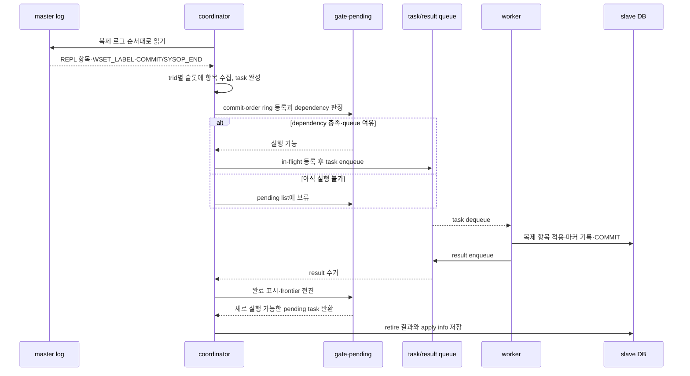
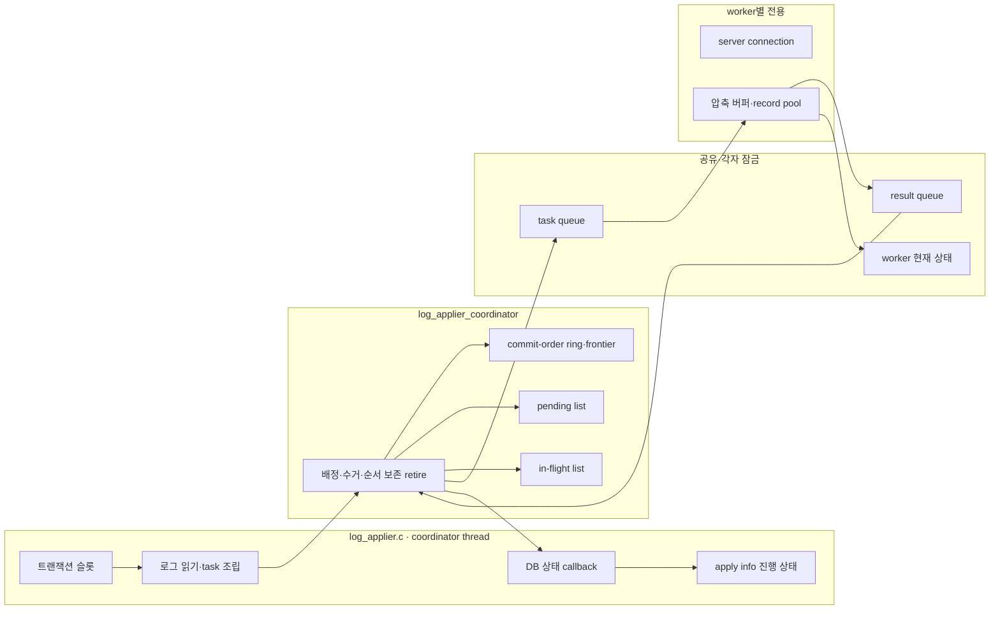
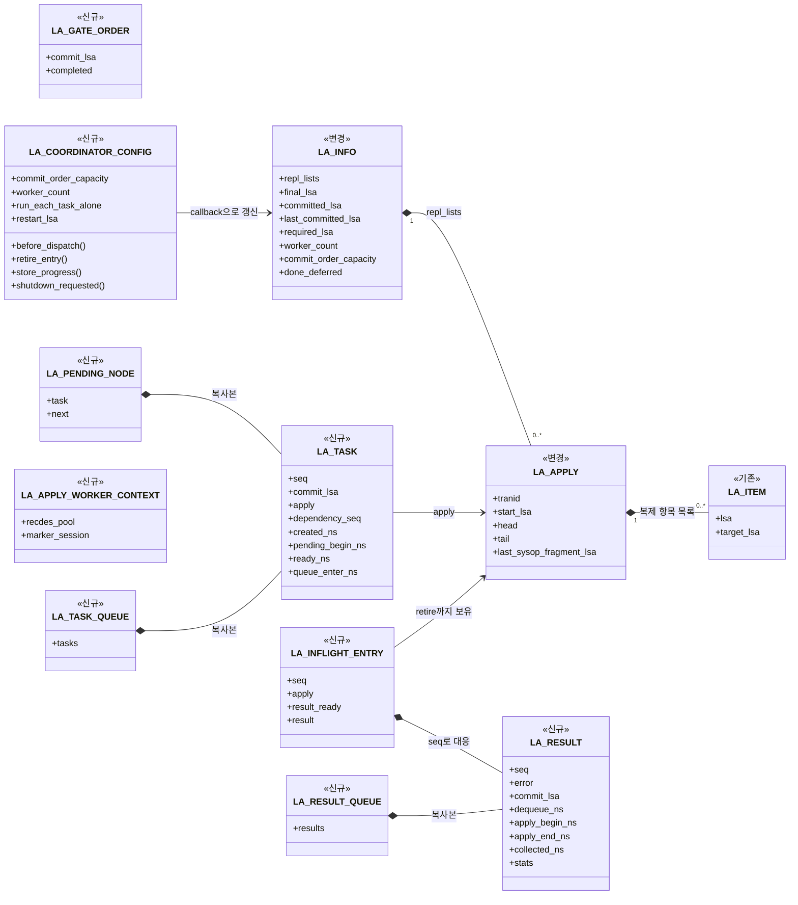
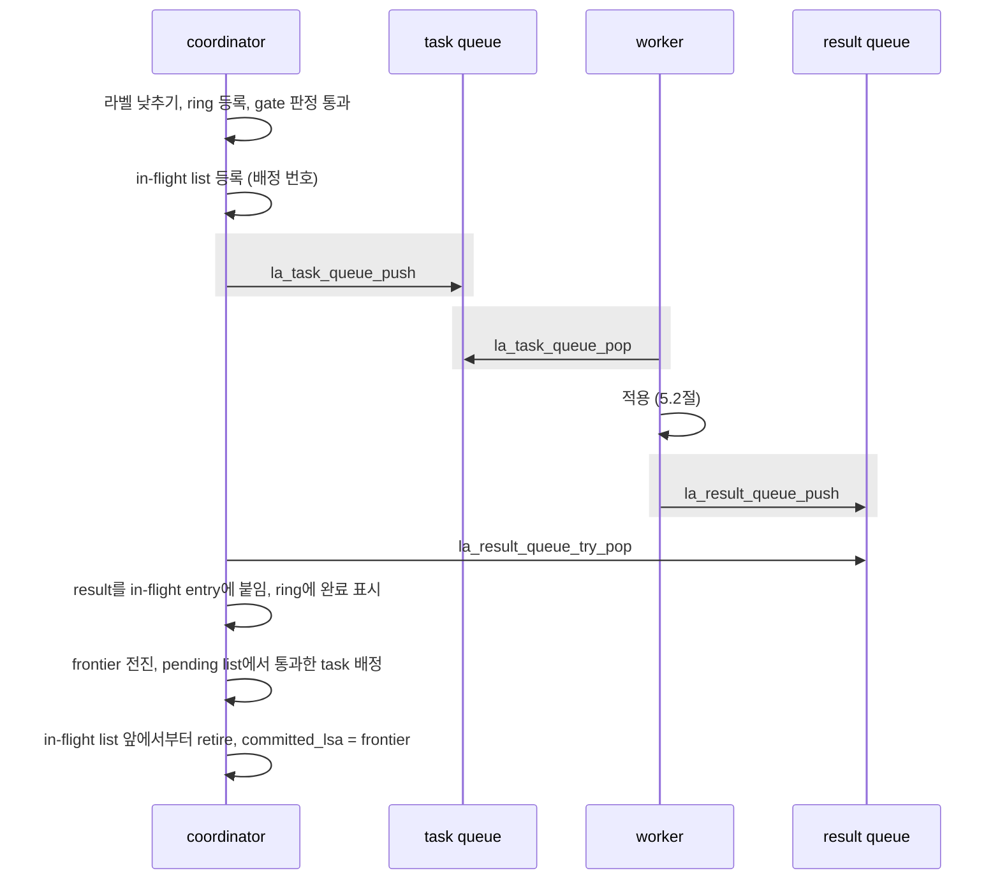
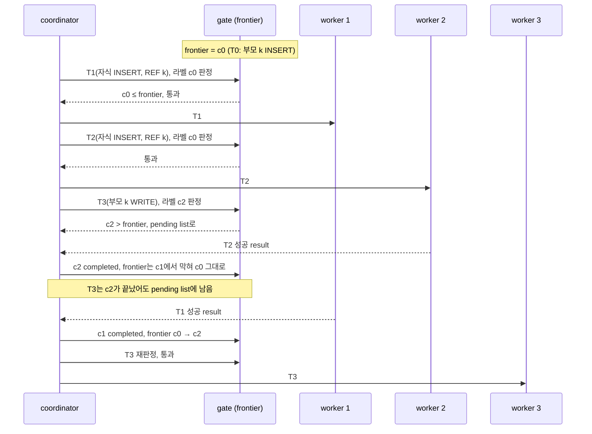
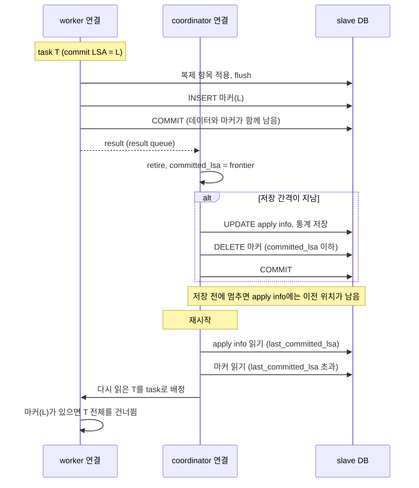
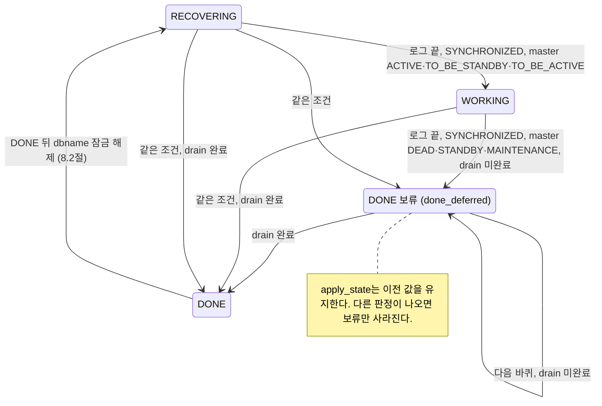

# 슬레이브 writeset 병렬 적용 설계

슬레이브의 applylogdb는 master가 남긴 라벨([01 2.4절](./01-master-implementation-design.md#24-wset_label))을 보고 트랜잭션의 적용 순서를 정한다. 충돌하는 트랜잭션은 master의 커밋 순서대로 적용하고, 서로 독립인 트랜잭션은 병렬로 적용한다. 일은 두 종류의 스레드가 나눠 맡는다. coordinator 한 개는 복제 로그를 읽어 task를 만들고, coordinator 모듈을 통해 적용 순서를 판정한다. worker 여러 개는 각자의 서버 connection으로 task를 적용하고 COMMIT한다.

## 1. 전체 처리 흐름

이 장은 coordinator와 worker가 복제 로그 한 건을 슬레이브에 적용하기까지 거치는 단계를 한 번에 보인다. 먼저 문서 전체에서 쓰는 이름을 정리한다. 이어서 처리 단계와 develop 대비 바뀐 호출 흐름, `log_applier.c`가 새 모듈을 부르는 곳을 차례로 보인다. 각 단계의 자세한 규칙은 2장부터 설명한다.

전체 흐름을 읽는 데 필요한 핵심 이름만 먼저 정리한다. 자료구조와 수명 규칙은 2장, task 생성은 3장에서 세부적으로 정의한다.

- **coordinator**: applylogdb의 메인 스레드다. `log_applier.c`에서 복제 로그를 읽어 task를 만들고, `log_applier_coordinator.cpp`에서 task 배정·result 수거·순서 보존 retire를 수행한다. apply info 갱신과 저장은 coordinator 모듈이 호출하는 callback으로 기존 `log_applier.c` 상태에 반영한다. 일부 trace 문자열은 이 스레드를 `reader`로 부른다.
- **worker**: task의 복제 항목을 적용하고 slave DB에 COMMIT하는 스레드다. 여러 worker가 task queue를 공유한다.
- **task·result**: task(`LA_TASK`)는 coordinator가 worker에 넘기는 트랜잭션 적용 단위고, result(`LA_RESULT`)는 worker가 적용 결과와 통계를 담아 돌려주는 값이다.
- **`dependency_seq`**: 현재 task보다 먼저 적용을 끝내야 하는 범위의 master 로그 위치다. NULL이면 대기할 선행 범위가 없다. slave는 이 위치까지 앞에서부터 빈틈없이 적용했을 때 task를 배정한다.
- **commit-order ring·frontier**: ring은 읽은 COMMIT과 라벨이 붙은 SYSOP_END를 로그 순서로 보존한다. frontier는 ring의 앞에서부터 빈틈없이 적용된 마지막 위치다.
- **pending·in-flight**: pending list는 아직 배정할 수 없는 task를 보관하고, in-flight list는 worker에 배정한 뒤 아직 retire하지 않은 task를 보존한다.
- **retire**: in-flight list 앞의 task를 result와 함께 정리하고, 트랜잭션 슬롯과 통계를 반영하며, `committed_lsa`를 안전한 frontier까지 옮기는 절차다.
- **applied-tx 마커**: worker가 복제 데이터와 같은 slave 트랜잭션에 남기는, COMMIT LSA를 담은 행이다. worker의 데이터 COMMIT과 coordinator의 apply info COMMIT 사이에 장애가 나도 이미 적용한 트랜잭션을 다시 적용하지 않게 한다.

복제 로그 한 건이 적용되는 전체 순서는 다음 스윔레인으로 먼저 잡는다. 세부 자료구조는 2장, task 구성은 3장, 배정과 완료는 4장, worker 내부는 5장에서 확대한다.



이 흐름에서 지켜야 할 기준은 세 가지다.

- coordinator만 로그 순서와 배정 상태를 바꾼다. worker는 받은 task만 적용한다.
- dependency를 통과하지 못한 task는 pending list에 남지만, coordinator는 뒤의 로그를 계속 읽는다.
- `committed_lsa`는 가장 멀리 끝난 worker가 아니라, commit-order ring의 앞에서부터 빠짐없이 완료된 frontier까지만 전진한다.

develop과 비교하면 호출 흐름은 다음과 같다. 이번에 더한 단계는 `[추가]`, 바뀐 단계는 `[변경]`으로 표시했다.

**AS-IS**

```text
la_apply_log_file() 메인 루프
├─ la_release_all_page_buffers()                     고정한 로그 페이지를 모두 놓음
├─ la_decache_page_buffers()
├─ check_reinit_copylog(), 아카이브 삭제, 로그 헤더 복사
├─ master가 DEAD인 채 대기 시간이 지나면 la_unlock_dbname()
├─ DONE이고 master가 ACTIVE가 아니면
│  └─ committed_lsa를 final_lsa로 옮김, la_log_commit()
├─ la_get_page_buffer()
├─ la_log_record_process()                           레코드마다
│  ├─ LOG_REPLICATION_DATA/STATEMENT: la_set_repl_log()
│  ├─ LOG_SYSOP_END, LOG_COMMIT
│  │  ├─ la_add_node_into_la_commit_list()
│  │  ├─ la_apply_commit_list()
│  │  │  └─ la_apply_repl_log()
│  │  │     ├─ la_lock_dbname()
│  │  │     └─ 항목마다 last_committed_rep_lsa보다 뒤이면 적용
│  │  └─ committed_lsa를 이 레코드의 LSA로 옮김
│  └─ LOG_ABORT: la_add_node_into_la_commit_list()
├─ la_check_time_commit()
│  └─ la_log_commit()                                남은 변경 flush, apply info 갱신, 데이터와 함께 COMMIT
├─ la_change_state()
├─ 역할이 바뀌었으면 la_unlock_dbname()
└─ 새 로그가 없으면 100ms sleep
```

**TO-BE**

```text
la_apply_log_file() 메인 루프
├─ [변경] 앞 바퀴에 고정한 페이지만 놓음                    worker가 고정한 페이지는 그 worker가 놓음
├─ [추가] la_coordinator_collect_and_retire()
│  ├─ la_coordinator_collect_results()                result 수거, ring에 완료 표시, frontier 전진, pending task 내보내기
│  └─ la_coordinator_retire_results()                 in-flight list 앞부터 retire, 간격이 지났으면 apply info 저장
├─ la_decache_page_buffers()
├─ [변경] 페이지 cache mutex 안에서 check_reinit_copylog(), 아카이브 삭제, 로그 헤더 복사
├─ [변경] master가 DEAD인 채 대기 시간이 지나고 drain 완료이면 la_unlock_dbname()
├─ DONE이고 master가 ACTIVE가 아니면
│  └─ [변경] committed_lsa를 final_lsa로 옮기되 frontier를 넘지 않게 함, la_log_commit()
├─ la_get_page_buffer()
├─ la_log_record_process()                            레코드마다
│  ├─ LOG_REPLICATION_DATA/STATEMENT: la_set_repl_log()
│  ├─ [추가] LOG_DUMMY_WSET_LABEL: la_get_wset_label()          라벨 holder에 보관
│  ├─ [변경] LOG_SYSOP_END: la_coordinator_process_sysop_end()  라벨이 있으면 fragment task
│  ├─ [변경] LOG_COMMIT: la_coordinator_process_commit()
│  │  ├─ [추가] la_coordinator_set_commit_dependency()
│  │  └─ [추가] la_coordinator_submit_task()
│  │     ├─ la_coordinator_wait_for_commit_order_slot()   ring이 가득 차면 자리가 날 때까지 대기
│  │     ├─ la_gate_set_initial_frontier()               frontier가 비어 있으면 committed_lsa로 시작
│  │     ├─ la_gate_bound_dependency()                    라벨 낮추기
│  │     ├─ la_gate_order_push()                          commit-order ring에 등록
│  │     ├─ la_coordinator_drain_ready()                  통과하는 pending task 먼저 내보냄
│  │     └─ gate 판정 통과이고 자리가 있으면 la_coordinator_enqueue_task(), 아니면 la_pending_push()
│  │        ├─ before_dispatch callback → la_coordinator_before_dispatch() → la_lock_dbname()
│  │        └─ la_coordinator_wait_for_inflight_slot(), la_inflight_push(), la_task_queue_push()
│  └─ [변경] LOG_ABORT: la_free_repl_items_by_tranid()
├─ la_check_time_commit()
│  └─ la_log_commit()
│     └─ [변경] la_coordinator_commit_apply_info()          apply info만 COMMIT
├─ [변경] la_change_state()                               drain 완료 전에는 DONE 보류
├─ [변경] 역할이 바뀌었고 drain 완료이면 la_unlock_dbname()
└─ [변경] 새 로그가 없으면 la_result_queue_wait_for_result()   result가 오면 100ms 전에 깨어남

[추가] la_worker_run()                                 worker마다, 큐가 닫힐 때까지 반복
├─ la_task_queue_pop()
├─ la_apply_worker_run_task()
│  └─ la_apply_worker_apply_task()
│     ├─ [변경] la_apply_repl_log()                       이미 적용한 트랜잭션이면 전체를 건너뜀
│     ├─ la_apply_worker_flush_task()                   남은 변경을 서버로 보냄
│     ├─ la_insert_applied_tx_marker()                  적용한 행이 있을 때만
│     ├─ 여기까지 실패하면 db_abort_transaction()
│     └─ la_apply_worker_commit_task() → la_commit_transaction()
└─ la_result_queue_push()
```

TO-BE에서 coordinator와 worker의 책임이 develop과 달라진 곳은 다음과 같다(3.5절).

- **데이터 COMMIT과 apply info COMMIT의 분리**: develop은 적용한 데이터와 apply info를 `la_log_commit`에서 한 트랜잭션으로 COMMIT한다. TO-BE에서는 worker가 트랜잭션마다 데이터를 COMMIT하고 coordinator가 apply info를 따로 COMMIT한다. 둘 사이의 차이는 applied-tx 마커로 메운다(7.3절).
- **`committed_lsa`의 전진**: develop은 레코드 하나를 적용할 때마다 그 LSA로 옮긴다. TO-BE에서는 retire 때 frontier까지만 옮긴다. 그래서 `committed_lsa` 이하의 COMMIT은 모두 적용된 상태다(4.6절).
- **dbname 잠금의 이동**: develop은 `la_apply_repl_log` 안에서 dbname 잠금을 잡는다. TO-BE에서는 coordinator가 복제 항목이 있고 `last_committed_lsa`보다 뒤인 task를 task queue에 넣기 직전에 잡는다. coordinator 모듈의 `la_coordinator_enqueue_task()`가 `before_dispatch` callback을 호출하고, `log_applier.c`의 `la_coordinator_before_dispatch()`가 잠금을 잡는다. worker는 잡지 않는다. 잠금은 drain 완료를 확인한 뒤(DONE 보류 포함)에만 풀고, 종료할 때는 worker를 멈춘 뒤에 푼다(4.4절, 8.2절).
- **재적용 판정의 단위**: develop은 항목마다 `last_committed_rep_lsa`와 비교해 건너뛸지 정한다. TO-BE는 트랜잭션 단위로만 판정한다. `last_committed_lsa` 이하이거나 applied-tx 마커가 있으면 그 트랜잭션 전체를 건너뛴다(7.4절).

`log_applier.c`와 `applier/` 모듈의 경계는 다음과 같다.

- **task 조립과 제출**: `log_applier.c`는 라벨과 복제 항목으로 완성한 task를 `la_coordinator_submit_task()`에 넘긴다. 적용할 항목이 없는 SYSOP_END는 `la_coordinator_complete_without_task()`로 완료 위치만 전달한다. 로그 끝이나 종료 경로에서는 `la_coordinator_collect_and_retire()`와 `la_coordinator_drain_complete()`를 호출한다.
- **coordinator 내부**: `log_applier_coordinator.cpp`가 gate, pending list, in-flight list, task/result queue를 조합한다. dependency 판정, pending 해제, worker 배정, result 수거, frontier 전진과 배정 순서 retire는 이 모듈 안에서 끝난다(4장).
- **기존 DB 상태 callback**: task를 worker에 넘기기 전에는 `la_coordinator_before_dispatch()`로 dbname 잠금을 잡는다. retire할 때는 `la_coordinator_retire_entry()`가 슬롯을 반환하고 `committed_lsa`와 통계를 갱신한다. 이어서 `la_coordinator_store_progress()`가 apply info 저장 간격을 판정한다. 대기 루프는 `la_coordinator_shutdown_requested()`로 종료 요청을 확인한다.
- **생명주기**: `la_coordinator_initialize_resources()`가 callback과 용량을 `LA_COORDINATOR_CONFIG`에 넣어 `la_coordinator_initialize()`를 부른다. worker 시작·종료와 재시작 시 남은 슬롯 정리는 기존 `log_applier.c`가 맡는다(7.5절, 8.3절).
- **필요 로그 위치와 종료 진단**: `required_lsa` 계산과 재시작 정리는 아직 기존 슬롯을 함께 보므로 `log_applier.c`가 in-flight list와 pending list를 읽는다. DONE 보류 로그도 세 구조의 남은 개수를 표시한다. 이는 배정 알고리즘을 다시 구현하는 경로가 아니라 기존 DB 상태와의 연결 경계다.
- **worker**: `la_worker_start()`에 넘기는 `LA_WORKER_CONFIG`의 callback 세 개(`la_apply_worker_run_task`, `la_request_shutdown`, `la_apply_worker_end_context`)가 worker 모듈이 `log_applier.c`를 부르는 유일한 길이다. 반대로 `log_applier.c`의 행 재구성 함수(`la_apply_insert_log`, `la_apply_update_log`, `la_get_overflow_recdes`)는 `la_assign_recdes_from_pool()`, `la_realloc_recdes_data()`로 worker context의 레코드 pool을 쓴다(5장).

### 1.1 소스 구성

슬레이브 병렬 적용 코드는 `src/transaction/applier/`에 모은다. 로그 읽기와 행 적용은 기존 `log_applier.c`에 둔다.

```text
src/transaction/
├─ applier/
│  ├─ log_applier_task.hpp
│  ├─ log_applier_result.hpp
│  ├─ log_applier_coordinator.hpp / .cpp
│  ├─ log_applier_gate.hpp / .cpp
│  ├─ log_applier_pending.hpp / .cpp
│  ├─ log_applier_inflight.hpp / .cpp
│  ├─ log_applier_task_queue.hpp / .cpp
│  ├─ log_applier_result_queue.hpp / .cpp
│  ├─ log_applier_worker.hpp / .cpp
│  ├─ log_applier_stat.hpp / .cpp
│  ├─ log_applier_stat_internal.hpp
│  ├─ log_applier_stat_store.hpp / .cpp
│  ├─ log_applier_stat_print.hpp / .cpp
│  └─ log_applier_debug.hpp
├─ log_applier.c
├─ log_applier.h
├─ log_applier_sql_log.c
└─ locator_sr.c
src/base/system_parameter.c / .h
src/connection/heartbeat.h
src/object/schema_system_catalog.cpp
src/object/schema_system_catalog_install.cpp / .hpp
src/object/schema_system_catalog_constants.h
src/object/work_space.c / .h
src/storage/file_io.c
src/executables/unload_object.c
CMakeLists.txt
cs/CMakeLists.txt
unit_tests/log_applier/
```

`applier/`는 이번 기능이 새로 만든 디렉토리이며, 파일마다 맡은 일은 다음과 같다.

- `log_applier_task.hpp`: task(`LA_TASK`) 정의다. coordinator가 만들고, task queue에 값으로 복사해 worker에 넘긴다.
- `log_applier_result.hpp`: result(`LA_RESULT`)와 task별 적용 통계(`LA_STATS`)를 정의한다. task 값으로 result를 채우는 `la_result_init`도 여기 있다.
- `log_applier_coordinator.hpp / .cpp`: 완성된 task의 dependency 판정, pending 보류와 해제, worker 배정, result 수거, frontier 전진과 배정 순서 retire를 조율한다. gate·pending·in-flight·queue의 개별 저장 구조는 각 모듈에 두고, coordinator는 이들을 하나의 처리 흐름으로 연결한다.
- `log_applier_gate.hpp / .cpp`: commit-order ring과 frontier, gate 판정, 라벨 낮추기를 맡는다. coordinator 전용이며 잠금이 없다.
- `log_applier_pending.hpp / .cpp`: pending list다. coordinator 전용이며 잠금이 없다.
- `log_applier_inflight.hpp / .cpp`: in-flight list와 배정 번호를 맡는다. coordinator 전용이며 잠금이 없다. entry의 필드는 구현 파일에 숨기고, 다른 모듈은 조회·소유권 이전 API로만 접근한다.
- `log_applier_task_queue.hpp / .cpp`: task queue다. coordinator와 worker가 함께 쓰며 자체 mutex와 condition variable로 보호한다.
- `log_applier_result_queue.hpp / .cpp`: result queue다. coordinator와 worker가 함께 쓰며 자체 mutex와 condition variable로 보호한다. 두 큐의 mutex를 동시에 잡는 스레드는 없다.
- `log_applier_worker.hpp / .cpp`: worker 스레드의 시작과 join, worker별 connection, worker context(압축 해제 버퍼, 레코드 pool)를 맡는다. `log_applier.c`의 적용 함수는 콜백으로만 부른다.
- `log_applier_stat.hpp / .cpp`: 메모리 통계를 수집한다. worker별 현재 상태와 동시 실행 worker 수는 `la_Worker_live_lock`으로 보호하고, 나머지 카운터는 coordinator만 바꾼다.
- `log_applier_stat_internal.hpp`: 수집과 DB 영속화가 함께 쓰는 통계 상태의 비공개 경계다. 일반 호출자는 포함하지 않는다.
- `log_applier_stat_store.hpp / .cpp`: `_db_ha_apply_stat`, `_db_ha_apply_worker_stat` 행의 초기화와 저장을 맡는다.
- `log_applier_stat_print.hpp / .cpp`: 저장된 통계를 읽어 `applyinfo`의 "Parallel Apply Info"를 출력한다. 메모리 통계 상태에는 접근하지 않는다.
- `log_applier_debug.hpp`: debug 빌드 전용 로그 매크로와 시간 측정 매크로다.

나머지 파일은 기존 파일이며, 바뀐 내용은 다음과 같다.

- `log_applier.c`: 라벨 holder와 task 구성, coordinator callback(dbname 잠금, 슬롯 반환, `committed_lsa`·통계·apply info 반영), worker callback(적용, flush, applied-tx 마커, COMMIT), applied-tx 마커 테이블, 공유 로그 페이지 캐시의 스레드별 고정 해제, `required_lsa` 계산의 확장.
- `log_applier.h`: worker를 멈추게 하는 flush 오류를 판정하는 `LA_IS_FLUSH_ERROR`.
- `log_applier_sql_log.c`: worker들이 SQL 로그를 동시에 쓰므로, 항목 하나의 기록과 파일 교체를 `sl_write_mutex`로 감싼다.
- `locator_sr.c`(서버): worker의 flush를 받는 `xlocator_repl_force`가 교착 희생자가 된 항목에서 다음 항목으로 넘어가지 않고 호출 전체를 실패로 끝낸다. 잠금을 쥔 채 다음 항목에서 다시 기다리면 끊으려던 교착이 풀리지 않기 때문이다. 인덱스 갱신에서 잠금 실패가 성공으로 되돌아가지 않도록 오류 전달도 보강했다.
- `system_parameter.c / .h`: `ha_apply_worker_count`, `ha_writeset_trace_level`.
- `heartbeat.h`: `HB_DEFAULT_APPLY_WORKER_COUNT`(1), `HB_MAX_APPLY_WORKER_COUNT`(32). worker별 배열은 최댓값 크기로 잡는다.
- `schema_system_catalog*`: 통계 테이블 `_db_ha_apply_stat`, `_db_ha_apply_worker_stat`의 정의와 시스템 클래스 등록. applied-tx 마커 테이블은 카탈로그가 아니며, applylogdb가 기동 때 만든다(7.3절).
- `unload_object.c`: 두 통계 테이블을 unloaddb 대상에서 뺀다.
- `work_space.c / .h`: worker가 flush 여부를 정할 때 쓰는 `ws_repl::ws_get_repl_obj_count`와 `ws_set_defer_free`.
- `file_io.c`: 서버 밖에서도 Windows가 아니면 `pread`/`pwrite`로 읽고 쓴다. 같은 파일 descriptor로 로그 페이지를 읽는 worker들이 파일 offset을 두고 다투지 않게 하기 위해서다.
- `CMakeLists.txt`: `MULTI_CONN_TO_A_SERVER`를 기본으로 켜고, `applier/` 디렉토리를 include 경로에 넣는다.
- `cs/CMakeLists.txt`: applier 소스를 client 라이브러리에 넣는다.
- `unit_tests/log_applier/`: gate, pending list, in-flight list, 두 큐, coordinator의 보류·해제·retire 흐름, worker 시작과 종료의 단위 테스트다. stat 모듈과 서버 연결이 필요한 `log_applier.c` callback은 포함하지 않는다(9.3절).

coordinator와 worker가 함께 쓰는 자료와 그 보호 방식은 2장 도입에 모아 둔다.

### 1.2 설정

슬레이브 병렬 적용이 읽는 파라미터는 다음과 같다. 모두 `cubrid_ha.conf`에 두고 실행 중에는 바꿀 수 없다. 파라미터마다 어느 함수가 값을 읽는지 함께 적었다.

- **`ha_apply_worker_count`** (새 파라미터)
  - worker 수다. 기본값 1, 범위 1~32(`HB_MAX_APPLY_WORKER_COUNT`).
  - `la_init`이 한 번 읽어 `la_Info.worker_count`에 두고, `LA_MAX_WORKER_COUNT`로 범위를 다시 자른다.
  - MULTI_CONN_TO_A_SERVER 없이 빌드했으면 1로 줄이고 알림을 남긴다.
  - 값이 1이면 COMMIT 순서로 적용한다는 알림을 남긴다(4.8절).
  - commit-order ring, in-flight list, result queue의 크기는 이 값에 task queue 용량 1024를 곱한 값이다(`LA_COMMIT_ORDER_CAPACITY`, 2.5절).
- **`ha_writeset_trace_level`** (새 파라미터, master와 같이 씀)
  - trace 수준이다. 기본값 0, 범위 0~3.
  - worker의 task 단위 줄(apply begin·done·end, flush, commit begin)은 worker를 시작할 때 읽은 값을 쓴다. 나머지 줄은 남길 때마다 파라미터를 읽는다.
  - 슬레이브 코드가 나누는 수준은 1과 2다(9.2절).
- **`ha_apply_max_mem_size`** (기존)
  - applylogdb 프로세스의 메모리 상한(MB)이다. 기본값 500. `cubrid heartbeat`가 applylogdb를 띄울 때 이 값을 `--max-mem-size`로 넘기고, `la_init()`이 `la_Info.max_mem_size`에 둔다.
  - `la_check_mem_size`는 프로세스의 가상 메모리 크기를 두 값 중 큰 것과 비교한다. 하나는 이 값이고, 다른 하나는 기준 크기의 두 배다. 넘으면 `ER_HA_LA_EXCEED_MAX_MEM_SIZE`로 applier를 멈춘다.
  - `[변경]` 기준 크기는 시작 대기(`HB_START_WAITING_TIME_IN_SECS`)가 지난 뒤 처음 검사할 때 잰다. develop은 `la_init`에서 쟀다. worker마다 malloc arena를 따로 잡아 가상 크기가 커지므로, worker가 시작한 뒤에 재야 한다.
- **`ha_applylogdb_max_commit_interval_in_msecs`** (기존, 기본값 500): coordinator가 retire 때 apply info를 저장하는 최소 간격이다. `la_coordinator_store_apply_info_at_interval()`이 저장할 때마다 읽는다(7.2절).
- **`ha_applylogdb_log_wait_time_in_secs`** (기존, 숨은 파라미터, 기본값 -1): master가 DEAD인 채 로그가 늘지 않을 때 dbname 잠금을 놓기까지 기다리는 시간이다. coordinator의 주 루프가 로그 끝에 닿을 때마다 읽는다. 0 이상일 때만 이 해제를 하고, drain 완료일 때만 놓는다(8.2절).
- **`ha_applylogdb_retry_error_list`, `ha_applylogdb_ignore_error_list`** (기존): 항목 적용 오류를 다시 시도할지, 무시할지 정한다. worker가 항목 오류를 만날 때마다 목록을 찾는다(`la_retry_on_error()`, `la_ignore_on_error()`, 5.3절).

master 쪽 `ha_writeset_history_size`는 슬레이브가 읽지 않는다([01 1.2절](./01-master-implementation-design.md#12-설정)).

### 1.3 처음 설계에서 바뀐 구조

처음 설계에 있던 구조 가운데 지금 구현에 없거나 다르게 만든 것은 다음과 같다. 항목마다 지금의 구조와 그렇게 한 이유만 적는다.

- **gate는 frontier만 본다**
  - 지금: task는 `dependency_seq`가 NULL이거나 frontier 이하일 때만 통과한다. frontier 위에서 먼저 끝난 COMMIT이 있어도 그것만 보고 통과시키지 않는다(4.1절).
  - 이유: 라벨은 충돌하는 앞 트랜잭션 가운데 가장 늦은 하나만 가리킨다. 그 하나가 끝난 것만 보고 통과시키면, 아직 끝나지 않은 다른 앞 트랜잭션과 같은 행을 동시에 바꿀 수 있다(6.1절).
- **완료 기록은 commit-order ring 하나**
  - 지금: 따로 완료 집합을 두지 않는다. 고정 크기 ring에 로그 순서로 LSA를 넣고, 끝난 항목은 이진 탐색으로 찾아 `completed`로 표시한다. ring에 없는 LSA, 곧 이미 frontier 뒤로 지나간 LSA는 무시한다(2.3절).
  - 이유: gate가 frontier만 보므로, 완료 정보는 frontier를 전진시킬 때 ring 앞쪽 항목에서만 필요하다.
- **라벨에 dependency 출처를 담지 않는다**
  - 지금: 라벨과 task는 `dependency_seq` 하나만 가진다. 이 값이 history의 WRITE에서 왔는지 REF에서 왔는지는 기록하지 않는다([01 2.4절](./01-master-implementation-design.md#24-wset_label)).
  - 이유: gate가 출처와 상관없이 frontier만 보므로 쓰는 곳이 없다.
- **pending list는 gate와 다른 모듈이다**
  - 지금: gate(`log_applier_gate.cpp`)는 commit-order ring과 판정만 맡는다. 기다리는 task는 `log_applier_pending.cpp`가 보관하며, pending list는 gate를 `la_gate_is_satisfied`로만 부른다(2.4절).
  - 이유: 판정 규칙과 대기 task 보관을 나눠 각각 따로 시험한다(9.3절).
- **용량 token과 worker 준비 barrier가 없다**
  - 지금: commit-order ring, in-flight list, result queue를 같은 크기(worker 수에 task queue 크기를 곱한 값)로 잡는다. ring이나 in-flight list가 차면 coordinator는 그 자리에서 result를 거두며 자리가 나기를 기다린다(4.7절). worker의 connection이 준비되기를 기다리지 않고 task를 넣는다(5.1절).
  - 이유: 공유 자료가 넘치지 않게 하는 데는 대기 지점 두 곳으로 충분하다. task는 worker가 꺼낼 때까지 task queue에 머물고, 시작하지 못한 worker는 스스로 빠지므로 준비를 맞출 필요가 없다.
- **재시작은 applied-tx 마커로 판정한다**
  - 지금: worker가 데이터와 같은 slave 트랜잭션에 applied-tx 마커를 넣는다. 재시작 때는 마커가 있는 COMMIT을 통째로 건너뛴다. apply info 테이블의 컬럼은 develop과 같다(7.3절, 7.4절).
  - 이유: unique 중복이나 대상 행 없음 오류만 건너뛰며 다시 적용하는 방식으로는, 키를 바꾼 UPDATE나 `n = n + 1` 같은 statement를 두 번 적용하는 것을 막지 못한다(7.3절).

## 2. 자료구조

이 장은 coordinator와 worker가 쓰는 자료구조를 다룬다. 트랜잭션 슬롯과 복제 항목은 coordinator가 로그를 읽으며 트랜잭션별로 복제 항목을 모으는 develop 구조다. 이번 구현은 이 위에 배정과 완료를 관리하는 구조(commit-order ring, pending list, in-flight list)와, coordinator와 worker가 task와 result를 주고받는 구조(task queue, result queue)를 더했다.

먼저 소유권을 나누면 구조가 단순해진다.



*그림 2-1. `log_applier.c`의 로그 읽기·DB 상태와 coordinator 모듈의 배정 상태, worker 공유 queue 사이의 소유권 경계*

coordinator 모듈의 배정 자료는 coordinator thread만 접근하므로 잠금 없이 사용한다. 기존 트랜잭션 슬롯과 apply info는 `log_applier.c`가 소유하고 callback으로만 갱신한다. 공유 queue는 각각 자기 mutex와 condition variable을 사용하고, worker 현재 상태는 통계용 mutex로 보호한다. worker별 connection과 복원 버퍼는 다른 worker와 공유하지 않는다.



*그림 2-2. 슬레이브 병렬 적용의 자료구조. 이번 설계에서 추가하거나 의미가 바뀐 주요 필드만 표시했다. `<<변경>>`은 develop 구조에 필드를 더하거나 뺀 것이다.*

`LA_COORDINATOR_CONFIG`는 coordinator 모듈이 기존 applier 상태를 직접 소유하지 않게 하는 연결 구조다. `restart_lsa`는 `la_Info.committed_lsa`를 가리키는 빌린 포인터이며, apply info를 읽은 뒤 첫 task를 제출할 때 초기 frontier로 사용한다. 네 callback은 각각 배정 전 DB 잠금, retire 시 슬롯·진행 위치 반영, apply info 주기 저장, 종료 요청 확인만 맡는다. gate·pending·in-flight 조작은 callback 밖의 coordinator 모듈에 남는다.

applier 자료는 기본으로 coordinator 전용이며 잠금 없이 읽고 쓴다. commit-order ring과 frontier, pending list, in-flight list와 배정 번호, 라벨 holder, 트랜잭션 슬롯 풀(`la_Info.repl_lists`), `la_Info`의 LSA 위치와 카운터가 여기에 속한다. 둘 이상의 스레드가 함께 쓰는 것은 다음뿐이다.

- **잠금으로 보호하는 것**
  - task queue와 result queue: queue마다 mutex를 둔다(2.5절).
  - 로그 페이지 cache: `la_Info.cache_pb->mutex`로 보호한다. 스레드마다 자기가 고정한 페이지만 해제한다.
  - worker별 현재 상태(`la_Worker_live`)와 동시 실행 worker 수: `la_Worker_live_lock`으로 보호한다(9.1절).
  - SQL 문장의 컴파일과 실행: `la_sql_compile_mutex`로 보호한다. SQL 파서가 스레드 안전하지 않은 정적 전역을 쓰기 때문이다.
  - SQL 로그 기록: `sl_write_mutex`로 보호한다(`log_applier_sql_log.c`).
  - worker 연결 열기: `la_Worker_session_mutex`로 하나씩 연다(2.6절).
- **잠금 없이 함께 쓰는 것**
  - 시작한 worker 수(`la_Live_worker_count`): 시작에 실패한 worker가 atomic으로 줄인다(2.6절).
  - 종료 요청 표시(`la_applier_need_shutdown`): worker는 `request_shutdown` 콜백으로 켜기만 하고, coordinator가 메인 루프에서 읽는다.
- **읽기만 하는 것**: 아래 셋은 coordinator가 worker를 시작하기 전에 정하고, worker가 도는 동안 바꾸지 않는다.
  - `la_Worker_config`: worker 설정(2.6절).
  - applied-tx 마커 목록(`la_Applied_tx_markers`): 기동 때 읽은 마커의 COMMIT LSA(7.3절).
  - `la_Info.last_committed_lsa`: worker가 이미 적용된 트랜잭션을 건너뛸지 판정할 때 읽는다(2.7절).
- **넘겨주는 것**: task가 가리키는 트랜잭션 슬롯.
  - coordinator는 task를 task queue에 넣은 뒤 retire할 때까지 그 슬롯을 비우거나 다른 트랜잭션에 내주지 않는다.
  - 그동안 슬롯의 복제 항목은 worker가 적용하면서 해제한다(2.1절).

### 2.1 트랜잭션 슬롯과 복제 항목

트랜잭션 슬롯은 develop 구조이며, 로그의 `trid`마다 하나씩 두고 그 트랜잭션의 복제 항목을 연결 목록으로 모은다. coordinator가 로그를 읽는 단계에서 만들고 채운다.
- coordinator는 트랜잭션의 첫 로그 레코드(`prev_tranlsa`가 NULL)를 만나면 `la_add_apply_list`로 슬롯을 잡고, 그 레코드 위치를 `start_lsa`에 기록한다. 라벨 레코드(`LOG_DUMMY_WSET_LABEL`)는 슬롯을 만들지 않는다.
- 복제 레코드(`LOG_REPLICATION_DATA`, `LOG_REPLICATION_STATEMENT`)를 만날 때마다 `la_set_repl_log`가 복제 항목을 만들어 목록 끝에 붙인다.

슬롯 풀(`la_Info.repl_lists`)은 슬롯 포인터의 배열이다.
- 빈 슬롯(`tranid == 0`)이 없으면 배열을 `LA_REPL_LIST_COUNT`(50)개 늘린다(`la_init_repl_lists`).
- 이때 realloc하는 것은 배열뿐이다. 슬롯 객체는 하나씩 따로 할당하므로 이미 있는 슬롯의 주소는 바뀌지 않는다.
- 그래서 task와 in-flight list가 슬롯 포인터를 들고 있는 동안 coordinator가 다른 트랜잭션 때문에 배열을 늘려도 그 포인터는 유효하다.

복제 항목이 `LA_MAX_REPL_ITEMS`(1000)개에 이르면 슬롯을 긴 트랜잭션으로 바꾼다. 이 동작은 develop과 같다.
- 첫 항목만 남기고 나머지를 해제한 뒤 `is_long_trans`를 켠다.
- 그 뒤로는 마지막 복제 레코드 위치만 `last_lsa`에 기록한다.
- 적용할 때는 첫 항목부터 `last_lsa`까지 로그를 다시 읽는다(`la_get_next_repl_item_from_log`).

develop과 달라진 점은 다음과 같다.
- **슬롯 수명**
  - develop의 `la_apply_repl_log`는 COMMIT을 적용한 직후 슬롯을 비웠다.
  - 이번 구현에서는 task가 슬롯을 가리킨다. worker가 복제 항목을 적용하며 해제한 뒤에도 슬롯은 `tranid`와 `start_lsa`를 유지한 채 남는다. 이미 적용된 COMMIT도 worker가 적용 없이 항목만 해제하므로 같은 경로를 지난다.
  - 슬롯은 coordinator가 그 task를 retire할 때 비운다(`la_coordinator_release_apply_slot`, 4.6절).
  - 그래서 `la_find_required_lsa`가 적용 중인 트랜잭션의 시작 위치를 계속 볼 수 있다(2.7절).
  - `LOG_ABORT`를 만나거나 `committed_lsa` 이하의 COMMIT을 만나면 coordinator가 그 자리에서 항목을 해제하고 슬롯을 비운다(`la_free_repl_items_by_tranid`, 3.4절).
- **sysop fragment 슬롯**
  - 라벨 단 `LOG_SYSOP_END`를 만나면, 그 위치까지의 복제 항목을 새로 할당한 슬롯으로 옮겨 fragment task에 준다(`la_detach_sysop_fragment`, 3.3절). fragment 슬롯의 `tranid`는 바깥 트랜잭션의 것이고, `start_lsa`는 옮긴 첫 복제 항목의 위치다.
  - 바깥 슬롯이 긴 트랜잭션이면 슬롯 내용 전체를 옮기고 바깥 슬롯을 빈 목록으로 되돌린다.
  - fragment 슬롯은 `repl_lists`에 속하지 않는다. fragment task를 retire할 때 해제하고, 종료할 때까지 retire되지 않은 것은 `la_free_unretired_fragments`가 해제한다(8.3절).
- **DONE을 알릴 때의 정리**: 남은 슬롯을 비우는 `la_clear_all_repl_lists`는 drain 완료 뒤에만 호출되므로, task가 가리키는 슬롯은 그때 남아 있지 않다(8.1절).

그림 2-2의 트랜잭션 슬롯(`LA_APPLY`) 필드를 설명한다. `last_sysop_fragment_lsa`만 이번에 더했다.
- `tranid`: 트랜잭션 id. 0이면 빈 슬롯이다.
- `num_items`: 목록에 있는 복제 항목 수.
- `is_long_trans`: 긴 트랜잭션 여부.
- `start_lsa`: 트랜잭션의 첫 로그 레코드 위치. `required_lsa` 계산에 쓴다.
- `last_lsa`: 긴 트랜잭션의 마지막 복제 레코드 위치.
- `head`, `tail`: 복제 항목 목록.
- `last_sysop_fragment_lsa`: 이 트랜잭션이 마지막으로 만든 sysop fragment의 `LOG_SYSOP_END` 위치. retire에서 슬롯을 비울 때 NULL로 돌아가고, ABORT로 슬롯을 비울 때는 지우지 않는다(3.4절, 10장). 최종 COMMIT task의 dependency를 이 값 이상으로 올린다(3.2절).

그림 2-2의 복제 항목(`LA_ITEM`)은 develop과 같다. 복제 레코드 한 건의 위치(`lsa`, `target_lsa`), 종류(`log_type`, `item_type`), 대상 클래스와 키(`class_name`, `packed_key_value`, `key`), serial 갱신 전 값(`packed_prior_value`)을 담는다.

### 2.2 task와 result

task는 coordinator가 `LOG_COMMIT` 또는 라벨 단 `LOG_SYSOP_END`를 읽을 때 만드는 적용 단위이고, result는 worker가 task 하나를 끝내고 돌려주는 값이다. COMMIT에서 만든 task를 COMMIT task, sysop fragment에서 만든 task를 fragment task라고 부른다.
- task는 값으로 복사되어 pending list와 task queue를 지난다.
- 트랜잭션 슬롯은 복사하지 않고 포인터(`apply`)로만 넘긴다. worker는 `la_find_apply_list`를 부르지 않고 이 포인터로 슬롯을 쓴다.
- worker는 task를 꺼내면 `la_result_init`으로 result의 `seq`, `tranid`, `rectype`, `commit_lsa`, `log_record_time`, `has_items`를 task 값으로 채우고, 처리한 worker 번호를 `worker_idx`에 넣는다. `committed_rep_lsa`는 NULL LSA, 나머지는 0이다. 적용을 마치면 result를 result queue로 돌려준다.

`seq`는 result를 task와 짝짓는 배정 번호다.
- `seq`는 task가 in-flight list에 들어갈 때 정해진다(`la_inflight_push`). pending list에 있는 동안은 아직 정해지지 않아 0이다. 첫 배정 번호도 0이다.
- result는 순서가 바뀌어 도착하므로, coordinator는 `seq`로 in-flight list의 항목을 찾는다(2.4절).

그림 2-2의 task(`LA_TASK`) 필드를 설명한다.
- `seq`: 배정 번호.
- `tranid`: 트랜잭션 id.
- `rectype`: `LOG_COMMIT` 또는 `LOG_SYSOP_END`. 각각 COMMIT task, fragment task다.
- `commit_lsa`: task를 만든 `LOG_COMMIT` 또는 `LOG_SYSOP_END` 레코드의 위치. commit-order ring에 이 값으로 들어간다.
- `log_record_time`: COMMIT 레코드의 트랜잭션 종료 시각. fragment task는 0이다.
- `apply`: 트랜잭션 슬롯. 슬롯이 없는 COMMIT이면 NULL이다.
- `has_items`: 적용할 복제 항목이 있는지. 슬롯이 없거나 목록이 비면 false다.
- `dependency_seq`: 먼저 적용돼야 하는 마지막 COMMIT LSA. NULL이면 기다리지 않는다. 라벨 값에서 출발해, fragment 위치로 올리기와 라벨이 없을 때 직전 COMMIT으로 올리기(3.2절), 라벨 낮추기(4.2절)를 거친 값이다.
- `created_ns`: coordinator가 완성된 task를 제출한 단조 시각.
- `pending_begin_ns`: dependency가 충족되지 않아 pending list에 들어간 시각. queue 공간만 부족해 pending에 들어간 task와 dependency를 기다리지 않은 task는 0이다.
- `ready_ns`: coordinator가 dependency 충족을 확인한 시각. 처음부터 실행 가능하면 최초 판정 시각이고, pending task이면 `la_pending_mark_ready` 또는 해제 경로에서 확인한 시각이다. 선행 task가 완료된 물리적 시각 자체는 아니다.
- `queue_enter_ns`: 공유 task queue에 들어간 시각.

그림 2-2의 result(`LA_RESULT`) 필드는 쓰임에 따라 세 무리로 나뉜다.
- 판정과 진행에 쓰는 필드
  - `seq`: in-flight list 항목과 짝을 짓는다.
  - `tranid`, `rectype`
  - `error`: NO_ERROR가 아니면 retire가 이 오류를 돌려주어 applier를 멈춘다(4.6절).
  - `commit_lsa`: 성공하면 commit-order ring에서 이 위치를 완료로 표시한다(4.5절).
  - `committed_rep_lsa`: 오류 없이 적용한 마지막 복제 항목의 위치. retire에서 `la_Info.committed_rep_lsa`를 앞으로만 옮긴다.
  - `log_record_time`: retire에서 `la_Info.log_record_time`으로 옮긴다.
  - `total_rows`: worker가 거친 복제 항목 수. retire에서 `la_Info.total_rows`에 더하고, 이 값이 바뀌면 main loop가 apply info를 저장한다. 0이면 applied-tx 마커를 넣지 않는다(2.8절).
- 통계 전용 필드
  - `has_items`, `busy_usec`(적용, flush, COMMIT에 걸린 시간), `apply_end_time`, `stats`.
  - task에서 복사한 `created_ns`, `pending_begin_ns`, `ready_ns`, `queue_enter_ns`.
  - worker가 기록하는 `dequeue_ns`, `apply_begin_ns`, `apply_end_ns`와 coordinator가 result를 수거하며 기록하는 `collected_ns`.
  - `*_ns`는 `CLOCK_MONOTONIC` 값이다. 경과 시간 계산에만 쓰고 DB 시각으로 표시하지 않는다.
- 디버그 전용 필드: `worker_idx`.

result의 `stats`(`LA_STATS`)는 트랜잭션 하나의 적용 통계다. retire에서 `la_Info`의 카운터에 더하며, 적용 판정에는 쓰지 않는다.
- `insert_counter`, `update_counter`, `delete_counter`, `schema_counter`, `fail_counter`
- `last_error_code`, `last_error_time`: `fail_counter`로 센 마지막 오류.
- `num_unflushed`: 아직 서버로 보내지 않은 복제 항목 수.
- `last_class_name`, `multi_class`: trace와 시험용 hook이 쓰는 마지막 적용 클래스.

### 2.3 commit-order ring과 frontier

commit-order ring과 frontier는 gate 판정의 기준을 만드는 coordinator 전용 구조다. ring은 coordinator가 로그에서 읽은 task의 위치를 읽은 순서대로 담는 고리 버퍼이고, frontier는 ring의 앞에서부터 빈틈없이 적용된 마지막 위치(COMMIT 또는 라벨이 붙은 SYSOP_END의 LSA)다.

ring에 들어가는 것은 다음과 같다.
- COMMIT task와 fragment task의 `commit_lsa`. task는 바로 배정되든 pending list에 들어가든 ring에 한 번 들어간다.
- 복제 항목 없이 라벨만 단 `LOG_SYSOP_END`의 위치. 위치만 넣고 바로 완료로 표시한다(`la_coordinator_complete_without_task`, 3.3절).
- 로그 순서로 넣으므로 ring은 LSA 순으로 정렬되어 있다. 그래서 위치로 항목을 찾을 때 이분 탐색을 쓴다(`la_gate_order_find`). ring에 없는 위치(이미 frontier가 지나간 것)는 찾지 못하고 무시한다.
- ring은 `la_Info.commit_order_capacity`만큼 찰 수 있다. 가득 차면 coordinator는 로그 읽기를 멈추고 result를 수거한다(4.7절).

frontier는 다음과 같이 움직인다.
- 성공 result를 수거하면 해당 항목에 완료 표시만 한다(`la_gate_mark_completed`). 실패 result는 표시하지 않으므로 그 항목은 미완료로 남고, retire에서 applier가 멈춘다(4.6절).
- `la_gate_advance_frontier`가 ring 맨 앞부터 완료된 항목을 빼면서 frontier를 그 위치로 옮긴다. 맨 앞 항목이 아직 적용 중이면, 뒤 항목이 먼저 완료되어도 frontier는 멈춘다(4.5절).
- gate 판정은 frontier만 본다(4.1절).

```text
frontier = C1
ring (맨 앞부터): C2 미완료 | C3 완료 | C4 미완료 | C5 완료

C2의 성공 result 수거 → C2 완료 표시
frontier = C3
ring (맨 앞부터): C4 미완료 | C5 완료
```

이 예에서 `dependency_seq`가 C3인 task는 C3이 끝난 것만으로는 통과하지 못한다. C2가 끝나 frontier가 C3에 닿아야 통과한다.

**frontier의 초기값**
- coordinator는 ring에 항목을 넣기 직전마다 `la_gate_set_initial_frontier(committed_lsa)`를 부른다. 부르는 곳은 `la_coordinator_submit_task`와 `la_coordinator_complete_without_task` 두 곳이다.
- 이 함수는 frontier가 NULL일 때만 값을 넣는다. 그래서 frontier는 첫 항목을 넣을 때 그 시점의 `committed_lsa`로 정해지고, 그 뒤로는 `la_gate_advance_frontier`만 frontier를 옮긴다.
- 이 값이 필요한 이유: `committed_lsa` 이하의 COMMIT은 `la_log_record_process`의 `LOG_COMMIT` 분기에서 항목만 버리고 ring에 넣지 않는다(3.4절). frontier가 그 위치에서 시작하지 않으면, 그런 COMMIT을 dependency로 가진 task가 영원히 기다린다.
- `la_gate_init`은 applier를 시작할 때마다 ring을 새로 잡고 frontier를 NULL로 지운다. 같은 프로세스 안에서 applier를 다시 시작할 때 이전 실행의 frontier가 남으면, 다시 읽는 트랜잭션이 아직 적용하지 않은 앞의 트랜잭션을 기다리지 않고 통과하기 때문이다(7.5절).

그림 2-2의 commit-order ring 항목(`LA_GATE_ORDER`) 필드와 ring의 전역 변수를 설명한다.
- `commit_lsa`: task의 위치.
- `completed`: 적용 완료 여부. 순서와 상관없이 켜진다.
- `la_Gate_frontier`: frontier. 첫 항목을 넣기 전에는 NULL이다.
- `la_Gate_order_ring`, `la_Gate_order_capacity`, `la_Gate_order_head`, `la_Gate_order_count`: 고리 버퍼와 그 용량, 맨 앞 위치, 항목 수.

### 2.4 pending list와 in-flight list

pending list와 in-flight list는 task가 ring에 들어간 뒤 retire될 때까지 거치는 coordinator 전용 목록이다. pending list는 아직 배정하지 못한 task를 담고, in-flight list는 task queue에 넣은 뒤 retire되지 않은 task를 담는다.

pending list는 단일 연결 목록이다.
- 들어가는 task는 두 종류다. gate 판정을 통과하지 못한 task, 그리고 통과했지만 task queue가 가득 차서 넣지 못한 task다(4.3절).
- task는 복사해서 넣는다.
- 따로 용량이 없다. pending list의 task는 모두 commit-order ring에도 들어 있으므로 ring 용량을 넘지 않는다.
- coordinator는 frontier가 움직이면 `la_pending_mark_ready`로 dependency가 충족된 task의 `ready_ns`를 남긴다. task queue가 가득 차도 시각을 먼저 남겨, dependency 대기와 worker 대기를 나눠 측정한다(4.3절, 9.1절).
- `la_pending_pop_ready`는 `ready_ns`가 있거나 현재 gate를 통과하는 task를 꺼낸다. 넣은 순서로 훑되 앞의 task가 아직 기다려도 뒤에서 통과하는 task는 꺼내므로, 기다리는 task가 독립 task를 막지 않는다.

in-flight list는 고리 버퍼다.
- coordinator는 task를 task queue에 넣기 직전에 항목을 추가하고 `seq`를 매긴다(`la_inflight_push`).
- result를 수거하면 맨 앞부터 `seq`가 같은 항목을 찾아 result를 붙인다(`la_inflight_attach_result`). 맞는 항목이 없으면 오류다.
- retire는 맨 앞 항목에 result가 붙었을 때만 한다. 맨 앞 task가 적용 중이면 뒤 task의 result가 와도 retire는 멈춘다(4.6절).

두 목록과 commit-order ring을 따로 두는 이유는 순서 기준이 다르기 때문이다.
- commit-order ring은 로그의 COMMIT 순서를 따르고, in-flight list는 배정 순서를 따른다.
- pending list에 있던 task는 뒤에 읽은 task보다 늦게 배정될 수 있으므로 두 순서가 다르다.
- 그래서 `committed_lsa`는 retire 순서가 아니라 frontier를 따른다(4.6절).
- in-flight list가 하는 일은 result를 task와 짝짓는 것과, task가 가리키는 트랜잭션 슬롯을 retire까지 붙잡아 두는 것뿐이다.
- `la_find_required_lsa`와 종료 처리는 두 목록을 모두 훑는다(2.7절, 8.3절).

그림 2-2의 pending list 노드(`LA_PENDING_NODE`) 필드와 목록의 전역 변수를 설명한다.
- `task`: 보관한 task의 복사본.
- `next`: 다음 노드.
- `la_Pending_head`, `la_Pending_tail`: 목록의 처음과 끝.
- `la_Pending_count`, `la_Pending_max_count`: 현재 길이와 이번 실행의 최대 길이. `la_pending_reset`이 기동 때 0으로 되돌린다.

그림 2-2의 in-flight list 항목(`LA_INFLIGHT_ENTRY`) 필드와 목록의 전역 변수를 설명한다.
- `seq`: 배정 번호.
- `apply`: 트랜잭션 슬롯. retire할 때 반환한다. 슬롯이 없는 COMMIT이면 NULL이다.
- `tranid`, `rectype`
- `result_ready`, `result`: 붙은 result와 그 여부.
- `la_Inflight`(`LA_INFLIGHT_LIST`): 항목 배열(`entries`)과 `capacity`, `head`, `tail`, `count`.
- `la_Dispatch_sequence`: 다음 배정 번호. 다시 쓰지 않으므로 result 하나는 항목 하나에만 대응한다. `la_inflight_init`에서 0으로 되돌린다.

위 필드는 자료구조의 의미를 설명하기 위해 표시한 것이다. 실제 헤더는 `LA_INFLIGHT_ENTRY`를 불완전 타입으로만 공개한다. coordinator와 `log_applier.c`는 `la_inflight_entry_get_*()`로 값을 읽고, sysop fragment 슬롯의 소유권을 넘겨받을 때만 `la_inflight_entry_take_apply()`를 쓴다. 따라서 목록의 저장 형식과 소유권 표시는 in-flight 모듈 밖에서 직접 바꿀 수 없다.

### 2.5 task queue, result queue와 용량

task queue와 result queue는 coordinator와 worker가 task와 result를 주고받는 공유 구조다. 이 절은 두 queue의 동작과 동기화, 그리고 ring과 목록의 용량을 정하는 상수를 다룬다.

task queue는 gate 판정을 통과한 task를 worker에 넘기는 고리 버퍼다.
- 정적 배열로 만들며 크기는 `LA_TASK_QUEUE_CAPACITY`(1024)다.
- coordinator 혼자 넣고, 여러 worker가 꺼낸다.
- coordinator는 넣기 전에 `la_task_queue_is_full`로 자리를 확인하고, 자리가 없으면 task를 pending list에 둔다. 넣기에서 기다리지 않는다(4.4절).
- worker는 task가 올 때까지 기다렸다가 꺼낸다(`la_task_queue_pop`).
- 종료 신호가 오면 worker는 queue에 남은 task를 꺼내지 않고 빠져나간다(8.3절).
- 현재 길이와 이번 실행의 최대 길이를 유지하며, `la_task_queue_get_count`와 `la_task_queue_get_max_count`가 통계 저장 시점에 이를 읽는다(9.1절).

result queue는 worker가 result를 coordinator에 돌려주는 고리 버퍼다.
- commit-order ring과 같은 크기로 할당한다.
- 여러 worker가 넣고, coordinator가 꺼낸다.
- queue에 있는 result는 모두 retire되지 않은 task의 것이고, 그런 task는 in-flight list에 있으므로 그 용량(result queue와 같은 크기)을 넘지 않는다. 그래서 result queue는 가득 차지 않는다.
- 그래도 가득 차면 worker는 result를 버리지 않고 자리가 날 때까지 기다린다. result를 버리면 retire가 그 자리에서 영원히 멈추기 때문이다.
- coordinator가 result를 꺼내는 함수는 기다리지 않는 `la_result_queue_try_pop` 하나다. `la_result_queue_wait_for_result`는 result가 오거나 정한 시간이 지날 때까지 기다리기만 하고 꺼내지 않는다.

동기화는 다음과 같다.
- task queue는 `la_Shared_task_mutex`와, worker가 기다리는 `la_Shared_task_not_empty`를 둔다. coordinator는 넣기에서 기다리지 않으므로, worker가 꺼낼 때 신호를 보내는 `la_Shared_task_not_full`을 기다리는 스레드는 없다.
- result queue는 `la_Shared_result_mutex`와, coordinator가 기다리는 `la_Shared_result_not_empty`, worker가 기다리는 `la_Shared_result_not_full`을 둔다.
- 두 mutex를 동시에 잡는 스레드가 없으므로 두 queue 사이에 교착은 생기지 않는다.
- 종료할 때 `la_task_queue_signal_shutdown`과 `la_result_queue_signal_shutdown`이 기다리는 스레드를 모두 깨운다.

용량은 `log_applier_worker.hpp`의 두 상수로 정한다. 가득 찼을 때의 동작은 4.7절에서 설명한다.
- `LA_TASK_QUEUE_CAPACITY`(1024): task queue의 크기.
- `LA_COMMIT_ORDER_CAPACITY(worker_count)`(worker_count × 1024): commit-order ring, in-flight list, result queue의 크기.
  - `la_coordinator_initialize_resources()`가 이 값을 `la_Info.commit_order_capacity`에 저장하고, `la_coordinator_initialize()`가 세 구조를 이 크기로 만든다(7.5절).
  - pending list는 따로 용량이 없다(2.4절).

### 2.6 worker와 worker context

worker는 task queue에서 task를 꺼내 적용하는 스레드이며, `la_Info.worker_count`개를 시작한다(2.7절). 이 절은 worker가 가진 자료를 다룬다. worker의 시작과 종료 순서는 5.1절, task 적용은 5.2절에서 설명한다.
- 각 worker는 슬레이브 서버에 자기 연결(sub-client)을 연다(`db_restart_sub`). 연결은 `la_Worker_session_mutex`로 한 번에 하나씩 연다.
- 복제 레코드를 재구성할 때 쓰는 버퍼는 worker마다 worker context에 둔다. develop에서는 `la_Info`의 `rec_type`, `undo_unzip_ptr`, `redo_unzip_ptr`와 전역 `la_recdes_pool`이 하나씩만 있었다. worker마다 따로 두어 재구성한 레코드가 다른 worker의 버퍼를 덮어쓰지 않게 한다.

트랜잭션 하나를 적용하는 방법은 `log_applier.c`에 있다. worker 모듈은 그 방법을 `LA_WORKER_CONFIG`의 콜백 세 개로 넘겨받는다.
- `run_task`: `la_apply_worker_run_task`. task 하나를 적용하고 result를 채운다.
- `request_shutdown`: `la_request_shutdown`. 종료 요청 표시(`la_applier_need_shutdown`)를 켠다.
- `end_context`: `la_apply_worker_end_context`. 연결을 닫기 전에 applied-tx 마커 INSERT 문장을 닫고, 이 스레드가 고정한 로그 페이지 목록의 메모리를 해제한다.

연결이나 context 준비에 실패한 worker는 스스로 빠지고(`la_worker_startup_failed`), 남은 worker가 계속 적용한다.
- 이때 `la_Live_worker_count`를 하나 줄이고, 0이 되면 applier 종료를 요청한다.
- worker가 적다고 결과가 틀려지지는 않는다. 배정은 어느 worker가 task를 꺼내든 같기 때문이다. 줄어드는 것은 병렬성뿐이다.

그림 2-2에 없는 worker 쪽 구조체의 필드를 차례로 설명한다. worker(`LA_WORKER`)의 필드는 다음과 같다. worker 배열(`la_apply_Workers`)은 `LA_MAX_WORKER_COUNT`(32) 크기로 잡고 앞의 `worker_count`개만 쓴다.
- `tid`: 스레드 id.
- `index`: worker 배열의 위치. 통계와 trace에서 worker를 구분한다.
- `started`: 스레드가 만들어져 join해야 하는지.
- `busy`: task를 쥐고 있는 동안 켜진다. 판정에는 쓰지 않으며, 현재 이 값을 읽는 코드는 없다.

worker 연결(`LA_WORKER_SESSION`)의 필드는 다음과 같다.
- `client_context_started`: 연결을 열었는지. 연결에 실패해도 켜 두어 `db_shutdown_sub`로 정리한다.

그림 2-2의 worker context(`LA_APPLY_WORKER_CONTEXT`) 필드를 설명한다.
- `worker_idx`: worker 번호.
- `rec_type`: 재구성 중인 레코드의 종류.
- `undo_unzip_ptr`, `redo_unzip_ptr`: 압축 해제 버퍼.
- `recdes_pool`: 레코드 버퍼 풀.
- `marker_session`, `marker_stmt_id`: applied-tx 마커 INSERT 문장. 연결마다 한 번 컴파일해 두고 값만 바꿔 실행한다(7.3절).

레코드 버퍼 풀(`LA_RECDES_POOL`)은 develop 구조를 worker 모듈로 옮긴 것이다. 복제 항목은 flush할 때까지 클라이언트에 모이므로, 풀은 flush 한 번 분량(`LA_MAX_UNFLUSHED_REPL_ITEMS`, 200)의 레코드를 고리처럼 돌려 쓴다. 한 페이지보다 큰 행은 그 칸만 따로 큰 메모리를 할당받는데, develop은 그 칸이 다시 쓰일 때에야 풀었다. worker마다 풀이 있어 큰 행 메모리가 worker 수만큼 남으므로, 트랜잭션의 마지막 flush 뒤 남은 복제 객체가 없으면 그 메모리를 바로 돌려준다(5.2절). 필드는 다음과 같다.
- `recdes_arr`, `area`: 레코드 배열과 그 데이터 영역.
- `next_idx`: 다음에 내줄 레코드 위치.
- `db_page_size`, `num_recdes`: 레코드 하나의 크기와 레코드 수.
- `is_initialized`: 준비 여부.

worker 설정(`LA_WORKER_CONFIG`)의 필드는 다음과 같다.
- `db_page_size`, `recdes_pool_size`: 버퍼 크기와 풀의 레코드 수.
- `trace_level`: 시작할 때 한 번 읽은 `ha_writeset_trace_level`.
- `run_task`, `request_shutdown`, `end_context`: 위의 콜백 세 개.

worker 모듈의 전역 변수는 다음과 같다.
- `la_Worker_session_mutex`: 연결을 하나씩 열기 위한 mutex.
- `la_Worker_config`: `la_worker_start`가 복사해 둔 설정. worker는 읽기만 한다.
- `la_Worker_count`: 시작한 worker 수.
- `la_Live_worker_count`: 시작에 실패하지 않은 worker 수. 시작 실패 때만 줄며, 적용 중 오류로 끝난 worker는 이 값을 줄이지 않는다.

### 2.7 la_Info의 LSA 위치와 추가 필드

`la_Info`(`LA_INFO`)는 develop의 applier 전역 상태다. 이번 구현에서는 LSA 위치 몇 개의 의미가 바뀌고, worker 수와 용량, DONE 보류를 위한 필드가 더해졌다.

그림 2-2의 `LA_INFO`에 표시한 LSA 위치는 다음과 같다. 각 위치가 언제 어떻게 움직이는지는 7.1절에서 설명한다.
- `final_lsa`
  - coordinator가 다음에 읽을 로그 위치다.
  - worker의 적용 진행과는 관계가 없다.
- `committed_lsa`
  - 이 위치 이하의 COMMIT이 모두 적용되었다는 뜻이다.
  - 실행 중에는 retire callback인 `la_coordinator_retire_entry()`가 frontier까지 앞으로만 옮긴다. frontier를 넘지 않는다.
  - 기동할 때는 `required_lsa`로 되돌려, 그 위치부터 로그를 다시 읽는다.
  - apply info에 저장한다.
- `last_committed_lsa`
  - 기동할 때 apply info에서 읽은 `committed_lsa`이며, 실행 중에는 바뀌지 않는다.
  - worker는 이 위치 이하의 COMMIT을 적용하지 않고 건너뛴다(7.4절).
  - applied-tx 마커도 이 위치보다 뒤의 것만 읽는다.
- `required_lsa`
  - 읽고 있거나 적용 중인 트랜잭션이 아직 필요로 하는 가장 앞의 로그 위치다.
  - 트랜잭션 슬롯, in-flight list, pending list에 있는 `start_lsa`의 최솟값이며, 모두 비면 `final_lsa`다(`la_find_required_lsa`).
  - develop은 트랜잭션 슬롯만 보았다. 이번 구현은 두 목록도 함께 훑는다. 바깥 트랜잭션이 ABORT되어 슬롯이 비어도 sysop fragment는 pending list나 in-flight list에 남아 있을 수 있기 때문이다.
  - apply info에 저장한다.
- `committed_rep_lsa`
  - result가 알려 준 마지막 적용 복제 항목 위치의 최댓값이다.
  - apply info와 `applyinfo`에 표시만 하며, 다시 적용할 범위를 정하는 데에는 쓰지 않는다.

추가한 필드는 다음과 같다.
- `worker_count`: 시작한 worker 수. `ha_apply_worker_count`를 1부터 `LA_MAX_WORKER_COUNT`(32) 사이로 맞춘 값이다. `MULTI_CONN_TO_A_SERVER` 없이 빌드하면 1이다(4.8절).
- `commit_order_capacity`: commit-order ring, in-flight list, result queue의 용량(2.5절).
- `done_deferred`, `done_deferred_since`: DONE 보류 여부와 보류를 시작한 시각(8.1절).

제거한 필드는 다음과 같다.
- `commit_head`, `commit_tail`: develop의 COMMIT 목록(`LA_COMMIT`). commit-order ring과 task가 그 역할을 대신한다.
- `rec_type`, `undo_unzip_ptr`, `redo_unzip_ptr`: worker context로 옮겼다(2.6절).

### 2.8 영속 테이블

슬레이브 DB에는 applier가 쓰는 테이블이 셋 있다. applied-tx 마커는 이번에 새로 만든 일반 테이블이고, apply info는 develop 테이블을 그대로 쓰며, 통계 테이블 둘은 시스템 카탈로그로 더했다.

**applied-tx 마커** (`ha_applied_tx_marker`, `LA_APPLIED_TX_MARKER_NAME`)
- 슬레이브 DB에 두는 일반 테이블이다. coordinator가 기동할 때 worker를 시작하기 전에 자기 연결에서, 없으면 만든다(`la_create_applied_tx_marker`).
- 컬럼은 `copied_log_path`(VARCHAR(4096)), `commit_pageid`(BIGINT), `commit_offset`(INTEGER)이고, 셋을 묶어 기본 키로 둔다.
- 행 하나는 worker가 적용해서 슬레이브에 COMMIT한 트랜잭션 하나이며, copylog 경로와 그 트랜잭션의 마스터 COMMIT LSA를 담는다.
- copylog 경로를 함께 넣는 이유는, 한 노드에서 원격 노드마다 도는 applier들의 마커를 구분하기 위해서다.
- worker는 이 행을 데이터와 같은 슬레이브 트랜잭션에서 넣는다(`la_insert_applied_tx_marker`). 따라서 데이터가 COMMIT된 경우에만 마커가 있다.
- 거친 복제 항목이 없는 task(result의 `total_rows`가 0)는 마커를 넣지 않는다.
- 마커를 읽고 지우는 시점은 다음과 같다. 자세한 쓰임은 7.3절에서 설명한다.
  - 기동할 때 `last_committed_lsa`보다 뒤의 마커만 읽는다(`la_load_applied_tx_markers`).
  - apply info를 저장하는 트랜잭션에서 저장하는 `committed_lsa` 이하의 마커를 지운다. 이 저장이 실패하면 마커는 남고 다음 저장 때 다시 지운다.
  - copylog를 재초기화하면 그 copylog 경로의 마커를 모두 지운다(7.6절).

**apply info** (`_db_ha_apply_info`)
- 테이블 정의와 이를 읽는 구조체(`LA_HA_APPLY_INFO`)는 develop과 같으며, 컬럼을 더하지 않았다.
- 달라진 것은 두 가지다. 저장하는 `committed_lsa`가 frontier를 따른다. 그리고 저장하는 트랜잭션에 통계 행 갱신과 applied-tx 마커 삭제가 함께 들어간다(7.2절).

**통계** (`_db_ha_apply_stat`, `_db_ha_apply_worker_stat`)
- 시스템 카탈로그로 등록한다(`schema_system_catalog_install.cpp`).
- 내용은 9.1절에서 설명한다.

## 3. 복제 로그에서 task 구성

이 장은 coordinator가 복제 로그를 읽어 task를 만드는 단계를 다룬다. 이 단계는 슬레이브 흐름의 맨 앞이다. 여기서 만든 task는 4장의 gate 판정을 거쳐 worker로 간다. coordinator는 레코드를 하나씩 읽고 `la_log_record_process`에서 종류에 따라 처리한다. 복제 항목이나 라벨을 읽을 때는 아무것도 적용하지 않는다. task를 만드는 레코드는 `LOG_COMMIT`과 라벨이 붙은 `LOG_SYSOP_END` 두 가지뿐이다.

**`la_log_record_process`**: 레코드 하나를 종류에 따라 처리한다(이 장과 관계있는 갈래만 적었다).

```text
 1  if 트랜잭션의 첫 레코드이고 종류가 END_OF_LOG, HA_SERVER_STATE, WSET_LABEL이 아님:
 2      트랜잭션 슬롯 배정 (la_add_apply_list)
 3  switch 레코드 종류:
 4  case LOG_REPLICATION_DATA, LOG_REPLICATION_STATEMENT:
 5      슬롯에 복제 항목 추가 (la_set_repl_log)
 6  case LOG_DUMMY_WSET_LABEL:
 7      라벨 holder = (trid, 라벨의 dependency_seq)
 8  case LOG_SYSOP_END:
 9      la_coordinator_process_sysop_end
10  case LOG_COMMIT:
11      if LSA > committed_lsa:
12          la_coordinator_process_commit
13      else:
14          슬롯의 복제 항목 해제, 슬롯 비움 (la_free_repl_items_by_tranid)
15  case LOG_ABORT:
16      슬롯의 복제 항목 해제, 슬롯 비움 (la_free_repl_items_by_tranid)
```

- **1~2행**: 라벨 레코드로는 슬롯을 만들지 않는다. 시스템 트랜잭션(`LOG_SYSTEM_TRANID`)의 레코드도 마찬가지다. 슬롯을 배정하는 방법과 긴 트랜잭션으로 바꾸는 조건은 2.1절에서 설명한다.
- **4~5행, 8~9행**: 실패하면 `la_applier_need_shutdown`을 세우고 오류를 반환한다.
- **6~7행**: 3.1절에서 설명한다.
- **10~14행**: 3.2절과 3.4절에서 설명한다.
- **15~16행**: 3.4절에서 설명한다.

### 3.1 라벨 holder

master는 라벨을 같은 트랜잭션의 `LOG_COMMIT`이나 `LOG_SYSOP_END` 바로 앞에 기록한다. 둘은 같은 `prior_lsa_mutex` 구간에서 기록된다([01 2.4절](./01-master-implementation-design.md#24-wset_label)). 그래서 라벨과 그 라벨이 가리키는 종료 레코드 사이에는 다른 레코드가 없다. coordinator는 라벨을 읽으면 라벨 holder에 넣어 두고, 같은 `trid`의 다음 `LOG_COMMIT`이나 `LOG_SYSOP_END`가 그 값을 가져간다.

**보관하는 값**
- `la_wset_label_trid`: 라벨을 남긴 트랜잭션의 `trid`. 비어 있으면 `NULL_TRANID`다.
- `la_wset_label_dependency_seq`: 라벨의 `dependency_seq`. `la_get_wset_label`이 레코드 헤더 뒤에서 읽는다.

**동작**
- 라벨을 읽으면 두 값을 덮어쓴다. 라벨과 종료 레코드 사이에는 다른 레코드가 없으므로 holder에는 라벨이 많아야 하나 들어 있다.
- `LOG_COMMIT`과 `LOG_SYSOP_END`는 `la_wset_label_trid`가 자기 `trid`와 같을 때만 라벨을 가져간다. 가져가면 `la_wset_label_trid`를 `NULL_TRANID`로 비운다(3.2절, 3.3절).
- 라벨 레코드를 읽지 못하면(로그 페이지 읽기 실패) 오류를 반환한다. 이때 `final_lsa`는 이 레코드에 그대로 있으므로 다음 바퀴에 이 레코드를 다시 읽는다. 읽지 못한 라벨을 NULL로 두고 넘어가면 그 트랜잭션은 아무것도 기다리지 않는다. 그래서 넘어가지 않고 다시 읽는다.
- 로그를 읽는 스레드는 coordinator 하나뿐이므로 라벨 holder에는 잠금이 없다.

### 3.2 COMMIT task와 dependency 결정

`committed_lsa`보다 뒤에 있는 `LOG_COMMIT`은 모두 `la_coordinator_process_commit`에서 COMMIT task가 된다. 복제 항목이 없는 COMMIT도 task가 되어 commit-order ring에 들어가고 worker까지 간다. `committed_lsa` 이하의 COMMIT은 3.4절에서 다룬다.

**`la_coordinator_process_commit`**: COMMIT 레코드로 COMMIT task를 만들어 넘긴다.

```text
 1  if 레코드에 커밋 시각이 있음:
 2      la_delay_replica (커밋 시각)
 3      if 실패:
 4          return 오류
 5  if apply info 상태가 IDLE:
 6      상태 = BUSY
 7  task = {tranid, rectype = LOG_COMMIT, commit_lsa = 이 레코드의 LSA, 커밋 시각}
 8  task.apply = la_find_apply_list (trid)
 9  task.has_items = 슬롯이 있고 복제 항목이 있음
10  la_coordinator_set_commit_dependency (task)
11  la_coordinator_submit_task (task)
12  if 실패:
13      la_applier_need_shutdown = true
14  return
```

- **1~4행**: `la_delay_replica`는 `ha_mode=replica`일 때만 기다린다. coordinator가 여기서 멈추는 동안 결과 수거와 retire도 멈춘다(10장).
- **8행**: 트랜잭션 슬롯을 복사하거나 옮기지 않고 슬롯의 주소만 task에 담는다. worker는 `la_Info.repl_lists`를 조회하지 않고 이 주소를 그대로 쓴다. 슬롯은 `tranid`를 가진 채 task가 retire될 때까지 남고, retire에서 비워진다(4.6절).
- **10행**: dependency를 정한다. 바로 아래에서 설명한다.
- **11행**: 4.3절에서 설명한다. 이 함수가 실패하면 coordinator를 멈추게 한다. 지연 복제를 기다리다 실패한 경우(1~4행)만 멈춤 표시 없이 오류를 반환한다.

**`la_coordinator_set_commit_dependency`**: COMMIT task의 `dependency_seq`를 정한다.

```text
 1  if 라벨 holder의 trid == task.tranid:
 2      dep = 라벨 값
 3      라벨 holder의 trid 비움
 4  else:
 5      dep = NULL
 6  if 슬롯의 last_sysop_fragment_lsa > dep:
 7      dep = last_sysop_fragment_lsa
 8  if 복제 항목이 있고 라벨이 없음:
 9      if commit-order ring이 비어 있지 않고 ring의 마지막 항목 > dep:
10          dep = ring의 마지막 항목
11  task.dependency_seq = dep
```

- **6~7행**: 이 트랜잭션에서 앞서 떼어 낸 sysop fragment가 있으면 그 `LOG_SYSOP_END` LSA까지 올린다. 그래서 바깥 트랜잭션의 COMMIT task는 자기 fragment task가 적용된 뒤에 실행된다(3.3절).
- **8~10행**: 복제 항목이 있는데 라벨이 없으면 충돌을 알 수 없다. writeset을 쓰지 않는 master의 로그이거나, master가 라벨을 기록하지 못한 경우다. 이때는 commit-order ring의 마지막 항목(`la_gate_get_order_tail`)까지 올린다. 그러면 앞서 읽은 task가 모두 적용된 뒤에 실행되므로 직렬로 적용할 때와 순서가 같다. ring이 비어 있으면 앞서 읽은 task가 모두 끝난 것이므로 값을 바꾸지 않는다.
- 복제 항목도 라벨도 없으면 `dependency_seq`는 NULL로 남아 gate를 바로 통과한다.

이렇게 정한 값은 commit-order ring에 넣기 전에 라벨 낮추기를 한 번 더 거친다(4.2절).

### 3.3 SYSOP_END와 sysop fragment

master는 복제 레코드를 남긴 독립 top operation(serial 갱신 등)에 라벨을 붙인다([01 7.2절](./01-master-implementation-design.md#72-독립-top-operation의-라벨)). 이 operation은 바깥 트랜잭션이 ABORT되어도 master에 남는다. 그래서 슬레이브도 바깥 COMMIT을 기다리지 않고, 라벨이 붙은 `LOG_SYSOP_END`에서 그 operation의 복제 항목을 따로 적용한다. 이렇게 떼어 낸 항목 묶음을 sysop fragment라 하고, 이를 적용하는 task를 fragment task라 한다.

**`la_coordinator_process_sysop_end`**: `LOG_SYSOP_END`를 세 갈래로 나눈다.

```text
 1  if LSA <= committed_lsa:
 2      trace만 남긴다
 3      return
 4  slot = la_find_apply_list (trid)
 5  if 라벨 holder의 trid == trid 이고 slot에 복제 항목이 있음:
 6      fragment = la_detach_sysop_fragment (slot, LSA)
 7      if fragment == NULL:
 8          return 오류
 9      task = {rectype = LOG_SYSOP_END, commit_lsa = LSA, apply = fragment,
10              has_items = true, dependency_seq = 라벨 값}
11      slot.last_sysop_fragment_lsa = LSA
12      라벨 holder 비움
13      if apply info 상태가 IDLE:
14          상태 = BUSY
15      return la_coordinator_submit_task (task)
16  if 라벨 holder의 trid == trid:
17      라벨 holder 비움
18      la_coordinator_complete_without_task (LSA)
19  return
```

- **1~3행**: 시작할 때 `committed_lsa`는 로그를 다시 읽기 시작하는 `required_lsa`로 놓인다. 실행 중에는 frontier를 따르는데, frontier는 아직 읽지 않은 COMMIT을 넘지 않는다. 그래서 코드 주석에 적힌 대로 실제로는 이 분기에 들어오지 않는다.
- **5~15행**: 라벨이 있고 복제 항목이 있으면 fragment task를 만든다. 라벨 값은 fragment task가 가져가고, 바깥 COMMIT에는 넘어가지 않는다.
- **11행**: 바깥 슬롯에 이 `LOG_SYSOP_END` LSA를 적는다. 이 트랜잭션의 COMMIT task가 이 값까지 dependency를 올려 fragment task를 기다린다(3.2절).
- **15행**: COMMIT task와 같은 경로로 넘긴다(4.3절). 이 함수가 오류를 반환하면 `la_log_record_process`가 `la_applier_need_shutdown`을 세운다.
- **16~18행**: 라벨은 있는데 슬레이브 슬롯에 복제 항목이 없으면 task를 만들지 않는다. 그래도 뒤 트랜잭션의 라벨이 이 LSA를 가리킬 수 있다. `la_coordinator_complete_without_task`는 이 LSA를 commit-order ring에 넣고 바로 완료로 표시한 뒤, 풀려난 pending task를 task queue에 넣는다. 완료 표시가 없으면 이 LSA를 가리키는 트랜잭션은 pending list에서 끝없이 남는다(6.3절). frontier는 다른 task와 마찬가지로, 앞선 COMMIT이 모두 적용된 뒤에야 이 LSA를 지난다.
- **19행**: 라벨이 없으면 아무것도 하지 않는다. 슬롯의 복제 항목은 그대로 남아, 바깥 COMMIT task와 함께 적용되거나 바깥 ABORT에서 버려진다.

**`la_detach_sysop_fragment`**: 바깥 슬롯에서 fragment의 항목을 떼어 새 슬롯에 옮긴다.

```text
 1  fragment = 새 슬롯, tranid = outer.tranid
 2  if 할당 실패:
 3      return NULL
 4  if outer.is_long_trans:
 5      fragment가 outer의 첫 항목, 항목 수, last_lsa를 넘겨받고 is_long_trans = true
 6      outer의 head, 항목 수, last_lsa를 비우고 is_long_trans = false
 7      return fragment
 8  for outer의 앞에서부터, LSA <= SYSOP_END인 항목:
 9      outer에서 떼어 fragment 끝에 붙인다
10  if fragment에 항목이 없음:
11      fragment 해제
12      return NULL
13  fragment.start_lsa = 첫 항목의 LSA
14  return fragment
```

- **1행**: 새 슬롯은 `la_Info.repl_lists`에 속하지 않는다. 그래서 같은 `tranid`를 가져도 `la_find_apply_list`에 잡히지 않는다. fragment task가 retire할 때 항목과 함께 메모리까지 해제된다(4.6절).
- **4~7행**: 긴 트랜잭션의 슬롯은 첫 항목과 마지막 복제 레코드의 LSA(`last_lsa`)만 가지고 있고, 적용할 때 worker가 로그에서 항목을 다시 읽는다. 둘 다 `LOG_SYSOP_END`보다 앞이므로 슬롯 내용 전체를 fragment로 옮기고 바깥 슬롯은 빈 일반 슬롯이 된다. 바깥 COMMIT에 남겨 두면 바깥 트랜잭션이 ABORT될 때 함께 버려진다. master에서는 이 operation이 따로 커밋되었으므로 그러면 안 된다.
- **8~9행**: 슬롯의 항목은 모두 이 `LOG_SYSOP_END`보다 먼저 읽은 것이므로 이 조건을 만족한다. 그래서 실제로는 슬롯의 항목 전부가 fragment로 옮겨진다. 이 항목이 모두 이 operation의 것이라는 근거는 master에 있다. master는 일반 DML의 복제 항목을 바깥 COMMIT 직전에 기록하고, sysop 안에서 복제 레코드를 기록하면 그 sysop에 라벨을 붙인다([01 7.2절](./01-master-implementation-design.md#72-독립-top-operation의-라벨)).
- **10~12행**: 호출하는 쪽은 항목이 있을 때만 부르므로 이 경우는 생기지 않는다. 할당 실패와 마찬가지로 NULL이 되면 `la_coordinator_process_sysop_end`가 오류를 반환한다.
- 바깥 슬롯의 `start_lsa`는 바꾸지 않는다.

serial을 쓰는 트랜잭션 T 하나에서 만들어지는 task는 다음과 같다.

```text
로그 (LSA 순)                         coordinator
REPLICATION_DATA  serial 갱신          T 슬롯에 항목 추가
WSET_LABEL        d1                  라벨 holder = (T, d1)
SYSOP_END         s1                  fragment task {commit_lsa = s1, dependency_seq = d1}
                                      T 슬롯의 last_sysop_fragment_lsa = s1
REPLICATION_DATA  행 INSERT            T 슬롯에 항목 추가
WSET_LABEL        d2                  라벨 holder = (T, d2)
COMMIT            c1                  COMMIT task {commit_lsa = c1, dependency_seq = max(d2, s1)}
```

COMMIT task는 fragment task가 적용된 뒤에 실행된다. T가 COMMIT 대신 ABORT로 끝나도 fragment task는 그대로 적용된다(3.4절).

### 3.4 ABORT와 이미 적용된 COMMIT

ABORT와 `committed_lsa` 이하의 COMMIT은 task를 만들지 않고 트랜잭션 슬롯만 정리한다(장 첫머리 의사코드의 13~16행).

**ABORT**
- `la_free_repl_items_by_tranid`가 그 트랜잭션의 복제 항목을 모두 해제하고 슬롯을 비운다(`tranid`, `start_lsa`, `last_lsa`). 비운 슬롯은 다른 `trid`에 다시 배정된다.
- 이미 떼어 낸 sysop fragment는 자기 슬롯을 가지므로 ABORT의 영향을 받지 않고 적용된다. master에서도 독립 top operation은 바깥 ABORT와 상관없이 남는다. 바깥 슬롯이 먼저 비워져도, retire되지 않은 fragment task의 위치는 `required_lsa` 계산에 남는다(7.1절).

**`committed_lsa` 이하의 COMMIT**
- task를 만들지 않고 슬롯의 복제 항목을 해제한 뒤 슬롯을 비운다. develop의 처리를 그대로 둔 분기다.
- 재시작하면 `committed_lsa`가 `required_lsa`로 놓이고 로그도 그 위치부터 읽는다(7.4절). 그래서 직전 실행에서 이미 적용한 COMMIT도 이 분기로 오지 않고 COMMIT task가 된다. worker가 `last_committed_lsa`나 applied-tx 마커를 보고 그 트랜잭션 전체를 건너뛴다(7.4절).
- 이런 COMMIT은 commit-order ring에 들어가지 않는다. 뒤 트랜잭션의 라벨이 이런 COMMIT을 가리켜도 그 트랜잭션이 pending list에 남지 않게 해야 한다. 그래서 첫 task를 ring에 넣기 전에 frontier를 `committed_lsa`에서 시작한다(2.3절).

### 3.5 develop과의 비교

develop은 `LOG_COMMIT`과 `LOG_SYSOP_END`를 commit list에 넣은 뒤 그 자리에서 `la_apply_commit_list`로 적용한다. 레코드를 처리하는 동안 적용이 끝나므로 `committed_lsa`도 그 자리에서 전진한다. TO-BE는 같은 진입점에서 task만 만들어 넘기고, 적용은 worker가 한다. develop과 비교하면 다음과 같고, 이번에 더한 단계는 `[추가]`, 바뀐 단계는 `[변경]`으로 표시했다.

**AS-IS**

```text
la_log_record_process()
├─ LOG_REPLICATION_DATA / STATEMENT: la_set_repl_log()
├─ LOG_COMMIT / LOG_SYSOP_END
│  ├─ LSA > committed_lsa
│  │  ├─ la_add_node_into_la_commit_list()
│  │  ├─ la_delay_replica()                         COMMIT만
│  │  └─ commit list가 빌 때까지 반복
│  │     ├─ la_apply_commit_list()
│  │     │  └─ la_apply_repl_log()
│  │     │     ├─ ABORT면 슬롯을 비우고 끝
│  │     │     ├─ la_lock_dbname()
│  │     │     ├─ last_committed_rep_lsa보다 뒤인 항목만 적용
│  │     │     └─ SYSOP_END면 그 LSA 뒤의 항목은 슬롯에 남김
│  │     └─ committed_lsa = 적용한 레코드의 LSA
│  └─ LSA <= committed_lsa: la_free_repl_items_by_tranid()
└─ LOG_ABORT: la_add_node_into_la_commit_list()    다음 COMMIT/SYSOP_END의 반복에서 슬롯 비움
```

**TO-BE**

```text
la_log_record_process()
├─ LOG_REPLICATION_DATA / STATEMENT: la_set_repl_log()
├─ [추가] LOG_DUMMY_WSET_LABEL: 라벨 holder에 보관                       3.1절
├─ [변경] LOG_SYSOP_END: la_coordinator_process_sysop_end()             3.3절
│  ├─ LSA <= committed_lsa: trace만
│  ├─ 라벨 + 항목: la_detach_sysop_fragment() → la_coordinator_submit_task()
│  ├─ 라벨만: la_coordinator_complete_without_task()
│  └─ 라벨 없음: 처리 없음 (바깥 COMMIT에서 적용)
├─ [변경] LOG_COMMIT
│  ├─ LSA > committed_lsa: la_coordinator_process_commit()              3.2절
│  │  ├─ la_delay_replica()
│  │  ├─ [추가] la_coordinator_set_commit_dependency()
│  │  └─ [추가] la_coordinator_submit_task()                            4.3절
│  └─ LSA <= committed_lsa: la_free_repl_items_by_tranid()
└─ [변경] LOG_ABORT: la_free_repl_items_by_tranid()                     3.4절
```

바뀐 점은 다음과 같다.

- **적용 시점**: develop은 레코드를 읽는 자리에서 적용한다. TO-BE는 task만 만들고 적용은 worker가 한다. `committed_lsa`는 레코드를 읽을 때가 아니라 retire할 때 frontier까지 전진한다(4.6절).
- **commit list 제거**: `LA_COMMIT`, `la_add_node_into_la_commit_list`, `la_apply_commit_list`가 없어졌다. 적용 순서는 commit-order ring과 gate 판정이 정한다(4장).
- **SYSOP_END 처리**: develop은 `committed_lsa`보다 뒤에 있는 모든 `LOG_SYSOP_END`에서 그 위치까지의 항목을 적용한다. TO-BE는 라벨이 붙은 `LOG_SYSOP_END`만 따로 적용하고, 라벨이 없는 `LOG_SYSOP_END`의 항목은 바깥 COMMIT에서 적용한다. `committed_lsa` 이하의 `LOG_SYSOP_END`에서 develop은 슬롯을 비우고, TO-BE는 trace만 남긴다.
- **ABORT 처리**: develop은 ABORT도 commit list에 넣고, 차례가 오면 슬롯을 비운다. TO-BE는 읽는 즉시 비운다.
- **dbname 잠금과 재적용 판정**: `la_apply_repl_log`에서 dbname 잠금과 항목별 `last_committed_rep_lsa` 비교가 빠졌다. dbname 잠금은 coordinator가 task를 task queue에 넣을 때 잡는다(4.4절). 재적용 판정은 트랜잭션 단위로 한다(7.4절).

## 4. dependency gate와 완료 처리

이 장은 coordinator가 만든 task(3장)를 worker에 배정하고, result를 수거해 안전한 `committed_lsa`에 반영하는 경로를 설명한다. 이 흐름의 조율은 `log_applier_coordinator.cpp`에 있고, 기존 슬롯·DB 잠금·apply info 갱신만 `log_applier.c` callback으로 돌아간다. task의 생명주기는 다음처럼 배정과 완료 두 단계로 구분된다.

```text
[배정] task 완성 → 라벨 낮추기·ring 등록 → gate 판정
                                    ├─ 대기: pending list
                                    └─ 통과: in-flight 등록 → task queue → worker

[완료] result 수거 → ring 완료 표시 → frontier 전진 → pending 재판정 → retire
```

dependency를 통과하지 못한 task는 pending list에 남지만 coordinator의 로그 읽기를 막지 않는다. coordinator가 멈추는 시점은 고정 용량이 찼 때(4.7절), dbname 잠금을 얻는 동안(4.4절), 지연 복제를 기다릴 때(3.2절), worker가 하나인 직렬 경로(4.8절)다.

정상 경로에서 task 한 건이 coordinator와 worker 사이를 오가는 순서는 그림 4-1과 같다. worker가 task를 적용하는 내용은 5.2절에 있다.



*그림 4-1. task 한 건의 정상 경로. 회색 구간은 각 큐의 mutex를 잡은 구간이다. 두 큐의 mutex를 함께 잡는 스레드는 없다.*

### 4.1 gate 판정 규칙

gate 판정은 task를 지금 worker에 넘겨도 되는지 정한다. task를 처음 읽었을 때(4.3절)와 pending list를 다시 훑을 때(4.5절) 같은 함수를 쓴다. 판정에는 task의 `dependency_seq`와 frontier만 쓴다. frontier는 commit-order ring에서 앞에서부터 빈틈없이 적용된 마지막 위치(COMMIT 또는 라벨이 붙은 SYSOP_END의 LSA)다.

**`la_gate_is_satisfied`**: task가 지금 배정될 수 있는지 판정한다.

```text
1  if dependency_seq가 NULL:
2      return 통과
3  if frontier가 NULL:
4      return 대기
5  return dependency_seq ≤ frontier
```

- **1~2행**: 라벨이 없다는 것은 앞서 충돌한 트랜잭션이 없다는 뜻이다.
- **3~4행**: frontier는 처음에 NULL이다. coordinator는 task를 ring에 넣기 전마다 frontier가 NULL이면 `committed_lsa`(재시작 위치)로 정한다(`la_gate_set_initial_frontier`). 어디서 왜 정하는지는 2.3절에서 설명한다.
- **5행**: frontier가 `dependency_seq`에 닿았다면 그 위치까지의 COMMIT이 빈틈없이 적용된 것이다.

라벨이 가리키는 트랜잭션 하나가 frontier보다 위에서 먼저 끝났다고 해서 통과시키지는 않는다. 라벨은 충돌하는 여러 선행 트랜잭션 가운데 가장 늦은 것 하나만 가리키므로, 나머지가 아직 적용 중일 수 있기 때문이다(6.1절).

frontier는 COMMIT 순서로만 전진한다. 뒤의 COMMIT이 먼저 끝나도 그 앞에 끝나지 않은 COMMIT이 있으면 frontier는 그 앞에 머문다. 전진 방식은 4.5절에서 설명한다.

### 4.2 라벨 낮추기

라벨 낮추기는 COMMIT이 아닌 위치를 가리키는 라벨을, 그 앞에서 마지막으로 읽은 COMMIT까지 내리는 일이다. coordinator는 task를 commit-order ring에 넣기 직전에 이 일을 한다(4.3절).

이런 라벨이 생기는 경우는 다음과 같다. 마스터는 재시작하면 라벨의 하한(`history_start`)을 복구한 로그의 끝으로 올린다([01 7.1절](./01-master-implementation-design.md#71-하한을-올리는-곳)). 이 위치는 COMMIT이 아니라서 commit-order ring에 들어가지 않고, frontier도 거기서 멈추지 않는다.

**예시 (LSA 세 개)**

```text
p  (100): 마스터 재시작 전 마지막 COMMIT. 슬레이브가 이미 읽어 ring에 있다.
r  (105): 마스터 재시작 하한. COMMIT이 아니다.
c1 (106): 재시작 뒤 첫 COMMIT. 충돌한 키가 없어 라벨이 r이다.
```

c1의 라벨을 그대로 두면 p가 적용되어도 frontier는 p(100)에서 멈추고 r(105)을 넘지 못한다. frontier가 r을 넘으려면 그다음 COMMIT인 c1 자신이 적용되어야 한다. 그래서 c1은 자기 자신을 기다리게 되고, 복제는 오류 없이 멈춘다. 라벨을 p로 낮추면 c1은 p가 적용된 뒤 실행된다.

**`la_gate_bound_dependency`**: 마지막으로 읽은 COMMIT보다 위에 있는 라벨을 그 COMMIT으로 낮춘다.

```text
 1  if dependency_seq가 NULL:
 2      return (바꾸지 않음)
 3  if ring이 비어 있지 않음:
 4      previous = ring의 tail
 5  else if frontier가 NULL이 아님:
 6      previous = frontier
 7  else:
 8      return (바꾸지 않음)
 9  if dependency_seq ≤ previous:
10      return (바꾸지 않음)
11  dependency_seq = previous
```

- **3~6행**: 마지막으로 읽은 COMMIT은 ring의 tail이다. ring이 비어 있으면 모든 COMMIT이 frontier까지 적용된 것이므로 frontier가 그 자리를 대신한다.
- **7~8행**: 아직 아무것도 정해지지 않은 상태다.
- **9~10행**: 라벨이 COMMIT LSA이면 마지막으로 읽은 COMMIT보다 클 수 없으므로 여기서 그대로 돌아간다.
- **11행**: 로그는 순서대로 읽고 라벨은 자기 COMMIT보다 앞에 있다. 그러므로 마지막으로 읽은 COMMIT과 그보다 큰 라벨 사이에는 다른 COMMIT이 없고, 낮춰도 "이 위치 이하의 COMMIT이 모두 적용되어야 한다"는 의미는 같다.

라벨을 낮췄고 `ha_writeset_trace_level`이 1 이상이면, coordinator는 원래 라벨과 낮춘 값을 trace에 남긴다(로그 문자열 그대로 `[WSET] coordinator label lowered`).

### 4.3 배정 순서

COMMIT task와 sysop fragment task는 모두 `la_coordinator_submit_task`로 들어온다(3.2절, 3.3절). 이 함수가 라벨 낮추기, ring 등록, gate 판정을 차례로 하고 task를 task queue나 pending list로 보낸다.

**`la_coordinator_submit_task`**: 로그에서 읽은 task를 ring에 등록하고 배정하거나 pending list에 둔다.

```text
 1  created_ns = 현재 단조 시각
 2  ring에 자리가 날 때까지 수거와 retire를 반복한다 (la_coordinator_wait_for_commit_order_slot)
 3  if frontier가 NULL:
 4      frontier = committed_lsa
 5  라벨을 낮춘다 (la_gate_bound_dependency)
 6  ring에 commit_lsa를 넣는다 (la_gate_order_push)
 7  if worker가 하나:
 8      4.8절 경로
 9      return
10  pending list에서 통과한 task를 먼저 배정한다 (la_coordinator_drain_ready)
11  dependency가 이미 충족됐으면 ready_ns = 현재 단조 시각
12  if dependency 충족 and task queue에 자리 있음:
13      task queue에 넣는다 (la_coordinator_enqueue_task)
14      return
15  dependency가 아직 충족되지 않았으면 pending_begin_ns = 현재 단조 시각
16  pending list 끝에 넣는다 (la_pending_push)
```

- **1행**: 이후 통계가 task 완성부터 result 수거까지 걸린 시간을 계산하는 시작점이다(9.1절).
- **2행**: ring이 가득 찼을 때만 기다린다. 이때는 로그 읽기가 멈춘다(4.7절).
- **3~4행**: frontier 시작값이다(2.3절).
- **5~6행**: 라벨 낮추기는 자기 COMMIT을 ring에 넣기 전에 해야 한다. 넣은 뒤라면 ring의 tail이 자기 자신이 되어, 라벨을 자기 COMMIT까지 낮춰 버린다.
- **6행**: 모든 task는 통과 여부와 상관없이 읽은 순서대로 ring에 한 번 들어간다. pending list의 task도 ring에 있어야 frontier가 그 task를 건너뛰지 않는다. 로그 순서로 넣으므로 ring은 LSA 순으로 정렬된다.
- **10행**: pending list에는 gate는 통과했지만 task queue에 자리가 없어 남은 task가 있을 수 있다. 새 task를 먼저 넣으면 그보다 먼저 준비된 task를 앞지르게 되므로 pending list부터 꺼낸다.
- **11~15행**: dependency 대기와 worker 자원 대기를 나눠 재기 위한 시각이다. dependency가 충족됐지만 queue가 가득 찬 task는 `ready_ns`를 가진 채 pending list에 남는다.
- **12~16행**: task queue에 넣는 일은 기다리지 않는다. 자리가 없으면 통과한 task도 pending list에 두고 coordinator는 뒤 로그를 계속 읽는다. pending list는 malloc 연결 목록이며, 그 task는 모두 ring에도 있으므로 ring 용량을 넘지 않는다(2.4절, 4.4절).

**`la_coordinator_drain_ready`**: pending list에서 gate를 통과하는 task를 task queue에 자리가 있는 동안 배정한다.

```text
1  dependency가 충족된 pending task에 ready_ns를 기록한다 (la_pending_mark_ready)
2  while task queue에 자리 있음:
3      task = ready_ns가 기록된 첫 task (la_pending_pop_ready)
4      if 그런 task가 없음:
5          return
6      task queue에 넣는다 (la_coordinator_enqueue_task)
```

- **1행**: task queue가 가득 차도 먼저 수행한다. dependency가 충족된 정확한 시점부터 queue 대기를 따로 계산하기 위해서다(9.1절).
- **2행**: 자리가 없으면 남은 task는 pending list에 순서대로 남아 다음 호출에서 나간다.
- 이 함수는 새 task를 배정하기 직전(`la_coordinator_submit_task` 9행), result를 수거해 frontier가 움직인 뒤(4.5절), 항목 없는 라벨 단 SYSOP_END를 완료로 표시한 뒤(3.3절) 불린다.

**`la_pending_pop_ready`**: pending list에서 gate를 통과하는 가장 오래된 task를 꺼낸다.

```text
1  for 노드 in pending list (넣은 순서):
2      if ready_ns가 기록됨 또는 gate 판정 통과:
3          노드를 목록에서 떼어 내고 task를 돌려준다
4          return 꺼냄
5  return 없음
```

- **1~4행**: 앞의 task가 아직 기다리는 중이어도 뒤에서 통과하는 task는 꺼낸다. 그래서 기다리는 task가 독립 task를 막지 않고, 꺼낸 task끼리는 넣은 순서를 지킨다.

### 4.4 task queue에 넣기

gate 판정을 통과한 task는 `la_coordinator_enqueue_task`가 in-flight list에 등록한 뒤 task queue에 넣는다. 새로 읽은 task(`LA_SCHED_DISPATCHED`)와 pending list에서 꺼낸 task(`LA_SCHED_RELEASED`)가 같은 함수를 쓰며, 이 구분은 통계와 trace에만 쓴다.

**`la_coordinator_enqueue_task`**: task를 in-flight list에 등록하고 task queue에 넣는다.

```text
1  ready_ns가 아직 0이면 현재 단조 시각으로 채운다
2  if 복제 항목이 있음 and commit_lsa > last_committed_lsa:
3      dbname 잠금을 잡는다 (la_lock_dbname)
4  in-flight list에 자리가 날 때까지 기다린다 (la_coordinator_wait_for_inflight_slot)
5  in-flight list 끝에 {트랜잭션 슬롯, tranid, 레코드 종류}를 넣고 배정 번호를 받는다
6  task.seq = 배정 번호
7  queue_enter_ns = 현재 단조 시각
8  task queue에 넣는다 (la_task_queue_push)
```

- **1행, 7행**: `ready_ns`부터 worker dequeue까지는 실행 가능한 task가 worker 자원을 기다린 시간이고, `queue_enter_ns`부터 dequeue까지는 실제 task queue 체류 시간이다(9.1절).
- **2~3행**: `last_committed_lsa`는 기동할 때의 `committed_lsa`다. 이 노드에서 데이터베이스에 쓰는 applier는 dbname 잠금을 가진 하나뿐이어야 하므로, coordinator가 쓰기 task를 넘기기 전에 잡는다. worker는 이 잠금을 잡지 않는다. 이미 잡고 있으면 바로 돌아온다. 다른 applier가 가지고 있으면 3초마다 다시 시도하며, 이 동안 coordinator는 멈춘다(8.2절).
- **4행**: in-flight list가 가득 찼을 때만 기다린다(4.7절).
- **5~6행**: 배정 번호는 0부터 하나씩 늘리며 다시 쓰지 않는다. 그래서 result 하나는 in-flight entry 하나에만 맞는다(4.5절). 번호는 `la_inflight_init`에서만 0으로 되돌린다.

task queue는 크기가 `LA_TASK_QUEUE_CAPACITY`(1024)인 정적 고리 버퍼다(2.5절). coordinator만 넣고 worker들이 꺼낸다.

**`la_task_queue_push`** (coordinator): task 하나를 task queue에 넣는다.

```text
 1  task mutex 잡기
 2  if 종료 중:
 3      task mutex 풀기
 4      return 실패
 5  if 가득 참:
 6      task mutex 풀기
 7      return 실패
 8  tail에 task를 복사한다
 9  not_empty 신호
10  task mutex 풀기
```

- **5~7행**: 일어나지 않는 경우다. 넣는 스레드는 coordinator 하나뿐이고, coordinator는 `la_task_queue_is_full`로 먼저 확인한 뒤에만 넣는다. 확인한 자리를 그 사이 다른 스레드가 차지할 수 없다. 이 분기는 오류를 설정하고 debug 빌드에서는 assert로 멈춘다.

**`la_task_queue_pop`** (worker): task 하나를 꺼낸다. 없으면 올 때까지 기다린다.

```text
1  task mutex 잡기
2  while 비어 있음 and 종료 중 아님:
3      not_empty를 기다린다
4  if 종료 중:
5      task mutex 풀기
6      return 실패
7  head의 task를 꺼내고 dequeue_ns를 기록한다
8  not_full 신호
9  task mutex 풀기
```

- **3행**: 기다리는 동안 mutex는 놓인다. 종료할 때는 `la_task_queue_signal_shutdown`이 기다리는 worker를 모두 깨운다.
- **4~6행**: 종료 중이면 queue에 task가 남아 있어도 꺼내지 않는다. 남은 task는 retire되지 않았으므로 다음 실행이 다시 읽는다(8.3절).
- **7행**: task는 gate를 이미 통과했으므로 어느 worker가 가져가도 된다. worker를 고르는 단계는 없다. `dequeue_ns`는 mutex를 푼 직후 worker가 기록한다.
- **8행**: task queue에 넣는 쪽은 기다리지 않으므로 지금은 not_full을 기다리는 스레드가 없다.

### 4.5 결과 수거와 frontier 전진

coordinator는 worker가 돌려준 result를 수거해 in-flight list의 entry에 붙이고, commit-order ring에 완료를 표시한 뒤 frontier를 전진시킨다. 메인 루프는 로그 페이지를 하나 가져오는 바퀴의 처음마다, 그리고 루프를 끝낼 때 한 번 더 `la_coordinator_collect_and_retire`를 부른다. ring이 가득 차서 기다리는 동안에도 같은 함수를 부른다(4.7절). 이 함수는 `la_coordinator_collect_results`로 수거한 뒤 `la_coordinator_retire_results`로 retire한다(4.6절).

**`la_coordinator_collect_results`**: 도착한 result를 모두 수거하고, 그 결과로 통과하게 된 task를 배정한다.

```text
1  while result queue에서 기다리지 않고 꺼낼 result가 있음 (la_result_queue_try_pop):
2      result를 기록한다 (la_coordinator_record_result)
3      if 실패:
4          return 오류
5  frontier를 전진시킨다 (la_gate_advance_frontier)
6  pending list에서 통과한 task를 배정한다 (la_coordinator_drain_ready)
```

- **1행**: result가 없으면 바로 끝난다. 여기서는 기다리지 않는다.
- **5~6행**: 모든 result를 기록한 뒤 frontier를 한 번만 전진시키고, 그 뒤에 pending list를 훑는다.

**`la_coordinator_record_result`**: result를 in-flight entry에 붙이고 ring에 완료를 표시한다.

```text
1  collected_ns = 현재 단조 시각
2  배정 번호가 같은 in-flight entry에 result를 붙인다 (la_inflight_attach_result)
3  if 그런 entry가 없음:
4      return 오류
5  task별 대기 시간과 완료 순서를 통계에 합산한다
6  if result가 성공 and 레코드 종류가 COMMIT 또는 SYSOP_END:
7      ring에서 commit_lsa를 완료로 표시한다 (la_gate_mark_completed)
```

- **1행, 5행**: worker 적용 종료부터 result 수거까지 걸린 시간과, 로그 순서와 다른 완료를 이 자리에서 센다(9.1절).
- **2행**: in-flight list를 앞에서부터 훑어 배정 번호로 entry를 찾는다.
- **6~7행**: 완료 표시는 retire를 기다리지 않고 수거하는 자리에서 한다. 그래서 이 result에 의존하던 task는 retire 전에 gate를 통과할 수 있다.
- **6행**: 실패한 result는 완료로 표시하지 않는다. 빠진 변경 위에서 의존 task를 실행하면 안 되기 때문이다. 그 실패는 retire에서 applier를 멈춘다(4.6절).

**`la_gate_mark_completed`**: ring에서 위치 하나를 완료로 표시한다.

```text
1  entry = ring에서 commit_lsa를 이진 탐색으로 찾는다
2  if entry가 없음:
3      return
4  entry.completed = true
```

- **1행**: ring은 LSA 순으로 정렬되어 있으므로 이진 탐색을 쓴다.
- **2~3행**: ring에 없는 위치는 이미 frontier 뒤에 있는 것이므로 할 일이 없다.

**`la_gate_advance_frontier`**: ring의 앞에서부터 완료된 entry를 지나며 frontier를 옮긴다.

```text
1  while ring이 비어 있지 않음 and ring의 head가 완료:
2      frontier = head의 commit_lsa
3      head를 ring에서 뺀다
```

- **1행**: head가 아직 적용 중이면 뒤의 entry가 먼저 완료되었어도 여기서 멈춘다. 그래서 frontier는 적용 중인 COMMIT을 건너뛰지 않는다.
- **3행**: frontier가 지나간 entry는 ring에서 빠지고, 그만큼 ring에 자리가 난다(4.7절).

ring에는 COMMIT task와 sysop fragment task의 위치 말고도, 적용할 항목이 없는 라벨 단 SYSOP_END의 위치가 들어간다. 이 위치는 result 없이 넣자마자 완료로 표시하고 frontier를 전진시킨다(`la_coordinator_complete_without_task`, 3.3절).

result는 순서가 뒤섞여 도착한다. commit-order ring과 in-flight list는 서로 다른 순서를 맡는다.

- **commit-order ring**: 로그에서 읽은 순서다. frontier와 `committed_lsa`가 이 순서를 따른다.
- **in-flight list**: task queue에 넣은 순서다. pending list에서 늦게 나온 task는 뒤에 들어가므로 로그 순서와 다를 수 있다. result를 entry에 대응시키고 트랜잭션 슬롯을 돌려주는 데 쓴다(4.6절).

다음 예시는 같은 task들에서 두 순서가 갈리는 모습이다. worker는 둘이다.

```text
로그에서 읽은 순서: T1(dependency 없음), T2(dependency = T1), T3(dependency 없음)

1  T1 읽음: ring [T1]. 통과 → in-flight seq 0, worker 1이 적용
2  T2 읽음: ring [T1 T2]. T1 > frontier → pending list
3  T3 읽음: ring [T1 T2 T3]. 통과 → in-flight seq 1, worker 2가 적용
4  T3 result: ring에서 T3 완료. head T1이 미완료라 frontier 그대로.
              in-flight head(seq 0)에 result가 없어 retire 없음
5  T1 result: T1 완료. frontier = T1 (T2가 미완료라 멈춤).
              pending list에서 T2 통과 → in-flight seq 2.
              retire: seq 0(T1), seq 1(T3). committed_lsa = T1
6  T2 result: T2 완료. frontier가 T2, T3을 지나 T3.
              retire: seq 2(T2). committed_lsa = T3
```

5행에서 T3은 retire되었지만 `committed_lsa`는 T1에 머문다. T3보다 앞선 T2가 아직 적용되지 않았기 때문이다(4.6절).

### 4.6 retire와 committed_lsa

retire는 in-flight list의 head부터 result가 붙은 entry를 차례로 정리하는 일이다. 트랜잭션 슬롯을 돌려주고 `committed_lsa`와 통계를 반영한다.

**`la_coordinator_retire_results`**: in-flight list 앞에서부터 끝난 task를 retire한다.

```text
1  while in-flight list의 head에 result가 붙어 있음:
2      if result가 실패:
3          return result의 오류
4      retire_entry callback을 호출한다 (la_coordinator_retire_entry)
5          트랜잭션 슬롯을 돌려준다 (la_coordinator_release_apply_slot)
6          committed_lsa를 frontier까지 올리고 통계를 반영한다
7      head entry를 in-flight list에서 뺀다
8      store_progress callback으로 apply info 저장 간격을 판정한다
```

- **1행**: head에 result가 아직 없으면 뒤의 entry가 끝났더라도 여기서 멈춘다.
- **2~3행**: 실패한 task와 그 뒤의 entry는 retire하지 않는다. 메인 루프는 이 오류를 받으면 applier를 멈춘다.
- **8행**: 주기 저장이다(7.2절).

**`la_coordinator_release_apply_slot`**: retire한 task의 트랜잭션 슬롯을 돌려준다.

```text
1  if 슬롯이 없음:
2      return
3  if 레코드 종류가 SYSOP_END:
4      슬롯의 복제 항목과 슬롯을 함께 해제한다
5      return
6  슬롯의 start_lsa, last_lsa, last_sysop_fragment_lsa를 비우고 tranid = 0
```

- **1~2행**: 트랜잭션 슬롯을 만든 적이 없는 COMMIT task가 여기에 온다.
- **3~5행**: sysop fragment는 트랜잭션에서 떼어 낸 별도 슬롯을 가지므로 통째로 해제한다(3.3절).
- **6행**: 일반 트랜잭션 슬롯은 `repl_lists` 풀에 남겨 다른 트랜잭션이 다시 쓰게 한다. 복제 항목은 worker가 적용한 뒤 이미 해제했다(5.2절).

**`la_coordinator_retire_entry`**: coordinator 모듈이 계산한 frontier를 기존 applier 상태에 반영한다. 이 callback은 `log_applier.c`에 있다.

```text
1  트랜잭션 슬롯을 돌려준다
2  assert frontier >= committed_lsa
3  if frontier > committed_lsa:
4      committed_lsa = frontier
5  result의 통계와 committed_rep_lsa를 반영한다
```

- **2~4행**: retire 가능한 entry가 있으면 frontier도 정해져 있다. `committed_lsa`는 뒤로 가지 않으며, debug 빌드에서는 frontier가 현재 값보다 작지 않은지 assert로 확인한다.
- **5행**: `la_coordinator_add_result_stats()`가 `committed_rep_lsa`와 행 적용 카운터를 갱신한다.

`committed_lsa`는 retire한 entry의 COMMIT LSA가 아니라 frontier를 따른다. in-flight list는 task queue에 넣은 순서라서, retire한 entry보다 앞선 COMMIT이 아직 pending list에 남아 있을 수 있기 때문이다. `committed_lsa`는 "이 위치 이하의 COMMIT은 모두 적용되었다"는 값이므로 그런 COMMIT을 넘어서면 안 된다.

`committed_rep_lsa`는 retire한 result 가운데 가장 큰 값으로 올린다. apply info와 `applyinfo`에 보이는 값이며, 무엇을 다시 적용할지 정하는 데는 쓰지 않는다. 카운터(`insert_counter` 등)와 `total_rows`도 retire할 때 `la_Info`에 더하고, COMMIT task이면 `commit_counter`를 하나 올린다.

### 4.7 용량과 대기

이 절은 coordinator가 용량 때문에 기다리거나 task를 미루는 곳과, 각 대기가 끝나는 근거를 설명한다. commit-order ring, in-flight list, result queue는 모두 같은 용량 `LA_COMMIT_ORDER_CAPACITY(worker_count)`(worker 수 × 1024)로 만들고, task queue만 worker 수와 상관없이 1024다(2.5절). 이 가운데 용량 때문에 로그 읽기가 멈추는 곳은 ring과 in-flight list가 가득 찬 경우뿐이다. task queue가 가득 차면 task를 pending list에 두고 로그를 계속 읽는다.

**commit-order ring이 가득 찬 경우**

**`la_coordinator_wait_for_commit_order_slot`**: ring에 자리가 날 때까지 로그 읽기를 멈추고 수거와 retire만 한다.

```text
1  while ring의 entry 수 ≥ 용량:
2      if 종료 요청:
3          return 실패
4      수거하고 retire한다 (la_coordinator_collect_and_retire)
5      if 아직 가득 참:
6          result가 올 때까지 최대 100ms 기다린다 (la_result_queue_wait_for_result)
```

- **6행**: result를 꺼내지 않고 도착만 기다린다. 꺼내는 일은 다음 바퀴의 4행이 한다.
- 끝나는 근거: ring의 가장 오래된 COMMIT은 언제나 gate를 통과한다. 그 앞의 COMMIT은 모두 적용되어 frontier가 바로 앞에 있고, 그 task의 라벨은 라벨 낮추기 때문에 바로 앞에 읽은 COMMIT 이하이기 때문이다(4.2절). 그 task가 pending list에 있었다면 4행의 수거가 배정한다. 이 task가 끝나면 frontier가 지나가 ring에 자리가 난다.

**in-flight list가 가득 찬 경우**

**`la_coordinator_wait_for_inflight_slot`**: in-flight list에 자리가 날 때까지 result를 하나씩 받아 retire한다.

```text
 1  while in-flight list의 entry 수 ≥ 용량:
 2      retire한다 (la_coordinator_retire_results)
 3      if 자리가 남:
 4          return
 5      result 하나를 기다려 꺼낸다 (la_coordinator_pop_result)
 6      result를 기록한다 (la_coordinator_record_result)
 7      frontier를 전진시킨다 (la_gate_advance_frontier)
 8      retire한다 (la_coordinator_retire_results)
```

- **2~4행**: 기다리기 전에 retire부터 한다. 수거는 result를 모두 붙인 다음 retire하기 전에 pending list의 task를 배정한다(4.5절). 그래서 in-flight list가 끝난 task로만 가득 차고 실행 중인 task는 하나도 없을 수 있다. 이때 result를 먼저 기다리면 끝나지 않는다.
- **5~8행**: pending list는 꺼내지 않는다. 이 함수는 `la_coordinator_drain_ready` 안에서도 불리기 때문이다.
- ring보다 in-flight list가 먼저 찰 수 있는 이유: ring은 frontier가 지나가면 비고, in-flight list는 head부터 retire해야 빈다. 두 순서가 다르므로 in-flight list만 가득 찰 수 있다.
- 끝나는 근거: 2행 뒤에도 남은 head entry에는 result가 없다. 그 task는 task queue에 있거나, worker가 실행 중이거나, 그 result가 result queue에 있다. 그래서 head의 result는 반드시 온다.

**`la_coordinator_pop_result`**: result 하나를 꺼낸다. 없으면 100ms 단위로 끊어 기다린다.

```text
1  loop:
2      if result queue에서 기다리지 않고 꺼냄:
3          return 꺼낸 result
4      if 종료 요청:
5          return 실패
6      result가 올 때까지 최대 100ms 기다린다
```

- **4~6행**: 적용 오류로 멈춘 worker, 마지막으로 시작에 실패한 worker, SIGTERM은 모두 종료 요청 플래그(`la_applier_need_shutdown`)만 세운다. worker가 하나도 남지 않으면 기다리는 result는 오지 않으므로, 시간 제한 없이 기다리면 끝나지 않는다. result를 기다리는 곳은 모두 이처럼 100ms 단위로 끊어서 이 플래그를 확인한다.

**task queue가 가득 찬 경우**

- 기다리지 않는다. gate를 통과한 task도 pending list에 두고 로그 읽기와 수거를 계속한다(4.3절).
- 끝나는 근거: worker가 task를 꺼낼 때마다 자리가 나고, 다음 수거의 `la_coordinator_drain_ready`가 pending list에서 넣은 순서대로 꺼낸다.

**result queue가 가득 찬 경우**

**`la_result_queue_push`** (worker): result 하나를 result queue에 넣는다.

```text
1  result mutex 잡기
2  while 가득 참 and 종료 중 아님:
3      not_full을 기다린다
4  if 종료 중:
5      result mutex 풀기
6      return 실패
7  tail에 result를 복사한다
8  not_empty 신호
9  result mutex 풀기
```

- **2~3행**: 실제로는 차지 않는다. result queue에 있는 result는 모두 retire하지 않은 task의 것이고, 그런 task는 in-flight list 용량을 넘지 않으며, 두 용량이 같다. 그래도 가득 차면 result를 버리지 않고 기다린다. result를 버리면 retire가 그 entry에서 영원히 멈추기 때문이다.

**읽을 로그가 없는 경우**

- 메인 루프는 새 페이지가 아직 없거나 로그 끝까지 읽었으면 sleep 대신 `la_result_queue_wait_for_result(100)`으로 기다린다. result가 오면 바로 깨어나 다음 바퀴의 처음에서 수거하고, pending list에서 통과한 task를 배정한다.

### 4.8 worker가 하나인 경우

`ha_apply_worker_count`가 1이면 coordinator는 pending list를 쓰지 않고, 모든 task를 ring에 넣은 직후 바로 task queue에 넣는다(`la_coordinator_submit_task` 6~8행, 4.3절). worker 하나가 FIFO인 task queue에서 꺼내므로 COMMIT 순서대로 적용된다. task를 pending list에 두면 뒤의 독립 task가 그 task를 앞지를 수 있는데, worker가 하나일 때는 로그를 COMMIT 순서대로 적용하는 것이 목적이다. 기동할 때 "applylogdb runs one apply worker: transactions are applied in commit order" 알림을 남긴다(로그 문자열 그대로).

**`la_coordinator_submit_task`의 worker 하나 경로** (6~8행)

```text
1  if MULTI_CONN_TO_A_SERVER로 빌드함:
2      task queue에 넣는다 (la_coordinator_enqueue_task)
3      return
4  task를 단독으로 실행한다 (la_coordinator_run_alone)
```

- **2행**: 이 경로에서는 task queue가 가득 차지 않는다. in-flight list 용량(1 × 1024)이 task queue 용량과 같고, `la_coordinator_enqueue_task`가 in-flight list의 자리를 먼저 기다리기 때문이다.
- **4행**: MULTI_CONN_TO_A_SERVER 없이 빌드하면 worker가 자기 연결을 만들 수 없다. `la_init`은 설정값이 1보다 커도 worker 수를 1로 줄이고 알림을 남긴다. 이 worker는 coordinator가 apply info를 저장하는 데 쓰는 같은 client를 쓰므로, 둘이 동시에 쓰면 안 된다.

**`la_coordinator_run_alone`**: 다른 task가 실행되지 않는 상태에서 task 하나를 실행한다.

```text
1  do:
2      pending list에서 통과한 task를 배정한다 (la_coordinator_drain_ready)
3      task queue에 넣은 task가 모두 retire될 때까지 기다린다 (la_coordinator_wait_until_retired)
4  while pending list가 비어 있지 않음
5  task queue에 넣는다 (la_coordinator_enqueue_task)
6  이 task가 retire될 때까지 기다린다 (la_coordinator_wait_until_retired)
```

- **1~4행**: worker가 하나이면 pending list는 비어 있으므로(`la_coordinator_submit_task`가 assert로 확인한다) 실제로는 앞서 넣은 task를 모두 retire하는 일만 한다.
- **6행**: 이 task가 retire된 뒤에야 coordinator는 다음 로그를 읽는다. 그동안 coordinator는 client를 쓰지 않는다.

**`la_coordinator_wait_until_retired`**: in-flight list가 빌 때까지 result를 하나씩 받아 retire한다.

```text
1  while in-flight list가 비어 있지 않음:
2      result 하나를 기다려 꺼낸다 (la_coordinator_pop_result)
3      result를 기록한다 (la_coordinator_record_result)
4      frontier를 전진시킨다 (la_gate_advance_frontier)
5      retire한다 (la_coordinator_retire_results)
```

- 이 함수와 `la_coordinator_run_alone`은 MULTI_CONN_TO_A_SERVER 없이 빌드할 때만 컴파일된다.

## 5. worker 적용

이 장은 coordinator가 task queue에 넣은 task를 worker가 꺼내 슬레이브 서버에 적용하고, 결과를 result queue로 돌려주기까지를 다룬다. develop에서는 applier 스레드 하나가 로그를 읽으면서 적용하고, 그동안 적용한 트랜잭션들을 apply info 갱신과 함께 주기적으로 COMMIT한다. 이번 구현에서는 worker마다 슬레이브 서버에 자기 connection을 따로 열고, task 하나(마스터 트랜잭션 하나 또는 sysop fragment 하나)를 슬레이브 트랜잭션 하나로 적용해 COMMIT한다. apply info는 coordinator가 자기 connection에서 따로 저장한다(7.2절).

코드는 두 곳에 나뉘어 있다. `applier/log_applier_worker.cpp`는 스레드의 생명주기와 worker context만 맡는다. task 한 건을 적용하는 방법은 `log_applier.c`의 함수를 콜백으로 받아 쓴다.

### 5.1 worker 생명주기

이 절은 coordinator가 worker를 띄우는 시점부터, worker가 자기 connection을 열고 task 루프에 들어갔다가 정리하고 끝나기까지를 다룬다.

coordinator는 시작할 때 `la_start_apply_workers`에서 `LA_WORKER_CONFIG`를 채워 `la_worker_start`에 넘긴다. worker는 이 설정을 시작한 뒤로 읽기만 한다.

- **크기**: 로그 헤더에서 읽은 DB 페이지 크기(`db_iopagesize`)와 레코드 pool 크기(`LA_MAX_UNFLUSHED_REPL_ITEMS`)를 담는다. 레코드 pool 크기는 flush 한 번에 보내는 항목 수와 같다.
- **trace 수준**: `ha_writeset_trace_level`을 한 번 읽어 둔다.
- **콜백**: `la_apply_worker_run_task`는 task 한 건을 적용하고, `la_request_shutdown`은 applier 종료를 요청하고, `la_apply_worker_end_context`는 connection을 닫기 전에 정리한다.

`la_worker_start`는 worker 수만큼 스레드를 만들고 바로 돌아온다. coordinator는 worker가 connection을 다 열 때까지 기다리지 않는다. task는 worker가 꺼낼 때까지 task queue에 머문다. 스레드 생성이 실패하면 `ER_FAILED`를 돌려준다. 그때까지 만든 스레드는 시작된 것으로 표시되어 있으므로 종료 경로의 join이 거둔다.

**`la_worker_main`**: worker 스레드 하나의 본체다.

```text
 1  if sub-client를 쓰지 않는 빌드:
 2      이 스레드의 오류 context를 만들어 등록한다
 3  la_worker_start_session (worker 번호)
 4  if 실패:
 5      la_worker_startup_failed
 6      끝으로 간다
 7  la_worker_context_init (unzip buffer 둘, 레코드 pool)
 8  if 실패:
 9      la_worker_startup_failed
10      끝으로 간다
11  error = la_worker_run (5.2절)
12  if error:
13      request_shutdown (applier 종료 요청)
14  끝:
15  if worker context를 만들었음:
16      end_context (마커 INSERT 문장 닫기, pinned 목록 해제)
17      la_worker_context_final
18  la_worker_end_session
19  if sub-client를 쓰지 않는 빌드:
20      2행의 오류 context를 해제한다
```

- **1~2행, 19~20행**: `MULTI_CONN_TO_A_SERVER`로 빌드하면 `db_restart_sub`가 이 스레드의 오류 context를 만들어 등록하고 `db_shutdown_sub`가 해제한다. 여기서 하나를 더 등록하면 그것과 부딪치므로, sub-client를 쓰지 않는 빌드에서만 worker가 직접 만든다. 이 빌드에서는 worker 수가 1로 줄어든다(4.8절, 1.2절).
- **4~6행, 8~10행**: 시작에 실패한 worker는 스스로 빠지고 스레드를 끝낸다. 남은 worker는 계속 적용한다.
- **12~13행**: `la_worker_run`이 오류로 끝나는 것은 flush 오류나 서버 연결 오류일 때뿐이다(5.3절). 이때는 applier 전체에 종료를 요청한다.
- **18행**: connection을 여는 데 실패했어도 닫는다. 실패한 sub-client가 남긴 오류 context로 오류를 보고하고, 그 context는 `db_shutdown_sub`만 해제하기 때문이다.

**`la_worker_start_session`**: 호출한 worker 스레드의 connection을 연다.

```text
 1  la_Worker_session_mutex 잡기
 2  if sub-client 빌드:
 3      db_restart_sub (worker 번호)
 4      if 실패:
 5          la_Worker_session_mutex 풀기
 6          return 오류
 7      tr_init ()
 8      db_disable_trigger ()
 9  ws_init_repl_objs ()
10  la_Worker_session_mutex 풀기
```

- **1행, 10행**: 이 mutex 때문에 worker들의 connection은 한 번에 하나씩 열린다.
- **3행**: worker 번호를 sub-client 번호로 써서 자기 connection을 연다.
- **7~8행**: `db_restart_sub`는 trigger를 초기화하지 않는다. 그래서 worker가 직접 초기화한 뒤 끈다. 슬레이브에서 trigger가 다시 실행되면 안 되기 때문이다.

`la_worker_end_session`은 이 순서를 거꾸로 밟는다. 복제 객체 목록과 flush 오류 목록을 비우고(`ws_clear_all_repl_objs`, `ws_clear_all_repl_errors_of_error_link`) sub-client 빌드이면 `db_shutdown_sub`로 connection을 닫는다.

**`la_worker_startup_failed`**: 시작하지 못한 worker를 빼낸다.

```text
1  남은 수 = la_Live_worker_count를 원자적으로 1 줄인 값
2  오류 로그에 worker 번호, 실패한 단계, 오류 코드, 남은 수를 남긴다
3  if 남은 수 ≤ 0:
4      request_shutdown
```

- **1~2행**: task는 어느 worker가 꺼내도 되므로, worker가 줄면 병렬도만 낮아지고 정확성은 그대로다.
- **3~4행**: 마지막 worker까지 빠지면 task를 꺼낼 스레드가 없으므로 applier 종료를 요청한다.

**종료**: coordinator는 `la_stop_apply_workers`에서 다음 순서로 worker를 멈춘다(8.3절).

1. `la_task_queue_signal_shutdown`과 `la_result_queue_signal_shutdown`으로 두 queue에 shutdown을 표시하고, 기다리던 worker를 깨운다.
2. `la_worker_join`으로 시작된 worker를 모두 join한다.

shutdown이 표시된 task queue는 남은 task가 있어도 더는 내주지 않는다. 그런 task의 COMMIT은 `committed_lsa` 뒤에 있으므로 다음 실행이 로그에서 다시 읽는다(7.4절).

### 5.2 task 한 건 적용

이 절은 worker가 task 하나를 꺼내 슬레이브에 적용하고 COMMIT한 뒤 result를 넣기까지를 다룬다.

develop과 비교하면 다음과 같고, 이번에 더한 단계는 `[추가]`, 바뀐 단계는 `[변경]`으로 표시했다.

**AS-IS**

```text
[applier 스레드 하나]
la_log_record_process()                    LOG_COMMIT·LOG_SYSOP_END를 만났을 때
└─ la_apply_commit_list()
   └─ la_apply_repl_log()
      ├─ la_lock_dbname()
      └─ 항목마다: last_committed_rep_lsa 이하이면 건너뛰고, 아니면 적용
la_check_time_commit()                     메인 루프에서 주기마다
└─ la_log_commit()
   ├─ la_flush_repl_items(immediate)
   ├─ la_update_ha_last_applied_info()     apply info 갱신
   └─ la_commit_transaction()              그동안 적용한 트랜잭션들과 apply info를 한 번에 COMMIT
```

**TO-BE**

```text
[coordinator]
la_coordinator_enqueue_task()
├─ [추가] la_lock_dbname()                  쓰는 task를 넘기기 전에(8.2절)
└─ [추가] task queue에 넣기(4.4절)

[worker마다]
la_worker_run()
└─ [추가] la_apply_worker_run_task()
   └─ [추가] la_apply_worker_apply_task()
      ├─ [변경] la_apply_repl_log()          건너뛰기를 트랜잭션 단위로 판정
      ├─ la_apply_worker_flush_task()
      │  └─ la_flush_repl_items(immediate)
      ├─ [추가] la_insert_applied_tx_marker()
      └─ la_apply_worker_commit_task()
         └─ [변경] la_commit_transaction()   이 트랜잭션 하나만 COMMIT

[coordinator]
retire
└─ [변경] apply info는 coordinator connection에서 따로 저장(7.2절)
```

develop은 데이터와 apply info를 한 슬레이브 트랜잭션으로 COMMIT하므로, 재시작 지점과 적용된 데이터가 어긋나지 않는다. 이번 구현에서는 데이터는 worker가, apply info는 coordinator가 서로 다른 connection에서 COMMIT한다. 그 사이를 메우려고 worker는 데이터와 같은 슬레이브 트랜잭션에 applied-tx 마커를 남긴다(7.3절).

**`la_worker_run`**: task 루프다.

```text
 1  loop:
 2      task = la_task_queue_pop ()
 3      if task queue가 shutdown됨:
 4          return 정상
 5      result 준비 (la_result_init)
 6      dequeue_ns = 현재 단조 시각
 7      apply_begin_ns = 현재 단조 시각
 8      run_task (task, result)
 9      apply_end_ns와 busy_usec를 기록한다
10      la_result_queue_push (result)
11      if result queue가 shutdown됨:
12          return 정상
13      if result.error가 flush 오류 또는 서버 연결 오류:
14          return result.error
```

- **5행**: task의 `seq`, `tranid`, 레코드 종류, `commit_lsa`를 result에 옮긴다. coordinator는 `seq`로 in-flight list의 entry를 찾는다(4.5절). result의 필드는 2.2절에서 설명한다.
- **6~9행**: `dequeue_ns`부터 `apply_begin_ns`까지는 worker가 task를 꺼낸 뒤 적용을 시작하기 전의 짧은 구간이다. `la_apply_worker_run_task`는 복제 항목이 있는 task를 worker의 현재 task로 표시하고, `la_apply_worker_apply_task`로 적용·flush·COMMIT한 뒤 `apply_end_ns`를 남긴다. `busy_usec`는 `apply_end_ns - apply_begin_ns`다(9.1절).
- **10~12행**: result queue는 coordinator가 worker를 멈출 때만 shutdown된다. 그때 넣지 못한 result는 버린다. retire되지 않았으므로 재시작 지점이 그 앞에 남고, 다음 실행이 다시 적용한다.
- **13~14행**: 5.3절에서 설명한다.

**`la_apply_worker_apply_task`**: 적용, flush, 마커, COMMIT을 차례로 한다.

```text
 1  rows = la_apply_repl_log (task)
 2  if 오류 없음:
 3      la_flush_repl_items (즉시)
 4  if 오류 없음 and rows > 0:
 5      la_insert_applied_tx_marker (commit_lsa)
 6  if 오류:
 7      db_abort_transaction ()
 8      result.error = 오류
 9      return
10  result.error = la_apply_worker_commit_task (task)
```

- **3행**: 항목을 적용하는 동안 client에 쌓인 변경을 남김없이 서버로 보낸다. 항목 적용 중에도 쌓인 변경이 flush 단위(`LA_MAX_UNFLUSHED_REPL_ITEMS`)에 이르면 중간 flush가 일어난다. 이 flush가 성공하고 남은 복제 객체가 없으면, 레코드 풀에서 한 페이지보다 큰 할당을 돌려준다(`la_release_oversized_recdes`). 풀의 레코드를 가리키는 것이 더는 없는 시점이기 때문이다(2.6절).
- **4~5행**: 적용을 시도한 항목이 하나라도 있을 때만 마커를 넣는다. 이미 적용된 트랜잭션이라 건너뛴 경우에는 rows가 0이라 마커를 다시 넣지 않는다. 마커 INSERT는 COMMIT하지 않으므로 데이터와 같은 슬레이브 트랜잭션에 들어간다. 데이터가 COMMIT되면 마커도 있고, 데이터가 없으면 마커도 없다.
- **6~9행**: 이미 적용한 변경은 열린 슬레이브 트랜잭션에 남아 있다. 되돌리지 않으면 이 worker가 다음에 꺼낸 task가 그 변경을 마커 없이 함께 COMMIT하게 된다.
- **10행**: `la_apply_worker_commit_task`는 이 task의 INSERT·UPDATE·DELETE·실패 건수를 이 worker의 누적 항목 수에 더하고 `la_commit_transaction`을 부른다. 그 사이에 환경 변수로만 켜지는 시험용 대기 지점(`la_apply_worker_test_block_before_commit`)이 있다(10장). `la_commit_transaction`이 COMMIT 뒤에 하는 정리는 5.4절에서 설명한다.

**`la_apply_repl_log`**: 트랜잭션 슬롯의 복제 항목을 차례로 적용한다.

```text
 1  if task에 트랜잭션 슬롯이 없음:
 2      return
 3  if 항목이 없음 or commit_lsa ≤ last_committed_lsa or applied-tx 마커가 있음:
 4      항목만 해제한다
 5      return
 6  for 슬롯의 각 복제 항목:
 7      이 스레드가 잡은 로그 페이지 fix를 모두 푼다
 8      if 필터 대상이 아님:
 9          종류에 따라 INSERT·UPDATE·DELETE·statement를 적용한다
10          rows += 1
11          if 성공:
12              committed_rep_lsa = 항목 LSA
13          else:
14              항목 오류 처리 (5.3절)
15      다음 항목을 구하고 이 항목을 해제한다
16  로그 페이지 fix를 모두 푼다
17  남은 항목을 해제한다
```

- **1~2행**: 복제 항목이 없는 COMMIT task(`task.apply == NULL`)는 적용 없이 끝나고, 빈 슬레이브 트랜잭션을 COMMIT한다.
- **3~5행**: 건너뛰기는 항목 단위가 아니라 트랜잭션 단위로 판정한다. 시작 때의 `last_committed_lsa` 이하이거나, 이전 실행이 마커를 남긴 COMMIT이면 트랜잭션 전체를 건너뛴다(7.4절). 그래서 한 트랜잭션이 일부만 적용되는 일이 없다.
- **4행, 17행**: 항목만 해제하고 트랜잭션 슬롯은 해제하지 않는다. 슬롯은 coordinator가 retire 때 비운다(4.6절).
- **7행, 16행**: 앞 항목이 페이지 경계를 넘는 레코드를 읽으며 잡은 fix를 푼다. 그 항목의 행은 이미 레코드 pool에 복사되어 있다(2.6절).
- **10행**: result의 `total_rows`가 되는 값이다. 필터로 거른 항목은 세지 않고, 재시도한 항목은 시도할 때마다 센다.
- **12행**: result의 `committed_rep_lsa`가 되는 값으로, 오류 없이 적용한 마지막 항목의 LSA다.
- **15행**: 긴 트랜잭션이면 다음 항목을 로그에서 다시 읽는다(`la_get_next_repl_item_from_log`).

### 5.3 오류 처리

이 절은 task를 적용하다 난 오류를 worker가 어떻게 다루는지, 그리고 그 가운데 무엇이 result로 coordinator에 전달되는지를 다룬다. 오류는 항목 하나의 오류, flush 오류, 마커와 COMMIT 오류로 나뉜다. result까지 올라가는 것은 트랜잭션을 그대로 COMMIT할 수 없는 오류뿐이다.

**항목 하나의 오류**

INSERT·UPDATE·DELETE 적용 함수는 오류가 나면 `la_log_apply_error`로 오류 로그를 남기고, `la_stat_note_error`로 `fail_counter`와 마지막 오류 코드·시각을 기록한다. statement 항목은 `la_apply_statement_log`가 같은 방식으로 기록한다. 그 뒤 `la_apply_repl_log`의 오류 처리(5.2절 14행)는 다음과 같다.

**`la_apply_repl_log`의 항목 오류 처리**

```text
 1  if flush 오류:
 2      남은 항목을 적용하지 않고 return 오류
 3  errid = 현재 오류 코드
 4  if 서버 연결 오류:
 5      return ER_NET_CANT_CONNECT_SERVER
 6  if errid가 무시 목록에 없고 재시도 대상:
 7      알림을 남긴다
 8      10초 쉰다
 9      같은 항목을 다시 적용한다
10  else:
11      오류를 지우고 다음 항목으로 넘어간다
```

- **1~2행**: 항목을 적용하다가 일어난 중간 flush의 오류다.
- **6행**: 무시 목록은 `ha_applylogdb_ignore_error_list`다. 재시도 대상은 `LA_RETRY_ON_ERROR`(잠금·페이지 latch 시간 초과, 교착 등)이거나 `ha_applylogdb_retry_error_list`에 있는 오류다.
- **6~9행**: 횟수 제한 없이 같은 항목을 다시 적용한다. develop과 같다.
- **10~11행**: 이미 세고 보고한 오류이므로, 트랜잭션은 남은 항목을 계속 적용하고 성공한 항목만으로 COMMIT된다. develop에서도 이런 오류가 난 뒤 다음 항목으로 넘어간다. 다만 develop은 마지막 항목의 오류 값을 그대로 돌려주고, 호출한 쪽은 로그만 남기고 넘어간다. 이번 구현에서는 result에 오류가 실리면 applier가 멈추므로(아래 coordinator 쪽 처리) 오류 값을 지운다. 그렇지 않으면 마지막 항목 하나의 실패로 트랜잭션 전체가 버려지고 applier가 멈춘다.

**flush 오류**

**`la_flush_repl_items`**: client에 쌓인 변경을 서버로 보낸다. develop과 같은 처리이고, 건수를 task의 통계에 센다는 점만 다르다.

```text
 1  if 쌓인 변경이 없음:
 2      return 정상
 3  if 쌓인 변경 < LA_MAX_UNFLUSHED_REPL_ITEMS and 즉시가 아님:
 4      return 정상
 5  locator_repl_flush_all ()
 6  if 일부 행만 실패 (ER_LC_PARTIALLY_FAILED_TO_FLUSH):
 7      for 실패한 행마다:
 8          오류 로그를 남기고, 그 행의 INSERT·UPDATE·DELETE 건수를 1 줄이고, fail_counter를 센다
 9          if 그 행의 오류가 무시 목록에 없고 재시도 대상:
10              재연결 안내를 오류 로그에 남긴다
11              return ER_LC_PARTIALLY_FAILED_TO_FLUSH
12      오류 없음으로 처리한다
13  else if 전송 실패:
14      fail_counter를 센다
15      return ER_LC_FAILED_TO_FLUSH_REPL_ITEMS
16  쌓인 변경을 비운다
```

- **9~11행**: 항목 하나라면 재시도했을 오류다. flush에서는 그 행만 다시 보낼 수 없으므로 flush 오류로 돌려주고, worker를 멈춘다(아래).
- **12행**: 그 밖의 행 오류는 항목 하나의 오류처럼 세고 넘어간다.

**result로 올라가는 오류와 worker가 끝나는 조건**

- result의 `error`에 들어가는 오류는 다음과 같다.
  - `la_apply_repl_log`가 돌려준 flush 오류나 서버 연결 오류
  - 마지막 flush의 오류
  - 마커 INSERT 오류
  - COMMIT 오류(5.4절의 두 번째 COMMIT 포함)
- 적용, flush, 마커 INSERT가 실패하면 worker는 슬레이브 트랜잭션을 되돌린 뒤 result를 넣는다(5.2절). COMMIT 오류는 되돌리지 않고 그대로 result에 담는다.
- result의 오류가 flush 오류나 서버 연결 오류이면 worker는 루프를 끝내고 applier 종료를 요청한다(5.1절). 그 밖의 오류이면 worker는 다음 task를 계속 꺼낸다.

**coordinator 쪽 처리**

- 실패한 result는 commit-order ring에 완료로 표시하지 않는다(4.5절). 그 트랜잭션에 의존하는 트랜잭션이 빠진 변경 위에서 실행되지 않게 하려는 것이다. 그런 트랜잭션은 pending list에 남는다.
- retire는 in-flight list의 head부터 진행하다가 실패한 result에서 멈추고, 그 오류를 돌려준다(4.6절). 그래서 `committed_lsa`는 실패한 트랜잭션을 넘지 않는다.
- 메인 루프는 result 수거와 retire에서 오류를 받으면, 서버 연결 오류나 flush 오류는 `la_shutdown` 후 그 오류로 끝내고, 그 밖의 오류는 종료 표시를 켜고 루프를 빠져나간다(4.6절).
- 멈추기 전에 다른 worker가 이미 COMMIT한 뒤쪽 트랜잭션은 마커가 함께 남아 있으므로, 다음 실행이 다시 적용하지 않고 건너뛴다(7.4절).

### 5.4 공유 자원

이 절은 worker들과 coordinator가 함께 쓰는 자원과 그 보호 방법을 다룬다. 공유 자원은 로그 페이지 cache, SQL 컴파일 mutex, connection을 여는 mutex(5.1절)다. 또 COMMIT 뒤 정리가 잡는 클래스 잠금이 worker 사이에 걸린다. unzip buffer와 레코드 pool은 worker context에 worker마다 따로 있다(2.6절).

**로그 페이지 cache**

coordinator와 worker는 같은 로그 페이지 cache(`la_Info.cache_pb`)를 쓴다. coordinator는 로그 레코드를 읽을 때 쓰고, worker는 UPDATE·INSERT 항목의 레코드나 긴 트랜잭션의 다음 항목을 로그에서 다시 읽을 때 쓴다. cache의 hash와 buffer 상태는 `cache_pb->mutex`로 보호한다.

develop에서는 이 cache를 applier 스레드 하나만 써서 mutex가 없다. fix도 일정 항목 수마다 `la_release_all_page_buffers`로 모든 buffer의 `fix_count`를 한꺼번에 0으로 만들어 푼다. 여러 스레드가 함께 쓰면 남이 잡은 fix까지 풀게 되므로, 이번 구현에서는 스레드마다 자기가 잡은 fix를 목록으로 기록하고 그것만 푼다.

**`la_get_page_buffer`**: 페이지를 찾거나 읽어 들여 fix한다.

```text
 1  cache mutex 잡기
 2  buffer = hash에서 pageid를 찾는다
 3  if 없음:
 4      buffer = la_cache_buffer_replace (pageid)
 5      if 실패:
 6          cache mutex 풀기
 7          return 없음
 8      hash에 등록한다
 9  else if buffer에 든 페이지 번호가 pageid와 다름:
10      hash에서 뺀다
11      cache mutex 풀기
12      return 없음
13  buffer.fix_count += 1
14  cache mutex 풀기
15  이 스레드의 pinned 목록에 (buffer, pageid)를 추가한다
```

- **4행**: `fix_count`가 0인 buffer만 골라 새 페이지를 읽어 들인다. 최근에 풀린 buffer는 한 바퀴 건너뛰고, 쓸 수 있는 buffer가 없으면 cache를 늘린다.
- **15행**: pinned 목록은 스레드별 변수(`thread_local`)라서 mutex 밖에서 고친다. 처음 256개(`LA_MIN_PINNED_PAGE_BUFFERS`)로 시작하고, 차면 두 배로 늘린다. 늘리지 못하면 그 fix를 기록하지 않는다. 그 buffer는 풀리지 않아 교체되지 않고, 대신 cache가 커진다.

fix를 풀고 buffer를 내보내는 함수는 다음 규칙을 따른다.

- **해제**: `la_release_page_buffer`는 페이지 하나, `la_release_pinned_page_buffers`는 목록 전체의 fix를 푼다. 둘 다 hash가 아니라 자기 pinned 목록에서 buffer를 찾는다. 다른 스레드가 buffer를 무효화한 뒤에는 hash 항목이 없거나 새 복사본을 가리킬 수 있기 때문이다.
- **해제 시점**: worker는 복제 항목 하나를 적용할 때마다(5.2절 7행), coordinator는 로그 레코드 하나를 처리할 때마다 목록을 비운다. coordinator는 지금 읽고 있는 페이지의 fix 하나만 남긴다. 그래서 페이지 경계를 넘는 레코드를 읽으며 잡은 fix가 쌓이지 않는다. 목록 전체를 푼 뒤 3분의 1 이하만 쓰고 있으면 목록을 반으로 줄인다(256개 아래로는 줄이지 않는다).
- **무효화**: `la_invalidate_page_buffer`는 buffer를 hash에서 빼되, 호출한 스레드의 fix만 푼다. 다른 스레드가 읽고 있는 buffer는 다음 조회가 새 복사본을 읽게 하고, 마지막 fix가 풀린 뒤에야 교체 대상이 된다.
- **범위 내보내기**: `la_decache_page_buffers`는 fix된 buffer를 건너뛴다.
- **worker 종료**: `la_apply_worker_end_context`가 그 worker 스레드의 pinned 목록을 해제한다(5.1절).

**SQL 컴파일 mutex**

SQL parser의 정적 전역 변수는 스레드 안전하지 않다. 그래서 applier 안에서 SQL 문장을 컴파일하거나 실행하는 곳은 모두 `la_sql_compile_mutex`를 잡는다. develop에는 이 mutex가 없다.

- **coordinator**: `la_update_query_execute_with_values`로 하는 apply info·통계 저장과 마커 삭제, 시작 때의 마커 로드에서 잡는다.
- **worker**: statement 항목 적용(`la_apply_statement_log` → `la_update_query_execute`), 마커 INSERT의 컴파일과 실행(`la_insert_applied_tx_marker`), 마커 INSERT 문장 닫기(`la_end_applied_tx_marker`)에서 잡는다.

이 구간에는 worker 사이에서도 한 번에 하나만 들어간다. 마커 INSERT는 worker connection마다 한 번만 컴파일해 두고 값만 바꿔 실행하지만, 실행도 이 mutex 안에서 한다. 서버가 다시 컴파일을 요구할 수 있기 때문이다. 실행이 실패하면 컴파일한 문장을 버리고 다음 호출에서 다시 컴파일한다. coordinator가 마커를 지우는 DELETE를 COMMIT 직전 마지막 문장으로 두는 것도 이 mutex 때문이다(7.2절).

**COMMIT 뒤 정리와 두 번째 COMMIT**

`la_commit_transaction`은 데이터를 COMMIT한 뒤, 복제 flush가 남긴 MOP를 일정 간격으로 정리한다. 이 정리가 클래스 잠금을 잡으므로, worker 사이에 잠금이 걸리지 않게 COMMIT을 한 번 더 한다.

**`la_commit_transaction`**

```text
1  db_commit_transaction ()
2  if 실패:
3      return 오류
4  if 마지막 정리 뒤 일정 시간이 지났거나 적용 항목 수가 일정 수를 넘음:
5      for root 클래스를 뺀 상주 클래스마다:
6          ws_intern_instances (클래스)
7      db_commit_transaction ()
8      마지막 정리 시각과 항목 수를 갱신한다
9  return 마지막 COMMIT의 결과
```

- **1행**: 데이터와 applied-tx 마커가 함께 COMMIT된다.
- **4행**: 기준은 시간 간격(`LA_WS_CULL_MOPS_INTERVAL`)과 항목 수(`LA_WS_CULL_MOPS_PER_APPLY`)이고, 시작 직후의 대기 시간(`HB_START_WAITING_TIME_IN_SECS`) 동안에는 더 작은 값(`_MIN`)을 쓴다. 항목 수는 이 worker의 누적 항목 수다(5.2절). 마지막 정리 시각과 항목 수는 `CUB_THREAD_LOCAL` 변수라서 worker마다 따로 센다. develop에서는 프로세스에 하나인 정적 변수다.
- **5~6행**: develop은 이 자리에서 `ws_filter_dirty`와 `ws_cull_mops`를 부른다. 이번 구현은 클래스마다 `ws_intern_instances`로 복제 flush가 남긴 MOP를 flush·decache·정리한다.
- **7행**: 6행은 클래스를 가져오면서 새 트랜잭션에서 클래스마다 SCH_S 잠금을 잡는다. 이 잠금을 쥔 채로 worker가 다음 task를 기다리면, 다른 worker가 적용하는 복제 DDL이 그 클래스의 SCH_M을 기다리게 된다. gate는 DDL 뒤의 task를 내보내지 않으므로 양쪽 다 진행하지 못한다. 그래서 COMMIT을 한 번 더 해 잠금을 놓는다.
- **9행**: 두 번째 COMMIT의 오류도 그대로 result에 담긴다(5.3절). 데이터와 마커는 1행에서 이미 남았으므로, 이 result 때문에 applier가 멈춰도 다음 실행은 마커를 보고 그 트랜잭션을 건너뛴다(7.4절).

## 6. 순서 보장 근거

[01 2.5절](./01-master-implementation-design.md#25-라벨이-지켜야-할-조건)과 [01 5장](./01-master-implementation-design.md#5-커밋-시-충돌-검사와-게시)은 master가 라벨 조건을 정하고 지키는 방식을 설명했다. 이 장은 그 뒤를 잇는다. slave가 라벨만 보고 충돌하는 트랜잭션을 master의 커밋 순서대로 적용하는 근거와, 그렇게 미뤄 두는 동안에도 적용이 멈추지 않는 근거를 정리한다. 근거가 되는 장치는 2장~5장에서 설명했고, 여기서는 그 장치들을 절 번호로 가리킨다.

### 6.1 전제와 결론

slave의 순서 보장은 master의 라벨 조건 하나와 slave의 gate 판정 하나를 이어서 얻는다.

- **master 라벨 조건** ([01 2.5절](./01-master-implementation-design.md#25-라벨이-지켜야-할-조건)): 트랜잭션 T의 라벨 값은 T가 기다려야 할 앞선 커밋 가운데 가장 늦은 것과 같거나 그보다 뒤에 있다. 또 T 자신의 커밋보다는 앞에 있다. 기다려야 할 앞선 커밋은 T와 같은 키를 다뤘고, 둘 중 하나라도 WRITE인 트랜잭션의 커밋이다.
- **slave gate 판정** (4.1절): T의 task는 dependency가 NULL이거나 frontier 이하일 때만 task queue에 들어간다. frontier는 빈틈없이 적용된 마지막 위치다(2.3절).

T보다 먼저 커밋했고 T와 충돌하는 트랜잭션을 T'라 하면, 두 조건은 다음처럼 이어진다.

```text
1  T'의 커밋 위치는 T의 dependency 이하다       master 라벨 조건과 dependency 조정 (3.2절, 4.2절)
2  T가 gate를 통과할 때 T의 dependency는 frontier 이하다   (4.1절)
3  frontier 이하의 COMMIT은 모두 slave에서 커밋되었다
→  T가 task queue에 들어가기 전에 T'는 slave에서 커밋되었다
```

- **1행**: dependency는 라벨을 그대로 쓰거나 고친 값이다. 라벨을 더 큰 값으로 올리는 경우는 둘이다. 바깥 COMMIT을 자기 sysop fragment까지 올리는 경우(3.3절)와 라벨이 없어 ring tail을 쓰는 경우(3.2절)다. 올린 값은 1행을 그대로 만족한다. 라벨을 낮추는 경우는 하나다. 라벨이 지금까지 읽은 마지막 COMMIT보다 크면 그 COMMIT으로 낮춘다(4.2절). T'는 T보다 먼저 커밋했으므로 T보다 먼저 읽혔고, T'의 COMMIT은 낮춘 값 이하다. 그래서 낮춘 경우에도 1행이 유지된다.
- **3행**: frontier의 정의가 그대로 이 뜻이 되려면 아래 장치가 필요하다.

**개별 완료로 통과시키지 않는 이유**
- master는 충돌하는 앞선 트랜잭션 여럿을 그 가운데 가장 늦은 COMMIT LSA 하나로 줄여 라벨에 남긴다. 라벨은 트랜잭션 하나를 가리키지만 나머지 트랜잭션도 함께 대표한다.
- T가 T1(COMMIT c1), T2(COMMIT c2)와 충돌하고 c1 < c2이면 라벨은 c2다. T2가 먼저 끝나고 T1이 아직 적용 중일 때, 라벨이 가리키는 c2가 끝났다는 이유로 T를 통과시키면 T가 같은 행에서 T1과 동시에 적용된다.
- REF에서 온 라벨도 같다. 라벨은 병렬로 적용된 여러 참조 트랜잭션 가운데 마지막 것만 가리킨다. 그래서 gate는 라벨이 어느 종류의 충돌에서 왔는지 알 필요가 없다.

**3행을 지키는 장치**

1. **ring은 LSA 순으로 쌓는다** (`la_gate_order_push`, 2.3절). commit-order ring에는 coordinator가 읽은 COMMIT과 라벨이 달린 SYSOP_END가 들어간다. coordinator는 로그를 순서대로 읽어 넣고, 새 entry가 마지막 entry보다 큰지 assert로 확인한다.
2. **성공한 result만 completed로 표시한다** (`la_coordinator_record_result`, 4.5절). COMMIT task와 sysop fragment task가 성공한 result만 표시한다. 실패한 result는 표시하지 않으므로 frontier는 그 자리에서 멈춘다. 그래서 그 트랜잭션에 의존하는 트랜잭션은 빠진 변경 위에서 적용되지 않는다.
3. **frontier는 빈틈에서 멈춘다** (`la_gate_advance_frontier`, 2.3절). ring의 가장 오래된 entry부터 completed가 이어지는 동안만 넘는다. 뒤의 COMMIT이 먼저 끝나도 앞에 아직 적용 중인 COMMIT이 있으면 넘지 않는다.
4. **라벨이 없으면 앞선 COMMIT을 모두 기다린다** (`la_coordinator_set_commit_dependency`, 3.2절). 복제 항목이 있는 COMMIT에 라벨이 없으면 ring tail을 dependency로 삼는다. ring이 비어 있으면 이미 읽은 COMMIT이 모두 frontier 이하이므로 NULL로 두어도 된다.
5. **바깥 COMMIT은 자기 sysop fragment 뒤에 적용한다** (`la_coordinator_set_commit_dependency`, 3.3절). dependency를 슬롯의 `last_sysop_fragment_lsa`까지 올린다.
6. **라벨을 낮춰도 뜻이 같다** (`la_gate_bound_dependency`, 4.2절). 라벨은 자기 COMMIT보다 앞에 있고 로그는 순서대로 읽힌다. 그래서 읽은 마지막 COMMIT과 그보다 큰 라벨 사이에는 COMMIT이 없다.
7. **frontier는 재시작 지점에서 시작한다** (`la_gate_set_initial_frontier`, `la_gate_init`). 재시작 지점(`committed_lsa`) 이하의 COMMIT은 이전 실행이 적용했으므로 ring에 올리지 않는다(3.4절, 7.4절). frontier는 재시작 지점에서 출발한다. `la_gate_init`이 이전 실행의 frontier를 지우므로, 같은 프로세스 안에서 재시작해도 이전 값으로 통과하지 않는다(7.5절).

### 6.2 충돌 유형별 순서

slave의 gate는 충돌 유형을 구분하지 않는다. 유형별 차이는 master가 라벨 값을 고를 때 이미 반영되어 있다([01 5.1절](./01-master-implementation-design.md#51-history-probe-규칙과-라벨-값)). 아래에서 T1이 먼저 커밋하고(COMMIT LSA c1) T2가 뒤에 커밋한다.

- **WRITE와 WRITE** (같은 행의 UPDATE·DELETE, 같은 UNIQUE 키의 DELETE와 INSERT): T2의 라벨은 c1 이상이다. T2는 frontier가 c1에 이른 뒤에 task queue에 들어간다. 그래서 T1의 변경이 slave에서 커밋된 뒤에 같은 행이나 키에 닿는다.
- **앞선 WRITE와 뒤의 REF** (T1이 부모를 INSERT, T2가 그 부모를 참조하는 자식을 INSERT): T2의 라벨은 부모 키의 write_seq에서 온 c1 이상이다. slave는 부모를 먼저 커밋하고 자식을 적용한다.
- **앞선 REF와 뒤의 WRITE** (T1이 자식을 INSERT, T2가 부모를 DELETE): T2의 라벨은 부모 키의 ref_seq에서 온 c1 이상이다. slave는 자식을 먼저 커밋하고 부모를 바꾼다.
- **같은 부모를 참조하는 REF끼리**: master는 REF끼리 서로의 ref_seq를 보지 않는다. 그래서 두 라벨 모두 부모를 쓴 COMMIT을 가리킨다. 부모가 적용되면 두 트랜잭션은 함께 gate를 통과해 서로 다른 worker에서 동시에 적용된다.

형제 REF 뒤에 부모를 바꾸는 WRITE가 오면, 그 라벨은 형제 가운데 마지막 COMMIT이다. 6.1절의 이유로 이 트랜잭션은 그 COMMIT 하나가 끝난 것으로는 통과하지 못한다. frontier가 그 COMMIT에 이를 때, 곧 형제가 모두 커밋된 뒤에 통과한다. 그림 6-1은 뒤의 형제가 먼저 끝나는 경우다.



*그림 6-1. 형제 REF T1, T2는 동시에 적용되고, 뒤의 부모 WRITE T3는 둘이 모두 커밋된 뒤에 적용된다. c0 < c1 < c2 < c3이고 그 사이에 다른 COMMIT은 없다. T3가 pending list에 있는 동안에도 coordinator는 뒤의 로그를 계속 읽는다.*

### 6.3 진행 보장

gate가 task를 미뤄 두기만 하면 순서는 지켜지지만, 미뤄 둔 task가 영영 나가지 못할 수도 있다. slave는 다음 성질로 진행을 보장한다. worker가 실패 없이 도는 동안에는 ring의 가장 오래된 entry가 언제나 gate를 통과한다.

**가장 오래된 entry가 통과하는 이유**
- ring의 가장 오래된 entry를 H라 하자. H보다 앞에 읽은 entry는 모두 frontier가 넘었으므로, frontier는 H 직전 entry이거나 재시작 지점이다.
- H의 dependency는 H를 ring에 올리기 직전의 ring tail 이하이고, ring이 비어 있었다면 그때의 frontier 이하다. 라벨이 COMMIT이면 master 라벨 조건의 두 번째 항목(자기 커밋보다 앞) 때문에 그 COMMIT은 이미 읽혔다. 라벨이 COMMIT이 아니어서 읽은 마지막 entry보다 크면 `la_gate_bound_dependency`가 그 entry로 낮춘다(4.2절). 라벨이 없을 때 쓰는 ring tail과 sysop fragment LSA도 H보다 먼저 읽은 값이다.
- 따라서 H의 dependency는 frontier 이하이고, H는 gate를 통과한다.
- H가 pending list에 있으면 `la_coordinator_drain_ready`가 task queue에 자리가 나는 대로 H를 내보낸다. 이 함수는 결과를 수거할 때마다 불린다(4.5절). task queue가 가득 차 있는 동안에는 worker에게 할 일이 있으므로 result가 계속 온다.

**라벨 낮추기가 필요한 이유**
- master는 재시작하면 라벨의 하한을 복구된 로그 끝으로 올린다([01 7.1절](./01-master-implementation-design.md#71-하한을-올리는-곳)). 이 값은 COMMIT LSA가 아니다.
- frontier는 ring entry 위에서만 멈춘다. 이 라벨을 넘으려면 그다음 COMMIT, 곧 라벨이 달린 트랜잭션 자신이 적용되어야 한다. 낮추지 않으면 그 트랜잭션은 자기 자신을 기다리게 된다.

**ring과 in-flight list가 가득 찬 경우** (4.7절)
- ring이 가득 차면 coordinator는 로그 읽기를 멈추고 `la_coordinator_wait_for_commit_order_slot`에서 결과만 수거한다. 위 이유로 가장 오래된 entry가 끝나 자리가 나므로 이 대기는 끝난다.
- in-flight list는 배정 순서로 쌓이고 맨 앞에서만 retire되므로, ring보다 먼저 가득 찰 수 있다. 결과를 모두 수거하고 pending list의 task까지 내보내면, 이 목록이 끝난 task로만 차고 도는 task는 하나도 없을 수 있다. 이때는 새 result가 오지 않는다. 그래서 `la_coordinator_wait_for_inflight_slot`은 기다리기 전에 맨 앞의 끝난 entry부터 retire한다. 이 함수는 `la_coordinator_drain_ready` 안에서도 불리므로, 여기서는 pending list의 task를 내보내지 않는다.
- result를 기다리는 `la_coordinator_pop_result`는 100ms 단위로 끊어 종료 요청을 확인한다. 남은 worker가 없으면 기다리던 result가 오지 않으므로, 시간 제한 없이 기다리면 이 대기가 끝나지 않는다.

**항목 없는 라벨 단 SYSOP_END** (3.3절)
- master는 복제 레코드를 남긴 sysop의 `LOG_SYSOP_END`에 라벨을 단다. 뒤의 트랜잭션은 그 LSA를 dependency로 가질 수 있다.
- slave에 그 sysop의 복제 항목이 없으면 task를 만들지 않는다. 대신 `la_coordinator_complete_without_task`가 이 LSA를 ring에 올리고 바로 completed로 표시한다. 이어서 frontier를 전진시키고 pending list의 task를 내보낸다. 이렇게 하지 않으면 이 LSA에 의존하는 트랜잭션이 pending list에 영원히 남는다.
- 이 entry도 다른 entry와 같이, 앞의 entry가 모두 적용된 뒤에야 frontier가 넘는다.

**worker가 하나인 경우**에는 task를 ring에 올린 뒤 pending list를 거치지 않고 바로 task queue에 넣는다. worker는 FIFO 순서로 하나씩 적용한다(4.8절).

**진행이 멈추는 경우**: 실패한 result는 completed로 표시하지 않으므로 frontier는 그 자리에서 멈춘다. 이것은 의도한 정지다. 실패한 entry 앞의 task는 모두 gate를 통과해 이미 배정된 것이므로 끝난다. 그 뒤 retire가 실패 result를 in-flight list 맨 앞에서 만나면 오류를 돌려 applier를 멈춘다. 그래서 오류 없이 멈춘 채로 남는 일은 없다(4.6절, 5.3절).

### 6.4 지키지 않는 것

gate가 지키는 것은 충돌하는 트랜잭션 사이의 순서뿐이다. 다음은 보장하지 않는다.

- **독립 트랜잭션 사이의 커밋 순서**: 충돌하지 않는 T1(c1)과 T2(c2)는 slave에서 T2가 먼저 커밋될 수 있다. 그 사이에 slave를 읽는 세션은 T2만 반영된 상태를 볼 수 있다. 이것은 master에 존재한 적이 없는 중간 상태다. 두 트랜잭션이 모두 적용되면 결과는 master와 같다. `committed_lsa`는 retire된 entry가 아니라 frontier를 따라가므로 재시작 지점에는 빈틈이 생기지 않는다(4.6절). frontier 뒤에서 먼저 커밋된 트랜잭션은 applied-tx 마커로 다시 적용하지 않는다(7.3절).
- **항목 단위 비치명 오류 뒤의 일관성**: `la_apply_repl_log`는 ignore 대상이거나 retry 대상이 아닌 항목 오류를 `fail_counter`에 세고 오류 로그만 남긴 뒤 나머지 항목을 적용해 커밋한다. 이 result는 성공이므로 completed로 표시되고, 그 트랜잭션에 의존하는 트랜잭션은 빠진 변경 위에서 적용된다. gate는 순서만 맞출 뿐, 내용이 master와 같다고 보장하지는 않는다(5.3절).

## 7. apply info 영속과 재시작

이 장은 slave가 어디까지 적용했는지를 저장하고, 다시 시작할 때 그 위치에서 이어 가는 방법을 다룬다. apply info(`_db_ha_apply_info`)는 그 위치를 기록하는 카탈로그 행이다. develop은 복제 데이터와 apply info를 같은 slave 트랜잭션으로 COMMIT했다. 그래서 저장된 위치와 실제로 적용된 데이터가 언제나 일치했다. 병렬 적용에서는 worker가 트랜잭션마다 데이터를 COMMIT하고, coordinator가 별도 트랜잭션으로 apply info를 COMMIT한다. 두 COMMIT 사이에 생기는 틈은 applied-tx 마커로 메운다. 아래에서 위치 값의 이동, apply info 저장, 마커, 재시작 순서를 차례로 설명한다.

### 7.1 LSA 위치의 이동

`la_Info`의 LSA 위치가 무엇을 뜻하는지는 2.7절에서 정의했다. 이 절은 각 위치를 누가 언제 옮기는지와 develop과 달라진 점을 다룬다. apply info 행에는 `committed_lsa`, `committed_rep_lsa`, `append_lsa`, `eof_lsa`, `final_lsa`, `required_lsa` 여섯 위치가 저장된다. 테이블 정의는 develop과 같다.

- **`final_lsa`**: coordinator가 다음에 읽을 로그 위치다. 레코드를 하나 처리할 때마다 그 레코드의 `forw_lsa`로 옮긴다. 시작할 때는 `la_apply_pre`가 `committed_lsa`로 맞춘다. worker의 적용 진행과는 관계없다. develop과 같다.
- **`committed_lsa`**: 이 위치 이하의 COMMIT은 모두 slave에 적용되었다.
  - develop은 COMMIT을 하나 적용할 때마다 그 COMMIT LSA로 옮겼다.
  - 이번 구현에서는 task를 retire할 때마다 coordinator 모듈이 frontier를 `la_coordinator_retire_entry()` callback에 넘기고, callback이 `committed_lsa`를 그 위치까지 옮긴다(4.6절). 값은 뒤로 옮기지 않는다.
  - applier가 DONE 상태이고 복사 로그 헤더의 master 상태가 ACTIVE, TO_BE_STANDBY, DEAD 가운데 어느 것도 아니면, main loop가 `committed_lsa`를 `final_lsa`로 올린다. 이때 frontier를 넘으면 frontier로 되돌린다. pending list나 in-flight list에 frontier 뒤의 task가 남아 있을 수 있기 때문이다.
  - 시작할 때는 `required_lsa`로 낮춘다(7.4절).
- **`last_committed_lsa`**: 이번 실행을 시작할 때 apply info에서 읽은 `committed_lsa`다. `la_get_last_ha_applied_info`가 한 번 정하고, 실행 중에는 바뀌지 않으므로 worker가 잠금 없이 읽는다. apply info에는 저장하지 않는다. develop에도 있는 값이다. 이번 구현에서는 다음 세 곳에서 더 쓴다.
  - worker가 트랜잭션을 건너뛸지 판정할 때(7.4절)
  - 읽어 들일 마커의 하한을 정할 때(7.3절)
  - dbname 잠금이 필요한지 판단할 때(8.2절)
- **`required_lsa`**: worker가 아직 읽어야 할 수 있는 로그 가운데 가장 앞의 위치다. 이 위치 앞의 로그는 지워도 된다. `la_log_commit`만 `la_find_required_lsa`를 불러 다시 계산한다.
- **`committed_rep_lsa`**: 오류 없이 적용된 마지막 복제 항목의 위치다.
  - develop은 복제 항목을 적용할 때마다 옮겼다. 다시 시작하면 `last_committed_rep_lsa` 이하의 복제 항목을 하나씩 건너뛰는 데 썼다.
  - 이번 구현에서는 worker가 result에 자기 task의 마지막 성공 항목 위치를 담는다. coordinator는 retire할 때 그 값이 더 클 때만 올린다(`la_coordinator_add_result_stats`).
  - retire는 COMMIT 순서가 아니라 배정 순서로 일어나므로, 이 값은 앞으로만 움직일 뿐 어떤 범위가 적용되었다는 보장은 없다. apply info와 applyinfo 출력에 보이는 값일 뿐이고, 다시 적용할지 판정하는 데에는 쓰지 않는다. 항목 단위 건너뛰기는 없앴고, 트랜잭션 단위 판정(7.4절)으로 바꿨다.

**`la_find_required_lsa`**: worker가 아직 읽어야 할 수 있는 가장 앞의 로그 위치를 구한다.

develop과 비교하면 다음과 같고, 이번에 더한 단계는 `[추가]`로 표시했다.

```text
1  low = NULL
2  for 트랜잭션 슬롯 중 쓰고 있는 것:
3      low = min(low, 슬롯의 start_lsa)
4  [추가] for in-flight list와 pending list의 task 중 슬롯이 있는 것:
5  [추가]     low = min(low, 그 슬롯의 start_lsa)
6  if low가 NULL:
7      return final_lsa
8  return low
```

- **4~5행**: sysop fragment는 바깥 트랜잭션과 따로 자기 슬롯을 가진다. 이 슬롯은 fragment가 retire될 때까지 pending list나 in-flight list에 남는다(3.3절). 바깥 트랜잭션이 ABORT되어 슬롯이 먼저 비워져도, 아직 retire되지 않은 fragment의 복제 항목은 worker가 읽어야 한다. 그래서 두 목록도 함께 본다.

로그 위의 위치 관계를 예로 들면 다음과 같다. `required_lsa`와 `committed_lsa`의 앞뒤는 정해져 있지 않다.

```text
로그:  ... C1 ... [T5 시작] ... C2 ... C3 ... C4 ... | 다음 레코드
상태:  C1, C2 적용 끝 / C3 적용 중 / C4 적용 끝 / T5는 COMMIT을 아직 읽지 않음

frontier = committed_lsa = C2     C4는 끝났지만 C3가 남아 있어 넘지 않는다
required_lsa = T5와 C3 트랜잭션의 시작 위치 중 앞의 것   여기서는 committed_lsa보다 앞
final_lsa = C4 뒤의 다음 레코드
마커로 지켜야 하는 COMMIT = C4      committed_lsa 뒤에서 이미 slave에 커밋되었다
```

### 7.2 apply info 저장

apply info는 coordinator만 저장하고, worker는 건드리지 않는다. 저장은 retire 경로와 주기 경로 두 곳에서 일어나며, 둘 다 `la_coordinator_commit_apply_info`로 저장한다.

**`la_coordinator_commit_apply_info`**: apply info, 통계, 마커 삭제를 한 slave 트랜잭션으로 COMMIT한다.

```text
 1  res = apply info 행 UPDATE (la_update_ha_last_applied_info)
 2  if res > 0:
 3      res = 통계 행 저장 (la_stat_store)
 4      if res == NO_ERROR:
 5          committed_lsa 이하의 마커 DELETE (la_delete_applied_tx_markers)
 6          return COMMIT
 7      ABORT
 8  fail_counter++
 9  if 서버 연결이 끊김:
10      return ER_NET_CANT_CONNECT_SERVER
11  오류 기록
12  return NO_ERROR
```

- **1행**: `committed_lsa`와 `last_committed_lsa` 가운데 큰 값을 저장한다. `committed_rep_lsa`도 `last_committed_rep_lsa`와 같은 방식으로 비교한다. 시작할 때 메모리의 `committed_lsa`를 `required_lsa`로 낮추므로, 저장된 위치가 뒤로 가지 않게 하려는 것이다. 행이 지워져 UPDATE된 행이 없으면 행을 다시 넣고 UPDATE한다. 여기까지는 develop과 같다.
- **5행**: 마커 DELETE는 COMMIT 바로 앞의 마지막 문장이어야 한다. 마커를 많이 지우면 잠금이 테이블 잠금으로 올라가 COMMIT까지 유지될 수 있다. 그동안 마커를 INSERT하려는 worker는 `la_sql_compile_mutex`를 쥔 채 그 잠금을 기다린다(7.3절). DELETE 뒤에 coordinator가 이 mutex를 잡는 문장(통계 저장처럼 SQL을 컴파일하는 문장)을 실행하면 두 쪽이 서로를 기다리게 된다. 그래서 통계 저장을 DELETE 앞에 둔다. DELETE가 실패하면 디버그 로그만 남기고 COMMIT한다. 지우지 못한 마커는 다음 저장 때 지운다.
- **7행**: `la_stat_store`는 통계 문장이 실패하면 savepoint까지만 되돌리고 오류 없이 돌아오므로 apply info는 그대로 COMMIT된다. savepoint 되돌리기까지 실패해 트랜잭션이 사라졌을 때만 오류가 돌아오며, 이때는 apply info UPDATE도 함께 취소되어 마커가 남는다. 다시 시작하면 직전에 저장된 위치부터 읽고, 남은 마커로 이미 적용한 COMMIT을 건너뛴다.
- **8~12행**: develop의 `la_log_commit`과 같은 처리다. 저장에 실패해도 서버 연결이 끊긴 경우가 아니면 applier를 멈추지 않는다. 위치는 다음 저장이 성공할 때까지 직전 값으로 남는다.

**retire 경로**: `la_coordinator_retire_results`는 task 하나를 retire할 때마다 `la_coordinator_store_apply_info_at_interval`을 부른다(4.6절).

**`la_coordinator_store_apply_info_at_interval`**: 정해진 간격이 지났을 때만 저장한다.

```text
1  if 직전 저장 뒤 ha_applylogdb_max_commit_interval_in_msecs가 지나지 않음:
2      return NO_ERROR
3  직전 저장 시각 = 지금
4  return la_coordinator_commit_apply_info
```

- **1~2행**: apply info 저장도 slave 서버의 COMMIT 하나다. 상호 HA 구성에서는 상대 노드의 applier가 이 COMMIT을 항목 없는 COMMIT으로 받아 retire하고, 그 retire가 다시 저장을 일으킨다. retire마다 저장하면 두 applier가 빈 트랜잭션을 끝없이 주고받는다. 간격 안에 retire된 진행분은 간격이 지난 뒤의 첫 retire가 저장한다. 더 이상 retire가 없으면 주기 경로가 저장한다.
- 이 경로는 `required_lsa`, `append_lsa`, `eof_lsa`를 다시 계산하지 않고 마지막으로 계산된 값을 그대로 저장한다.

**주기 경로**: main loop의 `la_check_time_commit`은 develop처럼 적응형 간격마다 서버 연결을 확인한다. 그다음 저장할 일이 있으면 `la_log_commit`을 부른다. 저장할 일은 적용 행 수(`total_rows`)가 바뀌었거나, apply info 갱신 표시가 있거나, replica에서 standby의 로그를 적용하는 경우다. `la_log_commit`을 부르는 곳은 develop과 같다. `la_check_time_commit` 외의 호출 지점은 다음과 같다.

- 상태 전환(`la_change_state`)
- 진행 중인 트랜잭션이 없을 때 만난 HA 서버 상태 레코드
- `ha_replica_time_bound` 도달
- DONE 상태에서 위치를 올릴 때(7.1절)

develop과 비교하면 다음과 같고, 이번에 더한 단계는 `[추가]`, 바뀐 단계는 `[변경]`으로 표시했다.

**AS-IS**

```text
la_log_commit()
├─ la_find_required_lsa()                 트랜잭션 슬롯만 봄
├─ append_lsa, eof_lsa := 복사 로그 헤더
├─ la_flush_repl_items()                  쌓아 둔 복제 데이터를 서버로 보냄
├─ la_update_ha_last_applied_info()
└─ la_commit_transaction()                복제 데이터와 apply info를 함께 COMMIT
```

**TO-BE**

```text
la_log_commit()
├─ [변경] la_find_required_lsa()          in-flight list와 pending list도 봄 (7.1절)
├─ append_lsa, eof_lsa := 복사 로그 헤더
└─ [변경] la_coordinator_commit_apply_info()
   ├─ la_update_ha_last_applied_info()
   ├─ [추가] la_stat_store()               _db_ha_apply_stat, _db_ha_apply_worker_stat
   ├─ [추가] la_delete_applied_tx_markers(committed_lsa)
   └─ db_commit_transaction()             apply info만 COMMIT

la_coordinator_retire_results()
└─ [추가] la_coordinator_store_apply_info_at_interval()
   └─ la_coordinator_commit_apply_info()   위와 같음
```

복제 데이터의 flush와 COMMIT은 worker가 task마다 한다(5.2절). 그래서 `la_log_commit`에서 빠졌다.

### 7.3 applied-tx 마커

**필요한 이유**

develop은 데이터와 위치를 한 트랜잭션으로 COMMIT했다. 그래서 둘은 함께 남거나 함께 사라지고, 다시 시작하면 저장된 위치부터 다시 적용하면 됐다. 이번 구현에서는 worker의 데이터 COMMIT과 coordinator의 apply info COMMIT이 분리되어 있다. 그래서 다시 시작할 때, 저장된 `committed_lsa`보다 뒤의 COMMIT이 이미 slave에 반영되어 있을 수 있다. 이런 경우는 두 가지다.

- worker가 COMMIT한 뒤, coordinator가 apply info를 저장하기 전에 applier가 멈춘 경우
- frontier 뒤에서 먼저 끝난 COMMIT. `committed_lsa`는 frontier까지만 올라가므로 이 COMMIT은 위치 값으로 나타낼 수 없다.

이런 트랜잭션을 다시 적용하면 안 된다.

- **행 변경**: 키 1을 INSERT한 트랜잭션과 키 1을 2로 UPDATE한 트랜잭션을 다시 적용하면 키 1이 다시 생긴다. slave에 master에 없는 행이 남는다.
- **statement**: DDL은 두 번째 실행에서 실패한다. statement로 복제된 `UPDATE t SET n = n + 1`은 두 번째에도 성공해서 `n`이 master와 달라진다.

그래서 worker는 적용한 트랜잭션마다 그 COMMIT LSA를 마커 행으로 남긴다. 마커는 데이터와 같은 slave 트랜잭션에 들어간다. 따라서 마커가 있으면 데이터도 COMMIT된 것이고, 마커가 없으면 데이터도 없다. 다시 시작하면 마커가 있는 COMMIT을 통째로 건너뛴다. 테이블 정의는 2.8절에 있다. 행의 키는 복사 로그 경로와 task의 commit LSA다. fragment task라면 commit LSA는 `LOG_SYSOP_END`의 LSA다. 한 노드는 상대 노드마다 applier를 하나씩 띄우므로, 복사 로그 경로로 applier별 마커를 나눈다.

**마커의 일생**
- **만들기**: coordinator가 시작할 때 자기 연결에서 `la_create_applied_tx_marker`로 테이블을 만들고 COMMIT한다. 이미 있으면 그대로 쓴다.
- **넣기**: worker는 task의 복제 항목을 적용하고 flush까지 성공하면, COMMIT 바로 앞에서 `la_insert_applied_tx_marker`를 부른다(5.2절). 적용을 시도한 항목이 하나도 없는 task(`total_rows == 0`)는 마커를 넣지 않는다. 이미 적용된 것으로 판정되어 건너뛴 트랜잭션과 항목이 모두 복제 필터에 걸린 트랜잭션이 여기에 해당한다.
- **실패**: 적용, flush, 마커 INSERT 가운데 하나라도 실패하면 worker는 `db_abort_transaction`으로 그 트랜잭션을 되돌린다. 되돌리지 않으면 applier가 멈추기 전에 이 worker가 다음 task를 COMMIT하면서, 마커 없는 변경까지 함께 COMMIT할 수 있다.
- **읽어 두기**: 시작할 때 coordinator가 `la_load_applied_tx_markers`로 읽는다.
- **확인**: worker가 `la_applied_tx_marker_exists`로 읽어 둔 배열을 이진 탐색한다.
- **지우기**: coordinator가 apply info를 저장하는 트랜잭션의 마지막 문장으로 `committed_lsa` 이하의 마커를 지운다(7.2절). 이 범위는 위치만으로 건너뛰므로 마커가 필요 없다. 복제를 처음부터 다시 시작할 때는 이 복사 로그의 마커를 모두 지운다(7.6절). `la_delete_applied_tx_markers`는 COMMIT하지 않고 호출한 쪽의 트랜잭션 안에서 지운다.

**`la_insert_applied_tx_marker`**: worker의 열린 slave 트랜잭션에 마커를 넣는다. COMMIT하지 않는다.

```text
 1  if 컴파일해 둔 INSERT가 없음:
 2      la_sql_compile_mutex 잡기
 3      INSERT 문 컴파일
 4      la_sql_compile_mutex 풀기
 5      if 실패:
 6          return 오류
 7  la_sql_compile_mutex 잡기
 8  (복사 로그 경로, commit LSA)로 INSERT 실행
 9  la_sql_compile_mutex 풀기
10  if 실패:
11      컴파일해 둔 문을 버린다
12      return 오류
```

- **1~6행**: INSERT 문은 worker 연결마다 한 번만 컴파일해 두고 값만 바꿔 실행한다. 컴파일해 둔 문은 worker가 끝날 때 버린다.
- **7~9행**: 실행 중에도 서버가 재컴파일을 요구할 수 있으므로 실행도 mutex 안에서 한다. 7.2절의 마커 DELETE 순서가 필요한 이유가 이 구간이다.

**`la_load_applied_tx_markers`**: 이전 실행이 남긴 마커 가운데 이번 실행에 필요한 것을 메모리에 읽는다.

```text
1  읽어 둔 마커 배열을 비운다
2  la_sql_compile_mutex 잡기
3  SELECT 이 복사 로그의 마커 중 last_committed_lsa보다 뒤의 것, LSA 순으로
4  la_sql_compile_mutex 풀기
5  결과 행을 차례로 배열에 담는다
6  if 마지막 행까지 읽지 못함:
7      배열을 비운다
8      return 오류
```

- **3행**: `last_committed_lsa` 이하는 위치만으로 건너뛰므로 읽지 않는다(7.4절).
- **5행**: 배열은 종료할 때까지 바꾸지 않으므로 worker가 잠금 없이 읽는다.
- **6~8행**: 일부만 읽힌 채 시작하면 이미 적용한 COMMIT을 다시 적용할 수 있다. 그래서 오류를 돌려주고, `la_apply_log_file`은 applier를 시작하지 않는다.



*그림 7-1. worker의 데이터 COMMIT과 coordinator의 apply info COMMIT이 분리된 상태에서, 마커가 다시 적용되는 것을 막는 흐름.*

### 7.4 재시작 순서와 건너뛰기 판정

`la_apply_log_file`은 applier 한 번의 실행이다. 시작할 때 apply info를 읽고, 마커를 준비한 뒤, worker를 띄우고 main loop로 들어간다. develop과 비교하면 다음과 같고, 이번에 더한 단계는 `[추가]`, 바뀐 단계는 `[변경]`으로 표시했다.

**AS-IS**

```text
la_apply_log_file()
├─ la_init()                              la_Info의 LSA를 모두 NULL로
├─ 복사 로그 잠금, 로그 헤더 읽기, 캐시 준비
├─ la_init_recdes_pool()
├─ la_get_last_ha_applied_info()         last_committed_lsa := committed_lsa
├─ la_create_repl_filter()
├─ committed_lsa := required_lsa
└─ main loop
   └─ la_apply_pre(): final_lsa := committed_lsa
```

**TO-BE**

```text
la_apply_log_file()
├─ la_init()                              la_Info의 LSA를 모두 NULL로
├─ [추가] la_coordinator_initialize_resources()
│  └─ la_coordinator_initialize()          task queue, result queue, in-flight list, commit-order ring (7.5절)
├─ 복사 로그 잠금, 로그 헤더 읽기, 캐시 준비
├─ la_get_last_ha_applied_info()         last_committed_lsa := committed_lsa
├─ [추가] la_create_applied_tx_marker()
├─ [추가] la_load_applied_tx_markers()    last_committed_lsa보다 뒤의 마커
├─ la_create_repl_filter()
├─ committed_lsa := required_lsa
├─ [추가] la_stat_init_rows()
├─ [변경] la_start_apply_workers()        worker마다 레코드 버퍼 준비 (develop의 la_init_recdes_pool 자리)
└─ main loop
   ├─ la_apply_pre(): final_lsa := committed_lsa
   └─ [추가] task를 넣을 때 la_gate_set_initial_frontier(committed_lsa)
```

- **apply info 읽기** (`la_get_last_ha_applied_info`, develop과 같음): 행이 있으면 위치와 카운터를 가져온다. 행의 DB 생성 시각이 복사 로그와 다르거나 `required_lsa`가 NULL이면 실패한다. 행이 없으면 `required_lsa`를 복사 로그 헤더의 `eof_lsa`로 두고, 나머지 위치를 `required_lsa`로 채운 행을 새로 넣는다. COMMIT한 뒤 `last_committed_lsa`와 `last_committed_rep_lsa`를 정한다.
- **마커 준비가 실패할 때**: 테이블을 만들지 못하거나 마커를 끝까지 읽지 못하면 applier를 시작하지 않는다(7.3절).
- **`committed_lsa`를 `required_lsa`로 낮추는 이유**: 저장된 `committed_lsa` 앞에서 시작해 그 뒤에 끝나는 트랜잭션이 있다. 그 복제 항목을 다시 모으려면 `required_lsa`부터 읽어야 한다. develop과 같다.
- **frontier의 초기값**: `la_gate_set_initial_frontier`는 frontier가 비어 있을 때만 `committed_lsa`로 정한다. 시작 위치 이하의 COMMIT은 commit-order ring에 들어오지 않는다. 그래서 그 COMMIT을 dependency로 가진 task가 끝없이 미뤄지지 않도록 frontier를 그 위치에서 시작한다(4.1절).
- **worker를 늦게 시작하는 이유**: worker는 레코드 버퍼 크기를 로그 페이지 크기로 정하는데, 이 값은 로그 헤더를 읽은 뒤에야 알 수 있다. 더 일찍 시작하면 기본값 4K로 버퍼를 잡아 큰 레코드에서 넘친다. 또 worker는 각자 클라이언트 연결을 연다. 이 작업이 coordinator의 시작 질의(apply info, 필터, 마커)와 겹치면 클라이언트 heap이 깨질 수 있다. 그래서 시작 질의가 모두 끝난 뒤에 worker를 시작한다.

다시 읽은 COMMIT은 두 단계에서 건너뛴다.

- **coordinator 단계** (3.4절): `la_log_record_process`가 `LOG_COMMIT`을 만났을 때 그 LSA가 `committed_lsa` 이하이면 task를 만들지 않고 그 트랜잭션의 슬롯을 비운다. develop과 같다. `la_coordinator_process_sysop_end`도 `committed_lsa` 이하의 `LOG_SYSOP_END`로는 fragment task를 만들지 않는다. 읽기는 `committed_lsa`에서 시작하고, 실행 중의 `committed_lsa`는 frontier를 따르므로 아직 읽지 않은 COMMIT을 넘지 않는다. 그래서 이 조건에 걸리는 레코드는 거의 없다. 코드 주석도 SYSOP_END 쪽 분기를 실제로는 도달하지 않는 경로로 적는다.
- **worker 단계**: `required_lsa`부터 다시 읽은 COMMIT은 대부분 task가 되어 worker에게 간다. worker가 이 COMMIT을 이미 적용된 것으로 판정해 건너뛴다.

**`la_apply_repl_log`**: task 하나의 복제 항목을 적용한다. 앞부분의 건너뛰기 판정만 보인다.

```text
1  if task에 슬롯이 없음:
2      return NO_ERROR
3  already = commit LSA ≤ last_committed_lsa 또는 commit LSA의 마커가 읽혀 있음
4  if 복제 항목이 없음 또는 already:
5      복제 항목을 해제한다
6      return NO_ERROR
7  항목을 차례로 적용한다 (5.2절)
```

- **3행**: `last_committed_lsa` 이하는 이전 실행이 저장한 위치로 판정하고, 그 뒤는 마커로 판정한다.
- **4~6행**: 판정은 트랜잭션 단위다. 트랜잭션 일부만 적용되는 일은 없다. develop은 이 판정에 마커 대신 항목 단위 판정을 함께 썼다. 트랜잭션 안에서 `last_committed_rep_lsa` 이하의 항목을 하나씩 건너뛰었는데, 이 단계를 없앴다. 슬롯은 retire할 때 coordinator가 비운다.
- 건너뛴 task도 성공 result를 보내므로 completed로 표시되고 frontier가 넘는다. 적용한 항목이 없으므로 마커는 다시 넣지 않는다(7.3절).

### 7.5 같은 프로세스 안의 재시작

applylogdb는 서버 연결이 끊긴 경우처럼 정해진 오류로 `la_apply_log_file`이 끝나면, 프로세스를 끝내지 않는다. 잠시 기다린 뒤 `la_apply_log_file`을 다시 부른다(`util_cs.c`의 `retry`). 그래서 앞 실행의 전역 상태가 다음 실행에 남지 않도록, 종료할 때와 시작할 때 각각 비운다. 단, 라벨 holder(`la_wset_label_trid`, `la_wset_label_dependency_seq`)는 비우지 않는다(10장).

종료할 때 `la_shutdown`이 비우는 것과 그 순서는 8.3절에 있다. 이때 pending list와 in-flight list에 남은 task를 버려도 COMMIT을 잃지 않는다. 그 COMMIT은 `committed_lsa` 뒤에 있으므로 다음 실행이 다시 읽는다. 이미 커밋된 것은 마커로 건너뛴다.

시작할 때는 `la_coordinator_initialize_resources()`가 설정과 callback을 만들고, `la_coordinator_initialize()`가 다음 상태를 다시 만든다. 크기는 모두 `LA_COMMIT_ORDER_CAPACITY (worker_count)`에서 정한다.

- `la_task_queue_init`: 인덱스와, 앞 실행이 남긴 종료 플래그를 지운다.
- `la_result_queue_init`: 버퍼를 다시 잡고 인덱스와 종료 플래그를 지운다.
- `la_inflight_init`: 배열을 다시 잡고 배정 번호를 0으로 되돌린다.
- `la_gate_init`: commit-order ring을 다시 잡고 frontier를 NULL로 지운다. 앞 실행의 frontier는 보통 이번 실행이 다시 읽기 시작하는 `committed_lsa`보다 뒤에 있다. 남겨 두면 `la_gate_set_initial_frontier`가 그 값을 유지한다. 그러면 `committed_lsa`부터 다시 적용하는 트랜잭션이 아직 적용하지 않은 앞의 트랜잭션을 기다리지 않고 gate를 통과한다.

마커 배열은 `la_shutdown`이 비우고, 다음 실행의 `la_load_applied_tx_markers`가 다시 읽는다(7.3절).

### 7.6 copylog 재초기화

상대 노드의 DB를 다시 만든 경우처럼 복사 로그를 처음부터 다시 받아야 하면, copylogdb가 복사 로그 헤더에 `mark_will_del`을 세운다. coordinator는 main loop마다 `check_reinit_copylog`로 헤더를 다시 읽는다. 이 표시를 보면 `la_Info.reinit_copylog`를 세우고 루프를 빠져나온다. worker도 로그 페이지를 읽을 때 이 헤더를 쓰므로, 이 확인은 캐시 mutex를 잡은 채로 한다.

루프를 빠져나온 뒤의 처리는 develop과 비교하면 다음과 같고, 이번에 더한 단계는 `[추가]`, 바뀐 단계는 `[변경]`으로 표시했다.

**AS-IS**

```text
[reinit_copylog]
├─ la_delete_ha_apply_info()              apply info 행 DELETE, COMMIT
├─ la_update_last_deleted_arv_num(-1)
├─ 오류 기록, 10초 대기
└─ la_shutdown()
```

**TO-BE**

```text
[reinit_copylog]
├─ [추가] la_stop_apply_workers()          worker를 먼저 멈춤
├─ [변경] la_delete_ha_apply_info()
│  ├─ apply info 행 DELETE
│  ├─ [추가] la_delete_applied_tx_markers(NULL)   DELETE가 실패하지 않았으면 이 복사 로그의 마커 전부
│  └─ COMMIT
├─ la_update_last_deleted_arv_num(-1)
├─ 오류 기록, 10초 대기
└─ la_shutdown()
```

- **worker를 먼저 멈추는 이유**: 아직 도는 worker가 마커를 지운 뒤에 이전 로그의 마커를 COMMIT할 수 있다. 그 마커는 새 로그에서 LSA가 같은 COMMIT을 잘못 건너뛰게 만든다.
- **마커를 모두 지우는 이유**: 복제를 처음부터 다시 시작하므로, 이전 로그의 마커가 새 로그의 COMMIT을 건너뛰게 하면 안 된다. apply info 행과 같은 트랜잭션에서 지우므로, 둘 중 하나만 남는 일은 없다.

## 8. 역할 전환과 종료

이 장은 master 상태가 바뀔 때 applier가 서버에 DONE을 보고하고 dbname 잠금을 놓는 과정과, applier를 멈출 때의 정리 순서를 다룬다. 둘 다 coordinator 루프(`la_apply_log_file`)가 바퀴마다 판정한다. develop은 직렬로 적용하므로 로그 끝에 도달하면 적용도 끝나 있었다. 병렬 적용에서는 coordinator가 로그 끝에 도달해도 worker가 아직 적용 중일 수 있으므로, DONE 보고와 잠금 해제 모두 drain 완료를 조건으로 삼는다.

drain 완료(`la_coordinator_drain_complete`)는 pending list, in-flight list, commit-order ring이 모두 빈 상태다. 세 목록은 COMMIT을 서로 다른 단계에서 들고 있으므로, COMMIT은 셋을 모두 떠나야 끝난 것이다.

- **pending list**: dependency가 아직 적용되지 않았거나 task queue에 자리가 없어 미뤄 둔 task
- **in-flight list**: worker에 넘겼지만 아직 retire되지 않은 task
- **commit-order ring**: frontier가 아직 넘지 않은 COMMIT

### 8.1 DONE 보류

`la_change_state`는 coordinator가 로그 페이지를 처리한 바퀴의 끝에서 불린다. 복사 로그 헤더의 master 상태와 로그 끝 도달 여부로 applier 상태를 정하고 서버에 알린다. master가 DEAD·STANDBY·MAINTENANCE이고 로그 끝에 도달하면 DONE을 보고하는데, drain 완료가 아니면 보고하지 않고 다음 바퀴로 미룬다. 이것을 DONE 보류라고 한다.

develop과 비교하면 다음과 같고, 이번에 더한 단계는 `[추가]`, 바뀐 단계는 `[변경]`으로 표시했다.

**AS-IS**

```text
la_change_state()
├─ 헤더의 master 상태·파일 상태·로그 끝 도달이 지난 판정과 같으면 return
├─ 로그 끝 도달, SYNCHRONIZED
│  ├─ master ACTIVE·TO_BE_STANDBY·TO_BE_ACTIVE → WORKING
│  └─ master DEAD·STANDBY·MAINTENANCE → DONE
│     └─ master가 DEAD가 아니면 la_clear_all_repl_and_commit_list()
├─ 그 밖 → RECOVERING
└─ 상태가 바뀌면 la_log_commit(true), boot_notify_ha_log_applier_state()
```

**TO-BE**

```text
la_change_state()
├─ [변경] done_deferred가 꺼져 있고 지난 판정과 같으면 return
├─ [추가] was_deferred = done_deferred, done_deferred = false
├─ 로그 끝 도달, SYNCHRONIZED
│  ├─ master ACTIVE·TO_BE_STANDBY·TO_BE_ACTIVE → WORKING
│  └─ master DEAD·STANDBY·MAINTENANCE
│     ├─ [추가] drain 완료가 아님 → DONE 보류 (done_deferred = true)
│     └─ drain 완료 → DONE
│        └─ [변경] master가 DEAD가 아니면 la_clear_all_repl_lists()
├─ 그 밖 → RECOVERING
└─ 상태가 바뀌면 la_log_commit(true), boot_notify_ha_log_applier_state()
```

**`la_change_state`**: 복사 로그 헤더로 applier 상태를 정하고 서버에 알린다.

```text
 1  if done_deferred가 꺼져 있음 그리고 master 상태·파일 상태·로그 끝 도달이 지난 판정과 같음:
 2      return
 3  지난 판정 값을 지금 값으로 바꾼다
 4  was_deferred = done_deferred
 5  done_deferred = false
 6  if 로그 끝에 도달함 그리고 파일 상태가 SYNCHRONIZED:
 7      if master가 ACTIVE·TO_BE_STANDBY·TO_BE_ACTIVE:
 8          if apply_state ≠ WORKING:
 9              new_state = WORKING
10      else if master가 DEAD·STANDBY·MAINTENANCE 그리고 apply_state ≠ DONE:
11          if drain 완료가 아님:
12              if was_deferred가 아님:
13                  done_deferred_since = 지금, "holds DONE" 알림
14              done_deferred = true
15          else:
16              if was_deferred:
17                  "reports DONE after holding" 알림
18              new_state = DONE
19              if master가 DEAD가 아님:
20                  la_clear_all_repl_lists
21  else:
22      master 상태에 따라 RECOVERING으로 정한다 (develop과 같음)
23  if new_state가 정해졌고 apply_state와 다름:
24      la_log_commit (true)
25      boot_notify_ha_log_applier_state (new_state)
26      성공하면 apply_state = new_state
```

- **1~2행**: `done_deferred`가 켜져 있으면 헤더가 바뀌지 않아도 조기 반환을 건너뛴다. 그래서 다음 바퀴에 DONE을 다시 판정한다.
- **4~5행**: 판정 전에 보류를 끄고, 11~14행에서만 다시 켠다. master가 다시 ACTIVE가 되는 등 다른 판정이 나오면 보류는 그대로 사라진다.
- **11~14행**: 보류 중에는 `new_state`를 정하지 않으므로 `apply_state`는 이전 값(WORKING 또는 RECOVERING)을 유지한다. 보류를 시작할 때 `applylogdb holds DONE: workers are still applying (pending=… dispatch=… order=… final=… committed=…)` 알림을 한 번 남긴다. `pending`은 pending list가 비지 않았는지(0 또는 1)를 나타낸다. `dispatch`와 `order`는 in-flight list와 commit-order ring의 task 수다. 승격이 늦어질 때 원인이 이 보류에서 시작하므로, 보류마다 한 번씩 남긴다.
- **15~18행**: DONE을 보고하는 갈래는 drain 완료를 `assert`로 한 번 더 확인한다. 보류했었다면 `applylogdb reports DONE after holding it for N seconds`를 남긴다.
- **19~20행**: 이 구현에는 develop의 commit list가 없으므로 복제 항목 슬롯만 비운다.

보류 중에는 통계 행의 `apply_state`가 `holding done`으로 바뀌고, 보류를 시작한 시각이 `done_hold_since`에 남는다(9.1절).

루프는 `la_change_state`를 부르기 직전에 로그 끝 도달 표시를 보정한다(`la_record_end_is_stale`, develop과 같다). master가 DEAD·STANDBY·MAINTENANCE이고 복사 로그 헤더의 eof가 `final_lsa`보다 뒤에 있으면 `is_end_of_record`를 끈다. 한 바퀴는 페이지를 한 번만 읽으므로, 그 사이 복사 로그가 늘었으면 이번에 만난 로그 끝은 복사 로그의 끝이 아니다.



*그림 8-1. applier 상태와 DONE 보류. DONE 보류는 apply_state 값이 아니라 `done_deferred` 플래그다.*

### 8.2 dbname 잠금

한 노드의 applier들은 같은 slave DB에 쓰고, dbname 잠금을 쥔 applier만 쓸 수 있다. develop은 COMMIT을 적용하는 `la_apply_repl_log`에서 잠금을 잡았다. 병렬 적용에서는 worker가 적용하므로, coordinator가 쓰기 task를 task queue에 넣기 전에 잡고 worker는 잡지 않는다. 잠금은 drain 완료일 때만 놓는다. 이 applier가 아직 적용하는 동안 다른 applier가 같은 DB에 쓰지 않게 하기 위해서다.

develop과 비교하면 다음과 같고, 이번에 더한 단계는 `[추가]`, 바뀐 단계는 `[변경]`으로 표시했다.

**AS-IS**

```text
la_apply_log_file() 한 바퀴
├─ master DEAD, eof 정지 ≥ log_wait_time → la_unlock_dbname(true)
├─ apply_state DONE, master ACTIVE·TO_BE_STANDBY 아님
│  ├─ la_unlock_dbname(true)
│  ├─ master가 DEAD가 아니면 committed_lsa = final_lsa
│  └─ la_log_commit(false), apply_state = RECOVERING
├─ la_log_record_process() 반복
│  └─ LOG_COMMIT → la_apply_repl_log() → la_lock_dbname()
├─ la_change_state()
└─ is_role_changed → la_unlock_dbname(true)
```

**TO-BE**

```text
la_apply_log_file() 한 바퀴
├─ [변경] master DEAD, eof 정지 ≥ log_wait_time, drain 완료 → la_unlock_dbname(true)
├─ apply_state DONE, master ACTIVE·TO_BE_STANDBY 아님
│  ├─ la_unlock_dbname(true)
│  ├─ [변경] master가 DEAD가 아니면 committed_lsa = min(final_lsa, frontier)
│  └─ la_log_commit(false), apply_state = RECOVERING
├─ la_log_record_process() 반복
│  └─ LOG_COMMIT → la_coordinator_process_commit() → la_coordinator_submit_task()
│     └─ [변경] la_coordinator_enqueue_task()
│        └─ before_dispatch callback → la_coordinator_before_dispatch() → la_lock_dbname()
├─ [변경] la_change_state()                       DONE 보류 (8.1절)
└─ [변경] is_role_changed, drain 완료 → la_unlock_dbname(true)
```

**획득**

**`la_coordinator_enqueue_task`과 `la_coordinator_before_dispatch`**: gate를 통과한 task를 task queue에 넣기 전에 coordinator 모듈이 `before_dispatch` callback을 부른다. callback은 기존 DB 잠금 상태를 가진 `log_applier.c`에 있으며, 아래 조건으로 잠금을 잡는다. 나머지 배정 과정은 4.4절에서 설명한다.

```text
1  if task에 항목이 있음 그리고 commit_lsa > last_committed_lsa:
2      la_lock_dbname
3      if 실패:
4          return 오류
5  in-flight list에 넣고 task queue에 넣는다 (4.4절)
```

- **1행**: 항목이 없는 COMMIT과 이전 실행이 이미 저장한 COMMIT은 slave DB에 쓰지 않으므로 잠금을 잡지 않는다. develop의 `la_apply_repl_log`가 잠금 전에 건너뛰는 조건과 같다. pending list에서 꺼낸 task도 이 함수를 거친다.
- **2행**: in-flight list와 task queue에 넣기 전에 잡는다. 그래서 잠금 없이 worker에 넘어간 쓰기 task는 없다.

**`la_lock_dbname`**: dbname 잠금 파일을 잡는다.

```text
 1  if 이미 쥐고 있음:
 2      return
 3  loop:
 4      잠금 파일을 잡는다
 5      if 성공:
 6          break
 7      if 종료 요청이 있음:
 8          return 오류
 9      3초 쉰다
10  is_role_changed = false
```

- **7~8행**: `[변경]` develop은 종료 요청을 보지 않고 계속 시도했다. 지금은 다른 applier가 잠금을 쥐고 있는 동안 종료 요청이 오면 오류로 돌아온다.

**해제**

**`la_apply_log_file`의 한 바퀴**: 아래는 잠금 해제와 관련된 부분만 보인다.

```text
 1  복사 로그 헤더를 읽는다
 2  if log_wait_time ≥ 0 그리고 master가 DEAD 그리고 eof가 지난 바퀴와 같음:
 3      if eof가 멈춘 지 log_wait_time 이상 그리고 drain 완료:
 4          la_unlock_dbname (clear_owner = true)
 5  if apply_state가 DONE 그리고 master가 ACTIVE·TO_BE_STANDBY가 아님:
 6      la_unlock_dbname (clear_owner = true)
 7      if master가 DEAD가 아님:
 8          committed_lsa = final_lsa
 9          if frontier가 있음 그리고 committed_lsa > frontier:
10              committed_lsa = frontier
11      if final_lsa ≥ committed_lsa:
12          la_log_commit (false)
13      apply_state = RECOVERING
14      1초 쉬고 다음 바퀴로
15  로그 페이지의 레코드를 차례로 처리한다
16  la_change_state (8.1절)
17  if is_role_changed 그리고 drain 완료:
18      la_unlock_dbname (clear_owner = true)
```

- **2~4행**: master가 DEAD인 채 복사 로그가 늘지 않으면 잠금을 놓는다. develop에는 drain 완료 조건이 없었다. `ha_applylogdb_log_wait_time_in_secs`는 숨은 파라미터이고 기본값이 -1이다. 그래서 기본 설정에서는 이 경로로 놓지 않는다.
- **5~6행**: DONE 뒤에 놓는다. 이 자리에는 drain 완료 검사가 없다. 하지만 DONE은 drain 완료일 때만 보고하므로(8.1절) 조건이 성립한다.
- **8~10행**: develop은 `committed_lsa`를 `final_lsa`로 옮겼다. `committed_lsa`는 그 이하의 COMMIT이 모두 적용되었다는 위치이므로, frontier를 넘지 않게 낮춘다(4.6절).
- **15행**: 잠금을 쥔 채로 ACTIVE·TO_BE_STANDBY가 아닌 master 상태 레코드(`LOG_DUMMY_HA_SERVER_STATE`)를 읽을 수 있다. 그러면 `la_log_record_process`는 `is_role_changed`를 켜고 `ER_INTERRUPTED`로 돌아온다. 레코드 처리는 거기서 멈추고 `final_lsa`는 그 레코드에 머문다. 잠금을 놓은 뒤의 바퀴에서 같은 레코드를 다시 읽으면, 잠금이 없으므로 그대로 지나간다. 이 동작은 develop과 같다.
- **17~18행**: develop은 `is_role_changed`만 보고 놓았다. 지금은 drain 완료까지 놓지 않는다. 그 사이에도 바퀴 맨 앞의 result 수거와 retire는 계속된다(4.5절).

`la_unlock_dbname`은 잠금을 쥐고 있지 않으면 아무것도 하지 않는다. 놓으면 `is_role_changed`를 끄고, `clear_owner`가 true이면 60초를 쉰다(develop과 같다). 위 세 곳은 `clear_owner = true`로 놓고, `la_shutdown`은 `false`로 놓는다(8.3절). 해제 뒤에 쓰기 task가 오면 `la_coordinator_enqueue_task`가 다시 잡는다.

### 8.3 종료 순서

`la_shutdown`은 applier를 멈출 때 부른다. 오류 경로 여러 곳과, 바깥 루프가 끝난 뒤에 불린다. drain 완료를 기다리지 않는다. 적용하지 못한 COMMIT은 `committed_lsa` 뒤에 있으므로 다음 실행이 다시 읽는다. 이미 커밋된 COMMIT은 applied-tx 마커로 건너뛴다(7.3절, 7.4절).

develop과 비교하면 다음과 같고, 이번에 더한 단계는 `[추가]`, 바뀐 단계는 `[변경]`으로 표시했다.

**AS-IS**

```text
la_shutdown()
├─ 로그 파일과 log_path 잠금 파일 닫기
├─ la_unlock_dbname(clear_owner = false)
├─ rec_type, undo·redo unzip 버퍼 해제
├─ 로그 page cache 해제
├─ repl_lists 슬롯 해제
├─ 로그 헤더 페이지, 복제 객체 목록 해제
└─ recdes pool 해제
```

**TO-BE**

```text
la_shutdown()
├─ [추가] la_stop_apply_workers()          두 queue에 종료 신호, worker join
├─ [추가] la_free_applied_tx_markers()     applied-tx 마커 배열 해제
├─ [추가] la_free_unretired_fragments()    retire되지 않은 sysop fragment 슬롯 해제
├─ [추가] la_inflight_clear()              in-flight list 비우기
├─ [추가] la_pending_clear()               pending list 비우기
├─ 로그 파일과 log_path 잠금 파일 닫기
├─ la_unlock_dbname(clear_owner = false)
├─ 로그 page cache 해제
│  └─ [추가] la_free_pinned_page_buffers()
├─ [변경] repl_lists 슬롯 해제, 슬롯에 남은 복제 항목도 해제
└─ 로그 헤더 페이지, 복제 객체 목록 해제
```

develop이 여기서 풀던 `rec_type`, unzip 버퍼, recdes pool은 worker context로 옮겼다. worker가 끝날 때 `la_worker_context_final`이 푼다(5.1절).

- **worker 정지**: `la_stop_apply_workers`는 task queue와 result queue에 종료 신호를 보내 기다리는 worker를 깨우고 join한다. 종료 신호가 오면 `la_task_queue_pop`은 queue에 task가 남아 있어도 실패를 돌려준다. 남은 task는 버려지고, retire되지 않았으므로 다음 실행이 다시 적용한다. 이미 task를 적용하던 worker는 그 task를 커밋까지 마친다. 그 뒤 result를 넣으려다 실패하면 루프를 빠져나간다. 그 result는 버려지지만, 데이터와 함께 마커가 커밋되었으므로 다음 실행이 건너뛴다.
- **마커 배열**: worker가 도는 동안 마커 배열을 읽으므로 worker를 멈춘 뒤에 푼다.
- **sysop fragment 슬롯**: fragment는 바깥 트랜잭션과 별도로 자기 슬롯을 가지며, 그 슬롯은 task가 retire될 때만 푼다(`la_coordinator_release_apply_slot`). applylogdb는 서버가 내려가면 같은 프로세스 안에서 applier를 다시 시작한다. 그래서 in-flight list나 pending list에 남은 fragment 슬롯을 여기서 풀지 않으면, 재시작할 때마다 남는다. 그 밖의 task는 `repl_lists` 슬롯을 가리키고, 그 슬롯은 `la_shutdown` 뒷부분에서 푼다.
- **in-flight list와 pending list**: 남은 entry와 task는 곧 풀릴 슬롯을 가리킨다. 비우지 않으면 다음 실행이 풀린 슬롯의 `start_lsa`를 `required_lsa`로 읽거나 worker에 넘길 수 있다.
- commit-order ring과 frontier는 여기서 비우지 않는다. 다음 실행을 시작할 때 `la_gate_init`이 비운다(7.5절).
- copylog 재초기화 경로는 apply info를 지우기 전에 `la_stop_apply_workers`를 먼저 부른다. 아직 도는 worker가 마커를 지운 뒤에 옛 로그의 마커를 커밋하지 않게 하기 위해서다(7.6절). 뒤이어 `la_shutdown`이 다시 부르면, `la_worker_join`은 이미 join한 worker를 건너뛴다.

## 9. 관측

이 장은 슬레이브 병렬 적용의 파라미터, 통계 테이블, trace 줄, 단위 테스트를 모은 참고 자료다. 동작 설명은 각 절이 가리키는 장에 있다.

### 9.1 통계

병렬 적용 통계는 두 시스템 테이블에 저장한다. 카운터는 applier가 시작할 때마다 0부터 다시 센다(`la_stat_reset`).

디버그·추적·비용에 해당하는 값(라벨 낮춤, 라벨 읽기 실패, serial fragment, `required_lsa` 보류 등)은 통계가 아니라 trace로 남긴다(9.2절).

- **`_db_ha_apply_stat`**: applier마다 한 행이고, `db_name`과 `copied_log_path`로 찾는다.
  - `start_time`: 이번 실행을 시작한 시각.
  - `last_update_time`: 마지막으로 저장한 시각.
  - `worker_count`: 실행 중인 worker 수.
  - `apply_state`: applier 상태. DONE 보류 중이면 `holding done`이다(8.1절).
  - `done_hold_since`: DONE 보류를 시작한 시각. 보류 중이 아니면 NULL이다.
  - `commit_read_count`: 복제 항목이 있는 COMMIT을 읽은 수.
  - `dispatch_direct_count`: 그중 읽자마자 task queue에 넣은 수.
  - `dispatch_parked_count`: 그중 pending list에 먼저 넣은 수. dependency가 미충족인 경우와 dependency는 충족했지만 task queue가 가득 찬 경우를 모두 센다. dependency 대기만 보려면 `dependency_wait_count`를 본다.
  - `inflight_count`, `pending_count`: 저장 시점의 in-flight list와 pending list의 task 수. sysop fragment task도 센다.
  - `task_count`: worker가 끝내고 coordinator가 수거한 task 수. 성공 여부와 `has_items`를 구분하지 않아, 항목 없는 COMMIT과 sysop fragment도 포함한다.
  - `dependency_wait_count`, `dependency_wait_usec`: dependency가 충족되지 않아 pending list에서 기다린 task 수와 누적 시간. `dispatch_*`와 달리 항목 없는 COMMIT과 sysop fragment도 포함할 수 있다.
  - `worker_wait_count`, `worker_wait_usec`: dependency 충족을 확인한 뒤 worker가 task를 꺼낼 때까지의 구간을 측정한 task 수와 누적 시간. 카운터는 이 구간이 존재하면 증가하므로, 유의미하게 오래 기다린 task 수만을 뜻하지는 않는다. task queue가 가득 차 pending list에 머문 시간도 포함한다.
  - `queue_wait_usec`: task queue에 들어간 뒤 worker가 꺼낼 때까지의 누적 시간. `worker_wait_usec` 중 실제 공유 queue 체류 시간을 분리한 값이다.
  - `result_collect_wait_usec`: worker 적용 종료부터 coordinator의 result 수거까지 걸린 누적 시간.
  - `total_task_usec`: task 완성부터 result 수거까지의 누적 시간.
  - `total_worker_busy_usec`, `observation_usec`: 복제 항목이 있는 task의 worker 적용 시간 합계와 관측 시간. `total_worker_busy_usec / observation_usec`가 평균 병렬도이고, 이를 다시 worker 수로 나누면 worker 활용률이다.
  - `running_worker_count`, `max_running_worker_count`: 저장 시점에 복제 항목이 있는 task를 적용 중인 worker 수와 이번 실행의 최댓값. 항목 없는 COMMIT task는 세지 않는다.
  - `max_task_queue_count`, `max_pending_count`: 이번 실행에서 관측한 task queue와 pending list의 최대 길이.
  - `out_of_order_completion_count`: coordinator가 먼저 수거한 result의 `commit_lsa` 최댓값보다 작은 `commit_lsa`의 result를 나중에 수거한 횟수. 성공 여부와 `has_items`를 필터하지 않으며, task result 전달 순서가 로그 순서와 달랐음을 나타낸다.
  - `concurrency_usec`: 동시에 복제 항목을 적용 중이던 worker 수별 누적 시간. `0:시간,1:시간,...,N:시간` 형식이며 단위는 마이크로초다.
- **`_db_ha_apply_worker_stat`**: worker마다 한 행이고, `worker_idx`로 나눈다.
  - `state`: `applying` 또는 `idle`.
  - `applied_task_count`: retire된 task 가운데 항목이 있는 task의 수.
  - `applied_row_count`: 그 task들이 적용한 INSERT·UPDATE·DELETE·스키마 항목 수. 실패한 항목은 세지 않는다.
  - `busy_usec`: 적용에 쓴 시간. flush와 커밋 시간을 포함한다.
  - `queue_wait_usec`: 이 worker가 가져간 task들이 공유 task queue에서 기다린 누적 시간.
  - `error_count`: 이 worker가 끝낸 task 가운데 task 오류 또는 항목 오류가 있었던 수.
  - `applying_commit_lsa_pageid/offset`, `applying_master_commit_time`, `applying_since`: 지금 적용 중인 task.
  - `last_applied_commit_lsa_pageid/offset`, `last_applied_master_commit_time`, `last_applied_time`: 마지막으로 retire된 COMMIT task.
  - `last_error_code`, `last_error_time`: retire된 task에서 마지막으로 센 항목 오류.

값을 모으고 저장하는 방식은 다음과 같다.

- **모듈 경계**: `log_applier_stat.cpp`는 실행 중 카운터와 worker 상태만 갱신한다. `log_applier_stat_store.cpp`는 같은 상태를 읽어 두 시스템 테이블에 저장하고, `log_applier_stat_print.cpp`는 DB에 저장된 행만 조회해 출력한다. 수집 경로가 DB API나 출력 형식에 의존하지 않도록 세 책임을 분리한다.

- **시각을 남기는 곳**: coordinator는 task 제출, dependency 미충족 task의 pending 진입, dependency 충족 확인, task queue 삽입과 result 수거 시각을 남긴다. queue가 가득 차 pending에 들어가더라도 dependency가 이미 충족했으면 `pending_begin_ns`는 0이고 `ready_ns`는 이미 설정된다. worker는 `la_task_queue_pop` 직후의 dequeue 시각과 적용 시작·종료 시각을 남긴다. 간격 계산은 모두 `CLOCK_MONOTONIC`을 사용한다.
- **간격 계산**: 한 task의 시각은 다음처럼 해석한다.

  ```text
  dependency 대기   = ready_ns       - pending_begin_ns   (pending task만)
  worker 대기       = dequeue_ns     - ready_ns
  queue 체류         = dequeue_ns     - queue_enter_ns
  worker 적용       = apply_end_ns   - apply_begin_ns
  result 수거 대기 = collected_ns - apply_end_ns
  task 전체          = collected_ns - created_ns

  평균 병렬도       = total_worker_busy_usec / observation_usec
  worker 활용률     = total_worker_busy_usec
                      / (worker_count × observation_usec) × 100
  ```

  `worker 대기`는 dependency가 충족된 뒤 task queue에 들어가기 전에 기다린 시간까지 포함하고, `queue 체류`는 그중 공유 queue 안의 시간만 나눈다. `total_worker_busy_usec`와 `concurrency_usec`는 `has_items=true`인 실제 적용 task만 세므로, 항목 없는 COMMIT이 병렬도를 부풀리지 않는다.
- **세는 곳**: coordinator는 COMMIT을 읽고 배정할 때 `la_stat_count_*`로 세고, result를 수거할 때 task의 대기 시간과 완료 순서를 더한다. worker는 적용을 시작하고 끝낼 때 `la_stat_worker_begin`, `la_stat_worker_end`로 자기 슬롯의 현재 task와 동시 실행 worker 수를 바꾼다. 이 공유 상태는 `la_Worker_live_lock`으로 보호한다. 끝난 task의 worker별 값은 retire 때 coordinator가 `la_stat_add_result`로 더한다.
- **시작**: `la_stat_init_rows`가 이 applier의 행을 지우고 이번 실행의 행을 새로 넣는다. 지난 실행의 worker 행이 남으면, worker 수를 줄여 다시 띄웠을 때 없는 worker가 일을 받지 못하는 worker처럼 보이기 때문이다. 테이블이 없거나 이 단계가 실패해도 applier는 계속 돌고, 통계만 저장하지 않는다.
- **저장**: apply info를 저장하는 트랜잭션 안에서 `la_stat_store`가 함께 갱신한다. 그래서 세 테이블은 같은 시점의 값을 보인다(7.2절). 통계 문장은 savepoint 뒤에서 짧은 잠금 대기로 실행한다. 실패하면 savepoint까지 되돌리므로 apply info는 그대로 커밋되고, 통계는 직전 값으로 남는다. 바뀐 것이 없는 worker 행은 다시 쓰지 않는다.
- **출력**: `applyinfo`가 `la_stat_print_applyinfo`로 "Parallel Apply Info"를 출력한다. 기본 출력에 평균 병렬도·worker 활용률·현재/최대 실행 worker 수가 나오고, `-v`를 주면 대기 구간·완료 순서·최대 queue 깊이·`concurrency_usec`와 worker별 줄도 출력한다. 통계 테이블이나 행이 없어도 실패하지 않고 없다는 줄만 출력한다.
- **기존 apply info**: `_db_ha_apply_info`의 INSERT·UPDATE·DELETE·스키마·COMMIT·실패 건수는 retire 때 result의 통계를 더한 값이다(4.6절). 컬럼은 develop과 같다.

### 9.2 trace

trace는 `[WSET]`으로 시작하는 줄을 applylogdb의 오류 로그에 남긴다(`_er_log_debug`). 일부 문자열에는 coordinator를 가리키는 `reader`가 남아 있다. 아래에는 로그 문자열을 그대로 적는다. 줄마다 `trid`와 `commit_lsa`가 있어서, 한 트랜잭션의 줄을 이어 볼 수 있다.

- **수준 1, coordinator**
  - `reader commit`: 읽은 COMMIT의 항목 수, 라벨 유무, dependency.
  - `reader schedule`: 배정 결정. `status`는 0(바로 배정), 1(pending list에서 꺼냄), 2(pending list에 넣음)이다. pending list에 넣은 task는 꺼낼 때 한 줄이 더 나온다.
  - `reader abort`: ABORT로 버린 항목 수.
  - `reader complete_without_task`: 적용할 항목 없이 완료로 표시한 SYSOP_END(3.3절).
  - `coordinator label lowered`: 라벨 낮추기 전후의 값(4.2절).
  - `SYSOP slave fragment assemble`: sysop fragment를 만든 위치와 항목 수.
  - `coordinator sysop_end ... action=defer`: 라벨이 있는 SYSOP_END.
  - `coordinator retire`, `coordinator result ... error=`: retire와 실패한 result.
  - `coordinator required_lsa held by unretired task`: 바깥 트랜잭션이 먼저 비워져, retire되지 않은 sysop fragment가 `required_lsa`를 잡고 있음(7.1절).
- **수준 1, worker**
  - `worker apply begin`, `worker apply done`: 항목이 있는 task의 시작과 끝, 걸린 시간. 클래스가 하나면 클래스 이름도 남긴다.
  - `worker error`: 항목 하나의 적용 오류와 오류 코드, 클래스, PK.
- **수준 2**
  - `worker apply end`, `worker flush begin`, `worker flush end`, `worker commit begin`: task 안의 단계.
  - `reader label`: 라벨을 읽은 위치와 값.
  - 라벨이 없는 SYSOP_END(`action=defer`)와 이미 적용된 SYSOP_END(`action=skip`).
  - `worker skip update without log position`.

trace 수준과 상관없이 남는 줄은 다음과 같다.

- **`er_log_debug` 줄**: 파라미터 `er_log_debug`가 켜져 있을 때만 남는다. 이 파라미터의 기본값은 debug 빌드에서 켜짐, release 빌드에서 꺼짐이다.
  - `ws_repl skip whole txn (already committed)`: worker가 이미 적용된 COMMIT의 항목을 적용하지 않고 버림. 트랜잭션마다 한 줄이다(7.4절).
  - `applied-tx markers loaded`: 시작할 때 읽은 applied-tx 마커 수와 가장 낮은·높은 commit LSA(7.3절).
  - `cannot delete applied-tx markers up to`: apply info 저장 트랜잭션에서 마커 삭제가 실패함. 남은 마커는 다음 저장 때 지운다(7.2절).
  - `ws_worker exit`: worker가 끝날 때 worker 번호, 끝난 이유, 오류 코드, 적용한 항목 수. 이유는 `normal_shutdown`, `start_session_failed`, `worker_context_init_failed`, `apply_failed` 중 하나다(5.1절).
  - `record end ... is short of the copied log eof`: 로그 끝 도달 표시를 되돌림(8.1절).
- **debug 빌드에서만 남는 줄**: `LA_DEBUG_LOG`는 NDEBUG가 아닐 때만 `er_log_debug`가 된다.
  - `ws_gate frontier advanced by N -> ...`: frontier가 전진한 칸 수와 새 frontier, ring에 남은 수(4.5절).
  - `coordinator defer_sysop_end ...`, `coordinator skip_sysop_end_already_committed ...`: SYSOP_END 처리(3.3절).
  - `reader ws_label ...`: 라벨을 읽은 위치와 `dependency_seq`(3.1절).
- **알림(`er_set`, NOTIFICATION)**: 오류 로그에 항상 남는다.
  - `applylogdb holds DONE: workers are still applying (...)`, `applylogdb reports DONE after holding it for N seconds`: DONE 보류의 시작과 끝(8.1절).
  - `applylogdb reader exit: reason=... error=...`: coordinator가 오류로 루프를 끝냄. `reason`은 끝낸 자리(`apply_pre_failed`, `collect_and_retire`, `log_commit`, `log_record_process_server_down`, `final_collect_and_retire` 등)다. `final_lsa`와 `committed_lsa`도 함께 남긴다.
  - `applylogdb is built without MULTI_CONN_TO_A_SERVER ...`, `applylogdb runs one apply worker: transactions are applied in commit order`: 시작할 때 정한 worker 수(1.2절).
  - `applylogdb computed required_lsa 0|0 (...)`: `required_lsa` 계산 결과가 0|0임. debug 빌드는 이어서 assert로 멈춘다(7.1절).
  - `the parallel apply statistics tables do not exist; ...`, `failed to initialize the parallel apply statistics; ...`, `failed to update the parallel apply statistics; later failures are not reported`: 통계를 저장하지 못함. 갱신 실패는 처음 한 번만 남긴다(9.1절).
- **오류(`er_set`, ERROR)**
  - `apply worker N could not start (이유, error E); M of K workers remain`: worker 하나가 세션이나 worker context를 준비하지 못함. 남은 worker가 0이면 applier를 멈춘다(5.1절).
  - `writeset apply gate: commit-order ring full`, `in-flight list overflow`, `task queue full`, `dispatch result seq mismatch`: 용량이나 배정 순번이 어긋남. 호출하는 쪽이 먼저 자리를 확인하므로(4.7절), 이 오류는 계산 실수를 잡는 장치다.

### 9.3 단위 테스트

단위 테스트는 `unit_tests/log_applier/`에 있다. coordinator가 쓰는 자료구조와 worker의 시작·종료를 서버 없이 확인한다.

**빌드 구성**

- CMake 옵션 `UNIT_TEST_LOG_APPLIER`(또는 `UNIT_TESTS`)를 켜면 실행 파일 `test_log_applier`가 만들어진다. Unix에서만 빌드한다.
- 시험 대상 소스는 직접 컴파일해 넣는다. 이 모듈들은 상태를 파일 static에 두고 `cubridcs`에서 내보내지 않기 때문이다. 오류 관리자 등 나머지 클라이언트 런타임은 `cubridcs`를 링크해 쓴다.
- 넣는 소스는 `applier/`의 `log_applier_coordinator.cpp`, `log_applier_inflight.cpp`, `log_applier_gate.cpp`, `log_applier_pending.cpp`, `log_applier_task_queue.cpp`, `log_applier_result_queue.cpp`, `log_applier_worker.cpp`다.
- 시험 대상이 아닌 것도 있다. 통계 수집·영속화·출력 모듈은 단위 테스트가 없다. worker가 부르는 적용 callback, applied-tx 마커, apply info 저장처럼 서버 연결이 필요한 `log_applier.c` 경로는 여기서 시험하지 않는다.
- worker 시험은 `db_restart_sub`와 `db_shutdown_sub`를 시험 파일 안의 stub으로 바꾼다. task를 넣지 않으므로 `run_task` 콜백은 불리지 않는다. 즉 task 적용 경로(5.2절)는 단위 테스트 대상이 아니다.
- `test_log_applier_common.hpp`는 LSA와 task를 만드는 도우미(`test_lsa`, `test_task`)를 둔다.

**시험 파일별 내용**

- **`test_log_applier_coordinator.cpp`** (4장)
  - 선행 task가 끝나기 전에는 dependent task를 pending list에 둔다.
  - 선행 result를 수거하면 frontier를 전진시키고 dependent task를 task queue로 보낸다.
  - result는 배정 순서로 retire하며 callback에 전달한 frontier와 drain 완료를 확인한다.

- **`test_log_applier_gate.cpp`** (4.1절, 4.2절, 4.5절, 7.5절)
  - frontier가 정해지기 전에는 dependency가 없는 task만 통과한다.
  - 첫 `la_gate_set_initial_frontier`만 frontier를 정한다.
  - frontier는 빈틈없이 끝난 COMMIT까지만 전진한다.
  - 라벨이 가리키는 COMMIT이 끝났어도 frontier가 거기까지 오지 않으면 통과하지 않는다.
  - ring에 없는 COMMIT의 완료 표시는 무시한다.
  - 마스터 재시작 하한 라벨은 낮추고, 이미 읽은 COMMIT이나 NULL인 라벨은 그대로 둔다.
  - ring 용량을 넘는 push는 실패한다.
  - `la_gate_init`이 이전 실행의 frontier와 ring을 비운다.
- **`test_log_applier_pending.cpp`** (4.3절)
  - 앞의 task가 막혀 있어도 뒤의 준비된 task는 넣은 순서대로 꺼낸다.
  - dependency가 충족된 시각을 `ready_ns`에 한 번만 남기고, 꺼낼 때까지 유지한다.
  - `la_pending_foreach`는 오래된 task부터 돈다.
  - 비운 뒤에도 다시 쓸 수 있다.
- **`test_log_applier_inflight.cpp`** (4.4절~4.6절)
  - result는 순서 없이 붙고, retire는 head에서만 한다.
  - in-flight list에 없는 순번의 result는 거절한다.
  - 용량을 넘는 push는 실패하고, 공간은 원형으로 다시 쓴다.
  - 초기화하면 배정 순번을 처음부터 다시 센다.
- **`test_log_applier_queues.cpp`** (4.4절, 4.7절, 8.3절)
  - task queue는 FIFO이고 용량에서 가득 참을 알린다. 기다리는 worker는 push나 종료 신호에 깬다. 종료 뒤에는 남은 task를 버리고 새 task를 받지 않는다.
  - result queue는 FIFO이고, `try_pop`과 `wait_for_result`는 꺼내지 않고 돌아온다. 가득 차면 worker가 기다리고, 종료 신호는 기다리는 양쪽을 모두 깨운다.
- **`test_log_applier_worker.cpp`** (5.1절)
  - worker마다 연 sub-client를 닫는다.
  - 하나가 시작에 실패해도 나머지는 계속 돌고, 모두 실패하면 applier에 정지를 요청한다.
  - sub-client를 여는 도중에 멈춰도 모두 열기를 기다린 뒤 다 닫는다.

## 10. 알려진 한계

코드에서 확인한 현재 동작 가운데 설계와 다르거나 주의가 필요한 곳이다. 각 항목에 위치와 영향을 적는다.

- **replica 지연 옵션**
  - 위치: `log_applier.c`의 `la_coordinator_process_commit`(`la_delay_replica` 호출).
  - coordinator는 `la_delay_replica`에서 잠자는 동안 result를 수거하지도, retire하지도 않는다. 그래서 replica에서 `ha_replica_delay`는 설정보다 더 늦어진다. `ha_replica_time_bound`는 경계 전에 COMMIT된 트랜잭션이 pending list에 남은 채로 멈출 수 있다. 코드의 TODO가 이 범위 밖임을 적고 있다.
- **시작에 실패한 worker**
  - 위치: `applier/log_applier_worker.cpp`의 `la_worker_startup_failed`.
  - worker 하나가 시작에 실패하면 다시 띄우지 않는다. applier는 설정한 수보다 적은 worker로 계속 돌고, 모두 실패해야 멈춘다.
- **release 빌드의 시험용 정지 지점**
  - 위치: `log_applier.c`의 `la_apply_worker_commit_task`가 COMMIT 직전에 부르는 `la_apply_worker_test_block_before_commit`.
  - 환경변수 `CUBRID_HA_TEST_BLOCK_CLASS`가 task에서 마지막으로 적용한 클래스 이름과 같으면, `CUBRID_HA_TEST_BLOCK_MSEC`만큼 COMMIT 전에 멈춘다. 이 값이 없으면 60000ms이고, 0 이하이면 멈추지 않는다. 멈출 때는 trace 수준과 상관없이 `ws_marker TEST block before commit` 줄을 남긴다.
  - 환경변수가 없으면 아무것도 하지 않지만, COMMIT마다 `getenv`를 한 번 부르고 클래스가 맞으면 한 번 더 부른다.
- **FK 부모·자식 순서의 전용 시험**
  - 위치: `applier/log_applier_gate.cpp`의 `la_gate_is_satisfied` 주석의 TODO.
  - gate 단위 테스트(9.3절)는 LSA 값만으로 규칙을 확인한다. 다음 세 가지를 따로 확인하는 시험은 없다.
    - 같은 부모의 자식들이 부모 적용 뒤에 병렬로 도는지
    - 자식 뒤의 부모 변경이 자식 모두를 기다리는지
    - RESTRICT·CASCADE·SET NULL 결과가 마스터와 같은지
- **worker의 권한 검사**
  - 위치: `log_applier.c`의 `la_repl_add_object`.
  - worker 스레드의 권한 context를 따로 초기화하지 않는다. 그래서 클래스를 읽고 복제 객체를 추가하는 동안 권한 검사를 끈다(`AU_SAVE_AND_DISABLE`). develop은 이 자리에서 권한 검사를 끄지 않았다.
- **ABORT 등으로 비운 슬롯에 남는 `last_sysop_fragment_lsa`**
  - 위치: `log_applier.c`의 `la_clear_applied_info`.
  - 다음 세 경로는 `la_clear_applied_info`로 슬롯을 비우는데, 이 함수는 `last_sysop_fragment_lsa`를 지우지 않는다.
    - LOG_ABORT
    - `committed_lsa` 이하의 COMMIT
    - DONE 때의 `la_clear_all_repl_lists`
  - `la_add_apply_list`가 그 슬롯을 다른 트랜잭션에 다시 주면, 그 COMMIT task의 dependency가 이전 트랜잭션의 SYSOP_END 위치까지 올라갈 수 있다. 이미 읽은 위치라서 순서를 어기지는 않고 대기만 늘어난다(추정). retire 경로(`la_coordinator_release_apply_slot`)는 이 값을 지운다.
- **같은 프로세스 안의 재시작과 라벨 holder**
  - 위치: `log_applier.c`의 파일 static `la_wset_label_trid`, `la_wset_label_dependency_seq`.
  - 두 값은 라벨을 소비할 때만 비운다. `la_init`, `la_shutdown`, `la_gate_init` 어디에서도 비우지 않는다. 앞 실행이 라벨을 읽고 그 COMMIT을 읽기 전에 멈추면, holder가 남은 채로 다음 실행이 시작된다.
  - 다음 실행은 `required_lsa`부터 다시 읽으므로 같은 라벨을 다시 읽어 덮어쓴다. 다만 그 전에 같은 `trid`의 라벨 없는 `LOG_SYSOP_END`를 만나면, 남은 라벨을 가져가 fragment task가 될 수 있다(추정, 재현하지 않음).
- **trace 문자열의 reader**
  - 위치: coordinator 모듈과 `log_applier.c`의 다음 함수들.
    - `log_applier_coordinator.cpp`의 `la_coordinator_trace_schedule`(`reader schedule`)
    - `log_applier_coordinator.cpp`의 `la_coordinator_complete_without_task`(`reader complete_without_task`)
    - `la_coordinator_process_commit`(`reader commit`)
    - `la_log_record_process`(`reader abort`, `reader label`, debug 빌드의 `reader ws_label`)
    - `la_coordinator_exit`(`applylogdb reader exit`)
  - 이 문서와 코드의 함수 이름은 주 스레드를 coordinator라고 부르지만, 이 문자열들은 reader를 쓴다. 로그를 검색할 때는 문자열 그대로(9.2절) 찾아야 한다.
- **코드 주석이 현재 동작과 다른 곳**
  - `applier/log_applier_stat.cpp`: `dispatch_parked_count`의 구조체·함수 주석과 `applyinfo`의 `Parked by dependency` 라벨은 dependency 미충족 task만 센다고 읽힌다. 실제로는 dependency가 이미 충족했지만 task queue가 가득 차 pending list에 먼저 들어간 COMMIT도 센다. dependency 대기 수는 `dependency_wait_count`로 구분한다(9.1절).
  - `applier/log_applier_task_queue.cpp`: `la_Shared_task_not_full`의 선언 주석은 "the coordinator waits for a free slot"이라고 쓴다. 하지만 이 조건 변수를 wait하는 곳은 없다. `la_task_queue_pop`과 `la_task_queue_signal_shutdown`이 signal·broadcast만 한다. coordinator는 `la_task_queue_is_full`로 먼저 확인하고, 자리가 없으면 task를 pending list에 넣는다(4.4절).
  - `applier/log_applier_task_queue.cpp`: `la_task_queue_pop`의 주석은 종료 때 버린 task 뒤에 `committed_rep_lsa`가 남는다고 쓴다. 재시작 위치는 `committed_lsa`다(4.6절, 7.1절).
  - `applier/log_applier_result.hpp`: `struct la_result`의 `committed_rep_lsa` 주석은 이 값이 재시작 위치를 옮긴다고 쓴다. 재시작 위치는 `committed_lsa`이고, `committed_rep_lsa`는 apply info에 저장되어 `applyinfo`가 출력할 뿐이다(7.1절).
  - `applier/log_applier_result.hpp`: `struct la_result`의 `tranid` 주석은 "frees this transaction's commit node at retire"라고 쓴다. 이 구현에는 commit node가 없다. retire 때 슬롯을 돌려주는 `la_coordinator_release_apply_slot`은 in-flight list entry의 `apply`를 쓰고, result의 `tranid`는 `la_coordinator_retire_results`의 trace에만 쓰인다.

## 부록 A. 코드 → 절 색인

본문은 함수 이름을 기준으로 설명한다. 아래 행 번호는 작성 시점의 탐색 보조 정보로만 사용하고, 코드가 바뀐 뒤에는 함수 이름으로 찾는다.

**src/transaction/log_applier.c**
- `LA_MAX_UNFLUSHED_REPL_ITEMS` 97: 2.6절
- `struct la_item` 263, `struct la_apply` 283: 2.1절
- `struct la_info` 299 (`done_deferred` 336, `worker_count` 341): 2.7절, 8.1절
- `struct la_ha_apply_info` 405: 2.8절
- `la_applier_need_shutdown` 441: 3.2절, 4.7절
- `la_apply_Workers` 450: 2.6절
- `la_sql_compile_mutex` 470: 5.4절
- `la_Applied_tx_markers` 474, `la_Applied_tx_marker_count` 475: 7.3절
- `la_coordinator_before_dispatch` 691: 4.4절, 8.2절
- `la_coordinator_release_apply_slot` 713, `la_coordinator_retire_entry` 735, `la_coordinator_add_result_stats` 760: 4.6절
- `la_coordinator_store_apply_info_at_interval` 796, `la_coordinator_store_progress` 813: 7.2절
- `la_stats_note_class` 1305: 5.2절
- `la_apply_worker_run_task` 1329, `la_apply_worker_flush_task` 1420, `la_apply_worker_commit_task` 1460: 5.2절
- `la_apply_worker_apply_task` 1368: 5.2절, 7.3절
- `la_apply_worker_test_block_before_commit` 1499: 9.2절, 10절
- `la_coordinator_initialize_resources` 1069: 1.1절, 7.5절
- `la_start_apply_workers` 1570, `la_apply_worker_end_context` 1591, `la_request_shutdown` 1601: 5.1절
- `la_stop_apply_workers` 1607: 5.1절, 8.3절
- `la_coordinator_commit_apply_info` 1629: 7.2절
- `la_stat_describe_applier` 1682: 7.2절, 9.1절
- `la_cache_buffer_replace` 2329, `la_pin_page_buffer` 2405, `la_get_page_buffer` 2451, `la_release_page_buffer` 2579, `la_release_pinned_page_buffers` 2606, `la_invalidate_page_buffer` 2665, `la_decache_page_buffers` 2694: 5.4절
- `la_lower_lsa` 2734, `la_lower_lsa_by_pending_task` 2748, `la_find_required_lsa` 2769: 7.1절
- `la_get_last_ha_applied_info` 3307: 7.4절
- `la_update_ha_last_applied_info` 3416: 7.2절
- `la_delete_ha_apply_info` 3560: 7.6절
- `LA_APPLIED_TX_MARKER_NAME` 3618: 2.8절, 7.3절
- `la_create_applied_tx_marker` 3627, `la_load_applied_tx_markers` 3654, `la_applied_tx_marker_exists` 3780: 7.3절, 7.4절
- `la_free_applied_tx_markers` 3765: 7.5절
- `la_insert_applied_tx_marker` 3820, `la_end_applied_tx_marker` 3889: 7.3절
- `la_delete_applied_tx_markers` 3911: 7.2절, 7.6절
- `la_ignore_on_error` 3945, `la_restart_on_bulk_flush_error` 3962, `la_retry_on_error` 3973: 5.3절
- `la_find_apply_list` 4350, `la_add_apply_list` 4379, `la_set_repl_log` 5028: 3절
- `la_get_wset_label` 5116: 3.1절
- `la_flush_repl_items` 6365: 5.2절, 5.3절
- `la_repl_add_object` 6508: 10절
- `la_log_apply_error` 6588: 5.3절
- `la_update_query_execute` 7072, `la_update_query_execute_with_values` 7120: 5.4절
- `la_apply_statement_log` 7164: 5.3절, 5.4절
- `la_apply_repl_log` 7416 (건너뛰기 판정 7432): 5.2절, 7.4절
- `la_free_repl_items_by_tranid` 7587: 3.4절
- `la_detach_sysop_fragment` 7701: 3.3절
- `la_wset_label_trid` 7776, `la_wset_label_dependency_seq` 7777: 3.1절
- `la_coordinator_process_sysop_end` 7323: 3.3절
- `la_coordinator_set_commit_dependency` 7445: 3.2절
- `la_coordinator_process_commit` 7490: 3.2절, 10절
- `la_log_record_process` 8148 (LOG_SYSOP_END 8227, LOG_COMMIT 8236, LOG_ABORT 8252, LOG_DUMMY_WSET_LABEL 8308): 1절, 3절
- `la_is_done_state` 8407, `la_record_end_is_stale` 8422, `la_change_state` 8430: 8.1절
- `la_log_commit` 8598: 7.1절, 7.2절
- `la_check_mem_size` 8650: 1.2절
- `la_commit_transaction` 8696: 5.4절
- `la_check_time_commit` 8770: 7.2절
- `la_lock_dbname` 8922, `la_unlock_dbname` 8958: 8.2절
- `la_init` 8985: 4.8절, 1.2절
- `la_free_unretired_fragments` 9083, `la_free_pending_fragment` 9109, `la_shutdown` 9121: 7.5절, 8.3절
- `la_get_applied_log_info` 9346: 9.1절
- `check_reinit_copylog` 10154: 7.6절
- `la_coordinator_exit` 9587: 9.2절, 10절

**src/transaction/applier/log_applier_coordinator.cpp**
- `la_coordinator_initialize` 76: 1.1절, 7.5절
- `la_coordinator_drain_ready` 118: 4.3절, 4.5절
- `la_coordinator_wait_for_commit_order_slot` 138: 4.7절
- `la_coordinator_enqueue_task` 165, `la_coordinator_trace_schedule` 210: 4.4절, 8.2절, 9.2절
- `la_coordinator_drain_complete` 226: 8.1절, 8.2절
- `la_coordinator_collect_and_retire` 232, `la_coordinator_collect_results` 246, `la_coordinator_record_result` 266: 4.5절
- `la_coordinator_complete_without_task` 291: 2.3절, 3.3절, 6.3절
- `la_coordinator_pop_result` 324, `la_coordinator_wait_until_retired` 345: 4.7절, 4.8절
- `la_coordinator_wait_for_inflight_slot` 377: 4.7절
- `la_coordinator_retire_results` 420: 4.6절
- `la_coordinator_run_alone` 466: 4.8절
- `la_coordinator_submit_task` 498: 4.2절, 4.3절, 4.8절
- `la_apply_log_file` 10245 (자원 생성 10288, apply info 로드 10358, 마커 생성·로드 10370, 통계 행 10434, worker 시작 10444, 수거 10476, dbname 잠금 해제 10572·10925, copylog 재초기화 10962): 1절, 7.4절, 7.6절, 8.2절, 8.3절
- `la_delay_replica` 11005: 10절

**src/transaction/applier/log_applier_gate.cpp**
- `LA_GATE_ORDER` 49, `la_Gate_frontier` 56, `la_Gate_order_ring` 61: 2.3절
- `la_gate_init` 82: 2.3절, 7.5절
- `la_gate_order_get_count` 112: 4.7절, 8.1절
- `la_gate_set_initial_frontier` 127: 4.3절, 7.4절
- `la_gate_get_frontier` 145: 4.6절
- `la_gate_get_order_tail` 165: 3.2절
- `la_gate_bound_dependency` 196: 4.2절
- `la_gate_order_push` 231: 4.3절
- `la_gate_advance_frontier` 262, `la_gate_mark_completed` 290, `la_gate_order_at` 341, `la_gate_order_find` 359: 4.5절
- `la_gate_is_satisfied` 324: 4.1절, 6.1절, 10절

**src/transaction/applier/log_applier_pending.cpp**
- `LA_PENDING_NODE` 43, `la_Pending_head`·`la_Pending_tail` 49: 2.4절
- `la_pending_reset`, `la_pending_get_count`, `la_pending_get_max_count`: 2.4절, 9.1절
- `la_pending_push` 58: 4.3절
- `la_pending_mark_ready`, `la_pending_pop_ready`: 4.3절, 4.5절, 9.1절
- `la_pending_clear` 144: 7.5절, 8.3절
- `la_pending_is_empty` 161: 8.1절
- `la_pending_foreach` 172: 7.1절, 8.3절

**src/transaction/applier/log_applier_inflight.cpp**
- `LA_INFLIGHT_LIST` 43, `la_Inflight` 52, `la_Dispatch_sequence` 53: 2.4절
- `la_inflight_init` 68: 7.5절
- `la_inflight_clear` 103: 7.5절, 8.3절
- `la_inflight_get_capacity` 114: 4.7절
- `la_inflight_push` 128: 4.4절
- `la_inflight_peek` 167, `la_inflight_pop` 181: 4.6절
- `la_inflight_attach_result` 198, `la_inflight_find_by_seq` 243: 4.5절
- `la_inflight_get_count` 221: 4.7절, 8.1절
- `la_inflight_entry_at` 232: 7.1절, 8.3절

**src/transaction/applier/log_applier_task_queue.cpp**
- `LA_TASK_QUEUE` 42, `la_Shared_task_queue`·mutex·조건 변수 50~54: 2.5절
- `la_Shared_task_not_full` 53: 10절
- `la_task_queue_init` 64: 7.5절
- `la_task_queue_push` 85, `la_task_queue_is_full` 123: 4.4절
- `la_task_queue_pop` 144: 5.2절
- `la_task_queue_signal_shutdown` 179: 8.3절
- `la_task_queue_get_count`, `la_task_queue_get_max_count`: 9.1절, 9.3절

**src/transaction/applier/log_applier_result_queue.cpp**
- `LA_RESULT_QUEUE` 46, `la_Shared_result_queue`·mutex·조건 변수 55~59: 2.5절
- `la_result_queue_init` 70: 7.5절
- `la_result_queue_push` 106: 4.7절, 5.2절
- `la_result_queue_try_pop` 140: 4.5절
- `la_result_queue_wait_for_result` 171: 4.7절, 10절
- `la_result_queue_signal_shutdown` 205: 8.3절
- `la_result_queue_get_count` 223: 9.3절

**src/transaction/applier/log_applier_worker.cpp**
- `la_Worker_config` 46, `la_Worker_count` 47, `la_Live_worker_count` 52: 2.6절, 5.1절
- `la_worker_start` 78, `la_worker_join` 112, `la_worker_start_session` 141, `la_worker_end_session` 179, `la_worker_init` 201, `la_worker_main` 216: 5.1절
- `la_worker_run` 309: 5.2절, 5.3절
- `la_worker_startup_failed` 398: 5.1절, 10절
- `la_worker_context_init` 421, `la_worker_context_final` 456, `la_clear_recdes_pool` 479, `la_realloc_recdes_data` 522, `la_assign_recdes_from_pool` 561, `la_release_oversized_recdes` 598, `la_init_recdes_pool` 628: 2.6절, 5.1절

**src/transaction/applier/log_applier_stat_internal.hpp / log_applier_stat.cpp**
- `LA_WORKER_LIVE`, `LA_WORKER_STAT`, `LA_APPLY_STAT`, `la_Worker_live`·`la_Worker_live_lock`: 9.1절
- `la_stat_reset`, `la_stat_count_*`, `la_stat_note_result_collected`, `la_stat_worker_begin`, `la_stat_worker_end`: 9.1절
- `la_stat_add_result`: 4.6절, 9.1절
- `la_stat_note_error`: 5.3절, 9.1절

**src/transaction/applier/log_applier_stat_store.cpp**
- `la_stat_init_rows`: 7.4절, 9.1절
- `la_stat_store`, `la_stat_update_rows`: 7.2절, 9.1절

**src/transaction/applier/log_applier_stat_print.cpp**
- `la_stat_sprint_time`, `la_stat_print_applyinfo`: 9.1절

**src/transaction/applier/ 헤더**
- `log_applier_task.hpp`: `LA_TASK` 37. 2.2절
- `log_applier_result.hpp`: `LA_STATS` 36, `LA_RESULT` 52(`tranid` 56), `la_result_init` 86. 2.2절, 10절
- `log_applier_inflight.hpp`: 불완전 타입 `LA_INFLIGHT_ENTRY`와 entry 조회·소유권 이전 API. 2.4절
- `log_applier_worker.hpp`: `LA_MAX_WORKER_COUNT` 39, `LA_TASK_QUEUE_CAPACITY` 41, `LA_COMMIT_ORDER_CAPACITY` 47. 2.5절, 1.2절. `LA_WORKER` 50, `LA_WORKER_SESSION` 64, `LA_RECDES_POOL` 75, `LA_APPLY_WORKER_CONTEXT` 88, `LA_WORKER_CONFIG` 110. 2.6절
- `log_applier_stat.hpp`: 메모리 통계 수집 API. `log_applier_stat_store.hpp`: `LA_STAT_APPLIER`와 DB 영속화 API. `log_applier_stat_print.hpp`: applyinfo 출력 API. 9.1절
- `log_applier_debug.hpp`: `LA_DEBUG_LOG` 31. 9.2절

**그 밖의 파일**
- `system_parameter.c`: `PRM_ID_HA_APPLY_MAX_MEM_SIZE` 2480, `PRM_ID_HA_WRITESET_TRACE_LEVEL` 5732, `PRM_ID_HA_APPLY_WORKER_COUNT` 5743: 1.2절
- `connection/heartbeat.h`: `HB_DEFAULT_APPLY_WORKER_COUNT` 34, `HB_MAX_APPLY_WORKER_COUNT` 35: 1.2절
- `schema_system_catalog_constants.h`: `CT_HA_APPLY_STAT_NAME` 58, `CT_HA_APPLY_WORKER_STAT_NAME` 59: 2.8절, 9.1절
- `unit_tests/log_applier/`: `CMakeLists.txt`, `test_log_applier_*.cpp`: 9.3절. `unit_tests/CMakeLists.txt`의 `UNIT_TEST_LOG_APPLIER` 45: 9.3절
