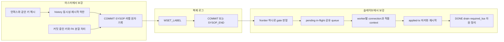

# 컨셉 설계에서 실제 구현까지 바뀐 내용

이 문서는 발표한 컨셉 설계와 현재 구현 사이의 차이를 설명한다. 독자는 [[6-1-cubrid-마스터-writeset-설계|마스터 컨셉 설계]]와 [[6-2-cubrid-슬레이브-병렬-적용-설계|슬레이브 컨셉 설계]]를 보았지만, 구현 과정의 리뷰와 장애 분석은 보지 않았다고 가정한다.

변경 하나는 다음 순서로 읽는다.

```text
컨셉 설계의 원안
  → 실제 구현
  → 바꾼 이유
  → 근거
  → 정합성·성능·운영 영향
```

근거 표기는 다음과 같다.

- **코드 확인**: 현재 브랜치의 함수와 자료구조에서 직접 확인했다.
- **검증 기록**: `_impl/_notes`, `fixes`, `review`의 재현·시험 결과가 있다.
- **커밋 근거**: 변경 목적이 커밋 제목과 diff에 남아 있다.
- **코드 기반 추정**: 위 세 근거에 명시적인 결정 이유가 없어 현재 호출 관계와 불변식으로 추정했다.

이 문서에서 자주 쓰는 용어는 다음 세 가지다.

- **dependency**: 현재 적용 단위보다 먼저 완료돼야 하는 마스터 로그 위치다. `WSET_LABEL.dependency_seq`로 전달한다.
- **history**: 마스터가 충돌 키별 마지막 WRITE·REF COMMIT 위치를 보관하는 메모리 map이다.
- **frontier**: 슬레이브가 로그 앞에서부터 빈틈없이 적용을 끝낸 마지막 적용 경계다. 적용 경계는 COMMIT 또는 라벨이 붙은 SYSOP_END의 LSA다. 뒤 경계가 먼저 끝나도 앞에 미완료 경계가 있으면 전진하지 않는다.

현재 동작의 전체 명세는 [[01-master-implementation-design|01 마스터 구현 설계]]와 [[02-slave-implementation-design|02 슬레이브 구현 설계]]가 담당한다. 이 문서는 같은 내용을 반복하지 않고 **왜 달라졌는지**에 집중한다.

## 1. 변경 지형도

초기 설계의 큰 방향은 유지됐다. 마스터는 제약 키로 dependency를 만들고, 슬레이브는 dependency를 지키면서 독립 트랜잭션을 worker에 보낸다. 실제 구현에서는 그 사이의 실패·재시작·동시성 경계를 닫기 위해 구조가 늘었다.



가장 큰 결정 변경은 세 가지다.

1. 충돌 키는 단순 packed bytes가 아니라 **B-tree가 같다고 판단하는 값**을 만들어야 한다.
2. `dependency_is_ref`로 대기 방식을 나누지 않고, 모든 라벨을 **연속 완료 경계(frontier)** 로 판정한다.
3. 재시작 중복 적용은 제한적 error-skip이 아니라 **데이터와 함께 커밋하는 applied-tx 마커**로 판정한다.

## 2. 마스터 구현에서 바뀐 내용

마스터의 기본 역할은 제약 키를 모아 dependency를 기록하고, COMMIT LSA를 history에 게시하는 것이다. 실제 구현에서는 인덱스 동등성, history 동시성, 재시작과 SYSOP·2PC까지 이 순서 보장의 범위를 넓혔다.

### 2.1 충돌 식별자에서 클래스 OID를 제거했다

- **원안**: `H(class_oid, index VFID, normalized key)`로 클래스와 인덱스를 함께 구분한다.
- **구현**: `H(index VFID, index와 같은 의미로 정규화한 key)`를 사용한다. 부모 PK의 WRITE와 자식 FK의 REF도 같은 부모 인덱스 VFID를 사용한다.
- **이유**: 상속 계층의 여러 클래스가 물리적으로 같은 UNIQUE 인덱스를 공유할 수 있다. 클래스 OID를 넣으면 같은 인덱스·같은 값인데도 다른 해시가 되어 충돌을 놓친다.
- **근거**: [[fixes/10-inherited-index-writeset-key|상속 공유 인덱스 분석]], 커밋 `0ab0a6173`, `6c6fe71a8`; `writeset_key_hash.cpp`.
- **영향**: 같은 물리 인덱스의 충돌은 클래스가 달라도 만난다. 서로 다른 인덱스는 VFID로 계속 분리된다.

### 2.2 키 해시를 B-tree 비교 의미에 맞췄다

- **원안**: 문자열은 collation을 반영하고, 그 밖의 값은 packed image를 해시한다.
- **구현**: 인덱스가 같은 값으로 보는 표현을 타입별로 맞춘다.
  - 문자열은 collation pseudo key를 쓰고 인덱스가 무시하는 뒤쪽 문자를 제외한다.
  - `FLOAT`·`DOUBLE`의 `-0.0`은 `+0.0`과 같게 만든다.
  - `TIMESTAMPTZ`·`DATETIMETZ`는 인덱스 비교에 들어가지 않는 zone을 제외한다.
  - 복합 키의 각 원소는 `MAX_ALIGNMENT` 경계에서 패킹한다.
  - 복합 FK REF는 자식 FK의 각 원소를 대응하는 부모 PK 원소 domain으로 변환한 뒤 부모 복합 PK와 같은 MIDXKEY로 해시한다. MATCH SIMPLE에서 원소 하나라도 NULL이면 부모 참조가 없으므로 REF를 만들지 않는다.
  - NaN은 하나의 동치 해시로 표현할 수 없어 그 트랜잭션을 commit-order로 보낸다.
- **이유**: 같은 인덱스 키가 다른 해시가 되는 false negative는 필요한 dependency를 없앤다. packed bytes가 같아 보이는지만으로는 인덱스의 collation·타입 비교와 일치하지 않는다.
- **근거**: 커밋 `cf8955a91`, `17aae152e`, `b717e2688`, `357f0568a`, `fc4b08eb3`; [[fixes/12-index-equal-key-hash-survey|동일 키 해시 조사]], [[_notes/07-poc-productization-followups|제품화 보완]].
- **영향**: 해시는 단순 직렬화 최적화가 아니라 정합성 경계가 됐다. 지원하지 못하는 값은 조용히 누락하지 않고 DML 오류 또는 commit-order 폴백으로 처리한다.

### 2.3 로컬 writeset과 전역 history를 모듈로 분리했다

- **원안**: `LOG_TDES.ws_hashes`와 전역 history map을 한 writeset 구성요소로 설명했다.
- **구현**: 트랜잭션 키 수집, 키 해시, dependency 순서 계산, history map, 설정, trace, 통계를 별도 모듈로 나눴다. 전역 history는 transaction table 준비·최종 해제 경로에 연결하고, `wset_History_initialized`로 잠금과 map의 중복 초기화·해제를 막는다.
- **이유**: 로컬 목록은 트랜잭션 생명주기이고, history는 서버 생명주기와 잠금 규칙을 가진다. 한 파일에 두면 공개 API와 내부 TBB accessor가 섞이고 초기화·정리 책임도 모호해진다.
- **근거**: [[_notes/05-modularization-analysis|모듈화 분석]], [[_notes/writeset-module-boundary-review|모듈 경계 리뷰]], 커밋 `865d9a3c2`, `a1c7c09bc`.
- **영향**: 호출자는 TBB를 알지 않고 `writeset_history` API만 사용한다. 구현 문서와 단위 테스트도 모듈 책임별로 나뉜다.

### 2.4 history clear와 probe에 같은 세대의 스냅샷을 보장했다

- **원안**: map이 가득 차면 비우고 `history_start`를 올린다고만 정의했다.
- **구현**:
  - 키별 probe·publish는 map 공유 잠금과 TBB 키 accessor를 쓴다.
  - 전체 clear는 `seq_lock`과 map 배타 잠금을 함께 잡는다.
  - clear의 하한은 clear를 수행한 트랜잭션 하나가 아니라, 그 시점까지 기록된 가장 큰 COMMIT LSA(`prev_commit_lsa`)다.
  - probe는 `history_start`, `prev_commit_lsa`, map을 clear 전 세대 또는 clear 후 세대 중 하나로만 읽는다.
  - 여러 트랜잭션이 공유 잠금 아래에서 동시에 게시할 때는 `wset_Publish_reserved`로 게시할 키 수를 먼저 예약한다. `map size + 전체 예약량`이 상한을 넘으면 배타 clear 경로로 전환한다.
- **이유**: COMMIT 순서와 publish 완료 순서는 다를 수 있다. 늦게 publish한 과거 트랜잭션이 clear하면서 더 최신 slot을 지우거나, probe가 clear 전 map과 clear 후 하한을 섞어 읽으면 dependency가 낮아진다.
- **근거**: [[_notes/06-history-clear-concurrency|history clear 동시성]], [[_notes/07-probe-snapshot-consistency|probe 스냅샷]], `writeset_history.cpp`.
- **영향**: 키별 접근의 병렬성은 유지하고, 드문 전체 clear에서만 전역 배타 구간을 사용한다. 동시에 시작한 게시가 각각의 검사만 통과해 history 상한을 넘는 경우도 막는다.

### 2.5 폴백은 불완전한 writeset을 사용하지 않는다

- **원안**: overflow나 키 변환 실패 때 직전 COMMIT 기준으로 보수 처리한다.
- **구현**:
  - 키 수 한도, statement 복제, NaN은 이유를 기록하고 로컬 키 전체를 버린 뒤 commit-order로 보낸다.
  - serial PK 인덱스를 아직 얻지 못한 경우도 statement 계열 폴백으로 분류한다.
  - 메모리 부족, 도메인 변환, 복합 키 추출처럼 키 생성 자체가 실패하면 폴백하지 않고 DML 오류를 반환한다.
  - 폴백 dependency는 `prev_commit_lsa`뿐 아니라 `history_start`보다도 낮아지지 않는다. COMMIT 뒤에는 키별 map을 비우고 하한을 유지한다.
- **이유**: A·B·C가 같은 키로 이어질 때 B의 키 일부만 빠지고 정상 writeset처럼 커밋하면 A→C만 연결되어 B의 순서를 잃는다. 안전한 폴백은 트랜잭션 전체를 한 경로로 바꿔야 한다.
- **근거**: `writeset.cpp`, `writeset_types.hpp`; [[_notes/07-poc-productization-followups|제품화 보완]], [[review/CBRD-27508_review_issues/C2_overflow_label_missing_history_floor|C2]], 커밋 `028a2bd0a`, `cc88f37a5`.
- **영향**: 폴백은 병렬성을 낮출 뿐 순서를 누락하지 않는다. 원인별 통계로 병렬성 손실 이유를 구분한다.

### 2.6 dependency 라벨에서 `dependency_is_ref`를 제거했다

- **원안**: WRITE slot에서 온 dependency는 특정 완료를, REF slot에서 온 dependency는 그 LSA까지의 연속 완료를 기다리도록 플래그를 전달한다.
- **구현**: 라벨은 `dependency_seq` 하나만 전달하고, 슬레이브는 모든 라벨을 `dependency_seq <= frontier`로 판정한다. completed 상태는 frontier를 전진시키는 내부 상태로만 쓴다. 다만 마스터 내부의 `candidate_is_ref`는 남아 있다. 마지막 후보가 `ref_seq`에서 왔으면 여러 참조 트랜잭션의 상한이므로 그대로 라벨에 쓰고, 그 밖의 후보는 `prev_commit_lsa`와의 경계를 적용하되 `history_start` 아래로 내리지 않는다. 즉 **전송 플래그만 제거**한 것이다.
- **이유**: 특정 완료만 확인하는 지름길은 그 완료가 다른 선행 사슬 위에 있지 않을 때 중간 트랜잭션을 건너뛸 수 있었다. 실제 순서 역전 예에서 한 개의 최댓값과 출처 플래그만으로는 전체 선행 집합을 표현하지 못했다.
- **근거**: [[_notes/11-dependency-label-design|dependency 라벨 재설계]]의 A1 결정, 커밋 이력의 `dependency_is_ref` 제거; `log_record.hpp`, `log_applier_gate.cpp`.
- **영향**: gate가 한 조건으로 단순해지고 정합성 논증이 쉬워졌다. 일부 트랜잭션은 개별 완료 지름길보다 더 기다리지만, pending list 때문에 뒤의 독립 트랜잭션까지 막지는 않는다.

### 2.7 라벨 결정과 COMMIT 기록을 같은 로그 잠금 구간에 넣었다

- **원안**: COMMIT 직전에 probe하고 `REPL → WSET_LABEL → COMMIT` 순서로 기록한다.
- **구현**: dependency 계산, 복제 레코드, WSET_LABEL, COMMIT 기록, `prev_commit_lsa`·폴백 하한 갱신을 `prior_lsa_mutex` 안에서 수행한다. 키 publish는 COMMIT 뒤, 행 잠금과 MVCCID self-lock을 풀기 전에 수행한다.
- **이유**: probe와 COMMIT 사이에 다른 COMMIT이 끼면 라벨이 실제 직전 상태를 놓친다. 반대로 키 수만큼 history를 갱신하는 publish까지 전역 로그 잠금 안에 두면 모든 로그 기록이 오래 멈춘다.
- **근거**: 커밋 `7a4ab074d`, `913171f58`, `787defb50`; `log_manager.c`의 local commit 경로.
- **영향**: 로그 순서 결정은 원자적이고, 키별 publish는 병렬로 수행된다. 같은 키의 다음 DML은 행·MVCC 잠금 때문에 publish 완료 뒤에만 COMMIT 경로에 온다.

### 2.8 서버 재시작은 복구된 로그 끝을 history 하한으로 삼는다

- **원안**: 프로세스 메모리 history를 재시작 뒤 어떻게 연결할지는 초기 컨셉에 없었다.
- **구현**: recovery가 끝나면 `history_start`를 복구된 로그의 끝으로 올린다. 재시작 전 키별 map은 복원하지 않고, 이후 라벨은 이 하한 아래로 내려가지 않는다.
- **이유**: map이 빈 상태에서 재시작 뒤 트랜잭션이 dependency 없음으로 기록되면 재시작 전 트랜잭션과의 순서를 잃는다. history 전체 영속화보다 전역 경계 하나가 단순하고 보수적이다.
- **근거**: [[12-cub_server-재시작|cub_server 재시작 설계]], [[_notes/05-cub-server-restart-barrier|초기 대안과 폐기 기록]], `log_manager.c`의 restart barrier.
- **영향**: 재시작 직후 일부 독립 트랜잭션도 이전 epoch 완료를 기다리지만, 이전·이후 epoch의 순서는 끊기지 않는다. 복구 로그 끝은 적용 경계가 아닐 수 있으므로 슬레이브는 현재 task보다 앞서 읽은 마지막 적용 경계로 라벨을 낮춘다. 이 경계는 COMMIT 또는 라벨이 붙은 SYSOP_END다. 낮추지 않으면 frontier가 존재하지 않는 LSA에 도달하지 못해 task가 자기 자신을 기다린다([[review/CBRD-27508_review_issues/C1_master_restart_floor_gate_stall|C1]], 커밋 `285786829`).

### 2.9 SYSOP_END를 별도 commit-order 적용 경계로 만들었다

- **원안**: 일반 트랜잭션 COMMIT 중심으로 probe·label·publish를 설명했고, develop이 중간 적용 경계로 쓰는 SYSOP_END는 빠져 있었다.
- **구현**:
  - 복제 레코드가 SYSOP 경계에서 확정되면 `WSET_LABEL → LOG_SYSOP_END`를 같은 로그 잠금 구간에 기록한다.
  - SYSOP dependency는 `max(prev_commit_lsa, history_start)`이고, 기록 뒤 `history_start`를 SYSOP_END까지 올린다.
  - serial 키는 수집하지만, 독립 top operation은 완전한 충돌 집합을 보장할 수 없어 commit-order 장벽으로 처리한다.
  - 이미 로그로 flush 표시된 복제 레코드는 표시한 SYSOP_END에서만 기록해 중복 경계를 만들지 않는다.
  - SYSOP 시작 때 로컬 writeset 위치를 표시하고, 라벨을 붙여 독립 적용한 SYSOP 또는 ABORT·부분 rollback으로 사라진 변경의 뒤쪽 키는 바깥 COMMIT의 writeset에서 제거한다. 다만 해당 SYSOP에서 이미 commit-order 폴백한 사실은 안전을 위해 바깥 트랜잭션에 남긴다.
- **이유**: develop은 SYSOP_END에서 항목을 중간 적용한다. 병렬 reader가 이를 무시하거나 바깥 COMMIT까지 임의로 누적하면 serial·INCR/DECR·checksumdb의 생존 범위와 순서가 달라진다.
- **근거**: [[_notes/10-sysop-end-investigation|SYSOP_END 조사와 결정]], 커밋 `3fb54e549`, `501e5f315`; `log_sysop_commit_internal()`.
- **영향**: SYSOP은 병렬성을 일부 제한하지만 앞뒤 트랜잭션이 경계를 건너뛰지 않는다. 슬레이브는 라벨이 붙은 SYSOP_END를 fragment task로 적용한다(3.6절).

### 2.10 커밋 중인 키와 분할 부모 FK를 실제 충돌 대상으로 맞췄다

- **원안**: 부모 PK WRITE와 자식 FK REF가 같은 해시에서 만난다는 정적 관계를 설명했다.
- **구현**:
  - FK·UNIQUE 검사 중 다른 트랜잭션이 같은 키를 커밋 중이면 그 COMMIT을 기다린다.
  - 분할 부모를 참조하는 FK REF는 root가 아니라 실제 키를 보유한 partition의 인덱스 공간을 사용한다.
- **이유**: 검사 시점에 커밋 중인 inserter/deleter를 단순히 없음으로 보면 마스터의 허용 결과와 history 게시 순서가 어긋난다. 분할 부모의 WRITE와 REF가 다른 VFID를 쓰면 slave에서 충돌을 놓친다.
- **근거**: [[review/CBRD-27508_review_issues/C3_fk_check_committing_inserter|C3]], [[review/CBRD-27508_review_issues/C11_partitioned_parent_fk_key_mismatch|C11]], develop `CBRD-27034`, 커밋 `8a23bb8f6`, `5ebe894ef`, `f7078fe07`, `b84567f36`.
- **영향**: FK 검사 결과와 writeset dependency가 같은 커밋 순서를 본다. 분할 테이블도 부모·자식 순서를 보존한다.

### 2.11 2PC도 일반 COMMIT과 같은 dependency 경로를 탄다

- **원안**: 1PC local commit 경로만 구체화했다.
- **구현**: 2PC 완료 경로도 복제 정보와 라벨을 기록하고 COMMIT LSA로 history를 게시하는 공통 완료 함수를 사용한다. 준비된 트랜잭션을 loose-end descriptor로 옮길 때 로컬 키 목록, 폴백 상태·사유와 dependency도 함께 복사한다.
- **이유**: 2PC가 null dependency로 나가고 키를 history에 게시하지 않으면 해당 트랜잭션과 뒤의 같은 키 트랜잭션이 모두 독립으로 보인다.
- **근거**: [[fixes/06-2pc-commit-dependency|2PC dependency 분석]], 현재 `log_complete_for_2pc()` 호출 경로.
- **영향**: 분산 트랜잭션도 일반 복제 트랜잭션과 같은 순서 정보에 포함된다.

### 2.12 로컬 writeset은 rollback 범위와 함께 줄어든다

- **원안**: ABORT한 트랜잭션은 publish하지 않는다고만 설명했고, savepoint·SYSOP 부분 rollback 뒤 로컬 키 목록은 구체화하지 않았다.
- **구현**: 각 `LOG_WSET_ENTRY`에 수집 당시 LSA를 함께 보관한다. `repl_log_abort_after_lsa()`가 복제 항목을 제거하는 경계에서 `wset_discard_keys_after_lsa()`도 같은 경계 이후 키를 제거한다.
- **이유**: 되돌린 변경의 키를 바깥 COMMIT에 게시하면 실제로 존재하지 않는 순서를 history에 남긴다. 특히 독립 SYSOP 키를 바깥 COMMIT 위치에 다시 게시하면 SYSOP_END에서 이미 확정된 적용 경계와 어긋난다.
- **근거**: **코드 확인** — `LOG_WSET_ENTRY.lsa`, `wset_discard_keys_after_lsa()`, `log_sysop_commit_internal()`과 rollback 호출 경로. 명시적인 별도 결정 note는 없어 세부 배치 이유는 **코드 기반 추정**이다.
- **영향**: rollback된 키가 뒤 트랜잭션에 불필요한 dependency를 만들지 않고, SYSOP와 바깥 COMMIT의 키 소유 범위가 분리된다.

## 3. 슬레이브 구현에서 바뀐 내용

슬레이브의 기본 역할은 라벨을 task로 옮기고, dependency를 만족한 task만 worker에 넘긴 뒤, 완료 결과로 안전한 적용 위치를 전진시키는 것이다. 실제 구현에서는 task 소유권, 재시작 중복 적용, 종료와 관측까지 이 생명주기에 포함했다.

### 3.1 하나의 reader가 coordinator 역할까지 맡는다

- **원안**: reader, coordinator, worker를 개념적으로 나누어 설명했다.
- **구현**: applylogdb 메인 스레드 하나가 로그 읽기와 task 조립, gate 판정, queue 배정, result 수거, retire, apply info 저장을 모두 맡는다. 구현 문서에서는 이 역할을 `coordinator`로 통일한다.
- **이유**: 로그 순서 상태와 `LA_INFO`, 트랜잭션 슬롯은 기존 메인 스레드 소유다. 별도 coordinator 스레드를 추가하면 같은 상태에 새 잠금과 전달 queue가 필요하다.
- **근거**: `log_applier.c`; [[_notes/08-applier-worker-design|worker 모듈 설계]].
- **영향**: coordinator 전용 자료는 잠금 없이 다룬다. task/result queue와 worker 현재 상태만 스레드 간 공유한다.

### 3.2 task는 복제 항목을 복사하지 않고 트랜잭션 슬롯을 가리킨다

- **원안**: 완성된 transaction task가 변경 목록을 가진다고 표현했다.
- **구현**: `LA_TASK.apply`가 기존 `LA_APPLY` 슬롯을 가리킨다. coordinator는 worker result가 retire될 때까지 슬롯을 재사용하지 않고, worker는 그 포인터의 항목을 적용하며 해제한다.
- **이유**: 복제 항목과 key image를 다시 복사하면 메모리와 소유권 전환 비용이 커진다. 반대로 슬롯을 일찍 재사용하면 worker가 해제된 목록을 읽는다.
- **근거**: `log_applier_task.hpp`, `log_applier_inflight.cpp`; [[_notes/09-applier-in-flight-design|in-flight 설계]].
- **영향**: task 복사는 작지만, 슬롯의 수명은 retire까지 연장된다. `required_lsa`도 pending·in-flight task가 가리키는 슬롯을 포함해야 한다.

### 3.3 완료 관리를 commit-order ring과 in-flight list로 나눴다

- **원안**: pending·running·completed 상태와 연속 완료 경계를 개념적으로 설명했다.
- **구현**:
  - commit-order ring은 로그 순서의 적용 경계 LSA와 완료 여부를 보관해 frontier를 계산한다. 이름은 commit-order지만 라벨이 붙은 SYSOP_END도 들어간다.
  - in-flight list는 worker에 넘긴 task와 result를 배정 순서(`seq`)로 대응시키고 head부터 retire한다.
  - result는 완료 순서대로 오지만 retire는 배정 순서대로 한다.
  - in-flight가 가득 찼을 때는 새 result를 기다리기 전에 이미 완료된 head부터 retire한다. 그렇지 않으면 목록은 완료 task로 가득 찼는데 앞으로 올 result가 없어 영구 대기할 수 있다.
- **이유**: commit 순서, worker 배정 순서, 완료 순서는 서로 다르다. 한 자료구조가 세 순서를 모두 대표하면 안전 LSA와 슬롯 반환 중 하나가 틀어진다.
- **근거**: [[_notes/09-applier-in-flight-design|in-flight 설계]], 커밋 `c1674aaa5`; `log_applier_gate.cpp`, `log_applier_inflight.cpp`.
- **영향**: `committed_lsa`는 frontier만 따라가고, 슬롯은 in-flight head부터 안전하게 반환된다.

### 3.4 gate는 frontier 하나만 보고, 막힌 task는 별도 pending list에 둔다

- **원안**: dependency 없음, 특정 선행 완료, REF 연속 완료의 세 판정을 사용했다.
- **구현**: 모든 task는 `dependency_seq <= frontier` 하나로 판정한다. 통과하지 못하거나 task queue가 가득 찬 task는 pending list에 두고, coordinator는 뒤 로그를 계속 읽는다. 마스터 재시작 floor처럼 현재 task 앞의 마지막 적용 경계보다 높은 라벨은 그 경계로 낮춘 뒤 ring에 넣는다.
- **이유**: 2.6절의 개별 완료 지름길 결함을 제거하면서도 MySQL식 head blocking은 피해야 했다. 판정과 대기 보관을 별도 모듈로 나누면 뒤의 독립 task를 계속 찾을 수 있다.
- **근거**: [[_notes/11-dependency-label-design|A1 결정]], `log_applier_gate.cpp`, `log_applier_pending.cpp`.
- **영향**: gate 정합성은 단순해지고, pending 앞의 장기 트랜잭션이 뒤의 독립 task를 막지 않는다.

### 3.5 worker별 queue 대신 공유 task/result queue를 사용한다

- **원안**: worker 선택과 worker queue 배정을 개념적으로 표현했다.
- **구현**: coordinator 한 명이 공유 task ring에 넣고 여러 worker가 경쟁해 꺼낸다. 여러 worker의 result도 공유 result ring으로 돌아온다. task queue는 1024, commit-order ring·in-flight·result queue는 `worker_count × 1024` 용량이다. worker 수만 `ha_apply_worker_count`(기본 1, 최대 `HB_MAX_APPLY_WORKER_COUNT`)로 기동 시 정하고 queue 단위 용량은 고정한다.
- **이유**: worker별 queue는 부하 편향과 worker 선택 정책을 추가한다. 공유 queue는 먼저 빈 worker가 가져가므로 별도 스케줄러 없이 부하를 분산한다.
- **근거**: [[_notes/08-applier-worker-design|worker·queue 설계]], `log_applier_task_queue.cpp`, `log_applier_result_queue.cpp`.
- **영향**: 특정 worker affinity는 없다. 같은 트랜잭션의 SYSOP fragment와 바깥 COMMIT 순서는 dependency로 보장하고, 같은 session에 묶는 방식은 사용하지 않는다.

queue와 ring은 무한히 커지지 않는다. commit-order ring이 가득 차면 coordinator는 로그 읽기를 멈추고 result 수거·frontier 전진만 수행한다. 가장 오래된 ring 항목의 dependency는 이미 frontier 이하로 보정돼 있으므로 worker가 살아 있는 동안에는 앞 항목이 끝나고 공간이 생긴다. 이 backpressure는 reader가 worker보다 빠를 때 메모리 사용량을 제한하기 위해 구현 과정에서 추가됐다(**코드 확인** — `la_coordinator_wait_for_commit_order_slot()`, `LA_COMMIT_ORDER_CAPACITY`).

### 3.6 라벨이 붙은 SYSOP_END를 fragment task로 적용한다

- **원안**: COMMIT 단위 task가 중심이었고 SYSOP 중간 적용은 범위 밖이었다.
- **구현**: coordinator는 SYSOP_END 이하의 복제 항목을 바깥 `LA_APPLY`에서 떼어 별도 fragment 슬롯과 task를 만든다. fragment 결과가 SYSOP_END LSA를 완료 처리하고, 바깥 COMMIT은 마지막 fragment LSA를 dependency로 포함한다. 라벨은 있으나 적용 항목이 없는 SYSOP_END도 task 없이 ring에서 완료 처리해, 뒤 task가 존재하지 않는 worker result를 기다리지 않게 한다.
- **이유**: develop의 SYSOP_END는 중간 적용 경계다. 최종 COMMIT까지 무조건 누적하면 바깥 ABORT에서도 살아야 하는 serial 변경의 의미가 달라지고, coordinator가 직접 적용하면 worker 커밋과 경쟁한다.
- **근거**: [[_notes/10-sysop-end-investigation|SYSOP 조사·대안·결정]], 커밋 `3fb54e549`; `la_coordinator_process_sysop_end()`.
- **영향**: SYSOP fragment도 일반 task와 같은 gate·queue·result·frontier 경로를 탄다. 종료 때 retire되지 않은 fragment 전용 슬롯을 별도로 해제한다.

### 3.7 worker는 자기 DB connection과 적용 context를 가진다

- **원안**: worker가 트랜잭션 전체를 한 DB 트랜잭션으로 적용한다고만 정의했다.
- **구현**: worker마다 `db_restart_sub()`로 sub-client를 열고, 오류 context, unzip buffer, RECDES pool, applied-marker statement를 따로 가진다. 로그 page pin 목록도 worker thread별 저장소를 사용한다. connection 시작은 기존 client 전역 초기화 때문에 mutex로 직렬화한다. coordinator는 모든 worker의 READY를 기다리지 않는다. thread가 생성된 뒤 session 또는 apply context 초기화에 실패한 worker만 live count에서 빠지고, 하나라도 살아 있으면 공유 queue를 계속 처리하며 마지막 worker가 빠질 때 전체 종료를 요청한다. `pthread_create()` 자체가 실패하면 시작 함수가 실패하고, caller의 종료 경로가 이미 만든 thread에 종료를 알린 뒤 join한다.
- **이유**: 기존 applylogdb의 client 상태와 압축·레코드 버퍼는 단일 스레드를 전제로 했다. 그대로 공유하면 offset·오류 context·page fix·버퍼가 서로 덮인다.
- **근거**: [[_notes/04-cs-worker-pool-analysis|CS worker 분석]], [[_notes/08-applier-worker-design|worker 설계]], `applier/log_applier_worker.cpp`와 `la_stop_apply_workers()`.
- **영향**: worker가 독립 트랜잭션을 실제로 동시에 COMMIT할 수 있다. `MULTI_CONN_TO_A_SERVER`가 없으면 worker를 1개로 제한하고 coordinator와 client를 번갈아 쓴다.

이 구조는 writeset 코드만으로 성립하지 않는다. multi-connection 기반 브랜치가 인증·trigger·session parameter·network state·error context 등 기존 client 전역 상태를 sub-client별 또는 thread-local 상태로 바꿨고, 현재 브랜치는 그 API를 worker 수명주기에 연결했다. 근거는 develop 병합 커밋 `53fe1a6d13`과 `db_restart_sub()`·`db_shutdown_sub()` 호출 경로다.

### 3.8 worker 1개는 commit order로만 적용한다

- **원안**: worker 수와 무관하게 같은 dependency gate를 사용한다.
- **구현**: worker가 하나면 pending을 사용하지 않고 모든 task를 FIFO task queue에 넣는다. multi-connection이 없는 빌드는 task 하나가 retire될 때까지 coordinator가 기다린다.
- **이유**: worker가 하나인데 pending task 뒤 독립 task를 먼저 넣으면 실제 적용 순서가 master commit order와 달라진다. 병렬 이득도 없으므로 직렬 의미를 유지하는 편이 안전하다.
- **근거**: [[fixes/05-single-worker-serial|single-worker 분석]], 커밋 `6dd13450b`; `la_coordinator_submit_task()`.
- **영향**: 기본값 1은 develop과 같은 순서 특성을 제공하고, worker 수를 늘릴 때만 병렬 배정이 시작된다.

### 3.9 worker 결과 대기는 종료 요청을 주기적으로 확인한다

- **원안**: result queue에서 완료 결과를 기다린다고만 정의했다.
- **구현**: coordinator는 result를 100ms 단위로 기다리고 매번 종료 요청을 확인한다. 시작 실패로 살아 있는 worker가 0이 되거나 worker가 서버 연결 오류를 만나면 전체 종료를 요청한다.
- **이유**: 무기한 condition wait 중 마지막 worker가 빠지면 앞으로 올 result가 없어 SIGTERM도 처리하지 못한다.
- **근거**: [[review/CBRD-27508_review_issues/C4_coordinator_result_wait_ignores_shutdown|C4]], 커밋 `bb5bd7082`; result wait 경로.
- **영향**: 실패 시 hang 대신 재시작 가능한 종료로 전환한다.

### 3.10 적용 데이터 COMMIT과 apply info COMMIT의 간극을 마커로 메웠다

- **원안**: `committed_lsa` 이전의 연속 완료만 영속하고 재시작 범위를 다시 적용하며 제한된 오류를 skip한다.
- **구현**: worker는 실제 적용 항목이 있는 task(`total_rows > 0`)에 대해, 적용 데이터와 같은 DB 트랜잭션에 task의 적용 경계 LSA를 담은 `ha_applied_tx_marker` 행을 기록한다. 일반 task는 COMMIT LSA, SYSOP fragment task는 SYSOP_END LSA를 쓴다. coordinator의 apply info가 뒤처진 채 죽으면 다음 실행이 현재 copied-log path의 마커를 모두 읽어 이미 적용한 task를 통째로 건너뛴다. 행 DML과 statement도 같은 마커 방식으로 처리한다. 처음에는 statement 전용 단일 마커와 recovery range 직렬화를 각각 도입했지만, task별 마커가 두 역할을 대체해 제거했다.
- **이유**: worker 데이터 COMMIT과 coordinator apply info COMMIT은 원자적이지 않다. PK·UNIQUE UPDATE를 다시 실행하면 단순 duplicate/no-object skip만으로 원래 결과를 복원할 수 없다.
- **근거**: [[fixes/08-applied-tx-marker|applied-tx marker]], [[review/CBRD-27508_review_issues/C17_recovery_range_statement_reapply|C17]], 커밋 `72650ce0d`, `d398beba2`, `fe230a932`.
- **영향**: 재시작 멱등성 판단 단위가 개별 오류에서 task 완료 표식으로 바뀌었다. 마커는 apply info 저장과 같은 coordinator 트랜잭션에서 `committed_lsa` 이하만 지우며, 통계 저장 실패로 apply info가 abort되면 마커도 남긴다. 기동 때 일부 마커만 읽은 상태로 worker를 시작하지 않고 전체 로드 실패로 처리한다. marker DELETE는 잠금 승격으로 worker INSERT와 교착할 수 있어 coordinator COMMIT 직전 마지막 SQL로 실행한다.

### 3.11 `required_lsa`가 pending·in-flight fragment까지 포함한다

- **원안**: 미완 트랜잭션의 `LA_APPLY.start_lsa` 최솟값을 보존한다.
- **구현**: 트랜잭션 슬롯뿐 아니라 pending list와 in-flight list가 가진 fragment 슬롯의 `start_lsa`도 함께 훑는다.
- **이유**: 바깥 트랜잭션이 ABORT되어 원래 슬롯이 비어도, 이미 분리한 SYSOP fragment는 worker queue·pending·in-flight에 남을 수 있다. 이를 빼면 필요한 archive log를 먼저 삭제한다.
- **근거**: [[fixes/02-required-lsa-fragments|required_lsa fragment 분석]], `la_find_required_lsa()`.
- **영향**: reader가 앞서가도 미완 task가 참조하는 로그는 보존된다.

### 3.12 DONE 전환은 모든 읽은 작업이 끝날 때까지 보류한다

- **원안**: 역할 전환 시 queue를 drain한 뒤 DONE으로 바꾼다.
- **구현**: pending list, in-flight list, commit-order ring이 모두 비어야 drain 완료다. DONE 조건을 먼저 만나도 `holding done`으로 두고 result 수거·retire를 계속한다. 임의 30초 timeout으로 강제 해제하지 않는다.
- **이유**: 읽은 로그가 남은 상태에서 DONE과 dbname lock 해제를 먼저 하면 다른 applier가 같은 DB에 쓰거나 승격 DB가 미적용 데이터를 노출한다. 시간 초과는 정합성 기준이 될 수 없다.
- **근거**: [[fixes/01-done-deferred|DONE 보류]], [[review/CBRD-27508_review_issues/C6_failover_drain_backstop_never_runs|timeout 제거]], 커밋 `52b3b130e`.
- **영향**: role change가 장기 트랜잭션만큼 늦어질 수 있지만, 완료되지 않은 작업을 버리고 승격하지 않는다.

### 3.13 dbname lock을 실제 쓰기 task 앞에서 다시 잡는다

- **원안**: applylogdb 기동 시 DB 소유권 잠금을 잡는 기존 흐름을 유지했다.
- **구현**: 복제 항목이 있는 task를 queue에 넣기 전에 dbname lock을 확인·획득하고, drain 완료 뒤에만 푼다.
- **이유**: HA 상태 전환으로 lock을 놓은 뒤 같은 프로세스가 다시 적용을 시작할 수 있다. 시작 때 한 번만 잡으면 이후에는 소유권 없이 쓸 수 있다.
- **근거**: [[review/CBRD-27508_review_issues/C5_dbname_lock_taken_once|C5]], 커밋 `345300457`.
- **영향**: 동시에 같은 slave DB를 쓰는 applier가 하나라는 기존 보장을 task 실행 시점에도 유지한다.

### 3.14 항목 오류와 flush 오류를 트랜잭션 경계에서 처리한다

- **원안**: worker가 트랜잭션을 적용하고 오류를 result로 돌려준다고 정의했다.
- **구현**:
  - 서버 연결·flush 오류는 task 실패로 worker result에 올려 applier를 멈춘다.
  - retry 목록의 항목 오류는 같은 항목을 다시 시도한다. 그 밖의 항목 오류는 기존 develop 정책처럼 fail 통계와 로그에 남기고 다음 항목으로 진행한다.
  - 마지막 항목의 비치명 오류가 task 전체 오류로 남지 않게 한다.
  - 서버의 복제 force가 교착 희생 오류를 만나면 같은 호출의 다음 항목으로 넘어가지 않고 호출 전체를 실패시킨다.
- **이유**: 마지막 항목 값만 함수 반환값으로 남으면 앞 항목과 같은 정책인데도 트랜잭션 전체가 중단된다. 반대로 교착 희생 뒤 잠금을 가진 채 다음 항목을 기다리면 교착을 끊지 못한다.
- **근거**: [[fixes/04-item-error-policy|항목 오류 정책]], `locator_sr.c`, worker flush 경로.
- **영향**: 항목 오류 정책과 task COMMIT 여부가 develop과 일관되고, 치명 오류는 result를 통해 applier 전체를 안전하게 멈춘다. 비치명 항목 오류는 해당 행이 빠진 부분 COMMIT이 될 수 있으며 `fail_counter`와 error log로 관측한다.

### 3.15 기존 단일 스레드 공유 자원을 worker-safe하게 바꿨다

- **원안**: worker 적용을 블랙박스로 보았기 때문에 기존 client 전역 자원의 경쟁은 다루지 않았다.
- **구현**:
  - 같은 file descriptor를 읽는 경로는 `pread`/`pwrite`로 offset 경쟁을 없앤다.
  - SQL 로그 기록과 교체를 mutex로 직렬화한다.
  - 로그 page cache의 fix는 worker별 목록으로 추적해 같은 worker가 해제한다.
  - worker별 큰 RECDES 영역은 트랜잭션 뒤 바로 반환한다.
  - VSZ 메모리 검사의 기준 크기는 worker 시작 뒤에 측정한다.
  - copied-log page header 갱신과 archive 제거는 page cache mutex 아래에서 수행하고, 현재 copied log 끝을 조금 넘는 레코드는 즉시 손상으로 단정하지 않고 다음 복사분을 기다린다.
- **이유**: 모두 develop에서는 스레드 하나라 드러나지 않던 공유 상태다. 병렬화 뒤에는 파일 offset, 로그 문자열, page fix, malloc arena가 worker 사이에서 경쟁하거나 메모리 누수처럼 보인다.
- **근거**: [[review/CBRD-27508_review_issues/C13_sql_log_race|SQL 로그 경쟁]], [[review/CBRD-27508_review_issues/C16_vsz_memory_check_false_positive|VSZ 기준]], [[_notes/pagecache-race-analysis|page cache 분석]], 커밋 `bf560620e`, `9b2dd61b5`.
- **영향**: 병렬 적용의 정합성뿐 아니라 종료·재시작과 장시간 실행의 자원 안정성을 확보한다.

### 3.16 통계는 apply info와 같은 시점에 별도 시스템 테이블로 저장한다

- **원안**: trace로 dependency와 worker 동작을 검증하는 데 집중했다.
- **구현**: applier 전체와 worker별 통계를 `_db_ha_apply_stat`, `_db_ha_apply_worker_stat`에 저장하고 `applyinfo`가 출력한다.
  - task/result에 `CLOCK_MONOTONIC` 기준의 `created_ns`, `pending_begin_ns`, `ready_ns`, `queue_enter_ns`, `dequeue_ns`, `apply_begin_ns`, `apply_end_ns`, `collected_ns`를 이어 전달한다.
  - 이 시각으로 dependency 대기, 실행 가능한 뒤 worker가 가져갈 때까지의 대기, 실제 task queue 체류, 적용 완료 뒤 result 수거 지연, task 전체 지연을 각각 합산한다.
  - worker busy 시간, 로그 순서와 다른 완료 횟수, 현재·최대 동시 실행 worker 수, task queue·pending 최대 깊이와 동시 실행 worker 수별 누적 시간(`concurrency_usec`)을 기록한다.
  - `applyinfo`는 `total_worker_busy_usec / observation_usec`를 평균 병렬도, `total_worker_busy_usec / (worker_count × observation_usec) × 100`을 worker 활용률(%)로 출력한다.
  - worker busy·동시 실행 수와 worker별 적용 건수는 `has_items=true`인 실제 적용 task만 센다. 빈 COMMIT은 queue·result 수명은 지나가도 적용 작업량에는 포함하지 않는다.
  - 통계 갱신은 apply info 갱신 뒤 savepoint에서 수행하며, 실패해도 apply info를 되돌리지 않는다. worker result의 `total_rows`도 coordinator 누계에 합쳐 마지막 burst 뒤에 기존 apply-info 저장 조건이 동작하게 한다.
- **이유**: trace는 개별 실행을 재현하기에는 유용하지만 양이 많아 병목이 dependency 대기인지 worker 부족인지 coordinator의 result 수거 지연인지 장기 비교하기 어렵다. 단계별 시간과 동시 실행 분포가 있어야 worker 수를 늘렸을 때 실제 병렬도가 올랐는지 판단할 수 있다. 반대로 관측 기능 때문에 복제 진행 위치 저장이 실패해서는 안 된다.
- **근거**: [[_notes/03-ha-statistics-tables-design-근거|통계 설계 근거]], 커밋 `1d37565f7`, `d2ec8cbbe`, `9f9373252`; **코드 확인** — `LA_TASK`·`LA_RESULT`의 시각 필드, `log_applier_stat.cpp`, 시스템 카탈로그 정의와 `applyinfo` 출력. 단계별 지표를 선정한 상세 이유는 별도 note·커밋이 없어 위 호출 경계에 따른 **코드 기반 추정**이다.
- **영향**: dependency가 만든 대기와 worker·queue·coordinator가 만든 대기를 분리하고, 평균 병렬도·worker 활용률·out-of-order 완료를 운영 중 비교할 수 있다. 빈 COMMIT 때문에 병렬도가 부풀지 않는다. 마스터의 고빈도 카운터는 DB 테이블 대신 메모리와 `SHOW WRITESET STATUS`로 조회한다.

### 3.17 라벨이 없거나 읽히지 않을 때 독립 task로 만들지 않는다

- **원안**: 마스터가 항상 올바른 `WSET_LABEL`을 COMMIT 바로 앞에 기록한다는 정상 경로를 전제로 했다.
- **구현**:
  - 라벨 레코드가 page 경계 등으로 완전히 읽히지 않으면 `final_lsa`를 전진시키지 않고 같은 레코드를 다시 읽는다.
  - 복제 항목이 있는 COMMIT인데 같은 `trid`의 라벨을 찾지 못하면, 직전 ring tail을 dependency로 넣어 앞선 모든 적용 경계 뒤에서 실행한다.
  - 라벨 holder는 다음 COMMIT 또는 SYSOP_END 한 건이 소비하면 비운다.
- **이유**: 읽기 실패를 NULL dependency로 바꾸면 가장 위험한 경우가 가장 병렬적인 task가 된다. 마스터가 라벨을 기록하지 못한 비정상·혼합 버전 경로도 같은 문제가 있다.
- **근거**: **코드 확인** — `la_get_wset_label()`, `la_coordinator_set_commit_dependency()`; [[review/CBRD-27508_review_issues/C12_wset_label_read_failure|C12]], 커밋 `34b21c4a5`.
- **영향**: 라벨 오류는 재독하거나 commit-order로 보수 처리한다. 데이터 변경이 없는 unlabeled COMMIT은 기존처럼 dependency 없이 완료할 수 있다.

## 4. 구현하면서 추가된 교차 절차

앞 절은 마스터와 슬레이브로 나누었지만, 다음 항목은 두 쪽 배포·수명주기를 함께 봐야 한다.

### 4.1 로그 레코드 형식은 양 노드가 동시에 이해해야 한다

- **원안**: 마스터와 슬레이브가 같은 `WSET_LABEL` 형식을 사용한다고 전제했다.
- **구현**: `LOG_DUMMY_WSET_LABEL`은 같은 `trid`의 COMMIT 또는 SYSOP_END 바로 앞에 위치한다. `dependency_is_ref` 제거는 master 기록 형식과 slave 디코딩 형식을 동시에 바꿨다.
- **이유**: 라벨 형식이 다르면 슬레이브가 dependency LSA의 offset을 잘못 읽어 안전한 혼합 운용이 불가능하다.
- **근거**: **코드 확인** — `LOG_REC_WSET_LABEL`, 기록·읽기 경로; [[review/CBRD-27508_review_issues/C8_log_record_type_53|C8]].
- **영향**: 서로 다른 바이너리를 섞은 HA는 이번 범위에서 지원하지 않으며, 새 로그 타입의 구버전 호환은 버전 업그레이드 정책에 맡긴다.

### 4.2 통계·마커 테이블은 서로 다른 수명 정책을 쓴다

- **원안**: 기존 `_db_ha_apply_info`에 진행 위치를 저장하는 구조가 중심이었고 새 테이블의 설치 수명은 다루지 않았다.
- **구현**: 통계 테이블은 시스템 카탈로그로 설치하고, 없으면 통계만 끈다. `ha_applied_tx_marker`는 applylogdb가 직접 만들며 행 DML과 statement를 별도 표식으로 나누지 않는다.
- **이유**: 통계는 관측 기능이라 없어도 적용을 계속해야 하지만, 마커는 재시작 중복 적용을 막는 정합성 상태라 적용 데이터와 같은 DB 트랜잭션에 있어야 한다.
- **근거**: **코드 확인** — system catalog installer, marker 생성·삽입 경로; [[review/CBRD-27508_review_issues/C7_ha_apply_info_columns_no_migration|C7]].
- **영향**: 기존 DB에 카탈로그 컬럼을 자동 추가하는 migration은 이번 범위에 넣지 않았다. 마커 테이블 생성·로드가 실패하면 applier 시작을 실패시킨다.

### 4.3 종료 순서는 포인터가 가리키는 자원 수명과 반대로 간다

- **원안**: worker를 깨우고 join한 뒤 자원을 해제한다는 큰 순서만 있었다.
- **구현**:

```text
task queue 종료 신호
  → worker가 현재 task를 끝냄
  → worker join
  → 미retire fragment 슬롯 해제
  → in-flight·pending 비움
  → LA_APPLY 슬롯과 page cache·마커 배열 정리
```

- **이유**: worker가 읽는 슬롯·마커·page cache를 먼저 해제하면 같은 프로세스 재시작에서 해제된 포인터가 `required_lsa`나 다음 task로 다시 노출된다.
- **근거**: 커밋 `fb5fb198a`, `78cd10ce5`, `ed8b462ba`; [[fixes/07-inprocess-restart-state|프로세스 내 재시작 분석]].
- **영향**: 같은 process 안에서 server-down 뒤 applier가 다시 시작해도 이전 실행의 pending·frontier·fragment 포인터를 물려받지 않는다.

### 4.4 release 빌드에서도 순서 결정을 한 흐름으로 추적한다

- **원안**: dependency와 worker 실행을 검증할 trace가 필요하다고만 정했다.
- **구현**: `ha_writeset_trace_level` 0~3을 마스터와 슬레이브가 같이 사용한다. 현재 검증 구현에서 수준 1은 마스터의 dependency·fallback·라벨이 붙은 SYSOP와 슬레이브의 schedule·result·retire·worker task 시작/끝을 남긴다. 수준 2는 라벨이 없는 SYSOP 경계와 worker의 apply·flush·COMMIT 단계, 라벨 읽기를 더한다. 수준 3은 키 값·hash와 probe·publish까지 남긴다. `trid`, COMMIT/SYSOP LSA, dependency, worker 번호와 dispatch 순번을 공통 식별자로 쓴다.
- **이유**: 마스터의 키 수집·dependency 결정과 슬레이브의 실제 배정·완료 순서를 한 실행에서 이어 보지 못하면, 최종 데이터 불일치가 키 누락인지 gate 오류인지 worker 적용 오류인지 구분할 수 없다.
- **근거**: **코드 확인** — `writeset_trace.cpp`, `[WSET]` trace 호출부, `ha_writeset_trace_level`; [[_notes/trace-port-poc-base|trace 이식 기록]].
- **영향**: release 실행에서도 장애 재현 근거를 남길 수 있다. trace는 관측 기능이며 dependency나 완료 판정의 입력으로 쓰지 않는다. worker COMMIT 직전 크래시 구간을 재현하는 `CUBRID_HA_TEST_BLOCK_*` 훅도 환경변수가 없으면 동작하지 않는 검증 전용 코드다.

## 5. 검토했지만 현재 구현에 넣지 않은 안

변경 이유를 이해하려면 채택하지 않은 안도 구분해야 한다. 다음 항목을 현재 코드의 기능으로 읽어서는 안 된다.

| 안 | 현재 판단 | 제외 이유 |
|---|---|---|
| `dependency_is_ref`별 gate 분기 | 제거 | 한 dependency와 출처 플래그만으로 전체 선행 집합을 표현하지 못함 |
| 특정 dependency가 completed set에 있으면 즉시 실행 | 제거 | frontier 앞의 hole을 건너뛸 수 있음 |
| worker별 task queue | 미채택 | 공유 queue로 부하 분산이 가능하고 worker 선택 정책이 불필요함 |
| 생성된 모든 worker의 session READY 뒤 dispatch | 제거 | session·context 초기화에 실패한 worker는 빠지고, 살아 있는 worker가 공유 queue를 처리할 수 있음. `pthread_create()` 실패는 여전히 전체 시작 실패임 |
| SYSOP 항목을 최종 COMMIT까지 단순 누적 | 미채택 | 바깥 ABORT에서도 살아남는 top operation 의미와 다름 |
| SYSOP마다 정밀 키별 dependency | 후속 최적화 | 현재 commit-order 장벽이 안전하며, serial·INCR/DECR 생산자별 정밀 수집 비용이 큼 |
| 제한적 INSERT/UPDATE/DELETE error-skip으로 재시작 멱등성 확보 | 대체 | PK·UNIQUE UPDATE 등은 오류 종류만으로 이미 적용된 전체 효과를 판정할 수 없어 marker로 대체 |
| statement 전용 단일 마커 | 대체 | statement뿐 아니라 행 키 변경도 중복 적용이 안전하지 않아 트랜잭션별 마커로 통합 |
| 재시작 recovery range의 강제 직렬 적용 | 제거 | 재적용 교착을 피하기 위한 중간 해법이었으나 applied-tx 마커가 이미 적용한 task 자체를 건너뜀 |
| SYSOP 전용 재시작 skip | 별도 구현하지 않음 | C9 검토에서 재현되지 않았고, 최종 구현은 COMMIT·SYSOP fragment를 모두 같은 applied-tx 마커 방식으로 각 적용 경계 LSA를 판정함 |
| writeset history 전체 영속화 | 미채택 | 재시작 로그 끝 하한 하나로 안전하게 연결 가능하며 영속화 비용이 큼 |
| failover drain 30초 강제 해제 | 제거 | 시간은 완료의 증거가 아니며 실제 정상 drain도 오래 걸릴 수 있음 |

## 6. 근거 역추적표

이 표는 구현 중 작성한 핵심 note가 본문의 어디에 반영됐는지 확인하기 위한 누락 검사다.

| 근거 문서 | 반영 절 | 핵심 결정 |
|---|---:|---|
| `_notes/05-cub-server-restart-barrier` | 2.8 | 라벨 플래그 안을 폐기하고 복구 로그 끝 하한 채택 |
| `_notes/06-history-clear-concurrency` | 2.4 | clear 하한을 최신 `prev_commit_lsa`로 올림 |
| `_notes/07-probe-snapshot-consistency` | 2.4 | map과 두 LSA를 같은 세대로 읽음 |
| `_notes/07-poc-productization-followups` | 2.5, 2.6 | 폴백·dependency 의미 누락 보완 |
| `_notes/08-applier-worker-design` | 3.1, 3.5, 3.7 | worker·queue 모듈, READY 제거, 공유 queue |
| `_notes/09-applier-in-flight-design` | 3.2, 3.3 | task-result 대응과 순서 보장 retire |
| `_notes/10-sysop-end-investigation` | 2.9, 3.6 | SYSOP_END 독립 경계와 대안 비교 |
| `_notes/11-dependency-label-design` | 2.6, 3.4 | frontier-only A1 채택 |
| `_notes/dependency-root-cause-20261008` | 2.6, 3.4 | 개별 완료 판정이 선행 사슬의 hole을 건너뛰는 원인 분석 |
| `_notes/gap-master`, `gap-slave`, `gap-e2e`, `design-gap-check`, `unimplemented` | 2.5~2.11, 3.4~3.17 | 초기 PoC의 누락 항목을 현재 코드에서 다시 확인한 작업 목록 |
| `_notes/missed-scenarios-manual-survey` | 2.1, 2.2, 2.9, 2.10 | 상속·분할 FK·인덱스 동등성·SYSOP 생산자 조사 |
| `_notes/unique-commit-order-20261019` | 2.7, 2.10 | 데이터 가시화와 로그 COMMIT 기록 순서 사이의 간극 보완 |
| `_notes/restart-recovery-analysis`, `restart-recovery-deadlock`, `serial-guarantee-analysis` | 3.8, 3.10, 5 | 재시작 재적용 결함과 중간 직렬화 안, 최종 marker 대체 |
| `_notes/wide-divergence-analysis` | 2.9, 3.6 | INCR SYSOP을 바깥 ABORT와 분리해야 하는 실측 근거 |
| `_notes/pagecache-race-analysis` | 3.15 | 병렬 page cache fix·invalidate 수명과 잠금 보완 |
| `_notes/trace-port-poc-base` | 4.4 | 마스터 dependency부터 worker retire까지 공통 trace 연결 |
| `_notes/03-ha-statistics-tables-design-근거` | 3.16 | 운영 통계 테이블과 applyinfo |
| `fixes/01~09` | 3.3, 3.8~3.14, 4.3, 5 | drain·required_lsa·오류·restart·in-flight 보완과 대체안 기록 |
| `fixes/10`, `fixes/12` | 2.1, 2.2 | 인덱스 동일성 단위와 해시 동등성 |
| review C1~C17 | 2.5, 2.8, 2.10, 3.9~3.17, 4.1~4.2, 5, 7 | 코드 리뷰에서 발견한 restart·FK·운영 결함 보완과 정책 경계 |

## 7. 남은 경계

현재 구현의 바깥에 둔 항목과 코드에서 확인한 한계를 구분해야 한다. 전자는 이번 구현이 해결하지 않기로 정한 범위이고, 후자는 현재 코드에 남아 있어 리뷰·시험에서 추적해야 할 동작이다.

### 7.1 이번 구현의 바깥에 둔 항목

- SYSOP 전역 장벽의 병렬성 손실은 정합성 결함이 아니라 후속 최적화다.
- multi-connection 매크로의 최종 빌드 범위는 CS 모듈 소유자와 확정해야 한다.
- 서로 다른 버전 바이너리를 섞은 HA와 시스템 카탈로그 자동 migration은 이번 범위 밖이다.
- SHARED 컬럼과 CLASS ATTRIBUTE가 슬레이브에 복제되지 않는 현상은 develop에서도 같은 기존 HA 제약이다. writeset 순서 결함으로 분류하지 않았다.
- slave에만 존재하는 UNIQUE 인덱스처럼 노드별 schema가 다른 경우는 마스터 writeset으로 순서를 만들 수 없으므로 운영 제약으로 남는다.

### 7.2 현재 코드에서 확인한 한계

- replica delay를 기다리는 동안 coordinator는 result를 수거·retire하지 않는다. delay 설정과 실제 반영 지연이 달라질 수 있고, time bound 앞의 task가 pending에 남을 수 있다.
- 시작에 실패한 worker는 다시 만들지 않는다. 남은 worker가 있으면 설정값보다 적은 수로 계속하고, 모두 실패했을 때만 applier를 멈춘다.
- FK 부모·자식 순서를 직접 검증하는 전용 gate 시험은 아직 없다. 현재 단위 테스트는 LSA 관계를 검증한다.
- worker는 권한 context를 따로 초기화하지 않아 복제 객체를 만들 때 권한 검사를 끈다.
- ABORT 등으로 비운 재사용 슬롯의 `last_sysop_fragment_lsa`가 남을 수 있다. 코드상 이전 SYSOP_END까지 불필요하게 기다릴 가능성은 있지만, 순서를 건너뛰는 경로는 확인되지 않았다. 이 영향 평가는 **코드 기반 추정**이며 재현 시험은 없다.
- 같은 프로세스 안에서 applier가 다시 시작될 때 라벨 holder를 명시적으로 초기화하지 않는다. 로그를 같은 위치부터 다시 읽어 보통 같은 라벨로 덮지만, 다음 경계 전까지의 상태는 별도 재현이 필요하다. 이 영향 평가는 **코드 기반 추정**이다.
- 재시작 COMMIT 직전 정지를 만드는 `CUBRID_HA_TEST_BLOCK_*` hook은 release 빌드에도 남아 있다. 환경변수가 없으면 정지하지 않지만 COMMIT마다 환경변수를 조회한다.

상세 위치와 검증 범위는 [[02-slave-implementation-design#10. 알려진 한계|02 문서 10장]]에서 관리한다.

### 7.3 관측 기능의 경계

- trace와 통계는 정합성 판정에 사용하지 않는다. 관측 정보가 실패해도 apply info와 데이터 적용은 계속돼야 한다.

구현 리뷰에서는 각 변경의 함수 이름보다 다음 세 질문을 먼저 확인하면 된다.

1. 순서 정보가 누락될 때 전체 트랜잭션이 보수 경로로 전환되는가?
2. worker 완료 순서와 무관하게 frontier와 재시작 위치가 hole을 넘지 않는가?
3. 종료·재시작 때 task가 가리키는 슬롯·로그 페이지·마커가 worker보다 먼저 해제되지 않는가?
