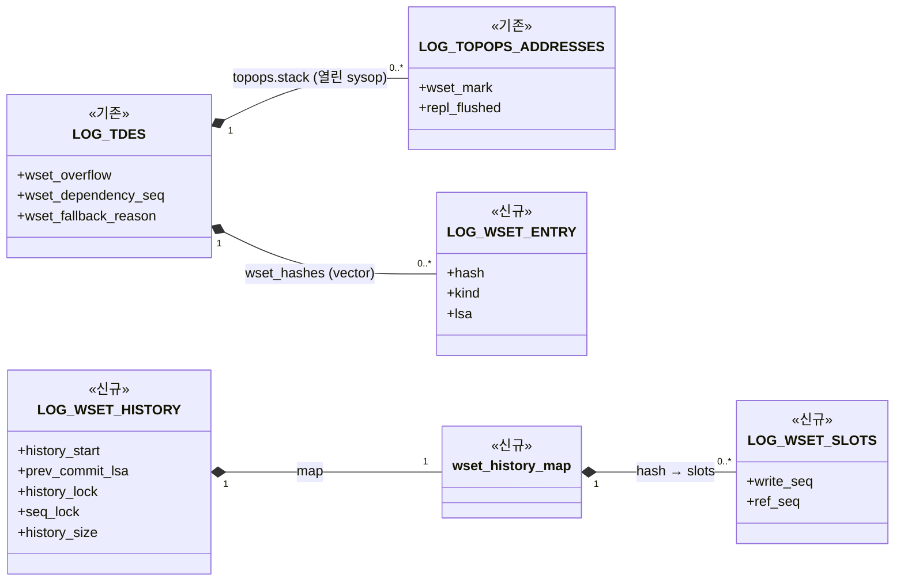
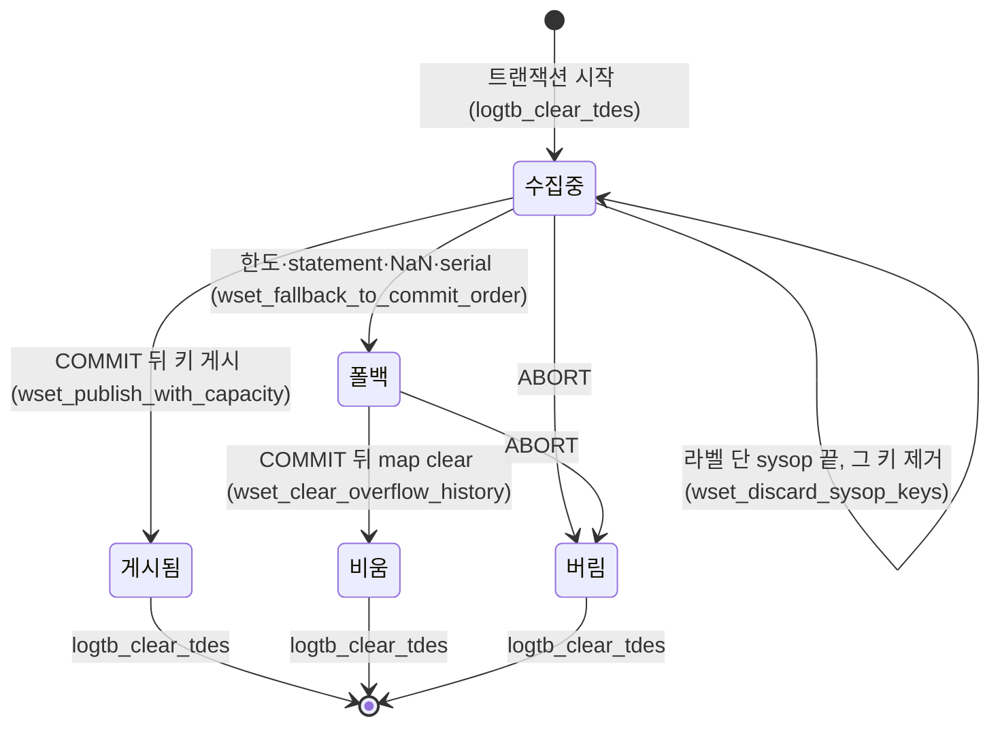
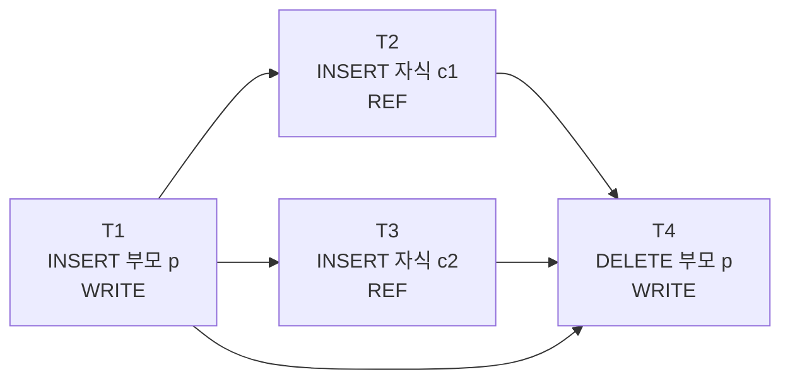
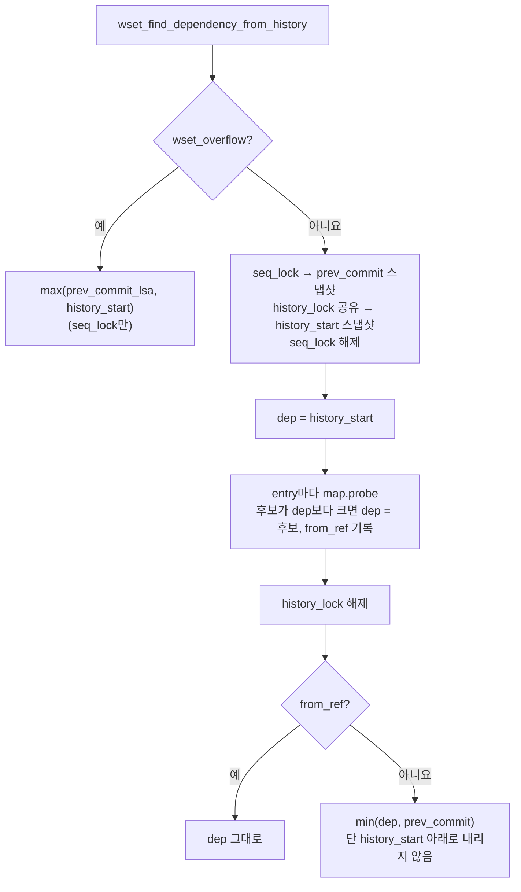
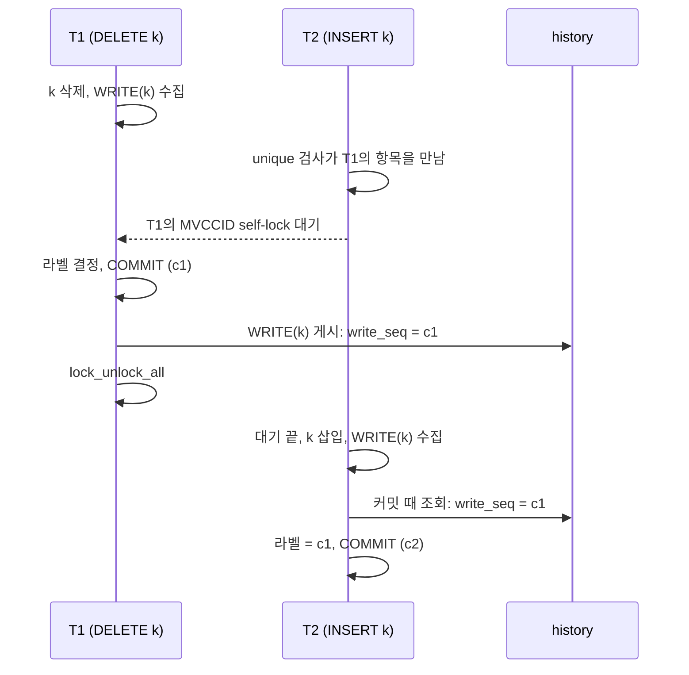
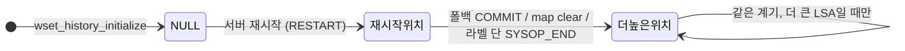

# 마스터 writeset 설계

마스터의 writeset은 슬레이브가 트랜잭션을 병렬로 적용해도 마스터와 같은 결과가 나오도록, 각 트랜잭션이 먼저 끝나기를 기다려야 할 이전 트랜잭션을 커밋 때 정해 로그에 남긴다. 슬레이브는 이 기록만 보고 적용 순서를 정한다.

## 1. 전체 처리 흐름
키별 writeset을 유지한 일반 복제 대상 로컬 트랜잭션의 순서는 다음과 같다. 한도 초과·statement 폴백과 독립 top operation은 뒤에서 별도로 설명한다. 문서에서 트랜잭션과 전역에서 저장하는 해시의 값은 다음과 같이 정리한다.
- **writeset**: 트랜잭션 하나가 DML 중에 모은 키 목록이다(`LOG_TDES.wset_hashes`). 커밋하면 history에 게시하고, ABORT하면 버린다.
- **history**: 서버 전역에 하나 있는 map이다(`wset_History`). 키별로 마지막 WRITE와 REF의 COMMIT LSA를 기억하며, 커밋 때 조회하고 커밋 뒤 갱신한다.

```text
[DML 중 — 행마다 반복]
행 INSERT·UPDATE·DELETE
  → 행 잠금 획득
  → locator_add_or_remove_index_internal() 또는 locator_update_index()
     → 인덱스 키 추출
     → [추가] wset_add_write_key()           PK·UNIQUE 키를 WRITE로 수집
     → [추가] locator_wset_collect_fk_ref()
        → [추가] wset_add_ref_key()          자식 FK의 부모 키를 REF로 수집
     → B-tree 변경, repl_log_insert()
  (모은 키는 writeset에 쌓이고, 커밋 전까지 history는 건드리지 않음)

[커밋 — 트랜잭션당 한 번]
log_commit_local()
  → log_append_repl_info_and_commit_log()
     → 로그 mutex(prior_lsa_mutex) 획득
     → log_append_repl_info_with_lock()             복제 로그 기록
     → [추가] wset_find_dependency_from_history()   dependency 결정
     → [추가] log_append_wset_label_with_lock()     WSET_LABEL 로그 기록
     → log_append_commit_log_with_lock()            COMMIT 로그 기록
     → [추가] wset_note_commit_with_log_lock()      커밋 순서 기준 갱신
     → 로그 mutex 해제
  → [추가] wset_publish_commit_to_history()         writeset을 history에 게시
  → lock_unlock_all()                               행 잠금과 MVCCID self-lock 해제
```

- **수집**: 일반 인덱스의 키는 모으지 않는다.
- **dependency 결정**: 같은 키를 앞서 바꾸거나 참조한 트랜잭션 중 가장 늦은 COMMIT LSA를 고른다. 키를 안전하게 모을 수 없는 트랜잭션(statement 복제, 키 수 초과)은 직전 커밋을 고른다. 로그 mutex 안에서 정하므로, 결정과 COMMIT 사이에 다른 커밋이 끼지 않는다.
- **기록**: 슬레이브는 라벨의 LSA까지 빈틈없이 적용된 뒤에 그 트랜잭션을 실행한다.
- **게시**: 결정 때는 아직 자기 COMMIT LSA가 없어서 COMMIT 뒤에 한다. 잠금(행 잠금과 MVCCID self-lock)을 풀기 전에 끝나야, 같은 행이나 키를 기다리던 다음 트랜잭션이 잠금을 얻었을 때 이 커밋을 history에서 찾는다(6.2절).

다른 모듈이 writeset을 부르는 곳은 단계별로 다음과 같다.

- **생명주기**: `log_tran_table.c`가 `wset_history_initialize`, `wset_history_finalize`를 부른다(9절).
- **수집**: `locator_sr.c`가 `wset_add_write_key`, `wset_add_ref_key`를, `serial.c`가 `wset_add_write_key`를 부른다(3절).
- **폴백**: `replication.c`(statement 복제)와 `serial.c`가 `wset_fallback_to_commit_order`를 부른다(4.3절, 4.4절).
- **커밋, 로그 mutex 안**: `log_manager.c`가 `wset_find_dependency_from_history`, `wset_note_commit_with_log_lock`을 부른다(5절).
- **커밋, 로그 mutex 해제 뒤**: `log_manager.c`가 `wset_publish_commit_to_history`를 부른다(5.3절, 7절).
- **독립 top operation**: `log_manager.c`가 `wset_find_sysop_fallback_dependency`, `wset_raise_history_start`, `wset_discard_sysop_keys`, `wset_abort_after_lsa`를 부른다(8절). `wset_raise_history_start`는 서버 재시작 때도 부른다(9절).
- **통계**: `show_scan.c`가 `SHOW WRITESET STATUS`의 시작 함수로 `wset_status_start_scan`을 함수 포인터로 등록한다.
- **trace**: `locator_sr.c`가 `wset_trace_enabled`로 trace 여부를 묻고, `wset_trace_key_source`로 키의 출처를 남긴다.

### 1.1 소스 구성

writeset 코드는 `src/transaction/writeset/`에 모은다.

```text
src/transaction/
├─ writeset/
│  ├─ writeset.hpp / .cpp
│  ├─ writeset_history.hpp
│  ├─ writeset_key_hash.hpp / .cpp
│  ├─ writeset_history_map.hpp / .cpp
│  ├─ writeset_types.hpp
│  └─ writeset_stat.hpp / .cpp
├─ locator_sr.c
├─ log_manager.c
├─ log_tran_table.c
├─ log_impl.h
├─ log_record.hpp
├─ log_append.cpp
├─ log_recovery.c
└─ replication.c
src/query/serial.c
src/query/show_scan.c
src/parser/show_meta.c
```

`writeset/`는 이번 기능이 새로 만든 디렉토리이며, 파일마다 맡은 일은 다음과 같다.

- `writeset.hpp / .cpp`: 키 수집, dependency 결정, history 게시와 clear, 생명주기. 서버 모듈은 대부분 이 헤더로 writeset을 부른다.
- `writeset_history.hpp`: 전역 history 구조체(`LOG_WSET_HISTORY`)와 `wset_History` 선언. writeset 모듈 내부 전용이며 `writeset.cpp`와 writeset 단위 테스트만 include한다.
- `writeset_key_hash.hpp / .cpp`: 제약 키를 인덱스가 비교하는 방식대로 해시한다(`wset_hash_key`). WRITE와 REF가 함께 쓴다.
- `writeset_history_map.hpp / .cpp`: 키별 write_seq와 ref_seq를 담는 동시성 map. TBB `concurrent_hash_map`을 감싼다.
- `writeset_types.hpp`: 공용 타입. 키 해시, WRITE와 REF 구분, 트랜잭션 writeset 항목. `log_impl.h`가 LOG_TDES 필드 때문에 이 헤더를 직접 include한다.
- `writeset_stat.hpp / .cpp`: master 통계와 `SHOW WRITESET STATUS`. `show_scan.c`가 이 헤더를 직접 include한다.

나머지 파일은 writeset을 부르는 기존 모듈이며, 바뀐 내용은 다음과 같다.

- `locator_sr.c`: INSERT·DELETE·UPDATE의 인덱스 갱신 경로에서 키 수집, FK REF 수집(분할 테이블 부모는 키가 있는 파티션으로 옮김).
- `log_manager.c`: 1PC·2PC 커밋 경로의 dependency 결정, 라벨 기록, 게시. sysop 끝의 라벨과 ABORT된 sysop의 키 제거. 재시작 하한.
- `log_tran_table.c`: history 초기화와 해제, 트랜잭션 descriptor의 writeset 필드 초기화와 복사.
- `log_impl.h`: `LOG_TDES`의 writeset 필드, sysop 스택의 `wset_mark`·`repl_flushed`.
- `log_record.hpp`, `log_append.cpp`, `log_recovery.c`: `LOG_DUMMY_WSET_LABEL` 레코드 정의와 기록 크기, 복구에서 건너뛰기.
- `replication.c`: statement 복제 시 commit-order 폴백.
- `serial.c`: serial 갱신의 키 수집, serial 인덱스를 아직 모를 때의 폴백.
- `show_scan.c`, `show_meta.c`: `SHOW WRITESET STATUS` 등록과 컬럼 정의.

## 2. 로컬 writeset과 전역 history

키를 트랜잭션별 writeset과 전역 history로 나누는 이유는, 행을 바꾸는 동안에는 아직 자기 COMMIT LSA가 없어 history에 올릴 값이 없기 때문이다. 그래서 키는 커밋까지 writeset에 모아 두고, COMMIT LSA가 정해진 뒤에 history에 올린다.



*그림 2. 로컬 writeset과 전역 history의 자료구조. 이번 설계에서 추가한 주요 필드만 표시했다.*

### 2.1 트랜잭션 로컬 writeset

로컬 writeset은 충돌 키의 해시와 WRITE·REF 종류를 vector에 담는다. 한 행에서 PK·UNIQUE·FK 키가 각각 나올 수 있고, UPDATE는 변경 전후의 키를 모두 수집하므로 항목 수는 행 수와 같지 않다(4.1절). 같은 키와 종류가 반복돼도 목록에는 그대로 남긴다(4.3절).

COMMIT 직전에 이 목록으로 dependency를 계산한다(5.1절). ABORT한 트랜잭션의 키는 history에 게시하지 않는다(5.3절). 한도를 넘었을 때의 폴백은 아래 `wset_overflow`와 4.3절에서 설명한다.

그림 2의 로컬 writeset 쪽 필드를 설명한다. 트랜잭션 descriptor(`LOG_TDES`)에 더한 필드는 다음과 같다.

- `wset_hashes`: 이 트랜잭션이 모은 키 목록(`LOG_WSET_ENTRY`의 vector).
- `wset_overflow`: writeset을 버리고 commit-order 폴백을 쓰는지 여부. 키 수가 한도를 넘거나, 변경이 statement로 복제되거나, NaN 키를 만나거나, serial 인덱스를 아직 찾지 못했을 때 켜진다. 일부 키만 남기면 안전하지 않으므로 목록 전체를 버린다. 키를 만들다 실패한 것은 DML 오류로 돌려주며 이 값을 켜지 않는다.
- `wset_dependency_seq`: 커밋 때 history에서 고른 dependency. COMMIT 바로 앞의 WSET_LABEL에 실린다.
- `wset_fallback_reason`: `wset_overflow`를 켠 이유. 커밋 때 통계로만 센다.

키 항목(`LOG_WSET_ENTRY`)은 다음을 담는다.

- `hash`: 충돌 키의 해시(3.1절).
- `kind`: WRITE 또는 REF.
- `lsa`: 키를 모은 시점의 트랜잭션 마지막 로그 LSA. sysop이 ABORT되면 sysop 시작 위치 뒤에 모은 키를 이 값으로 찾아 지운다(8절).

PoC는 트랜잭션 COMMIT의 병렬 적용만 다뤘지만, 구현에서는 복제 항목을 남기는 sysop도 처리해야 한다. 이를 위해 sysop 스택 항목(`LOG_TOPOPS_ADDRESSES`)에 두 필드를 더했다. 둘 다 `log_sysop_start`에서 정하며, sysop 처리는 8장에서 설명한다.

- `wset_mark`: sysop을 시작할 때의 `wset_hashes` 크기. 그 뒤에 모은 키가 이 sysop의 키다(8.3절).
- `repl_flushed`: 이 sysop이 가장 안쪽에 열려 있는 동안 복제 레코드가 로그에 기록됐는지 여부. 켜져 있으면 그 `LOG_SYSOP_END`에 라벨을 단다(8.2절).

writeset은 다음 상태를 오간다.



*그림 2-1. 트랜잭션 로컬 writeset의 상태. 폴백 상태에서는 키를 더 모으지 않는다.*

### 2.2 트랜잭션 descriptor의 초기화와 복사

writeset 필드는 descriptor를 다시 쓸 때마다 비워야 한다. 이전 트랜잭션의 키나 폴백 표시가 남으면 다음 트랜잭션이 엉뚱한 키를 게시하거나 commit-order로 떨어진다.

- `logtb_initialize_tdes`: descriptor를 처음 만들 때 네 필드를 비운다.
- `logtb_clear_tdes`: 트랜잭션이 끝나 descriptor를 돌려줄 때 네 필드를 비운다. 커밋과 ABORT가 모두 이 경로를 지난다.
- `log_tdes::copy_to`: 2PC loose end를 새 descriptor로 옮길 때(`log_complete`) 네 필드를 함께 복사한다. 키는 그 키가 설명하는 복제 레코드와 같이 움직여야, 새 descriptor에서 나중에 쓰는 COMMIT이 dependency를 찾고 키를 게시한다.
- `logtb_realloc_topops_stack`(sysop 스택 확장): 새 칸을 0으로 채운다. 복구 분석은 `log_sysop_start` 없이 칸을 채우므로, `wset_mark`와 `repl_flushed`에 쓰레기 값이 남으면 안 된다.

### 2.3 전역 history

전역 history는 키 해시마다 마지막 WRITE COMMIT LSA와 REF COMMIT LSA의 최댓값을 보관한다. 각 트랜잭션은 COMMIT 직전에 해당 키를 조회하고, 본인 COMMIT LSA가 확정된 뒤 WRITE·REF 슬롯을 갱신한다. 서로 다른 키는 동시에 처리할 수 있도록 해시 맵의 키별 접근을 보호한다.

history를 비우거나 서버가 재시작하면 이전 키별 이력을 조회할 수 없으므로 이력을 비운 시점의 하한을 함께 관리한다. commit-order 폴백에 쓰는 직전 COMMIT LSA도 전역으로 유지한다. dependency 계산은 5절, history 게시와 동시성은 7절에서 설명한다.

그림 2의 전역 history 쪽 필드를 설명한다. 전역 history(`LOG_WSET_HISTORY`, 서버에 하나 있는 `wset_History`)의 필드는 다음과 같다.

- `map`: 키 해시마다 slot(`write_seq`, `ref_seq`)을 담는 `wset_history_map`. 키별 조회(probe), 갱신(publish), 전체 비우기(clear)를 제공한다. TBB `concurrent_hash_map`을 감싸며, 키 하나씩 잠그므로 서로 다른 키의 probe와 publish는 동시에 돈다.
  - `write_seq`: 이 키를 마지막으로 WRITE한 트랜잭션의 COMMIT LSA.
  - `ref_seq`: 이 키를 REF한 트랜잭션들의 COMMIT LSA 중 최댓값.
- `history_start`: 키별 이력을 볼 수 없는 구간의 하한. 서버 재시작, history 비우기, 폴백 커밋, 독립 top operation에서 올린다. 모든 dependency는 이 값 이상이 된다.
- `prev_commit_lsa`: 직전에 기록된 COMMIT LSA. commit-order 폴백의 dependency로 쓴다.
- `history_lock`: map을 보호하는 읽기/쓰기 잠금. probe와 publish는 공유로, map을 비우는 clear는 배타로 잡는다. TBB의 clear는 다른 접근과 동시에 돌면 안전하지 않기 때문이다.
- `seq_lock`: `prev_commit_lsa`와 `history_start`를 함께 지키는 mutex. 두 값을 읽거나 올리는 곳은 모두 이 잠금을 잡는다.
- `history_size`: `ha_writeset_history_size` 값. 트랜잭션별 키 수와 map 크기의 상한으로 함께 쓴다.

map 밖에 전역 값이 하나 더 있다. `wset_Publish_reserved`(atomic)는 공유 잠금으로 게시 중인 트랜잭션들이 예약한 키 수다. 용량 확인에 함께 더해 여러 게시가 동시에 한도를 넘지 않게 한다(7.2절).

### 2.4 WSET_LABEL

WSET_LABEL은 master가 커밋하는 트랜잭션마다 로그에 남기는 레코드다(레코드 종류 `LOG_DUMMY_WSET_LABEL`, 내용 `LOG_REC_WSET_LABEL`). "이 트랜잭션은 어느 커밋 뒤에 적용해야 하는가"를 slave에 알린다. writeset과 history는 master 메모리에만 있으므로, slave가 적용 순서를 알 수 있는 근거는 이 레코드뿐이다.

**담는 값**
- `dependency_seq` 하나. 커밋 때 고른 dependency의 COMMIT LSA다(`LOG_TDES.wset_dependency_seq`).
- 기다릴 커밋이 없으면 NULL이다.

**기록 시점과 위치**
- 복제가 켜진 상태에서 커밋하는 트랜잭션마다 남긴다. 1PC(`log_commit_local`)와 2PC(`log_complete`) 커밋 모두 같다. 로그 applier 자신의 트랜잭션에는 남기지 않는다.
- 같은 트랜잭션의 복제 항목 뒤, COMMIT 바로 앞에 둔다. 복제 레코드를 로그에 남긴 독립 top operation이면 종료 유형과 상관없이 `LOG_SYSOP_END` 바로 앞에 둔다(8절).
- 라벨과 COMMIT은 같은 `prior_lsa_mutex` 구간에서 기록되므로, 둘 사이에 다른 레코드가 끼지 않는다(5.2절).

슬레이브는 라벨 값을 같은 트랜잭션의 COMMIT(또는 `LOG_SYSOP_END`)에 붙여, 그 값 이하의 커밋이 모두 적용된 뒤에 적용한다. 자세한 처리는 slave 설계 문서의 [3장](./02-slave-implementation-design.md#3-복제-로그에서-task-구성)과 [4장](./02-slave-implementation-design.md#4-dependency-gate와-완료-처리)에서 설명한다.

**참고**
- 처음 설계에 있던 `dependency_is_ref`는 뺐다. completed set이 사라지면서 slave가 모든 dependency를 같은 방식(빈틈없이 적용될 때까지)으로 기다리기 때문이다.

### 2.5 라벨이 지켜야 할 조건

슬레이브는 dependency가 있는 트랜잭션끼리는 master의 커밋 순서대로 적용해야 한다. 이를 위해 master는 트랜잭션 T가 커밋할 때 T의 dependency를 라벨 값으로 정해 로그에 남긴다. 슬레이브는 빈틈없이 적용한 마지막 커밋 위치가 이 라벨 값에 이르면 T를 적용한다. 위치는 모두 master 로그의 COMMIT LSA다.

**어떤 트랜잭션을 기다려야 하는가**

부모 키 p 하나를 두고 네 트랜잭션이 차례로 커밋하는 경우를 보자.

```text
T1: INSERT 부모 p           WRITE(p)
T2: INSERT 자식 c1 → p      REF(p)    T1을 기다린다
T3: INSERT 자식 c2 → p      REF(p)    T1을 기다린다. T2는 기다리지 않는다
T4: DELETE 부모 p           WRITE(p)  T1, T2, T3를 기다린다
```



*그림 2-2. 같은 부모 키를 다루는 네 트랜잭션. 화살표는 "앞이 적용된 뒤에 뒤를 적용한다"는 뜻이다. T2와 T3 사이에는 화살표가 없으므로 슬레이브에서 동시에 적용할 수 있다.*

규칙은 하나다. 같은 키를 다룬 두 트랜잭션 중 하나라도 WRITE이면, 뒤에 커밋한 트랜잭션은 앞의 트랜잭션을 기다려야 한다. 둘 다 REF이면, 즉 같은 부모를 참조하는 자식끼리이면 기다리지 않는다.

**라벨 값의 조건**

슬레이브는 라벨 값까지 빈틈없이 적용된 뒤에 T를 적용하므로, 라벨 값은 다음 두 조건을 만족해야 한다.

- 기다려야 할 앞선 커밋 중 가장 늦은 것과 같거나 그보다 뒤여야 한다. 하나라도 그보다 앞에 두면, 슬레이브가 그 커밋보다 T를 먼저 또는 동시에 적용할 수 있다. 그림 2-2에서 T4의 라벨은 T3의 커밋 위치 이상이어야 한다.
- T 자신의 커밋보다 앞이어야 한다. 그렇지 않으면 T가 자기 적용을 기다리게 된다.

**master가 라벨 값을 정하는 방법**

master는 키마다 그 키를 마지막으로 WRITE한 커밋과 REF한 커밋을 기억해 두고(2.3절), T의 키 종류에 따라 다음을 기다리게 한다.

```text
T의 키가 WRITE → 그 키의 마지막 WRITE 커밋과 마지막 REF 커밋 중 늦은 것
T의 키가 REF   → 그 키의 마지막 WRITE 커밋
```

T의 키 전체에서 나온 값 중 가장 늦은 것이 라벨 값이 된다. 자세한 계산은 5.1절에서 설명한다.

**라벨 값이 필요보다 큰 경우**

라벨 값이 첫 번째 조건보다 뒤여도 순서는 지켜진다. 필요 없는 커밋까지 기다리게 되어 병렬성만 줄어든다. 그래서 키별 이력을 볼 수 없을 때(폴백, 하한 아래)는 직전 커밋이나 하한을 라벨 값으로 쓴다.

## 3. 충돌 키와 해시

충돌 키의 해시는 모두 이번 기능에서 추가한 함수 `wset_hash_key`(`writeset_key_hash.cpp`)에서 만든다. 이 장은 이 함수가 키 종류에 따라 바이트를 만들고 해시하는 방법을 설명한다. 이 함수를 부르는 곳은 4장에서 설명한다.

### 3.1 충돌 키

충돌 키는 (index VFID, 정규화한 키)이다. 이 둘을 이어 FNV-1a 64비트로 해시하고(`wset_hash_key`), `LOG_WSET_ENTRY`에 `{hash, kind}`로 넣는다.

```text
hash = FNV-1a64 ( index VFID | 정규화한 키 바이트 )
```

해시는 master 메모리 안에서만 비교하므로 바이트 배치는 정해진 형식이 아니다.

인덱스는 표현이 달라도 같은 키로 보는 값이 있다(예: `'a'`와 `'a '`, -0.0과 +0.0). 이런 값이 같은 바이트가 되도록 키를 정규화한다.
- 문자열: collation pseudo key 5바이트. 인덱스가 무시하는 끝 공백은 자르고, NUL은 공백으로 바꾼다(binary 콜레이션은 끝 NUL만 자른다). (`wset_pack_string_key`)
- TIMESTAMPTZ·DATETIMETZ: UTC 부분만 (`wset_strip_zone`)
- FLOAT·DOUBLE: -0.0을 +0.0으로 (`wset_unsign_zero`)
- MONETARY: 화폐 단위 없이 금액만 (`wset_strip_currency`)
- VARBIT: 비트 길이를 바이트 단위로 올림 (`wset_round_bit_length`)
- 복합 키: 원소마다 같은 규칙 (`wset_midxkey_hash`)
- 그 밖의 타입: 패킹한 값 그대로
- NaN: 모든 키와 같아 해시할 수 없으므로 그 트랜잭션을 commit-order로 보낸다. (`wset_value_is_nan`)
- 확인하지 못한 것: locale·UCA 콜레이션의 가중치 0 글자(실측 환경 없음)

PoC는 해시에 행의 class OID를 넣었지만, 구현에서는 뺐다. 상속 계층의 상위 클래스와 하위 클래스는 물려받은 PRIMARY KEY와 UNIQUE에 B-tree 하나를 함께 쓰는데, class OID를 넣으면 같은 키라도 클래스마다 해시가 달라진다.

- 상위 클래스에서 키 1을 DELETE한 T1 뒤에, 하위 클래스로 키 1을 INSERT한 T2는 T1을 기다리지 않는다. 슬레이브에서 T2가 먼저 적용되면 unique 위반으로 실패하고, 뒤이어 T1이 적용되어 행이 사라진다.
- 상위 클래스 PK를 참조하는 FK에서 부모 행이 하위 클래스에 있으면, 자식의 REF가 부모의 WRITE와 만나지 않는다.

class OID를 빼서 생기는 부작용은 작다. 지워진 B-tree의 VFID가 다시 쓰이면 해시가 겹쳐 의존이 하나 더 생길 뿐이다. 또 인덱스를 지우는 DDL은 문장 복제라서 커밋 때 history를 비운다.

타입별 처리는 3.2절(문자열), 3.3절(그 밖 타입), 3.4절(복합 키), 3.5절(NaN과 키 생성 오류)에서 설명한다.

FNV-1a 64비트 해시(`wset_fnv1a`)에 넣는 바이트는 index VFID 6바이트(fileid 4바이트, volid 2바이트) 다음에 정규화한 키 바이트다.

해시가 우연히 겹치면 서로 무관한 두 트랜잭션 사이에 dependency가 하나 더 생길 뿐이다. 반대로 같은 키가 다른 해시가 되면 순서를 놓친다. 정규화를 고칠 때는 항상 "다른 키가 합쳐지는 것"은 허용하고 "같은 키가 갈라지는 것"은 막아야 한다.

### 3.2 문자열 키

인덱스는 문자열을 collation 기준으로 비교하므로, 저장 바이트가 달라도 같은 키일 수 있다(대소문자 무시 collation, 끝 공백 등). 그래서 문자열은 다음 순서로 해시한다(`wset_string_hash`, `wset_pack_string_key`).

```text
1  s = 문자열 바이트
2  if 콜레이션이 binary:  s 끝의 NUL을 자른다
3  else:                  s 안의 NUL을 모두 공백으로 바꾼다
4  if CHAR 또는 ignore_trailing_space가 켜진 VARCHAR:  s 끝의 공백을 자른다
5  h = lc->mht2str (s)                        -- ELF 해시, 4바이트(실제 28비트)
6  key = 0xC5 + h의 little endian 4바이트      -- 5바이트
7  hash = FNV-1a64 (index VFID 6바이트 + key)
```

2~4행은 인덱스 비교가 무시하거나 같게 보는 바이트를 해시 전에 정리한다. 규칙은 콜레이션마다 두 값을 같은 unique 컬럼에 넣어, 인덱스가 같은 키로 보는지(unique 위반이 나는지) 시험한 결과에 맞췄다.

- **2행**: binary 콜레이션은 끝의 NUL만 무시한다. `'ab'`와 `'ab'||NUL`은 같은 키이고, `'ab'`와 `'ab '`, `'a b'`와 `'a'||NUL||'b'`는 다른 키였다.
- **3행**: 그 밖의 콜레이션은 NUL을 공백과 같게 본다. iso88591_bin·utf8_bin·utf8_ko_cs에서 `'a b'`와 `'a'||NUL||'b'`가 같은 키였다. NUL을 공백으로 보지 않는 콜레이션에서는 다른 두 키가 같은 해시가 될 뿐이다.
- **4행**: CHAR에서는 `'a'`와 `'a '`가 같은 키였고, 기본 설정의 VARCHAR에서는 다른 키였다.
- **5행**: develop의 collation별 해시 함수다. collation이 같다고 보는 문자열은 같은 값이 된다. 반환형은 `unsigned int`지만 위 4비트가 항상 0이라 실제 정보는 28비트다. euckr_bin의 `lang_mht2str_ko`는 끝의 공백과 전각 공백(0xA1A1)을 더 자르고, 중간의 0xA1A1은 공백과 같은 값으로 계산한다. 그래서 euckr VARCHAR에서 인덱스가 다르게 보는 `'a'`와 `'a '`도 같은 해시가 되지만, 키가 합쳐질 뿐이다.
- **6행**: 태그 `0xC5`는 다른 타입의 패킹 값과 구분하기 위한 것이다(`wset_pack_string_key`).
- **7행**: 다른 타입과 같은 마지막 단계다(`wset_string_hash` → `wset_fnv1a`).

`mht2str`는 develop에서 해시 파티션·해시 GROUP BY·해시 조인의 버킷을 고를 때 쓰는 함수다(`mht_get_hash_number`). 버킷용이라 서로 다른 문자열도 쉽게 같은 값이 되고, 최종 해시가 64비트여도 문자열 구별력은 5행의 28비트에 묶인다. 겹치면 관계없는 트랜잭션이 기다릴 뿐 순서를 놓치지는 않는다(10절).

### 3.3 그 밖 타입의 값 정규화

문자열도 복합 키도 아닌 값은 다음 순서로 해시한다(`wset_hash_key`).

1. **값 정규화**: 인덱스가 같은 키로 보는 값이 같은 패킹 바이트가 되도록 다음 네 함수를 차례로 거친다. 바꿀 필요가 없는 값은 그대로 지나간다.
   - `wset_strip_zone`: TIMESTAMPTZ·DATETIMETZ에서 UTC 부분만 남긴다. 인덱스는 UTC 시각만 비교하므로, 같은 순간을 다른 시간대로 쓴 두 값은 같은 키다.
   - `wset_unsign_zero`: FLOAT·DOUBLE의 -0.0을 +0.0으로 바꾼다. 인덱스는 숫자로 비교해 둘을 같게 보지만, 패킹 바이트는 부호 비트가 다르다.
   - `wset_strip_currency`: MONETARY의 화폐 단위를 DOLLAR로 통일한다. 인덱스는 금액만 비교하므로 $100과 \100은 같은 키다. 금액 -0.0도 0.0으로 바꾼다.
   - `wset_round_bit_length`: VARBIT의 비트 길이를 바이트 단위로 올린다. 인덱스는 바이트만 비교하므로, 같은 바이트 수 안에서 끝의 0 비트만 다른 두 값(예: 7비트와 8비트)은 같은 키다.
2. **패킹**: `or_pack_mem_value`로 패킹한다. 버퍼는 0으로 채워 둔다. 정렬 때문에 건너뛴 바이트도 해시에 들어가므로, 쓰레기 값이 남으면 같은 키가 다른 해시가 된다.
3. **FNV-1a**: index VFID 6바이트 뒤에 패킹 바이트를 이어 FNV-1a 64비트로 해시한다.

새 타입을 키로 쓸 수 있게 되면, 그 타입의 인덱스 비교가 같다고 보는 값들이 같은 패킹 바이트가 되는지 확인해야 한다. 다르면 1에 정규화 함수를 하나 더 넣고, 3.4절의 복합 키 갈래에도 같은 함수를 넣어야 한다.

### 3.4 복합 키

복합 키(MIDXKEY)는 패킹한 전체 이미지를 해시하지 않는다. 패킹 이미지에는 문자열 원소가 저장 바이트 그대로 들어 있어, collation상 같은 두 키가 다른 바이트가 되기 때문이다. 그래서 다음 순서로 해시한다(`wset_midxkey_hash`).

1. **원소별 변환**: 원소를 하나씩 꺼내 태그 1바이트와 함께 버퍼에 이어 쓴다.
   - NULL: `0xC0`만 쓴다.
   - 문자열: 3.2절 의사코드 1~6행의 5바이트(`0xC5`와 ELF 해시 4바이트)를 쓴다. collation은 원소 도메인에서 가져온다.
   - 그 밖: `0xC1`을 쓰고, 다음 정렬 위치(`MAX_ALIGNMENT`)부터 3.3절 1~2단계로 정규화하고 패킹한 값을 정렬 크기(`OR_VALUE_ALIGNED_SIZE`)만큼 쓴다. 남는 바이트는 0이다.
2. **FNV-1a**: index VFID 6바이트 뒤에 이 버퍼를 이어 FNV-1a 64비트로 해시한다.

태그는 종류가 다른 원소가 같은 바이트로 이어져 해시가 겹치지 않게 한다. 원소 길이를 실제 패킹 길이가 아니라 정렬 크기로 잡으므로, 같은 값이면 배치가 항상 같다. 원소 중 하나라도 NaN이면 끝까지 계산한 뒤 호출자가 폴백한다(3.5절).

```text
예: (VARCHAR 'ab', INT 7, NULL), MAX_ALIGNMENT = 8

offset 0      C5
offset 1..4   ELF 해시('ab') 4바이트
offset 5      C1
offset 6..7   0 (정렬)
offset 8..    INT 7을 패킹한 값, OR_VALUE_ALIGNED_SIZE 크기 (남는 바이트는 0)
그 다음       C0
```

복합 키에는 도메인이 있어야 한다. 원소를 꺼내려면 도메인이 필요하고, 도메인 없이 패킹하면 그 인덱스의 모든 키가 같은 머리만 남아 같은 해시가 되며, 같은 행을 도메인이 있는 상태로 모은 해시와도 달라진다. 그래서 `wset_hash_key`는 도메인이 없는 MIDXKEY를 오류로 돌려준다. INSERT·DELETE 경로의 `heap_attrvalue_get_key`는 복합 키를 도메인 없이 돌려주므로, 호출자가 키를 모으는 동안만 도메인을 넣어 준다(4.1절).

### 3.5 NaN과 키 생성 오류

FLOAT·DOUBLE·MONETARY의 NaN은 해시로 나타낼 수 없다. 인덱스는 이 타입들을 `MR_CMP`로 비교하는데, NaN은 어떤 값보다 작지도 크지도 않으므로 모든 키와 같다고 판정된다. 한 키가 모든 키와 같으면 해시 하나로 그 관계를 표현할 수 없다.

- `wset_hash_key`는 NaN이면 해시를 만들지 않고 NaN임을 알린다. 복합 키는 원소 중 하나라도 NaN이면 같다.
- `wset_add_write_key`와 `wset_add_ref_key`는 이 값을 보면 `wset_fallback_to_commit_order (tdes, WSET_FALLBACK_NAN_KEY)`를 부르고 정상 반환한다. NaN 키가 있는 트랜잭션은 commit-order로 적용된다.
- NaN 키 뒤의 트랜잭션은 따로 처리하지 않는다. NaN 트랜잭션이 커밋하면 하한이 그 COMMIT으로 올라가므로, 뒤의 모든 트랜잭션이 그것을 기다린다.

키를 만들다 실패한 경우는 폴백하지 않고 DML 오류로 돌려준다. 실패한 키를 빼고 진행하면 그 키의 순서를 놓치기 때문이다.

- 메모리 할당 실패: `ER_OUT_OF_VIRTUAL_MEMORY`.
- 키 모양이 맞지 않음(도메인 없는 복합 키, 원소를 꺼내지 못함, 부모 PK와 FK의 컬럼 수가 다름 등): `wset_error`가 하위 모듈이 설정한 오류를 그대로 넘기고, 없으면 `ER_HA_WRITESET_KEY_BUILD_FAILED`를 설정한다. `locator_sr.c`에는 같은 규칙의 `locator_wset_error`가 있다.

## 4. 행 변경에서 WRITE·REF 수집

행이 바뀌면 바뀐 제약 키를 해시해, 해시와 종류(WRITE 또는 REF)를 로컬 writeset에 모은다. 키를 모으는 함수는 종류별로 하나씩이며, 둘 다 `wset_hash_key`를 불러 3장에서 설명한 해시를 만든 뒤 로컬 writeset에 넣는다(4.3절).

- **WRITE** (`wset_add_write_key`): PK·UNIQUE·REVERSE UNIQUE를 바꾼 행의 index VFID와 인덱스 키를 해시한다.
- **REF** (`wset_add_ref_key`): 자식 FK가 참조하는 부모 PK의 VFID와, 부모 PK 도메인으로 바꾼 FK 값을 해시한다. 복합 FK는 부모 PK 순서의 MIDXKEY 하나로 만든다(4.2절).
- 일반 인덱스는 수집하지 않는다.

NULL 처리
- UNIQUE·REVERSE UNIQUE 단일 키의 NULL은 NULL의 패킹 값으로 WRITE를 수집한다. 같은 인덱스의 NULL은 모두 같은 해시가 되어 서로 기다린다(보수적 처리). 복합 키의 NULL 원소는 `0xC0` 태그로 나타낸다(3.4절).
- FK 구성 값 중 하나라도 NULL이면 REF를 수집하지 않는다.

### 4.1 수집 조건과 호출 경로

키는 다음 조건을 모두 만족할 때만 모은다. 하나라도 어긋나면 그 행의 키는 수집하지 않는다.

- 행이 복제 대상이다(`need_replication`, INSERT·DELETE 경로는 `datayn`도).
- 로그 applier의 스레드가 아니다(`!LOG_CHECK_LOG_APPLIER`). 슬레이브가 적용하는 변경은 다시 복제하지 않는다.
- 복제가 허용된 상태다(`log_does_allow_replication`).
- 트랜잭션이 복제를 억제하고 있지 않다(`suppress_replication == 0`). writeset 함수 안에서 확인한다.
- 이미 폴백한 트랜잭션이 아니다(`!wset_overflow`). writeset 함수 안에서 확인한다.

키는 B-tree를 바꾸기 전에 모은다.

INSERT·DELETE에서 키를 모으는 위치는 다음과 같다. AS-IS(develop)와 TO-BE를 나란히 두고, 이번에 더한 단계는 `[추가]`로 표시했다.

**AS-IS — INSERT·DELETE**

```text
locator_add_or_remove_index_internal()
└─ 인덱스별 반복
   ├─ 현재 행에서 인덱스 키 추출
   ├─ B-tree INSERT 또는 DELETE
   └─ PK이면 FK action 확인 후 repl_log_insert()
```

**TO-BE — INSERT·DELETE**

```text
locator_add_or_remove_index_internal()
└─ 인덱스별 반복
   ├─ 현재 행에서 인덱스 키 추출 (collect_wset이면 key_domain도 받음)
   ├─ [추가] PK·UNIQUE·REVERSE UNIQUE
   │  ├─ 복합 키면 key_domain을 잠시 넣음
   │  └─ wset_add_write_key()
   ├─ [추가] 자식 FOREIGN KEY
   │  └─ locator_wset_collect_fk_ref()
   │     └─ wset_add_ref_key()
   ├─ B-tree INSERT 또는 DELETE
   └─ PK이면 FK action 확인 후 repl_log_insert()
```

INSERT는 새 행, DELETE는 지우기 전 행이 현재 행이다. 복합 키는 `heap_attrvalue_get_key`가 도메인 없이 돌려주므로, `wset_add_write_key`를 부르는 동안만 인덱스의 키 도메인을 넣었다가 다시 뺀다(3.4절).

UPDATE도 같은 방식으로 develop과 비교한다.

**AS-IS — UPDATE**

```text
locator_update_index()
├─ 인덱스별 old key·new key 추출과 비교
├─ B-tree DELETE·INSERT 또는 UPDATE
└─ PK old key로 repl_log_insert()
```

**TO-BE — UPDATE**

```text
locator_update_index()
├─ 인덱스별 old key·new key 추출과 비교
├─ [추가] PK·UNIQUE·REVERSE UNIQUE: 값이 바뀌었는지와 상관없이
│  ├─ old key → wset_add_write_key()
│  └─ new key → wset_add_write_key()
├─ [추가] 자식 FOREIGN KEY: 값이 바뀌었는지와 상관없이
│  ├─ old key → locator_wset_collect_fk_ref()
│  └─ new key → locator_wset_collect_fk_ref()
├─ B-tree DELETE·INSERT 또는 UPDATE
└─ PK old key로 repl_log_insert()
   └─ [추가] PK 인덱스 순회를 건너뛴 경로이면, 오류 확인 뒤 old PK → wset_add_write_key()
```

UPDATE에서 키가 바뀌지 않았어도 old·new를 모두 모으는 이유는, 인덱스의 같음 판정에 기대지 않기 위해서다. 같은 값이면 같은 해시가 두 번 들어갈 뿐이다.

PK 인덱스 순회를 건너뛴 경로는 MVCC를 쓰지 않는 클래스(예: `db_serial`)를 PK 컬럼을 건드리지 않고 제자리에서 고치는 UPDATE다. 인덱스 루프에서 PK를 모으지 않았으므로, 복제 로그를 남긴 뒤 old PK 하나를 WRITE로 모은다. 루프 안의 수집과 동시에 일어나지 않으므로 같은 키를 두 번 세지 않는다.

### 4.2 FK REF 수집

자식 행의 FK는 부모 PK의 WRITE와 같은 해시가 되어야 서로를 찾는다. 그래서 REF는 자식 FK 인덱스가 아니라 부모 PK 인덱스의 VFID로, 자식 값이 아니라 부모 PK 도메인으로 바꾼 값으로 해시한다. REF 키는 두 함수가 나눠 만든다.

**`locator_wset_collect_fk_ref`**: 자식 행에서 FK 값을 꺼내 넘긴다.

```text
1  parent_domain = 부모 PK B-tree의 키 도메인
2  fk = 자식 행의 FK 값
3  if fk에 NULL이 있음: 끝 (수집하지 않음)
4  if 부모가 분할 테이블: btid = 키가 들어 있는 파티션의 PK B-tree
5  wset_add_ref_key (btid, fk, parent_domain)
```

- **2행**: 복합 키는 도메인 없이 돌아오므로 FK 인덱스의 도메인을 넣어 준다(3.4절).
- **4행**: 부모의 WRITE도 파티션의 PK B-tree로 모이기 때문이다. FK 검사가 부모 행을 찾는 방식(`partition_prune_unique_btid`)과 같다(`locator_wset_resolve_ref_partition`).

**`wset_add_ref_key`**: 부모 도메인으로 바꿔 해시한다.

```text
1  casted = fk를 부모 PK 도메인으로 바꾼 값
2  hash = wset_hash_key (btid, casted)
3  if NaN: commit-order 폴백
4  else:   로컬 writeset에 {hash, REF} 추가
```

- **1행**: 자식 컬럼의 타입이나 collation이 부모와 달라도 부모의 WRITE와 같은 바이트가 되게 하려는 것이다. 복합 키는 원소마다 바꿔 MIDXKEY 하나로 만든다(`wset_make_parent_midxkey`).
- **2~4행**: 해시는 3장, NaN 폴백은 3.5절, 로컬 writeset 추가는 4.3절에서 설명한다.

변환에 실패하면 DML 오류로 돌려준다. 컬럼 수가 다르거나, 변환이 넘치거나 맞지 않거나(`ER_TP_CANT_COERCE_OVERFLOW`, `ER_TP_CANT_COERCE`), NULL이 아니던 값이 NULL이 되는 경우다.

### 4.3 로컬 writeset 추가, 한도와 폴백

**`wset_add_write_key`**: 키를 해시해 WRITE로 넣는다. 4.1절의 경로에서 PK·UNIQUE·REVERSE UNIQUE 인덱스마다 부른다.

```text
1  if 이미 폴백 또는 복제 억제: 끝
2  hash = wset_hash_key (index VFID, key)
3  if NaN: commit-order 폴백
4  else:   wset_push_hash (hash, WRITE)
```

REF는 4.2절의 `wset_add_ref_key`가 같은 방식으로 `wset_push_hash`를 부른다.

**`wset_push_hash`**: 로컬 writeset에 항목 하나를 넣는다. WRITE와 REF가 함께 쓴다.

```text
1  if 항목 수 ≥ ha_writeset_history_size: commit-order 폴백, 끝
2  wset_hashes에 {hash, kind, lsa = 트랜잭션 마지막 로그 LSA} 추가
```

- **1행**: 전역 history의 크기 설정을 트랜잭션 로컬 writeset의 항목 상한에도 쓴다.
- **2행**: 원래 키 값 대신 해시와 종류만 보관하며, 같은 `{hash, kind}`도 중복 제거하지 않는다. 메모리 할당에 실패하면 DML 오류로 돌려준다.

**`wset_fallback_to_commit_order`**: 모은 키를 버리고 폴백을 표시한다.

```text
1  if 이미 폴백: 끝
2  wset_overflow = true, 폴백 이유 기록
3  wset_hashes를 비우고 메모리도 돌려준다
```

- 폴백을 부르는 곳은 한도 초과, NaN(3.5절), statement 복제(`replication.c`의 `repl_log_insert_statement`), serial 인덱스를 아직 찾지 못한 serial 갱신(`serial.c`의 `serial_update_serial_object`, 4.4절)이다.
- 일부 키만 남기면 안전하지 않으므로 목록 전체를 버리고, 그 뒤로는 키를 더 모으지 않는다.
- 폴백한 트랜잭션은 COMMIT에서 키별 dependency를 계산하지 않고, 커밋 뒤 전역 history를 비운다(5장).
- 폴백은 되돌리지 않는다. 같은 트랜잭션 안에서 폴백한 문장이 ABORT되어도 `wset_overflow`는 켜진 채로 남는다(8.3절). 커밋이 조금 늦게 적용될 뿐이다.

### 4.4 serial 갱신과 statement 복제

인덱스 루프를 지나지 않는 변경 두 가지는 따로 처리한다.

**serial 갱신** (`serial_update_serial_object`)
- serial 값 갱신은 `db_serial`을 힙에서 바로 고치므로 인덱스 루프의 수집을 거치지 않는다. 그래서 복제 로그를 남긴 뒤 `db_serial`의 PK 키를 직접 WRITE로 모은다(`serial_Cached_btid`).
- `serial_Cached_btid`를 아직 모르면 키를 만들 수 없으므로 `wset_fallback_to_commit_order (STATEMENT_REPLICATION)`을 부른다.
- 키 생성이 실패하면 일반 DML처럼 오류로 돌려준다.
- serial 갱신은 보통 독립 top operation 안에서 일어나므로, 모은 키는 그 sysop의 `LOG_SYSOP_END`에서 버려지고 순서는 sysop 라벨로 지킨다(8.2절).
- `serial_Cached_btid`는 SERVER_MODE에만 있으므로 이 블록은 `#if defined (SERVER_MODE)` 안에 둔다.

**statement 복제** (`repl_log_insert_statement`)
- DDL처럼 행 이미지 없이 문장으로 복제하는 변경은 키를 만들 수 없다. 복제 로그를 남기기 전에 `wset_fallback_to_commit_order (STATEMENT_REPLICATION)`을 부른다. `suppress_replication`이 켜져 있어 로그를 남기지 않으면 부르지 않는다.
- 인덱스를 지우는 DDL도 이 경로이므로, 커밋 뒤 history를 비우고 하한을 올린다. 지워진 B-tree의 VFID가 다시 쓰여도 이전 이력과 섞이지 않는 이유다(3.1절).

## 5. 커밋 시 충돌 검사와 게시

### 5.1 history probe 규칙과 라벨 값

- 현재 entry가 **REF**이면 이전 `write_seq`를 조회한다. 부모 WRITE는 기다리지만 같은 부모의 다른 REF는 기다리지 않는다.
- 현재 entry가 **WRITE**이면 이전 `write_seq`와 `ref_seq` 중 큰 값을 조회한다. 이전 WRITE와 앞선 자식 REF를 함께 고려한다.

`wset_find_dependency_from_history()`는 각 entry의 후보를 비교해 가장 큰 LSA 하나를 선택한다. 시작값은 `history_start`다. 최종 후보가 `ref_seq`에서 왔으면 그 LSA를 그대로 쓴다. 그 외에는 후보와 `prev_commit_lsa` 중 이른 값을 택하되 `history_start` 아래로 내리지 않는다. `wset_overflow`이면 map을 조회하지 않고 `prev_commit_lsa`와 `history_start` 중 큰 값을 반환한다.

라벨에는 dependency가 WRITE 슬롯과 REF 슬롯 중 어디서 왔는지 기록하지 않는다. 슬레이브 gate는 출처와 상관없이 모든 non-NULL dependency에 대해 연속 완료 경계를 확인하므로 출처가 필요 없다.



*그림 5-1. 라벨 값을 정하는 과정*

```text
예: history_start = 50, prev_commit_lsa = 140
    키 k1: write_seq = 100, ref_seq = 130
    키 k2: write_seq = 120, ref_seq = NULL

T가 WRITE(k1), REF(k2)를 가진 경우
  WRITE(k1) → max(100, 130) = 130, ref_seq에서 옴
  REF(k2)   → write_seq = 120, 130보다 작아 버림
  결과      → ref_seq에서 온 130을 그대로 라벨로 씀

T가 REF(k1)만 가진 경우
  REF(k1)   → write_seq = 100
  결과      → min(100, 140) = 100, 하한 50 이상이므로 라벨 100
```

```c
// writeset_history_map.cpp: wset_history_map::probe
map_type::const_accessor acc;
if (!m_map.find (acc, hash)) return false;
slots = acc->second;
candidate_is_ref = (kind == LOG_WSET_KIND_WRITE && LSA_GT (&slots.ref_seq, &slots.write_seq));
candidate = candidate_is_ref ? slots.ref_seq : slots.write_seq;
return true;

// writeset.cpp: wset_find_dependency_in_range (골격)
pthread_mutex_lock (&wset_History.seq_lock);
prev_commit_snapshot = wset_History.prev_commit_lsa;
pthread_rwlock_rdlock (&wset_History.history_lock);
history_start_snapshot = wset_History.history_start;
pthread_mutex_unlock (&wset_History.seq_lock);

wset_parent = history_start_snapshot;
for (각 entry e)
  if (map.probe (e.hash, e.kind, slots, candidate, candidate_is_ref)
      && !LSA_ISNULL (&candidate) && LSA_GT (&candidate, &wset_parent))
    { wset_parent = candidate; dependency_from_ref_seq = candidate_is_ref; }
pthread_rwlock_unlock (&wset_History.history_lock);

if (dependency_from_ref_seq) { *out = wset_parent; return; }
*out = (LSA_ISNULL (&prev_commit_snapshot) || LSA_LT (&wset_parent, &prev_commit_snapshot))
       ? wset_parent : prev_commit_snapshot;
if (!LSA_ISNULL (&history_start_snapshot) && (LSA_ISNULL (out) || LSA_LT (out, &history_start_snapshot)))
  *out = history_start_snapshot;
```

`prev_commit_lsa`는 기록 순서상 직전 COMMIT이므로, 게시된 어떤 slot 값보다 작지 않다. 그래서 보통은 키에서 고른 후보가 그대로 라벨이 된다. 두 값 중 이른 것을 고르는 것은 둘 다 안전한 경계이기 때문이다.

### 5.2 로그 mutex 안의 순서

**AS-IS**

```text
log_commit_local()
├─ log_append_repl_info_and_commit_log()
│  └─ prior_lsa_mutex 안
│     ├─ log_append_repl_info_with_lock()
│     └─ log_append_commit_log_with_lock()
├─ lock_unlock_all()
└─ log_change_tran_as_completed()
```

**TO-BE**

```text
log_commit_local()
├─ log_append_repl_info_and_commit_log()
│  └─ prior_lsa_mutex 안
│     ├─ log_append_repl_info_with_lock()
│     ├─ [추가] wset_find_dependency_from_history()    라벨 결정
│     ├─ [추가] log_append_wset_label_with_lock()
│     ├─ log_append_commit_log_with_lock()
│     └─ [추가] wset_note_commit_with_log_lock()       prev_commit_lsa 전진, 폴백이면 history_start 올림
├─ [추가] wset_publish_commit_to_history(commit_lsa)  키 게시, 폴백·용량 초과면 map 비움
├─ lock_unlock_all()
└─ log_change_tran_as_completed()
```

라벨 결정과 commit-order 기준 갱신(`prev_commit_lsa`, `history_start`)은 COMMIT 기록과 같은 `prior_lsa_mutex` 구간에서 한다. 그래서 라벨은 기록 순서상 바로 앞까지의 COMMIT을 반영하고, statement 복제 같은 commit-order 트랜잭션은 그 구간 안에서 하한을 자기 COMMIT으로 올린 뒤에야 다음 트랜잭션이 라벨을 정한다. 라벨 결정을 구간 밖에서 먼저 하면 그 사이에 기록된 COMMIT을 놓치고, 하한을 구간 밖에서 나중에 올리면 그 사이에 라벨을 정한 뒤 트랜잭션이 statement를 기다리지 않는다(2026-10-25 실측, [9.1.10](../9-미해결-리스크.md)). 이 구간에서 history map을 조회하므로, 키가 많은 트랜잭션과 map을 비우는 동안 모든 로그 기록이 그만큼 기다린다(최적화 후보는 9.1.10).

복제 항목·WSET_LABEL·COMMIT을 한 `prior_lsa_mutex` 구간에 연속 기록해 다른 트랜잭션의 COMMIT이 끼어들지 않게 한다. 라벨 값도 같은 구간에서 정한다. `LOG_DUMMY_WSET_LABEL`의 payload에는 `dependency_seq`만 담고, `trid`는 로그 공통 헤더에서 읽는다. 키 목록은 로그로 보내지 않는다. probe 때는 아직 본인 COMMIT LSA가 없으므로 history를 조회만 한다. 게시에는 확정된 COMMIT LSA를 사용한다.

하한을 구간 밖에서 올렸을 때 생기는 문제는 다음과 같다.

```text
S: statement 복제 (폴백), T: S 뒤에 커밋하는 일반 트랜잭션

1. S가 mutex 안에서 라벨을 정하고 COMMIT(s) 기록, mutex 해제
2. T가 mutex 안에서 라벨을 정함: 하한이 아직 s보다 아래라 키 후보만으로 라벨이 s보다 작음
3. S가 mutex 밖에서 하한을 s로 올림 (이미 늦음)
→ 슬레이브에서 T가 S를 기다리지 않고 S와 함께 적용됨
```

그래서 `wset_note_commit_with_log_lock`은 COMMIT 기록 바로 뒤, 같은 구간에서 부른다.

```c
// log_manager.c: log_append_repl_info_and_commit_log
log_Gl.prior_info.prior_lsa_mutex.lock ();
log_append_repl_info_with_lock (thread_p, tdes, true);
wset_find_dependency_from_history (tdes, &tdes->wset_dependency_seq);
log_append_wset_label_with_lock (thread_p, tdes);
log_append_commit_log_with_lock (thread_p, tdes, commit_lsa);
wset_note_commit_with_log_lock (tdes, commit_lsa);
log_Gl.prior_info.prior_lsa_mutex.unlock ();

// writeset.cpp: wset_note_commit_with_log_lock
pthread_mutex_lock (&wset_History.seq_lock);
if (LSA_ISNULL (&prev_commit_lsa) || LSA_GT (commit_lsa, &prev_commit_lsa))  prev_commit_lsa = *commit_lsa;
if (tdes->wset_overflow && (LSA_ISNULL (&history_start) || LSA_GT (commit_lsa, &history_start)))
  history_start = *commit_lsa;
pthread_mutex_unlock (&wset_History.seq_lock);
```

이 함수는 하한만 올리고 map은 비우지 않는다. map을 비우는 일은 mutex 밖의 게시 단계가 한다. 그 사이 map에 남아 있는 값은 모두 새 하한 아래라 라벨을 낮추지 못한다.

### 5.3 게시와 잠금 해제의 순서

`wset_publish_commit_to_history`는 COMMIT LSA가 정해진 뒤, 잠금을 풀기 전에 불러야 한다. 6.2절의 근거가 이 순서다. ABORT한 트랜잭션은 이 함수를 부르면 안 된다.

```c
// log_manager.c: log_commit_local (로컬 트랜잭션, 복제 대상)
log_append_repl_info_and_commit_log (thread_p, tdes, &commit_lsa);
assert_release (LSA_ISNULL (&tdes->wset_dependency_seq) || LSA_LE (&tdes->wset_dependency_seq, &commit_lsa));
wset_publish_commit_to_history (tdes, &commit_lsa);
...
if (retain_lock != true)
  lock_unlock_all (thread_p);
log_change_tran_as_completed (thread_p, tdes, LOG_COMMIT, &commit_lsa);

// writeset.cpp: wset_publish_commit_to_history
wset_stat_count_commit (tdes->wset_overflow, tdes->wset_fallback_reason == WSET_FALLBACK_TRANSACTION_LIMIT);
if (tdes->wset_overflow) { wset_clear_overflow_history (tdes, commit_lsa); return; }
if (tdes->wset_hashes.empty ()) return;
wset_publish_with_capacity (tdes, 0, tdes->wset_hashes.size (), commit_lsa);
```

- **폴백한 트랜잭션**: 키가 없으므로 게시하지 않고 map을 비운다(`wset_clear_overflow_history`). 하한은 이미 5.2절에서 자기 COMMIT으로 올라갔다.
- **키가 없는 트랜잭션**: 아무것도 하지 않는다.
- **COMMIT WORK RETAIN LOCK**: develop과 같이 `lock_unlock_all`을 부르지 않으므로, 커밋한 MVCCID의 self-lock도 다른 잠금과 함께 그 세션의 다음 트랜잭션이 끝날 때까지 남는다. 이 트랜잭션이 넣은 행을 고치려는 트랜잭션은 그때까지 기다린다(develop CBRD-27034의 동작). self-lock은 게시보다 늦게 풀리므로 6.2절의 근거는 그대로 성립한다.

### 5.4 2PC 경로

2PC 트랜잭션은 `log_commit_local`에서 COMMIT을 쓰지 않고 `log_complete`로 미룬다. `log_complete`의 COMMIT 갈래는 1PC와 같은 세 단계(mutex 안 결정·라벨·COMMIT·기준 갱신, 게시)를 밟고, 게시 뒤에 `lock_unlock_all`을 부른다. 그래서 2PC 커밋도 슬레이브에서 다른 커밋과 같은 방식으로 순서가 정해진다.

```text
log_complete()  (iscommitted == LOG_COMMIT, 복제 허용)
├─ log_append_repl_info_and_commit_log()      5.2절과 같음
├─ assert_release (dependency ≤ commit_lsa)
├─ wset_publish_commit_to_history(commit_lsa)
├─ log_change_tran_as_completed()
└─ lock_unlock_all()
```

loose end 트랜잭션을 새 descriptor로 옮기는 경우에는 writeset 필드도 함께 복사한다(2.2절). 그래야 새 descriptor에서 쓰는 COMMIT이 원래 트랜잭션의 키로 dependency를 정하고 게시한다.

## 6. 순서 보장 근거

2.5절의 조건을 master가 어떻게 지키는지 정리한다. 4장과 5장에서 본 수집·라벨 결정·게시·잠금 해제의 순서가 근거가 된다.

### 6.1 조건을 지키는 장치

master는 2.5절의 조건을 다음 장치로 지킨다.

1. **결정·라벨·COMMIT·기준 갱신을 한 로그 mutex 구간에서 한다** (`log_append_repl_info_and_commit_log`). 결정과 COMMIT 사이에 다른 COMMIT이 끼지 않는다(5.2절).
2. **게시는 COMMIT LSA가 정해진 뒤, 잠금을 풀기 전에 한다** (`log_commit_local`, `log_complete`). 충돌하는 뒤 트랜잭션은 이 게시를 본다(6.2절, 5.3절).
3. **slot은 더 큰 COMMIT LSA로만 바꾼다** (`wset_history_map::publish`). 게시가 COMMIT 순서와 다르게 끝나도 값이 뒤로 가지 않는다.
4. **WRITE는 write_seq와 ref_seq를, REF는 write_seq만 본다** (`wset_history_map::probe`). 형제 REF는 서로 기다리지 않는다.
5. **라벨은 하한(`history_start`) 이상이다** (`wset_find_dependency_in_range`, `wset_find_dependency_from_history`, `wset_find_sysop_fallback_dependency`). history가 기억하지 못하는 구간은 하한이 덮는다(8.1절).
6. **history를 비우면 하한을 직전 커밋까지 올린다** (`wset_clear_history_locked`). 지워진 slot의 COMMIT LSA는 모두 그 아래에 있다(7.2절).
7. **ABORT한 변경의 키는 게시하지 않는다**. ABORT 경로는 게시 함수를 부르지 않고, ABORT된 sysop의 키는 `wset_abort_after_lsa`가 지운다(8.3절).
8. **키를 안전하게 모을 수 없으면 commit-order로 바꾼다** (`wset_fallback_to_commit_order`). 일부 키만 남기지 않고 모두 버린다(4.3절).

### 6.2 충돌 유형별로 순서가 보장되는 방식

앞 절의 2번 장치가 충분한 이유는, 충돌하는 두 트랜잭션 가운데 뒤의 것이 앞의 것을 반드시 기다리기 때문이다. 기다림은 writeset이 만드는 것이 아니라 develop의 잠금과 MVCC 검사가 만든다. writeset은 그 기다림이 끝나는 시점보다 게시를 앞에 두기만 한다.

- **T1이 아직 잠금을 쥐고 있을 때 T2가 같은 행이나 키에 닿으면**: T2는 T1의 잠금(행 잠금 또는 MVCCID self-lock)이 풀릴 때까지 기다린다. T1은 게시를 마친 뒤 잠금을 풀므로, T2가 커밋에서 history를 조회할 때 T1이 이미 들어 있다.
- **T1이 이미 잠금을 풀었으면**: T1의 게시도 이미 끝났다.

develop은 READ COMMITTED에서 행의 X 잠금을 문장 끝에 놓을 수 있다. 그래서 커밋 무렵의 기다림은 대부분 MVCCID self-lock에서 일어난다. 아직 커밋하지 않은 트랜잭션의 MVCCID를 만난 검사는 `logtb_is_active_other_mvccid`(활성 MVCCID이거나 그 self-lock이 아직 잡혀 있음)로 판정하고, 그 self-lock을 기다린다. `logtb_complete_mvcc`가 COMMIT 기록 전에 MVCCID를 비활성으로 바꾸어도, self-lock은 `lock_unlock_all`까지 남는다.

충돌 유형별로 T2가 T1을 기다리는 곳은 다음과 같다.

- **같은 행의 UPDATE·DELETE**: T2가 행을 고치려다 T1의 잠금을 기다린다. 두 트랜잭션 모두 그 행의 PK를 WRITE로 모은다.
- **같은 UNIQUE 키** (T1이 키 k를 DELETE, T2가 k를 INSERT): T2의 unique 검사가 T1이 지운 항목을 만나 T1의 self-lock을 기다린다. 둘 다 k를 WRITE로 모은다.
- **앞선 WRITE와 뒤의 REF** (T1이 부모를 INSERT, T2가 그 부모를 참조하는 자식을 INSERT): T2의 FK 검사가 아직 커밋되지 않은 부모 행을 만나 기다린다. T2의 REF는 부모 키의 write_seq에서 T1을 찾는다.
- **앞선 REF와 뒤의 WRITE** (T1이 자식을 INSERT, T2가 부모를 DELETE): T2의 FK 검사가 T1의 자식 행을 만나 기다린다. T2의 WRITE는 부모 키의 ref_seq에서 T1을 찾는다.
- **같은 부모를 참조하는 REF끼리**: 서로 기다리지 않고, 서로의 ref_seq도 보지 않는다. 슬레이브에서도 병렬로 적용된다.



*그림 6-1. 같은 UNIQUE 키를 지우고 다시 넣는 두 트랜잭션. 게시가 self-lock 해제보다 앞이므로 T2의 조회는 c1을 찾는다.*

### 6.3 commit-order로 낮아지는 경우

키별 dependency를 쓸 수 없는 경우에는 "앞선 것을 모두 기다린다"는 commit-order 규칙으로 바꾼다. 경우마다 들어가는 곳, 라벨 값, 하한의 변화는 다음과 같다. `max(a, b)`는 둘 중 늦은 LSA다.

- **트랜잭션 키 수 초과**: `wset_push_hash`가 한도에서 `wset_fallback_to_commit_order(TRANSACTION_LIMIT)`. 라벨은 `max(prev_commit_lsa, history_start)`. 커밋하면 하한을 자기 COMMIT으로 올리고 map을 비운다.
- **statement 복제**: `repl_log_insert_statement`가 `wset_fallback_to_commit_order(STATEMENT_REPLICATION)`. 라벨과 하한은 위와 같다.
- **NaN 키**: `wset_add_write_key`, `wset_add_ref_key`가 `wset_fallback_to_commit_order(NAN_KEY)`. 라벨과 하한은 위와 같다.
- **serial 인덱스를 아직 모름**: `serial_update_serial_object`가 `wset_fallback_to_commit_order(STATEMENT_REPLICATION)`. 라벨과 하한은 위와 같다.
- **복제 레코드를 남긴 독립 top operation**: `log_sysop_commit_internal`. 라벨은 `max(prev_commit_lsa, history_start)`. 하한을 그 `LOG_SYSOP_END` LSA로 올리고 map은 유지한다(8절).
- **서버 재시작**: `log_initialize_internal`. 라벨은 없다. 하한을 복구된 로그 끝으로 올린다(9.1절).
- **history 용량 초과, 게시 중 메모리 부족**: `wset_publish_with_capacity`. 그 트랜잭션의 라벨은 이미 정해졌다. 하한을 `prev_commit_lsa`로 올리고 map을 비운다(7.2절).

앞의 네 경우는 트랜잭션 전체를 commit-order로 바꾸는 폴백이고, 뒤의 세 경우는 하한만 올린다. 하한을 올리면 그 뒤에 커밋하는 모든 트랜잭션의 라벨이 하한 이상이 되므로, 하한 앞의 작업을 모두 기다린다.

## 7. COMMIT 뒤 history 게시와 동시성

COMMIT 직전 probe는 `seq_lock`을 잡은 뒤 `history_lock`을 공유로 잡아 `prev_commit_lsa`와 `history_start`를 같은 history 세대에서 읽는다. `seq_lock`을 놓고 공유 잠금을 유지한 채 키별 슬롯을 조회하므로 조회 중 map clear가 끼어들지 않는다.

COMMIT LSA가 확정되면 같은 `prior_lsa_mutex` 구간에서 commit-order 기준을 전진시키고(5.2절), 잠금을 놓은 뒤 트랜잭션이 수집한 키를 전역 history에 게시한다. 같은 키의 WRITE·REF 이력에는 각각 더 큰 COMMIT LSA를 남긴다. ABORT는 게시하지 않는다. 게시를 마친 뒤 잠금을 해제해야 다음 트랜잭션이 이 이력을 조회할 수 있다. 키 게시를 로그 mutex 밖에서 해도 되는 것은 같은 키를 건드리는 뒤 트랜잭션이 잠금 때문에 이 게시 뒤에야 COMMIT까지 가기 때문이다(6.2절). 키가 없는 statement 복제에는 이 보장이 없으므로, statement의 순서는 mutex 안의 라벨과 하한으로만 지킨다.

### 7.1 잠금 종류와 획득 순서

writeset이 쓰는 잠금은 네 가지이며, 언제나 다음 순서로만 잡는다. 거꾸로 잡는 곳이 없으므로 교착이 생기지 않는다.

```text
prior_lsa_mutex  →  seq_lock  →  history_lock (공유 또는 배타)  →  TBB accessor (키 하나)
```

함수별로 잡는 잠금은 다음과 같다.

- `wset_find_dependency_in_range`: (`prior_lsa_mutex` 안에서) `seq_lock` → `history_lock` 공유 → `seq_lock` 해제 → 키마다 accessor → `history_lock` 해제.
- `wset_find_dependency_from_history`의 폴백 갈래, `wset_find_sysop_fallback_dependency`, `wset_note_commit_with_log_lock`, `wset_raise_history_start`: `seq_lock`만. map을 읽지 않으므로 `history_lock`을 잡지 않는다. 앞의 셋과 sysop 경로의 `wset_raise_history_start`는 `prior_lsa_mutex` 안에서 불리므로, 여기서 `history_lock`을 기다리면 모든 로그 기록이 멈춘다.
- `wset_publish_with_capacity` 일반 게시: `history_lock` 공유 → 키마다 accessor.
- `wset_publish_with_capacity` 용량 부족·메모리 부족, `wset_clear_overflow_history`: `seq_lock` → `history_lock` 배타. 공유 잠금은 먼저 놓고 다시 잡는다.
- `wset_get_history_usage`: `history_lock` 공유.

accessor는 한 번에 하나만 잡는다. 키 하나를 조회하거나 게시하면 바로 놓고 다음 키로 간다.

probe가 `seq_lock`을 쥔 채 공유 잠금을 잡는 이유는, `prev_commit_lsa`·`history_start`와 map을 같은 세대로 읽기 위해서다. clear는 `seq_lock`과 배타 잠금을 함께 쥐고 map과 하한을 바꾸므로, probe는 "clear 전의 map과 clear 전의 하한" 또는 "clear 뒤의 map과 clear 뒤의 하한" 둘 중 하나만 본다.

### 7.2 용량 예약과 history 비우기

```text
일반 게시
  → history_lock 공유 획득
  → 진행 중인 게시의 예약량을 포함해 용량 확보
  → entry마다 TBB accessor로 슬롯 하나를 갱신하고 즉시 해제
  → 예약 반환, 공유 잠금 해제

용량 부족 또는 commit-order 폴백
  → seq_lock → history_lock 배타 획득
  → 용량 재확인 또는 map clear
  → prev_commit_lsa를 history_start에 반영
  → 일반 게시라면 현재 entry 게시
  → 잠금 해제
```

한 트랜잭션이 여러 키를 가져도 accessor는 한 번에 하나만 잡는다. 정상 조회·게시는 공유 보호 아래 키별 슬롯에 접근한다. history를 비울 때는 진행 중인 조회·게시와 겹치지 않도록 배타 보호로 전환하고, 이력의 유효 하한도 함께 바꾼다. 용량에는 진행 중인 게시의 예약량을 포함하며, 공유 보호를 놓고 배타 보호로 전환한 뒤 다시 확인한다.

`history_start`는 clear로 사라진 슬롯의 COMMIT LSA를 포괄해야 한다. COMMIT LSA 순서와 게시 완료 순서가 다를 수 있으므로 clear를 촉발한 한 트랜잭션의 LSA가 아니라 단조 전진한 `prev_commit_lsa`를 사용한다.

게시 중 map이 새 키의 노드를 만들다 메모리가 모자라면(`std::bad_alloc`), COMMIT은 이미 로그에 있으므로 되돌릴 수 없다. 일부 키만 게시된 상태가 될 수 있으므로 용량 초과와 같이 처리한다. 배타 잠금으로 map을 비우고 하한을 `prev_commit_lsa`로 올리면, 뒤의 모든 트랜잭션이 이 커밋을 기다리므로 빠진 키가 있어도 순서를 놓치지 않는다.

```c
// writeset.cpp: wset_history_reserve_capacity
reserved = wset_Publish_reserved.fetch_add (publish_count) + publish_count;
if (map.size () + reserved <= history_size) return true;	/* 예약 유지, 게시 뒤 반환 */
wset_Publish_reserved.fetch_sub (publish_count);
return false;

// writeset.cpp: wset_publish_with_capacity (골격)
pthread_rwlock_rdlock (&history_lock);
if (wset_history_reserve_capacity (n))
  {
    published = wset_publish_keys (...);			/* false: bad_alloc */
    wset_history_release_capacity (n);
    pthread_rwlock_unlock (&history_lock);
    if (published) return;
  }
else
  {
    pthread_rwlock_unlock (&history_lock);
    published = true;
  }

pthread_mutex_lock (&seq_lock);
pthread_rwlock_wrlock (&history_lock);
if (!published)
  wset_clear_history_locked (&prev_commit_lsa, ...);		/* OUT_OF_MEMORY */
else
  {
    if (!wset_history_has_capacity (n))
      wset_clear_history_locked (&prev_commit_lsa, ...);	/* HISTORY_CAPACITY */
    if (!wset_publish_keys (...))
      wset_clear_history_locked (&prev_commit_lsa, ...);	/* OUT_OF_MEMORY */
  }
pthread_rwlock_unlock (&history_lock);
pthread_mutex_unlock (&seq_lock);

// writeset.cpp: wset_clear_history_locked
if (LSA_ISNULL (&history_start) || LSA_GT (clear_floor, &history_start)) history_start = *clear_floor;
map.clear ();
```

배타 잠금 아래에서는 공유 잠금으로 게시 중인 트랜잭션이 없으므로 예약량은 0이고, map 크기만 보면 된다(`wset_history_has_capacity`).

용량이 꽉 찬 상태에서 게시가 이어지면 매번 map을 비우게 된다. 비운 뒤에는 하한이 직전 커밋까지 올라가므로 그동안의 트랜잭션은 사실상 commit-order로 적용된다. `ha_writeset_history_size`는 동시에 살아 있어야 할 키 수보다 넉넉히 잡아야 한다.

## 8. 하한(history_start)과 독립 top operation

### 8.1 하한을 올리는 곳

`history_start`는 "이 위치 앞의 이력은 map에서 찾을 수 없으니 모두 기다리라"는 값이다. 모든 라벨이 이 값 이상이 되므로, 하한을 올리면 그 뒤에 커밋하는 트랜잭션은 하한 앞의 작업을 모두 기다린다. 하한은 내려가지 않으며, 올리는 곳은 네 곳이다.

- **폴백 커밋**: `wset_note_commit_with_log_lock`이 그 COMMIT LSA로 올린다(5.2절).
- **history 비우기**: `wset_clear_history_locked`가 `prev_commit_lsa`로 올린다(7.2절).
- **라벨 단 sysop**: `log_append_wset_label_and_sysop_end`가 `wset_raise_history_start`로 그 `LOG_SYSOP_END` LSA까지 올린다(8.2절).
- **서버 재시작**: `log_initialize_internal`이 `wset_raise_history_start`로 복구된 로그 끝(`append_lsa`)까지 올린다(9.1절).



*그림 8-1. `history_start`의 변화. 모든 갱신은 `seq_lock` 안에서 "더 클 때만" 바꾼다.*

sysop과 재시작은 map을 비우지 않고 하한만 올린다. 하한 아래 값은 라벨을 낮추지 못하므로 남겨 두어도 문제가 없고, 연산마다 map을 다시 채우는 비용을 피한다.

### 8.2 독립 top operation의 라벨

복제 항목이 있는 `LOG_SYSOP_END`는 바깥 트랜잭션의 COMMIT과 별도로 적용된다. 이 경계에서는 sysop의 키별 이력을 게시하지 않고, 앞선 작업 전체와 뒤의 작업 사이에 commit-order 조건을 둔다.

```text
AS-IS
log_sysop_start() → 기존 top operation 상태 보관
log_sysop_commit_internal() → 복제 항목·LOG_SYSOP_END 기록

TO-BE
log_sysop_start() → wset_hashes.size()를 wset_mark로, repl_flushed = false
log_append_repl_info_internal() → 커밋 전에 복제 레코드를 기록하면 가장 안쪽 sysop의 repl_flushed = true
log_sysop_commit_internal()
  → 라벨 조건: 이번에 기록할 복제 항목이 있음 (repl_item_count > 0)
               또는 repl_flushed (applier 아님, 활성 worker 트랜잭션, 복제 허용)
  → 조건을 만족하면 log_append_wset_label_and_sysop_end()
       prior_lsa_mutex 안에서
       wset_find_sysop_fallback_dependency() → WSET_LABEL·LOG_SYSOP_END 기록 → wset_raise_history_start(sysop_lsa)
     그 뒤 wset_discard_sysop_keys(wset_mark)
  → 아니면 기존 log_append_sysop_end()
```

sysop을 시작할 때 로컬 writeset의 끝을 표시한다. 라벨 조건을 만족하는 sysop은 앞선 `prev_commit_lsa`와 `history_start` 중 큰 값을 dependency로 정하고, 같은 로그 append 구간에서 WSET_LABEL을 `LOG_SYSOP_END` 바로 앞에 기록한다. 슬레이브는 이 라벨도 연속 완료 경계로 판정하므로, sysop은 앞선 작업이 모두 적용된 뒤에 적용된다.

라벨 조건은 종료 유형(`LOG_SYSOP_END_COMMIT`, 논리 undo 등)과 상관없다. 복제 레코드가 그 `LOG_SYSOP_END`에서 슬레이브에 적용되는지만 본다.

- `repl_item_count > 0`: 이 `LOG_SYSOP_END`를 기록하면서 아직 기록되지 않은 복제 항목을 함께 기록한다. 복제 flush mark가 열려 있는 동안(`fl_mark_repl_recidx != -1`)에는 기록하지 않으므로 0이다.
- `repl_flushed`: 이 sysop이 가장 안쪽에 열려 있는 동안 복제 레코드가 이미 로그에 기록됐다. checksumdb는 `log_sysop_commit` 전에 문장을 기록하고, 트랜잭션에 붙은 INCR의 레코드는 나중의 다른 sysop 끝에서 기록될 수 있다.
- 라벨이 없는 `LOG_SYSOP_END`의 복제 레코드는 슬레이브에서 바깥 트랜잭션에 남아, 바깥 COMMIT에서 적용되거나 ABORT에서 버려진다.

`LOG_SYSOP_END`의 LSA가 확정되면 map은 유지하고 `history_start`만 그 위치까지 올린다. 뒤의 트랜잭션이 이 sysop보다 앞서 적용되지 않게 하기 위해서다. 하한을 같은 mutex 구간에서 올리는 이유는 5.2절과 같다.

```c
// log_manager.c: log_append_wset_label_and_sysop_end
log_Gl.prior_info.prior_lsa_mutex.lock ();
wset_find_sysop_fallback_dependency (tdes, &tdes->wset_dependency_seq);
log_append_wset_label_with_lock (thread_p, tdes);
log_append_sysop_end_internal (thread_p, tdes, sysop_end, data_size, data, true, sysop_end_lsa_out);
wset_raise_history_start (sysop_end_lsa_out, "SYSOP_COMMIT_ORDER");
log_Gl.prior_info.prior_lsa_mutex.unlock ();

// writeset.cpp: wset_find_sysop_fallback_dependency
pthread_mutex_lock (&wset_History.seq_lock);
*out = wset_History.prev_commit_lsa;
if (!LSA_ISNULL (&history_start) && (LSA_ISNULL (out) || LSA_LT (out, &history_start))) *out = history_start;
pthread_mutex_unlock (&wset_History.seq_lock);
```

sysop의 라벨은 앞선 라벨 단 sysop도 기다린다. 그 sysop이 하한을 자기 `LOG_SYSOP_END`로 올려 두었기 때문이다.

### 8.3 sysop 키 폐기와 ABORT

sysop에서 수집한 키는 로컬 writeset의 표시 이후 부분에서 제거해 바깥 COMMIT의 probe·게시 대상에서 제외한다. serial 갱신은 인덱스 수집 경로 밖에서 해당 행의 키를 직접 수집하지만, 이 sysop 경계에서는 그 키도 게시하지 않는다. serial 행의 잠금은 `LOG_SYSOP_END`에서 풀리므로, 바깥 COMMIT에서 게시하면 실제와 다른 순서를 history에 남기게 된다. 복제 항목이 없는 sysop에는 라벨과 하한 전진을 적용하지 않고 키도 지우지 않는다.

sysop이 ABORT되면 `log_sysop_abort`가 `wset_abort_after_lsa`를 불러, sysop을 시작한 위치(바깥 트랜잭션의 마지막 sysop 부모 LSA) 뒤에 모은 키를 로컬 writeset에서 지운다. 되돌려진 변경의 키가 바깥 COMMIT에서 probe·게시되지 않게 하기 위해서이며, 복제 로그를 같은 위치까지 지우는 `repl_log_abort_after_lsa`와 짝을 이룬다. 문장 단위 rollback과 savepoint까지의 부분 rollback이 모두 sysop ABORT로 이 경로를 지난다.

```c
// log_manager.c: log_sysop_abort (변경이 있는 sysop)
if (!LOG_CHECK_LOG_APPLIER (thread_p) && tdes->is_active_worker_transaction ()
    && log_does_allow_replication () == true)
  {
    repl_log_abort_after_lsa (tdes, LOG_TDES_LAST_SYSOP_PARENT_LSA (tdes));
    wset_abort_after_lsa (tdes, LOG_TDES_LAST_SYSOP_PARENT_LSA (tdes));
  }

// writeset.cpp: wset_abort_after_lsa
tdes->wset_hashes.erase (std::remove_if (begin, end, [start_lsa] (const LOG_WSET_ENTRY &e)
                                          { return LSA_GT (&e.lsa, start_lsa); }), end);

// writeset.cpp: wset_discard_sysop_keys
if (sysop_key_begin < tdes->wset_hashes.size ())
  tdes->wset_hashes.erase (tdes->wset_hashes.begin () + sysop_key_begin, tdes->wset_hashes.end ());
```

두 함수가 키를 찾는 기준이 다르다.

- `wset_discard_sysop_keys`는 개수(`wset_mark`)로 자른다. sysop이 끝날 때 그 sysop의 키는 항상 목록의 끝에 있기 때문이다.
- `wset_abort_after_lsa`는 LSA(`LOG_WSET_ENTRY.lsa`)로 고른다. 복제 레코드를 지우는 `repl_log_abort_after_lsa`와 같은 기준이어야 키와 복제 레코드가 함께 남거나 함께 지워진다.
- sysop이 로그를 하나도 쓰기 전에 모은 키는 `lsa`가 부모 LSA와 같아 남는다. 뒤의 트랜잭션이 조금 더 기다릴 뿐이다.
- sysop 안에서 켜진 폴백은 ABORT해도 되돌리지 않는다.

## 9. 초기화·설정·관측

### 9.1 초기화·종료·재시작

서버 시작 시 `logtb_define_trantable_log_latch`가 `wset_history_initialize`를 불러 전역 history map과 잠금(`history_lock`, `seq_lock`)을 준비하고, `ha_writeset_history_size`와 trace 수준을 읽어 둔다. 통계 시작 시각도 이때 정한다(`wset_stat_start`). 로컬 writeset은 트랜잭션 descriptor를 사용할 때 초기화하고, 트랜잭션이 끝나면 비운다(2.2절). 서버 종료 시 `logtb_undefine_trantable`이 `wset_history_finalize`를 불러 전역 history를 비우고 잠금을 없앤다. 복구 중 트랜잭션 테이블을 다시 쓰는 경로는 이 정리를 거치지 않으므로 history가 그대로 남는다. 초기화 함수는 이미 초기화됐으면 아무것도 하지 않는다(`wset_History_initialized`).

서버 재시작에서는 복구된 로그 끝을 `history_start`로 올린다. history는 프로세스 메모리에 있어 재시작 뒤에는 비어 있으므로, 재시작 뒤의 트랜잭션은 재시작 전의 충돌 상대를 찾을 수 없다. 하한을 로그 끝으로 올리면 재시작 뒤의 모든 복제 커밋이 슬레이브에서 재시작 전의 작업을 모두 기다린다. 이를 위해 로그에 따로 쓰는 것은 없고, 재시작 뒤 첫 커밋들의 라벨이 이 값을 싣는다. 일반 키별 probe, 폴백, sysop 폴백 모두 이 하한을 반영한다.

```c
// log_manager.c: log_initialize_internal (SERVER_MODE)
{
  const LOG_LSA restart_lsa = log_Gl.hdr.append_lsa;
  wset_raise_history_start (&restart_lsa, "RESTART");
}
```

### 9.2 설정

- `ha_writeset_history_size`: 전역 history의 키 수 상한이자 트랜잭션 하나의 키 수 상한. 기본값 1,000,000, 범위 1~10,000,000. 서버 시작 때 한 번 읽는다.
- `ha_writeset_trace_level`: trace 수준 0~3, 기본값 0. 서버 시작 때 한 번 읽는다(serial과 sysop의 trace는 부를 때마다 파라미터를 읽는다).

### 9.3 통계

`SHOW WRITESET STATUS`는 서버가 시작한 뒤의 누적 값을 보여 준다. 카운터는 `writeset_stat.cpp`의 atomic 변수이며, 컬럼은 `show_meta.c`의 `metadata_of_writeset_status`에 정의한다.

- `Start_time`: 카운터를 시작한 시각.
- `History_size`, `History_entry_count`: 상한과 현재 map의 키 수(`wset_get_history_usage`, 공유 잠금으로 읽음).
- `Commit_count`: 라벨을 남긴 커밋 수.
- `Commit_fallback_count`: 그중 commit-order로 라벨을 정한 커밋 수.
- `Fallback_key_limit_count`, `Fallback_statement_count`: 폴백 커밋을 이유별로 나눈 수. 키 한도와 그 밖으로만 나눈다(10절).
- `Conflict_ref_count`, `Conflict_write_count`: 키가 충돌한 커밋 가운데 dependency가 ref_seq에서 온 것과 write_seq에서 온 것.
- `Clear_capacity_count`: 용량 초과로 map을 비운 횟수.
- `Key_limit_exceeded_count`: 키 한도를 넘은 트랜잭션 수(커밋 여부와 무관).
- `Fallback_count`: 폴백한 트랜잭션 수(커밋 여부와 무관).
- `Write_publish_count`, `Ref_publish_count`: 게시한 WRITE·REF 키 수.
- `History_clear_count`: 이유와 상관없이 map을 비운 횟수.

### 9.4 trace

trace는 `[WSET]`로 시작하는 줄을 서버 오류 로그에 남긴다(`_er_log_debug`).

- 수준 1: `INITIALIZE`, `FALLBACK`(이유), `DEPENDENCY`(라벨과 그 근거), `COMMIT`(COMMIT LSA, dependency, 키 수, 폴백 여부), `CLEAR`, `HISTORY_START`, 라벨 단 sysop, serial 키 수집.
- 수준 2: 모든 sysop의 끝.
- 수준 3: 키마다 `COLLECT`(해시, 클래스, 인덱스, 키 값), `SOURCE`(테이블, 행, 제약 이름), `PROBE`(slot 값과 후보), `PUBLISH`.

HA 회귀 하니스는 수준 1의 `COMMIT` 줄로 dependency가 앞선 커밋을 덮는지 확인한다.

### 9.5 단위 테스트

`unit_tests/writeset/`에 있다. `[writeset]` 태그가 정확성 시험이고, `[benchmark]`, `[stress]`는 비용 측정이다.

- 키 해시: 부모 WRITE와 자식 REF가 같은 해시(단일·복합), 복합 키 문자열 원소의 collation, 시간대, -0.0, MONETARY, VARBIT, NaN 폴백, 끝 공백·NUL·binary 콜레이션, 상속 계층의 같은 키, 같은 키라도 다른 인덱스면 독립.
- dependency: 독립 트랜잭션은 NULL, 같은 키는 앞선 WRITE, 여러 키 중 가장 늦은 커밋, FK REF와 형제 REF, ref_seq 단조 갱신, 순서가 뒤바뀐 게시.
- 폴백과 하한: 한도 초과, 폴백 뒤 하한, 늦은 clear가 새 커밋을 하한으로 보존, probe의 `seq_lock` 순서, 하한 아래로 내리지 않음, 재시작·sysop 뒤의 폴백.
- sysop: 키 폐기, 라벨 값, 하한 상승.
- 동시성: 서로 다른 키의 동시 게시, 같은 부모를 참조하는 동시 REF.

## 10. 알려진 한계와 미결 사항

설계 수준의 미해결 리스크는 [9장](../9-미해결-리스크.md)에 있다. 이 문서의 코드에서 확인한 것은 다음과 같다.

- **NaN 폴백의 통계 분류**: `wset_stat_count_commit`은 폴백 이유를 키 한도인지 아닌지로만 나누므로, NaN 폴백이 `Fallback_statement_count`에 들어간다.
- **serial 폴백의 이유**: serial 인덱스를 아직 모를 때의 폴백이 `STATEMENT_REPLICATION`으로 기록된다. 동작에는 영향이 없고 trace와 통계만 다르다.
- **RETAIN LOCK 뒤의 긴 대기**: RETAIN LOCK으로 커밋한 세션은 다음 트랜잭션이 끝날 때까지 MVCCID self-lock을 쥐므로, 그 행을 고치려는 다른 트랜잭션이 그동안 기다린다(HA 실측 약 13초, A 세션이 15초 머문 시험). develop CBRD-27034의 동작이며 writeset 순서와는 무관하다(5.3절).
- **문자열 키의 해시 겹침**: 문자열은 `mht2str`(28비트 ELF 해시)로 먼저 접은 뒤 FNV-1a로 해시하므로(3.2절), 서로 다른 문자열이 같은 키가 되기 쉽다. 같은 식으로 계산하면 날짜와 번호를 이은 키 100만 개 중 47%, 무작위 12자 100만 개 중 0.2%가 겹친다. 순서는 지키지만 그런 키를 쓰는 테이블에서 병렬성이 줄어든다. 복합 키의 문자열 원소도 같다.
- **확인하지 못한 콜레이션**: locale·UCA 콜레이션에서 가중치가 0인 글자.
- **로그 mutex 안의 map 조회**: 키가 많은 트랜잭션의 probe와 map clear를 기다리는 동안 모든 로그 기록이 멈춘다(9.1.10).
- **코드 주석이 현재 동작과 다른 곳**: `writeset_types.hpp`의 `LOG_WSET_HASH` 주석은 class OID를 해시에 넣는다고 쓴다. `wset_publish_keys` 주석은 행 X 잠금과 단순 대입, read slot을 말한다. `writeset_history.hpp`의 `seq_lock` 주석은 `prev_commit_lsa`만 지킨다고 쓴다. `log_impl.h`의 `wset_overflow` 주석은 폴백 계기를 한도와 statement 둘만 적는다.

## 부록 A. 코드 → 절 색인

행 번호는 787defb50 기준이다. 본문은 함수 이름으로 쓰고, 행 번호는 여기에만 둔다.

**src/transaction/writeset/writeset.cpp**
- `wset_kind_name` 96, `wset_fallback_reason_name` 109, `wset_trace_collected_key` 125, `wset_trace_enabled` 166, `wset_trace_key_source` 172: 9.4절
- `wset_history_initialize` 201, `wset_history_finalize` 232: 9.1절
- `wset_push_hash` 266, `wset_fallback_to_commit_order` 298: 4.3절
- `wset_add_write_key` 330: 3.5절, 4.1절, 4.3절
- `wset_cast_value_to_domain` 374, `wset_cast_midxkey_element` 406, `wset_make_parent_midxkey` 442, `wset_add_ref_key` 541: 4.2절
- `wset_find_dependency_in_range` 638, `wset_find_dependency_from_history` 733: 5.1절, 7.1절
- `wset_publish_keys` 774: 7.2절
- `wset_note_commit_with_log_lock` 813: 5.2절
- `wset_clear_history_locked` 832, `wset_history_has_capacity` 856, `wset_history_reserve_capacity` 871, `wset_history_release_capacity` 887, `wset_clear_overflow_history` 893, `wset_publish_with_capacity` 912: 7.2절
- `wset_publish_commit_to_history` 995: 5.3절
- `wset_discard_sysop_keys` 1039, `wset_abort_after_lsa` 1064: 8.3절
- `wset_find_sysop_fallback_dependency` 1088: 8.2절
- `wset_raise_history_start` 1118: 8.1절, 9.1절
- `wset_get_history_usage` 1149: 9.3절

**src/transaction/writeset/writeset_key_hash.cpp**
- `wset_fnv1a`: 3.1절
- `wset_string_hash` 109, `wset_pack_string_key` 147: 3.2절
- `wset_strip_zone` 217, `wset_unsign_zero` 251, `wset_strip_currency` 293, `wset_round_bit_length` 322: 3.3절
- `wset_value_is_nan` 349: 3.5절
- `wset_midxkey_hash` 387: 3.4절
- `wset_hash_key` 547: 3.1절, 3.3절
- `wset_error` 623: 3.5절

**src/transaction/writeset/writeset_history_map.cpp**
- `wset_history_map::probe` 48: 5.1절
- `wset_history_map::publish` 69: 6.1절, 7.2절
- `wset_history_map::size` 101, `wset_history_map::clear` 107: 7.2절

**src/transaction/writeset/writeset_stat.cpp**
- `wset_stat_start` 71, `wset_stat_count_*` 80~153, `wset_status_start_scan` 187: 9.3절

**src/transaction/writeset/ 헤더**
- `writeset.hpp`: 공개 함수, `WSET_FALLBACK_REASON`. 1절, 1.1절
- `writeset_history.hpp`: `LOG_WSET_HISTORY`, `wset_History`. 2.3절
- `writeset_history_map.hpp`: `LOG_WSET_SLOTS`, `wset_history_map`. 2.3절
- `writeset_types.hpp`: `LOG_WSET_HASH`, `LOG_WSET_KIND`, `LOG_WSET_ENTRY`. 2.1절
- `writeset_key_hash.hpp`: `wset_hash_key`, `wset_error`. 3.1절, 3.5절
- `writeset_stat.hpp`: 통계 함수. 9.3절

**src/transaction/log_manager.c**
- `log_initialize_internal` 1123 (재시작 하한 1516): 9.1절
- `log_sysop_start` 3702 (`wset_mark`, `repl_flushed` 3759): 2.1절, 8.2절
- `log_sysop_commit_internal` 3933 (라벨 조건 4049): 8.2절
- `log_sysop_abort` 4250 (`wset_abort_after_lsa` 4275): 8.3절
- `log_append_wset_label_and_sysop_end` 4904: 8.2절
- `log_append_repl_info_internal` 4930 (`repl_flushed` 4996): 8.2절
- `log_append_repl_info_and_commit_log` 5029: 5.2절
- `log_append_wset_label_with_lock` 5065: 2.4절
- `log_commit_local` 5578 (게시 5639): 5.3절
- `log_complete` 6076 (descriptor 복사 6292, 게시 6412): 2.2절, 5.4절

**src/transaction/locator_sr.c**
- `locator_wset_error` 7908: 3.5절
- `locator_wset_trace_key_source` 7923: 9.4절
- `locator_wset_resolve_ref_partition` 7964, `locator_wset_collect_fk_ref` 8013: 4.2절
- `locator_add_or_remove_index_internal` 8125 (수집 8296): 4.1절
- `locator_update_index` 8689 (수집 9028, PK 순회를 건너뛴 경로 9312): 4.1절

**그 밖의 파일**
- `log_tran_table.c`: `logtb_define_trantable_log_latch` 414, `logtb_undefine_trantable` 596: 9.1절. `logtb_clear_tdes` 1540, `logtb_initialize_tdes` 1666, `log_tdes::copy_to` 6668, `logtb_realloc_topops_stack` 172: 2.2절
- `log_impl.h`: `LOG_TOPOPS_ADDRESSES`의 `wset_mark`·`repl_flushed` 361, `LOG_TDES`의 writeset 필드 539: 2.1절
- `log_record.hpp`: `LOG_DUMMY_WSET_LABEL` 140, `LOG_REC_WSET_LABEL` 262: 2.4절
- `log_append.cpp` 359·1271, `log_recovery.c` 2511·3987·4930·5951: 2.4절
- `replication.c`: `repl_log_insert_statement` 587 (폴백 610): 4.4절
- `serial.c`: `serial_update_serial_object` 1214 (수집과 폴백 1305): 4.4절
- `show_scan.c` 242, `show_meta.c` `metadata_of_writeset_status`: 9.3절
