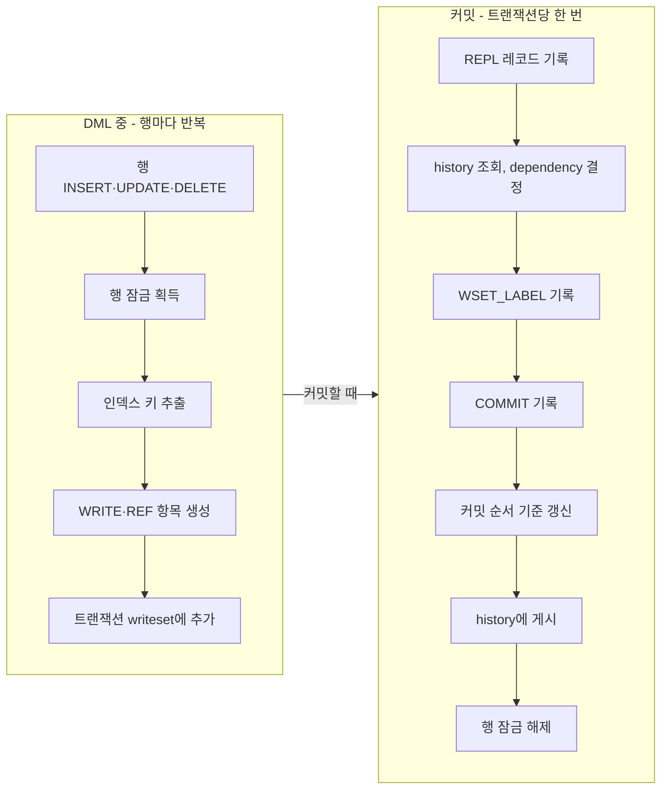
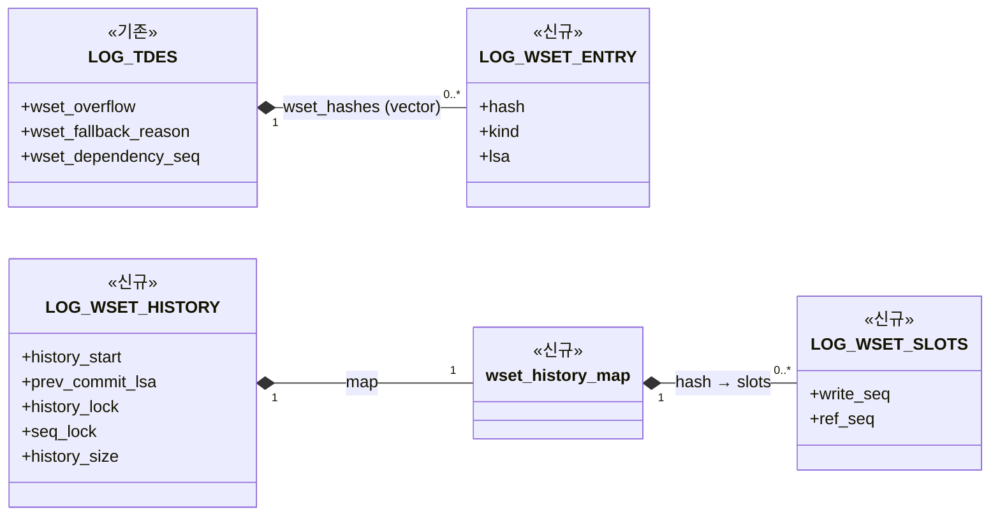
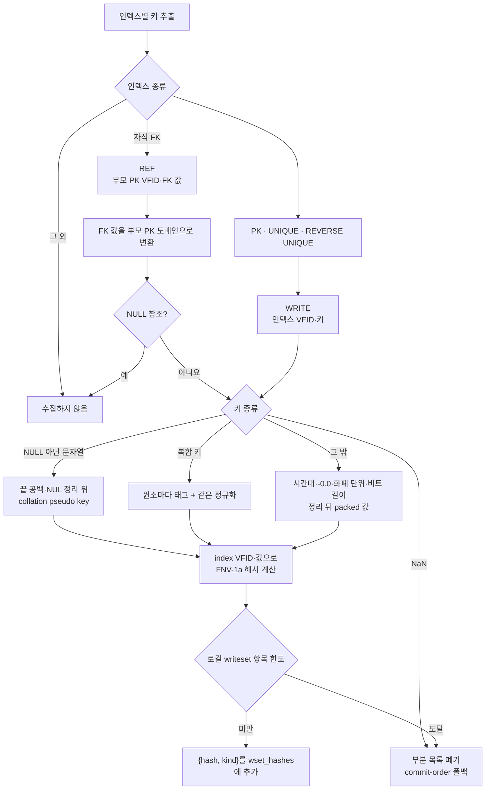

# 마스터 writeset 설계

마스터의 writeset은 슬레이브가 트랜잭션을 병렬로 적용해도 마스터와 같은 결과가 나오도록, 각 트랜잭션이 먼저 끝나기를 기다려야 할 이전 트랜잭션을 커밋 때 정해 로그에 남긴다. 슬레이브는 이 기록만 보고 적용 순서를 정한다.

## 1. 전체 처리 흐름
키별 writeset을 유지한 일반 복제 대상 로컬 트랜잭션의 순서는 다음과 같다. 한도 초과·statement 폴백과 독립 top operation은 뒤에서 별도로 설명한다. 문서에서 트랜잭션과 전역에서 저장하는 해시의 값은 다음과 같이 정리한다.
- **writeset**: 트랜잭션 하나가 DML 중에 모은 키 목록이다(`LOG_TDES.wset_hashes`). 커밋하면 history에 게시하고, ABORT하면 버린다.
- **history**: 서버 전역에 하나 있는 map이다(`wset_History`). 키별로 마지막 WRITE와 REF의 COMMIT LSA를 기억하며, 커밋 때 조회하고 커밋 뒤 갱신한다.

```text
[DML 중 — 행마다 반복]
행 INSERT·UPDATE·DELETE
  → 행 잠금 획득
  → locator_add_or_remove_index_internal() 또는 locator_update_index()
     → 인덱스 키 추출
     → [추가] wset_add_write_key()           PK·UNIQUE 키를 WRITE로 수집
     → [추가] locator_wset_collect_fk_ref()
        → [추가] wset_add_ref_key()          자식 FK의 부모 키를 REF로 수집
     → B-tree 변경, repl_log_insert()
  (모은 키는 writeset에 쌓이고, 커밋 전까지 history는 건드리지 않음)

[커밋 — 트랜잭션당 한 번]
log_commit_local()
  → log_append_repl_info_and_commit_log()
     → 로그 mutex(prior_lsa_mutex) 획득
     → log_append_repl_info_with_lock()             복제 로그 기록
     → [추가] wset_find_dependency_from_history()   dependency 결정
     → [추가] log_append_wset_label_with_lock()     WSET_LABEL 로그 기록
     → log_append_commit_log_with_lock()            COMMIT 로그 기록
     → [추가] wset_note_commit_with_log_lock()      커밋 순서 기준 갱신
     → 로그 mutex 해제
  → [추가] wset_publish_commit_to_history()         writeset을 history에 게시
  → lock_unlock_all()                               행 잠금 해제
```



- **수집**: 일반 인덱스의 키는 모으지 않는다.
- **dependency 결정**: 같은 키를 앞서 바꾸거나 참조한 트랜잭션 중 가장 늦은 COMMIT LSA를 고른다. 키를 안전하게 모을 수 없는 트랜잭션(statement 복제, 키 수 초과)은 직전 커밋을 고른다. 로그 mutex 안에서 정하므로, 결정과 COMMIT 사이에 다른 커밋이 끼지 않는다.
- **기록**: 슬레이브는 라벨의 LSA까지 빈틈없이 적용된 뒤에 그 트랜잭션을 실행한다.
- **게시**: 결정 때는 아직 자기 COMMIT LSA가 없어서 COMMIT 뒤에 한다. 행 잠금을 풀기 전에 끝나야, 같은 행을 기다리던 다음 트랜잭션이 행 잠금을 얻었을 때 이 커밋을 history에서 찾는다.

다른 모듈이 writeset을 부르는 곳은 단계별로 다음과 같다.

- **생명주기**: `log_tran_table.c`가 `wset_history_initialize`, `wset_history_finalize`를 부른다(7절).
- **수집**: `locator_sr.c`가 `wset_add_write_key`, `wset_add_ref_key`를, `serial.c`가 `wset_add_write_key`를 부른다(3절).
- **폴백**: `replication.c`(statement 복제)와 `serial.c`가 `wset_fallback_to_commit_order`를 부른다(3.3절).
- **커밋, 로그 mutex 안**: `log_manager.c`가 `wset_find_dependency_from_history`, `wset_note_commit_with_log_lock`을 부른다(4절).
- **커밋, 로그 mutex 해제 뒤**: `log_manager.c`가 `wset_publish_commit_to_history`를 부른다(5절).
- **독립 top operation**: `log_manager.c`가 `wset_find_sysop_fallback_dependency`, `wset_raise_history_start`, `wset_discard_sysop_keys`, `wset_abort_after_lsa`를 부른다(6절). `wset_raise_history_start`는 서버 재시작 때도 부른다(7절).
- **통계**: `show_scan.c`가 `SHOW WRITESET STATUS`의 시작 함수로 `wset_status_start_scan`을 함수 포인터로 등록한다.
- **trace**: `locator_sr.c`와 `btree.c`가 `wset_trace_enabled`로 trace 여부를 묻고, `locator_sr.c`는 `wset_trace_key_source`로 키의 출처를 남긴다.

### 1.1 소스 구성

writeset 코드는 `src/transaction/writeset/`에 모은다.

```text
src/transaction/
├─ writeset/
│  ├─ writeset.hpp / .cpp
│  ├─ writeset_key_hash.hpp / .cpp
│  ├─ writeset_history_map.hpp / .cpp
│  ├─ writeset_types.hpp
│  └─ writeset_stat.hpp / .cpp
├─ locator_sr.c
├─ log_manager.c
├─ log_tran_table.c
└─ replication.c
src/query/serial.c
src/query/show_scan.c
src/storage/btree.c
```

`writeset/`는 이번 기능이 새로 만든 디렉토리이며, 파일마다 맡은 일은 다음과 같다.

- `writeset.hpp / .cpp`: 키 수집, dependency 결정, history 게시와 clear, 생명주기. 서버 모듈은 대부분 이 헤더로 writeset을 부른다.
- `writeset_key_hash.hpp / .cpp`: 제약 키를 인덱스가 비교하는 방식대로 해시한다(`wset_hash_key`). WRITE와 REF가 함께 쓴다.
- `writeset_history_map.hpp / .cpp`: 키별 write_seq와 ref_seq를 담는 동시성 map. TBB `concurrent_hash_map`을 감싼다.
- `writeset_types.hpp`: 공용 타입. 키 해시, WRITE와 REF 구분, 트랜잭션 writeset 항목. `log_impl.h`가 LOG_TDES 필드 때문에 이 헤더를 직접 include한다.
- `writeset_stat.hpp / .cpp`: master 통계와 `SHOW WRITESET STATUS`. `show_scan.c`가 이 헤더를 직접 include한다.

나머지 파일은 writeset을 부르는 기존 모듈이며, 바뀐 내용은 다음과 같다.

- `locator_sr.c`: INSERT·DELETE·UPDATE의 인덱스 갱신 경로에서 키 수집, FK REF 수집, 커밋 중인 inserter 대기.
- `log_manager.c`: 커밋 경로의 dependency 결정, 라벨 기록, 게시. sysop 끝의 라벨.
- `log_tran_table.c`: history 초기화와 해제.
- `replication.c`: statement 복제 시 commit-order 폴백.
- `serial.c`: serial 갱신의 키 수집.
- `btree.c`: UNIQUE·FK 검사가 커밋 중인(아직 게시 전) 트랜잭션을 만나면 기다림. writeset 함수는 trace 여부만 부른다.
- `show_scan.c`: `SHOW WRITESET STATUS` 등록.

## 2. 로컬 writeset과 전역 history

키를 트랜잭션별 writeset과 전역 history로 나누는 이유는, 행을 바꾸는 동안에는 아직 자기 COMMIT LSA가 없어 history에 올릴 값이 없기 때문이다. 그래서 키는 커밋까지 writeset에 모아 두고, COMMIT LSA가 정해진 뒤에 history에 올린다.



*그림 2. 로컬 writeset과 전역 history의 자료구조. 이번 설계에서 추가한 주요 필드만 표시했다.*

### 2.1 트랜잭션 로컬 writeset

로컬 writeset은 충돌 키의 해시와 WRITE·REF 종류를 vector에 담는다. 한 행에서 PK·UNIQUE·FK 키가 각각 나올 수 있고, UPDATE는 변경 전후의 키를 모두 수집하므로 항목 수는 행 수와 같지 않다. 같은 키와 종류가 반복돼도 목록에는 그대로 남긴다.

COMMIT 직전에 이 목록으로 dependency를 계산한다. 목록이 한도를 넘으면 부분 writeset을 버리고 commit-order 폴백을 사용한다. ABORT한 트랜잭션의 키는 history에 게시하지 않는다. 키 수집 조건과 폴백은 3절에서 설명한다.

트랜잭션 descriptor(`LOG_TDES`)에 더한 필드는 다음과 같다.

- `wset_hashes`: 이 트랜잭션이 모은 키 목록(`LOG_WSET_ENTRY`의 vector).
- `wset_overflow`: writeset을 버리고 commit-order 폴백을 쓰는지 여부. 키 수가 한도를 넘거나 변경이 statement로 복제될 때 켜진다. 일부 키만 남기면 안전하지 않으므로 목록 전체를 버린다. 키를 만들다 실패한 것은 DML 오류로 돌려주며 이 값을 켜지 않는다.
- `wset_fallback_reason`: `wset_overflow`를 켠 이유. 커밋 때 통계로만 센다.
- `wset_dependency_seq`: 커밋 때 history에서 고른 dependency. COMMIT 바로 앞의 WSET_LABEL에 실린다.

키 항목(`LOG_WSET_ENTRY`)은 다음을 담는다.

- `hash`: 충돌 키의 해시(3.1절).
- `kind`: WRITE 또는 REF.
- `lsa`: 키를 모은 시점의 트랜잭션 마지막 로그 LSA. sysop이 ABORT되면 sysop 시작 위치 뒤에 모은 키를 이 값으로 찾아 지운다(6절).

### 2.2 전역 history

전역 history는 키 해시마다 마지막 WRITE COMMIT LSA와 REF COMMIT LSA의 최댓값을 보관한다. 각 트랜잭션은 COMMIT 직전에 해당 키를 조회하고, 본인 COMMIT LSA가 확정된 뒤 WRITE·REF 슬롯을 갱신한다. 서로 다른 키는 동시에 처리할 수 있도록 해시 맵의 키별 접근을 보호한다.

history를 비우거나 서버가 재시작하면 이전 키별 이력을 조회할 수 없으므로 이력을 비운 시점의 하한을 함께 관리한다. commit-order 폴백에 쓰는 직전 COMMIT LSA도 전역으로 유지한다. dependency 계산은 4절, history 게시와 동시성은 5절에서 설명한다.

전역 history(`LOG_WSET_HISTORY`, 서버에 하나 있는 `wset_History`)의 필드는 다음과 같다.

- `map`: 키 해시마다 slot(`write_seq`, `ref_seq`)을 담는 `wset_history_map`. TBB `concurrent_hash_map`을 감싸며, 키 하나씩 잠그므로 서로 다른 키의 probe와 publish는 동시에 돈다.
- `history_start`: 키별 이력을 볼 수 없는 구간의 하한. 서버 재시작, history 비우기, 폴백 커밋, 독립 top operation에서 올린다. 모든 dependency는 이 값 이상이 된다.
- `prev_commit_lsa`: 직전에 기록된 COMMIT LSA. commit-order 폴백의 dependency로 쓴다.
- `history_lock`: map을 보호하는 읽기/쓰기 잠금. probe와 publish는 공유로, map을 비우는 clear는 배타로 잡는다. TBB의 clear는 다른 접근과 동시에 돌면 안전하지 않기 때문이다.
- `seq_lock`: `prev_commit_lsa`와 `history_start`를 함께 지키는 mutex. 두 값을 읽거나 올리는 곳은 모두 이 잠금을 잡는다.
- `history_size`: `ha_writeset_history_size` 값. 트랜잭션별 키 수와 map 크기의 상한으로 함께 쓴다.

### 2.3 WSET_LABEL

WSET_LABEL은 master가 커밋하는 트랜잭션마다 로그에 남기는 레코드다. "이 트랜잭션은 어느 커밋 뒤에 적용해야 하는가"를 slave에 알린다. writeset과 history는 master 메모리에만 있으므로, slave가 적용 순서를 알 수 있는 근거는 이 레코드뿐이다.

**담는 값**
- `dependency_seq` 하나. 커밋 때 고른 dependency의 COMMIT LSA다(`LOG_TDES.wset_dependency_seq`).
- 기다릴 커밋이 없으면 NULL이다.

**기록 시점과 위치**
- 복제가 켜진 상태에서 커밋하는 트랜잭션마다 남긴다. 로그 applier 자신의 트랜잭션에는 남기지 않는다.
- 같은 트랜잭션의 복제 항목 뒤, COMMIT 바로 앞에 둔다. 독립 top operation이면 `LOG_SYSOP_END` 바로 앞에 둔다(6절).
- 라벨과 COMMIT은 같은 `prior_lsa_mutex` 구간에서 기록되므로, 둘 사이에 다른 레코드가 끼지 않는다(4.2절).

**slave에서 쓰는 방법**
1. coordinator는 라벨을 읽어 둔다.
2. 같은 트랜잭션의 COMMIT(또는 SYSOP_END)을 만나면, 그 값을 태스크의 dependency로 붙인다.
3. 태스크는 `dependency_seq` 이하의 커밋이 빈틈없이 모두 적용된 뒤에 실행된다. NULL이면 기다리지 않는다.

자세한 처리는 slave 설계 문서의 [복제 로그에서 task 구성](./02-slave-implementation-design.md#1-복제-로그에서-task-구성)과 [dependency gate와 완료 처리](./02-slave-implementation-design.md#3-dependency-gate와-완료-처리)에 있다.

**참고**
- 레코드 종류는 `LOG_DUMMY_WSET_LABEL`이다. 크래시 복구에서는 아무 일도 하지 않는다.
- 처음 설계에 있던 `dependency_is_ref`는 뺐다. slave가 모든 dependency를 같은 방식(빈틈없이 적용될 때까지)으로 기다리기 때문이다.

## 3. 행 변경에서 WRITE·REF 수집

### 3.1 충돌 키

충돌 키는 (index VFID, 정규화한 키)이다. 이 둘을 이어 FNV-1a 64비트로 해시하고(`wset_hash_key`), `LOG_WSET_ENTRY`에 `{hash, kind}`로 넣는다.

```text
hash = FNV-1a64 ( index VFID | 정규화한 키 바이트 )
```

해시는 master 메모리 안에서만 비교하므로 바이트 배치는 정해진 형식이 아니다. 지킬 규칙은 인덱스가 같은 키로 보는 값이 같은 바이트가 되는 것뿐이다.

- **WRITE** (`wset_add_write_key`): PK·UNIQUE·REVERSE UNIQUE를 바꾼 행의 index VFID와 인덱스 키
- **REF** (`wset_add_ref_key`): 자식 FK가 참조하는 부모 PK의 VFID와, 부모 PK 도메인으로 변환한 FK 값. 복합 FK는 부모 PK 순서의 MIDXKEY 하나로 만든다.
- 일반 인덱스는 수집하지 않는다.

키는 인덱스가 같다고 비교하는 값이 같은 바이트가 되도록 정규화한다.
- 문자열: collation pseudo key 5바이트. 인덱스가 무시하는 끝 공백은 자르고, NUL은 공백으로 바꾼다(binary 콜레이션은 끝 NUL만 자른다). (`wset_pack_string_key`)
- TIMESTAMPTZ·DATETIMETZ: UTC 부분만 (`wset_strip_zone`)
- FLOAT·DOUBLE: -0.0을 +0.0으로 (`wset_unsign_zero`)
- MONETARY: 화폐 단위 없이 금액만 (`wset_strip_currency`)
- VARBIT: 비트 길이를 바이트 단위로 올림 (`wset_round_bit_length`)
- 복합 키: 원소마다 같은 규칙 (`wset_midxkey_hash`)
- 그 밖의 타입: 패킹한 값 그대로
- NaN: 모든 키와 같아 해시할 수 없으므로 그 트랜잭션을 commit-order로 보낸다. (`wset_value_is_nan`)
- 확인하지 못한 것: locale·UCA 콜레이션의 가중치 0 글자(실측 환경 없음)

NULL 처리
- UNIQUE·REVERSE UNIQUE의 NULL은 packed NULL로 WRITE를 수집한다.
- FK 구성 값 중 하나라도 NULL이면 REF를 수집하지 않는다.

class OID는 해시에 넣지 않는다. 상속 계층은 물려받은 PRIMARY KEY와 UNIQUE에 B-tree 하나를 함께 쓰므로, 상위 클래스와 하위 클래스로 쓴 같은 키가 하나의 해시가 되어야 한다. 지워진 B-tree의 VFID가 다시 쓰이면 해시가 겹치는 쪽이라 의존이 하나 더 생길 뿐이다. 또 인덱스를 지우는 DDL은 문장 복제라서 커밋 때 history를 비운다.

### 3.2 수집 호출 경로

**AS-IS — INSERT·DELETE**

```text
locator_add_or_remove_index_internal()
└─ 인덱스별 반복
   ├─ 현재 행에서 인덱스 키 추출
   ├─ B-tree INSERT 또는 DELETE
   └─ PK이면 FK action 확인 후 repl_log_insert()
```

**TO-BE — INSERT·DELETE**

```text
locator_add_or_remove_index_internal()
└─ 인덱스별 반복
   ├─ 현재 행에서 인덱스 키 추출
   ├─ [추가] PK·UNIQUE·REVERSE UNIQUE
   │  └─ wset_add_write_key()
   ├─ [추가] 자식 FOREIGN KEY
   │  └─ locator_wset_collect_fk_ref()
   │     └─ wset_add_ref_key()
   ├─ B-tree INSERT 또는 DELETE
   └─ PK이면 FK action 확인 후 repl_log_insert()
```

**AS-IS — UPDATE**

```text
locator_update_index()
├─ 인덱스별 old key·new key 추출과 비교
├─ B-tree DELETE·INSERT 또는 UPDATE
└─ PK old key로 repl_log_insert()
```

**TO-BE — UPDATE**

```text
locator_update_index()
├─ 인덱스별 old key·new key 추출과 비교
├─ [추가] PK·UNIQUE·REVERSE UNIQUE: 값이 바뀌었는지와 상관없이
│  ├─ old key → wset_add_write_key()
│  └─ new key → wset_add_write_key()
├─ [추가] 자식 FOREIGN KEY: 값이 바뀌었는지와 상관없이
│  ├─ old key → locator_wset_collect_fk_ref()
│  └─ new key → locator_wset_collect_fk_ref()
├─ B-tree DELETE·INSERT 또는 UPDATE
└─ PK old key로 repl_log_insert()
   └─ [추가] PK 인덱스 순회를 건너뛴 경로이면, 오류 확인 뒤 old PK → wset_add_write_key()
```

INSERT는 새 행, DELETE는 지우기 전 행이 현재 행이다. 키는 B-tree를 바꾸기 전에 모은다.

### 3.3 키 수집과 로컬 writeset 추가

복제 대상 행의 인덱스 처리 중 다음 순서로 `LOG_WSET_ENTRY`를 만든다. 로그 적용 스레드와 복제 억제 상태에서는 수집하지 않는다.



*그림 3-1. 인덱스 키를 WRITE·REF로 분류해 해시를 계산하고 트랜잭션 로컬 writeset에 추가하는 과정*

WRITE 키는 `wset_hash_key`가 다음 순서로 해시한다(`wset_add_write_key`).

```text
NULL이 아닌 문자열 → wset_string_hash
복합 키            → wset_midxkey_hash  (원소마다 3.1과 같은 정규화)
NaN                → 해시하지 않고 commit-order 폴백
그 밖              → wset_strip_zone → wset_unsign_zero
                   → wset_strip_currency → wset_round_bit_length
                   → or_pack_mem_value → wset_fnv1a
```

- 복합 키는 원소마다 태그를 붙여 이어 붙인다. NULL 원소는 0xC0, 문자열 원소는 0xC5와 pseudo key, 그 밖의 원소는 0xC1과 패킹한 원소다. 태그는 종류가 다른 원소가 같은 바이트로 이어져 해시가 겹치지 않게 한다.
- 복합 키의 도메인이 비어 있으면 키를 만들지 않고 오류로 돌려준다. 도메인 없이 패킹하면 그 인덱스의 모든 키가 같은 해시가 되기 때문이다.

REF 키는 FK 값을 부모 PK 도메인으로 바꾼 뒤 WRITE와 같은 방식으로 해시한다(`wset_add_ref_key`).

```text
FK 값이 NULL         → 수집하지 않음
부모 PK가 복합 키    → wset_make_parent_midxkey로 부모 PK 순서의 MIDXKEY를 만든다
                       (구성 값 중 NULL이 있으면 수집하지 않음)
부모 PK가 단일 컬럼  → wset_cast_value_to_domain으로 부모 PK 도메인으로 변환한다
두 경우 모두         → wset_hash_key로 WRITE와 같은 순서로 해시
```

- 부모 PK 도메인으로 바꾸는 이유는 자식 컬럼의 타입이나 collation이 부모와 달라도 부모의 WRITE와 같은 바이트가 되게 하려는 것이다.

로컬 writeset에는 원래 키 값 대신 해시와 종류만 보관하며, 같은 `{hash, kind}`도 중복 제거하지 않는다.

전역 writeset history의 최대 충돌 키 항목 수를 정하는 `ha_writeset_history_size`를 트랜잭션 로컬 writeset의 항목 상한에도 사용한다. 항목을 추가할 때마다 이 한도를 확인하고, 다음 항목을 담을 수 없으면 부분 목록을 버리고 더는 키를 수집하지 않는다. 키 구성·변환·메모리 할당 실패는 DML 오류로 전달한다. 행 키로 표현할 수 없는 statement 복제도 commit-order 폴백을 사용한다. 폴백은 `wset_fallback_to_commit_order`가 한다. `replication.c`의 `repl_log_insert_statement`가 statement 복제 로그를 남길 때 부르고, `serial.c`의 `serial_update_serial_object`는 serial 인덱스를 아직 찾지 못해 키를 만들 수 없을 때 부른다. 이 함수는 모은 키를 버리고 `wset_overflow`와 폴백 이유를 표시하며, 한 번 폴백한 트랜잭션은 그 뒤 키를 더 모으지 않는다. 폴백한 트랜잭션은 COMMIT에서 키별 dependency를 계산하지 않고, COMMIT 후 전역 history를 비운다.

## 4. COMMIT 직전 dependency 계산

### 4.1 history probe 규칙

- 현재 entry가 **REF**이면 이전 `write_seq`를 조회한다. 부모 WRITE는 기다리지만 같은 부모의 다른 REF는 기다리지 않는다.
- 현재 entry가 **WRITE**이면 이전 `write_seq`와 `ref_seq` 중 큰 값을 조회한다. 이전 WRITE와 앞선 자식 REF를 함께 고려한다.

`wset_find_dependency_from_history()`는 각 entry의 후보를 비교해 가장 큰 LSA 하나를 선택한다. 시작값은 `history_start`다. 최종 후보가 `ref_seq`에서 왔으면 그 LSA를 그대로 쓴다. 그 외에는 후보와 `prev_commit_lsa` 중 이른 값을 택하되 `history_start` 아래로 내리지 않는다. `wset_overflow`이면 map을 조회하지 않고 `prev_commit_lsa`와 `history_start` 중 큰 값을 반환한다.

라벨에는 dependency가 WRITE 슬롯과 REF 슬롯 중 어디서 왔는지 기록하지 않는다. 슬레이브 gate는 출처와 상관없이 모든 non-NULL dependency에 대해 연속 완료 경계를 확인하므로 출처가 필요 없다.

### 4.2 COMMIT 호출 경로와 로그 배치

**AS-IS**

```text
log_commit_local()
├─ log_append_repl_info_and_commit_log()
│  └─ prior_lsa_mutex 안
│     ├─ log_append_repl_info_with_lock()
│     └─ log_append_commit_log_with_lock()
├─ lock_unlock_all()
└─ log_change_tran_as_completed()
```

**TO-BE**

```text
log_commit_local()
├─ log_append_repl_info_and_commit_log()
│  └─ prior_lsa_mutex 안
│     ├─ log_append_repl_info_with_lock()
│     ├─ [추가] wset_find_dependency_from_history()    라벨 결정
│     ├─ [추가] log_append_wset_label_with_lock()
│     ├─ log_append_commit_log_with_lock()
│     └─ [추가] wset_note_commit_with_log_lock()       prev_commit_lsa 전진, 폴백이면 history_start 올림
├─ [추가] wset_publish_commit_to_history(commit_lsa)  키 게시, 폴백·용량 초과면 map 비움
├─ lock_unlock_all()
└─ log_change_tran_as_completed()
```

라벨 결정과 commit-order 기준 갱신(`prev_commit_lsa`, `history_start`)은 COMMIT 기록과 같은 `prior_lsa_mutex` 구간에서 한다. 그래서 라벨은 기록 순서상 바로 앞까지의 COMMIT을 반영하고, statement 복제 같은 commit-order 트랜잭션은 그 구간 안에서 하한을 자기 COMMIT으로 올린 뒤에야 다음 트랜잭션이 라벨을 정한다. 라벨 결정을 구간 밖에서 먼저 하면 그 사이에 기록된 COMMIT을 놓치고, 하한을 구간 밖에서 나중에 올리면 그 사이에 라벨을 정한 뒤 트랜잭션이 statement를 기다리지 않는다(2026-10-25 실측, [9.1.10](../9-미해결-리스크.md)). 이 구간에서 history map을 조회하므로, 키가 많은 트랜잭션과 map을 비우는 동안 모든 로그 기록이 그만큼 기다린다(최적화 후보는 9.1.10).

복제 항목·WSET_LABEL·COMMIT을 한 `prior_lsa_mutex` 구간에 연속 기록해 다른 트랜잭션의 COMMIT이 끼어들지 않게 한다. 라벨 값도 같은 구간에서 정한다. `LOG_DUMMY_WSET_LABEL`의 payload에는 `dependency_seq`만 담고, `trid`는 로그 공통 헤더에서 읽는다. 키 목록은 로그로 보내지 않는다. probe 때는 아직 본인 COMMIT LSA가 없으므로 history를 조회만 한다. 게시에는 확정된 COMMIT LSA를 사용한다.

## 5. COMMIT 뒤 history 게시와 동시성

COMMIT 직전 probe는 `seq_lock`을 잡은 뒤 `history_lock`을 공유로 잡아 `prev_commit_lsa`와 `history_start`를 같은 history 세대에서 읽는다. `seq_lock`을 놓고 공유 잠금을 유지한 채 키별 슬롯을 조회하므로 조회 중 map clear가 끼어들지 않는다.

COMMIT LSA가 확정되면 같은 `prior_lsa_mutex` 구간에서 commit-order 기준을 전진시키고(4.2절), 잠금을 놓은 뒤 트랜잭션이 수집한 키를 전역 history에 게시한다. 같은 키의 WRITE·REF 이력에는 각각 더 큰 COMMIT LSA를 남긴다. ABORT는 게시하지 않는다. 게시를 마친 뒤 행 잠금을 해제해야 다음 트랜잭션이 이 이력을 조회할 수 있다. 키 게시를 잠금 밖에서 해도 되는 것은 같은 키를 건드리는 뒤 트랜잭션이 행 잠금 때문에 이 게시 뒤에야 COMMIT까지 가기 때문이다. 키가 없는 statement 복제에는 이 보장이 없으므로, statement의 순서는 잠금 안의 라벨과 하한으로만 지킨다.

```text
일반 게시
  → history_lock 공유 획득
  → 진행 중인 게시의 예약량을 포함해 용량 확보
  → entry마다 TBB accessor로 슬롯 하나를 갱신하고 즉시 해제
  → 예약 반환, 공유 잠금 해제

용량 부족 또는 commit-order 폴백
  → seq_lock → history_lock 배타 획득
  → 용량 재확인 또는 map clear
  → prev_commit_lsa를 history_start에 반영
  → 일반 게시라면 현재 entry 게시
  → 잠금 해제
```

한 트랜잭션이 여러 키를 가져도 accessor는 한 번에 하나만 잡는다. 정상 조회·게시는 공유 보호 아래 키별 슬롯에 접근한다. history를 비울 때는 진행 중인 조회·게시와 겹치지 않도록 배타 보호로 전환하고, 이력의 유효 하한도 함께 바꾼다. 용량에는 진행 중인 게시의 예약량을 포함하며, 공유 보호를 놓고 배타 보호로 전환한 뒤 다시 확인한다.

`history_start`는 clear로 사라진 슬롯의 COMMIT LSA를 포괄해야 한다. COMMIT LSA 순서와 게시 완료 순서가 다를 수 있으므로 clear를 촉발한 한 트랜잭션의 LSA가 아니라 단조 전진한 `prev_commit_lsa`를 사용한다.

## 6. 독립 top operation

복제 항목이 있는 `LOG_SYSOP_END_COMMIT`은 바깥 트랜잭션의 COMMIT과 별도로 적용된다. 이 경계에서는 sysop의 키별 이력을 게시하지 않고, 앞선 작업 전체와 뒤의 작업 사이에 commit-order 조건을 둔다.

```text
AS-IS
log_sysop_start() → 기존 top operation 상태 보관
log_sysop_commit_internal() → 복제 항목·LOG_SYSOP_END 기록

TO-BE
log_sysop_start() → wset_hashes.size()를 wset_mark로 보관
log_sysop_commit_internal() — 복제 항목이 있는 COMMIT형
  → 동일 prior_lsa_mutex 구간에서
       wset_find_sysop_fallback_dependency() → WSET_LABEL·LOG_SYSOP_END 기록 → wset_raise_history_start(sysop_lsa)
  → wset_discard_sysop_keys(wset_mark)
```

sysop을 시작할 때 로컬 writeset의 끝을 표시한다. COMMIT형 sysop에 복제 항목이 있으면 앞선 `prev_commit_lsa`와 `history_start` 중 큰 값을 dependency로 정하고, 같은 로그 append 구간에서 WSET_LABEL을 `LOG_SYSOP_END` 바로 앞에 기록한다. 슬레이브는 이 라벨도 연속 완료 경계로 판정하므로, sysop은 앞선 작업이 모두 적용된 뒤에 적용된다.

`LOG_SYSOP_END`의 LSA가 확정되면 map은 유지하고 `history_start`만 그 위치까지 올린다. 뒤의 트랜잭션이 이 sysop보다 앞서 적용되지 않게 하기 위해서다. sysop에서 수집한 키는 로컬 writeset의 표시 이후 부분에서 제거해 바깥 COMMIT의 probe·게시 대상에서 제외한다. serial 갱신은 인덱스 수집 경로 밖에서 해당 행의 키를 직접 수집하지만, 이 sysop 경계에서는 그 키도 게시하지 않는다. 복제 항목이 없는 sysop에는 라벨과 하한 전진을 적용하지 않는다. sysop이 ABORT되면 `log_sysop_abort`가 `wset_abort_after_lsa`를 불러, sysop을 시작한 위치(바깥 트랜잭션의 마지막 sysop 부모 LSA) 뒤에 모은 키를 로컬 writeset에서 지운다. 되돌려진 변경의 키가 바깥 COMMIT에서 probe·게시되지 않게 하기 위해서이며, 복제 로그를 같은 위치까지 지우는 `repl_log_abort_after_lsa`와 짝을 이룬다.

## 7. 초기화·재시작과 오류 경계

서버 시작 시 `logtb_define_trantable_log_latch`가 `wset_history_initialize`를 불러 전역 history map과 잠금(`history_lock`, `seq_lock`)을 준비하고, `ha_writeset_history_size`와 trace 수준을 읽어 둔다. 로컬 writeset은 트랜잭션 descriptor를 사용할 때 초기화하고, 트랜잭션이 끝나면 비운다. 서버 종료 시 `logtb_undefine_trantable`이 `wset_history_finalize`를 불러 전역 history를 비우고 잠금을 없앤다. 복구 중 트랜잭션 테이블을 다시 쓰는 경로는 이 정리를 거치지 않으므로 history가 그대로 남는다.

`ha_writeset_history_size`는 트랜잭션 로컬 writeset과 전역 history의 충돌 키 항목 상한에 함께 사용한다. `ha_writeset_trace_level`은 수집·probe·게시 과정의 추적 로그 수준을 정한다.

서버 재시작에서는 복구된 로그 끝을 `history_start`로 올린다. 일반 키별 probe와 sysop 폴백은 이 하한을 반영한다. 다만 현재 `wset_overflow` 분기는 `history_start` 없이 `prev_commit_lsa`만 반환하므로, 재시작 또는 sysop 직후의 폴백 라벨이 하한보다 낮아질 수 있다.

키 구성·메모리 할당 실패는 행 변경 오류로 반환한다. 한도 초과와 statement 복제는 commit-order 폴백으로 처리한다. 현 구현은 라벨 기록용 메모리 할당 실패를 COMMIT 경로에 전달하지 않으므로, 이 경우 COMMIT이 라벨 없이 남을 수 있다.
