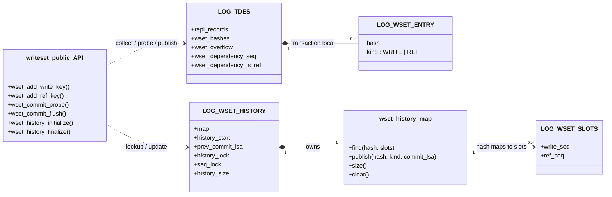

# 마스터 writeset 구현 설계

마스터 writeset 구현은 `src/transaction/writeset.cpp`와 `writeset.hpp`에 둔다. 소스와 헤더는 실제 빌드 언어에 맞춰 C++ 확장자를 사용하되, 인터페이스와 제어 흐름은 기존 transaction 모듈의 함수 중심 구조를 유지한다.

## 1. 목적과 처리 흐름

마스터는 트랜잭션이 변경하거나 참조한 제약 키를 수집하고, 커밋 직전에 먼저 완료돼야 할 트랜잭션의 COMMIT LSA를 결정한다.

```text
행·인덱스 변경
  → WRITE·REF 항목 수집
  → 트랜잭션 로컬 writeset에 보관
  → 커밋 직전 전역 history 조회(probe)
  → dependency 라벨과 COMMIT 기록
  → 현재 COMMIT LSA를 전역 history에 게시(publish)
  → 행 잠금 해제
```

`probe`와 `publish`를 분리하는 이유는 probe 시점에는 현재 트랜잭션의 COMMIT LSA가 아직 정해지지 않았기 때문이다. publish는 COMMIT LSA가 확정된 뒤, 같은 키를 기다리는 후행 트랜잭션이 행 잠금을 획득하기 전에 끝나야 한다.

### 1.1 자료구조와 인터페이스

다음 UML은 기존 트랜잭션 descriptor에 추가되는 로컬 writeset과, 모든 트랜잭션이 공유하는 전역 history의 소유 관계를 구분한다. 함수는 구현 세부사항을 모두 나열하지 않고 다른 모듈이 호출하는 공개 인터페이스만 표시한다.



`LOG_TDES.wset_hashes`는 한 트랜잭션만 소유하고 commit 또는 abort 때 비운다. `LOG_WSET_HISTORY`는 서버의 전역 상태이며, `wset_history_map`이 TBB accessor를 이용한 키별 동기화를 감춘다. 따라서 호출자는 TBB 타입을 직접 다루지 않는다.

### 1.2 AS-IS/TO-BE 호출 트리

UML이 상태의 소유 관계를 보여준다면, 다음 호출 트리는 기존 경로의 어느 위치에 writeset 처리가 추가되는지를 보여준다. 붉은 박스 대신 `[추가]` 표기로 구현 변경점을 표시한다.

#### 1.2.1 행·인덱스 처리에서 키 수집

**AS-IS — INSERT·DELETE**

```text
locator_add_or_remove_index_internal()
├─ 인덱스별 key 생성
├─ B-tree INSERT/DELETE
└─ 기존 복제 정보 생성
```

**TO-BE — INSERT·DELETE**

```text
locator_add_or_remove_index_internal()
├─ 인덱스별 key 생성
├─ [추가] PK·UNIQUE·REVERSE UNIQUE
│  └─ wset_add_write_key()
├─ [추가] 자식 FK
│  └─ locator_wset_collect_fk_ref()
│     └─ wset_add_ref_key()
├─ B-tree INSERT/DELETE
└─ 기존 복제 정보 생성
```

**AS-IS — UPDATE**

```text
locator_update_index()
├─ old/new key 생성
├─ B-tree DELETE/INSERT
└─ 기존 복제 정보 생성
```

**TO-BE — UPDATE**

```text
locator_update_index()
├─ old/new key 생성
├─ [추가] old/new WRITE 수집
│  └─ wset_add_write_key()
├─ [추가] old/new FK REF 수집
│  └─ locator_wset_collect_fk_ref()
│     └─ wset_add_ref_key()
├─ B-tree DELETE/INSERT
└─ 기존 복제 정보 생성
```

두 진입점은 기존 행·인덱스 처리를 그대로 수행하면서 제약 키를 `LOG_TDES.wset_hashes`에 추가한다. 키 수집 실패는 기존 오류 정리 경로로 전달하며, 일부 키만 빠진 writeset으로 계속하지 않는다.

#### 1.2.2 COMMIT에서 dependency 생성과 history 게시

**AS-IS**

```text
log_commit_local()
├─ 트랜잭션 복제 정보 기록
├─ COMMIT 기록
└─ 행 잠금 해제
```

**TO-BE**

```text
log_commit_local()
├─ [추가] wset_commit_probe()
├─ 트랜잭션 복제 정보 기록
├─ [추가] WSET_LABEL 기록
├─ COMMIT 기록
├─ [추가] wset_commit_flush()
└─ 행 잠금 해제
```

`probe`는 COMMIT 전에 dependency를 정하지만 history를 변경하지 않는다. COMMIT LSA가 정해진 뒤 `flush`가 그 LSA를 history에 게시하며, 이 작업은 같은 키를 변경할 후행 트랜잭션이 행 잠금을 얻기 전에 끝난다.

#### 1.2.3 전역 history와 트랜잭션 상태의 생명주기

전역 history는 transaction table의 재생성 여부와 관계없이 서버 실행 기간 동안 한 번만 유지한다. 초기화의 직접 caller는 `logtb_define_trantable_log_latch()`지만, 두 번째 호출부터는 `wset_History_initialized`를 확인하고 즉시 반환한다. 최종 해제는 공통 종료 경로인 `boot_server_all_finalize()`가 담당한다.

```text
logtb_define_trantable_log_latch()
├─ transaction table 생성·확장
├─ system LOG_TDES 초기화
├─ lock·page buffer·file manager 초기화
└─ wset_history_initialize()
   ├─ 최초 호출: 락과 map 상태를 초기화하고 history_size를 캐시
   └─ 후속 호출: 이미 초기화됐으면 즉시 반환

최종 종료
└─ boot_server_all_finalize()
   └─ wset_history_finalize()
      ├─ map과 LSA 상태 정리
      ├─ history_lock·seq_lock 해제
      └─ wset_History_initialized = false
```

개별 `LOG_TDES`의 로컬 writeset은 이 전역 초기화와 별개다. `logtb_initialize_tdes()`와 `logtb_clear_tdes()`가 descriptor 생성·재사용 시 `wset_hashes`, overflow 상태와 dependency 필드를 초기화한다.

일반 서버 기동에서는 `boot_restart_server()`가 한 번 실행되는 동안 transaction table이 두 번 생성될 수 있지만, 전역 history는 다시 만들지 않는다.

```text
boot_restart_server()
│
├─ 1차: boot-time transaction table 생성
│  └─ logtb_define_trantable()
│     └─ logtb_define_trantable_log_latch()
│        └─ wset_history_initialize()  ← 실제 초기화
│
├─ 중간: 복구에 필요한 디스크 정보 확인
│  └─ logtb_undefine_trantable()
│     └─ transaction descriptor 배열만 재정의; history는 유지
│
└─ 2차: recovery용 transaction table 재생성
   └─ logtb_define_trantable_log_latch()
      └─ wset_history_initialize()      ← 초기화 상태이므로 반환
```

페이지 크기 조정이나 transaction table 확장 재시도도 같은 하위 함수를 다시 호출할 수 있다. 이 경로는 아직 사용자 트랜잭션의 writeset이 게시되기 전이며, 중간 table 재정의 때문에 history의 map과 락을 해제하지 않는다. 서버 시작 경로는 writeset 초기화 전에 시스템 파라미터를 적재하므로 `history_size`도 최초 초기화에서 확정할 수 있다.

`wset_History_initialized`는 동시 접근을 제어하는 락이 아니라 초기화·종료의 중복 실행을 막는 생명주기 상태다.

- transaction table이 여러 번 정의돼도 같은 락을 다시 초기화하지 않는다.
- 초기화 전에 공통 오류 정리 경로가 호출되거나 종료가 중복 호출돼도 초기화되지 않은 락을 해제하지 않는다.
- 최종 종료 뒤 같은 프로세스에서 새 서버 생명주기를 시작하면 다음 초기화가 다시 수행된다.

현재 지원 경로에서는 writeset이 게시된 뒤 실행 중인 `cub_server`의 COMMIT LSA 기준이 다시 초기화되지 않는다. 향후 이 전제가 바뀌면 새 트랜잭션을 받기 전에 history를 비우는 별도 reset이 필요하다. 이는 실행 중 용량 초과 시 map을 비우고 현재 COMMIT LSA를 `history_start`로 남기는 보수적 clear와는 다른 생명주기 처리다.

## 2. 행 연산에서 수집하는 키

행 연산에서는 기존 인덱스 갱신과 복제 정보 생성 흐름을 유지하고, 이미 추출한 제약 키를 트랜잭션 writeset에 추가하는 단계만 삽입한다. 별도 객체를 도입하지 않으므로 이 절은 UML 대신 AS-IS/TO-BE 호출 흐름으로 변경 범위를 표시한다.

### 2.1 INSERT·DELETE 호출 흐름

**AS-IS**

```text
locator_add_or_remove_index_internal()
└─ 인덱스별 반복
   ├─ 현재 행에서 인덱스 키 추출
   ├─ B-tree INSERT 또는 DELETE
   └─ PK이면 FK action 확인 후 repl_log_insert()
```

**TO-BE**

```text
locator_add_or_remove_index_internal()
└─ 인덱스별 반복
   ├─ 현재 행에서 인덱스 키 추출
   ├─ [추가] UNIQUE·REVERSE UNIQUE
   │  └─ wset_add_write_key()
   ├─ [추가] 자식 FOREIGN KEY
   │  └─ locator_wset_collect_fk_ref()
   │     └─ wset_add_ref_key()
   ├─ 기존 B-tree INSERT 또는 DELETE
   └─ PK이면
      ├─ 기존 FK action 확인
      ├─ 기존 repl_log_insert()
      └─ [추가] wset_add_write_key()
```

INSERT는 `new row`, DELETE는 `old row`가 현재 행으로 들어온다. 일반 인덱스는 writeset에 추가하지 않는다. 수집 대상은 row-based replication이 가능한 데이터 변경이며, 복제 로그 생성이나 키 수집이 실패하면 오류를 상위 DML 경로로 반환한다.

### 2.2 UPDATE 호출 흐름

**AS-IS**

```text
locator_update_index()
├─ 인덱스별 old key·new key 추출
├─ 두 키 비교 후 B-tree 갱신
└─ PK old key로 repl_log_insert()
```

**TO-BE**

```text
locator_update_index()
├─ 인덱스별 old key·new key 추출과 비교
├─ [추가] UNIQUE·REVERSE UNIQUE
│  ├─ old key → wset_add_write_key()
│  └─ 값이 바뀌면 new key → wset_add_write_key()
├─ [추가] 자식 FOREIGN KEY
│  ├─ old key → locator_wset_collect_fk_ref()
│  └─ 값이 바뀌면 new key → locator_wset_collect_fk_ref()
├─ 기존 B-tree 갱신
├─ [추가] PK old key·new key → wset_add_write_key()
└─ 기존 repl_log_insert()
```

PK 인덱스가 기존 최적화에 의해 반복문에서 생략되는 UPDATE는 복제 로그에 사용하는 변경 전 PK를 WRITE로 한 번 수집한다. 이 보조 경로에서도 `repl_log_insert()` 오류를 먼저 확인한 뒤 writeset을 수집하여, 복제 로그 생성 실패가 writeset 함수의 반환값으로 덮이지 않게 한다.

### 2.3 수집 대상

제약조건이 적용 순서를 만드는 키만 수집한다.

- PRIMARY KEY·UNIQUE·REVERSE UNIQUE: `WRITE`
- 자식 FOREIGN KEY: 부모 PK에 대한 `REF`
- 일반 INDEX·REVERSE INDEX: 수집하지 않음

DML별 입력 행은 다음과 같다.

- INSERT: `new key`
- DELETE: `old key`
- UPDATE: `old key`와 `new key`

UPDATE에서 두 행 이미지를 모두 수집해야 이전 제약 값의 해제와 새 제약 값의 점유 순서를 함께 보존할 수 있다.

### 2.4 충돌 키

충돌 키는 다음 정보로 구성한다.

```text
H(class_oid, index VFID, normalized key)
```

클래스와 인덱스 식별자를 포함하므로 관계없는 테이블과 인덱스가 같은 값을 가졌다는 이유로 충돌하지 않는다. 문자열은 collation의 동등성 규칙을 반영하고, 그 밖의 값은 정규화한 packed 표현을 사용한다.

자식 FK의 REF는 자식 인덱스가 아니라 부모 PK의 충돌 공간을 사용한다.

```text
WRITE(parent.id=7)
  = H(parent class_oid, parent PK VFID, 7)

REF(child.parent_id=7)
  = H(parent class_oid, parent PK VFID, 7)
```

### 2.5 NULL과 복합 FK

자식 FK가 NULL이면 참조하는 부모 행이 없으므로 해당 FK의 REF만 생성하지 않는다. 자식 행의 PK·UNIQUE WRITE 수집은 그대로 수행한다.

```text
child(id=10, parent_id=NULL)
  → WRITE(child PK=10)
  → 부모 REF 없음
```

CUBRID의 FK는 부모 PK 전체를 참조한다. 복합 PK의 일부만 참조할 수 없으므로 복합 FK는 모든 컬럼을 부모 PK 순서와 도메인에 맞춘 하나의 `MIDXKEY`로 구성해야 한다. 구성 컬럼 중 하나라도 NULL이면 CUBRID의 FK 검사와 동일하게 부모 참조가 없는 것으로 처리한다.

구현은 자식 복합 FK의 각 구성 값을 대응하는 부모 PK 컬럼 도메인으로 변환한 뒤, 부모 PK 도메인의 `MIDXKEY` 하나로 다시 구성한다. 이 값을 부모 클래스와 부모 PK VFID로 해시하므로 부모 PK WRITE와 동일한 history 슬롯에서 만난다. 컬럼 수 불일치, 구성 값 추출·형변환 또는 MIDXKEY 구성 실패는 호출자에게 오류로 전달하며, 일부 REF만 빠진 writeset을 커밋하지 않는다.

## 3. 트랜잭션 로컬 writeset

각 수집 항목은 충돌 키의 해시와 접근 종류를 함께 가진다.

```c
struct wset_entry
{
  LOG_WSET_HASH hash;
  LOG_WSET_KIND kind;  /* WRITE 또는 REF */
};
```

항목은 현재 트랜잭션의 `LOG_TDES.wset_hashes`에 저장한다. 수집 시 결정한 `kind`는 커밋 시점에 다시 추론하지 않는다.

생명주기는 다음과 같다.

```text
LOG_TDES 초기화
  → 키 수집
  → dependency probe
  → COMMIT 성공 시 publish
  → descriptor 정리

ABORT
  → publish 없이 로컬 writeset 폐기
```

현재 구현은 동일한 `{hash, kind}`를 중복 제거하지 않는다. 이는 정합성을 깨뜨리지는 않지만 반복 키가 많은 트랜잭션의 메모리 사용량과 한도 초과 가능성을 높인다.

## 4. 전역 history

전역 history는 충돌 키별로 최근 WRITE와 REF의 COMMIT LSA를 보관한다.

```c
struct wset_slots
{
  LOG_LSA write_seq;
  LOG_LSA ref_seq;
};
```

- `write_seq`: 같은 충돌 키를 마지막으로 WRITE한 트랜잭션의 COMMIT LSA
- `ref_seq`: 같은 충돌 키를 REF한 트랜잭션 중 가장 큰 COMMIT LSA
- `history_start`: 전체 이력을 비운 뒤, 삭제된 관계보다 dependency가 앞서지 않도록 유지하는 하한
- `prev_commit_lsa`: commit-order 폴백에 사용하는 최근 COMMIT 기준

history map은 `tbb::concurrent_hash_map`을 사용한다. TBB accessor가 개별 충돌 키의 조회와 갱신을 보호한다.

`history_lock`은 같은 역할을 중복 수행하지 않는다.

- shared lock: 일반 probe와 publish가 전체 clear와 겹치지 않게 함
- exclusive lock: `map.clear()`와 `history_start` 갱신을 하나의 상태 전환으로 보호
- `seq_lock`: `prev_commit_lsa`의 단조 증가를 별도로 보호

따라서 서로 다른 키의 일반 접근은 병렬로 진행되며, 전체 clear 동안에만 map 접근이 차단된다.

## 5. dependency probe

현재 트랜잭션의 각 항목은 같은 해시의 history 슬롯과 다음 규칙으로 비교한다.

- 현재 REF: 이전 `write_seq`만 기다린다.
  - 같은 부모를 참조한 이전 REF는 기다리지 않으므로 형제 자식이 사슬로 연결되지 않는다.
- 현재 WRITE: 이전 `write_seq`와 `ref_seq` 중 더 늦은 값을 기다린다.
  - 이전 WRITE와의 변경 순서를 보존한다.
  - 해당 키의 상태를 전제로 실행된 이전 REF가 끝나기 전에 키를 변경하지 않는다.

모든 항목에서 얻은 후보 중 가장 늦은 COMMIT LSA를 트랜잭션의 dependency로 선택한다. 후보가 `ref_seq`에서 왔다면 라벨에 그 출처를 함께 기록한다. 슬레이브는 특정 REF 하나의 완료가 아니라 그 LSA까지의 연속 완료 경계를 확인해야 하기 때문이다.

`history_start`는 키별 후보의 기본 하한이다. writeset을 사용할 수 없는 트랜잭션은 키별 계산을 사용하지 않고 `prev_commit_lsa`를 dependency로 선택한다.

probe는 `seq_lock → history read lock` 순서로 진입해 `prev_commit_lsa`와 `history_start`를 같은 history 상태에서 읽는다. 두 값을 복사한 뒤 `seq_lock`은 즉시 해제하고, 키별 map 조회는 shared history lock과 TBB accessor로 병렬 수행한다. 최종 dependency는 `history_start`보다 작아질 수 없다. clear와 경합하는 구체적인 시나리오와 잠금 범위는 [[07-probe-snapshot-consistency|writeset dependency probe 스냅샷 일관성 설계]]에서 설명한다.

## 6. 로그 기록과 publish

커밋 경로의 순서는 다음과 같다.

```text
wset_commit_probe()
  → REPL 레코드
  → WSET_LABEL
  → COMMIT
  → wset_commit_flush()
  → 행 잠금 해제
```

`WSET_LABEL`에는 마스터가 결정한 dependency LSA와 그 dependency가 REF 이력에서 선택됐는지를 기록한다. 슬레이브는 이를 다시 계산하지 않는다.

COMMIT LSA가 확정되면 `wset_commit_flush()`가 현재 항목을 게시한다.

- WRITE 항목: `write_seq = current commit_lsa`
- REF 항목: `ref_seq = max(ref_seq, current commit_lsa)`

publish를 행 잠금 해제 전에 수행하므로 같은 키의 후행 WRITE가 잠금을 획득해 probe할 때는 현재 트랜잭션의 COMMIT LSA가 이미 history에 존재한다. ABORT 경로에서는 COMMIT LSA가 없으므로 publish하지 않는다.

`WSET_LABEL` append가 실패하면 오류를 호출자에게 전달한다. 같은 로그 append 경계에서 COMMIT 또는 복제 항목이 있는 `LOG_SYSOP_END`를 계속 기록하지 않으며, history도 게시하지 않는다. 슬레이브의 라벨 누락 검사는 기록된 로그를 탐지하는 방어선으로만 사용한다.

독립 top operation은 sysop 시작 시 writeset의 끝을 조각 경계로 보존한다. sysop 끝에서 `NEED_FLUSH` 복제 항목이 있으면 해당 조각만 probe하고, 같은 `trid`의 `LOG_SYSOP_END` 바로 앞에 `WSET_LABEL`을 기록한다. `LOG_SYSOP_END` LSA가 확정되면 그 LSA로 조각의 WRITE·REF를 history에 게시하고 조각을 바깥 writeset에서 제거한다. 복제 항목이 없는 sysop은 라벨과 history를 게시하지 않는다. 바깥 COMMIT은 남은 writeset만 사용한다.

serial 갱신은 인덱스 키 수집 경로를 거치지 않으므로 `db_serial` 행의 serial 이름 키를 sysop 조각의 WRITE로 직접 수집한다. 같은 serial을 갱신하는 다음 트랜잭션은 앞선 `LOG_SYSOP_END` task를 기다리며, 앞 트랜잭션의 바깥 COMMIT까지 기다리지 않는다. checksumdb처럼 statement 복제 항목이 있는 조각은 commit-order 폴백을 사용한다.

## 7. 보수적 폴백, 오류 전파와 전체 clear

일부 키만 수집한 writeset을 정상 경로에 사용하면 필요한 dependency를 누락할 수 있다. 정상적으로 예상되는 다음 조건은 트랜잭션 전체를 보수 상태로 전환한다.

- 트랜잭션별 writeset 한도 초과
- statement 기반 복제로 행 writeset을 사용할 수 없음

보수 상태의 트랜잭션은 `prev_commit_lsa`를 dependency로 사용한다. 커밋 후에는 키별 history를 비우고 현재 COMMIT LSA까지 `history_start`를 전진시켜, 뒤 트랜잭션이 삭제된 과거 관계를 건너뛰지 못하게 한다.

반면 다음 기술적 실패는 commit-order 폴백으로 숨기지 않고 호출자에게 오류를 반환해 해당 DML을 중단한다.

- 부모 PK 도메인 또는 필요한 제약 메타데이터 조회 실패
- FK 키 추출 또는 부모 도메인 형변환 실패
- 키 크기 계산·패킹 실패
- 메모리 할당 실패
- 복합 FK의 컬럼 수 불일치 또는 부모 도메인 `MIDXKEY` 구성 실패

`wset_add_write_key()`, `wset_add_ref_key()`와 `locator_wset_collect_fk_ref()`는 `int` 오류 코드를 반환한다. INSERT·DELETE 경로의 `locator_add_or_remove_index_internal()`과 UPDATE 경로의 `locator_update_index()`는 반환값을 확인하고 기존 오류 정리 경로로 이동한다. 자식 FK가 NULL인 경우만 참조할 부모가 없는 정상 제외이므로 `NO_ERROR`를 반환한다.

전역 history 용량을 초과하는 경우에도 exclusive `history_lock`을 얻은 뒤 용량을 다시 확인하고, 필요할 때만 clear와 하한 갱신을 수행한다.

COMMIT LSA를 받은 순서와 실제 publish 실행 순서는 다를 수 있다. 전체 clear는 현재 트랜잭션의 COMMIT LSA만 하한으로 사용하지 않고, clear 전에 게시를 시작한 트랜잭션을 모두 포괄하는 `prev_commit_lsa`까지 `history_start`에 반영해야 한다. 구체적인 경쟁 시나리오와 잠금 순서는 [[06-history-clear-concurrency|전역 writeset history clear 동시성 설계]]에서 설명한다.

## 8. 코드 대응과 리뷰 경계

- 행·인덱스 변경과 FK REF 수집: `locator_add_or_remove_index_internal()`, `locator_update_index()`, `locator_wset_collect_fk_ref()`
- 키 정규화와 로컬 수집: `wset_add_write_key()`, `wset_add_ref_key()`, `wset_make_parent_midxkey()`, `wset_cast_midxkey_element()`, `wset_cast_value_to_domain()`, `wset_push()`
- dependency 계산: `wset_commit_probe()`
- 로그 기록: `log_commit_local()`, `log_append_repl_info_and_commit_log()`
- history 게시: `wset_commit_flush()`
- 전역 상태 생명주기: `wset_history_initialize()`, `wset_history_finalize()`

리뷰에서는 함수 내부 행 단위 구현보다 다음 경계를 우선 확인한다.

- 제약 키를 빠짐없이 같은 충돌 공간으로 정규화하는가?
- probe 결과가 COMMIT 바로 앞의 라벨에 기록되는가?
- publish가 행 잠금 해제 전에 완료되는가?
- clear와 `history_start`가 원자적인 상태 전환으로 보이는가?
- 키 하나라도 안전하게 만들지 못하면 부분 writeset으로 계속하지 않고 DML을 중단하는가?
