# 슬레이브 writeset 병렬 적용 설계

> [!NOTE]
> **검토 메모 (2026-11-01, 검토가 끝나면 지운다)**
> 마스터 문서(01)를 본 뒤 이 문서의 2장을 볼 때 다음을 함께 확인한다.
> - coordinator와 worker가 함께 쓰는 자료 목록이 1.1절 끝과 2장 도입에 두 번 있고, 서로 빠진 항목이 있다. 1.1절에는 worker가 읽는 `la_Info.last_committed_lsa`가 없고, 2장에는 `la_Live_worker_count`, `la_Worker_config`, `sl_write_mutex`가 없다. 목록을 한 곳으로 합쳐야 한다.
> - frontier의 초기값(`la_gate_set_initial_frontier`로 `committed_lsa`에서 시작)과 그 이유가 2.3절 외에 4.1절, 6.1절, 7.4절에도 짧게 남아 있다. 서로 모순은 아니다.
> - 링크 검사에서 깨진 링크는 0건이고, 코드 블록은 모두 닫혀 있다.

슬레이브의 applylogdb는 master가 COMMIT마다 남긴 라벨의 `dependency_seq`만 보고 적용 순서를 정한다. 충돌하는 트랜잭션은 master의 커밋 순서대로 적용하고, 서로 독립인 트랜잭션은 병렬로 적용한다. 일은 두 종류의 스레드가 나눠 맡는다. coordinator 한 개는 복제 로그를 읽어 task를 만들고 순서를 판정한다. worker 여러 개는 각자의 서버 connection으로 task를 적용하고 COMMIT한다.

## 1. 전체 처리 흐름

coordinator는 로그를 읽는 일과, 끝난 task의 result를 거두는 일을 한 루프에서 번갈아 한다. worker는 task queue에서 task를 하나씩 꺼내 적용하고 result를 돌려준다. 두 흐름은 다음과 같다.

```text
[coordinator 루프 한 바퀴]
la_apply_log_file() 메인 루프
  → [추가] la_coordinator_collect_and_retire()       result 수거, frontier 전진, pending 재판정, retire
  → [변경] check_reinit_copylog(), 아카이브 삭제        페이지 cache mutex 안에서 처리
  → la_get_page_buffer()
  → la_log_record_process()                          레코드마다 반복
     → LOG_REPLICATION_DATA/STATEMENT: la_set_repl_log()      복제 항목을 트랜잭션 슬롯에 모음
     → [추가] LOG_DUMMY_WSET_LABEL: la_get_wset_label()        라벨 holder에 보관
     → [변경] LOG_SYSOP_END: la_coordinator_process_sysop_end()
     → [변경] LOG_COMMIT: la_coordinator_process_commit()
        → [추가] la_coordinator_set_commit_dependency()        dependency 결정
        → [추가] la_coordinator_submit_task()                  ring 등록, gate 판정, task queue 또는 pending list
     → LOG_ABORT: la_free_repl_items_by_tranid()
  → la_check_time_commit() → la_log_commit()
     → [변경] la_coordinator_commit_apply_info()               apply info 저장
  → [변경] la_change_state()                           drain 완료 전에는 DONE 보류
  → [변경] 새 로그가 없으면 la_result_queue_wait_for_result()  result가 오면 바로 깨어남

[worker task 하나]
[추가] la_worker_run()
  → la_task_queue_pop()
  → la_apply_worker_run_task() → la_apply_worker_apply_task()
     → [변경] la_apply_repl_log()                    이미 적용한 트랜잭션이면 전체를 건너뜀
     → la_apply_worker_flush_task()                  남은 변경을 서버로 보냄
     → [추가] la_insert_applied_tx_marker()           같은 트랜잭션에 applied-tx 마커 기록
     (여기까지 실패하면 db_abort_transaction()으로 되돌림)
     → la_apply_worker_commit_task() → [변경] la_commit_transaction()
  → la_result_queue_push()
```

- **로그 읽기**: coordinator만 로그를 읽는다. 복제 항목은 트랜잭션 슬롯에 모으기만 하고 바로 적용하지 않는다.
- **task 구성**: `LOG_COMMIT`을 만나면 그 트랜잭션의 슬롯과 dependency를 담은 COMMIT task를 만든다. 라벨이 붙은 `LOG_SYSOP_END`에서는 sysop 범위의 복제 항목을 떼어 fragment task를 만든다(3절).
- **gate 판정**: task의 `dependency_seq`가 NULL이거나 frontier 이하이면 task queue에 넣는다. 그렇지 않으면 pending list에 둔다(4.1절).
- **적용과 COMMIT**: worker는 자기 connection에서 항목을 적용하고 applied-tx 마커를 남긴 뒤 COMMIT한다(5.2절).
- **완료 처리**: coordinator는 result를 받으면 commit-order ring에 완료를 표시하고 frontier를 전진시킨다. pending list에서 이제 통과하는 task를 꺼내 넣고, in-flight list의 앞에서부터 retire한다(4.5절, 4.6절).
- **apply info 저장**: retire와 주기 COMMIT에서 coordinator의 connection으로 apply info를 저장한다(7.2절).

문서에서 반복해서 쓰는 이름은 다음과 같다.

- **복제 항목**(`LA_ITEM`): 복제 로그 레코드 하나에서 만든 적용 단위. 레코드 위치와 대상 class·key 정보를 가진다.
- **트랜잭션 슬롯**(`LA_APPLY`): 트랜잭션 하나의 복제 항목 목록. coordinator가 `trid`별로 `la_Info.repl_lists` 배열에서 찾거나 빈 슬롯을 배정한다.
- **라벨**(`LOG_DUMMY_WSET_LABEL`): master가 COMMIT 또는 SYSOP_END 바로 앞에 남기는 레코드. 값은 `dependency_seq` 하나다([01 2.3절](./01-master-implementation-design.md#23-wset_label)).
- **라벨 holder**: 읽은 라벨을 같은 `trid`의 다음 종료 레코드까지 들고 있는 coordinator의 정적 변수 두 개.
- **task**(`LA_TASK`): worker에 넘기는 적용 단위. `LOG_COMMIT`에서 만든 것이 COMMIT task, 라벨이 붙은 `LOG_SYSOP_END`에서 만든 것이 fragment task다.
- **sysop fragment**: 바깥 트랜잭션에서 떼어 낸, 독립 top operation의 복제 항목 묶음. 자기 트랜잭션 슬롯을 따로 가진다.
- **commit-order ring**(`la_Gate_order_ring`): coordinator가 읽은 COMMIT과 라벨이 붙은 SYSOP_END의 LSA를 로그 순서대로 담고, 각 항목의 완료 여부를 기록한다.
- **frontier**(`la_Gate_frontier`): commit-order ring의 앞에서부터 빈틈없이 적용된 마지막 COMMIT LSA. ring에는 라벨 단 SYSOP_END의 LSA도 들어가므로 frontier가 SYSOP_END LSA일 수도 있다.
- **pending list**: gate 판정을 통과하지 못했거나 task queue에 자리가 없어 기다리는 task의 목록.
- **in-flight list**: task queue에 넣은 뒤 아직 retire하지 않은 task의 목록. 넣은 순서대로 retire한다.
- **result**(`LA_RESULT`): worker가 task 하나를 끝내고 result queue로 돌려주는 값.
- **retire**: in-flight list 앞의 task를 result와 함께 정리하는 일. 트랜잭션 슬롯 반환, `committed_lsa` 전진, 통계 합산을 한다.
- **applied-tx 마커**(`ha_applied_tx_marker`): worker가 데이터와 같은 slave 트랜잭션에 남기는, 적용을 마친 COMMIT LSA 행(7.3절).

develop의 직렬 흐름과 비교하면 coordinator와 worker의 책임이 세 군데에서 바뀐다(3.5절).

- **데이터 COMMIT과 apply info COMMIT의 분리**: develop은 적용한 데이터와 apply info를 `la_log_commit`에서 한 트랜잭션으로 COMMIT한다. TO-BE에서는 worker가 트랜잭션마다 데이터를 COMMIT하고 coordinator가 apply info를 따로 COMMIT한다. 둘 사이에 생기는 차이는 applied-tx 마커로 메운다(7.3절).
- **dbname 잠금의 이동**: develop은 `la_apply_repl_log` 안에서 dbname 잠금을 잡는다. TO-BE에서는 coordinator가 복제 항목이 있는 task를 task queue에 넣기 전에 잡고, worker는 잡지 않는다(4.4절, 8.2절).
- **항목별 재적용 판정의 제거**: develop은 항목마다 `last_committed_rep_lsa`와 비교해 건너뛸지 정한다. TO-BE는 트랜잭션 단위로만 판정한다. `last_committed_lsa` 이하이거나 applied-tx 마커가 있으면 그 트랜잭션 전체를 건너뛴다(7.4절).

log_applier.c가 applier/ 모듈을 부르는 곳은 단계별로 다음과 같다.

- **생명주기**: `la_coordinator_init_resources`가 `la_task_queue_init`, `la_result_queue_init`, `la_inflight_init`, `la_gate_init`을 부른다. `la_start_apply_workers`가 `la_worker_start`를, `la_stop_apply_workers`가 `la_task_queue_signal_shutdown`, `la_result_queue_signal_shutdown`, `la_worker_join`을 부른다. `la_shutdown`은 `la_free_unretired_fragments`로 남은 sysop fragment 슬롯을 해제한 뒤(`la_inflight_entry_at`, `la_pending_foreach`) `la_inflight_clear`, `la_pending_clear`를 부른다(8.3절). `la_init`이 `la_stat_reset`을 부른다.
- **task 구성**: `la_coordinator_set_commit_dependency`가 라벨이 없을 때 `la_gate_get_order_tail`을 부른다. `la_coordinator_process_commit`이 `la_stat_count_commit_read`를 부른다(3절).
- **gate 판정과 배정**: `la_coordinator_submit_task`가 `la_gate_set_initial_frontier`, `la_gate_bound_dependency`, `la_gate_order_push`, `la_gate_is_satisfied`, `la_task_queue_is_full`, `la_pending_push`, `la_stat_count_dispatch_parked`를 부른다. `la_coordinator_drain_ready`가 `la_task_queue_is_full`, `la_pending_pop_ready`를, `la_coordinator_enqueue_task`가 `la_inflight_push`, `la_task_queue_push`, `la_stat_count_dispatch_direct`를 부른다. `la_coordinator_complete_without_task`가 `la_gate_set_initial_frontier`, `la_gate_order_push`, `la_gate_mark_completed`, `la_gate_advance_frontier`를 부른다(4.1~4.4절).
- **결과 수거와 retire**: `la_coordinator_collect_results`가 `la_result_queue_try_pop`, `la_gate_advance_frontier`를, `la_coordinator_record_result`가 `la_inflight_attach_result`, `la_gate_mark_completed`를 부른다. `la_coordinator_retire_results`가 `la_inflight_peek`, `la_inflight_pop`을, `la_coordinator_advance_committed_lsa`가 `la_gate_get_frontier`를 부른다(4.5절, 4.6절).
- **대기**: `la_coordinator_wait_for_commit_order_slot`이 `la_gate_order_get_count`, `la_result_queue_wait_for_result`를, `la_coordinator_wait_for_inflight_slot`이 `la_inflight_get_count`, `la_inflight_get_capacity`를, `la_coordinator_pop_result`가 `la_result_queue_try_pop`, `la_result_queue_wait_for_result`를 부른다. 메인 루프는 읽을 로그가 없을 때 `la_result_queue_wait_for_result`로 기다린다(4.7절).
- **drain 완료**: `la_coordinator_drain_complete`가 `la_pending_is_empty`, `la_inflight_get_count`, `la_gate_order_get_count`를 부른다(8.1절, 8.2절).
- **재시작 위치**: `la_find_required_lsa`가 `la_inflight_entry_at`, `la_pending_foreach`를 부른다. 메인 루프는 `la_gate_get_frontier`로 `committed_lsa`가 frontier를 넘지 않게 한다(7.1절).
- **worker**: `la_worker_start`에 넘기는 `LA_WORKER_CONFIG`의 콜백 세 개(`la_apply_worker_run_task`, `la_request_shutdown`, `la_apply_worker_end_context`)가 worker 모듈이 log_applier.c를 부르는 유일한 길이다. 반대로 log_applier.c의 행 재구성 함수(`la_apply_insert_log`, `la_apply_update_log`, `la_get_overflow_recdes`)는 worker context의 레코드 pool을 `la_assign_recdes_from_pool`, `la_realloc_recdes_data`로 쓴다(5절).
- **통계**: worker 쪽에서 `la_apply_worker_run_task`가 `la_stat_worker_begin`, `la_stat_worker_end`를, 행 적용 경로가 `la_stat_note_error`를 부른다. coordinator 쪽에서 `la_coordinator_add_result_stats`가 `la_stat_add_result`를, `la_coordinator_commit_apply_info`가 `la_stat_store`를, 기동 때 `la_stat_init_rows`를, `applyinfo`가 `la_stat_print_applyinfo`를 부른다(9.2절).

### 1.1 소스 구성

슬레이브 병렬 적용 코드는 `src/transaction/applier/`에 모으고, 로그 읽기와 행 적용은 기존 `log_applier.c`에 둔다.

```text
src/transaction/
├─ applier/
│  ├─ log_applier_task.hpp
│  ├─ log_applier_result.hpp
│  ├─ log_applier_gate.hpp / .cpp
│  ├─ log_applier_pending.hpp / .cpp
│  ├─ log_applier_inflight.hpp / .cpp
│  ├─ log_applier_task_queue.hpp / .cpp
│  ├─ log_applier_result_queue.hpp / .cpp
│  ├─ log_applier_worker.hpp / .cpp
│  ├─ log_applier_stat.hpp / .cpp
│  └─ log_applier_debug.hpp
├─ log_applier.c
├─ log_applier.h
└─ log_applier_sql_log.c
src/base/system_parameter.c / .h
src/connection/heartbeat.h
src/object/schema_system_catalog_install.cpp / .hpp
src/object/schema_system_catalog_constants.h
cs/CMakeLists.txt
unit_tests/log_applier/
```

`applier/`는 이번 기능이 새로 만든 디렉토리이며, 파일마다 맡은 일은 다음과 같다.

- `log_applier_task.hpp`: task(`LA_TASK`) 정의. coordinator가 만들고 task queue에 값으로 복사해 worker에 넘긴다.
- `log_applier_result.hpp`: result(`LA_RESULT`)와 worker별 적용 통계(`LA_STATS`), result를 task 값으로 채우는 `la_result_init`.
- `log_applier_gate.hpp / .cpp`: commit-order ring과 frontier, gate 판정, 라벨 낮추기. coordinator 전용이며 잠금이 없다.
- `log_applier_pending.hpp / .cpp`: gate를 아직 통과하지 못했거나 task queue에 자리가 없는 task를 담는 pending list. coordinator 전용이며 잠금이 없다.
- `log_applier_inflight.hpp / .cpp`: task queue에 넣었으나 아직 retire하지 않은 task의 in-flight list와 배정 번호. coordinator 전용이며 잠금이 없다.
- `log_applier_task_queue.hpp / .cpp`: coordinator가 넣고 worker들이 꺼내는 task queue. coordinator와 worker가 공유하며 자체 mutex와 condition variable로 보호한다.
- `log_applier_result_queue.hpp / .cpp`: worker들이 넣고 coordinator가 꺼내는 result queue. 공유 자료이며 자체 mutex와 condition variable로 보호한다. 두 큐의 mutex를 동시에 잡는 스레드는 없다.
- `log_applier_worker.hpp / .cpp`: worker 스레드의 시작과 join, worker별 sub-client 연결, worker context(압축 해제 버퍼, 레코드 pool). log_applier.c의 적용 함수는 콜백으로만 부른다.
- `log_applier_stat.hpp / .cpp`: `_db_ha_apply_stat`, `_db_ha_apply_worker_stat` 통계와 `applyinfo` 출력. worker가 갱신하는 worker별 현재 상태만 `la_Worker_live_lock`으로 보호하고, 나머지 카운터는 coordinator만 바꾼다.
- `log_applier_debug.hpp`: debug 빌드 전용 로그 매크로와 시간 측정 매크로.

나머지 파일은 기존 파일이며, 바뀐 내용은 다음과 같다.

- `log_applier.c`: 라벨 holder와 task 구성, coordinator의 배정·수거·retire, worker 콜백(적용, flush, applied-tx 마커, COMMIT), applied-tx 마커 테이블, 공유 로그 페이지 캐시의 스레드별 고정 해제, `required_lsa` 계산의 확장.
- `log_applier.h`: worker가 멈출 flush 오류를 판정하는 `LA_IS_FLUSH_ERROR`.
- `log_applier_sql_log.c`: worker들이 SQL 로그를 동시에 쓰므로 한 항목의 기록을 `sl_write_mutex`로 감싼다.
- `system_parameter.c / .h`: `ha_apply_worker_count`, `ha_writeset_trace_level`.
- `heartbeat.h`: `HB_DEFAULT_APPLY_WORKER_COUNT`(1), `HB_MAX_APPLY_WORKER_COUNT`(32). worker별 배열은 최댓값 크기로 잡는다.
- `schema_system_catalog_*`: 통계 테이블 `_db_ha_apply_stat`, `_db_ha_apply_worker_stat`. applied-tx 마커 테이블은 카탈로그가 아니라 applylogdb가 기동 때 만든다(7.3절).
- `cs/CMakeLists.txt`: applier 소스를 client 라이브러리에 넣는다.
- `unit_tests/log_applier/`: gate, pending, in-flight list, 두 큐, worker 시작과 종료의 단위 테스트. stat 모듈과 log_applier.c의 coordinator 함수는 포함하지 않는다(9.4절).

coordinator와 worker 사이에서 공유하는 것은 다음뿐이다. 이 목록에 없는 applier 자료는 coordinator 전용이다.

- task queue와 result queue: 각자의 mutex.
- 트랜잭션 슬롯: coordinator가 task에 주소를 넣어 넘긴다. worker는 그 슬롯의 복제 항목을 적용하며 해제하고, coordinator는 retire 전까지 슬롯을 다른 트랜잭션에 쓰지 않는다(2.1절).
- worker별 현재 상태(`la_Worker_live`): `la_Worker_live_lock`.
- 살아 있는 worker 수(`la_Live_worker_count`): atomic 감소.
- `la_Worker_config`: 시작 때 한 번 복사하고 이후 읽기만 한다.
- 공유 로그 페이지 캐시: `la_Info.cache_pb->mutex`. 스레드마다 자기가 고정한 페이지만 해제한다.
- 기동 때 읽은 applied-tx 마커 목록: worker는 잠금 없이 읽기만 한다(7.3절).
- SQL 문장 compile과 실행: `la_sql_compile_mutex`. SQL 로그 기록: `sl_write_mutex`.

### 1.2 처음 설계에서 바뀐 구조

처음 설계(6-2 개념 설계와 이전 버전의 이 문서)에 있던 구조 가운데 구현하면서 없애거나 바꾼 것은 다음과 같다. 이전 문서나 PoC 코드를 읽을 때 이 이름이 나오면 아래 대응을 따른다.

- **완료 집합(completed set) → commit-order ring 항목의 `completed` 표시**
  - 처음 설계: worker가 끝낸 COMMIT LSA를 해시 집합에 넣고, frontier 위에서 먼저 끝난 dependency는 개별 완료로 통과시켰다.
  - 지금: gate는 `dependency ≤ frontier`만 본다(4.1절). 해시 집합은 frontier가 가장 오래된 COMMIT의 완료 여부를 아는 데만 쓰이게 되어, ring 항목마다 `completed` 표시를 두는 것으로 바꿨다.
  - 이유: 라벨은 충돌하는 선행 트랜잭션 가운데 가장 늦은 하나만 가리키므로, 그 하나가 끝난 것으로 통과시키면 나머지와 같은 행을 동시에 바꿀 수 있다(6.1절).
- **Gate Order FIFO → commit-order ring**
  - 처음 설계: COMMIT을 읽은 순서대로 넣는 FIFO와 별도의 완료 집합.
  - 지금: 용량이 고정된 ring 하나(2.3절). 로그 순서로 넣으므로 정렬되어 있고, 완료 표시는 이진 탐색으로 찾는다. ring에 없는 LSA(이미 frontier 뒤)는 무시한다.
- **dispatch order → in-flight list**
  - 하는 일은 같고 이름만 바꿨다(2.4절). `la_dispatch_order_push`가 배정을 한 번 더 하는 것처럼 읽혔기 때문이다. 배정 번호(`seq`)와 trace의 `dispatch=` 필드는 이름을 유지한다.
- **work queue → task queue**: 이름만 바꿨다(2.5절).
- **gate 안의 pending 목록 → 별도 모듈 pending list**
  - gate(`log_applier_gate.cpp`)는 판정만 하고, 기다리는 task는 `log_applier_pending.cpp`가 관리한다(2.4절). pending list는 gate를 `la_gate_is_satisfied`로만 부른다.
- **라벨과 task의 `dependency_is_ref`(`dependency_is_read`) 제거**
  - 처음 설계: dependency가 history의 REF slot에서 왔는지 표시해, WRITE에서 온 dependency만 개별 완료로 통과시켰다.
  - 지금: gate가 출처와 상관없이 frontier만 보므로 표시가 필요 없어 라벨과 task에서 뺐다. 라벨에는 `dependency_seq` 하나만 있다([01 2.3절](./01-master-implementation-design.md#23-wset_label)).
- **구현하지 않은 것**: 처음 설계에 있던 `total_outstanding_capacity` token과 worker 준비 완료 barrier는 만들지 않았다. 용량은 ring·in-flight list·result queue의 같은 크기와 대기 지점으로 관리하고(4.7절), coordinator는 worker 연결이 준비되기를 기다리지 않고 task를 넣는다(5.1절).
- **재시작 방식 교체**
  - 처음 설계: apply info에 `max_committed_lsa` 상한을 두고, 재시작 뒤 `recovery_boundary_lsa`까지는 unique 중복·대상 행 없음 오류를 건너뛰며 다시 적용했다.
  - 지금: applied-tx 마커(`ha_applied_tx_marker`)를 데이터와 같은 트랜잭션에 넣고, 재시작 때 마커가 있는 COMMIT을 통째로 건너뛴다(7.3절, 7.4절). apply info 테이블에는 컬럼을 더하지 않았다.
  - 이유: 오류만 건너뛰는 방식은 키를 바꾼 UPDATE나 `n = n + 1` 같은 statement를 두 번 적용하는 것을 막지 못한다(7.3절).
- **PoC 계측 제거**: 병렬 적용 구간 통계, 주기 진행 로그, retire head-blocker 진단, 로그 페이지 캐시 적중 통계, 헤더 페이지 보호(`mprotect`), 시간 측정 매크로 출력 등 PoC 때 붙인 debug 계측은 뺐다. 동작은 `[WSET]` trace(9.3절)와 통계 테이블(9.2절)로 본다.

## 2. 자료구조

슬레이브의 자료구조는 맡은 일에 따라 세 부류로 나뉜다.
- 트랜잭션 슬롯(`LA_APPLY`)과 복제 항목(`LA_ITEM`)은 develop 구조를 그대로 쓴다. coordinator가 로그를 읽으며 트랜잭션별로 복제 항목을 모으는 데 쓴다.
- commit-order ring, pending list, in-flight list는 coordinator가 배정과 완료를 관리하는 구조다. coordinator 한 스레드만 접근하므로 잠금이 없다.
- task queue와 result queue는 coordinator와 worker가 task와 result를 주고받는 구조다. queue마다 mutex와 condition 변수를 둔다.

접근하는 스레드를 기준으로 나누면 다음과 같다.
- **coordinator 전용**: commit-order ring과 frontier, pending list, in-flight list, 라벨 holder, `la_Info`의 LSA 위치와 카운터. 잠금 없이 읽고 쓴다.
- **동기화해서 공유**: task queue와 result queue(각자의 mutex), 로그 페이지 cache(`la_Info.cache_pb->mutex`), worker별 진행 상태(`la_Worker_live`, `la_Worker_live_lock`). 이 밖에 SQL 컴파일 구간은 `la_sql_compile_mutex`로 보호한다.
- **읽기 전용 공유**: applied-tx 마커 배열(`la_Applied_tx_markers`)과 `la_Info.last_committed_lsa`. 둘 다 worker를 시작하기 전에 정하고, worker가 도는 동안 바꾸지 않는다.
- **넘겨주는 구조**: task가 가리키는 트랜잭션 슬롯.
  - coordinator는 task를 task queue에 넣은 뒤 retire할 때까지 그 슬롯을 비우거나 다른 트랜잭션에 내주지 않는다.
  - 그 동안 슬롯의 복제 항목은 worker가 적용하면서 해제한다.

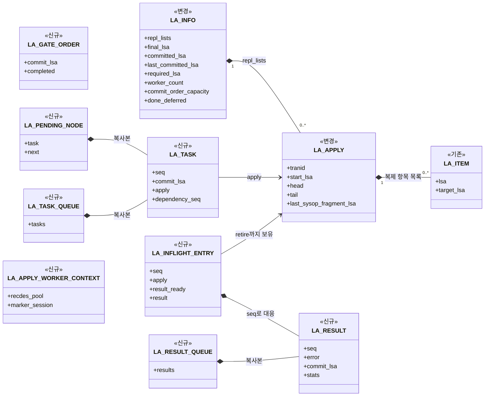

*그림 2a. 슬레이브 병렬 적용의 자료구조. 이번 설계에서 추가하거나 의미가 바뀐 주요 필드만 표시했다. `<<변경>>`은 develop 구조에 필드를 더하거나 뺀 것이다.*

task 한 건은 다음 상태를 지난다.

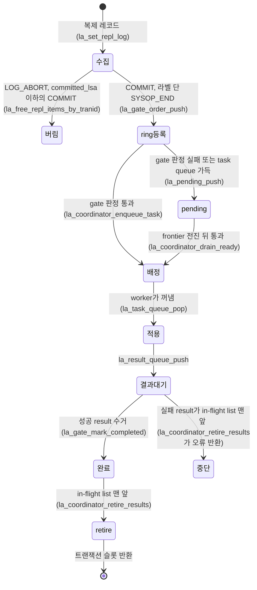

*그림 2b. task 한 건의 상태.*
- "완료"는 commit-order ring 항목에 완료 표시를 남긴 상태다.
- retire는 in-flight list 맨 앞에서 배정 순서대로 일어난다.
- frontier가 이 task를 지나가는 시점은 retire와 별개다(2.3절).
- worker가 하나이면 pending을 거치지 않는다(4.8절).

### 2.1 트랜잭션 슬롯과 복제 항목

트랜잭션 슬롯은 develop 구조로, 로그의 `trid`마다 하나씩 두고 그 트랜잭션의 복제 항목을 연결 목록으로 모은다. 만들어지고 채워지는 과정은 다음과 같다.
- coordinator는 트랜잭션의 첫 로그 레코드(`prev_tranlsa`가 NULL)를 만나면 `la_add_apply_list`로 슬롯을 잡고, 그 위치를 `start_lsa`에 기록한다.
- 복제 레코드(`LOG_REPLICATION_DATA`, `LOG_REPLICATION_STATEMENT`)를 만날 때마다 `la_set_repl_log`가 복제 항목을 만들어 목록 끝에 붙인다.

슬롯 풀(`la_Info.repl_lists`)은 슬롯 포인터의 배열이다.
- 빈 슬롯(`tranid == 0`)이 없으면 배열을 `LA_REPL_LIST_COUNT`(50)개 늘린다.
- 이때 realloc하는 것은 배열뿐이다. 슬롯 객체는 하나씩 따로 할당하므로 이미 있는 슬롯의 주소는 바뀌지 않는다(`la_init_repl_lists`).
- 그래서 task와 in-flight list가 슬롯 포인터를 들고 있는 동안 coordinator가 다른 트랜잭션 때문에 배열을 늘려도 그 포인터는 유효하다.

복제 항목이 `LA_MAX_REPL_ITEMS`(1000)개에 이르면 슬롯을 긴 트랜잭션으로 바꾼다. 이 동작은 develop과 같다.
- 첫 항목만 남기고 나머지를 해제한 뒤 `is_long_trans`를 켠다.
- 그 뒤로는 마지막 복제 레코드 위치만 `last_lsa`에 기록한다.
- 적용할 때는 첫 항목부터 `last_lsa`까지 로그를 다시 읽는다(`la_get_next_repl_item_from_log`).

develop과 달라진 점은 다음과 같다.
- **슬롯 수명**
  - develop의 `la_apply_repl_log`는 COMMIT을 적용한 직후 슬롯을 비웠다.
  - 이번 구현에서는 task가 슬롯을 가리킨다. worker가 복제 항목을 적용하며 해제한 뒤에도 슬롯은 `tranid`와 `start_lsa`를 유지한 채 남는다.
  - 슬롯은 coordinator가 그 task를 retire할 때 비운다(`la_coordinator_release_apply_slot`).
  - 그래서 `la_find_required_lsa`가 적용 중인 트랜잭션의 시작 위치를 계속 볼 수 있다(2.7절).
- **sysop fragment 슬롯**
  - 라벨 단 `LOG_SYSOP_END`를 만나면, 그 위치까지의 복제 항목을 새로 할당한 슬롯으로 옮겨 fragment task에 준다(`la_detach_sysop_fragment`, 3.3절).
  - 긴 트랜잭션이면 슬롯 내용 전체를 옮기고 바깥 슬롯을 빈 목록으로 되돌린다.
  - fragment 슬롯은 `repl_lists`에 속하지 않는다. fragment task를 retire할 때 해제하고, 종료할 때 retire되지 않은 것은 `la_free_unretired_fragments`가 해제한다.
- **`last_sysop_fragment_lsa` 필드 추가**: 아래 필드 목록 참고.

트랜잭션 슬롯(`LA_APPLY`)의 필드는 다음과 같다.
- `tranid`: 트랜잭션 id. 0이면 빈 슬롯이다.
- `num_items`: 목록에 있는 복제 항목 수.
- `is_long_trans`: 긴 트랜잭션 여부.
- `start_lsa`: 트랜잭션의 첫 로그 레코드 위치. fragment 슬롯은 첫 복제 항목의 위치다. `required_lsa` 계산에 쓴다.
- `last_lsa`: 긴 트랜잭션의 마지막 복제 레코드 위치.
- `head`, `tail`: 복제 항목 목록.
- `last_sysop_fragment_lsa` (추가): 이 트랜잭션이 마지막으로 만든 sysop fragment의 `LOG_SYSOP_END` 위치. fragment가 없으면 NULL이다. 최종 COMMIT task의 dependency를 이 값 이상으로 올린다(3.2절).

복제 항목(`LA_ITEM`)은 develop과 같다. 복제 레코드 한 건의 위치(`lsa`, `target_lsa`), 종류(`log_type`, `item_type`), 대상 클래스와 키(`class_name`, `packed_key_value`, `key`), serial 갱신 전 값(`packed_prior_value`)을 담는다.

```c
// log_applier.c: struct la_apply
struct la_apply
{
  int tranid;
  int num_items;
  bool is_long_trans;
  LOG_LSA start_lsa;
  LOG_LSA last_lsa;
  LA_ITEM *head;
  LA_ITEM *tail;
  /* SYSOP_END coordinate of this transaction's most recent independent serial fragment, or null when
   * it produced none. The transaction's final commit task waits for this fragment to commit first. */
  LOG_LSA last_sysop_fragment_lsa;
};
```

슬롯을 retire 때 비우는 `la_coordinator_release_apply_slot`의 코드는 4.6절에 있다.

`repl_lists`의 슬롯은 다음 상태를 오간다.

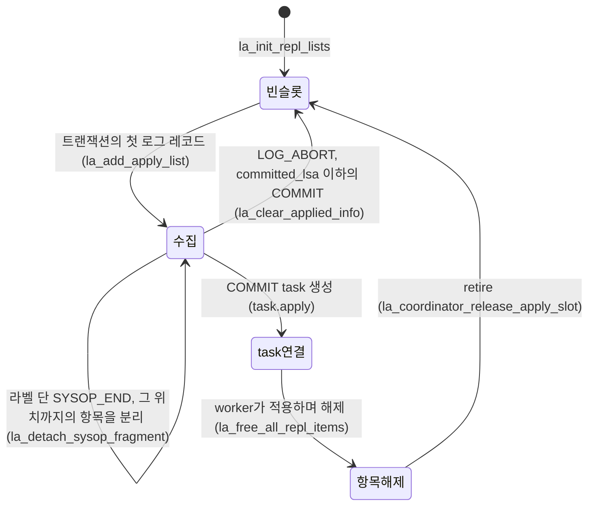

*그림 2-1. `repl_lists` 트랜잭션 슬롯의 상태.*
- 이미 적용된 COMMIT도 worker가 적용 없이 항목만 해제하므로 같은 경로를 지난다.
- DONE을 알릴 때 남은 슬롯을 비우는 `la_clear_all_repl_lists`는 drain 완료 뒤에만 호출되므로, task연결이나 항목해제 상태의 슬롯은 남아 있지 않다(8.1절).
- fragment 슬롯은 할당(`la_detach_sysop_fragment`), fragment task, worker의 항목 해제, retire 때 해제 순으로만 지난다.

### 2.2 task와 result

task는 coordinator가 COMMIT 또는 라벨 단 `LOG_SYSOP_END`를 읽을 때 만드는 적용 단위다. COMMIT에서 만든 것을 COMMIT task, sysop fragment에서 만든 것을 fragment task라고 부른다.
- task는 값으로 복사되어 pending list와 task queue를 지난다.
- 트랜잭션 슬롯은 복사하지 않고 포인터(`apply`)로만 넘긴다. worker는 `la_find_apply_list`를 부르지 않고 이 포인터로 슬롯을 쓴다.
- worker는 task를 받아 같은 `seq`를 가진 result를 채우고 result queue로 돌려준다(`la_result_init`).

`seq`의 역할은 다음과 같다.
- `seq`는 task가 in-flight list에 들어갈 때 정해진다(`la_inflight_push`). pending list에 있는 동안은 아직 정해지지 않았다(0으로 채워 두며, 첫 배정 번호도 0이다).
- result는 순서가 바뀌어 도착하므로, coordinator는 `seq`로 in-flight list의 항목을 찾는다.

task(`LA_TASK`)의 필드는 다음과 같다.
- `seq`: 배정 번호.
- `tranid`: 트랜잭션 id.
- `rectype`: `LOG_COMMIT` 또는 `LOG_SYSOP_END`. 각각 COMMIT task, fragment task다.
- `commit_lsa`: task를 만든 COMMIT 또는 `LOG_SYSOP_END` 레코드의 위치. commit-order ring에 이 값으로 들어간다.
- `log_record_time`: COMMIT 레코드의 트랜잭션 종료 시각. fragment task는 0이다.
- `apply`: 트랜잭션 슬롯. 복제 항목이 없는 COMMIT이면 NULL일 수 있다.
- `has_items`: 적용할 복제 항목이 있는지. 빈 COMMIT이면 false다.
- `dependency_seq`: 먼저 적용돼야 하는 마지막 COMMIT LSA. NULL이면 기다리지 않는다. 라벨 값에서 출발해, fragment 위치로 올리기, 라벨이 없을 때 직전 COMMIT으로 올리기(3.2절), 라벨 낮추기(4.2절)를 거친 값이다.

result(`LA_RESULT`)의 필드는 쓰임에 따라 세 무리로 나뉜다.
- 판정과 진행에 쓰는 필드
  - `seq`: in-flight list 항목과 짝을 짓는다.
  - `tranid`, `rectype`
  - `error`: NO_ERROR가 아니면 retire가 이 오류를 돌려주어 applier를 멈춘다(4.6절).
  - `commit_lsa`: 성공하면 commit-order ring에서 이 위치를 완료로 표시한다.
  - `committed_rep_lsa`: 오류 없이 적용한 마지막 복제 항목의 위치. retire에서 `la_Info.committed_rep_lsa`를 앞으로만 옮긴다.
  - `log_record_time`: retire에서 `la_Info.log_record_time`으로 옮긴다.
  - `total_rows`: worker가 거친 복제 항목 수. retire에서 `la_Info.total_rows`에 더하고, 이 값이 바뀌면 main loop가 apply info를 저장한다.
- 통계 전용 필드: `has_items`, `busy_usec`(적용·flush·COMMIT에 걸린 시간), `apply_end_time`, `stats`.
- 디버그 전용 필드: `worker_idx`.

`stats`(`LA_STATS`)는 트랜잭션 하나의 적용 통계다. retire에서 `la_Info`의 카운터에 더하며, 적용 판정에는 쓰지 않는다.
- `insert_counter`, `update_counter`, `delete_counter`, `schema_counter`, `fail_counter`
- `last_error_code`, `last_error_time`: `fail_counter`로 센 마지막 오류.
- `num_unflushed`
- `last_class_name`, `multi_class`: trace와 시험용 hook이 쓰는 마지막 적용 클래스.

```c
// log_applier_task.hpp: struct la_task
struct la_task
{
  UINT64 seq;
  int tranid;
  int rectype;
  LOG_LSA commit_lsa;
  time_t log_record_time;
  LA_APPLY *apply;		/* repl_list pre-mapped by the coordinator */
  bool has_items;
  LOG_LSA dependency_seq;	/* null = no dependency */
};

// log_applier_result.hpp: struct la_result
struct la_result
{
  UINT64 seq;
  int tranid;
  int rectype;
  int error;
  LOG_LSA commit_lsa;
  LOG_LSA committed_rep_lsa;
  time_t log_record_time;
  int total_rows;
  /* statistics only */
  bool has_items;
  UINT64 busy_usec;
  struct timeval apply_end_time;
  LA_STATS stats;
  /* debug only */
  int worker_idx;
};

// log_applier_result.hpp: la_result_init
memset (result, 0, sizeof (*result));
result->seq = task->seq;
result->tranid = task->tranid;
result->rectype = task->rectype;
result->commit_lsa = task->commit_lsa;
LSA_SET_NULL (&result->committed_rep_lsa);
...
result->worker_idx = worker_idx;
```

### 2.3 commit-order ring과 frontier

commit-order ring은 coordinator가 로그에서 읽은 task의 위치를 읽은 순서대로 담는 고리 버퍼다.
- 항목은 COMMIT task와 fragment task의 `commit_lsa`다.
- 복제 항목 없이 라벨만 단 `LOG_SYSOP_END`는 위치만 넣고 바로 완료로 표시한다(`la_coordinator_complete_without_task`, 3.3절).
- task는 바로 배정되든 pending list에 들어가든 ring에 한 번 들어간다.
- 로그 순서로 넣으므로 ring은 LSA 순으로 정렬되어 있다. 그래서 위치로 항목을 찾을 때 이분 탐색을 쓴다(`la_gate_order_find`).

frontier는 앞에서부터 빈틈없이 적용된 마지막 COMMIT LSA다.
- 성공 result를 수거하면 해당 항목에 완료 표시만 한다(`la_gate_mark_completed`).
- `la_gate_advance_frontier`가 ring 맨 앞부터 완료된 항목을 빼면서 frontier를 그 위치로 옮긴다.
- 맨 앞 항목이 아직 적용 중이면, 뒤 항목이 먼저 완료되어도 frontier는 멈춘다.
- gate 판정은 frontier만 본다(4.1절).

frontier의 초기값과 재시작은 다음과 같다.
- coordinator는 첫 task를 ring에 넣기 직전에 frontier를 `committed_lsa`로 정한다(`la_gate_set_initial_frontier`).
- 그 위치 이하의 COMMIT은 ring에 들어오지 않는다. 그래서 그런 COMMIT을 dependency로 가진 task도 통과할 수 있다.
- `la_gate_init`은 applier를 다시 시작할 때 ring과 frontier를 비운다(7.5절).
- ring이 `la_Info.commit_order_capacity`만큼 차면 coordinator는 로그 읽기를 멈춘다(4.7절).

commit-order ring의 항목(`LA_GATE_ORDER`)과 전역 변수는 다음과 같다.
- `commit_lsa`: task의 위치.
- `completed`: 적용 완료 여부. 순서와 상관없이 켜진다.
- `la_Gate_frontier`: frontier. 첫 task 전에는 NULL이다.
- `la_Gate_order_ring`, `la_Gate_order_capacity`, `la_Gate_order_head`, `la_Gate_order_count`: 고리 버퍼와 그 용량, 맨 앞 위치, 항목 수.

```c
// log_applier_gate.cpp: struct la_gate_order
struct la_gate_order
{
  LOG_LSA commit_lsa;
  bool completed;
};

static LOG_LSA la_Gate_frontier = LSA_INITIALIZER;	/* NULL until the first commit starts it */
static LA_GATE_ORDER *la_Gate_order_ring = NULL;
static int la_Gate_order_capacity = 0;
static int la_Gate_order_head = 0;
static int la_Gate_order_count = 0;

// log_applier_gate.cpp: la_gate_advance_frontier
while (la_Gate_order_count > 0 && la_Gate_order_ring[la_Gate_order_head].completed)
  {
    LSA_COPY (&la_Gate_frontier, &la_Gate_order_ring[la_Gate_order_head].commit_lsa);
    la_Gate_order_head = (la_Gate_order_head + 1) % la_Gate_order_capacity;
    la_Gate_order_count--;
  }
```

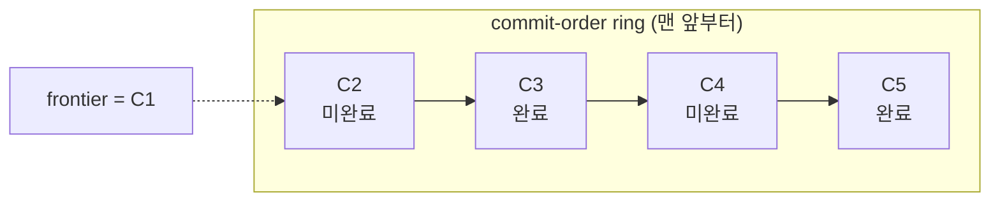

*그림 2-3a. C1까지 적용된 상태의 commit-order ring.*
- C3과 C5가 먼저 끝났지만, C2가 적용 중이라 frontier는 C1에 머문다.
- C2가 끝나면 frontier는 C3까지 전진한다.
- `dependency_seq`가 C3인 task는 C3이 끝난 것만으로는 통과하지 못한다. frontier가 C3에 닿아야 통과한다.

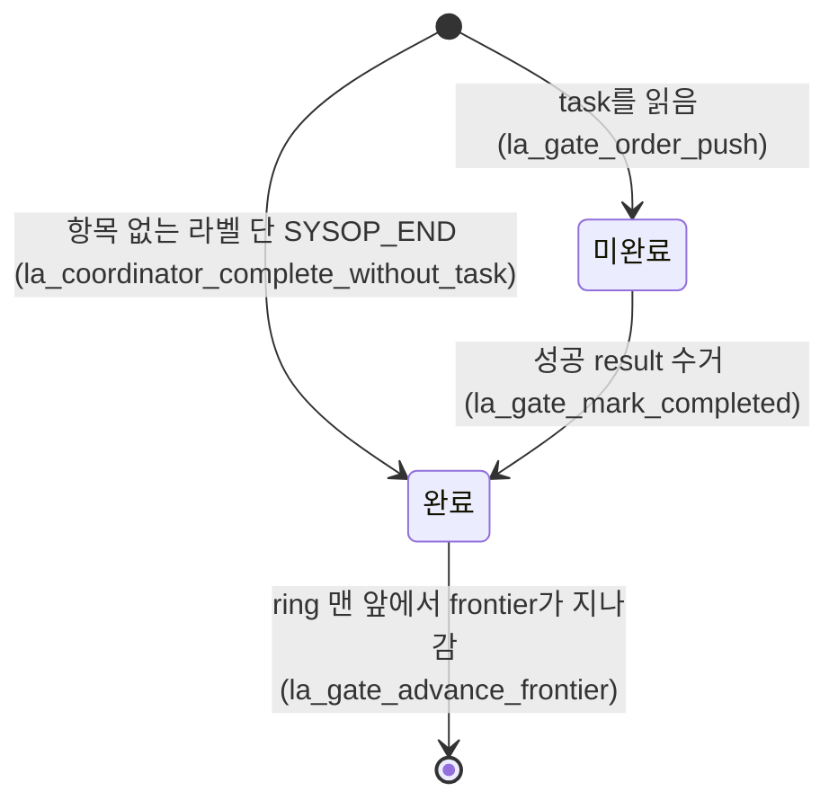

*그림 2-3b. commit-order ring 항목의 상태. 실패 result는 완료로 표시하지 않는다. 그 항목은 미완료로 남고 retire에서 applier가 멈춘다.*

### 2.4 pending list와 in-flight list

pending list는 아직 배정하지 못한 task를 보관하는 단일 연결 목록이다.
- 들어가는 task는 두 종류다. gate 판정을 통과하지 못한 task, 그리고 통과했지만 task queue가 가득 차서 넣지 못한 task다.
- task는 복사해서 넣는다.
- coordinator는 frontier가 움직일 때마다 목록을 앞에서부터 훑어 gate 판정을 통과하는 task를 꺼낸다(`la_pending_pop_ready`).
- 앞의 task가 아직 기다려도 뒤에서 통과하는 task는 꺼낸다. 그래서 기다리는 task가 독립 task를 막지 않으며, 꺼낸 task끼리는 넣은 순서를 지킨다.
- pending list에 따로 용량이 없는 이유: pending list의 task는 모두 commit-order ring에도 들어 있으므로 ring 용량을 넘지 않는다.

in-flight list는 task queue에 넣었지만 아직 retire하지 않은 task를 넣은 순서대로 담는 고리 버퍼다.
- coordinator는 task를 task queue에 넣기 직전에 항목을 추가하고 `seq`를 매긴다(`la_inflight_push`).
- result를 수거하면 `seq`로 항목을 찾아 result를 붙인다(`la_inflight_attach_result`).
- retire는 맨 앞 항목에 result가 붙었을 때만 한다. 맨 앞 task가 적용 중이면 뒤 task의 result가 와도 retire는 멈춘다.

두 목록이 따로 있는 이유는 순서 기준이 다르기 때문이다.
- commit-order ring은 로그의 COMMIT 순서를 따르고, in-flight list는 배정 순서를 따른다.
- pending list에 있던 task는 뒤에 읽은 task보다 늦게 배정될 수 있으므로 두 순서가 다르다.
- 그래서 `committed_lsa`는 retire 순서가 아니라 frontier를 따른다(4.6절).
- in-flight list가 하는 일은 result를 task와 짝짓는 것과, task가 가리키는 트랜잭션 슬롯을 retire까지 붙잡아 두는 것뿐이다.
- `la_find_required_lsa`와 종료 처리는 두 목록을 모두 훑는다(2.7절, 8.3절).

pending list의 노드(`LA_PENDING_NODE`)와 전역 변수는 다음과 같다.
- `task`: 보관한 task의 복사본.
- `next`: 다음 노드.
- `la_Pending_head`, `la_Pending_tail`: 목록의 처음과 끝.

in-flight list의 항목(`LA_INFLIGHT_ENTRY`)과 전역 변수는 다음과 같다.
- `seq`: 배정 번호.
- `apply`: 트랜잭션 슬롯. retire할 때 반환한다. 슬롯이 없는 COMMIT이면 NULL이다.
- `tranid`, `rectype`
- `result_ready`, `result`: 붙은 result와 그 여부.
- `la_Inflight`: 항목 배열(`entries`)과 `capacity`, `head`, `tail`, `count`.
- `la_Dispatch_sequence`: 다음 배정 번호. 재사용하지 않으며 `la_inflight_init`에서 0으로 되돌린다.

```c
// log_applier_pending.cpp: struct la_pending_node
struct la_pending_node
{
  LA_TASK task;
  LA_PENDING_NODE *next;
};

// log_applier_pending.cpp: la_pending_pop_ready
for (cur = la_Pending_head; cur != NULL; prev = cur, cur = cur->next)
  {
    if (la_gate_is_satisfied (&cur->task.dependency_seq) == false)
      {
	continue;
      }
    ...				/* unlink cur */
    *task = cur->task;
    free_and_init (cur);
    return true;
  }
return false;

// log_applier_inflight.hpp: struct la_inflight_entry
struct la_inflight_entry
{
  UINT64 seq;
  LA_APPLY *apply;		/* repl_list slot freed only when this entry retires */
  int tranid;
  int rectype;
  bool result_ready;
  LA_RESULT result;
};
```

### 2.5 task queue, result queue와 용량

task queue는 gate 판정을 통과한 task를 worker에 넘기는 고리 버퍼다.
- 정적 배열로 만들며 크기는 `LA_TASK_QUEUE_CAPACITY`(1024)다.
- coordinator 혼자 넣고, 여러 worker가 꺼낸다.
- 넣기는 기다리지 않는다(4.4절).
- worker는 task가 올 때까지 기다렸다가 꺼낸다.
- 종료 신호가 오면 queue에 남은 task는 버린다(8.3절).

result queue는 worker가 result를 coordinator에 돌려주는 고리 버퍼다.
- commit-order ring과 같은 크기로 할당한다.
- 여러 worker가 넣고, coordinator가 꺼낸다.
- queue에 있는 result는 모두 retire되지 않은 task의 것이고, 그런 task는 in-flight list에 있으므로 그 용량(result queue와 같은 크기)을 넘지 않는다. 그래서 result queue는 가득 차지 않는다.
- 그래도 가득 차면 worker는 result를 버리지 않고 기다린다. result를 버리면 retire가 그 자리에서 영원히 멈추기 때문이다.
- coordinator가 result를 꺼내는 함수는 기다리지 않는 `la_result_queue_try_pop` 하나다. `la_result_queue_wait_for_result`는 result가 오거나 정한 시간이 지날 때까지 기다리기만 하고 꺼내지 않는다.

동기화는 다음과 같다.
- 두 queue는 각자 mutex 하나와 condition 변수 둘(비지 않음, 차지 않음)을 둔다.
- 두 mutex를 동시에 잡는 스레드가 없으므로 두 queue 사이에 교착은 생기지 않는다.
- 종료할 때 `la_task_queue_signal_shutdown`과 `la_result_queue_signal_shutdown`이 기다리는 스레드를 모두 깨운다.

용량은 다음 두 상수로 정한다. 가득 찼을 때의 동작은 4.7절에서 설명한다.
- `LA_TASK_QUEUE_CAPACITY`(1024): task queue의 크기.
- `LA_COMMIT_ORDER_CAPACITY(worker_count)`(worker_count × 1024): commit-order ring, in-flight list, result queue의 크기.
  - `la_coordinator_init_resources`가 이 값을 `la_Info.commit_order_capacity`에 저장하고, 세 구조를 이 크기로 만든다.
  - pending list는 따로 용량이 없다(2.4절).
  - 세 구조를 만드는 `la_coordinator_init_resources`의 코드는 7.5절에 있다.

```c
// log_applier_worker.hpp
#define LA_TASK_QUEUE_CAPACITY      1024
#define LA_COMMIT_ORDER_CAPACITY(worker_count)  ((worker_count) * LA_TASK_QUEUE_CAPACITY)

// log_applier_task_queue.cpp: struct la_task_queue
struct la_task_queue
{
  LA_TASK tasks[LA_TASK_QUEUE_CAPACITY];
  int head;
  int tail;
  int count;
};
static pthread_mutex_t la_Shared_task_mutex = PTHREAD_MUTEX_INITIALIZER;
static pthread_cond_t la_Shared_task_not_empty = PTHREAD_COND_INITIALIZER;	/* workers wait for a task */
static pthread_cond_t la_Shared_task_not_full = PTHREAD_COND_INITIALIZER;
static bool la_Shared_task_shutdown = false;

// log_applier_result_queue.cpp: struct la_result_queue
struct la_result_queue
{
  LA_RESULT *results;		/* sized to the commit-order capacity */
  int capacity;
  int head;
  int tail;
  int count;
};

```

### 2.6 worker와 worker context

worker는 `ha_apply_worker_count`개만큼 시작하는 적용 스레드다.
- 각 worker는 슬레이브 서버에 자기 연결(sub-client)을 연다(`db_restart_sub`).
- 연결은 `la_Worker_session_mutex`로 한 번에 하나씩 연다.
- 복제 레코드를 재구성할 때 쓰는 버퍼는 각자의 worker context에 둔다. develop에서는 이 버퍼들이 전역 하나였다. `la_Info`의 `rec_type`, `undo_unzip_ptr`, `redo_unzip_ptr`와 전역 `la_recdes_pool`이 그것이다. 이번 구현은 worker마다 따로 두어, 재구성한 레코드가 다른 worker의 버퍼를 덮어쓰지 않는다.

트랜잭션 하나를 적용하는 방법은 `log_applier.c`에 있다. worker 모듈은 그 방법을 `LA_WORKER_CONFIG`의 콜백 세 개로 넘겨받는다.
- `run_task`: `la_apply_worker_run_task`. task 하나를 적용하고 result를 채운다.
- `request_shutdown`: `la_request_shutdown`. applier 종료를 요청한다.
- `end_context`: `la_apply_worker_end_context`. 연결을 닫기 전에 applied-tx 마커 INSERT 문장을 닫고, 이 스레드의 pinned 목록 메모리를 해제한다.

연결이나 context 준비에 실패한 worker는 스스로 빠지고(`la_worker_startup_failed`), 남은 worker가 계속 적용한다.
- 시작할 수 있는 worker 수는 `la_Live_worker_count`로 센다.
- 이 수가 0이 되면 applier 종료를 요청한다.
- worker가 적다고 결과가 틀려지지는 않는다. 배정은 어느 worker가 task를 꺼내든 같기 때문이다. 줄어드는 것은 병렬성뿐이다.

worker(`LA_WORKER`)의 필드는 다음과 같다.
- `tid`: 스레드 id.
- `index`: worker 배열의 위치. 통계와 trace에서 worker를 구분한다.
- `started`: 스레드가 만들어져 join해야 하는지.
- `busy`: task를 쥐고 있는지. 상태 출력에만 쓰는 디버그 값이다.

worker 연결(`LA_WORKER_SESSION`)의 필드는 다음과 같다.
- `client_context_started`: 연결을 열었는지.

worker context(`LA_APPLY_WORKER_CONTEXT`)의 필드는 다음과 같다.
- `worker_idx`: worker 번호.
- `rec_type`: 재구성 중인 레코드의 종류.
- `undo_unzip_ptr`, `redo_unzip_ptr`: 압축 해제 버퍼.
- `recdes_pool`: 레코드 버퍼 풀.
- `marker_session`, `marker_stmt_id`: applied-tx 마커 INSERT 문장. 연결마다 한 번 컴파일해 두고 값만 바꿔 실행한다(7.3절).

레코드 버퍼 풀(`LA_RECDES_POOL`)의 필드는 다음과 같다. 복제 항목은 flush할 때까지 클라이언트에 모이므로, 풀은 flush 한 번 분량(`LA_MAX_UNFLUSHED_REPL_ITEMS`)의 레코드를 고리처럼 돌려 쓴다.
- `recdes_arr`, `area`: 레코드 배열과 그 데이터 영역.
- `next_idx`: 다음에 내줄 레코드 위치.
- `db_page_size`, `num_recdes`: 레코드 하나의 크기와 레코드 수.
- `is_initialized`: 준비 여부.

worker 설정(`LA_WORKER_CONFIG`)의 필드는 다음과 같다.
- `db_page_size`, `recdes_pool_size`: 버퍼 크기와 풀의 레코드 수.
- `trace_level`: 시작할 때 한 번 읽은 `ha_writeset_trace_level`.
- `run_task`, `request_shutdown`, `end_context`: 위의 콜백 세 개.

worker 모듈의 전역 변수는 다음과 같다.
- `la_Worker_session_mutex`: 연결을 하나씩 열기 위한 mutex.
- `la_Worker_config`: 시작할 때 복사한 설정.
- `la_Worker_count`: 시작한 worker 수.
- `la_Live_worker_count`: 아직 task를 받을 수 있는 worker 수.

```c
// log_applier_worker.hpp: struct la_apply_worker_context
struct la_apply_worker_context
{
  int worker_idx;
  INT16 rec_type;		/* record type of the row being rebuilt, written by la_get_recdes */
  LOG_ZIP *undo_unzip_ptr;
  LOG_ZIP *redo_unzip_ptr;
  LA_RECDES_POOL recdes_pool;
  struct db_session *marker_session;	/* applied-transaction marker INSERT, compiled once on this connection */
  int marker_stmt_id;
};

// log_applier_worker.hpp: struct la_worker_config
struct la_worker_config
{
  int db_page_size;
  int recdes_pool_size;
  int trace_level;
  LA_WORKER_RUN_TASK_FUNC run_task;
  LA_WORKER_REQUEST_SHUTDOWN_FUNC request_shutdown;
  LA_WORKER_END_CONTEXT_FUNC end_context;
};
```

worker 스레드는 다음 상태를 지난다.

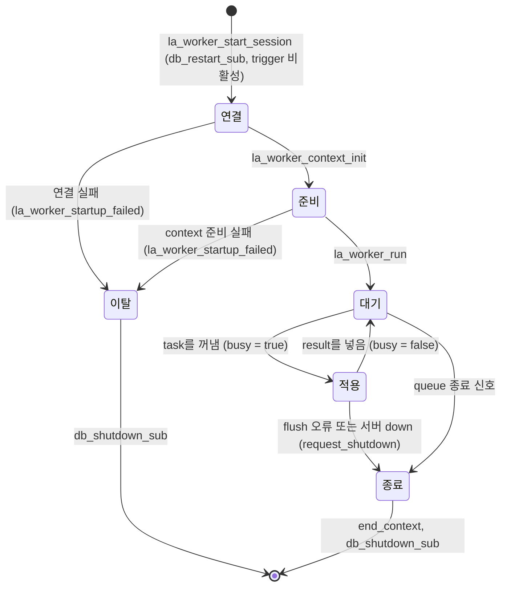

*그림 2-6. worker 스레드의 상태.*
- 이탈한 worker가 마지막 하나였다면 applier 종료를 요청한다.
- flush 오류나 서버 down이 아닌 적용 오류에서는 worker가 계속 다음 task를 받는다. applier는 coordinator가 그 result를 retire할 때 멈춘다(5.3절).

### 2.7 la_Info의 LSA 위치와 추가 필드

`la_Info`(`LA_INFO`)는 develop의 applier 전역 상태다. 이번 구현에서는 LSA 위치 몇 개의 의미가 바뀌었다.
- `final_lsa`
  - coordinator가 다음에 읽을 로그 위치다.
  - worker의 적용 진행과는 관계가 없다.
- `committed_lsa`
  - 이 위치 이하의 COMMIT이 모두 적용되었다는 뜻이다.
  - 실행 중에는 retire할 때 frontier까지 옮긴다(`la_coordinator_advance_committed_lsa`).
  - 기동할 때는 `required_lsa`로 되돌려, 그 위치부터 로그를 다시 읽는다.
  - apply info에 저장한다.
- `last_committed_lsa`
  - 기동할 때 apply info에서 읽은 `committed_lsa`이며, 실행 중에는 바뀌지 않는다.
  - worker는 이 위치 이하의 COMMIT을 적용하지 않고 건너뛴다.
  - applied-tx 마커도 이 위치보다 뒤의 것만 읽는다.
- `required_lsa`
  - 읽고 있거나 적용 중인 트랜잭션이 아직 필요로 하는 가장 앞의 로그 위치다.
  - 트랜잭션 슬롯, in-flight list, pending list에 있는 `start_lsa`의 최솟값이며, 셋 다 비면 `final_lsa`다(`la_find_required_lsa`).
  - develop은 트랜잭션 슬롯만 보았다. 이번 구현은 두 목록도 함께 훑는다. 바깥 트랜잭션이 ABORT되어 슬롯이 비어도 sysop fragment는 pending list나 in-flight list에 남아 있을 수 있기 때문이다.
  - apply info에 저장한다.
- `committed_rep_lsa`
  - result가 알려 준 마지막 적용 복제 항목 위치의 최댓값이다.
  - apply info와 `applyinfo`에 표시만 하며, 다시 적용할 범위를 정하는 데에는 쓰지 않는다.

각 위치가 언제 어떻게 움직이는지는 7.1절에서 설명한다.

추가한 필드는 다음과 같다.
- `worker_count`: 시작한 worker 수. `ha_apply_worker_count`를 1부터 `LA_MAX_WORKER_COUNT` 사이로 맞춘 값이다. `MULTI_CONN_TO_A_SERVER` 없이 빌드하면 1이다(4.8절).
- `commit_order_capacity`: commit-order ring, in-flight list, result queue의 용량(2.5절).
- `done_deferred`, `done_deferred_since`: DONE 보류 여부와 보류를 시작한 시각(8.1절).

제거한 필드는 다음과 같다.
- `commit_head`, `commit_tail`: develop의 COMMIT 목록(`LA_COMMIT`). commit-order ring과 task가 그 역할을 대신한다.
- `rec_type`, `undo_unzip_ptr`, `redo_unzip_ptr`: worker context로 옮겼다(2.6절).

```c
// log_applier.c: struct la_info (바뀐 부분)
  LOG_LSA final_lsa;		/* last processed log lsa */
  LOG_LSA committed_lsa;	/* last committed commit log lsa */
  LOG_LSA committed_rep_lsa;	/* last committed replication log lsa */
  LOG_LSA last_committed_lsa;	/* last committed commit log lsa at the beginning of the applylogdb */
  ...
  bool done_deferred;		/* DONE was due but workers were still applying */
  time_t done_deferred_since;	/* when the current hold on DONE began */
  ...
  int worker_count;		/* apply workers started, from ha_apply_worker_count */
  int commit_order_capacity;	/* worker_count * LA_TASK_QUEUE_CAPACITY */
  ...
  LOG_LSA required_lsa;		/* start lsa of the first transaction to be applied */
```

### 2.8 영속 테이블

**applied-tx 마커** (`ha_applied_tx_marker`)
- 슬레이브 DB에 두는 일반 테이블이다. coordinator가 기동할 때 자기 연결에서, 없으면 만든다(`la_create_applied_tx_marker`).
- 행 하나는 worker가 적용해서 슬레이브에 COMMIT한 트랜잭션 하나이며, copylog 경로와 그 트랜잭션의 마스터 COMMIT LSA를 담는다.
- copylog 경로를 함께 넣는 이유는, 한 노드에서 원격 노드마다 도는 applier들의 마커를 구분하기 위해서다.
- worker는 이 행을 데이터와 같은 슬레이브 트랜잭션에서 넣는다. 따라서 데이터가 COMMIT된 경우에만 마커가 있다.
- 적용한 행이 없는 task는 마커를 넣지 않는다.
- 쓰는 방법은 7.3절에서 설명한다.

```c
// log_applier.c: la_create_applied_tx_marker
#define LA_APPLIED_TX_MARKER_NAME "ha_applied_tx_marker"

"CREATE TABLE IF NOT EXISTS [%s] (copied_log_path VARCHAR(4096), commit_pageid BIGINT, "
"commit_offset INTEGER, PRIMARY KEY (copied_log_path, commit_pageid, commit_offset));"
```

**apply info** (`_db_ha_apply_info`)
- 테이블 정의와 이를 읽는 구조체(`LA_HA_APPLY_INFO`)는 develop과 같으며, 컬럼을 더하지 않았다.
- 달라진 것은 두 가지다. 저장하는 `committed_lsa`가 frontier를 따른다. 그리고 저장하는 트랜잭션에 통계 행 갱신과 applied-tx 마커 삭제가 함께 들어간다(7.2절).

**통계** (`_db_ha_apply_stat`, `_db_ha_apply_worker_stat`)
- 시스템 카탈로그로 등록한다(`schema_system_catalog_install.cpp`).
- 내용은 9.2절에서 설명한다.

applied-tx 마커 행은 다음 상태를 지난다.

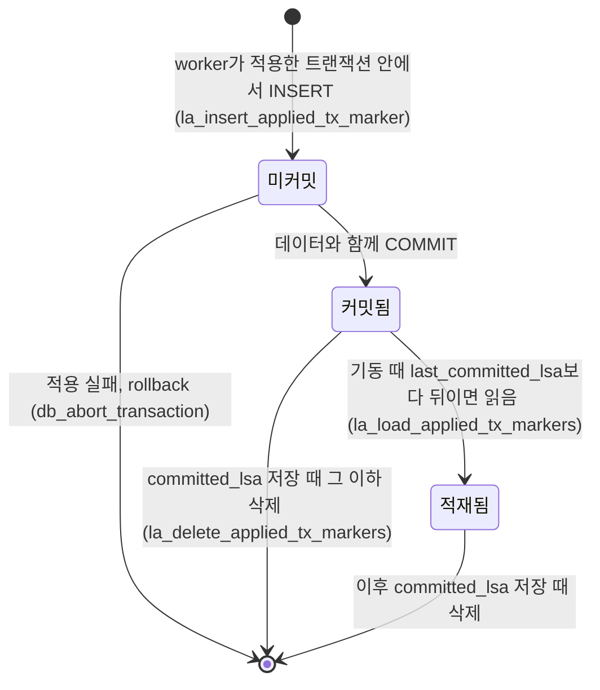

*그림 2-8. applied-tx 마커 행의 상태.*
- copylog를 재초기화하면 그 copylog 경로의 마커를 모두 지운다(7.6절).
- 마커 삭제가 들어간 apply info 저장이 실패하면 마커는 남는다. 다음 저장 때 다시 지운다.

## 3. 복제 로그에서 task 구성

coordinator는 로그를 한 레코드씩 읽으며 `la_log_record_process`에서 레코드 종류별로 처리한다. 복제 항목은 트랜잭션 슬롯에 모으고, 라벨은 라벨 holder에 보관한다. task는 `LOG_COMMIT`과 라벨이 붙은 `LOG_SYSOP_END`에서만 만든다. 복제 항목이나 라벨을 읽는 순간에는 아무것도 적용하지 않는다.

트랜잭션 슬롯을 배정하고 복제 항목을 모으는 방법, 긴 트랜잭션으로 바꾸는 조건은 2.1절에 있다. 라벨 레코드는 슬롯을 만들지 않는다.

### 3.1 라벨 holder

master는 라벨을 같은 트랜잭션의 `LOG_COMMIT` 또는 `LOG_SYSOP_END` 바로 앞에, 같은 `prior_lsa_mutex` 구간 안에서 기록한다([01 2.3절](./01-master-implementation-design.md#23-wset_label)). 그래서 라벨과 그 라벨이 가리키는 종료 레코드 사이에는 다른 레코드가 없다. coordinator는 라벨을 읽으면 라벨 holder에 보관하고, 같은 `trid`의 다음 `LOG_COMMIT`이나 `LOG_SYSOP_END`가 이를 가져간다.

**보관하는 값**
- `la_wset_label_trid`: 라벨을 남긴 트랜잭션의 `trid`. 비어 있으면 `NULL_TRANID`다.
- `la_wset_label_dependency_seq`: 라벨의 `dependency_seq`.

**동작**
- 라벨을 읽으면 두 값을 덮어쓴다. 라벨을 읽지 못하면 오류를 반환하고, `final_lsa`가 이 레코드에 머물러 다음 바퀴에 다시 읽는다.
- `LOG_COMMIT`이나 `LOG_SYSOP_END`는 `la_wset_label_trid`가 자기 `trid`와 같을 때만 라벨을 가져간다. 가져가면 `la_wset_label_trid`를 `NULL_TRANID`로 비운다.
- 로그를 읽는 스레드는 coordinator 하나뿐이므로 라벨 holder에는 잠금이 없다.

```c
// log_applier.c: 라벨 holder
static int la_wset_label_trid = NULL_TRANID;
static LOG_LSA la_wset_label_dependency_seq = LSA_INITIALIZER;

// log_applier.c: la_log_record_process
case LOG_DUMMY_WSET_LABEL:
  /* keep the label in the holder; the next LOG_COMMIT or LOG_SYSOP_END of the same trid takes it. */
  error = la_get_wset_label (pg_ptr, final, &la_wset_label_dependency_seq);
  if (error != NO_ERROR)
    {
      ...
      return error;
    }
  la_wset_label_trid = lrec->trid;
  ...
  break;

// log_applier.c: la_get_wset_label
wset_label = (LOG_REC_WSET_LABEL *) ((char *) pg->area + offset);
LSA_COPY (dependency_seq, &wset_label->dependency_seq);
```

### 3.2 COMMIT task와 dependency 결정

`committed_lsa`보다 뒤에 있는 `LOG_COMMIT`은 모두 `la_coordinator_process_commit`에서 COMMIT task가 된다. 복제 항목이 없는 COMMIT도 task가 되어 commit-order ring에 들어가고 worker까지 간다. `committed_lsa` 이하의 COMMIT은 3.4절에서 다룬다.

**COMMIT task를 만드는 순서**
1. COMMIT 레코드의 시각을 읽고 `la_delay_replica`로 지연 복제를 기다린다. 이 함수는 `ha_mode=replica`일 때만 기다린다(10절).
2. apply info의 상태를 BUSY로 바꾼다.
3. task를 채운다. `commit_lsa`는 COMMIT 레코드의 LSA이고, `apply`는 `la_find_apply_list(trid)`로 찾은 트랜잭션 슬롯의 주소다. 슬롯을 복사하거나 옮기지 않으므로, worker는 `la_Info.repl_lists`를 조회하지 않고 이 주소를 그대로 쓴다. `has_items`는 슬롯에 복제 항목이 있는지다.
4. `la_coordinator_set_commit_dependency`로 `dependency_seq`를 정한다.
5. `la_coordinator_submit_task`로 넘긴다(4.3절). 실패하면 `la_applier_need_shutdown`을 세운다.

**dependency 결정**(`la_coordinator_set_commit_dependency`)
- **라벨**: 라벨 holder의 `trid`가 같으면 라벨 값을 쓰고 holder를 비운다. 없으면 NULL에서 시작한다.
- **sysop fragment**: 슬롯의 `last_sysop_fragment_lsa`가 있고 지금 값보다 크면 그 값으로 올린다. 바깥 트랜잭션의 COMMIT은 자기 sysop fragment가 적용된 뒤에 실행된다(3.3절).
- **라벨이 없는 경우**: 복제 항목이 있는데 라벨이 없으면 충돌을 알 수 없다. 이때는 commit-order ring의 마지막 항목(`la_gate_get_order_tail`)까지 올린다. 앞서 읽은 COMMIT이 모두 적용된 뒤에 실행되므로 직렬 적용과 같은 순서가 된다. ring이 비어 있으면 이 단계는 값을 바꾸지 않는다.
- 복제 항목이 없고 라벨도 없으면 `dependency_seq`는 NULL로 남아 바로 통과한다.

이렇게 정한 값은 commit-order ring에 넣기 전에 라벨 낮추기를 한 번 더 거친다(4.2절).

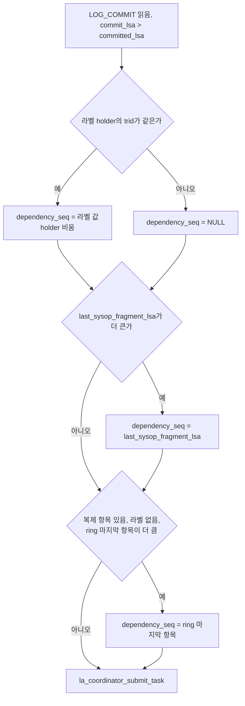

*그림 3-1. COMMIT task의 dependency 결정.*

```c
// log_applier.c: la_coordinator_process_commit
eot_time = la_retrieve_eot_time (pg_ptr, final);
if (eot_time != 0)
  {
    error = la_delay_replica (eot_time);
    ...
  }
...
memset (&task, 0, sizeof (task));
task.tranid = lrec->trid;
task.rectype = lrec->type;
task.log_record_time = eot_time;
LSA_COPY (&task.commit_lsa, final);
/* the worker uses the slot directly and never looks up la_Info.repl_lists */
task.apply = la_find_apply_list (lrec->trid);
task.has_items = (task.apply != NULL && task.apply->head != NULL);
has_label = la_coordinator_set_commit_dependency (&task);
...
error = la_coordinator_submit_task (&task);
if (error != NO_ERROR)
  {
    la_applier_need_shutdown = true;
  }

// log_applier.c: la_coordinator_set_commit_dependency
bool has_label = (la_wset_label_trid == task->tranid);

if (has_label)
  {
    LSA_COPY (&task->dependency_seq, &la_wset_label_dependency_seq);
    la_wset_label_trid = NULL_TRANID;
  }
else
  {
    LSA_SET_NULL (&task->dependency_seq);
  }

if (task->apply != NULL && !LSA_ISNULL (&task->apply->last_sysop_fragment_lsa))
  {
    if (LSA_GT (&task->apply->last_sysop_fragment_lsa, &task->dependency_seq))
      {
        LSA_COPY (&task->dependency_seq, &task->apply->last_sysop_fragment_lsa);
      }
  }

if (task->has_items && !has_label && la_gate_get_order_tail (&previous_lsa)
    && (LSA_ISNULL (&task->dependency_seq) || LSA_GT (&previous_lsa, &task->dependency_seq)))
  {
    LSA_COPY (&task->dependency_seq, &previous_lsa);
  }

return has_label;
```

### 3.3 SYSOP_END와 sysop fragment

master는 복제 레코드를 남긴 독립 top operation(serial 갱신 등)에 라벨을 붙인다([01 7.2절](./01-master-implementation-design.md#72-독립-top-operation의-라벨)). 이 operation은 바깥 트랜잭션이 ABORT되어도 master에 남는다. 그래서 슬레이브도 바깥 COMMIT을 기다리지 않고 `LOG_SYSOP_END`에서 따로 적용한다. `la_coordinator_process_sysop_end`는 `committed_lsa`보다 뒤에 있는 `LOG_SYSOP_END`를 다음 세 갈래로 나눈다.

**갈래**
- **라벨이 있고 슬롯에 복제 항목이 있음**: `la_detach_sysop_fragment`로 sysop fragment를 떼어 fragment task를 만든다.
  - `rectype`은 `LOG_SYSOP_END`, `commit_lsa`는 SYSOP_END의 LSA, `dependency_seq`는 라벨 값이다.
  - 바깥 슬롯의 `last_sysop_fragment_lsa`에 SYSOP_END LSA를 적는다. 이 트랜잭션의 COMMIT task가 이 fragment task를 기다리게 하기 위해서다(3.2절).
  - 라벨 holder를 비우고 `la_coordinator_submit_task`로 넘긴다.
- **라벨이 있고 복제 항목이 없음**: task를 만들지 않는다. 라벨 holder를 비우고, `la_coordinator_complete_without_task`로 SYSOP_END LSA를 commit-order ring에 넣은 뒤 바로 완료로 표시한다. 뒤 트랜잭션이 이 LSA를 dependency로 가질 수 있는데, 완료 표시가 없으면 그 트랜잭션은 pending list에서 끝없이 기다린다(6.3절).
- **라벨이 없음**: 아무것도 하지 않는다. 슬롯의 복제 항목은 그대로 남아 바깥 COMMIT task와 함께 적용된다.

`committed_lsa` 이하의 `LOG_SYSOP_END`는 trace만 남긴다. 시작할 때 `committed_lsa`는 로그를 다시 읽기 시작하는 `required_lsa`로 놓이고, 실행 중에는 아직 읽지 않은 COMMIT을 넘지 않는 frontier를 따른다. 그래서 코드 주석은 이 분기에 실제로는 들어오지 않는다고 적는다.

**fragment 분리**(`la_detach_sysop_fragment`)
- 새 트랜잭션 슬롯을 할당하고 바깥 슬롯과 같은 `tranid`를 준다. 이 슬롯은 `la_Info.repl_lists`에 속하지 않으며, fragment task가 retire할 때 메모리까지 해제된다(4.6절).
- **일반 트랜잭션**: 바깥 슬롯의 앞에서부터 LSA가 SYSOP_END 이하인 복제 항목의 링크를 끊어 새 슬롯에 붙인다. master는 auto-increment sysop을 행 INSERT보다 먼저 기록하고 일반 DML은 바깥 COMMIT에서 내보내므로, SYSOP_END 이하의 항목이 이 operation의 것이다. 그 뒤의 항목은 바깥 슬롯에 남는다.
- **긴 트랜잭션**: 바깥 슬롯은 첫 항목과 `last_lsa`만 가지고 있고, 둘 다 SYSOP_END 이하다. 그래서 슬롯 내용 전체를 fragment로 옮기고 바깥 슬롯을 비운다. 새 슬롯은 `is_long_trans`를 물려받아 worker가 로그에서 항목을 다시 읽는다.
- 옮긴 항목이 하나도 없으면 새 슬롯을 해제하고 NULL을 돌려준다. 메모리 할당 실패도 NULL이다. 어느 경우든 `la_coordinator_process_sysop_end`는 오류를 반환한다.
- 바깥 슬롯의 `start_lsa`는 바꾸지 않는다.

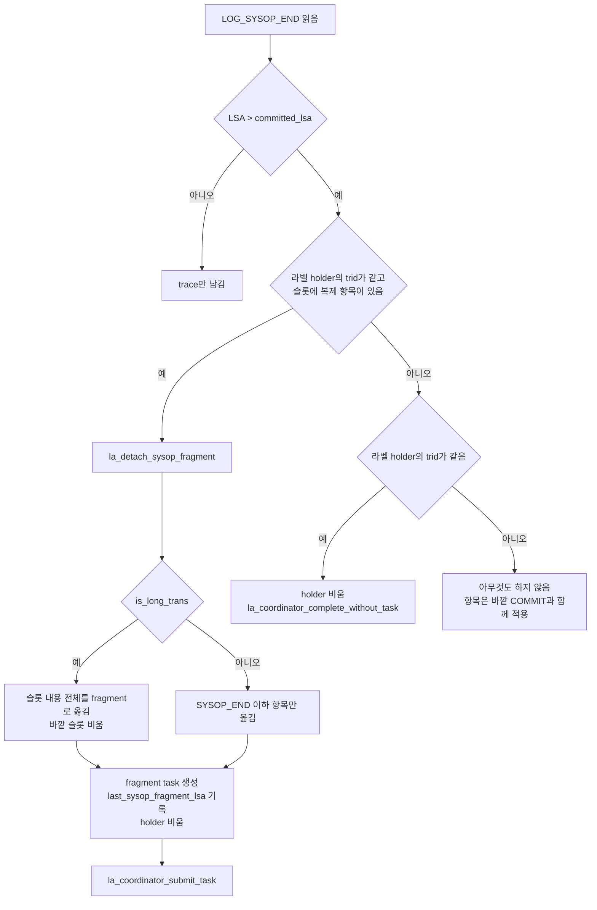

*그림 3-2. `LOG_SYSOP_END`의 세 갈래.*

아래 그림은 serial을 쓰는 트랜잭션 T 하나의 로그 순서와 coordinator의 처리를 보인다.

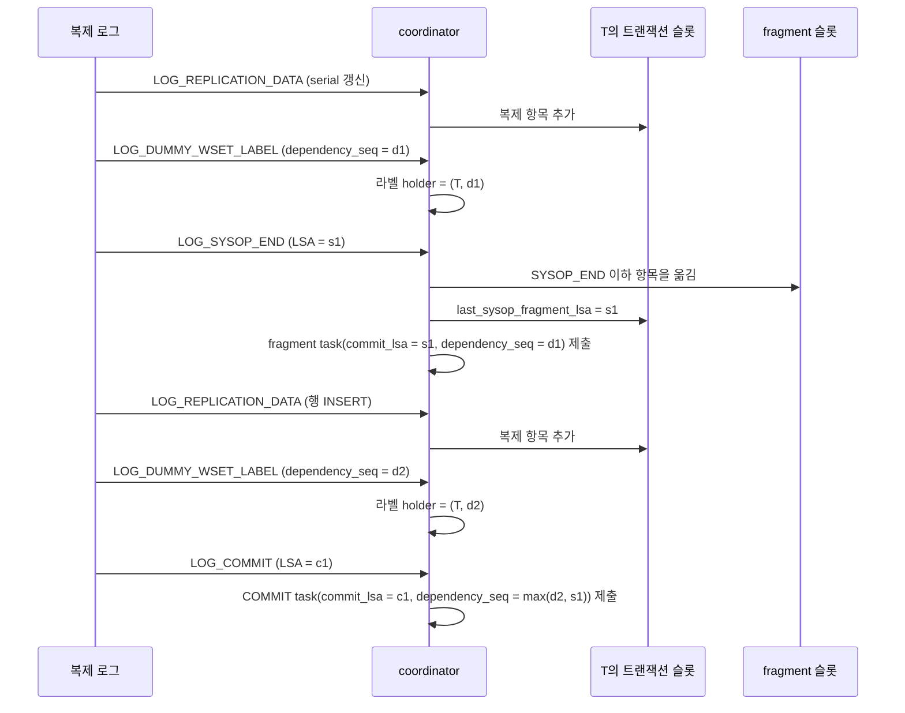

*그림 3-3. sysop fragment가 있는 트랜잭션의 task 구성. COMMIT task는 fragment task가 적용된 뒤에 실행된다.*

```c
// log_applier.c: la_coordinator_process_sysop_end
if (LSA_GT (final, &la_Info.committed_lsa))
  {
    LA_APPLY *sysop_apply = la_find_apply_list (lrec->trid);

    if (la_wset_label_trid == lrec->trid && sysop_apply != NULL && sysop_apply->head != NULL)
      {
        LA_APPLY *fragment = la_detach_sysop_fragment (sysop_apply, final);
        ...
        task.rectype = LOG_SYSOP_END;
        LSA_COPY (&task.commit_lsa, final);
        task.apply = fragment;
        task.has_items = true;
        LSA_COPY (&task.dependency_seq, &la_wset_label_dependency_seq);

        /* The outer transaction's final commit must wait for this fragment to commit first. */
        LSA_COPY (&sysop_apply->last_sysop_fragment_lsa, final);

        la_wset_label_trid = NULL_TRANID;
        LSA_SET_NULL (&la_wset_label_dependency_seq);
        ...
        return la_coordinator_submit_task (&task);
      }

    labeled = (la_wset_label_trid == lrec->trid);
    if (labeled)
      {
        la_wset_label_trid = NULL_TRANID;
        LSA_SET_NULL (&la_wset_label_dependency_seq);

        error = la_coordinator_complete_without_task (final);
        ...
      }
    ...
  }

// log_applier.c: la_detach_sysop_fragment
fragment = (LA_APPLY *) malloc (DB_SIZEOF (LA_APPLY));
...
fragment->tranid = outer->tranid;
...
if (outer->is_long_trans)
  {
    fragment->head = outer->head;
    fragment->tail = outer->head;
    fragment->num_items = outer->num_items;
    fragment->is_long_trans = true;
    LSA_COPY (&fragment->last_lsa, &outer->last_lsa);
    LSA_COPY (&fragment->start_lsa, &fragment->head->lsa);

    outer->head = NULL;
    ...
    outer->is_long_trans = false;
    LSA_SET_NULL (&outer->last_lsa);
    return fragment;
  }

for (item = outer->head; item != NULL && LSA_LE (&item->lsa, fragment_lsa); item = next_item)
  {
    next_item = item->next;
    la_unlink_repl_item (outer, item);
    la_add_repl_item (fragment, item);
  }

if (fragment->head == NULL)
  {
    free_and_init (fragment);
    return NULL;
  }

LSA_COPY (&fragment->start_lsa, &fragment->head->lsa);
return fragment;
```

### 3.4 ABORT와 이미 적용된 COMMIT

**ABORT**
- `LOG_ABORT`를 만나면 `la_free_repl_items_by_tranid`가 그 트랜잭션의 복제 항목을 모두 해제하고 슬롯을 비운다(`tranid`, `start_lsa`, `last_lsa`). 비운 슬롯은 다른 `trid`에 다시 배정된다. task는 만들지 않는다.
- 이미 떼어 낸 sysop fragment는 자기 슬롯을 가지므로 ABORT의 영향을 받지 않고 적용된다. master에서도 독립 top operation은 바깥 ABORT와 상관없이 남는다. 바깥 슬롯이 먼저 비워져도 fragment의 항목 위치는 `required_lsa` 계산에 남는다(7.1절).

**`committed_lsa` 이하의 COMMIT**
- `LOG_COMMIT`의 LSA가 `committed_lsa` 이하이면 task를 만들지 않고, 슬롯의 복제 항목을 해제한 뒤 슬롯을 비운다.
- 재시작 직후에는 `committed_lsa`가 `required_lsa`로 놓이고 로그도 그 위치부터 읽는다(7.4절). 그래서 직전 실행이 저장한 `committed_lsa`까지의 COMMIT은 이 분기가 아니라 COMMIT task가 된다. worker가 `last_committed_lsa`나 applied-tx 마커를 보고 그 트랜잭션 전체를 건너뛴다.
- 이 COMMIT들은 commit-order ring에 들어가지 않는다. 뒤 트랜잭션의 라벨이 이 COMMIT을 가리켜도 기다리지 않도록, 첫 task를 ring에 넣기 전에 frontier를 `committed_lsa`로 시작한다(2.3절).

```c
// log_applier.c: la_log_record_process
case LOG_COMMIT:
  if (LSA_GT (final, &la_Info.committed_lsa))
    {
      error = la_coordinator_process_commit (lrec, final, pg_ptr);
      ...
    }
  else
    {
      la_free_repl_items_by_tranid (lrec->trid);
    }
  break;

case LOG_ABORT:
  ...
  la_free_repl_items_by_tranid (lrec->trid);
  break;
```

### 3.5 develop과의 비교

develop은 `LOG_COMMIT`과 `LOG_SYSOP_END`를 commit list에 넣은 뒤 그 자리에서 `la_apply_commit_list`로 바로 적용한다. 레코드를 처리하는 동안 적용까지 끝나므로 `committed_lsa`도 그 자리에서 전진한다. TO-BE는 같은 진입점에서 task만 만들어 넘기고, 적용은 worker가 한다.

```text
AS-IS (develop)
la_log_record_process()
  → LOG_REPLICATION_DATA/STATEMENT: la_set_repl_log()
  → LOG_COMMIT / LOG_SYSOP_END (> committed_lsa)
     → la_add_node_into_la_commit_list()
     → la_delay_replica()
     → do {
          la_apply_commit_list()
            → la_apply_repl_log(tranid)
               → la_lock_dbname()
               → 항목마다 last_committed_rep_lsa와 비교해 적용
               → SYSOP_END면 그 이후 항목은 남김
          committed_lsa = 적용한 레코드의 LSA
        } while (적용한 것이 있음)
  → LOG_ABORT: commit list에 넣고 차례가 오면 슬롯 비움
(데이터 COMMIT은 la_log_commit()에서 apply info와 함께)

TO-BE
la_log_record_process()
  → LOG_REPLICATION_DATA/STATEMENT: la_set_repl_log()
  → [추가] LOG_DUMMY_WSET_LABEL: 라벨 holder에 보관
  → [변경] LOG_SYSOP_END (> committed_lsa): la_coordinator_process_sysop_end()
     → 라벨 + 항목: la_detach_sysop_fragment() → fragment task 제출
     → 라벨만: la_coordinator_complete_without_task()
     → 라벨 없음: 처리 없음 (바깥 COMMIT에서 적용)
  → [변경] LOG_COMMIT (> committed_lsa): la_coordinator_process_commit()
     → la_delay_replica()
     → la_coordinator_set_commit_dependency()
     → la_coordinator_submit_task()
  → [변경] LOG_ABORT: 바로 슬롯 비움
(데이터 COMMIT은 worker, committed_lsa는 frontier를 따라 retire에서 전진)
```

바뀐 점은 다음과 같다.

- **적용 시점**: develop은 레코드를 읽는 자리에서 적용한다. TO-BE는 task만 만들고 적용은 worker가 한다. `committed_lsa`는 레코드를 읽을 때가 아니라 retire할 때 frontier까지 전진한다(4.6절).
- **commit list 제거**: `LA_COMMIT`과 `la_add_node_into_la_commit_list`, `la_apply_commit_list`가 없어졌다. 적용 순서는 commit-order ring과 gate 판정이 정한다.
- **SYSOP_END 처리**: develop은 `committed_lsa`보다 뒤에 있는 모든 SYSOP_END에서 그 시점까지의 항목을 적용한다. TO-BE는 라벨이 붙은 SYSOP_END만 따로 적용하고, 라벨이 없는 SYSOP_END의 항목은 바깥 COMMIT에서 적용한다.
- **ABORT 처리**: develop은 ABORT도 commit list에 넣어 차례가 오면 슬롯을 비운다. TO-BE는 읽는 즉시 비운다.
- **dbname 잠금과 재적용 판정**: `la_apply_repl_log`에서 dbname 잠금과 항목별 `last_committed_rep_lsa` 비교가 빠졌다(1절, 4.4절, 7.4절).

## 4. dependency gate와 완료 처리

coordinator는 task를 만들 때마다 gate 판정으로 지금 worker에 넘겨도 되는지 정한다. 넘길 수 없는 task는 pending list에 두고 로그를 계속 읽으며, worker가 result를 돌려줄 때마다 frontier를 올리고 pending list에서 통과한 task를 꺼낸다. 이 장은 판정 규칙, 배정 순서, 결과 수거와 retire, 대기 지점을 차례로 설명한다.

### 4.1 gate 판정 규칙

gate는 task의 `dependency_seq`와 frontier만 비교한다. frontier는 commit-order ring의 앞에서부터 빠짐없이 적용된 마지막 COMMIT LSA다.

**통과 조건**
- `dependency_seq`가 NULL이면 통과한다. 앞서 충돌한 트랜잭션이 없다는 뜻이다.
- `dependency_seq <= frontier`이면 통과한다. 그 위치까지의 COMMIT이 빈틈없이 적용되었다는 뜻이다.
- 나머지는 pending list에 둔다. frontier가 아직 정해지지 않았으면(NULL) NULL이 아닌 dependency는 모두 기다린다.

라벨이 가리키는 트랜잭션 하나가 frontier 위에서 먼저 끝난 것만으로는 통과시키지 않는다. 라벨은 충돌하는 여러 선행 트랜잭션 가운데 가장 늦은 것 하나만 가리키기 때문이다(6.1절).

```c
// log_applier_gate.cpp: la_gate_is_satisfied
if (LSA_ISNULL (dep))
  {
    return true;
  }

return !LSA_ISNULL (&la_Gate_frontier) && LSA_LE (dep, &la_Gate_frontier);
```

frontier는 COMMIT 순서로만 전진한다. 뒤의 COMMIT이 먼저 끝나도 앞에 끝나지 않은 COMMIT이 있으면 frontier는 그 앞에 머문다.

- commit-order ring에는 coordinator가 로그에서 읽은 COMMIT task와 sysop fragment task의 위치(`commit_lsa`)를 읽은 순서대로 넣는다. 적용할 항목이 없는 라벨 붙은 SYSOP_END의 위치도 넣는다(3.3절). 로그를 순서대로 읽으므로 ring은 LSA 순으로 정렬된다.
- 성공한 result가 오면 ring에서 그 위치를 이진 탐색으로 찾아 완료로 표시한다. ring에 없는 위치(이미 frontier 뒤)는 무시한다.
- frontier 전진은 ring의 head부터 완료 표시가 이어지는 동안만 한다. 지나간 entry는 ring에서 빠진다.

`la_gate_advance_frontier`의 코드는 2.3절에 있다.

frontier의 시작 값은 재시작 위치다. coordinator는 COMMIT을 ring에 넣기 전마다 `la_gate_set_initial_frontier(committed_lsa)`를 부르고, 이 함수는 frontier가 NULL일 때만 값을 넣는다. 재시작 위치 이하의 COMMIT은 ring에 들어가지 않으므로, 이 값이 없으면 그런 COMMIT을 dependency로 가진 task가 영원히 기다린다. `la_gate_init`은 frontier와 ring을 모두 비운다. 같은 프로세스 안에서 applier를 다시 시작할 때 이전 실행의 frontier가 남으면, 새로 읽는 위치보다 앞선 frontier로 아직 적용하지 않은 선행 트랜잭션을 지나쳐 버리기 때문이다(7.5절).

### 4.2 라벨 낮추기

마스터는 재시작하면 라벨의 하한(`history_start`)을 복구한 로그의 끝으로 올린다([01 7.1절](./01-master-implementation-design.md#71-하한을-올리는-곳)). 이 위치는 COMMIT이 아니므로 commit-order ring에 들어가지 않고, frontier도 거기서 멈추지 않는다. coordinator는 task를 ring에 넣기 전에 `la_gate_bound_dependency`로 이런 라벨을 마지막으로 읽은 COMMIT까지 낮춘다.

**예시 (LSA 세 개)**
- p(100): 마스터 재시작 전 마지막 COMMIT. 슬레이브가 이미 읽어 ring에 있다.
- r(105): 마스터 재시작 하한. COMMIT이 아니다.
- c1(106): 재시작 뒤 첫 COMMIT. 충돌한 키가 없어 라벨이 r이다.

c1을 낮추지 않고 판정하면, p가 적용되어도 frontier는 p(100)에서 멈추고 r(105)을 넘지 못한다. frontier가 r을 넘으려면 다음 COMMIT인 c1 자신이 적용되어야 하므로, c1은 자기 자신을 기다리게 되고 복제는 오류 없이 멈춘다. 라벨을 p로 낮추면 c1은 p까지 적용된 뒤 실행된다.

**낮춰도 의미가 같은 이유**
- 로그는 순서대로 읽고 라벨은 자기 COMMIT보다 앞에 있다. 그러므로 마지막으로 읽은 COMMIT보다 큰 라벨과 그 COMMIT 사이에는 다른 COMMIT이 없다.
- 마지막으로 읽은 COMMIT은 ring의 tail이고, ring이 비어 있으면 frontier다. 둘 다 없으면(아무것도 읽기 전) 라벨을 그대로 둔다.
- COMMIT LSA인 라벨은 마지막으로 읽은 COMMIT보다 클 수 없으므로 바뀌지 않는다.

```c
// log_applier_gate.cpp: la_gate_bound_dependency
if (LSA_ISNULL (dep))
  {
    return false;
  }
if (!la_gate_get_order_tail (&previous) && !la_gate_get_frontier (&previous))
  {
    return false;
  }
if (!LSA_GT (dep, &previous))
  {
    return false;
  }

LSA_COPY (dep, &previous);
return true;
```

라벨을 낮췄고 `ha_writeset_trace_level`이 1 이상이면 coordinator는 원래 라벨과 낮춘 값을 trace에 남긴다(로그 문자열 그대로 `[WSET] coordinator label lowered`).

### 4.3 배정 순서

COMMIT task와 fragment task는 모두 `la_coordinator_submit_task`로 들어온다(3절). 순서는 다음과 같다.

```text
la_coordinator_submit_task(task)
  → la_coordinator_wait_for_commit_order_slot()   commit-order ring에 자리가 날 때까지 수거·retire(4.7절)
  → la_gate_set_initial_frontier(committed_lsa)    frontier가 NULL일 때만 재시작 위치로
  → la_gate_bound_dependency(dependency_seq)       라벨 낮추기(4.2절)
  → la_gate_order_push(commit_lsa)                 통과 여부와 상관없이 ring에 한 번 등록
  → worker가 하나이면 바로 task queue에 넣고 끝(4.8절)
  → la_coordinator_drain_ready()                   pending list에서 이미 통과한 task를 먼저 배정
  → gate 판정 통과이고 task queue에 자리가 있으면
       la_coordinator_enqueue_task()               (4.4절)
     아니면
       la_pending_push()                           pending list에 둔다
```

**ring에는 판정 전에 넣는다**
- 모든 task는 통과 여부와 상관없이 읽은 순서대로 ring에 한 번 들어간다. frontier가 pending list의 task를 건너뛰지 않으려면 그 위치가 ring에 있어야 한다.

**새 task보다 pending list를 먼저 비운다**
- pending list에는 이미 통과했지만 task queue가 가득 차서 남은 task가 있을 수 있다. 새 task를 먼저 넣으면 그보다 먼저 준비된 task를 앞지르게 되므로, `la_coordinator_drain_ready`로 먼저 꺼낸다.
- `la_coordinator_drain_ready`는 task queue에 자리가 있는 동안 `la_pending_pop_ready`를 반복한다. `la_pending_pop_ready`는 등록 순서로 훑으며 gate를 통과한 첫 task를 꺼낸다. 앞의 task가 기다리는 중이어도 뒤의 통과한 task를 막지 않는다.
- pending list는 malloc 연결 목록이며 별도 용량이 없다(2.4절).

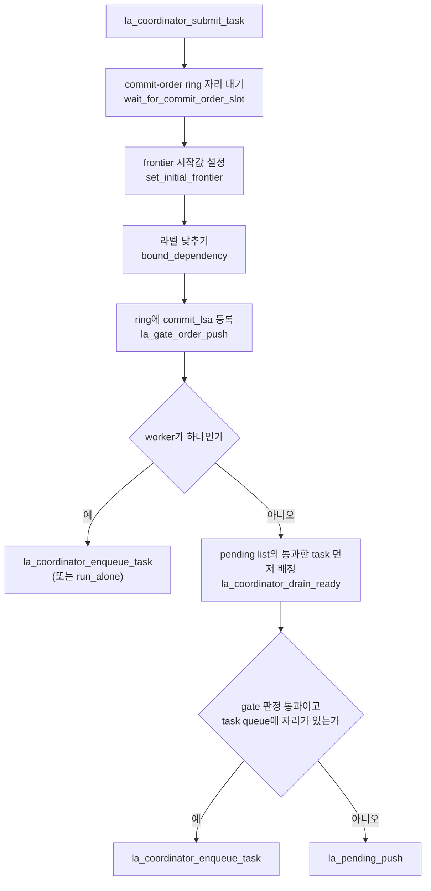

*그림 4-1. task 한 건이 배정되거나 pending list로 가는 경로.*

```c
// log_applier.c: la_coordinator_submit_task
error = la_coordinator_wait_for_commit_order_slot ();
...
la_gate_set_initial_frontier (&la_Info.committed_lsa);
LSA_COPY (&label, &task->dependency_seq);
if (la_gate_bound_dependency (&task->dependency_seq) && prm_get_integer_value (PRM_ID_HA_WRITESET_TRACE_LEVEL) >= 1)
  {
    ...   /* "[WSET] coordinator label lowered" trace */
  }
error = la_gate_order_push (&task->commit_lsa);
...
if (la_Info.worker_count == 1)
  {
    ...   /* worker가 하나인 경우 (4.8절) */
  }

error = la_coordinator_drain_ready ();
...
if (la_gate_is_satisfied (&task->dependency_seq) && !la_task_queue_is_full ())
  {
    return la_coordinator_enqueue_task (task, LA_SCHED_DISPATCHED);
  }

error = la_pending_push (task);
```

### 4.4 task queue에 넣기

gate를 통과한 task는 `la_coordinator_enqueue_task`가 task queue에 넣는다. 새로 읽은 task(`LA_SCHED_DISPATCHED`)와 pending list에서 꺼낸 task(`LA_SCHED_RELEASED`)가 같은 함수를 쓴다.

**순서**
1. task에 복제 항목이 있고 `commit_lsa`가 기동 때의 `last_committed_lsa`보다 뒤이면 dbname 잠금을 잡는다. worker는 이 잠금을 잡지 않는다(8.2절).
2. in-flight list에 자리가 없으면 자리가 날 때까지 기다린다(4.7절).
3. in-flight list에 슬롯 주소, `tranid`, 레코드 종류를 등록하고 배정 번호를 받아 `task.seq`에 넣는다. 배정 번호는 다시 쓰지 않으므로 result 하나는 entry 하나에만 맞는다.
4. task queue에 넣는다.

**task queue**
- 정적 배열 하나이며 용량은 `LA_TASK_QUEUE_CAPACITY`(1024)다. coordinator만 넣고 worker들이 꺼낸다.
- 넣기는 기다리지 않는다. coordinator가 `la_task_queue_is_full`로 먼저 확인하고, 자리가 없으면 task를 pending list에 둔다. 넣는 스레드가 coordinator 하나뿐이라 확인한 자리를 다른 스레드가 먼저 차지하지 않는다.
- worker는 `la_task_queue_pop`에서 task가 올 때까지 기다린다. task는 gate를 이미 통과했으므로 어느 worker가 가져가도 된다.

```c
// log_applier.c: la_coordinator_enqueue_task
if (task.has_items && LSA_GT (&task.commit_lsa, &la_Info.last_committed_lsa))
  {
    error = la_lock_dbname (&la_Info.db_lockf_vdes, la_slave_db_name, la_Info.log_path);
    ...
  }

error = la_coordinator_wait_for_inflight_slot ();
...
error = la_inflight_push (task.apply, task.tranid, task.rectype, &dispatch_seq);
...
task.seq = dispatch_seq;
...
return la_task_queue_push (&task);
```

```c
// log_applier_task_queue.cpp: la_task_queue_push (coordinator), la_task_queue_pop (worker)
pthread_mutex_lock (&la_Shared_task_mutex);
...
la_Shared_task_queue.tasks[la_Shared_task_queue.tail] = *task;
...
pthread_cond_signal (&la_Shared_task_not_empty);
pthread_mutex_unlock (&la_Shared_task_mutex);

pthread_mutex_lock (&la_Shared_task_mutex);
while (la_Shared_task_queue.count == 0 && la_Shared_task_shutdown == false)
  {
    pthread_cond_wait (&la_Shared_task_not_empty, &la_Shared_task_mutex);
  }
...
```

정상 경로에서 task 한 건이 coordinator와 worker 사이를 오가는 순서는 그림 4-2와 같다. worker가 task를 적용하는 내용은 5.2절에 있다.

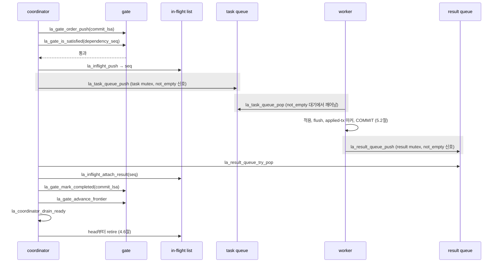

*그림 4-2. 정상 경로. 회색 구간은 각 큐의 mutex를 잡은 구간이며, 두 큐의 mutex를 함께 잡는 스레드는 없다.*

### 4.5 결과 수거와 frontier 전진

coordinator는 메인 루프를 한 바퀴 돌 때마다 `la_coordinator_collect_and_retire`를 부른다. 앞부분인 `la_coordinator_collect_results`가 result를 수거하고, 뒷부분인 `la_coordinator_retire_results`가 retire한다(4.6절).

**수거 순서**
1. result queue에서 기다리지 않고(`la_result_queue_try_pop`) 있는 result를 모두 꺼낸다.
2. 꺼낸 result마다 `la_coordinator_record_result`가 같은 배정 번호의 in-flight list entry에 붙인다. 맞는 entry가 없으면 오류다.
3. 성공한 COMMIT과 SYSOP_END result는 이 자리에서 ring에 완료로 표시한다. retire를 기다리지 않으므로, 이 result에 의존하던 task는 retire 전에 gate를 통과할 수 있다.
4. 실패한 result는 완료로 표시하지 않는다. 빠진 변경 위에 의존 task를 실행하면 안 되기 때문이며, 그 실패는 retire에서 applier를 멈춘다(4.6절).
5. 모두 붙인 뒤 frontier를 한 번 전진시키고, `la_coordinator_drain_ready`로 새로 통과한 pending list의 task를 배정한다.

```c
// log_applier.c: la_coordinator_collect_results, la_coordinator_record_result
while (la_result_queue_try_pop (&result) == NO_ERROR)
  {
    error = la_coordinator_record_result (&result);
    ...
  }
la_gate_advance_frontier ();
return la_coordinator_drain_ready ();

error = la_inflight_attach_result (result);
...
if (result->error == NO_ERROR && (result->rectype == LOG_COMMIT || result->rectype == LOG_SYSOP_END))
  {
    la_gate_mark_completed (&result->commit_lsa);
  }
```

result는 순서가 뒤섞여 도착한다. commit-order ring과 in-flight list는 서로 다른 순서를 맡는다.

- **commit-order ring**: 로그에서 읽은 COMMIT 순서다. frontier와 `committed_lsa`가 이 순서를 따른다.
- **in-flight list**: task queue에 넣은 순서다. pending list에서 늦게 나온 task는 뒤에 들어가므로 COMMIT 순서와 다를 수 있다. result를 entry에 대응시키고 트랜잭션 슬롯을 돌려주는 데 쓴다.

그림 4-3은 같은 예시로 두 순서가 갈리는 모습을 보인다. T1은 dependency가 없고, T2는 T1을 dependency로 가지며, T3은 dependency가 없다. 로그에서 읽은 순서는 T1, T2, T3이다.

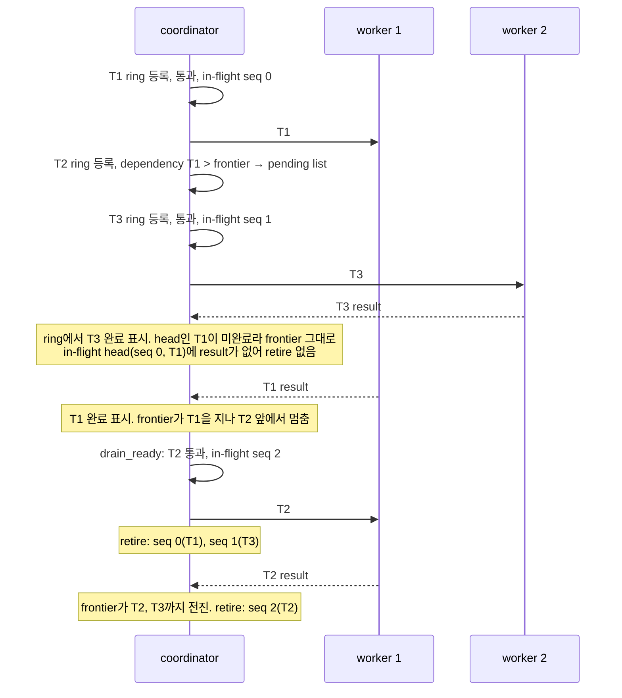

*그림 4-3. 순서가 뒤섞인 완료. T3이 먼저 끝나도 frontier와 retire는 T1을 기다린다.*

### 4.6 retire와 committed_lsa

retire는 in-flight list의 head부터 result가 붙은 entry를 차례로 정리하는 일이다. head에 result가 아직 없으면, 뒤의 entry가 끝났더라도 거기서 멈춘다.

**entry 하나를 retire할 때**
1. result가 실패이면 그 오류를 그대로 반환한다. 호출한 쪽은 applier를 멈춘다. 실패한 task 뒤의 entry는 retire하지 않는다.
2. `la_coordinator_release_apply_slot`으로 트랜잭션 슬롯을 돌려준다. fragment task의 슬롯은 복제 항목과 함께 해제한다. 일반 트랜잭션 슬롯은 `start_lsa`, `last_lsa`, `last_sysop_fragment_lsa`, `tranid`를 비워 다른 트랜잭션이 다시 쓰게 한다. 슬롯이 없는 task(복제 항목이 없는 COMMIT)는 할 일이 없다.
3. `la_coordinator_advance_committed_lsa`로 `committed_lsa`를 frontier까지 올린다.
4. `la_coordinator_add_result_stats`로 통계와 `committed_rep_lsa`를 반영한다.
5. entry를 in-flight list에서 뺀다.
6. 일정 간격이 지났으면 apply info를 저장한다(주기 저장, 7.2절).

```c
// log_applier.c: la_coordinator_retire_results
while ((entry = la_inflight_peek ()) != NULL && entry->result_ready)
  {
    result = &entry->result;
    if (result->error != NO_ERROR)
      {
        return result->error;
      }

    la_coordinator_release_apply_slot (entry);
    la_coordinator_advance_committed_lsa ();
    la_coordinator_add_result_stats (result);
    la_inflight_pop ();

    error = la_coordinator_store_apply_info_at_interval ();
    ...
  }
```

```c
// log_applier.c: la_coordinator_release_apply_slot
if (entry->apply == NULL)
  {
    return;
  }
if (entry->rectype == LOG_SYSOP_END)
  {
    la_free_all_repl_items (entry->apply);
    free_and_init (entry->apply);
    return;
  }
LSA_SET_NULL (&entry->apply->start_lsa);
LSA_SET_NULL (&entry->apply->last_lsa);
LSA_SET_NULL (&entry->apply->last_sysop_fragment_lsa);
entry->apply->tranid = 0;
```

**committed_lsa는 retire한 entry가 아니라 frontier를 따른다**
- in-flight list는 task queue에 넣은 순서라서, retire한 entry의 COMMIT LSA보다 앞선 COMMIT이 pending list에 남아 있을 수 있다.
- `committed_lsa`는 "이 위치 이하의 COMMIT은 모두 적용되었다"는 값이므로 frontier만 따른다. frontier가 아직 정해지지 않았으면 재시작 때의 값을 유지하며, 뒤로 가지 않는다.

```c
// log_applier.c: la_coordinator_advance_committed_lsa
if (!la_gate_get_frontier (&frontier))
  {
    return;
  }

assert (LSA_GE (&frontier, &la_Info.committed_lsa));
if (LSA_GT (&frontier, &la_Info.committed_lsa))
  {
    LSA_COPY (&la_Info.committed_lsa, &frontier);
  }
```

`committed_rep_lsa`는 retire한 result 가운데 가장 큰 값으로 올린다. apply info와 `applyinfo`에 보이는 값이며, 무엇을 다시 적용할지 정하는 데는 쓰지 않는다. 카운터(`insert_counter` 등)와 `total_rows`도 retire 때 `la_Info`에 더한다.

### 4.7 용량과 대기

commit-order ring, in-flight list, result queue는 모두 같은 용량 `LA_COMMIT_ORDER_CAPACITY(worker_count)`(worker 수 × 1024)로 만든다. task queue만 worker 수와 상관없이 1024다. coordinator가 기다리거나 일을 미루는 곳은 다섯 곳이며, 각각 끝나는 근거가 있다.

**1. commit-order ring이 가득 찬 경우**
- `la_coordinator_wait_for_commit_order_slot`에서 로그 읽기를 멈추고 수거와 retire만 반복한다. result가 없으면 `la_result_queue_wait_for_result`로 최대 100ms 기다린다.
- 끝나는 근거: ring의 가장 오래된 COMMIT은 항상 gate를 통과한다. 그 앞의 COMMIT은 모두 적용되어 frontier가 바로 앞에 있고, 그 task의 라벨은 라벨 낮추기 때문에 바로 앞에 읽은 COMMIT 이하이기 때문이다. 이 task가 끝나면 frontier가 지나가 ring에 자리가 난다.

**2. in-flight list가 가득 찬 경우**
- `la_coordinator_wait_for_inflight_slot`에서 먼저 retire하고, 그래도 가득 차 있으면 result 하나를 기다려(`la_coordinator_pop_result`) 붙이고 다시 retire한다. 이 함수는 `la_coordinator_drain_ready` 안에서도 불리므로 여기서는 pending list를 꺼내지 않는다.
- 기다리기 전에 retire부터 하는 이유: 수거가 result를 모두 붙인 뒤 retire 전에 pending list의 task를 배정하므로, in-flight list가 끝난 task로만 가득 찬 채 실행 중인 task가 하나도 없을 수 있다. 이때 result를 기다리면 끝나지 않는다.
- ring보다 in-flight list가 먼저 찰 수 있는 이유: ring은 frontier가 지나가면 비고, in-flight list는 head부터 retire해야 빈다. 두 순서가 다르므로 in-flight list만 가득 찰 수 있다.
- 끝나는 근거: retire한 뒤에도 남은 head entry에는 result가 없으므로, 그 task는 task queue에 있거나 worker가 실행 중이거나 result queue에 있다. 그래서 head의 result는 반드시 온다.

**3. task queue가 가득 찬 경우**
- 기다리지 않는다. gate를 통과한 task도 pending list에 두고 로그 읽기와 수거를 계속한다.
- 끝나는 근거: worker가 task를 꺼낼 때마다 자리가 나고, 다음 수거의 `la_coordinator_drain_ready`가 pending list에서 등록 순서대로 꺼낸다.

**4. result queue가 가득 찬 경우**
- worker가 `la_result_queue_push`에서 자리가 날 때까지 기다린다. result를 버리면 retire가 그 entry에서 영원히 멈추기 때문이다.
- 실제로는 차지 않는다. result queue의 result는 모두 retire하지 않은 task의 것이고, 그런 task는 in-flight list 용량을 넘지 않으며, 두 용량이 같다. 이 대기는 계산이 틀렸을 때를 위한 방어 장치다.

**5. 읽을 로그가 없는 경우**
- 메인 루프는 새 페이지가 없거나 로그 끝에 도달하면 sleep 대신 `la_result_queue_wait_for_result(100)`로 기다린다. result가 오면 바로 깨어나 수거하고, pending list에서 풀린 task를 배정한다.

result를 기다리는 곳은 모두 100ms 단위로 끊어서 `la_applier_need_shutdown`을 확인한다. 적용 오류로 멈춘 worker, 마지막으로 시작에 실패한 worker, SIGTERM은 이 플래그만 세운다. worker가 하나도 없으면 기다리는 result가 오지 않으므로, 시간 제한 없이 기다리면 끝나지 않는다.

```c
// log_applier.c: la_coordinator_wait_for_commit_order_slot
while (la_gate_order_get_count () >= la_Info.commit_order_capacity)
  {
    if (la_applier_need_shutdown)
      {
        return ER_FAILED;
      }
    error = la_coordinator_collect_and_retire ();
    ...
    if (la_gate_order_get_count () >= la_Info.commit_order_capacity)
      {
        (void) la_result_queue_wait_for_result (100);
      }
  }

// log_applier.c: la_coordinator_wait_for_inflight_slot
while (la_inflight_get_count () >= la_inflight_get_capacity ())
  {
    error = la_coordinator_retire_results ();
    ...
    if (la_inflight_get_count () < la_inflight_get_capacity ())
      {
        break;
      }
    error = la_coordinator_pop_result (&result);
    ...
    error = la_coordinator_record_result (&result);
    ...
    la_gate_advance_frontier ();
    error = la_coordinator_retire_results ();
    ...
  }
```

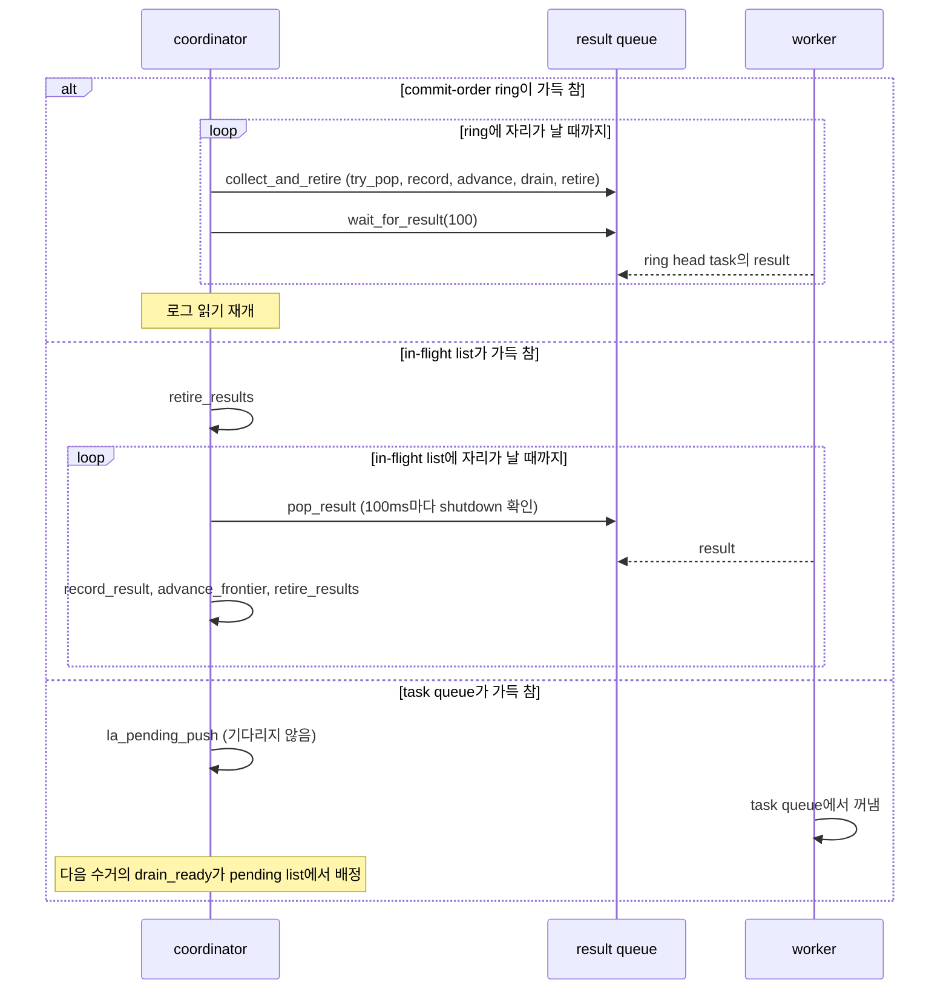

*그림 4-4. coordinator의 back-pressure. result queue의 대기는 worker 쪽 방어 장치라 그림에서 뺐다.*

### 4.8 worker가 하나인 경우

`ha_apply_worker_count`가 1이면 coordinator는 pending list를 쓰지 않는다. 모든 task를 ring에 넣은 직후 바로 task queue에 넣고, worker 하나가 FIFO 큐에서 COMMIT 순서대로 꺼내 적용한다. task를 pending list에 두면 뒤의 독립 task가 그 task를 앞지를 수 있는데, worker가 하나일 때는 로그를 COMMIT 순서대로 적용하는 것이 목적이기 때문이다. 기동 때 "applylogdb runs one apply worker: transactions are applied in commit order" 알림을 남긴다(로그 문자열 그대로).

- 이 경로에서 task queue는 가득 차지 않는다. in-flight list 용량(1 × 1024)이 task queue 용량과 같고, `la_coordinator_enqueue_task`가 in-flight list의 자리를 먼저 기다리기 때문이다.

MULTI_CONN_TO_A_SERVER 없이 빌드하면 worker가 자기 연결을 만들 수 없다. `la_init`은 설정값이 1보다 커도 worker 수를 1로 줄이고 알림을 남긴다. 이 worker는 coordinator가 apply info를 저장하는 같은 client를 쓰므로 둘이 동시에 쓰면 안 된다. 그래서 `la_coordinator_run_alone`이 task를 하나씩 단독으로 실행한다.

1. pending list의 task를 배정하고, task queue에 넣은 task가 모두 retire될 때까지 기다린다(`la_coordinator_wait_until_retired`). pending list가 빌 때까지 반복한다.
2. 이번 task를 넣는다.
3. 이 task가 retire될 때까지 기다린다. 그 뒤에야 다음 COMMIT을 읽는다.

```c
// log_applier.c: la_coordinator_submit_task (worker가 하나인 경우)
if (la_Info.worker_count == 1)
  {
    assert (la_pending_is_empty ());
#if defined (CS_MODE) && defined (MULTI_CONN_TO_A_SERVER)
    return la_coordinator_enqueue_task (task, LA_SCHED_DISPATCHED);
#else
    return la_coordinator_run_alone (task);
#endif
  }

// log_applier.c: la_coordinator_run_alone
do
  {
    error = la_coordinator_drain_ready ();
    ...
    error = la_coordinator_wait_until_retired ();
    ...
  }
while (!la_pending_is_empty ());

error = la_coordinator_enqueue_task (task, LA_SCHED_DISPATCHED);
...
return la_coordinator_wait_until_retired ();
```

`la_coordinator_wait_until_retired`는 in-flight list가 빌 때까지 result를 하나씩 기다려 붙이고(`la_coordinator_pop_result`, `la_coordinator_record_result`) frontier를 올린 뒤 retire한다. 이 함수와 `la_coordinator_run_alone`은 MULTI_CONN_TO_A_SERVER 없는 빌드에만 있다.

## 5. worker 적용

worker는 coordinator가 task queue에 넣은 task를 하나씩 꺼내 슬레이브 서버에 적용하고, 그 결과를 result로 돌려주는 스레드다. worker마다 슬레이브 서버에 자기 connection을 따로 연다. 데이터 트랜잭션은 이 connection에서 worker가 직접 COMMIT하고, apply info는 coordinator가 자기 connection에서 저장한다(7.2절). worker 모듈(`applier/log_applier_worker.cpp`)은 스레드의 생명주기와 worker context만 맡는다. task 한 건을 적용하는 방법은 `log_applier.c`의 함수를 콜백으로 받아 쓴다.

### 5.1 worker 생명주기

coordinator는 시작할 때 `la_start_apply_workers`로 `LA_WORKER_CONFIG`를 채워 `la_worker_start`에 넘긴다. 이 설정은 worker가 시작한 뒤로 읽기만 한다.

- **크기**: 로그 헤더에서 읽은 DB 페이지 크기, 레코드 pool 크기(`LA_MAX_UNFLUSHED_REPL_ITEMS`, flush 한 번에 보내는 항목 수와 같다).
- **trace 수준**: `ha_writeset_trace_level`을 한 번 읽어 둔다.
- **콜백**: `la_apply_worker_run_task`(task 한 건 적용), `la_request_shutdown`(applier 종료 요청), `la_apply_worker_end_context`(connection을 닫기 전 정리).

`la_worker_start`는 worker 수만큼 스레드를 만들고 바로 돌아온다. coordinator는 worker가 session을 다 열 때까지 기다리지 않는다. task는 worker가 꺼낼 때까지 task queue에 머문다.

```text
[worker 스레드 하나]
la_worker_main()
  → la_worker_start_session()              la_Worker_session_mutex 안에서 하나씩
     → db_restart_sub(worker 번호)          자기 sub-client connection
     → tr_init(), db_disable_trigger()     슬레이브에서 trigger를 다시 실행하지 않음
     → ws_init_repl_objs()
     (실패 → la_worker_startup_failed() → end)
  → la_worker_context_init()                unzip buffer 둘, 레코드 pool
     (실패 → la_worker_startup_failed() → end)
  → la_worker_run()                         task 루프(5.2절)
     (적용 오류로 끝남 → request_shutdown)
end:
  → end_context()                           마커 INSERT 문장 닫기, pinned 목록 해제
  → la_worker_context_final()
  → la_worker_end_session()
     → ws_clear_all_repl_objs()
     → db_shutdown_sub()
```

- **session을 하나씩 여는 이유**: `la_worker_start_session`은 `la_Worker_session_mutex`를 쥐고 `db_restart_sub`를 부르므로, worker들의 session 시작은 차례로 일어난다.
- **trigger**: `db_restart_sub`는 trigger 초기화를 하지 않는다. 그래서 worker가 직접 `tr_init`을 부르고 trigger를 끈다.
- **실패한 session도 닫는다**: `db_restart_sub`가 실패해도 그 스레드의 오류 context가 남아 있어야 오류를 보고할 수 있다. 이 context는 `db_shutdown_sub`만 해제하므로, 시작에 실패한 worker도 끝에서 session을 닫는다.
- **MULTI_CONN_TO_A_SERVER 없이 빌드한 경우**: `db_restart_sub`를 부르지 않고 프로세스의 client connection을 함께 쓴다. 이때 worker는 오류 context를 직접 만들어 등록하고, 끝에서 해제한다. worker 수는 1로 줄어든다(4.8절, 9.1절).
- **시작 실패**: `la_worker_startup_failed`가 살아 있는 worker 수(`la_Live_worker_count`)를 하나 줄이고 오류 로그에 남긴다. 남은 worker는 계속 적용한다. task는 어느 worker가 꺼내도 되므로 worker가 줄면 병렬도만 낮아진다. 마지막 worker까지 시작에 실패하면 task를 꺼낼 스레드가 없으므로 applier 종료를 요청한다.
- **종료**: coordinator의 `la_stop_apply_workers`가 task queue와 result queue에 shutdown을 알리고, 시작된 worker를 모두 join한다(8.3절). shutdown이 켜진 task queue는 남은 task가 있어도 더는 내주지 않는다. 그런 task의 COMMIT은 `committed_lsa` 뒤에 있으므로 다음 실행이 로그에서 다시 읽는다(7.4절).

```c
// log_applier_worker.cpp: la_worker_main
error = la_worker_start_session (&session, worker->index);
session_started = true;
if (error != NO_ERROR)
  {
    la_worker_startup_failed (worker, "start_session_failed", error);
    goto end;
  }
error = la_worker_context_init (&worker_context, ...db_page_size, ...recdes_pool_size);
...
error = la_worker_run (worker, &worker_context, &worker_applied_item_count);
if (error != NO_ERROR)
  {
    la_Worker_config.request_shutdown ();
  }
end:
if (worker_context_started)
  {
    la_Worker_config.end_context (&worker_context);
    la_worker_context_final (&worker_context);
  }
if (session_started)
  {
    la_worker_end_session (&session);
  }
```

### 5.2 task 한 건 적용

`la_worker_run`은 task queue에서 task를 꺼내 result를 준비하고 `run_task` 콜백을 부른 뒤, result를 result queue에 넣는다. 이 일을 queue가 shutdown될 때까지 반복한다. result의 `seq`는 task의 `seq`를 그대로 옮긴 값이다. coordinator는 이 값으로 in-flight list의 entry를 찾는다(4.5절).

```c
// log_applier_worker.cpp: la_worker_run
while (true)
  {
    if (la_task_queue_pop (&task) != NO_ERROR)
      {
        break;                       /* shutdown */
      }
    worker->busy = true;
    la_result_init (&result, &task, context->worker_idx);
    la_Worker_config.run_task (context, &task, trace_level, worker_applied_item_count, &result);
    error = la_result_queue_push (&result);
    worker->busy = false;
    if (error != NO_ERROR)
      {
        return NO_ERROR;             /* result queue shutdown: the result is dropped */
      }
    if (LA_IS_FLUSH_ERROR (result.error) || result.error == ER_NET_CANT_CONNECT_SERVER
        || ER_IS_SERVER_DOWN_ERROR (result.error))
      {
        return result.error;
      }
  }
```

`run_task`로 넘어가는 `la_apply_worker_run_task`는 복제 항목이 있는 task라면 통계에 이 worker의 현재 task로 표시하고, `la_apply_worker_apply_task`를 부른 뒤 걸린 시간을 result의 `busy_usec`에 넣는다. 실제 적용 순서는 `la_apply_worker_apply_task`가 정한다.

```text
[worker task 하나]
la_apply_worker_apply_task()
  → la_apply_repl_log()                  복제 항목 적용
     (이미 적용된 COMMIT이면 항목만 해제하고 끝, 7.4절)
  → la_apply_worker_flush_task()
     → la_flush_repl_items(immediate)    모아 둔 변경을 서버로 보냄
  → [추가] la_insert_applied_tx_marker() applied-tx 마커 INSERT(7.3절)
     (적용한 항목이 있을 때만)
  (앞 단계 실패 → db_abort_transaction(), result.error 설정, 끝)
  → la_apply_worker_commit_task()
     → la_commit_transaction()           데이터와 마커를 한 트랜잭션으로 COMMIT
```

- **적용**: `la_apply_repl_log`는 트랜잭션 슬롯의 복제 항목을 차례로 적용하고, 적용한 항목은 바로 해제한다. 트랜잭션 슬롯 자체는 해제하지 않는다. 슬롯은 coordinator가 retire 때 비운다(4.6절). 복제 항목이 없는 COMMIT task(`task.apply == NULL`)도 같은 함수를 지나며, 적용 없이 끝난다.
- **이미 적용된 COMMIT**: COMMIT LSA가 시작 때의 `last_committed_lsa` 이하이거나 applied-tx 마커가 있으면 트랜잭션 전체를 건너뛴다. 이 경우 적용한 항목 수가 0이므로 마커를 다시 넣지 않는다(7.4절).
- **마커**: 적용한 항목이 하나라도 있으면 COMMIT 직전에 같은 슬레이브 트랜잭션 안에서 마커를 INSERT한다. 데이터가 COMMIT되면 마커도 함께 있고, 데이터가 없으면 마커도 없다.
- **실패**: flush나 마커 INSERT가 실패하면 열린 슬레이브 트랜잭션을 `db_abort_transaction`으로 되돌린다. 되돌리지 않으면 이 worker가 다음에 꺼낸 task가 앞 변경을 마커 없이 함께 COMMIT하게 된다.
- **COMMIT**: `la_apply_worker_commit_task`는 이 worker가 적용한 항목 수를 늘리고 `la_commit_transaction`을 부른다. 그 사이에 시험용 훅(`la_apply_worker_test_block_before_commit`)이 끼어 있다(10장).

```c
// log_applier.c: la_apply_worker_apply_task
result->error = la_apply_repl_log (context, task->apply, &task->commit_lsa, &total_rows,
                                   &result->committed_rep_lsa, &result->stats);
result->total_rows = total_rows;
...
if (result->error == NO_ERROR)
  {
    result->error = la_apply_worker_flush_task (context, task, trace_level, &result->stats);
  }
if (result->error == NO_ERROR && total_rows > 0)
  {
    result->error = la_insert_applied_tx_marker (context, &task->commit_lsa);
  }
if (result->error != NO_ERROR)
  {
    (void) db_abort_transaction ();
    return;
  }
result->error = la_apply_worker_commit_task (context, task, trace_level, &result->stats, worker_applied_item_count);
```

result에는 성공 여부 말고도 다음 값이 담긴다. coordinator는 retire할 때 이 값들을 전역 값에 더한다(4.6절, 9.2절).

- `committed_rep_lsa`: 오류 없이 적용한 마지막 복제 항목의 LSA.
- `total_rows`: 이 task에서 다룬 항목 수.
- `stats`: INSERT·UPDATE·DELETE·스키마·실패 건수, 마지막 오류 코드와 시각, 마지막으로 적용한 클래스.
- `busy_usec`, `apply_end_time`, `worker_idx`: worker별 통계와 trace용.

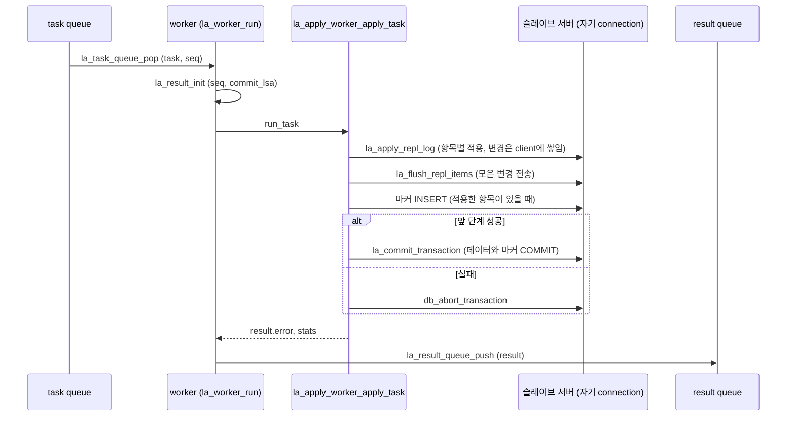

### 5.3 오류 처리

worker의 오류는 항목 하나의 오류, flush 오류, 서버 연결 오류, 마커와 COMMIT 오류로 나뉜다. 이 가운데 result까지 올라가는 것은 트랜잭션을 그대로 COMMIT할 수 없는 오류뿐이다.

**항목 하나의 오류**

INSERT·UPDATE·DELETE 적용 함수는 오류가 나면 `la_log_apply_error`로 오류 로그를 남기고 `la_stat_note_error`로 `fail_counter`, 마지막 오류 코드와 시각을 센다. statement 항목은 `la_apply_statement_log`가 같은 방식으로 센다. 그 뒤 `la_apply_repl_log`는 오류 종류에 따라 다음처럼 처리한다.

- **flush 오류**(`LA_IS_FLUSH_ERROR`): 남은 항목을 적용하지 않고 오류를 돌려준다.
- **서버 연결 오류**: `ER_NET_CANT_CONNECT_SERVER`로 바꿔 돌려준다.
- **재시도할 오류**: `ha_applylogdb_ignore_error_list`에 없으면서, `LA_RETRY_ON_ERROR`(잠금·페이지 latch 시간 초과, 교착 등)이거나 `ha_applylogdb_retry_error_list`에 있는 오류다. 알림을 남기고 10초 쉰 뒤 같은 항목을 다시 적용한다. 횟수 제한은 없다.
- **그 밖의 오류**: 이미 세고 보고했으므로 오류를 지우고 다음 항목으로 넘어간다. 트랜잭션은 성공한 항목만으로 COMMIT된다. 마지막 항목 하나의 실패로 트랜잭션 전체를 버리고 applier를 멈추지 않으려는 것이다.

```c
// log_applier.c: la_apply_repl_log (항목 오류)
if (LA_IS_FLUSH_ERROR (error))
  {
    goto end;
  }
errid = er_errid ();
...
if (ER_IS_SERVER_DOWN_ERROR (errid))
  {
    error = ER_NET_CANT_CONNECT_SERVER;
    goto end;
  }
else if (la_ignore_on_error (errid) == false && la_retry_on_error (errid) == true)
  {
    LA_SLEEP (10, 0);
    continue;                        /* the same item again */
  }
else
  {
    error = NO_ERROR;                /* counted in fail_counter; go on with the next item */
  }
```

**flush 오류**

`la_flush_repl_items`는 client에 쌓인 변경을 한 번에 서버로 보낸다. 일부만 실패하면(`ER_LC_PARTIALLY_FAILED_TO_FLUSH`) 실패한 행마다 오류 로그를 남기고, 해당 INSERT·UPDATE·DELETE 건수를 하나씩 줄이고, `fail_counter`를 센다. 실패한 행의 오류가 재연결해야 할 오류(`la_restart_on_bulk_flush_error`)이면 `ER_LC_PARTIALLY_FAILED_TO_FLUSH`를 돌려준다. 그렇지 않으면 성공으로 처리한다. 전송 자체가 실패하면 `ER_LC_FAILED_TO_FLUSH_REPL_ITEMS`를 돌려준다.

**result로 올라가는 오류와 worker가 끝나는 조건**

- result의 `error`에 들어가는 오류는 다음과 같다.
  - `la_apply_repl_log`가 돌려준 flush 오류나 서버 연결 오류
  - 마지막 flush의 오류
  - 마커 INSERT 오류
  - COMMIT 오류
- 적용, flush, 마커 INSERT가 실패하면 worker는 슬레이브 트랜잭션을 되돌린 뒤 result를 넣는다. COMMIT 오류는 되돌리지 않고 그대로 result에 담는다.
- result의 오류가 flush 오류이거나 서버 연결 오류이면 worker는 루프를 끝내고 applier 종료를 요청한다. 그 밖의 오류이면 worker는 다음 task를 계속 꺼낸다.
- result queue가 shutdown되어 result를 넣지 못하면 그 result는 버린다. retire되지 않았으므로 재시작 지점이 그 앞에 남고, 다음 실행이 다시 적용한다.

**coordinator 쪽 처리**

- 실패한 result는 commit-order ring에 완료로 표시하지 않는다(4.5절). 그 트랜잭션에 의존하는 트랜잭션이 빠진 변경 위에서 실행되지 않게 하기 위해서다.
- retire는 in-flight list의 head부터 진행하다가 실패한 result에서 멈추고 그 오류를 돌려준다(4.6절).
- 메인 루프는 그 오류가 서버 연결 오류나 flush 오류이면 `la_shutdown` 후 오류로 돌아가고, 그 밖의 오류이면 applier 종료 표시를 켜고 루프를 빠져나간다(4.7절).

### 5.4 공유 자원

worker 사이에 나누는 자원은 로그 페이지 cache, SQL 컴파일 mutex, session 시작 mutex이다. 레코드를 재구성하는 버퍼는 worker마다 따로 있다(2.6절).

**로그 페이지 cache**

coordinator와 worker는 같은 로그 페이지 cache(`la_Info.cache_pb`)를 쓰고, cache의 hash와 buffer 상태는 `cache_pb->mutex`로 보호한다. coordinator는 로그 레코드를 읽을 때, worker는 복제 항목의 원본 레코드를 다시 읽을 때 이 cache를 쓴다.

- **fix**: `la_get_page_buffer`는 mutex 안에서 페이지를 찾거나 빈 buffer에 읽어 들이고, `fix_count`를 하나 올린다. mutex를 놓은 뒤 그 buffer를 호출한 스레드의 pinned 목록(thread_local)에 기록한다.
- **해제**: 스레드는 자기 pinned 목록에 있는 fix만 푼다. `la_release_page_buffer`는 페이지 하나, `la_release_pinned_page_buffers`는 목록 전체를 푼다. worker는 복제 항목 하나를 적용할 때마다, coordinator는 로그 레코드 하나를 처리할 때마다 목록을 비운다. 그래서 페이지 경계를 넘는 레코드를 읽으며 잡은 fix가 쌓이지 않는다.
- **교체**: `la_cache_buffer_replace`는 `fix_count`가 0인 buffer만 새 페이지에 내준다. `la_decache_page_buffers`도 fix된 buffer는 건너뛴다. `la_invalidate_page_buffer`는 hash에서 buffer를 빼되 호출한 스레드의 fix만 푼다. 다른 스레드가 읽고 있는 buffer는 마지막 fix가 풀린 뒤에야 교체 대상이 된다.
- **pinned 목록 크기**: 처음 256개로 시작하고, 차면 두 배로 늘린다. 작업 단위가 끝났을 때 3분의 1 이하만 쓰고 있으면 반으로 줄인다. worker가 끝날 때 `la_apply_worker_end_context`가 목록을 해제한다.

```c
// log_applier.c: la_get_page_buffer
pthread_mutex_lock (&cache_pb->mutex);
cache_buffer = (LA_CACHE_BUFFER *) mht_get (cache_pb->hash_table, (void *) &pageid);
if (cache_buffer == NULL)
  {
    cache_buffer = la_cache_buffer_replace (cache_pb, pageid, ...);   /* only a buffer with fix_count 0 */
    ...
  }
...
cache_buffer->fix_count++;
pthread_mutex_unlock (&cache_pb->mutex);
la_pin_page_buffer (cache_buffer, pageid);    /* this thread's own list */
```

**SQL 컴파일 mutex**

SQL parser의 정적 전역 변수는 스레드 안전하지 않다. 그래서 SQL 문장을 컴파일하거나 실행하는 곳은 모두 `la_sql_compile_mutex`를 쥔다.

- coordinator: `la_update_query_execute_with_values`로 하는 apply info·통계 저장과 마커 삭제, 시작 때의 마커 로드.
- worker: statement 항목 적용(`la_apply_statement_log` → `la_update_query_execute`), 마커 INSERT의 컴파일과 실행(`la_insert_applied_tx_marker`).

이 구간은 worker 사이에서도 한 번에 하나만 들어간다. 마커 INSERT는 statement 한 번만 컴파일해 두고 값만 바꿔 실행하지만, 실행도 이 mutex 안에서 한다. 서버가 다시 컴파일을 요구할 수 있기 때문이다. coordinator가 마커를 지우는 DELETE를 COMMIT 직전 마지막 문장으로 두는 이유도 이 mutex와 관련 있다(7.2절).

**COMMIT 뒤 한 번 더 하는 COMMIT**

`la_commit_transaction`은 데이터를 COMMIT한 뒤, 일정 시간이 지났거나 적용한 항목이 일정 수를 넘으면 상주 클래스마다 `ws_intern_instances`로 복제 flush가 남긴 MOP를 정리한다. 이 정리는 클래스를 가져오면서 새 트랜잭션에서 클래스마다 SCH_S 잠금을 잡는다. 이 잠금을 쥔 채 worker가 다음 task를 기다리면 문제가 생긴다. 다른 worker의 복제 DDL이 그 클래스의 SCH_M을 기다리고, gate는 DDL 뒤의 task를 내보내지 않으므로 양쪽 다 진행하지 못한다. 그래서 정리 뒤에 COMMIT을 한 번 더 해 잠금을 놓는다. 마지막 정리 시각과 항목 수는 스레드별 변수(`CUB_THREAD_LOCAL`)라서 worker마다 따로 센다.

```c
// log_applier.c: la_commit_transaction
error = db_commit_transaction ();
...
if (diff_time >= ws_cull_mops_interval || diff_applied_item >= ws_cull_mops_per_apply)
  {
    for (m = ws_Resident_classes; m != NULL; m = m->next)
      {
        ...
        ws_intern_instances (m->op);
      }
    /* the class fetches above hold SCH_S in a new transaction; release them before waiting for the next task */
    error = db_commit_transaction ();
  }
...
return error;
```

두 번째 COMMIT의 오류도 그대로 result에 담긴다. 데이터와 applied-tx 마커는 첫 COMMIT으로 이미 남았으므로, 이 result 때문에 applier가 멈춰도 다음 실행은 마커를 보고 그 트랜잭션을 건너뛴다(7.4절).

## 6. 순서 보장 근거

[01 5절](./01-master-implementation-design.md#5-순서-보장-근거)은 master가 라벨 조건을 지키는 방식을 정리했다. 이 장은 slave가 그 라벨만 보고 충돌하는 트랜잭션의 순서를 지키는 근거를 정리한다. 4장에서 본 gate 판정, 결과 수거, frontier 전진, 라벨 낮추기가 근거가 된다.

### 6.1 전제와 결론

slave의 순서 보장은 두 조건을 결합해서 얻는다.

- **master 라벨 조건** ([01 2.4절](./01-master-implementation-design.md#24-라벨이-지켜야-할-조건)): T'가 T보다 먼저 커밋했고 둘이 충돌하면 `commit_lsa(T') ≤ label(T) < commit_lsa(T)`이다.
- **slave gate 판정** (4.1절): T의 task는 dependency가 NULL이거나 `dependency ≤ frontier`일 때만 task queue에 들어간다.

frontier는 빈틈없이 적용된 마지막 COMMIT LSA다. frontier 이하의 COMMIT은 모두 slave에서 커밋이 끝났다는 뜻이고, 이 뜻은 다음 전제가 있을 때만 성립한다.

- commit-order ring은 로그에서 읽은 COMMIT과 라벨 단 SYSOP_END를 LSA 순서로 담는다.
- ring entry의 `completed`는 worker가 성공한 result를 돌려준 경우에만 표시한다(`la_coordinator_record_result`). 실패한 result는 표시하지 않는다.
- frontier는 ring의 가장 오래된 entry부터 `completed`가 이어지는 구간만 넘는다.
- frontier는 재시작 지점(`committed_lsa`)에서 시작하고, 그 이하의 COMMIT은 이전 실행이 적용했으므로 ring에 올리지 않는다(7.4절).

두 조건을 이으면 결론은 다음과 같다.

```text
T'가 T보다 먼저 커밋했고 T와 충돌하면
    commit_lsa(T') ≤ dependency(T)                 라벨 조건과 3.2절·4.2절의 조정
    dependency(T)  ≤ frontier                     T가 gate를 통과한 시점
  → commit_lsa(T') ≤ frontier
  → T'는 T가 task queue에 들어가기 전에 slave에서 커밋되었다
```

dependency는 라벨을 그대로 쓰거나 더 큰 값으로 올린 값이다. 자기 sysop fragment로 올리는 경우와 라벨이 없을 때 ring tail로 정하는 경우가 그렇다(3.2절). 라벨을 낮추는 경우는 하나뿐이다. 라벨이 지금까지 읽은 마지막 COMMIT보다 크면 그 COMMIT으로 낮춘다(4.2절). T'는 T보다 먼저 커밋했으므로 T보다 먼저 읽혔고, 그래서 `commit_lsa(T')`는 낮춘 값 이하다. 올린 경우는 자명하고, 낮춘 경우도 T'가 먼저 읽혔으므로 첫 줄의 부등식이 유지된다.

**개별 완료로 통과시키지 않는 이유**
- master는 충돌하는 앞선 트랜잭션들을 가장 큰 COMMIT LSA 하나로 줄여 라벨에 남긴다. 라벨은 트랜잭션 하나를 가리키지만 나머지도 함께 대표한다.
- T가 T1(c1), T2(c2)와 충돌하고 c1 < c2이면 라벨은 c2다. T2가 먼저 끝나고 T1이 아직 적용 중일 때 "라벨이 가리키는 c2가 끝났다"는 이유로 T를 통과시키면, T가 같은 행에서 T1과 함께 돈다.
- REF에서 온 라벨도 같다. 라벨은 병렬로 돈 여러 참조 트랜잭션 가운데 마지막 것만 가리킨다. 그래서 gate는 라벨이 어느 종류의 충돌에서 왔는지 알 필요가 없다.

slave는 아래 장치로 위 결론의 전제를 지킨다.

1. **ring은 COMMIT LSA 순으로 쌓는다** (`la_gate_order_push`). coordinator가 로그를 순서대로 읽어 push하고, 새 entry가 마지막 entry보다 큰지 assert로 확인한다.
2. **성공한 result만 completed로 표시한다** (`la_coordinator_record_result`). COMMIT과 sysop fragment(`LOG_SYSOP_END`)의 성공 result만 표시한다. 실패한 트랜잭션 자리에서 frontier가 멈추므로 그 뒤에 의존하는 트랜잭션은 통과하지 못하고, retire가 실패 result를 만나면 applier를 멈춘다(4.6절).
3. **frontier는 빈틈에서 멈춘다** (`la_gate_advance_frontier`). 뒤의 COMMIT이 먼저 끝나도 앞에 아직 적용 중인 COMMIT이 있으면 넘지 않는다.
4. **gate는 dependency가 frontier 이하일 때만 통과시킨다** (`la_gate_is_satisfied`). 라벨이 가리키는 COMMIT 하나가 끝난 것으로는 통과하지 않는다.
5. **라벨을 낮춰도 아래쪽 경계는 유지된다** (`la_gate_bound_dependency`). 읽은 마지막 COMMIT과 그보다 큰 라벨 사이에는 COMMIT이 없으므로 낮춘 값도 같은 뜻이다.
6. **라벨이 없으면 앞선 모든 COMMIT을 기다린다** (`la_coordinator_set_commit_dependency`). 항목이 있는 COMMIT에 라벨이 없으면 ring tail을 dependency로 삼는다. ring이 비어 있으면 읽은 COMMIT이 모두 frontier 아래에 있으므로 NULL로 두어도 된다.
7. **바깥 COMMIT은 자기 sysop fragment 뒤에 적용한다** (`la_coordinator_set_commit_dependency`). dependency를 슬롯의 `last_sysop_fragment_lsa`까지 올린다(3.3절).
8. **frontier는 재시작 지점에서 시작하고 이전 실행의 값을 남기지 않는다** (`la_gate_set_initial_frontier`, `la_gate_init`). 재시작 지점 이하 COMMIT은 `la_log_record_process`의 `LOG_COMMIT` 분기에서 항목만 버리고 ring에 올리지 않는다. `la_gate_init`이 frontier를 지우므로 같은 프로세스 안의 재시작이 이전 실행의 frontier로 통과하지 않는다(7.5절).

이 장치들의 코드는 4.1절(`la_gate_is_satisfied`), 2.3절(`la_gate_advance_frontier`), 4.5절(`la_coordinator_record_result`)에 있다.

### 6.2 충돌 유형별 순서

slave의 gate는 충돌 유형을 구분하지 않는다. 유형별 차이는 master가 라벨 값을 고를 때 이미 반영되어 있다([01 5.2절](./01-master-implementation-design.md#52-충돌-유형별로-순서가-보장되는-방식)). 아래에서 T1이 먼저 커밋하고(COMMIT LSA c1) T2가 뒤에 커밋한다.

- **WRITE와 WRITE** (같은 행의 UPDATE·DELETE, 같은 UNIQUE 키의 DELETE와 INSERT): T2의 라벨은 c1 이상이다. T2는 frontier가 c1을 넘은 뒤에 task queue에 들어가므로, T1의 변경이 slave에서 커밋된 뒤에 같은 행이나 키에 닿는다.
- **앞선 WRITE와 뒤의 REF** (T1이 부모를 INSERT, T2가 그 부모를 참조하는 자식을 INSERT): T2의 라벨은 부모 키의 write_seq에서 온 c1 이상이다. slave는 부모를 먼저 커밋하고 자식을 적용한다.
- **앞선 REF와 뒤의 WRITE** (T1이 자식을 INSERT, T2가 부모를 DELETE): T2의 라벨은 부모 키의 ref_seq에서 온 c1 이상이다. slave는 자식을 먼저 커밋하고 부모를 바꾼다.
- **같은 부모를 참조하는 REF끼리**: master는 REF끼리 서로의 ref_seq를 보지 않으므로 두 라벨 모두 부모를 쓴 COMMIT을 가리킨다. 부모가 적용되면 두 트랜잭션은 함께 gate를 통과해 서로 다른 worker에서 병렬로 적용된다.

형제 REF 뒤에 부모를 바꾸는 WRITE가 오면, 그 라벨은 형제 가운데 마지막 COMMIT(c2)이다. 6.1절의 이유로 이 트랜잭션은 c2 하나가 끝나는 것으로는 통과하지 못하고, frontier가 c2에 닿을 때, 곧 형제 둘이 모두 커밋된 뒤에 통과한다. 그림 6-1은 T2가 T1보다 먼저 끝나는 경우다.

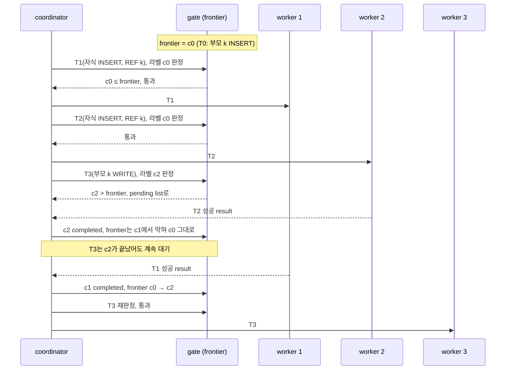

*그림 6-1. 형제 REF T1, T2는 병렬로 적용되고, 뒤의 부모 WRITE T3는 둘이 모두 커밋된 뒤에 적용된다. c0 < c1 < c2 < c3이고 그 사이에 다른 COMMIT은 없다.*

### 6.3 진행 보장

gate가 기다리게만 하면 순서는 지켜지지만, 기다림이 끝나지 않을 수도 있다. slave는 worker가 실패 없이 돌고 있는 동안 ring의 가장 오래된 entry가 언제나 gate를 통과한다는 성질로 진행을 보장한다.

**가장 오래된 entry가 통과하는 이유**
- ring의 가장 오래된 entry를 H라 하자. H보다 앞의 entry는 모두 frontier가 넘었으므로, frontier는 H 바로 앞에 읽은 COMMIT이거나 재시작 지점이다.
- H의 dependency는 H를 ring에 올리기 직전에 읽은 마지막 COMMIT 이하다. master 라벨은 자기 COMMIT보다 앞이고 로그는 순서대로 읽으므로, 라벨이 COMMIT이면 그 COMMIT은 이미 읽혔다. 라벨이 COMMIT이 아니어서 읽은 마지막 COMMIT보다 크면 `la_gate_bound_dependency`가 그 COMMIT으로 낮춘다. 라벨이 없을 때의 ring tail과 sysop fragment LSA도 H보다 먼저 읽은 값이다.
- 따라서 H의 dependency는 frontier 이하이고, H는 gate를 통과한다.
- H가 pending list에 있으면 결과를 수거할 때마다 부르는 `la_coordinator_drain_ready`가 task queue에 자리가 나는 대로 내보낸다. task queue가 가득 찬 동안에는 worker에게 할 일이 있으므로 result가 계속 온다.

**라벨 낮추기가 없으면 생기는 무한 대기**
- master는 재시작하면 라벨의 하한을 복구된 로그 끝으로 올린다([01 5.3절](./01-master-implementation-design.md#53-commit-order로-낮아지는-경우)). 이 값은 COMMIT이 아니다.
- frontier는 COMMIT에서만 멈추므로, 이 라벨을 넘으려면 다음 COMMIT, 곧 라벨을 단 트랜잭션 자신이 적용되어야 한다. 그 트랜잭션은 자기 자신을 기다리게 된다.

**ring과 in-flight list가 가득 찬 경우**
- ring이 가득 차면 coordinator는 로그 읽기를 멈추고 `la_coordinator_wait_for_commit_order_slot`에서 결과만 수거한다. 위 이유로 가장 오래된 entry가 끝나 자리가 나므로 이 대기는 끝난다.
- in-flight list는 배정 순서로 쌓이고 맨 앞에서만 retire되므로, ring보다 먼저 가득 찰 수 있다. `la_coordinator_wait_for_inflight_slot`은 기다리기 전에 맨 앞의 끝난 entry부터 retire한다. 결과를 모두 수거하고 pending list의 task를 내보낸 뒤에는 끝난 task로만 가득 차고 도는 task가 없을 수 있어서, 먼저 retire하지 않으면 새 result가 오지 않는다. 이 함수는 `la_coordinator_drain_ready` 안에서도 불리므로 parked task는 여기서 내보내지 않는다.
- result를 기다리는 `la_coordinator_pop_result`와 `la_result_queue_wait_for_result`는 100ms 단위로 깨어 종료 요청을 확인한다. 남은 worker가 없으면 기다리던 result가 오지 않으므로, 시간 제한 없이 기다리면 끝나지 않는다.

**항목 없는 라벨 단 SYSOP_END**
- master는 복제 레코드를 남긴 sysop의 `LOG_SYSOP_END`에 라벨을 달고, 뒤의 트랜잭션은 그 LSA를 dependency로 가질 수 있다.
- slave에 그 sysop의 항목이 없으면 task를 만들지 않는다. `la_coordinator_complete_without_task`는 이 LSA를 ring에 올리고 바로 completed로 표시한 뒤 frontier를 전진시키고 pending list의 task를 내보낸다. 코드 주석은 이것이 없으면 이 LSA에 의존하는 트랜잭션이 pending list에 영원히 남는다고 적는다.
- 이 entry도 다른 entry처럼 앞의 COMMIT이 모두 적용된 뒤에야 frontier가 넘는다.

**worker가 하나인 경우**에는 모든 task를 바로 task queue에 넣고 FIFO 순서로 하나씩 적용하므로 pending list를 쓰지 않는다(4.8절).

**진행이 멈추는 경우**: 실패한 result는 completed로 표시하지 않으므로 frontier는 그 자리에서 멈춘다. 이것은 의도한 정지다. retire가 실패 result를 in-flight list 맨 앞에서 만나면 오류를 돌려 applier를 멈추므로, 소리 없이 멈춰 있지 않는다(4.6절, 5.3절).

대기 루프와 라벨 낮추기의 코드는 4.7절과 4.2절에 있다.

### 6.4 지키지 않는 것

gate가 지키는 것은 충돌하는 트랜잭션 사이의 순서뿐이다. 다음은 보장하지 않는다.

- **독립 트랜잭션 사이의 커밋 순서**: 충돌하지 않는 T1(c1)과 T2(c2)는 slave에서 T2가 먼저 커밋될 수 있다. 그 사이 slave를 읽는 세션은 T2는 반영되고 T1은 반영되지 않은 상태, 곧 master에 존재한 적이 없는 중간 상태를 볼 수 있다. 두 트랜잭션이 모두 적용되면 결과는 master와 같다. `committed_lsa`는 retire된 entry가 아니라 frontier를 따라가므로, 재시작 지점에는 빈틈이 생기지 않는다(4.6절).
- **항목 단위 비치명 오류 뒤의 일관성**: `la_apply_repl_log`는 ignore 대상이거나 retry 대상이 아닌 항목 오류를 `fail_counter`에만 세고 나머지 항목을 적용해 커밋한다. 이 result는 성공이므로 completed로 표시되고, 그 트랜잭션에 의존하는 트랜잭션은 빠진 변경 위에서 적용된다. gate는 순서만 맞출 뿐 내용이 master와 같음을 보장하지 않는다(5.3절).
- **FK 부모·자식 순서의 전용 시험**: 6.2절의 FK 경우는 라벨 조건과 gate 판정에서 이끈 논증이다. 한 부모의 자식들이 병렬로 적용되는지, 자식 뒤의 부모 변경이 자식 모두를 기다리는지(부모, 자식, 부모 순서), FK 동작(RESTRICT, CASCADE, SET NULL)마다 slave 결과가 master와 같은지는 아직 전용 시험이 없다(`la_gate_is_satisfied`의 TODO). gate 단위 테스트는 frontier가 빈틈에서 멈추는 것, frontier 위에서 끝난 dependency를 통과시키지 않는 것, master 재시작 하한 라벨을 낮추는 것을 확인한다(9.4절).

## 7. apply info 영속과 재시작

apply info(`_db_ha_apply_info`)는 슬레이브가 마스터 로그를 어디까지 적용했는지 기록하는 카탈로그 행이다. applylogdb는 다시 시작할 때 이 행을 읽고 그 위치부터 로그를 다시 읽는다. develop에서는 한 스레드가 복제 데이터와 apply info를 같은 슬레이브 트랜잭션으로 COMMIT했으므로, 저장된 위치와 실제로 적용된 데이터가 항상 일치했다. 병렬 적용에서는 worker가 트랜잭션마다 자기 연결로 데이터를 COMMIT하고, coordinator가 다른 연결로 apply info를 COMMIT한다. 두 COMMIT 사이에는 틈이 생긴다. 이 절은 위치 값이 어떻게 움직이는지, 그 틈을 applied-tx 마커로 어떻게 메우는지, 다시 시작할 때 무엇을 건너뛰는지를 차례로 설명한다.

### 7.1 LSA 위치의 이동

apply info에 저장하는 위치는 develop과 같은 다섯 개다. 이름과 저장 컬럼도 그대로이고, 값을 옮기는 주체와 시점이 바뀌었다.

- **`final_lsa`**: coordinator가 다음에 읽을 로그 위치다. 레코드를 하나 처리할 때마다 그 레코드의 `forw_lsa`로 옮긴다. 시작할 때는 `la_apply_pre`가 `committed_lsa`로 맞춘다. worker의 적용 진행과는 관계가 없다. develop과 같다.
- **`committed_lsa`**: 이 위치 이하의 COMMIT은 모두 슬레이브에 적용되었다는 뜻이다. 다시 시작하면 이 값 이하의 COMMIT은 위치만으로 건너뛰고, 읽기는 `required_lsa`부터 시작한다(7.4절).
  - develop은 COMMIT 하나를 적용할 때마다 그 COMMIT LSA로 옮겼다.
  - 병렬 적용에서는 retire 때 `la_coordinator_advance_committed_lsa`가 frontier까지 옮긴다(4.6절). 뒤의 task가 먼저 끝나도 앞에 미완료가 있으면 frontier에 머물고, 뒤로 가지 않는다.
  - master가 ACTIVE가 아니고 applier가 DONE 상태일 때는 main loop가 `committed_lsa`를 `final_lsa`로 올린다. 이때도 frontier를 넘으면 frontier로 다시 낮춘다.
  - 시작할 때는 `required_lsa`로 낮춘다(7.4절).
- **`last_committed_lsa`**: 이번 실행을 시작할 때 apply info에서 읽은 `committed_lsa`다. `la_get_last_ha_applied_info`가 한 번 정하고 실행 중에는 바꾸지 않는다. 그래서 worker가 lock 없이 읽는다. develop에도 있다. 병렬 적용에서는 worker의 건너뛰기 판정, 마커 로드의 하한, dbname 잠금 조건(8.2절)에 쓴다.
- **`required_lsa`**: worker가 아직 읽어야 할 수 있는 로그 중 가장 앞 위치다. 이 위치 앞의 로그는 지워도 된다.
  - `la_log_commit`이 `la_find_required_lsa`를 불러 계산한다. 다른 곳에서는 계산하지 않는다.
  - develop은 `repl_lists`의 트랜잭션 슬롯만 보았다. 병렬 적용에서는 in-flight list와 pending list에 있는 task 슬롯의 `start_lsa`도 함께 본다. 바깥 트랜잭션이 ABORT로 먼저 비워져도 아직 retire되지 않은 sysop fragment의 복제 항목을 보존하려는 것이다.
  - 아무것도 남지 않았으면 `final_lsa`를 쓴다.
- **`committed_rep_lsa`**: 오류 없이 적용한 마지막 복제 항목의 위치다.
  - develop은 복제 항목을 적용할 때마다 옮겼다. 다시 시작하면 `last_committed_rep_lsa` 이하의 복제 항목을 하나씩 건너뛰는 데 썼다.
  - 병렬 적용에서는 worker가 result에 자기 task의 마지막 성공 항목 위치를 담는다. coordinator는 retire 때 그 값이 더 클 때만 올린다. retire는 COMMIT 순서가 아니라 배정 순서로 일어나므로, 이 값은 전진만 할 뿐 어떤 범위가 적용됐다는 보장은 없다. apply info와 applyinfo 출력에 보이는 값일 뿐이고, 재적용 판정에는 쓰지 않는다. 항목 단위 건너뛰기는 없어졌고, 트랜잭션 단위 판정(7.4절)으로 바뀌었다.

apply info에 저장할 때 `la_update_ha_last_applied_info`는 `committed_lsa`와 `last_committed_lsa` 중 큰 값을 쓴다. `committed_rep_lsa`도 같은 방식이다. 시작할 때 메모리의 `committed_lsa`를 `required_lsa`로 낮추므로, 저장된 위치가 뒤로 가지 않게 하려는 것이다. develop과 같다.

로그 위의 위치 관계는 다음과 같다. `required_lsa`와 `committed_lsa`의 앞뒤는 정해져 있지 않다. 진행 중인 트랜잭션이 frontier보다 앞에서 시작했으면 `required_lsa`가 앞이고, 진행 중인 것이 없으면 `required_lsa`는 `final_lsa`와 같다.

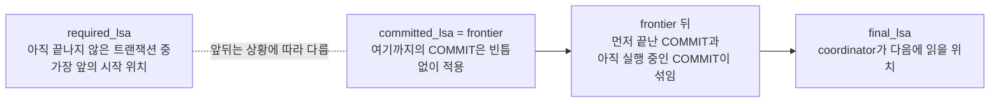

*그림 7-1. 로그 위 위치의 관계. frontier 뒤 구간이 applied-tx 마커가 필요한 범위다(7.3절).*

### 7.2 apply info 저장

apply info는 coordinator가 자기 연결에서 `la_coordinator_commit_apply_info`로 저장한다. worker는 apply info를 건드리지 않는다. 한 번의 저장은 다음 순서로 슬레이브 트랜잭션 하나를 이룬다.

```text
la_coordinator_commit_apply_info()
  → la_update_ha_last_applied_info()          apply info 행 UPDATE (위치, 카운터, 시간)
  → [추가] la_stat_store()                     _db_ha_apply_stat, _db_ha_apply_worker_stat 행 갱신
  → [추가] la_delete_applied_tx_markers(committed_lsa)
                                               committed_lsa 이하 마커 DELETE (반드시 마지막 문장)
  → db_commit_transaction()
```

- **마커 DELETE를 마지막에 두는 이유**: 마커를 많이 지우면 잠금이 테이블 잠금으로 올라가 COMMIT까지 유지될 수 있다. 그동안 마커를 INSERT하려는 worker는 `la_sql_compile_mutex`를 쥔 채 그 잠금을 기다린다. DELETE 뒤에 coordinator가 이 mutex를 다시 잡는 문장(통계 저장처럼 SQL을 컴파일하는 문장)을 실행하면, 서로를 영원히 기다린다. 그래서 통계 저장을 DELETE 앞에 두고, DELETE 다음에는 COMMIT만 한다.
- **마커 DELETE가 실패할 때**: 디버그 로그만 남기고 COMMIT한다. 지우지 못한 마커는 다음 저장 때 지운다.
- **통계 저장이 실패할 때**: 트랜잭션 전체를 ABORT한다. apply info UPDATE도 함께 취소되므로 마커도 남는다. 다시 시작하면 직전에 저장된 위치부터 읽고, 남은 마커로 이미 적용한 COMMIT을 건너뛴다.
- **apply info UPDATE가 실패할 때**: develop과 같이 `fail_counter`를 올리고 오류를 남긴다. 서버 연결이 끊긴 경우가 아니면 applier를 멈추지 않는다.

```c
// log_applier.c: la_coordinator_commit_apply_info
res = la_update_ha_last_applied_info ();
if (res > 0)
  {
    la_stat_describe_applier (&applier);
    res = la_stat_store (&applier, la_update_query_execute_with_values);
    if (res == NO_ERROR)
      {
        /* The delete is the last statement before the commit ... */
        if (la_delete_applied_tx_markers (&la_Info.committed_lsa) < 0)
          {
            er_log_debug (...);
          }
        return db_commit_transaction ();
      }
    (void) db_abort_transaction ();
  }
la_Info.fail_counter++;
...
```

이 함수를 부르는 경로는 두 가지다.

- **retire 경로**: `la_coordinator_retire_results`가 task 하나를 retire할 때마다 `la_coordinator_store_apply_info_at_interval`을 부른다. 직전 저장으로부터 `ha_applylogdb_max_commit_interval_in_msecs`가 지났을 때만 저장한다. 이 경로는 `required_lsa`, `append_lsa`, `eof_lsa`를 다시 계산하지 않고 마지막으로 계산된 값을 그대로 쓴다.
- **주기 경로**: main loop의 `la_check_time_commit`이 develop처럼 적응형 주기마다 확인한다. 적용 행 수(`total_rows`)가 바뀌었거나 apply info를 갱신할 일이 있으면 `la_log_commit`을 부른다. `la_log_commit`은 `required_lsa`를 다시 계산하고 `append_lsa`와 `eof_lsa`를 로그 헤더에서 읽은 뒤 `la_coordinator_commit_apply_info`를 부른다. 상태 전환 시점(`la_change_state`), HA 서버 상태 레코드를 만났는데 진행 중인 트랜잭션이 없을 때, `ha_replica_time_bound`에 도달했을 때, DONE 상태에서 위치를 올릴 때도 `la_log_commit`을 부른다.

```c
// log_applier.c: la_coordinator_store_apply_info_at_interval
if (now_ns - last_store_ns < interval_ns)
  {
    return NO_ERROR;
  }
last_store_ns = now_ns;
return la_coordinator_commit_apply_info ();

// log_applier.c: la_log_commit
(void) la_find_required_lsa (&la_Info.required_lsa);
la_Info.append_lsa = la_Info.act_log.log_hdr->append_lsa;
LSA_COPY (&la_Info.eof_lsa, &la_Info.act_log.log_hdr->eof_lsa);
...
error = la_coordinator_commit_apply_info ();
```

**retire마다 저장하지 않는 이유**: apply info 저장은 슬레이브 서버에서 일어나는 COMMIT 하나다. 상호 HA 구성에서는 상대 노드의 applier가 이 COMMIT을 빈 COMMIT으로 받아 retire하고, 그 retire가 다시 저장을 일으킨다. retire마다 저장하면 두 applier가 빈 트랜잭션을 끝없이 주고받는다. 주기 안에 retire된 진행분은 주기가 지난 뒤의 첫 retire가 저장하고, 더 이상 retire가 없으면 주기 경로의 `la_log_commit`이 저장한다.

### 7.3 applied-tx 마커

**필요한 이유**

develop은 여러 트랜잭션의 복제 데이터를 한 슬레이브 트랜잭션에 쌓았다가, `la_log_commit`에서 apply info UPDATE와 함께 COMMIT했다. 데이터와 위치가 함께 남거나 함께 사라지므로, 다시 시작하면 저장된 위치부터 다시 적용하면 됐다.

병렬 적용에서는 worker가 트랜잭션마다 자기 연결로 COMMIT하고, coordinator는 그 뒤에 따로 apply info를 저장한다. 그래서 다시 시작할 때 저장된 `committed_lsa`보다 뒤의 COMMIT이 이미 슬레이브에 반영되어 있을 수 있다. 두 경우가 있다.

- worker가 COMMIT한 뒤 coordinator가 apply info를 저장하기 전에 applier가 멈춘 경우
- frontier 뒤에서 먼저 끝난 COMMIT. `committed_lsa`는 frontier까지만 저장되므로 이 COMMIT은 위치 값으로 표현할 수 없다.

이런 트랜잭션을 다시 적용하면 안 된다. 코드 주석이 드는 예는 다음과 같다.

- **행 변경**: 키 1을 INSERT하고, 이어서 키 1을 2로 UPDATE한 트랜잭션들을 다시 적용하면 키 1이 다시 생긴다. 슬레이브에 마스터에 없는 행이 남는다.
- **statement**: DDL은 두 번째 실행에서 실패한다. statement로 복제된 `UPDATE t SET n = n + 1`은 두 번째에도 성공해서 `n`이 마스터와 달라진다.

그래서 worker는 적용한 트랜잭션마다 그 COMMIT LSA를 마커 행으로 남긴다. 마커는 데이터와 같은 슬레이브 트랜잭션에 들어가므로, 마커가 있으면 데이터도 COMMIT된 것이고 마커가 없으면 데이터도 없다. 다시 시작하면 마커가 있는 COMMIT을 통째로 건너뛴다.

**테이블**

coordinator가 시작할 때 자기 연결에서 만든다. 이미 있으면 그대로 쓴다.

```sql
-- log_applier.c: la_create_applied_tx_marker
CREATE TABLE IF NOT EXISTS [ha_applied_tx_marker] (
  copied_log_path VARCHAR(4096), commit_pageid BIGINT, commit_offset INTEGER,
  PRIMARY KEY (copied_log_path, commit_pageid, commit_offset));
```

- `copied_log_path`는 마커가 어느 복사 로그에서 왔는지를 구분한다. 한 노드는 상대 노드마다 applier를 하나씩 띄우므로, 이 값으로 applier별 마커를 나눈다.
- `commit_pageid`, `commit_offset`은 task의 commit LSA다. fragment task라면 `LOG_SYSOP_END`의 LSA다.

**마커의 일생**

- **INSERT**: worker가 `la_apply_worker_apply_task`에서 복제 항목을 적용하고 flush까지 성공한 뒤, COMMIT 바로 앞에서 `la_insert_applied_tx_marker`를 부른다. 이 함수는 COMMIT하지 않는다. 적용한 항목이 하나도 없는 task(`total_rows == 0`)는 마커를 넣지 않는다. 이미 적용된 것으로 판정되어 건너뛴 트랜잭션이나, 항목이 모두 복제 필터로 걸러진 트랜잭션이 여기에 해당한다. INSERT 문은 worker 연결마다 한 번만 컴파일해 두고 값만 바꿔 실행한다. 컴파일과 실행 모두 `la_sql_compile_mutex` 안에서 한다.
- **실패**: 적용, flush, 마커 INSERT 중 하나라도 실패하면 worker는 `db_abort_transaction`으로 그 트랜잭션을 되돌린다. 되돌리지 않으면 applier가 멈추기 전에 이 worker가 다음 task를 COMMIT하면서 마커 없는 변경까지 함께 COMMIT할 수 있다.
- **로드**: 시작할 때 coordinator가 `la_load_applied_tx_markers`로 이 복사 로그의 마커 중 `last_committed_lsa`보다 뒤의 것만 읽는다. 정렬된 배열로 메모리에 두고 종료할 때까지 바꾸지 않으므로 worker는 lock 없이 읽는다. 일부만 읽힌 채로 시작하면 이미 적용한 COMMIT을 다시 적용할 수 있으므로, 행을 끝까지 읽지 못하면 오류를 반환하고 applier를 시작하지 않는다.
- **확인**: worker가 `la_applied_tx_marker_exists`로 배열을 이진 탐색한다.
- **DELETE**: coordinator가 apply info를 저장하는 트랜잭션의 마지막 문장으로 `committed_lsa` 이하의 마커를 지운다(7.2절). 이 범위는 위치만으로 건너뛰므로 마커가 필요 없다. 복제를 처음부터 다시 시작할 때(`la_delete_ha_apply_info`)는 이 복사 로그의 마커를 모두 지운다(7.6절).

worker가 마커를 넣는 위치는 5.2절의 `la_apply_worker_apply_task` 발췌에 있다. 마커를 읽고 지우는 SQL은 다음과 같다.

```c
// log_applier.c: la_load_applied_tx_markers
SELECT commit_pageid, commit_offset FROM [ha_applied_tx_marker] WHERE copied_log_path = ?
  AND (commit_pageid > ? OR (commit_pageid = ? AND commit_offset > ?))   -- last_committed_lsa 초과
  ORDER BY commit_pageid, commit_offset;

// log_applier.c: la_delete_applied_tx_markers (upto_lsa = committed_lsa)
DELETE FROM [ha_applied_tx_marker] WHERE copied_log_path = ?
  AND (commit_pageid < ? OR (commit_pageid = ? AND commit_offset <= ?));
```

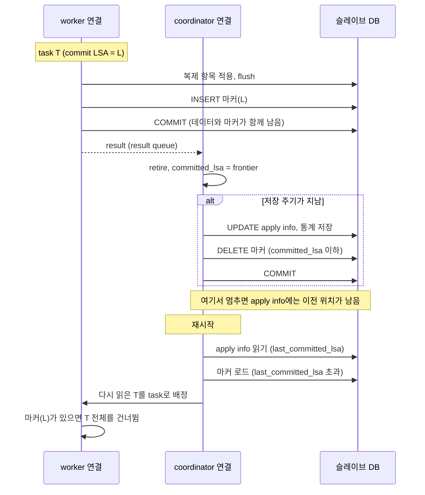

*그림 7-2. worker의 데이터 COMMIT과 coordinator의 apply info COMMIT이 분리된 상태에서 마커가 재적용을 막는 흐름.*

### 7.4 재시작 순서와 건너뛰기 판정

`la_apply_log_file`은 다음 순서로 시작한다. develop에 있던 단계는 그대로 두고, 표시한 단계만 새로 넣었다.

```text
la_apply_log_file()
  → la_init()                                    la_Info의 LSA를 모두 NULL로
  → [추가] la_coordinator_init_resources()        task queue, result queue, in-flight list, commit-order ring
  → 로그 헤더 읽기, 캐시 준비
  → la_get_last_ha_applied_info()                 apply info 읽기 (없으면 행을 새로 만듦)
       last_committed_lsa := committed_lsa
  → [추가] la_create_applied_tx_marker()
  → [추가] la_load_applied_tx_markers()           last_committed_lsa 초과 마커
  → committed_lsa := required_lsa
  → [추가] la_stat_init_rows()
  → [추가] la_start_apply_workers()               worker 시작은 여기서
  → main loop
       la_apply_pre(): final_lsa := committed_lsa
       첫 task를 넣을 때 la_gate_set_initial_frontier(committed_lsa)
```

- **apply info 읽기**: 저장된 행이 있으면 위치와 카운터를 가져온다. 없으면 `required_lsa`를 로그 헤더의 `eof_lsa`로 두고 나머지 위치를 `required_lsa`로 채운 행을 새로 넣는다. 그다음 COMMIT하고 `last_committed_lsa`와 `last_committed_rep_lsa`를 정한다.
- **`committed_lsa`를 `required_lsa`로 낮추는 이유**: 저장된 `committed_lsa` 이전에 시작했지만 그 뒤에 끝나는 트랜잭션의 복제 항목을 다시 모으려면 `required_lsa`부터 읽어야 한다. develop과 같다.
- **frontier의 초기값**: `la_gate_set_initial_frontier`는 frontier가 비어 있을 때만 `committed_lsa`로 정한다. 시작 위치 이하의 COMMIT은 commit-order ring에 들어오지 않으므로, 그 COMMIT을 dependency로 가진 task가 영원히 기다리지 않도록 frontier를 그 위치에서 시작한다(4.1절).
- **worker를 늦게 시작하는 이유**: worker는 레코드 버퍼 크기를 로그 페이지 크기로 정하는데, 이 값은 로그 헤더를 읽은 뒤에야 안다. 더 일찍 시작하면 기본값 4K로 버퍼를 잡아 큰 레코드에서 넘친다. 또 worker는 각자 클라이언트 연결을 여는데, 이 작업이 coordinator의 시작 질의(apply info, 필터, 마커)와 겹치면 applier 재시작 때 클라이언트 heap이 깨지는 현상이 관찰되었다. 그래서 coordinator의 시작 질의가 모두 끝난 뒤에 worker를 시작한다.

다시 읽은 COMMIT은 두 단계로 건너뛴다.

- **coordinator 단계**: `la_log_record_process`가 `LOG_COMMIT`을 만났을 때 그 LSA가 `committed_lsa` 이하이면 task를 만들지 않고 그 트랜잭션의 복제 항목만 해제한다. `LOG_SYSOP_END`도 `committed_lsa` 이하이면 fragment task를 만들지 않는다. 읽기는 `committed_lsa`에서 시작하고 실행 중에는 `committed_lsa`가 아직 읽지 않은 COMMIT을 넘지 않으므로, 이 조건에 걸리는 레코드는 거의 없다. 코드 주석도 SYSOP_END 쪽 분기를 실제로는 도달하지 않는 경로로 적는다.
- **worker 단계**: `la_apply_repl_log`가 task의 commit LSA가 `last_committed_lsa` 이하이거나 마커가 있으면 그 트랜잭션 전체를 건너뛴다. 복제 항목은 해제하고, 트랜잭션 슬롯은 retire 때 coordinator가 해제한다. 판정을 복제 항목 단위가 아니라 트랜잭션 단위로 하므로 트랜잭션 일부만 적용되는 일은 없다. 건너뛴 task도 result를 보내 frontier를 전진시킨다.

coordinator 단계의 `LOG_COMMIT` 분기 코드는 3.4절에 있다. worker 단계는 다음과 같다.

```c
// log_applier.c: la_apply_repl_log
already_committed = (LSA_LE (commit_lsa, &la_Info.last_committed_lsa)
                     || la_applied_tx_marker_exists (commit_lsa));
if (apply->head == NULL || already_committed)
  {
    la_free_all_repl_items (apply);
    return NO_ERROR;
  }
```

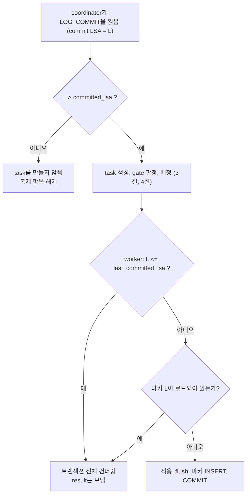

*그림 7-3. 다시 읽은 COMMIT의 건너뛰기 판정.*

### 7.5 같은 프로세스 안의 재시작

applylogdb는 서버 연결이 끊기는 등의 오류로 `la_apply_log_file`이 끝나면, 프로세스를 끝내지 않고 잠시 기다린 뒤 `la_apply_log_file`을 다시 부른다(`util_cs.c`의 `retry`). 그래서 앞 실행의 전역 상태가 다음 실행에 남지 않게 종료와 시작에서 각각 비운다. 다만 라벨 holder(`la_wset_label_trid`, `la_wset_label_dependency_seq`)는 비우지 않는다(10장).

종료할 때 `la_shutdown`이 비우는 것과 그 순서는 8.3절에 있다. 남은 pending list의 task를 버려도 잃어버리는 것은 아니다. 그 COMMIT은 `committed_lsa` 뒤에 있으므로 다음 실행이 다시 읽는다.

시작할 때 `la_coordinator_init_resources`가 다시 만드는 것은 다음과 같다.

- `la_task_queue_init`: 인덱스와 앞 실행이 남긴 종료 플래그를 지운다.
- `la_result_queue_init`: 버퍼를 다시 잡고 인덱스와 종료 플래그를 지운다.
- `la_inflight_init`: 배열을 다시 잡고 배정 번호를 0으로 되돌린다.
- `la_gate_init`: commit-order ring을 다시 잡고 frontier를 NULL로 지운다. 앞 실행의 frontier는 보통 이번 실행이 다시 읽기 시작하는 `committed_lsa`보다 뒤에 있다. 남겨 두면 `la_gate_set_initial_frontier`가 그 값을 유지하고, `committed_lsa`부터 다시 적용하는 트랜잭션이 아직 적용하지 않은 앞의 트랜잭션을 기다리지 않고 gate를 통과한다.

```c
// log_applier.c: la_coordinator_init_resources
la_Info.commit_order_capacity = LA_COMMIT_ORDER_CAPACITY (la_Info.worker_count);
la_task_queue_init ();
error = la_result_queue_init (la_Info.commit_order_capacity);
...
error = la_inflight_init (la_Info.commit_order_capacity);
...
return la_gate_init (la_Info.commit_order_capacity);
```

### 7.6 copylog 재초기화

상대 노드의 DB가 다시 만들어지는 등으로 복사 로그를 처음부터 다시 받아야 하면, copylogdb가 복사 로그 헤더에 `mark_will_del`을 세운다. coordinator는 main loop에서 `check_reinit_copylog`로 헤더를 다시 읽다가 이 표시를 보면 `la_Info.reinit_copylog`를 세우고 루프를 빠져나온다. 헤더는 worker도 로그 페이지를 읽을 때 쓰므로, 이 확인은 캐시 mutex 안에서 한다.

루프를 빠져나온 뒤의 처리 순서는 다음과 같다. develop과 다른 점은 worker를 먼저 멈추는 것과 마커를 함께 지우는 것이다.

```text
[reinit_copylog]
  → [추가] la_stop_apply_workers()        worker를 먼저 멈춤
  → la_delete_ha_apply_info()             apply info 행 DELETE
       → [추가] la_delete_applied_tx_markers(NULL)   이 복사 로그의 마커 전부 DELETE
       → COMMIT
  → la_update_last_deleted_arv_num(-1)
  → 오류 기록, 10초 대기
  → la_shutdown()
```

- **worker를 먼저 멈추는 이유**: 아직 실행 중인 worker가 마커를 지운 뒤에 이전 로그의 마커를 COMMIT할 수 있다. 그 마커는 새 로그에서 같은 LSA를 가진 COMMIT을 잘못 건너뛰게 만든다.
- **마커를 모두 지우는 이유**: 복제가 처음부터 다시 시작하므로 이전 로그의 마커가 새 로그의 COMMIT을 건너뛰게 하면 안 된다.

```c
// log_applier.c: la_apply_log_file (main loop 다음)
if (la_Info.reinit_copylog == true)
  {
    /* a worker still running could commit a marker of the old stream after the markers are deleted */
    la_stop_apply_workers ();
    la_delete_ha_apply_info ();
    (void) la_update_last_deleted_arv_num (la_Info.log_path_lockf_vdes, -1);
    la_Info.reinit_copylog = false;
    ...
    LA_SLEEP (10, 0);
  }
la_shutdown ();

// log_applier.c: la_delete_ha_apply_info
res = la_update_query_execute_with_values (query_buf, ...);   /* DELETE FROM _db_ha_apply_info ... */
...
if (res >= 0)
  {
    (void) la_delete_applied_tx_markers (NULL);
  }
(void) db_commit_transaction ();
```

## 8. 역할 전환과 종료

master의 역할이 바뀌면 applier는 서버에 DONE을 보고하고 dbname 잠금을 놓는다. develop은 직렬로 적용하므로 로그 끝에 도달하면 적용도 끝나 있었다. 병렬 적용에서는 coordinator가 로그 끝에 도달해도 worker가 아직 적용 중일 수 있으므로, 두 동작 모두 drain 완료를 조건으로 삼는다.

drain 완료(`la_coordinator_drain_complete`)는 pending list, in-flight list, commit-order ring이 모두 빈 상태다. 세 목록은 COMMIT을 서로 다른 단계에서 들고 있다.

- **pending list**: dependency를 기다리는 COMMIT
- **in-flight list**: worker에 넘겼지만 아직 retire되지 않은 COMMIT
- **commit-order ring**: frontier가 아직 넘지 않은 COMMIT

COMMIT은 세 목록을 모두 떠나야 끝난 것이다.

```c
// log_applier.c: la_coordinator_drain_complete
return (la_pending_is_empty () && la_inflight_get_count () == 0 && la_gate_order_get_count () == 0);
```

### 8.1 DONE 보류

`la_change_state`는 coordinator 루프에서 로그 페이지를 읽은 바퀴마다 불리며, 복사된 로그 헤더의 master 상태와 로그 끝 도달 여부를 보고 applier 상태를 정한다. DONE을 보고할 조건이 되었는데 drain 완료가 아니면 DONE을 보고하지 않고 보류한다.

```text
la_change_state()
  → 상태 변화가 없고 done_deferred도 꺼져 있으면 바로 반환
  → was_deferred = done_deferred, done_deferred = false
  → 로그 끝에 도달했고 SYNCHRONIZED이며 master가 DEAD·STANDBY·MAINTENANCE이고 아직 DONE이 아니면
     → [추가] drain 완료가 아니면
          → [추가] 이번 보류가 처음이면 done_deferred_since 기록, 알림 로그
          → [추가] done_deferred = true (DONE을 보고하지 않음)
     → drain 완료이면
          → [추가] 보류했었으면 보류 시간을 알림 로그에 남김
          → new_state = DONE
          → master가 DEAD가 아니면 la_clear_all_repl_lists()
  → new_state가 정해졌으면 la_log_commit(true), boot_notify_ha_log_applier_state()
```

- **재판정**: `done_deferred`가 켜져 있으면 맨 앞의 조기 반환을 건너뛰므로, 로그 헤더가 바뀌지 않아도 다음 바퀴에 DONE을 다시 판정한다.
- **보류 해제**: 판정 전에 `done_deferred`를 끄고 DONE 보류일 때만 다시 켠다. master가 다시 ACTIVE가 되는 등 다른 결과가 나오면 보류는 그대로 사라진다.
- **apply_state**: 보류 중에도 `apply_state`는 이전 값(WORKING 또는 RECOVERING)을 유지한다. 통계 행은 보류 중일 때 상태 문자열을 `"holding done"`으로 바꾸고, 보류를 시작한 시각(`done_hold_since`)을 함께 보인다(9.2절).
- **알림 로그**: 보류를 시작할 때 한 번 `applylogdb holds DONE: workers are still applying (pending=… dispatch=… order=… final=… committed=…)`를 남긴다. 보류 끝에 DONE을 보고할 때 `applylogdb reports DONE after holding it for N seconds`를 남긴다. 승격이 늦어지면 원인이 이 보류에서 시작하므로 보류마다 한 번씩 남긴다.
- DONE을 보고하는 갈래는 drain 완료를 `assert`로 다시 확인한다.
- **로그 끝 판정의 보정**: `la_change_state`를 부르기 직전에, master가 DEAD·STANDBY·MAINTENANCE이고 복사 로그 헤더의 eof가 `final_lsa`보다 뒤이면 로그 끝 도달 표시(`is_end_of_record`)를 끈다(`la_record_end_is_stale`). 한 바퀴는 페이지를 한 번만 읽으므로, 그 사이 복사 로그가 늘었으면 이번에 만난 END_OF_LOG는 복사 로그의 끝이 아니다. 이 보정이 없으면 아직 읽지 않은 로그를 남긴 채 DONE을 판정할 수 있다.

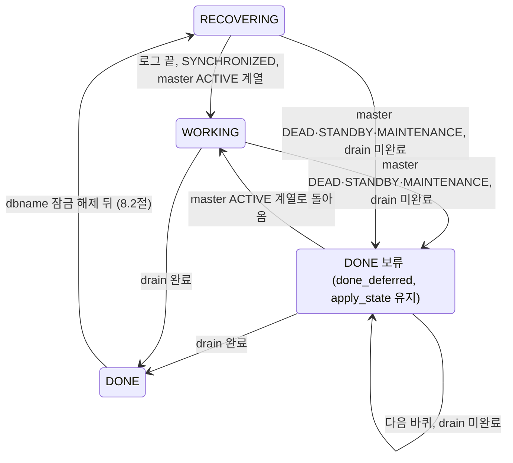

*그림 8-1. applier 상태와 DONE 보류. DONE 보류는 apply_state 값이 아니라 `done_deferred` 플래그다.*

```c
// log_applier.c: la_change_state
if (!la_Info.done_deferred
    && la_Info.last_server_state == la_Info.act_log.log_hdr->ha_server_state
    && ...)
  {
    return NO_ERROR;
  }
...
was_deferred = la_Info.done_deferred;
la_Info.done_deferred = false;
...
else if (la_is_done_state (la_Info.act_log.log_hdr->ha_server_state))
  {
    if (la_Info.apply_state != HA_LOG_APPLIER_STATE_DONE)
      {
        if (!la_coordinator_drain_complete ())
          {
            if (!was_deferred)
              {
                la_Info.done_deferred_since = time (NULL);
                ... /* "applylogdb holds DONE: ..." */
              }
            la_Info.done_deferred = true;
          }
        else
          {
            ... /* was_deferred이면 "applylogdb reports DONE after holding it ..." */
            new_state = HA_LOG_APPLIER_STATE_DONE;
            ...
          }
      }
  }
```

### 8.2 dbname 잠금

한 노드의 applier들은 같은 slave DB에 쓰고, dbname 잠금을 쥔 applier만 쓸 수 있다. develop은 적용하는 스레드가 `la_apply_repl_log`에서 잠금을 잡았다. 병렬 적용에서는 worker가 적용하므로, coordinator가 쓰기 task를 task queue에 넣기 전에 잡는다. worker는 이 잠금을 잡지 않는다.

**획득**
- `la_coordinator_enqueue_task`에서 task에 항목이 있고(`has_items`) COMMIT LSA가 `last_committed_lsa`보다 크면 `la_lock_dbname`을 부른다. 항목이 없는 COMMIT과 이전 실행이 이미 저장한 COMMIT은 쓰지 않으므로 잡지 않는다.
- 잡는 시점은 in-flight list와 task queue에 넣기 전이다. 그래서 잠금 없이 worker에 넘어간 쓰기 task는 없다.
- `la_lock_dbname`은 이미 쥐고 있으면 바로 돌아온다. 다른 applier가 쥐고 있으면 종료 요청이 올 때까지 3초마다 다시 시도한다. 획득하면 `is_role_changed`를 끈다.

**해제**
coordinator 루프에서 놓는 곳은 세 곳이고, 모두 `clear_owner = true`로 놓는다. `la_unlock_dbname`은 이때 60초를 쉬고 `is_role_changed`를 끈다.

1. **상대가 DEAD로 멈춘 경우**: master가 DEAD이고 복사된 로그의 eof가 `ha_applylogdb_log_wait_time_in_secs` 이상 그대로이며 drain 완료일 때 놓는다. develop에는 drain 완료 조건이 없었다.
2. **역할이 바뀐 경우**: 잠금을 쥔 채로 ACTIVE·TO_BE_STANDBY가 아닌 master 상태 레코드(`LOG_DUMMY_HA_SERVER_STATE`)를 읽으면 `is_role_changed`를 켠다. 루프는 `is_role_changed`가 켜져 있고 drain 완료일 때 놓는다. develop에는 drain 완료 조건이 없었다.
3. **DONE 뒤**: `apply_state`가 DONE이고 master가 ACTIVE·TO_BE_STANDBY가 아니면 놓는다. 이 자리에는 drain 완료 검사가 없지만, DONE은 drain 완료일 때만 보고한다(8.1절).

drain을 기다리는 이유는 코드 주석대로, 이 applier가 아직 적용하는 동안 다른 applier가 같은 DB에 쓰지 않게 하기 위해서다. 해제 뒤 쓰기 task가 오면 `la_coordinator_enqueue_task`가 다시 잡는다. 이 밖에 `la_shutdown`이 `clear_owner = false`로 놓는다(8.3절).

**DONE 경로의 committed_lsa**
- DONE 뒤 잠금을 놓을 때 master가 DEAD가 아니면 develop은 `committed_lsa`를 `final_lsa`로 옮겼다.
- 지금은 `final_lsa`로 옮기되 frontier보다 크면 frontier로 낮춘다. 곧 `committed_lsa = min(final_lsa, frontier)`이다. `committed_lsa`는 그 이하의 COMMIT이 모두 적용되었다는 약속이므로 frontier를 넘지 않는다(4.6절).
- 그 뒤 `final_lsa ≥ committed_lsa`이면 `la_log_commit(false)`로 저장하고 `apply_state`를 RECOVERING으로 바꾼다.

```mermaid
stateDiagram-v2
  unlocked --> locked: 쓰기 task enqueue (has_items, commit_lsa > last_committed_lsa)
  locked --> locked: 다음 쓰기 task, 이미 쥐고 있어 바로 반환
  locked --> role_changed: ACTIVE·TO_BE_STANDBY가 아닌 master 상태 레코드
  role_changed --> unlocked: drain 완료
  locked --> unlocked: master DEAD, eof 정지가 log_wait_time 이상, drain 완료
  locked --> unlocked: apply_state DONE, master ACTIVE·TO_BE_STANDBY 아님
  locked --> unlocked: la_shutdown
  state "is_role_changed = true" as role_changed
```

*그림 8-2. dbname 잠금의 획득과 해제. 획득은 coordinator의 enqueue 한 곳이다.*

```c
// log_applier.c: la_coordinator_enqueue_task
if (task.has_items && LSA_GT (&task.commit_lsa, &la_Info.last_committed_lsa))
  {
    error = la_lock_dbname (&la_Info.db_lockf_vdes, la_slave_db_name, la_Info.log_path);
    ...
  }
...   /* 이후 순서는 4.4절 */

// log_applier.c: la_apply_log_file (DEAD 대기)
if ((now - last_eof_time) >= prm_get_integer_value (PRM_ID_HA_APPLYLOGDB_LOG_WAIT_TIME_IN_SECS)
    && la_coordinator_drain_complete ())
  {
    clear_owner = true;
    error = la_unlock_dbname (&la_Info.db_lockf_vdes, la_slave_db_name, clear_owner);
  }

// log_applier.c: la_apply_log_file (DONE 뒤)
if (la_Info.apply_state == HA_LOG_APPLIER_STATE_DONE
    && (final_log_hdr.ha_server_state != HA_SERVER_STATE_ACTIVE)
    && (final_log_hdr.ha_server_state != HA_SERVER_STATE_TO_BE_STANDBY))
  {
    clear_owner = true;
    error = la_unlock_dbname (&la_Info.db_lockf_vdes, la_slave_db_name, clear_owner);
    if (final_log_hdr.ha_server_state != HA_SERVER_STATE_DEAD)
      {
        LSA_COPY (&la_Info.committed_lsa, &la_Info.final_lsa);
        if (la_gate_get_frontier (&frontier) && LSA_GT (&la_Info.committed_lsa, &frontier))
          {
            LSA_COPY (&la_Info.committed_lsa, &frontier);
          }
      }
    ...
  }

// log_applier.c: la_apply_log_file (역할 전환)
if (la_Info.is_role_changed == true && la_coordinator_drain_complete ())
  {
    clear_owner = true;
    error = la_unlock_dbname (&la_Info.db_lockf_vdes, la_slave_db_name, clear_owner);
  }
```

### 8.3 종료 순서

`la_shutdown`은 applier를 멈출 때 부른다. 오류 경로 여러 곳과 바깥 루프의 끝에서 불린다. drain 완료를 확인하지 않는다. 적용하지 못한 COMMIT은 `committed_lsa` 뒤에 있으므로 다음 실행이 다시 읽고, 이미 커밋된 것은 applied-tx 마커로 건너뛴다(7.3절, 7.4절).

```text
la_shutdown()
  → [추가] la_stop_apply_workers()          두 queue에 종료 신호, worker join
  → [추가] la_free_applied_tx_markers()     마커 배열 해제
  → [추가] la_free_unretired_fragments()    retire되지 않은 sysop fragment 슬롯 해제
  → [추가] la_inflight_clear()              in-flight list 비우기
  → [추가] la_pending_clear()               pending list 비우기
  → 로그 파일 닫기
  → la_unlock_dbname(clear_owner = false)
  → 로그 page cache, repl_lists 해제
```

- **worker 정지**: `la_stop_apply_workers`는 task queue와 result queue에 종료 신호를 보내 기다리는 worker를 깨우고 join한다. 종료 신호가 오면 `la_task_queue_pop`은 queue에 task가 남아 있어도 실패를 돌려준다. 남은 task는 버리고, retire되지 않았으므로 다음 실행이 다시 적용한다. task를 적용하던 worker는 그 task를 커밋까지 마친 뒤 result를 넣으려다 실패하고 루프를 빠져나간다. 그 result는 버려지지만, 데이터와 함께 마커가 커밋되었으므로 다음 실행이 건너뛴다.
- **마커 배열**: worker가 도는 동안 마커 배열을 읽으므로 worker를 멈춘 뒤에 푼다.
- **sysop fragment 슬롯**: fragment는 바깥 트랜잭션과 따로 자기 슬롯을 가지며, 그 슬롯은 task가 retire될 때만 푼다(`la_coordinator_release_apply_slot`). applylogdb는 서버가 내려가면 같은 프로세스 안에서 applier를 다시 시작하므로, in-flight list나 pending list에 남은 fragment 슬롯을 여기서 풀지 않으면 재시작마다 남는다. 그 밖의 task는 `repl_lists` 슬롯을 가리키고, 그 슬롯은 `la_shutdown` 뒷부분에서 푼다.
- **in-flight list와 pending list**: 남은 entry와 pending list의 task는 곧 풀 슬롯을 가리킨다. 남겨 두면 다음 실행이 풀린 슬롯의 `start_lsa`를 `required_lsa`로 읽거나 worker에 넘길 수 있다. pending list에 있던 task의 COMMIT은 `committed_lsa` 뒤에 있으므로 다음 실행이 다시 읽는다.
- commit-order ring과 frontier는 여기서 비우지 않는다. 다음 실행의 `la_gate_init`이 비운다(7.5절).
- copylog 재초기화 경로는 apply info를 지우기 전에 `la_stop_apply_workers`를 먼저 부른다. 아직 도는 worker가 마커를 지운 뒤에 옛 로그의 마커를 커밋하지 않게 하기 위해서다(7.6절). 그 뒤 `la_shutdown`이 다시 부르면 `la_worker_join`은 이미 join한 worker를 건너뛴다.

```c
// log_applier.c: la_shutdown
la_stop_apply_workers ();

/* the workers read the marker set while they run */
la_free_applied_tx_markers ();

/* only a retired fragment frees its slot, and the next run in this process would not see these */
la_free_unretired_fragments ();

/* the remaining entries point at the repl_lists slots freed below */
la_inflight_clear ();

/* parked tasks point at the apply slots freed below; see la_pending_clear */
la_pending_clear ();
...
if (la_Info.db_lockf_vdes != NULL_VOLDES)
  {
    error = la_unlock_dbname (&la_Info.db_lockf_vdes, la_slave_db_name, false);
    ...
  }

// log_applier.c: la_stop_apply_workers
la_task_queue_signal_shutdown ();
la_result_queue_signal_shutdown ();

la_worker_join (la_apply_Workers, la_Info.worker_count);
```

## 9. 설정과 관측

### 9.1 설정

슬레이브의 병렬 적용이 읽는 파라미터는 다음과 같다. 모두 동적으로 바꿀 수 없다.

- **`ha_apply_worker_count`**
  - worker 수. 기본값 1, 범위 1~32(`HB_MAX_APPLY_WORKER_COUNT`).
  - `la_init`이 한 번 읽어 `la_Info.worker_count`에 둔다. 범위를 다시 한 번 `LA_MAX_WORKER_COUNT`로 자른다.
  - MULTI_CONN_TO_A_SERVER 없이 빌드했으면 1로 줄이고 알림을 남긴다.
  - 값이 1이면 COMMIT 순서로 적용한다는 알림을 남긴다(4.8절).
  - commit-order ring, in-flight list, result queue의 크기는 이 값에 task queue 용량 1024를 곱한 값이다(2.5절).
- **`ha_writeset_trace_level`**
  - trace 수준. 기본값 0, 범위 0~3.
  - worker는 시작할 때 한 번 읽고, coordinator는 trace를 남길 때마다 읽는다.
  - 슬레이브 코드가 나누는 수준은 1과 2이다(9.3절).
- **`ha_apply_max_mem_size`**
  - applylogdb 프로세스의 메모리 상한(MB). 기본값 500.
  - `la_check_mem_size`는 프로세스의 가상 메모리 크기를 이 값과, 시작 대기 뒤 처음 잰 크기의 두 배 중 큰 값과 비교한다. 넘으면 `ER_HA_LA_EXCEED_MAX_MEM_SIZE`로 applier를 멈춘다.
  - worker마다 malloc arena가 따로 생겨 가상 크기가 커지므로, 기준 크기는 worker가 시작한 뒤에 잰다.
- **`ha_applylogdb_max_commit_interval_in_msecs`**(기존)
  - coordinator가 retire 때 apply info를 저장하는 최소 간격(7.2절).
  - 간격을 두는 이유는 7.2절에 있다.
- **`ha_applylogdb_log_wait_time_in_secs`**(기존): 마스터가 DEAD인 채 로그가 늘지 않을 때 dbname 잠금을 놓기까지 기다리는 시간. drain 완료일 때만 놓는다(8.2절).
- **`ha_applylogdb_retry_error_list`, `ha_applylogdb_ignore_error_list`**(기존): 항목 적용 오류를 다시 시도할지 정한다(5.3절).

마스터 쪽 `ha_writeset_history_size`는 슬레이브가 읽지 않는다([01 8.2절](./01-master-implementation-design.md#82-설정)).

### 9.2 통계

병렬 적용 통계는 두 시스템 테이블에 저장한다. 카운터는 applier가 시작할 때마다 0부터 다시 센다.

- **`_db_ha_apply_stat`**: applier마다 한 행이고, `db_name`, `copied_log_path`로 찾는다.
  - `worker_count`: 실행 중인 worker 수.
  - `apply_state`: applier 상태. DONE 보류 중이면 `holding done`(8.1절).
  - `done_hold_since`: DONE 보류를 시작한 시각.
  - `commit_read_count`: 복제 항목이 있는 COMMIT을 읽은 수.
  - `dispatch_direct_count`: 그중 읽자마자 task queue에 넣은 수.
  - `dispatch_parked_count`: 그중 pending list에 먼저 넣은 수.
  - `inflight_count`, `pending_count`: 저장 시점의 in-flight list와 pending list의 task 수.
  - `last_update_time`: 마지막 저장 시각.
- **`_db_ha_apply_worker_stat`**: worker마다 한 행이고, `worker_idx`로 나눈다.
  - `state`: `applying` 또는 `idle`.
  - `applied_task_count`, `applied_row_count`, `busy_usec`: retire된 task 수, 항목 수, 적용에 쓴 시간.
  - `applying_commit_lsa_pageid/offset`, `applying_master_commit_time`, `applying_since`: 지금 적용 중인 task.
  - `last_applied_commit_lsa_pageid/offset`, `last_applied_master_commit_time`, `last_applied_time`: 마지막으로 retire된 task.
  - `last_error_code`, `last_error_time`: 마지막으로 센 항목 오류.

값을 모으고 저장하는 방식은 다음과 같다.

- **세는 곳**: coordinator가 COMMIT을 읽고 배정할 때 `la_stat_count_*`로 센다. worker는 적용을 시작하고 끝낼 때 `la_stat_worker_begin`, `la_stat_worker_end`로 자기 슬롯의 현재 task를 바꾼다. 이 슬롯만 mutex로 보호한다. 완료한 값은 retire 때 coordinator가 `la_stat_add_result`로 더한다.
- **저장**: 시작할 때 `la_stat_init_rows`가 이번 실행의 행으로 바꾼다. 테이블이 없거나 이 단계가 실패해도 applier는 돌고, 통계만 저장하지 않는다. 이후에는 apply info를 저장하는 트랜잭션 안에서 `la_stat_store`가 함께 갱신하므로, 세 테이블은 같은 시점의 값을 보여 준다(7.2절). 값이 바뀌지 않은 worker 행은 다시 쓰지 않는다.
- **출력**: `applyinfo`가 `la_stat_print_applyinfo`로 "Parallel Apply Info"를 출력한다. `-v`를 주면 나머지 컬럼과 worker별 줄도 출력한다.
- **기존 apply info**: `_db_ha_apply_info`의 INSERT·UPDATE·DELETE·스키마·COMMIT·실패 건수는 retire 때 result의 통계를 더한 값이다(4.6절). 컬럼은 develop과 같다.

### 9.3 trace

trace는 `[WSET]`으로 시작하는 줄을 applylogdb의 오류 로그에 남긴다(`_er_log_debug`). 일부 문자열에는 coordinator를 가리키는 `reader`가 남아 있으며, 아래에서는 로그 문자열 그대로 적는다. 줄마다 `trid`와 `commit_lsa`가 있으므로 한 트랜잭션의 줄을 이어 볼 수 있다.

- **수준 1, coordinator**
  - `reader commit`: 읽은 COMMIT의 항목 수, 라벨 유무, dependency.
  - `reader schedule`: 배정 결정. `status`는 0(바로 배정), 1(pending list에서 꺼냄), 2(pending list에 넣음)이다. pending list에 넣은 task는 꺼낼 때 한 줄이 더 나온다.
  - `reader abort`: ABORT로 버린 항목 수.
  - `reader complete_without_task`: 적용할 항목 없이 완료로 표시한 SYSOP_END(3.3절).
  - `coordinator label lowered`: 라벨 낮추기 전후 값(4.2절).
  - `SYSOP slave fragment assemble`: sysop fragment를 만든 위치와 항목 수.
  - `coordinator sysop_end ... action=defer`: 라벨이 있는 SYSOP_END.
  - `coordinator retire`, `coordinator result ... error=`: retire와 실패한 result.
  - `coordinator required_lsa held by unretired task`: 바깥 트랜잭션이 먼저 비워져, retire되지 않은 sysop fragment가 `required_lsa`를 잡고 있음(7.1절).
- **수준 1, worker**
  - `worker apply begin`, `worker apply done`: 항목이 있는 task의 시작과 끝, 걸린 시간, 클래스가 하나면 클래스 이름.
  - `worker error`: 항목 하나의 적용 오류, 오류 코드, 클래스, PK.
- **수준 2**
  - `worker apply end`, `worker flush begin`, `worker flush end`, `worker commit begin`: task 안의 단계.
  - `reader label`: 라벨을 읽은 위치와 값.
  - 라벨이 없는 SYSOP_END(`action=defer`)와 이미 적용된 SYSOP_END(`action=skip`).
  - `worker skip update without log position`.

trace 수준과 상관없이 남는 줄은 다음과 같다.

- **`er_log_debug` 줄**: 파라미터 `er_log_debug`가 켜져 있을 때만 남는다. 이 파라미터의 기본값은 debug 빌드에서 켜짐, release 빌드에서 꺼짐이다.
  - `ws_repl skip whole txn (already committed)`: worker가 이미 적용된 COMMIT의 항목을 적용하지 않고 버림. 항목마다가 아니라 트랜잭션마다 한 줄이다(7.4절).
  - `applied-tx markers loaded`: 시작할 때 읽은 applied-tx 마커 수와 가장 낮은 commit LSA, 가장 높은 commit LSA(7.3절).
  - `cannot delete applied-tx markers up to`: apply info 저장 트랜잭션에서 마커 삭제가 실패함. 남은 마커는 다음 저장 때 지운다(7.2절).
  - `ws_worker exit`: worker가 끝날 때 worker 번호, 끝난 이유, 오류 코드, 적용한 항목 수. 이유는 `normal_shutdown`, `start_session_failed`, `worker_context_init_failed`, `apply_failed` 중 하나이다(5.1절).
  - `record end ... is short of the copied log eof`: 마스터가 멈춘 상태에서, 이번에 읽은 로그 끝이 복사 로그 헤더의 eof보다 앞이라 로그 끝 도달 표시를 되돌림(8.1절).
- **알림(`er_set`, NOTIFICATION)**: 오류 로그에 항상 남는다.
  - `applylogdb holds DONE: workers are still applying (...)`: DONE 보류를 시작함. pending list가 비었는지, in-flight list와 commit-order ring의 task 수, `final_lsa`, `committed_lsa`를 함께 남긴다. 보류 한 번에 한 줄이다(8.1절).
  - `applylogdb reports DONE after holding it for N seconds`: DONE 보류를 끝내고 DONE을 보고함(8.1절).
  - `applylogdb reader exit: reason=... error=...`(로그 문자열 그대로): coordinator가 오류로 main loop를 끝냄. `reason`은 끝낸 자리(`apply_pre_failed`, `collect_and_retire`, `log_commit`, `log_record_process_server_down`, `final_collect_and_retire` 등)이고, `final_lsa`와 `committed_lsa`를 함께 남긴다(8.3절).
  - `applylogdb is built without MULTI_CONN_TO_A_SERVER ...`, `applylogdb runs one apply worker: transactions are applied in commit order`: 시작할 때 정한 worker 수(9.1절, 4.8절).
  - `applylogdb computed required_lsa 0|0 (...)`: `required_lsa` 계산 결과가 0|0임. 슬롯과 task 중 가장 낮은 위치, `final_lsa`를 함께 남긴다. debug 빌드는 이어서 assert로 멈춘다(7.1절).
  - `the parallel apply statistics tables do not exist; ...`, `failed to initialize the parallel apply statistics; ...`, `failed to update the parallel apply statistics; later failures are not reported`: 통계를 저장하지 못함. 갱신 실패는 처음 한 번만 남긴다(9.2절).
- **오류(`er_set`, ERROR)**
  - `apply worker N could not start (이유, error E); M of K workers remain`: worker 하나가 세션이나 worker context를 준비하지 못함. 남은 worker가 0이면 applier를 멈춘다(5.1절).
  - `writeset apply gate: commit-order ring full`, `in-flight list overflow`, `task queue full`, `dispatch result seq mismatch`: 용량이나 배정 순번이 어긋남. 호출하는 쪽이 먼저 자리를 확인하고 기다리므로(4.7절), 이 오류는 계산 실수를 막는 장치이다.

**debug 빌드 전용 줄**

`LA_DEBUG_LOG`는 NDEBUG가 아닐 때만 `er_log_debug`가 되고, release 빌드에서는 아무것도 하지 않는다. 따라서 debug 빌드에서 `er_log_debug`가 켜져 있을 때만 남는다.

- `ws_gate frontier advanced by N -> ...`: frontier가 전진한 칸 수, 새 frontier, commit-order ring에 남은 수(4.5절).
- `coordinator defer_sysop_end ...`, `coordinator skip_sysop_end_already_committed ...`: SYSOP_END 처리. trace의 `action=defer`, `action=skip`과 같은 자리이다(3.3절).
- `reader ws_label ...`(로그 문자열 그대로): 라벨을 읽은 위치와 `dependency_seq`(3.1절).

**시험 훅 환경변수**

worker는 COMMIT 직전에 `la_apply_worker_test_block_before_commit`을 부른다. 이 함수는 release 빌드에도 들어 있고, 환경변수로만 켜진다.

- `CUBRID_HA_TEST_BLOCK_CLASS`: task에서 마지막으로 적용한 클래스 이름이 이 값과 같으면 COMMIT 전에 멈춘다. 비어 있거나 다르면 아무것도 하지 않는다.
- `CUBRID_HA_TEST_BLOCK_MSEC`: 멈추는 시간(ms). 없으면 60000이고, 0 이하이면 멈추지 않는다.
- 멈출 때는 trace 수준과 상관없이 `ws_marker TEST block before commit`을 남긴다.
- 쓰임새: 한 클래스의 COMMIT을 붙잡아 두는 동안 다른 worker가 뒤의 COMMIT을 끝내게 한다. 이때 프로세스를 죽이면 적용했지만 apply info에는 반영되지 않은 구간이 매번 같은 모양으로 생긴다. 재시작과 applied-tx 마커 시험(7.3절, 7.4절)에 쓴다.
- 이 훅은 제거 대상이다(10절).

```c
// log_applier.c: la_apply_worker_test_block_before_commit
const char *block_class = getenv ("CUBRID_HA_TEST_BLOCK_CLASS");
...
if (block_class == NULL || block_class[0] == '\0' || stats->last_class_name[0] == '\0'
    || strcmp (block_class, stats->last_class_name) != 0)
  {
    return;
  }

block_msec_str = getenv ("CUBRID_HA_TEST_BLOCK_MSEC");
block_msec = (block_msec_str != NULL) ? atoi (block_msec_str) : 60000;
...
_er_log_debug (ARG_FILE_LINE, "ws_marker TEST block before commit worker=%d trid=%d class=%s ...", ...);
usleep ((useconds_t) block_msec * 1000);
```

### 9.4 단위 테스트

단위 테스트는 `unit_tests/log_applier/`에 있다. coordinator가 쓰는 자료구조와 worker의 시작·종료를 서버 없이 확인한다.

**빌드 구성**

- CMake 옵션 `UNIT_TEST_LOG_APPLIER`(또는 `UNIT_TESTS`)를 켜면 실행 파일 `test_log_applier`가 만들어진다. Unix에서만 빌드한다.
- 시험 대상 소스를 직접 컴파일해 넣는다. 이 모듈들은 상태를 파일 static에 두고 `cubridcs`에서 내보내지 않기 때문이다. 오류 관리자 등 나머지 클라이언트 런타임은 `cubridcs`를 링크해 쓴다.
- 포함하는 소스
  - `applier/log_applier_inflight.cpp`, `log_applier_gate.cpp`, `log_applier_pending.cpp`
  - `applier/log_applier_task_queue.cpp`, `log_applier_result_queue.cpp`
  - `applier/log_applier_worker.cpp`
- 포함하지 않는 소스
  - `applier/log_applier_stat.cpp`: 통계는 단위 테스트가 없다.
  - `log_applier.c`: coordinator 함수(`la_coordinator_*`), worker가 부르는 적용 콜백(`la_apply_worker_*`), applied-tx 마커, apply info 저장은 서버 연결이 필요해 여기서 시험하지 않는다.
- worker 시험은 `db_restart_sub`, `db_shutdown_sub`를 시험 파일 안의 stub으로 바꾼다. task를 넣지 않으므로 `run_task` 콜백은 불리지 않는다. 즉 task 적용 경로(5.2절)는 단위 테스트 대상이 아니다.
- `test_log_applier_common.hpp`는 LSA와 task를 만드는 도우미(`test_lsa`, `test_task`)를 둔다.

**`test_log_applier_gate.cpp`** (4.1절, 4.2절, 4.5절)
- `gate passes a task without dependency and holds others until the frontier is set`: frontier가 없을 때 dependency가 없는 task만 통과한다.
- `gate starts the frontier at the restart point and keeps it`: 첫 `la_gate_set_initial_frontier`만 frontier를 정하고, 그 이하 dependency는 통과한다.
- `gate advances the frontier only over a gap-free prefix of completed commits`: 뒤의 COMMIT이 먼저 끝나도 앞 COMMIT이 끝나기 전에는 frontier가 움직이지 않는다.
- `gate does not pass a dependency that finished above the frontier`: 라벨이 가리키는 COMMIT이 끝났어도 frontier가 거기까지 오지 않으면 통과하지 않는다.
- `gate ignores completion of a commit not on the ring`: ring에 없는 COMMIT의 완료 표시는 frontier를 바꾸지 않는다.
- `gate passes the first commit after a master restart whose label is the restart floor`: 마스터 재시작 하한 라벨을 마지막으로 적용한 COMMIT으로 낮춰 바로 통과시킨다.
- `gate lowers a restart-floor label to the latest commit on the ring and waits for it`: 재시작 전 COMMIT이 아직 적용 중이면 그것들만 기다린다.
- `gate keeps a label that is a commit already read`: 이미 읽은 COMMIT이나 frontier, NULL인 라벨은 낮추지 않는다.
- `gate leaves a label as is before anything is read`: frontier도 ring도 비어 있으면 라벨을 그대로 둔다.
- `gate refuses a commit beyond the ring capacity`: ring 용량을 넘는 push는 실패한다.
- `gate init clears the frontier and the ring left by a previous run`: `la_gate_init`이 이전 실행의 frontier와 ring을 비운다(7.5절).

**`test_log_applier_pending.cpp`** (4.3절)
- `pending list releases ready tasks in parking order without waiting for an earlier blocked one`: 앞의 task가 막혀 있어도 뒤의 준비된 task는 넣은 순서대로 꺼낸다.
- `pending list visits parked tasks oldest first`: `la_pending_foreach`는 오래된 task부터 돈다.
- `pending list clear drops every parked task and the list is usable again`: 비운 뒤에도 다시 쓸 수 있다.

**`test_log_applier_inflight.cpp`** (4.4절~4.6절)
- `in-flight list attaches out-of-order results and retires from the head only`: result는 순서 없이 붙고, 꺼내기는 head에서만 한다.
- `in-flight list rejects a result whose task is not in flight`: in-flight list에 없는 순번의 result는 거절한다.
- `in-flight list refuses a push beyond its capacity and wraps around`: 용량을 넘는 push는 실패하고, 원형으로 다시 쓴다.
- `in-flight list init empties the list and restarts dispatch numbering`: 초기화하면 비워지고 배정 순번을 처음부터 다시 센다.

**`test_log_applier_queues.cpp`** (4.4절, 4.7절, 8.3절)
- `task queue hands tasks over in FIFO order and reports full at its capacity`: task queue는 FIFO이고 용량에서 가득 참을 알린다.
- `task queue wakes a waiting worker on push and on shutdown`: 기다리는 worker는 push나 종료 신호에 깬다.
- `task queue abandons queued tasks and refuses new ones after shutdown`: 종료 뒤에는 남은 task를 버리고 새 task를 받지 않는다.
- `result queue returns results in FIFO order and try_pop does not wait`: result queue는 FIFO이고 `try_pop`은 기다리지 않는다.
- `result queue wait_for_result times out when empty and does not dequeue`: 비어 있으면 시간이 지나 돌아오고, 꺼내지는 않는다.
- `result queue blocks a worker on a full queue until the coordinator takes one`: 가득 차면 worker는 coordinator가 하나를 꺼낼 때까지 기다린다.
- `result queue shutdown releases a blocked worker and a waiting coordinator`: 종료 신호가 기다리는 양쪽을 모두 깨운다.

**`test_log_applier_worker.cpp`** (5.1절)
- `every worker closes the sub-client it opened`: worker마다 연 sub-client를 닫는다.
- `a worker whose sub-client fails to start closes it and the others keep running`: 하나가 시작에 실패해도 그 sub-client를 닫고, 나머지는 계속 돈다.
- `when no worker can start the applier is told to stop`: 모두 실패하면 applier에 정지를 요청한다.
- `a stop while workers are still opening their sub-clients waits for them and closes every one`: sub-client를 여는 도중에 멈춰도 다 열기를 기다린 뒤 모두 닫는다.

## 10. 알려진 한계

코드에 TODO로 남았거나 코드와 설명이 맞지 않는 곳이다. 각 항목에 위치와 영향을 적는다.

- **replica 지연 옵션 미지원**
  - 위치: `log_applier.c`의 `la_coordinator_process_commit`(`la_delay_replica` 호출 앞의 TODO).
  - coordinator가 `la_delay_replica`에서 잠자는 동안 result를 수거하지도 retire하지도 않는다. 그래서 `ha_replica_delay`는 설정보다 더 늦어지고, `ha_replica_time_bound`는 경계 전에 COMMIT된 트랜잭션이 pending list에 남은 채 멈출 수 있다. replica에서 병렬 applier를 쓰기 전에 두 옵션을 처리해야 한다.
- **시작에 실패한 worker를 대체하지 않음**
  - 위치: `applier/log_applier_worker.cpp`의 `la_worker_startup_failed`.
  - worker 하나가 시작에 실패하면 applier는 남은 worker로 계속 돈다. 설정한 수보다 적은 worker로 돌며, 모두 실패해야 멈춘다. 대체 기동에는 재시도 간격과 한도가 필요하고, 포기하면 지금처럼 멈춰야 한다고 TODO에 적혀 있다.
- **시험 훅이 release 빌드에 남음**
  - 위치: `log_applier.c`의 `la_apply_worker_test_block_before_commit`과, 이를 부르는 `la_apply_worker_commit_task`.
  - 환경변수가 없으면 동작하지 않지만, COMMIT마다 `getenv`를 두 번까지 부른다. 재시작·hole 시험에 더 필요 없으면 지우고, 계속 필요하면 debug 빌드 전용으로 하거나 시작할 때 한 번만 읽도록 바꿔야 한다.
- **FK 부모·자식 순서 전용 시험 없음**
  - 위치: `applier/log_applier_gate.cpp`의 `la_gate_is_satisfied` 주석의 TODO.
  - 같은 부모의 자식들이 부모 적용 뒤 병렬로 도는지, 자식 뒤의 부모 변경이 자식 모두를 기다리는지, RESTRICT·CASCADE·SET NULL 결과가 마스터와 같은지를 확인하는 전용 시험이 없다. gate 단위 테스트(9.4절)는 LSA 값만으로 규칙을 확인한다.
- **trace 문자열에 남은 reader**
  - 위치: `log_applier.c`의 `la_coordinator_trace_schedule`(`[WSET] reader schedule`), `la_coordinator_complete_without_task`(`reader complete_without_task`), `la_coordinator_process_commit`(`reader commit`), `la_log_record_process`(`reader abort`, `reader label`, debug 전용 `reader ws_label`), `la_coordinator_exit`(`applylogdb reader exit`).
  - 본문과 코드는 주 스레드를 coordinator라고 부르지만 이 문자열들은 reader를 쓴다. 로그를 검색할 때는 문자열 그대로(9.3절) 찾아야 한다.
- **task queue의 not_full 조건 변수를 기다리는 곳이 없음**
  - 위치: `applier/log_applier_task_queue.cpp`의 `la_Shared_task_not_full`.
  - `la_task_queue_pop`과 `la_task_queue_signal_shutdown`이 이 조건 변수에 signal·broadcast를 하지만 wait하는 곳은 없다. 선언 주석은 "the coordinator waits for a free slot"이라고 하지만, coordinator는 `la_task_queue_is_full`로 먼저 확인하고 자리가 없으면 task를 pending list에 넣는다(4.4절). 동작에는 영향이 없고 주석과 코드가 다르다.
- **`LA_RESULT.committed_rep_lsa` 주석이 낡음**
  - 위치: `applier/log_applier_result.hpp`의 `struct la_result`.
  - 주석은 이 값이 재시작 위치(restart point)를 옮긴다고 적지만, 재시작 위치는 `committed_lsa`이고 `committed_rep_lsa`는 표시용이다(7.1절).
- **`LA_RESULT.tranid` 주석이 낡음**
  - 위치: `applier/log_applier_result.hpp`의 `struct la_result`.
  - 주석은 "frees this transaction's commit node at retire"이지만 이 구현에는 commit node가 없다. retire 때 슬롯을 돌려주는 `la_coordinator_release_apply_slot`은 in-flight list 항목의 `apply`를 쓰고, result의 `tranid`는 `la_coordinator_retire_results`의 trace에만 쓰인다.
- **worker의 권한 context를 초기화하지 않음**
  - 위치: `log_applier.c`의 `la_repl_add_object`.
  - 클래스를 읽고 복제 객체를 추가하는 동안 권한 검사를 끈다(`AU_SAVE_AND_DISABLE`). 복제 적용을 의도한 소유자로 실행하려면 worker의 권한 context를 초기화해야 한다는 TODO가 있다.
- **result 대기의 시간 계산**
  - 위치: `applier/log_applier_result_queue.cpp`의 `la_result_queue_wait_for_result`.
  - 절대 시각을 만들어 `pthread_cond_timedwait`를 쓴다. 이 모듈을 pthread에서 `std::condition_variable`로 옮길 때 `wait_for`로 바꾸라는 정리용 TODO이고, 동작상 문제는 적혀 있지 않다.
- **ABORT로 비운 슬롯에 남는 `last_sysop_fragment_lsa`**
  - 위치: `log_applier.c`의 `la_clear_applied_info`.
  - LOG_ABORT, `committed_lsa` 이하의 COMMIT, DONE 때의 `la_clear_all_repl_lists`로 비운 슬롯은 이 값을 지우지 않는다. 그 슬롯을 다른 트랜잭션이 다시 쓰면 그 COMMIT task의 dependency가 이전 트랜잭션의 SYSOP_END 위치로 올라갈 수 있다. 이미 읽은 위치라서 순서를 어기지는 않고 대기만 늘어난다(추정). retire 경로(`la_coordinator_release_apply_slot`)는 이 값을 지운다.
- **`la_task_queue_pop` 주석의 `committed_rep_lsa`**
  - 위치: `applier/log_applier_task_queue.cpp`의 `la_task_queue_pop`.
  - 주석은 종료 때 버린 task 뒤에 "committed_rep_lsa가 남는다"고 적지만, 재시작 위치는 `committed_lsa`다(4.6절, 7.1절).
- **같은 프로세스 재시작 때 라벨 holder를 비우지 않음**
  - 위치: `log_applier.c`의 `la_wset_label_trid`, `la_wset_label_dependency_seq`.
  - `la_init`과 `la_shutdown` 어디에서도 두 값을 비우지 않는다. 앞 실행이 라벨을 읽고 그 COMMIT을 읽기 전에 멈추면 holder가 남은 채 다음 실행이 시작된다. 다음 실행은 그 라벨보다 앞(`required_lsa`)부터 다시 읽으므로 같은 라벨을 다시 읽어 덮어쓰지만, 그 사이에 같은 `trid`의 라벨 없는 `LOG_SYSOP_END`가 있으면 남은 라벨을 가져가 fragment task가 될 수 있다(추정, 재현하지 않음). 7.5절의 초기화 목록에 holder 비우기를 더하는 것이 안전하다.

## 부록 A. 코드 → 절 색인

행 번호는 787defb50 기준이다. 본문은 함수 이름으로 쓰고, 행 번호는 여기에만 둔다.

**src/transaction/log_applier.c**
- `LA_MAX_UNFLUSHED_REPL_ITEMS` 97: 2.6절
- `struct la_item` 263, `struct la_apply` 283: 2.1절
- `struct la_info` 299 (`done_deferred` 336, `worker_count` 341): 2.7절, 8.1절
- `struct la_ha_apply_info` 405: 2.8절
- `LA_SCHED_STATUS` 436: 9.3절
- `la_applier_need_shutdown` 441: 3.2절, 4.7절
- `la_apply_Workers` 450: 2.6절
- `la_sql_compile_mutex` 470: 5.4절
- `la_Applied_tx_markers` 474, `la_Applied_tx_marker_count` 475: 7.3절
- `la_coordinator_drain_ready` 726: 4.3절, 4.5절
- `la_coordinator_wait_for_commit_order_slot` 754: 4.7절
- `la_coordinator_enqueue_task` 792 (dbname 잠금 807): 4.4절, 8.2절
- `la_coordinator_trace_schedule` 848: 9.3절, 10절
- `la_coordinator_drain_complete` 872: 8.1절, 8.2절
- `la_coordinator_collect_and_retire` 886, `la_coordinator_collect_results` 904, `la_coordinator_record_result` 935: 4.5절
- `la_coordinator_complete_without_task` 967: 2.3절, 3.3절, 6.3절
- `la_coordinator_pop_result` 1008: 4.7절, 4.8절
- `la_coordinator_wait_until_retired` 1037: 4.8절
- `la_coordinator_wait_for_inflight_slot` 1085: 4.7절
- `la_coordinator_release_apply_slot` 1136, `la_coordinator_advance_committed_lsa` 1165, `la_coordinator_add_result_stats` 1192: 4.6절
- `la_coordinator_store_apply_info_at_interval` 1228: 7.2절
- `la_coordinator_retire_results` 1254: 4.6절
- `la_stats_note_class` 1305: 5.2절
- `la_apply_worker_run_task` 1329, `la_apply_worker_flush_task` 1420, `la_apply_worker_commit_task` 1455: 5.2절
- `la_apply_worker_apply_task` 1368: 5.2절, 7.3절
- `la_apply_worker_test_block_before_commit` 1494: 9.3절, 10절
- `la_coordinator_init_resources` 1532: 7.5절
- `la_start_apply_workers` 1565, `la_apply_worker_end_context` 1586, `la_request_shutdown` 1596: 5.1절
- `la_stop_apply_workers` 1602: 5.1절, 8.3절
- `la_coordinator_commit_apply_info` 1624: 7.2절
- `la_stat_describe_applier` 1677: 7.2절, 9.2절
- `la_cache_buffer_replace` 2324, `la_pin_page_buffer` 2400, `la_get_page_buffer` 2446, `la_release_page_buffer` 2574, `la_release_pinned_page_buffers` 2601, `la_invalidate_page_buffer` 2660, `la_decache_page_buffers` 2689: 5.4절
- `la_lower_lsa` 2729, `la_lower_lsa_by_pending_task` 2743, `la_find_required_lsa` 2764: 7.1절
- `la_get_last_ha_applied_info` 3302: 7.4절
- `la_update_ha_last_applied_info` 3411: 7.2절
- `la_delete_ha_apply_info` 3555: 7.6절
- `LA_APPLIED_TX_MARKER_NAME` 3613: 2.8절, 7.3절
- `la_create_applied_tx_marker` 3622, `la_load_applied_tx_markers` 3649, `la_applied_tx_marker_exists` 3775: 7.3절, 7.4절
- `la_free_applied_tx_markers` 3760: 7.5절
- `la_insert_applied_tx_marker` 3815, `la_end_applied_tx_marker` 3884: 7.3절
- `la_delete_applied_tx_markers` 3906: 7.2절, 7.6절
- `la_ignore_on_error` 3940, `la_restart_on_bulk_flush_error` 3957, `la_retry_on_error` 3968: 5.3절
- `la_find_apply_list` 4345, `la_add_apply_list` 4374, `la_set_repl_log` 5023: 3절
- `la_get_wset_label` 5111: 3.1절
- `la_flush_repl_items` 6360: 5.2절, 5.3절
- `la_repl_add_object` 6503: 10절
- `la_log_apply_error` 6583: 5.3절
- `la_update_query_execute` 7067, `la_update_query_execute_with_values` 7115: 5.4절
- `la_apply_statement_log` 7159: 5.3절, 5.4절
- `la_apply_repl_log` 7411 (건너뛰기 판정 7427): 5.2절, 7.4절
- `la_free_repl_items_by_tranid` 7582: 3.4절
- `la_detach_sysop_fragment` 7696: 3.3절
- `la_wset_label_trid` 7771, `la_wset_label_dependency_seq` 7772: 3.1절
- `la_coordinator_submit_task` 7794: 4.2절, 4.3절, 4.8절
- `la_coordinator_run_alone` 7869: 4.8절
- `la_coordinator_process_sysop_end` 7913: 3.3절
- `la_coordinator_set_commit_dependency` 8035: 3.2절
- `la_coordinator_process_commit` 8080: 3.2절, 10절
- `la_log_record_process` 8143 (LOG_SYSOP_END 8222, LOG_COMMIT 8231, LOG_ABORT 8247, LOG_DUMMY_WSET_LABEL 8303): 1절, 3절
- `la_is_done_state` 8402, `la_record_end_is_stale` 8417, `la_change_state` 8425: 8.1절
- `la_log_commit` 8593: 7.1절, 7.2절
- `la_check_mem_size` 8645: 9.1절
- `la_commit_transaction` 8691: 5.4절
- `la_check_time_commit` 8765: 7.2절
- `la_lock_dbname` 8917, `la_unlock_dbname` 8953: 8.2절
- `la_init` 8980: 4.8절, 9.1절
- `la_free_unretired_fragments` 9078, `la_free_pending_fragment` 9104, `la_shutdown` 9116: 7.5절, 8.3절
- `la_get_applied_log_info` 9341: 9.2절
- `check_reinit_copylog` 10149: 7.6절
- `la_coordinator_exit` 10177: 9.3절, 10절
- `la_apply_log_file` 10240 (자원 생성 10283, apply info 로드 10353, 마커 생성·로드 10365, 통계 행 10429, worker 시작 10439, 수거 10471, dbname 잠금 해제 10567·10920, copylog 재초기화 10957): 1절, 7.4절, 7.6절, 8.2절, 8.3절
- `la_delay_replica` 11000: 10절

**src/transaction/applier/log_applier_gate.cpp**
- `LA_GATE_ORDER` 49, `la_Gate_frontier` 56, `la_Gate_order_ring` 61: 2.3절
- `la_gate_init` 82: 2.3절, 7.5절
- `la_gate_order_get_count` 112: 4.7절, 8.1절
- `la_gate_set_initial_frontier` 127: 4.3절, 7.4절
- `la_gate_get_frontier` 145: 4.6절
- `la_gate_get_order_tail` 165: 3.2절
- `la_gate_bound_dependency` 196: 4.2절
- `la_gate_order_push` 231: 4.3절
- `la_gate_advance_frontier` 262, `la_gate_mark_completed` 290, `la_gate_order_at` 341, `la_gate_order_find` 359: 4.5절
- `la_gate_is_satisfied` 324: 4.1절, 6.1절, 10절

**src/transaction/applier/log_applier_pending.cpp**
- `LA_PENDING_NODE` 43, `la_Pending_head`·`la_Pending_tail` 49: 2.4절
- `la_pending_push` 58: 4.3절
- `la_pending_pop_ready` 98: 4.3절, 4.5절
- `la_pending_clear` 144: 7.5절, 8.3절
- `la_pending_is_empty` 161: 8.1절
- `la_pending_foreach` 172: 7.1절, 8.3절

**src/transaction/applier/log_applier_inflight.cpp**
- `LA_INFLIGHT_LIST` 43, `la_Inflight` 52, `la_Dispatch_sequence` 53: 2.4절
- `la_inflight_init` 68: 7.5절
- `la_inflight_clear` 103: 7.5절, 8.3절
- `la_inflight_get_capacity` 114: 4.7절
- `la_inflight_push` 128: 4.4절
- `la_inflight_peek` 167, `la_inflight_pop` 181: 4.6절
- `la_inflight_attach_result` 198, `la_inflight_find_by_seq` 243: 4.5절
- `la_inflight_get_count` 221: 4.7절, 8.1절
- `la_inflight_entry_at` 232: 7.1절, 8.3절

**src/transaction/applier/log_applier_task_queue.cpp**
- `LA_TASK_QUEUE` 42, `la_Shared_task_queue`·mutex·조건 변수 50~54: 2.5절
- `la_Shared_task_not_full` 53: 10절
- `la_task_queue_init` 64: 7.5절
- `la_task_queue_push` 85, `la_task_queue_is_full` 123: 4.4절
- `la_task_queue_pop` 144: 5.2절
- `la_task_queue_signal_shutdown` 179: 8.3절
- `la_task_queue_get_count` 197: 9.4절

**src/transaction/applier/log_applier_result_queue.cpp**
- `LA_RESULT_QUEUE` 46, `la_Shared_result_queue`·mutex·조건 변수 55~59: 2.5절
- `la_result_queue_init` 70: 7.5절
- `la_result_queue_push` 106: 4.7절, 5.2절
- `la_result_queue_try_pop` 140: 4.5절
- `la_result_queue_wait_for_result` 171: 4.7절, 10절
- `la_result_queue_signal_shutdown` 205: 8.3절
- `la_result_queue_get_count` 223: 9.4절

**src/transaction/applier/log_applier_worker.cpp**
- `la_Worker_config` 46, `la_Worker_count` 47, `la_Live_worker_count` 52: 2.6절, 5.1절
- `la_worker_start` 78, `la_worker_join` 112, `la_worker_start_session` 141, `la_worker_end_session` 179, `la_worker_init` 201, `la_worker_main` 216: 5.1절
- `la_worker_run` 309: 5.2절, 5.3절
- `la_worker_startup_failed` 398: 5.1절, 10절
- `la_worker_context_init` 421, `la_worker_context_final` 456, `la_clear_recdes_pool` 479, `la_realloc_recdes_data` 522, `la_assign_recdes_from_pool` 561, `la_init_recdes_pool` 597: 2.6절, 5.1절

**src/transaction/applier/log_applier_stat.cpp**
- `LA_WORKER_LIVE` 54, `LA_WORKER_STAT` 64, `LA_APPLY_STAT` 83, `la_Worker_live`·`la_Worker_live_lock` 99~100: 9.2절
- `la_stat_reset` 113, `la_stat_count_*` 126~144, `la_stat_worker_begin` 156, `la_stat_worker_end` 173, `la_stat_make_time` 239, `la_stat_count_pending` 254: 9.2절
- `la_stat_add_result` 189: 4.6절, 9.2절
- `la_stat_note_error` 225: 5.3절, 9.2절
- `la_stat_init_rows` 270: 7.4절, 9.2절
- `la_stat_store` 383, `la_stat_update_rows` 432: 7.2절, 9.2절
- `la_stat_sprint_time` 591, `la_stat_print_applyinfo` 613: 9.2절

**src/transaction/applier/ 헤더**
- `log_applier_task.hpp`: `LA_TASK` 37. 2.2절
- `log_applier_result.hpp`: `LA_STATS` 36, `LA_RESULT` 52(`tranid` 56), `la_result_init` 86. 2.2절, 10절
- `log_applier_inflight.hpp`: `LA_INFLIGHT_ENTRY` 34. 2.4절
- `log_applier_worker.hpp`: `LA_MAX_WORKER_COUNT` 39, `LA_TASK_QUEUE_CAPACITY` 41, `LA_COMMIT_ORDER_CAPACITY` 47. 2.5절, 9.1절. `LA_WORKER` 50, `LA_WORKER_SESSION` 64, `LA_RECDES_POOL` 75, `LA_APPLY_WORKER_CONTEXT` 88, `LA_WORKER_CONFIG` 110. 2.6절
- `log_applier_stat.hpp`: `LA_STAT_APPLIER` 38. 9.2절
- `log_applier_debug.hpp`: `LA_DEBUG_LOG` 31. 9.3절

**그 밖의 파일**
- `system_parameter.c`: `PRM_ID_HA_APPLY_MAX_MEM_SIZE` 2480, `PRM_ID_HA_WRITESET_TRACE_LEVEL` 5732, `PRM_ID_HA_APPLY_WORKER_COUNT` 5743: 9.1절
- `connection/heartbeat.h`: `HB_DEFAULT_APPLY_WORKER_COUNT` 34, `HB_MAX_APPLY_WORKER_COUNT` 35: 9.1절
- `schema_system_catalog_constants.h`: `CT_HA_APPLY_STAT_NAME` 58, `CT_HA_APPLY_WORKER_STAT_NAME` 59: 2.8절, 9.2절
- `unit_tests/log_applier/`: `CMakeLists.txt`, `test_log_applier_*.cpp`: 9.4절. `unit_tests/CMakeLists.txt`의 `UNIT_TEST_LOG_APPLIER` 45: 9.4절
