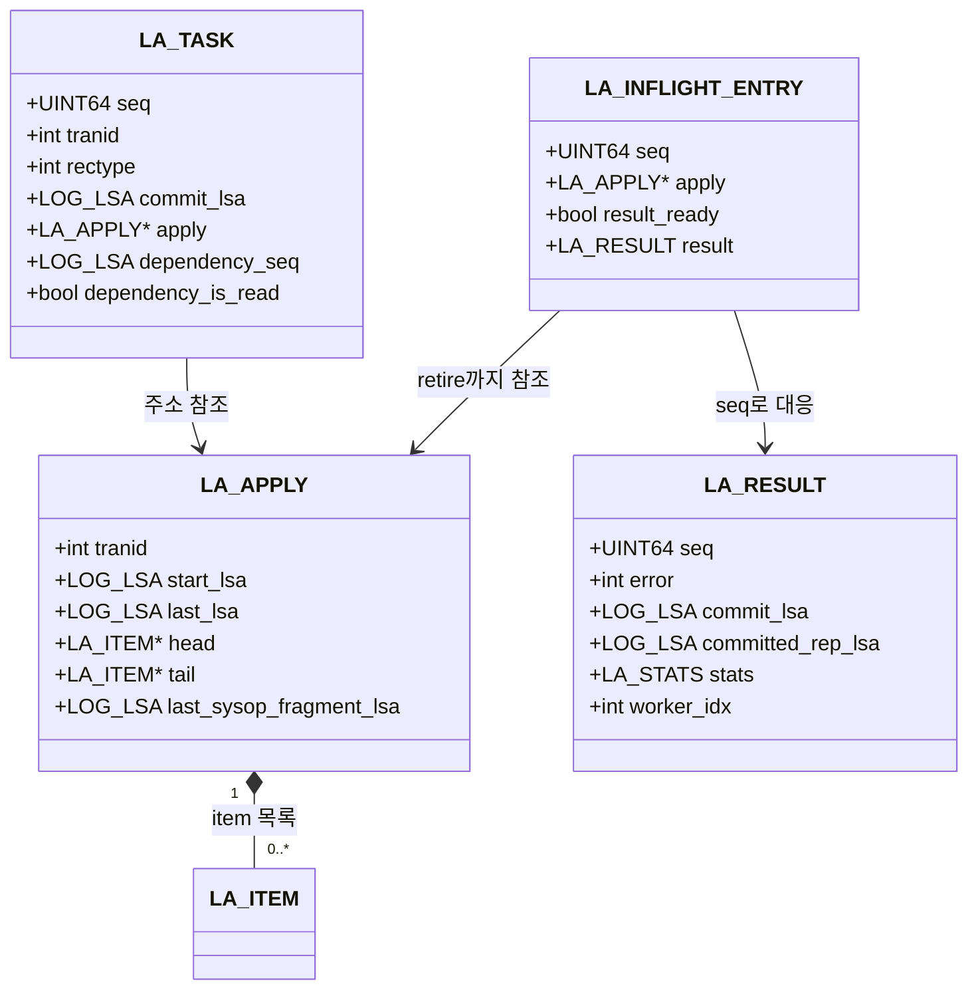

# 슬레이브 병렬 적용 구현 설계

이 문서는 PR #8052의 현재 `applylogdb` 구현을 기록한다. 코드의 `reader`는 로그를 읽고 task 배정과 결과 수거를 조정하는 주 스레드이며, 아래에서는 coordinator라고 부른다.

## 1. 복제 로그에서 task 구성

coordinator는 복제 항목을 `trid`별 `LA_APPLY` 슬롯의 `LA_ITEM` 목록에 모은다. `LOG_DUMMY_WSET_LABEL`을 만나면 로그 헤더의 `trid`와 payload의 `dependency_seq`, `dependency_is_ref`를 임시 보관한다. 다음 `LOG_COMMIT` 또는 `LOG_SYSOP_END`에서 같은 `trid`의 라벨을 task에 넣고, 그 레코드의 LSA를 `task.commit_lsa`로 쓴다. 슬레이브 내부 구조체에서 `dependency_is_ref`에 해당하는 필드명은 아직 `dependency_is_read`다.

일반 COMMIT task의 `task.apply`는 item 목록을 가진 `LA_APPLY` 슬롯의 주소다. 목록을 복사하거나 task로 옮기지 않는다. worker는 item을 적용하면서 `LA_ITEM`을 제거·해제한다. 슬롯은 coordinator가 result를 확정할 때까지 유지하고, retire에서 `tranid`와 시작 위치를 비워 재사용한다.

복제 항목이 있는 COMMIT에 맞는 라벨이 없으면, coordinator는 현재 Gate Order의 마지막 COMMIT LSA를 dependency에 넣어 앞선 작업을 기다리게 한다. 라벨이 없는 task를 독립 task로 취급하지 않는 폴백이다. 라벨이 없는 빈 COMMIT은 별도 적용 항목 없이 처리된다.

라벨이 있는 `LOG_SYSOP_END`에서 일반 슬롯에 적용할 item이 있으면, coordinator는 sysop 범위의 item을 분리해 별도 `LA_APPLY` fragment와 task를 만든다. 바깥 트랜잭션 슬롯에는 마지막 fragment LSA를 남기고, 최종 COMMIT task의 dependency가 그 위치 이상이 되게 한다. 라벨은 있지만 적용할 item이 없는 `LOG_SYSOP_END`는 해당 LSA를 완료 위치로 등록한다. 라벨이 없거나 이미 `committed_lsa` 이하인 sysop은 별도 task를 만들지 않는다.

## 2. coordinator, queue와 worker

coordinator는 공용 task queue와 result queue, pending 목록, Gate Order, In-flight List를 관리한다. worker는 각각 `db_restart_sub()`로 슬레이브 서버에 연결하고 자신의 적용 context를 만든다. coordinator는 worker session 준비를 기다리지 않고 task를 배정할 수 있다. session 시작에 실패한 worker는 종료하며, 적용 중 오류는 전체 applier의 종료를 요청한다.

| 구성 요소 | 현재 역할 |
|---|---|
| Gate Order | 로그에서 읽은 COMMIT·sysop 위치와 완료 여부를 순서대로 기록하고 연속 완료 경계를 계산 |
| pending 목록 | dependency가 아직 충족되지 않았거나 공용 task queue가 가득 찬 task를 보관 |
| 공용 task queue | 배정된 task를 여러 worker가 가져가는 큐 |
| In-flight List | 배정된 task의 순서 번호, `LA_APPLY` 주소와 result를 연결하고 retire 순서를 관리 |
| 공용 result queue | worker가 DB COMMIT 결과를 coordinator에 전달하는 큐 |

새 task를 받기 전에 coordinator는 기존 pending 목록의 실행 가능한 task를 먼저 배정한다. pending은 등록 순서로 검사하되, 앞의 task가 dependency를 기다리면 건너뛰고 뒤의 실행 가능한 task를 꺼낸다. 새 task도 dependency가 충족되고 task queue에 자리가 있으면 즉시 배정하며, 그렇지 않으면 pending에 넣는다. Gate Order에는 두 경우 모두 task의 `commit_lsa`를 한 번 등록한다. In-flight List에는 실제로 배정할 때 등록한다.

Gate Order는 worker 수에서 정한 고정 용량의 ring이다. 가득 차면 coordinator는 새 task를 읽지 않고 result를 수거·retire하며 자리가 날 때까지 기다린다. task queue나 In-flight List에 자리가 없을 때도 result를 수거해 진행한다. 별도의 `total_outstanding_capacity` token이나 worker 준비 완료 barrier는 현재 구현에 없다.

## 3. dependency gate와 완료 처리

현재 gate의 판정은 다음과 같다.

```text
dependency_seq가 NULL이면 실행 가능
그렇지 않고 dependency_seq <= frontier이면 실행 가능
나머지는 pending
```

`frontier`는 Gate Order의 앞에서부터 빠짐없이 완료된 마지막 COMMIT LSA다. 뒤의 task가 먼저 DB COMMIT에 성공해도 앞에 미완료 task가 있으면 frontier는 그 앞에 머문다. 현재 gate는 `dependency_is_ref` 값으로 분기하거나 특정 LSA 한 건의 완료만으로 task를 통과시키지 않는다. 이 값은 라벨과 task에 보존되지만 실행 가능 여부는 `dependency_seq`와 frontier로만 판단한다.

마스터 라벨은 여러 충돌 키에서 나온 선행 후보를 최댓값 하나로 줄인다. 그 LSA의 task 한 건만 먼저 끝났다고 다른 후보까지 끝났다고 볼 수 없어서, 현재 구현은 그 위치까지 빈틈없는 완료를 요구한다. 같은 규칙이 `history_start`와 commit-order 폴백의 하한도 처리한다. 완료 집합의 개별 멤버십은 배정 판정에 쓰지 않는다.

worker는 task의 item을 적용하고 남은 변경을 flush한 다음 DB COMMIT을 수행한다. 성공 result가 공용 result queue에 들어오면 coordinator는 해당 Gate Order entry를 완료로 표시하고 frontier를 전진시킨다. 실패 result는 완료로 표시하지 않고, In-flight List에서 오류를 반환한다. In-flight List는 배정 순서의 head부터 result를 retire하며, 그때 `LA_APPLY` 슬롯을 반환한다. `committed_lsa`는 retire된 task의 순서가 아니라 Gate Order의 frontier를 따른다.

`required_lsa`는 `repl_lists`에서 아직 사용 중인 `LA_APPLY` 슬롯의 `start_lsa` 중 최솟값으로 계산한다. worker가 item을 해제했어도 일반 COMMIT 슬롯은 retire 전까지 사용 중이므로 이 계산에 남는다. sysop fragment는 별도 슬롯을 가지며 retire에서 해제하지만, 현재 `la_find_required_lsa()`는 분리된 fragment 슬롯을 직접 순회하지 않는다. 바깥 트랜잭션이 먼저 ABORT되어 일반 슬롯이 비워진 경우 fragment의 시작 위치가 `required_lsa`에 남는지는 코드상 보장되지 않는다. worker별 적용 통계와 `committed_rep_lsa`는 result로 보내고, coordinator가 retire하면서 전역 값에 반영한다.

## 4. apply info 영속과 재시작

`_db_ha_apply_info`의 기존 `(db_name, copied_log_path)` 행에 `max_committed_lsa_pageid`, `max_committed_lsa_offset` 컬럼을 추가한다. worker별 행은 만들지 않는다. 이 이름의 값은 **실제로 DB COMMIT된 task의 최댓값이 아니라 재시작 때 재적용 오류를 허용할 수 있는 구간의 상한**이다.

coordinator는 `task.apply`가 있는 task를 worker에 넘기기 전에, 그 task의 COMMIT LSA가 저장된 상한보다 크면 새 상한을 자신의 DB connection에서 먼저 영속한다. 새 상한은 task의 COMMIT LSA와 복사된 로그 헤더의 EOF LSA 중 큰 값이다. 그래서 상한은 아직 읽지 않았거나 적용하지 않은 task보다 앞설 수 있다. `task.apply == NULL`이면 이 값을 갱신하지 않는다. worker의 데이터 COMMIT과 이 상한의 저장은 서로 다른 DB 트랜잭션이다.

재시작 시 coordinator는 저장된 `committed_lsa`부터 로그를 읽고, 저장된 `max_committed_lsa`를 `recovery_boundary_lsa`로 불러온다. `commit_lsa <= last_committed_lsa`인 task는 목록 전체를 건너뛴다. 그보다 뒤에서 `commit_lsa <= recovery_boundary_lsa`인 task는 다시 적용하되, flush 중 INSERT의 unique 중복과 UPDATE·DELETE의 대상 행 없음 오류 조합을 재적용 오류로 집계해 건너뛴다. 범위 밖의 오류는 일반 오류로 처리한다. 재시작 구간을 직렬로 실행하는 함수는 있으나 호출은 비활성화되어 현재는 다른 task와 같이 병렬 배정된다.

상한 이하에 실제로 적용하지 않은 task가 섞일 수 있고, 상한 이하의 동일한 오류 코드가 이전 적용과 무관하게 발생할 수도 있다. 현재 구현은 task별 영속 완료 표식으로 두 경우를 구분하지 않는다. statement 복제 항목의 재적용은 위 행 연산 오류 처리에 포함되지 않는다.

정상 진행에서는 coordinator가 frontier를 `committed_lsa`에 반영하고 주기적으로 apply info 행을 갱신한다. `final_lsa`는 로그 읽기 위치이므로 적용 완료 위치로 해석하지 않는다. 종료 시에는 pending, In-flight List와 Gate Order가 모두 비워졌는지 확인하며 worker queue와 result queue에 종료를 알리고 worker를 join한다.

## 5. 자료구조와 수명

`log_applier.c`에는 로그 읽기, `LA_ITEM`·`LA_APPLY`, coordinator와 기존 적용 코어가 있다. `applier/log_applier_task.hpp`와 `log_applier_result.hpp`는 worker에 전달할 값의 형태를 정의한다. 같은 디렉터리의 `log_applier_gate.cpp`, `log_applier_pending.cpp`, `log_applier_inflight.cpp`가 배정·완료 순서를 나눠 맡고, `log_applier_task_queue.cpp`, `log_applier_result_queue.cpp`, `log_applier_worker.cpp`가 공용 큐와 worker thread를 맡는다.



`LA_ITEM`은 복제 레코드의 `lsa`, `target_lsa`, key·class 정보를 가진 연결 목록 노드다. `LA_APPLY`는 `trid`별 목록의 슬롯이다. 일반 COMMIT task는 목록을 옮기지 않고 `task.apply`와 In-flight List entry가 같은 슬롯을 가리킨다. worker는 적용한 item을 `la_free_repl_item()`으로 목록에서 제거하고, 적용이 끝나면 남은 item도 정리한다. 이 시점에도 `LA_APPLY` 슬롯은 In-flight List에 남는다. head result가 retire되어야 일반 슬롯의 `tranid/start_lsa/last_lsa`를 비운다.

`repl_lists`는 `LA_APPLY *`를 담은 배열이다. 빈 슬롯이 없으면 배열을 확장하지만 이미 할당된 `LA_APPLY` 객체의 주소는 바꾸지 않는다. 따라서 coordinator가 다른 `trid`의 item을 계속 모으는 동안에도 task가 보관한 슬롯 포인터는 유효하다. 슬롯은 result가 도착했다는 이유만으로 재사용하지 않고 In-flight List retire까지 기다린다.

sysop task는 예외다. `la_detach_sysop_fragment()`가 바깥 슬롯에서 sysop 범위의 item 링크를 끊어 새로 할당한 `LA_APPLY`에 붙인다. 해당 fragment 슬롯은 In-flight List retire 때 메모리까지 해제한다. 바깥 슬롯은 후속 복제 항목과 최종 COMMIT용으로 계속 사용한다.

`LA_TASK.seq`는 worker 번호가 아니라 In-flight List가 배정할 때 만든 순서 번호다. worker는 `LA_RESULT.seq`에 이를 그대로 돌려준다. result에는 성공·오류, 적용 위치, 통계와 진단용 worker 번호가 담긴다. 어느 worker가 처리했는지와 result가 도착한 순서에 관계없이 coordinator가 해당 In-flight List entry를 찾는다.

## 6. 기존 직렬 경로와 PR 호출 흐름

아래 AS-IS는 writeset 병렬 경로를 연결하기 전의 직렬 apply 흐름이고, TO-BE는 PR #8052에서 이미 구현한 호출 흐름이다. 적용 함수는 기존 `log_applier.c`의 코어를 worker에서 호출한다.

### 6.1 로그 읽기와 task 생성

```text
AS-IS: la_apply_log_file()
  → la_log_record_process()
  → LOG_REPLICATION_DATA/STATEMENT를 trid별 repl_list에 누적
  → LOG_COMMIT/SYSOP_END: la_apply_commit_list()
     → la_apply_repl_log() → flush·COMMIT

TO-BE(PR 구현): la_apply_log_file()
  → la_log_record_process()
     → LOG_REPLICATION_DATA/STATEMENT: la_set_repl_log()
     → LOG_DUMMY_WSET_LABEL: dependency·trid 임시 보관
     → LOG_COMMIT: la_coordinator_process_commit()
        → la_find_apply_list(trid)를 LA_TASK.apply에 저장
        → la_coordinator_set_commit_dependency()
        → la_coordinator_submit_task()
     → LOG_SYSOP_END: la_coordinator_process_sysop_end()
     → LOG_ABORT: 해당 trid의 복제 item 정리
```

라벨을 읽는 순간에는 적용하지 않는다. COMMIT task의 `commit_lsa`는 COMMIT 레코드 위치, sysop task는 `LOG_SYSOP_END` 위치다. COMMIT에 맞는 라벨이 없고 복제 항목이 있으면 Gate Order의 마지막 LSA를 dependency로 사용한다. 현재 구현의 라벨 holder는 `trid`·dependency를 보관하고 다음 종료 레코드에서 소비하며, 중복·미소비 라벨을 별도 오류 상태로 분류하는 구조는 없다.

### 6.2 판정과 배정

```text
la_coordinator_submit_task()
  → Gate Order 용량 확인; 가득 차면 결과 수거·retire를 반복
  → la_gate_order_push(commit_lsa)
  → 기존 pending 중 ready task를 먼저 배정
  → la_gate_is_satisfied(dependency_seq)와 task queue 공간 확인
     ├─ 통과: la_coordinator_dispatch_task()
     │   → la_coordinator_wait_for_inflight_slot()
     │   → la_coordinator_cover_commit()                 # apply가 있는 경우
     │   → la_inflight_push() → task.seq 확정
     │   → la_task_queue_push()
     └─ 대기: la_pending_push()
```

`la_gate_is_satisfied()`는 NULL 또는 `dependency_seq <= frontier`만 통과시킨다. `la_pending_pop_ready()`는 pending 목록을 앞에서부터 검사해 첫 ready task를 꺼낸다. 앞의 dependency 대기 task는 뒤의 독립 task를 막지 않는다. 공용 task queue가 가득 찬 경우에는 새 task를 pending에 두고 result 수거 후 다시 검사한다.

### 6.3 worker 실행과 result 확정

```text
la_worker_main()
  → la_worker_start_session() / db_restart_sub()
  → la_worker_context_init()
  → la_worker_run()
     → la_task_queue_pop()
     → la_apply_worker_run_task()
        → la_apply_repl_log() → la_apply_worker_flush_task()
        → la_apply_worker_commit_task() / la_commit_transaction()
     → la_result_queue_push()

coordinator: la_coordinator_collect_and_retire()
  → la_result_queue_try_pop()
  → la_inflight_attach_result(seq)
  → 성공 COMMIT·SYSOP_END: la_gate_mark_completed(commit_lsa)
  → la_gate_advance_frontier()
  → la_coordinator_drain_ready()
  → In-flight List head부터 la_coordinator_retire_results()
     → commit node와 LA_APPLY 슬롯 정리
     → committed_lsa를 frontier까지 전진
     → 통계·committed_rep_lsa 합산
```

result는 순서가 바뀌어 도착해도 즉시 해당 entry에 붙고 Gate Order에는 성공을 표시한다. 그러나 In-flight List는 head의 result가 올 때까지 뒤의 entry를 retire하지 않는다. Gate Order는 **로그 COMMIT 순서의 연속 완료**, In-flight List는 **worker 배정 순서의 result 대응과 슬롯 반환**을 담당하므로 두 순서가 달라도 역할이 섞이지 않는다.

## 7. 공용 queue, worker context와 용량

| 자원 | 현재 구현과 한도 |
|---|---|
| 공용 task queue | 정적 배열 1개, `LA_TASK_QUEUE_CAPACITY=1024`; coordinator 한 스레드만 push하고 worker들이 pop |
| Gate Order | `worker_count × 1024`개 entry의 ring; pending·queued·running·완료 후 앞의 hole을 기다리는 task를 모두 포함 |
| 공용 result queue | Gate Order와 같은 수로 초기 할당; worker가 push, coordinator가 pop |
| In-flight List | Gate Order와 같은 수의 배열; 배정됐지만 retire되지 않은 task만 보관 |
| pending | coordinator만 접근하는 연결 목록; 별도의 독립 용량 대신 Gate Order 한도에 포함 |

worker 수는 `ha_apply_worker_count`에서 읽어 `la_Info.worker_count`에 보관한다. 공용 task queue의 1024개 용량은 이 값과 별도의 고정 상수이고, Gate Order·result queue·In-flight List 용량은 worker 수에 따라 정한다. `ha_writeset_trace_level`은 coordinator의 일정·결과 로그와 worker의 적용 단계 로그에 사용한다.

task queue의 push는 기다리지 않는다. coordinator는 가득 찬 것을 확인하면 task를 pending에 두고 result 수거를 진행한다. result queue는 모든 미retire task의 결과를 담을 수 있게 초기화한다. 예상과 달리 가득 차면 worker가 condition을 기다리며 결과를 버리지 않는다. queue 둘은 각각 mutex·condition을 사용하고 서로의 mutex를 함께 잡지 않는다.

각 worker는 서버 sub-client connection, error context, unzip buffer와 `RECDES` pool을 자신의 thread에 준비한다. 재구성한 레코드가 다른 worker의 buffer를 덮지 않도록 적용 context를 분리했다. `log_applier.c`의 `la_apply_worker_run_task()`와 적용·flush·COMMIT 함수는 `LA_WORKER_CONFIG.run_task` 콜백으로 worker loop에 전달된다. 공유 로그 페이지 cache는 mutex와 fix count로 보호하며, 각 thread가 자신이 고정한 페이지를 해제한다.

`la_apply_log_file()`은 `la_init()` 다음에 coordinator 자원과 worker를 시작한다. 모든 worker의 session 준비를 기다리는 READY barrier는 없다. 시작 실패 worker는 빠지고 살아 있는 worker가 task를 처리한다. 마지막 worker까지 시작에 실패하면 applier 종료를 요청한다. 종료에서는 task/result queue에 shutdown을 알리고 시작된 worker를 join한다.

worker connection의 호출 경계는 `la_worker_start_session() → db_restart_sub() → boot_restart_client_sub()`다. worker는 이 connection에서 trigger를 비활성화하고 적용을 수행한다. 종료에서는 `db_shutdown_sub()`로 자기 connection을 닫는다. coordinator는 자신의 connection에서 apply info를 갱신하므로 worker의 데이터 COMMIT과 coordinator의 apply info COMMIT은 분리된다.

## 8. sysop와 재시작의 현재 경계

마스터가 commit-order로 라벨링한 독립 sysop은 `LOG_SYSOP_END`에서 item fragment task가 된다. 바깥 COMMIT은 `last_sysop_fragment_lsa`를 dependency에 반영해 이 task의 완료를 기다린다. 라벨이 있으나 적용할 item이 없는 sysop은 Gate Order에 완료 위치만 추가한다. 현재 fragment 분리는 `is_long_trans`가 아닌 `LA_APPLY`에 대해 수행된다. 긴 트랜잭션은 이 분기에서 fragment task를 만들지 않는다.

`max_committed_lsa` 저장은 `la_coordinator_dispatch_task()`의 `la_coordinator_cover_commit()`에서 worker queue push 전에 수행한다. 이 값이 앞서 설명한 복구 상한인 이유가 여기에 있다. 재시작 때 worker가 이전 실행에서 적용한 task를 정확히 식별하는 행이나 task별 표식은 없다. 행 연산의 지정된 오류 조합만 복구 구간에서 건너뛰며, 재시작 구간을 직렬로 배정하는 함수의 호출은 현재 주석 처리되어 있다.

`required_lsa` 계산은 일반 `repl_lists` 슬롯만 순회한다. 분리된 sysop fragment가 pending·running에 있고 바깥 트랜잭션 슬롯이 ABORT로 먼저 비워지는 경우 fragment의 `start_lsa`는 이 계산에 직접 포함되지 않는다. 이 상태는 현재 구현의 보존 경계로 기록한다.
