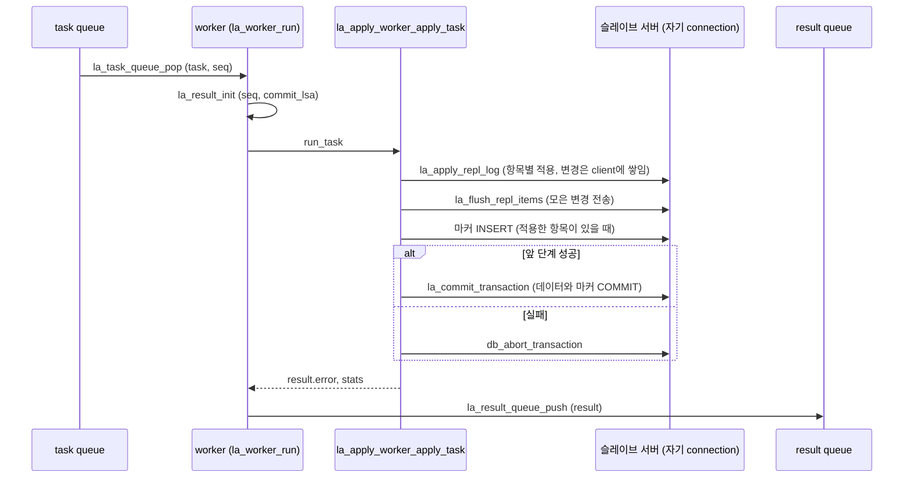

# 02 재작성 원고의 미확인 목록 (2026-11-01)

## 1장·3장

1. `la_clear_applied_info`(ABORT와 `committed_lsa` 이하 COMMIT의 경로)는 슬롯의 `last_sysop_fragment_lsa`를 비우지 않습니다. `la_add_apply_list`도 빈 슬롯(`tranid == 0`)을 재배정할 때 이 값을 초기화하지 않습니다. 그래서 fragment를 만든 뒤 ABORT된 트랜잭션의 슬롯을 다음 `trid`가 받으면, 그 COMMIT task의 dependency가 이전 SYSOP_END LSA로 올라갈 수 있습니다. 값이 이전 LSA이므로 결과는 대기가 늘어나는 정도로 보이지만, 영향을 검증하지는 않았습니다. 이 값을 비우는 곳은 `la_coordinator_release_apply_slot`(retire)과 `la_init_repl_lists`뿐입니다.
2. 라벨이 없는 SYSOP_END에 복제 항목이 있는 경우의 결과. 항목이 바깥 슬롯에 남으므로, 바깥 트랜잭션이 ABORT되면 함께 버려집니다. master가 복제 레코드를 남긴 독립 top operation에는 항상 라벨을 붙인다고 01 문서에 있으므로, 라벨을 남기지 않는 master(writeset 이전 버전)에서 오는 로그를 지원 대상으로 볼지는 확인하지 않았습니다.
3. `committed_lsa` 이하 `LOG_COMMIT` 분기에 실제로 들어오는 경우. 시작할 때 `final_lsa = committed_lsa = required_lsa`이고 실행 중에는 `committed_lsa`가 frontier를 따르므로, 들어오는 경로를 찾지 못했습니다. 그래서 본문에는 동작만 적고 "실제로는 들어오지 않는다"고 단정하지 않았습니다(SYSOP_END 쪽은 코드 주석에 그렇게 적혀 있어 그대로 옮겼습니다).
4. 복제 항목이 없는 COMMIT task를 worker가 처리할 때 `la_commit_transaction`이 빈 COMMIT을 실행하는 비용과, 이것이 상호 HA에서 빈 트랜잭션을 만드는지는 확인하지 않았습니다(apply info 저장 쪽 핑퐁 주석과는 다른 경로입니다).
5. master가 빈 COMMIT(복제 항목 없음)에도 라벨을 남기는지는 01 2.3절의 "복제가 켜진 상태에서 커밋하는 트랜잭션마다"를 따랐습니다. master 코드로 직접 확인하지는 않았습니다.
6. 01 문서 앵커 `#23-wset_label`, `#72-독립-top-operation의-라벨`은 GitHub slug 규칙으로 추정했습니다. 렌더링해서 확인하지는 않았습니다.

## 1.1·4장

1. 트랜잭션 슬롯 공유의 안전성: worker의 `la_free_all_repl_items`는 `start_lsa`를 건드리지 않는 것을 확인했다. 하지만 coordinator가 `la_find_required_lsa`에서 in-flight 슬롯의 `start_lsa`를 읽는 동안 worker가 같은 슬롯의 head·tail·num_items를 바꾸는 데 대한 동기화 근거는 코드 주석(task.hpp의 "pre-mapped ... avoiding realloc / slot-reuse race")뿐이다. long 트랜잭션의 `la_free_and_add_next_repl_item` 경로는 읽지 않았다. 1.1의 공유 목록 둘째 항목은 이 범위 안에서만 썼다.
2. 4.7의 1번 근거는 `la_coordinator_wait_for_commit_order_slot` 주석과 gate 단위 테스트에 기댄다. ring head task가 pending list에 있고 task queue가 가득 찬 상태에서, 수거 루프 안의 drain_ready → enqueue → wait_for_inflight_slot 경로가 어떻게 이어지는지는 따라가 보지 않았다.
3. `la_lock_dbname`의 내부 동작은 읽지 않았다. 4.4에는 잡는 조건만 썼고 의미는 8.2절로 넘겼다.
4. `committed_lsa`는 retire할 때만 frontier를 따른다. retire가 없는 동안(예: `la_coordinator_complete_without_task`만 frontier를 올린 경우) 다음 retire나 메인 루프의 DONE 분기 전까지 뒤처질 수 있다. 4.6에는 "retire할 때" 갱신한다고만 썼다. 실제 영향은 확인하지 않았다.
5. `la_Shared_task_not_full`은 signal과 broadcast만 있고 기다리는 곳이 없다. 4.4에는 "넣기는 기다리지 않는다"만 썼다. 정리할지는 판단이 필요하다.
6. 그림 4-3은 코드 동작을 재구성한 예시이고, 이 시나리오를 그대로 확인하는 단위 테스트는 없다(gate 테스트 "frontier가 빈틈없는 prefix로만 전진"과 inflight 테스트 "순서가 뒤섞인 result를 붙이고 head만 retire"가 각 부분을 확인한다).
7. 4.2의 마스터 하한 앵커(`#71-하한을-올리는-곳`)와 4.1의 앵커(`#41-history-probe-규칙과-라벨-값`)는 01 제목으로 만든 slug라서, 렌더러에서 실제로 맞는지 확인이 필요하다.

## 2장

**1. trid 재사용 (일부 확인)**
- 확인한 것: 마스터의 `logtb_get_new_tran_id`는 `log_Gl.hdr.next_trid`를 원자적으로 1씩 늘린다. INT32를 넘을 때만 `LOG_SYSTEM_TRANID + 1`로 돌아간다. 그래서 마스터가 도는 동안에는 약 2^31번째 트랜잭션 전에는 같은 trid가 나오지 않는다.
- 확인하지 못한 것: 마스터 재시작 복구는 `next_trid`를 END_OF_LOG 레코드의 trid로 다시 정한다(`log_rv_analysis_log_end`, `log_recovery_analysis`). 이 값이 이미 쓴 trid보다 작아질 수 있는지 모른다.
- 슬레이브 쪽 위험: 슬롯은 retire 전까지 `tranid`를 유지한다. 그 사이에 같은 trid가 나오면 `la_add_apply_list`가 적용 중인 슬롯을 돌려준다.
- 따라서 이 항목은 미확인으로 둔다.

**2. `la_clear_applied_info`가 `last_sysop_fragment_lsa`를 지우지 않음 (확인)**
- 이 함수는 복제 항목을 해제하고 `start_lsa`, `last_lsa`를 NULL로, `tranid`를 0으로 만들지만, `last_sysop_fragment_lsa`는 그대로 둔다. `is_long_trans`, `num_items`는 `la_free_all_repl_items`가 되돌린다.
- `la_add_apply_list`는 빈 슬롯을 재사용할 때 `tranid`만 정한다.
- 이 함수를 거쳐 비는 경우는 세 가지다. LOG_ABORT, `committed_lsa` 이하의 COMMIT, DONE 때의 `la_clear_all_repl_lists`.
- 결과: 이렇게 빈 슬롯을 다른 트랜잭션이 재사용하면, `la_coordinator_set_commit_dependency`가 그 트랜잭션의 COMMIT task dependency를 이전 트랜잭션의 fragment 위치로 올릴 수 있다.
- 영향(추정, 미검증): 남은 값은 앞서 읽은 `LOG_SYSOP_END` 위치다. 그래서 불필요하게 더 기다릴 뿐, 순서를 어기지는 않는다고 본다.
- retire 경로(`la_coordinator_release_apply_slot`)는 이 필드를 지운다. 같은 처리를 `la_clear_applied_info`에 넣을지는 결정이 필요하다.

**3. 빈 COMMIT task의 슬레이브 COMMIT (확인)**
- `apply`가 NULL이거나 head가 NULL이면 `la_apply_repl_log`는 바로 NO_ERROR를 돌려준다.
- 그 뒤 `la_apply_worker_flush_task`가 `la_flush_repl_items(true)`를 호출한다. `total_rows`가 0이므로 마커는 넣지 않는다.
- 마지막으로 `la_apply_worker_commit_task`가 `la_commit_transaction` 안에서 `db_commit_transaction()`을 조건 없이 호출한다.
- 이미 적용되어 건너뛰는 task도 같은 경로를 지난다.
- 따라서 빈 task마다 worker 연결에서 COMMIT 요청이 한 번씩 나간다. 다만 이 요청이 슬레이브 서버에 COMMIT 로그 레코드를 남기는지는 확인하지 못했다.

**4. `la_init_repl_lists` 오류 경로 i/j (확인)**
- 할당 실패 경로의 `for (j = 0; j < i; j++) free_and_init (la_Info.repl_lists[i]);`는 `j`가 아니라 `i`로 해제한다. 그래서 이미 할당한 슬롯이 해제되지 않는다.
- git blame으로는 2014년 커밋 6522201dab2이고, upstream/develop에도 같은 코드가 있다. 이번 기능의 범위 밖이므로 todo 대상이다.

**5. 새로 본 것: 슬롯의 `num_items`를 잠금 없이 읽음 (미확인)**
- coordinator는 `LOG_DUMMY_HA_SERVER_STATE`를 처리할 때 `la_is_repl_lists_empty`로 모든 슬롯의 `num_items`를 읽는다.
- 같은 시각에 worker는 적용 중인 슬롯의 `num_items`를 `la_unlink_repl_item`으로 줄일 수 있다.
- 잠금 없이 읽고 쓰는 경합이다. 판정에 실제로 영향을 주는지는 확인하지 못했다.

**6. 코드 주석 정정 후보 (확인)**
- `LA_RESULT.tranid`의 주석 "frees this transaction's commit node at retire"는 지금 코드와 맞지 않는다. COMMIT 목록(`LA_COMMIT`)이 제거되어 commit node가 없기 때문이다.
- 현재 이 필드는 retire할 때 남기는 trace(정상, 오류)에만 쓴다.

## 5장·9장

## 5. worker 적용

worker는 coordinator가 task queue에 넣은 task를 하나씩 꺼내 슬레이브 서버에 적용하고, 그 결과를 result로 돌려주는 스레드다. worker마다 슬레이브 서버에 자기 connection을 따로 연다. 데이터 트랜잭션은 이 connection에서 worker가 직접 COMMIT하고, apply info는 coordinator가 자기 connection에서 저장한다(7.2절). worker 모듈(`applier/log_applier_worker.cpp`)은 스레드의 생명주기와 worker context만 맡는다. task 한 건을 적용하는 방법은 `log_applier.c`의 함수를 콜백으로 받아 쓴다.

### 5.1 worker 생명주기

coordinator는 시작할 때 `la_start_apply_workers`로 `LA_WORKER_CONFIG`를 채워 `la_worker_start`에 넘긴다. 이 설정은 worker가 시작한 뒤로 읽기만 한다.

- **크기**: 로그 헤더에서 읽은 DB 페이지 크기, 레코드 pool 크기(`LA_MAX_UNFLUSHED_REPL_ITEMS`, flush 한 번에 보내는 항목 수와 같다).
- **trace 수준**: `ha_writeset_trace_level`을 한 번 읽어 둔다.
- **콜백**: `la_apply_worker_run_task`(task 한 건 적용), `la_request_shutdown`(applier 종료 요청), `la_apply_worker_end_context`(connection을 닫기 전 정리).

`la_worker_start`는 worker 수만큼 스레드를 만들고 바로 돌아온다. coordinator는 worker가 session을 다 열 때까지 기다리지 않는다. task는 worker가 꺼낼 때까지 task queue에 머문다.

```text
[worker 스레드 하나]
la_worker_main()
  → la_worker_start_session()              la_Worker_session_mutex 안에서 하나씩
     → db_restart_sub(worker 번호)          자기 sub-client connection
     → tr_init(), db_disable_trigger()     슬레이브에서 trigger를 다시 실행하지 않음
     → ws_init_repl_objs()
     (실패 → la_worker_startup_failed() → end)
  → la_worker_context_init()                unzip buffer 둘, 레코드 pool
     (실패 → la_worker_startup_failed() → end)
  → la_worker_run()                         task 루프(5.2절)
     (적용 오류로 끝남 → request_shutdown)
end:
  → end_context()                           마커 INSERT 문장 닫기, pinned 목록 해제
  → la_worker_context_final()
  → la_worker_end_session()
     → ws_clear_all_repl_objs()
     → db_shutdown_sub()
```

- **session을 하나씩 여는 이유**: `la_worker_start_session`은 `la_Worker_session_mutex`를 쥐고 `db_restart_sub`를 부르므로, worker들의 session 시작은 차례로 일어난다.
- **trigger**: `db_restart_sub`는 trigger 초기화를 하지 않는다. 그래서 worker가 직접 `tr_init`을 부르고 trigger를 끈다.
- **실패한 session도 닫는다**: `db_restart_sub`가 실패해도 그 스레드의 오류 context가 남아 있어야 오류를 보고할 수 있다. 이 context는 `db_shutdown_sub`만 해제하므로, 시작에 실패한 worker도 끝에서 session을 닫는다.
- **MULTI_CONN_TO_A_SERVER 없이 빌드한 경우**: `db_restart_sub`를 부르지 않고 프로세스의 client connection을 함께 쓴다. 이때 worker는 오류 context를 직접 만들어 등록하고, 끝에서 해제한다. worker 수는 1로 줄어든다(4.8절, 9.1절).
- **시작 실패**: `la_worker_startup_failed`가 살아 있는 worker 수(`la_Live_worker_count`)를 하나 줄이고 오류 로그에 남긴다. 남은 worker는 계속 적용한다. task는 어느 worker가 꺼내도 되므로 worker가 줄면 병렬도만 낮아진다. 마지막 worker까지 시작에 실패하면 task를 꺼낼 스레드가 없으므로 applier 종료를 요청한다.
- **종료**: coordinator의 `la_stop_apply_workers`가 task queue와 result queue에 shutdown을 알리고, 시작된 worker를 모두 join한다(8.3절). shutdown이 켜진 task queue는 남은 task가 있어도 더는 내주지 않는다. 그런 task의 COMMIT은 `committed_lsa` 뒤에 있으므로 다음 실행이 로그에서 다시 읽는다(7.4절).

```c
// log_applier_worker.cpp: la_worker_main
error = la_worker_start_session (&session, worker->index);
session_started = true;
if (error != NO_ERROR)
  {
    la_worker_startup_failed (worker, "start_session_failed", error);
    goto end;
  }
error = la_worker_context_init (&worker_context, ...db_page_size, ...recdes_pool_size);
...
error = la_worker_run (worker, &worker_context, &worker_applied_item_count);
if (error != NO_ERROR)
  {
    la_Worker_config.request_shutdown ();
  }
end:
if (worker_context_started)
  {
    la_Worker_config.end_context (&worker_context);
    la_worker_context_final (&worker_context);
  }
if (session_started)
  {
    la_worker_end_session (&session);
  }
```

### 5.2 task 한 건 적용

`la_worker_run`은 task queue에서 task를 꺼내 result를 준비하고 `run_task` 콜백을 부른 뒤, result를 result queue에 넣는다. 이 일을 queue가 shutdown될 때까지 반복한다. result의 `seq`는 task의 `seq`를 그대로 옮긴 값이다. coordinator는 이 값으로 in-flight list의 entry를 찾는다(4.5절).

```c
// log_applier_worker.cpp: la_worker_run
while (true)
  {
    if (la_task_queue_pop (&task) != NO_ERROR)
      {
        break;                       /* shutdown */
      }
    worker->busy = true;
    la_result_init (&result, &task, context->worker_idx);
    la_Worker_config.run_task (context, &task, trace_level, worker_applied_item_count, &result);
    error = la_result_queue_push (&result);
    worker->busy = false;
    if (error != NO_ERROR)
      {
        return NO_ERROR;             /* result queue shutdown: the result is dropped */
      }
    if (LA_IS_FLUSH_ERROR (result.error) || result.error == ER_NET_CANT_CONNECT_SERVER
        || ER_IS_SERVER_DOWN_ERROR (result.error))
      {
        return result.error;
      }
  }
```

`run_task`로 넘어가는 `la_apply_worker_run_task`는 복제 항목이 있는 task라면 통계에 이 worker의 현재 task로 표시하고, `la_apply_worker_apply_task`를 부른 뒤 걸린 시간을 result의 `busy_usec`에 넣는다. 실제 적용 순서는 `la_apply_worker_apply_task`가 정한다.

```text
[worker task 하나]
la_apply_worker_apply_task()
  → la_apply_repl_log()                  복제 항목 적용
     (이미 적용된 COMMIT이면 항목만 해제하고 끝, 7.4절)
  → la_apply_worker_flush_task()
     → la_flush_repl_items(immediate)    모아 둔 변경을 서버로 보냄
  → [추가] la_insert_applied_tx_marker() applied-tx 마커 INSERT(7.3절)
     (적용한 항목이 있을 때만)
  (앞 단계 실패 → db_abort_transaction(), result.error 설정, 끝)
  → la_apply_worker_commit_task()
     → la_commit_transaction()           데이터와 마커를 한 트랜잭션으로 COMMIT
```

- **적용**: `la_apply_repl_log`는 트랜잭션 슬롯의 복제 항목을 차례로 적용하고, 적용한 항목은 바로 해제한다. 트랜잭션 슬롯 자체는 해제하지 않는다. 슬롯은 coordinator가 retire 때 비운다(4.6절). 복제 항목이 없는 COMMIT task(`task.apply == NULL`)도 같은 함수를 지나며, 적용 없이 끝난다.
- **이미 적용된 COMMIT**: COMMIT LSA가 시작 때의 `last_committed_lsa` 이하이거나 applied-tx 마커가 있으면 트랜잭션 전체를 건너뛴다. 이 경우 적용한 항목 수가 0이므로 마커를 다시 넣지 않는다(7.4절).
- **마커**: 적용한 항목이 하나라도 있으면 COMMIT 직전에 같은 슬레이브 트랜잭션 안에서 마커를 INSERT한다. 데이터가 COMMIT되면 마커도 함께 있고, 데이터가 없으면 마커도 없다.
- **실패**: flush나 마커 INSERT가 실패하면 열린 슬레이브 트랜잭션을 `db_abort_transaction`으로 되돌린다. 되돌리지 않으면 이 worker가 다음에 꺼낸 task가 앞 변경을 마커 없이 함께 COMMIT하게 된다.
- **COMMIT**: `la_apply_worker_commit_task`는 이 worker가 적용한 항목 수를 늘리고 `la_commit_transaction`을 부른다. 그 사이에 시험용 훅(`la_apply_worker_test_block_before_commit`)이 끼어 있다(10장).

```c
// log_applier.c: la_apply_worker_apply_task
result->error = la_apply_repl_log (context, task->apply, &task->commit_lsa, &total_rows,
                                   &result->committed_rep_lsa, &result->stats);
result->total_rows = total_rows;
...
if (result->error == NO_ERROR)
  {
    result->error = la_apply_worker_flush_task (context, task, trace_level, &result->stats);
  }
if (result->error == NO_ERROR && total_rows > 0)
  {
    result->error = la_insert_applied_tx_marker (context, &task->commit_lsa);
  }
if (result->error != NO_ERROR)
  {
    (void) db_abort_transaction ();
    return;
  }
result->error = la_apply_worker_commit_task (context, task, trace_level, &result->stats, worker_applied_item_count);
```

result에는 성공 여부 말고도 다음 값이 담긴다. coordinator는 retire할 때 이 값들을 전역 값에 더한다(4.6절, 9.2절).

- `committed_rep_lsa`: 오류 없이 적용한 마지막 복제 항목의 LSA.
- `total_rows`: 이 task에서 다룬 항목 수.
- `stats`: INSERT·UPDATE·DELETE·스키마·실패 건수, 마지막 오류 코드와 시각, 마지막으로 적용한 클래스.
- `busy_usec`, `apply_end_time`, `worker_idx`: worker별 통계와 trace용.



### 5.3 오류 처리

worker의 오류는 항목 하나의 오류, flush 오류, 서버 연결 오류, 마커와 COMMIT 오류로 나뉜다. 이 가운데 result까지 올라가는 것은 트랜잭션을 그대로 COMMIT할 수 없는 오류뿐이다.

**항목 하나의 오류**

INSERT·UPDATE·DELETE 적용 함수는 오류가 나면 `la_log_apply_error`로 오류 로그를 남기고 `la_stat_note_error`로 `fail_counter`, 마지막 오류 코드와 시각을 센다. statement 항목은 `la_apply_statement_log`가 같은 방식으로 센다. 그 뒤 `la_apply_repl_log`는 오류 종류에 따라 다음처럼 처리한다.

- **flush 오류**(`LA_IS_FLUSH_ERROR`): 남은 항목을 적용하지 않고 오류를 돌려준다.
- **서버 연결 오류**: `ER_NET_CANT_CONNECT_SERVER`로 바꿔 돌려준다.
- **재시도할 오류**: `LA_RETRY_ON_ERROR`(잠금·페이지 latch 시간 초과, 교착 등) 또는 `ha_applylogdb_retry_error_list`에 있고 `ha_applylogdb_ignore_error_list`에 없는 오류다. 알림을 남기고 10초 쉰 뒤 같은 항목을 다시 적용한다. 횟수 제한은 없다.
- **그 밖의 오류**: 이미 세고 보고했으므로 오류를 지우고 다음 항목으로 넘어간다. 트랜잭션은 성공한 항목만으로 COMMIT된다. 마지막 항목 하나의 실패로 트랜잭션 전체를 버리고 applier를 멈추지 않으려는 것이다.

```c
// log_applier.c: la_apply_repl_log (항목 오류)
if (LA_IS_FLUSH_ERROR (error))
  {
    goto end;
  }
errid = er_errid ();
...
if (ER_IS_SERVER_DOWN_ERROR (errid))
  {
    error = ER_NET_CANT_CONNECT_SERVER;
    goto end;
  }
else if (la_ignore_on_error (errid) == false && la_retry_on_error (errid) == true)
  {
    LA_SLEEP (10, 0);
    continue;                        /* the same item again */
  }
else
  {
    error = NO_ERROR;                /* counted in fail_counter; go on with the next item */
  }
```

**flush 오류**

`la_flush_repl_items`는 client에 쌓인 변경을 한 번에 서버로 보낸다. 일부만 실패하면(`ER_LC_PARTIALLY_FAILED_TO_FLUSH`) 실패한 행마다 오류 로그를 남기고, 해당 INSERT·UPDATE·DELETE 건수를 하나씩 줄이고, `fail_counter`를 센다. 실패한 행의 오류가 재연결해야 할 오류(`la_restart_on_bulk_flush_error`)이면 `ER_LC_PARTIALLY_FAILED_TO_FLUSH`를 돌려준다. 그렇지 않으면 성공으로 처리한다. 전송 자체가 실패하면 `ER_LC_FAILED_TO_FLUSH_REPL_ITEMS`를 돌려준다.

**result로 올라가는 오류와 worker가 끝나는 조건**

- result의 `error`에 들어가는 오류는 다음과 같다.
  - `la_apply_repl_log`가 돌려준 flush 오류나 서버 연결 오류
  - 마지막 flush의 오류
  - 마커 INSERT 오류
  - COMMIT 오류
- 오류가 있으면 worker는 슬레이브 트랜잭션을 되돌리고 그 result를 result queue에 넣는다.
- result의 오류가 flush 오류이거나 서버 연결 오류이면 worker는 루프를 끝내고 applier 종료를 요청한다. 그 밖의 오류이면 worker는 다음 task를 계속 꺼낸다.
- result queue가 shutdown되어 result를 넣지 못하면 그 result는 버린다. retire되지 않았으므로 재시작 지점이 그 앞에 남고, 다음 실행이 다시 적용한다.

**coordinator 쪽 처리**

- 실패한 result는 commit-order ring에 완료로 표시하지 않는다(4.5절). 그 트랜잭션에 의존하는 트랜잭션이 빠진 변경 위에서 실행되지 않게 하기 위해서다.
- retire는 in-flight list의 head부터 진행하다가 실패한 result에서 멈추고 그 오류를 돌려준다(4.6절).
- 메인 루프는 그 오류가 서버 연결 오류나 flush 오류이면 `la_shutdown` 후 오류로 돌아가고, 그 밖의 오류이면 applier 종료 표시를 켜고 루프를 빠져나간다(8.3절).

### 5.4 공유 자원

worker 사이에 나누는 자원은 로그 페이지 cache, SQL 컴파일 mutex, session 시작 mutex이다. 레코드를 재구성하는 버퍼는 worker마다 따로 있다(2.6절).

**로그 페이지 cache**

coordinator와 worker는 같은 로그 페이지 cache(`la_Info.cache_pb`)를 쓰고, cache의 hash와 buffer 상태는 `cache_pb->mutex`로 보호한다. coordinator는 로그 레코드를 읽을 때, worker는 복제 항목의 원본 레코드를 다시 읽을 때 이 cache를 쓴다.

- **fix**: `la_get_page_buffer`는 mutex 안에서 페이지를 찾거나 빈 buffer에 읽어 들이고, `fix_count`를 하나 올린다. mutex를 놓은 뒤 그 buffer를 호출한 스레드의 pinned 목록(thread_local)에 기록한다.
- **해제**: 스레드는 자기 pinned 목록에 있는 fix만 푼다. `la_release_page_buffer`는 페이지 하나, `la_release_pinned_page_buffers`는 목록 전체를 푼다. worker는 복제 항목 하나를 적용할 때마다, coordinator는 로그 레코드 하나를 처리할 때마다 목록을 비운다. 그래서 페이지 경계를 넘는 레코드를 읽으며 잡은 fix가 쌓이지 않는다.
- **교체**: `la_cache_buffer_replace`는 `fix_count`가 0인 buffer만 새 페이지에 내준다. `la_decache_page_buffers`도 fix된 buffer는 건너뛴다. `la_invalidate_page_buffer`는 hash에서 buffer를 빼되 호출한 스레드의 fix만 푼다. 다른 스레드가 읽고 있는 buffer는 마지막 fix가 풀린 뒤에야 교체 대상이 된다.
- **pinned 목록 크기**: 처음 256개로 시작하고, 차면 두 배로 늘린다. 작업 단위가 끝났을 때 3분의 1 이하만 쓰고 있으면 반으로 줄인다. worker가 끝날 때 `la_apply_worker_end_context`가 목록을 해제한다.

```c
// log_applier.c: la_get_page_buffer
pthread_mutex_lock (&cache_pb->mutex);
cache_buffer = (LA_CACHE_BUFFER *) mht_get (cache_pb->hash_table, (void *) &pageid);
if (cache_buffer == NULL)
  {
    cache_buffer = la_cache_buffer_replace (cache_pb, pageid, ...);   /* only a buffer with fix_count 0 */
    ...
  }
...
cache_buffer->fix_count++;
pthread_mutex_unlock (&cache_pb->mutex);
la_pin_page_buffer (cache_buffer, pageid);    /* this thread's own list */
```

**SQL 컴파일 mutex**

SQL parser의 정적 전역 변수는 스레드 안전하지 않다. 그래서 SQL 문장을 컴파일하거나 실행하는 곳은 모두 `la_sql_compile_mutex`를 쥔다.

- coordinator: `la_update_query_execute_with_values`로 하는 apply info·통계 저장과 마커 삭제, 시작 때의 마커 로드.
- worker: statement 항목 적용(`la_apply_statement_log` → `la_update_query_execute`), 마커 INSERT의 컴파일과 실행(`la_insert_applied_tx_marker`).

이 구간은 worker 사이에서도 한 번에 하나만 들어간다. 마커 INSERT는 statement 한 번만 컴파일해 두고 값만 바꿔 실행하지만, 실행도 이 mutex 안에서 한다. 서버가 다시 컴파일을 요구할 수 있기 때문이다. coordinator가 마커를 지우는 DELETE를 COMMIT 직전 마지막 문장으로 두는 이유도 이 mutex와 관련 있다(7.2절).

**COMMIT 뒤 한 번 더 하는 COMMIT**

`la_commit_transaction`은 데이터를 COMMIT한 뒤, 일정 시간이 지났거나 적용한 항목이 일정 수를 넘으면 상주 클래스마다 `ws_intern_instances`로 복제 flush가 남긴 MOP를 정리한다. 이 정리는 클래스를 가져오면서 새 트랜잭션에서 클래스마다 SCH_S 잠금을 잡는다. 이 잠금을 쥔 채 worker가 다음 task를 기다리면 문제가 생긴다. 다른 worker의 복제 DDL이 그 클래스의 SCH_M을 기다리고, gate는 DDL 뒤의 task를 내보내지 않으므로 양쪽 다 진행하지 못한다. 그래서 정리 뒤에 COMMIT을 한 번 더 해 잠금을 놓는다. 마지막 정리 시각과 항목 수는 스레드별 변수(`CUB_THREAD_LOCAL`)라서 worker마다 따로 센다.

```c
// log_applier.c: la_commit_transaction
error = db_commit_transaction ();
...
if (diff_time >= ws_cull_mops_interval || diff_applied_item >= ws_cull_mops_per_apply)
  {
    for (m = ws_Resident_classes; m != NULL; m = m->next)
      {
        ...
        ws_intern_instances (m->op);
      }
    /* the class fetches above hold SCH_S in a new transaction; release them before waiting for the next task */
    error = db_commit_transaction ();
  }
```

## 9. 설정과 관측

### 9.1 설정

슬레이브의 병렬 적용이 읽는 파라미터는 다음과 같다. 모두 동적으로 바꿀 수 없다.

- **`ha_apply_worker_count`**
  - worker 수. 기본값 1, 범위 1~32(`HB_MAX_APPLY_WORKER_COUNT`).
  - `la_init`이 한 번 읽어 `la_Info.worker_count`에 둔다. 범위를 다시 한 번 `LA_MAX_WORKER_COUNT`로 자른다.
  - MULTI_CONN_TO_A_SERVER 없이 빌드했으면 1로 줄이고 알림을 남긴다.
  - 값이 1이면 COMMIT 순서로 적용한다는 알림을 남긴다(4.8절).
  - commit-order ring, in-flight list, result queue의 크기는 이 값에 task queue 용량 1024를 곱한 값이다(2.5절).
- **`ha_writeset_trace_level`**
  - trace 수준. 기본값 0, 범위 0~3.
  - worker는 시작할 때 한 번 읽고, coordinator는 trace를 남길 때마다 읽는다.
  - 슬레이브 코드가 나누는 수준은 1과 2이다(9.3절).
- **`ha_apply_max_mem_size`**
  - applylogdb 프로세스의 메모리 상한(MB). 기본값 500.
  - `la_check_mem_size`는 프로세스의 가상 메모리 크기를 이 값과, 시작 대기 뒤 처음 잰 크기의 두 배 중 큰 값과 비교한다. 넘으면 `ER_HA_LA_EXCEED_MAX_MEM_SIZE`로 applier를 멈춘다.
  - worker마다 malloc arena가 따로 생겨 가상 크기가 커지므로, 기준 크기는 worker가 시작한 뒤에 잰다.
- **`ha_applylogdb_max_commit_interval_in_msecs`**(기존)
  - coordinator가 retire 때 apply info를 저장하는 최소 간격(7.2절).
  - retire마다 저장하면 상호 HA에서 두 applier가 빈 트랜잭션을 끝없이 주고받는다.
- **`ha_applylogdb_log_wait_time_in_secs`**(기존): 마스터가 DEAD인 채 로그가 늘지 않을 때 dbname 잠금을 놓기까지 기다리는 시간. drain 완료일 때만 놓는다(8.2절).
- **`ha_applylogdb_retry_error_list`, `ha_applylogdb_ignore_error_list`**(기존): 항목 적용 오류를 다시 시도할지 정한다(5.3절).

마스터 쪽 `ha_writeset_history_size`는 슬레이브가 읽지 않는다([01 8.2절](./01-master-implementation-design.md#82-설정)).

### 9.2 통계

병렬 적용 통계는 두 시스템 테이블에 저장한다. 카운터는 applier가 시작할 때마다 0부터 다시 센다.

- **`_db_ha_apply_stat`**: applier마다 한 행이고, `db_name`, `copied_log_path`로 찾는다.
  - `worker_count`: 실행 중인 worker 수.
  - `apply_state`: applier 상태. DONE 보류 중이면 `holding done`(8.1절).
  - `done_hold_since`: DONE 보류를 시작한 시각.
  - `commit_read_count`: 복제 항목이 있는 COMMIT을 읽은 수.
  - `dispatch_direct_count`: 그중 읽자마자 task queue에 넣은 수.
  - `dispatch_parked_count`: 그중 pending list에 먼저 넣은 수.
  - `inflight_count`, `pending_count`: 저장 시점의 in-flight list와 pending list의 task 수.
  - `last_update_time`: 마지막 저장 시각.
- **`_db_ha_apply_worker_stat`**: worker마다 한 행이고, `worker_idx`로 나눈다.
  - `state`: `applying` 또는 `idle`.
  - `applied_task_count`, `applied_row_count`, `busy_usec`: retire된 task 수, 항목 수, 적용에 쓴 시간.
  - `applying_commit_lsa_pageid/offset`, `applying_master_commit_time`, `applying_since`: 지금 적용 중인 task.
  - `last_applied_commit_lsa_pageid/offset`, `last_applied_master_commit_time`, `last_applied_time`: 마지막으로 retire된 task.
  - `last_error_code`, `last_error_time`: 마지막으로 센 항목 오류.

값을 모으고 저장하는 방식은 다음과 같다.

- **세는 곳**: coordinator가 COMMIT을 읽고 배정할 때 `la_stat_count_*`로 센다. worker는 적용을 시작하고 끝낼 때 `la_stat_worker_begin`, `la_stat_worker_end`로 자기 슬롯의 현재 task를 바꾼다. 이 슬롯만 mutex로 보호한다. 완료한 값은 retire 때 coordinator가 `la_stat_add_result`로 더한다.
- **저장**: 시작할 때 `la_stat_init_rows`가 이번 실행의 행으로 바꾼다. 테이블이 없거나 이 단계가 실패해도 applier는 돌고, 통계만 저장하지 않는다. 이후에는 apply info를 저장하는 트랜잭션 안에서 `la_stat_store`가 함께 갱신하므로, 세 테이블은 같은 시점의 값을 보여 준다(7.2절). 값이 바뀌지 않은 worker 행은 다시 쓰지 않는다.
- **출력**: `applyinfo`가 `la_stat_print_applyinfo`로 "Parallel Apply Info"를 출력한다. `-v`를 주면 나머지 컬럼과 worker별 줄도 출력한다.
- **기존 apply info**: `_db_ha_apply_info`의 INSERT·UPDATE·DELETE·스키마·COMMIT·실패 건수는 retire 때 result의 통계를 더한 값이다(4.6절). 컬럼은 develop과 같다.

### 9.3 trace

trace는 `[WSET]`으로 시작하는 줄을 applylogdb의 오류 로그에 남긴다(`_er_log_debug`). 일부 문자열에는 coordinator를 가리키는 `reader`가 남아 있으며, 아래에서는 로그 문자열 그대로 적는다. 줄마다 `trid`와 `commit_lsa`가 있으므로 한 트랜잭션의 줄을 이어 볼 수 있다.

- **수준 1, coordinator**
  - `reader commit`: 읽은 COMMIT의 항목 수, 라벨 유무, dependency.
  - `reader schedule`: 배정 결정. `status`는 0(바로 배정), 1(pending list에서 꺼냄), 2(pending list에 넣음)이다. pending list에 넣은 task는 꺼낼 때 한 줄이 더 나온다.
  - `reader abort`: ABORT로 버린 항목 수.
  - `reader complete_without_task`: 적용할 항목 없이 완료로 표시한 SYSOP_END(3.3절).
  - `coordinator label lowered`: 라벨 낮추기 전후 값(4.2절).
  - `SYSOP slave fragment assemble`: sysop fragment를 만든 위치와 항목 수.
  - `coordinator sysop_end ... action=defer`: 라벨이 있는 SYSOP_END.
  - `coordinator retire`, `coordinator result ... error=`: retire와 실패한 result.
  - `coordinator required_lsa held by unretired task`: 바깥 트랜잭션이 먼저 비워져, retire되지 않은 sysop fragment가 `required_lsa`를 잡고 있음(7.1절).
- **수준 1, worker**
  - `worker apply begin`, `worker apply done`: 항목이 있는 task의 시작과 끝, 걸린 시간, 클래스가 하나면 클래스 이름.
  - `worker error`: 항목 하나의 적용 오류, 오류 코드, 클래스, PK.
- **수준 2**
  - `worker apply end`, `worker flush begin`, `worker flush end`, `worker commit begin`: task 안의 단계.
  - `reader label`: 라벨을 읽은 위치와 값.
  - 라벨이 없는 SYSOP_END(`action=defer`)와 이미 적용된 SYSOP_END(`action=skip`).
  - `worker skip update without log position`.

trace 수준과 상관없이 남는 줄은 다음과 같다.

- `er_log_debug`
  - `ws_repl skip whole txn (already committed)`: 이미 적용된 COMMIT을 건너뜀.
  - `applied-tx markers loaded`: 시작 때 불러온

## 7장

1. 라벨 holder(`la_wset_label_trid`, `la_wset_label_dependency_seq`)는 정적 초기값만 있고, `la_init`이나 `la_shutdown`에서 다시 지우는 코드를 찾지 못했다. 같은 프로세스 재시작(7.5절) 때 앞 실행의 라벨이 남아 다음 실행의 같은 `trid` COMMIT에 붙을 수 있는지는 확인하지 못했다. 영향 분석이 필요하다.
2. main loop의 바깥 do-while이 서버 연결 오류 없이 다시 돌 때 `la_apply_pre`가 `final_lsa`를 `committed_lsa`로 되돌린다. 이때 `repl_lists`에 이미 모인 복제 항목이 다시 추가되는지 확인하지 못했다. coordinator 단계 건너뛰기(7.4절)가 이 경우에 쓰이는지와 관련된다.
3. reinit_copylog 처리 뒤 `la_apply_log_file`은 `ER_HA_GENERIC_ERROR`를 반환한다. `util_cs.c`의 retry 조건에는 이 오류가 없으므로 프로세스가 끝나는 것으로 보이지만, 그 뒤 heartbeat가 applylogdb를 다시 띄우는지는 확인하지 못했다.
4. DONE 상태에서 `committed_lsa := final_lsa`로 올릴 때 frontier가 아직 NULL이면 frontier로 낮추지 않는다. 이 경우 ring과 in-flight가 비어 있음이 보장되는지는 따로 확인하지 못했다(8.1절 DONE 보류 담당과 교차 확인 필요).
5. `la_apply_log_file`의 `LSA_COPY (&la_Info.committed_lsa, &la_Info.required_lsa)` 위 주석이 "initialize final_lsa"로 되어 있다. develop에서 물려받은 낡은 주석으로 보이지만(추정), 문서에는 반영하지 않았다.
6. 마커 INSERT를 `la_sql_compile_mutex`로 직렬화하는 데 드는 처리량 비용은 현재 HEAD에서 측정하지 않았다.

## 6장·8장

1. **complete_without_task가 없을 때의 무한 대기**: 6.3절은 코드 주석을 따라 "영원히 parked"라고 적었다. 그런데 `la_gate_bound_dependency`가 들어간 지금은, 그 SYSOP_END LSA를 라벨로 가진 T가 올 때 (a) 사이에 다른 COMMIT C가 읽혔으면 frontier가 C를 넘을 때 통과하고, (b) 없었으면 라벨이 마지막 COMMIT으로 낮아지므로 무한 대기가 생기지 않는 것으로 보인다. 주석이 bound_dependency보다 먼저 쓰였을 수 있다. 코드로 재현하지 않았으므로 판단을 보류한다. 본문 문장을 "주석은 …라고 적는다"로 둔 이유다.
2. **DONE 뒤 잠금 해제 시점의 drain 상태**: DONE 경로 해제에는 drain 검사가 없다. DONE을 보고한 바퀴와 해제 사이에 새 쓰기 task가 enqueue될 수 있는지는 루프 순서를 끝까지 따라가지 않았다.
3. **DONE의 승격 쪽 의미**: "승격이 늦어지는 원인"은 코드 주석("A promotion that stalls starts here")에 근거한다. heartbeat가 DONE을 어떻게 쓰는지는 서버·heartbeat 코드에서 확인하지 않았다.
4. **slave 서버의 FK 검사**: 6.2절의 "부모를 먼저 커밋하고 자식을 적용한다"는 gate 순서만 근거로 했다. 순서가 어긋날 때 slave 서버가 FK 위반으로 실패하는지는 확인하지 않았다.
5. **`la_task_queue_pop` 주석의 committed_rep_lsa**: 주석은 버린 task 뒤에 "committed_rep_lsa가 남는다"고 적지만, 재시작 지점은 `committed_lsa`다(4.6절). 주석이 낡은 것으로 보이나 수정 여부는 판단하지 않았다. 본문은 "retire되지 않았으므로 다음 실행이 다시 적용한다"로만 적었다.
6. **6.4절 중간 상태 노출**: 논리적 귀결로 적었고 실측은 하지 않았다.
7. **apply_state 초기값**: 그림 8-1에 시작 상태를 넣지 않았다. 기동 때의 `apply_state` 초기값은 확인하지 않았다.
8. **앵커**: 01 문서로의 링크 slug(`#24-라벨이-지켜야-할-조건`, `#52-충돌-유형별로-순서가-보장되는-방식`, `#53-commit-order로-낮아지는-경우`, `#5-순서-보장-근거`)는 GitHub 규칙으로 추정한 것이고 `_tools/github_links.py verify`는 돌리지 않았다.
9. **함수 이름**: 8.2절 발췌 머리의 `la_apply_log_file`은 해제 코드가 있는 coordinator 메인 루프 함수 이름으로 쓴 것이다. 정확한 함수명은 확인이 필요하다(행 10560, 10586, 10917 부근).

## 부록 A

1. **절 번호 매핑 중 다른 원고와 맞추지 못한 것**: 2장과 6장, 8장 원고를 보지 못해 해당 절 번호(2.x, 6.1, 8.x)는 확정 목차의 절 제목으로 추정해 붙였다. `la_applier_need_shutdown`(3.2절, 4.7절), `la_coordinator_exit`(8.3절 참조)도 같다. 원고가 합쳐진 뒤 각 절에 실제로 나오는지 대조가 필요하다.
2. **`la_repl_add_object`의 권한 검사 끄기 영향**: 이 브랜치 커밋(66fe3ac5e)에서 추가된 것은 확인했지만, develop에서는 이 자리를 어떤 권한으로 실행했는지, 권한을 끈 것이 실제로 결과를 바꾸는지는 확인하지 않았다. 10절에는 TODO 문구만 옮겼다.
3. **trace 수준 3**: 파라미터 범위는 0~3이지만 슬레이브 코드에서 3 이상 분기는 찾지 못했다.
4. **`_er_log_debug`가 trace 줄을 항상 쓰는지**: `[WSET]` 줄과 `ws_marker TEST` 줄이 `er_log_debug` 파라미터와 상관없이 남는다는 것은 매크로 정의(`er_log_debug`만 파라미터를 검사)로 판단했다. `_er_log_debug` 내부 조건은 읽지 않았다.
5. **단위 테스트 통과 여부**: TEST_CASE 제목과 gate·worker 시험 본문을 읽었을 뿐, 이번에 빌드하거나 실행하지 않았다.
6. **`ws_marker TEST` 훅의 last_class_name**: "task에서 마지막으로 적용한 클래스"로 썼다. `la_stats_note_class`가 이 값을 바꾸는 시점(클래스가 여럿일 때)은 자세히 확인하지 않았다.
