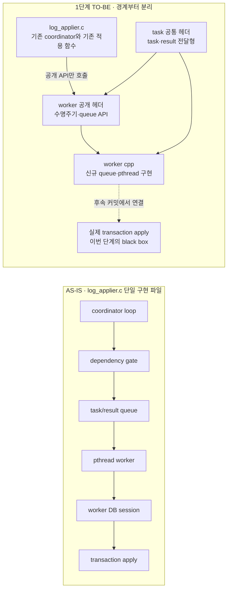
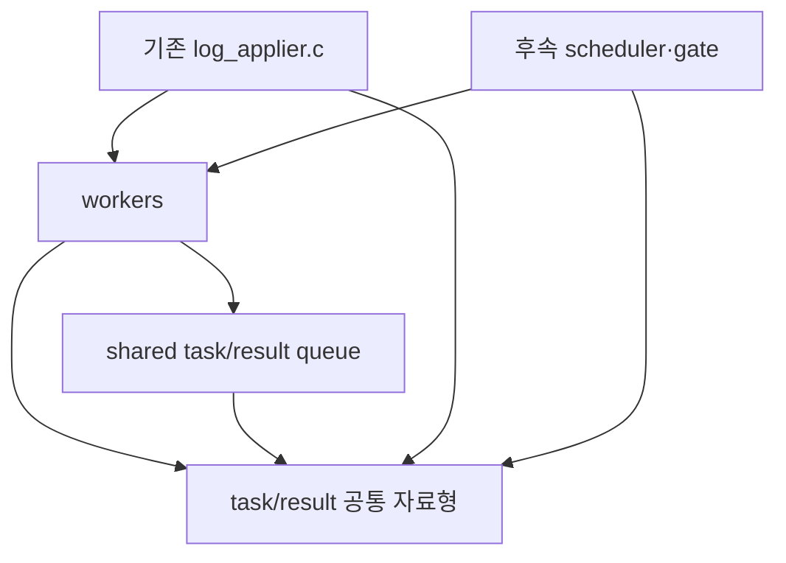
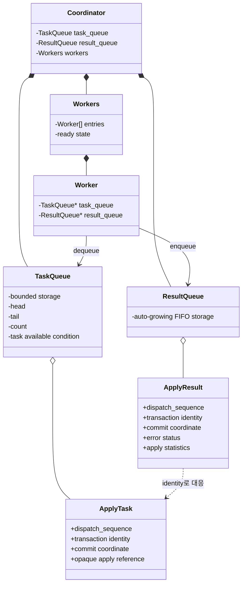
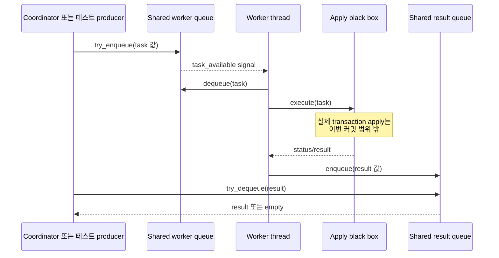
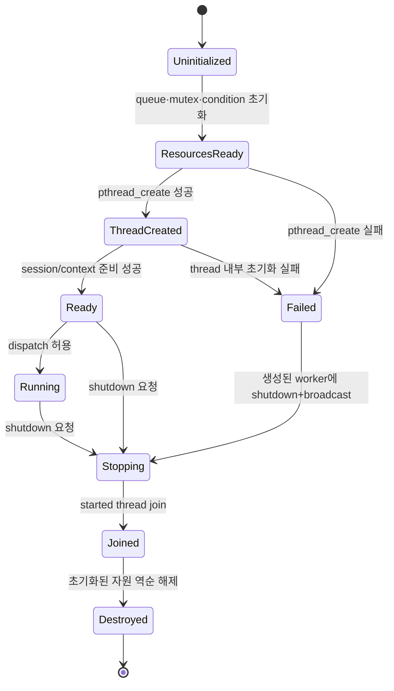
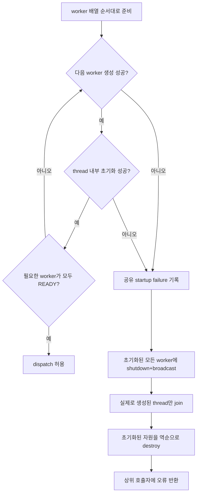
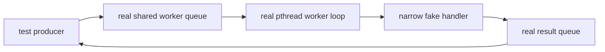

# 병렬 어플라이어 1단계 — worker와 queue 생명주기

이 문서는 병렬 어플라이어 PR의 첫 번째 논리 커밋을 설계한다. 목표는 실제 트랜잭션을 병렬 적용하는 것이 아니라, 후속 구현이 의존할 **모듈 경계와 실행 자원**을 먼저 안전하게 만드는 것이다.

문서에서 `현재 코드`는 `feature/writeset_error_skip`에서 확인한 구현을 뜻하고, `1단계 목표`는 이번 커밋에서 새로 만들 구조를 뜻한다. 구현이 끝나기 전까지 파일명과 함수명은 후보이며, 실제 코드와 함께 확정한다.

## 1. 이번 단계가 먼저 필요한 이유

현재 코드는 task·result 자료형, 두 큐, worker 상태, thread main, DB session, 실제 적용, dispatch와 dependency gate가 모두 `log_applier.c` 안에 있다. 같은 파일의 `static` 상태를 직접 참조하므로 기능을 한꺼번에 옮기면 수명주기 오류와 모듈 분리 오류를 구분하기 어렵다.

첫 단계에서는 기존 코드를 대규모로 이동하지 않는다.

* 외부에서 사용할 경계만 `.hpp`에 먼저 선언한다.
* 기존 함수 본체는 당분간 `log_applier.c`에 둔다.
* 새로 추가하는 worker·queue 함수만 해당 `.cpp`에 구현한다.
* production coordinator에는 연결하지 않아 실제 적용 순서를 바꾸지 않는다.

이렇게 하면 모듈 경계와 thread·queue 정리를 먼저 검증하고, 리뷰가 끝난 기존 함수만 후속 커밋에서 이동할 수 있다.

## 2. AS-IS와 1단계 TO-BE



1단계가 끝나도 coordinator와 실제 적용 함수가 자동으로 새 `.cpp`로 이동하는 것은 아니다. 헤더는 책임 경계를 나타내고, 구현 위치 이동은 후속 리뷰가 끝난 함수부터 진행한다.

### 의존 방향



worker 모듈은 coordinator, gate, `la_Info`를 직접 참조하지 않는다. 필요한 값은 공개 API의 인자나 명시적인 context로 받는다. 이 단방향 의존이 헤더 상호 include와 새로운 전역 결합을 막는다.

## 3. 공개 자료형의 관계

기존 PoC에는 `LA_APPLY_TASK`, `LA_APPLY_RESULT`, worker별 task queue·result queue와 worker 상태가 모두 같은 파일에 있다. 정식 구현은 모듈 사이를 건너는 task와 result를 공통 헤더에 두고, 공용 task queue와 result queue는 별도 queue 모듈로 분리한다. coordinator가 두 queue 인스턴스를 소유하고 worker에는 비소유 포인터를 전달한다.

PoC에서 달라지는 queue 구조는 두 가지뿐이다.

- worker별 task queue를 용량이 고정된 **공용 worker queue 하나**로 합친다.
- worker별 result queue를 **자동 성장하는 공용 result FIFO 하나**로 합친다.

worker queue가 가득 차면 enqueue는 대기하지 않고 `FULL`을 반환한다. result queue는 worker가 완료 결과를 반환할 때 공간을 기다리지 않으며, 전체 미완료 task의 메모리 상한은 후속 coordinator·In-flight List 설계에서 관리한다.



그림의 필드는 의미만 나타낸다. 이번 커밋에서는 `dispatch_sequence`와 In-flight List를 포함해 task-result 대응 기반을 확정한다. dependency와 실제 `LA_APPLY` 소유권에 필요한 나머지 필드는 production coordinator를 연결하는 후속 커밋에서 확정한다. 공통 자료형을 먼저 두는 이유는 worker 모듈과 기존 `log_applier.c`가 서로의 내부 구조를 포함하지 않고 같은 전달 단위를 사용하게 하기 위해서다.

## 4. 공개 API 초안

> [!NOTE]
> **2026-10-10 구현 반영.** worker 모듈(`log_applier_worker.cpp/.hpp`)이 thread 수명과 task loop까지 갖게 됐다. 옮긴 것은 thread 진입점(`la_worker_main`), task loop(`la_worker_run`), 기동 실패 처리(`la_worker_startup_failed`), result 초기화, 그리고 적용 context(`LA_APPLY_WORKER_CONTEXT`, `RECDES` pool, init/final)이다. 트랜잭션 한 건을 적용하는 `la_apply_worker_run_task`와 그 아래 적용·flush·commit 코드는 `log_applier.c`에 남고, `la_worker_start`가 받는 `LA_WORKER_CONFIG`의 `run_task` 콜백으로 넘어간다. config에는 page 크기, pool 크기(= flush 배치 `LA_MAX_UNFLUSHED_REPL_ITEMS`), trace level, 그리고 applier를 멈추라고 알리는 `request_shutdown` 콜백이 함께 들어간다. 살아 있는 worker 수는 모듈이 센다. worker의 debug stage 배열도 모듈 소유가 되어 coordinator는 `la_worker_debug_get_state`로 읽고, 적용 코드는 `la_worker_debug_set_stage`로 쓴다. 아래 초안의 `la_worker_operations`/`shared_context` 자리를 이 config가 대신한다.

실행 기반의 공개 API는 다음과 같다. production 코드는 coordinator를 통해 queue·worker·In-flight List를 함께 생성한다. queue 인스턴스는 coordinator가 소유하고 worker는 전달받은 포인터를 소유하지 않는다. READY 보고와 thread join은 worker 구현 파일에 숨긴다.

```cpp
int la_task_queue_create (std::size_t capacity, la_task_queue **queue_out);
void la_task_queue_destroy (la_task_queue *queue);
la_queue_enqueue_status la_task_queue_try_enqueue (la_task_queue *queue,
                                                    const la_apply_task &task);
bool la_task_queue_dequeue (la_task_queue *queue, la_apply_task &task);
void la_task_queue_shutdown (la_task_queue *queue);

int la_result_queue_create (la_result_queue **queue_out);
void la_result_queue_destroy (la_result_queue *queue);
void la_result_queue_enqueue (la_result_queue *queue,
                              const la_apply_result &result);
bool la_result_queue_try_dequeue (la_result_queue *queue,
                                  la_apply_result &result);

int la_worker_create (std::size_t worker_count,
                      la_task_queue *task_queue,
                      la_result_queue *result_queue,
                      const la_worker_operations &worker_operations,
                      void *shared_context,
                      la_workers **workers_out);
int la_worker_start (la_workers *workers);
void la_worker_stop (la_workers *workers);
void la_worker_destroy (la_workers *workers);

int la_inflight_create (std::size_t capacity,
                              la_inflight_list **order_out);
void la_inflight_destroy (la_inflight_list *order);
la_dispatch_status la_inflight_try_enqueue_task (
  la_inflight_list *order, la_task_queue *task_queue, la_apply_task &task);
int la_inflight_record_task_result (
  la_inflight_list *order, const la_apply_result &result);
bool la_inflight_try_retire_task (
  la_inflight_list *order, la_retired_task &retired);
std::size_t la_inflight_unretired_count (
  const la_inflight_list *order);

int la_coordinator_create (std::size_t worker_count,
                           std::size_t task_queue_capacity,
                           std::size_t inflight_capacity,
                           const la_worker_operations &worker_operations,
                           void *shared_context,
                           la_coordinator **coordinator_out);
int la_coordinator_start_workers (la_coordinator *coordinator);
void la_coordinator_stop_workers (la_coordinator *coordinator);
void la_coordinator_destroy (la_coordinator *coordinator);
```

정상 종료에서는 `la_coordinator_stop_workers()`가 task queue를 먼저 닫아 대기 worker를 깨우고, `la_worker_stop()`이 생성된 pthread를 join한다. `la_worker_destroy()`는 이미 정지한 worker 상태만 해제하며 queue를 해제하지 않는다. worker 시작 도중 일부 thread 생성이나 초기화가 실패한 경우에만 worker 모듈이 task queue를 닫고 이미 시작한 thread를 join한다.

worker와 queue는 한 번 생성하고 한 번 종료하는 one-shot 수명주기를 가진다. 같은 객체에서 `start → stop → start`를 반복하는 기능은 제공하지 않는다. 프로세스를 다시 시작하면 새 객체를 만들며, role change는 기존 객체를 재시작하는 대신 queue와 실행 중 작업을 drain한 뒤 종료한다. 따라서 재시작 전용 `prepare_start`, `open`, `clear`, queue-empty 검사 API는 두지 않는다. 내부 task queue는 생성 직후 enqueue 가능한 상태지만, coordinator는 `la_coordinator_start_workers()`가 모든 worker의 READY를 확인해 반환하기 전과 `la_coordinator_stop_workers()` 이후의 task를 `STOPPED`로 거부한다.

worker thread main과 queue 내부 push/pop, worker session 준비 함수는 다른 모듈이 호출하지 않으므로 공개 헤더에 선언하지 않는다.

### 적용 context 분리

기존 직렬 경로는 레코드 해제에 필요한 `rec_type`, undo/redo unzip buffer와 `RECDES` pool을 `la_Info`와 파일 전역 변수에서 사용한다. 여러 worker가 이 상태를 공유하면 한 worker의 압축 해제 결과나 pool 위치를 다른 worker가 덮어쓸 수 있다. 따라서 실제 dispatch를 연결하기 전에 이 상태를 `LA_APPLY_CONTEXT`로 묶고 적용 함수의 인자로 전달한다.

```text
직렬 경로
la_apply_Context
  └─ la_apply_repl_log(context, ...)

병렬 경로
worker 0 ── LA_APPLY_CONTEXT 0 ── la_apply_repl_log(context, ...)
worker 1 ── LA_APPLY_CONTEXT 1 ── la_apply_repl_log(context, ...)
worker N ── LA_APPLY_CONTEXT N ── la_apply_repl_log(context, ...)
```

첫 변경은 기존 직렬 경로도 같은 context 기반 함수를 호출하게 하여 동작을 보존한다. 후속 production operations의 `initialize`가 worker별 context를 만들고 `finalize`가 해제한다. DB session 생성 방식은 이 객체와 분리한다. CS팀의 `db_restart_sub()`가 `develop`에 들어오면 session 초기화 adapter만 교체하며 queue·worker와 적용 함수의 인자 구조는 바꾸지 않는다.

로그 페이지 cache는 reader와 worker가 함께 사용하므로 worker-local로 복제하지 않는다. 대신 hash 조회·buffer 교체·`fix_count` 변경·cache 확장을 하나의 cache mutex로 보호한다. `la_get_page()`가 반환한 buffer는 `fix_count`가 남아 있는 동안 교체하지 않고, 사용자는 반드시 `la_release_page_buffer()`로 해제한다. 기존 `la_release_all_page_buffers()`처럼 다른 실행 주체가 보유한 fix까지 일괄 해제하는 경로는 병렬 실행에서 안전하지 않으므로 제거한다. 범위 decache도 `fix_count > 0`인 buffer를 건너뛴다.

## 5. 초기화·시작·ready·종료 흐름

> [!NOTE]
> **2026-10-09 결정.** 아래의 READY/FAILED 핸드셰이크는 구현했다가 뺐다. task는 공용 queue에 들어가고 살아 있는 worker 아무나 가져가므로, 일부 worker가 session이나 apply context를 열지 못해도 나머지로 같은 결과를 낸다. 그래서 coordinator는 기다리지 않고, 기동에 실패한 worker는 ERROR 한 줄을 남기고 스스로 빠진다(`la_apply_worker_startup_failed`). 살아 있는 worker 수를 세어 **마지막 하나까지 없어질 때만** applier를 멈춘다. 준비 전에 queue에 쌓인 task는 worker가 뜨면 가져간다. 이 절의 "모든 worker READY 이후에만 dispatch", 8절의 `ready`·`startup_error` 상태, 11절의 READY 관련 검증 항목은 이 결정으로 대체된다.


현재 코드에서 `la_apply_log_file()`은 `la_init()` 다음에 worker를 시작하고, `la_shutdown()`이 worker를 멈춘다. 에러 스킵 브랜치의 `started`는 `pthread_create()` 성공만 뜻하며, thread 내부의 DB session과 실행 context 준비 완료를 뜻하지 않는다.

1단계 목표는 **thread 생성 성공**과 **task를 받을 준비 완료**를 구분하는 것이다.

```text
coordinator thread
la_apply_log_file()
├─ la_init()
├─ worker 생성
│  ├─ 공용 bounded task queue·condition 초기화
│  ├─ 공용 result queue·mutex 초기화
│  └─ queue 포인터를 넘겨 worker context 배열 준비
├─ worker 시작
│  ├─ worker별 pthread_create()
│  └─ 모든 worker의 READY 또는 FAILED 대기
└─ 모든 worker READY 이후에만 dispatch 허용

worker thread
worker main
├─ thread-local error context 준비
├─ CS sub-client·DB session 준비
├─ 적용 context 준비
├─ READY 또는 FAILED 보고
└─ task 대기 loop

정상 종료
la_shutdown()
├─ task queue shutdown
│  ├─ 새 enqueue 거부
│  └─ 대기 worker condition broadcast
├─ worker thread join
├─ worker 해제
├─ result queue 해제
└─ task queue 해제

정상 종료
la_apply_log_file()
└─ la_shutdown()
   ├─ worker stop
   │  ├─ shutdown 상태 설정
   │  └─ 모든 condition broadcast
   ├─ worker join
   │  └─ 생성된 pthread만 pthread_join()
   └─ worker destroy
      └─ 초기화된 queue·condition·mutex 역순 해제
```

CS sub-client와 실제 적용 context를 만드는 기존 함수가 첫 커밋에 그대로 연결되는지는 구현 결과로 확정한다. 하지만 READY의 의미는 최종적으로 “이 worker가 task를 받아 DB 작업을 시작할 수 있음”이어야 한다. 단순한 `pthread_create()` 성공을 READY로 보지 않는다.

## 6. task/result queue의 생산자와 소비자



이번 단계의 테스트 producer는 production coordinator를 대신한다. 큐와 thread 수명주기를 검증하기 위해 task를 넣을 수는 있지만, `la_apply_repl_log()`과 실제 DB COMMIT은 아직 연결하지 않는다. 첫 단계는 non-blocking result dequeue만 제공한다. `result_pending`과 `result_available_cond`는 실제 coordinator가 결과 수거와 drain 대기를 연결하는 후속 커밋에서 추가한다.

task에는 후속 gate와 진단에 필요한 `dependency_seq`와 `dependency_is_ref`를 보존하고, 공용 result queue에서는 실제 실행 worker를 식별할 수 있도록 result에 `worker_index`를 담는다. 이 값은 coordinator가 enqueue 대상을 지정하기 위한 값이 아니라 실행 결과와 진단을 위한 값이다. 실제 `er_log` 출력은 production coordinator와 적용 callback을 연결하는 커밋에서 `ha_writeset_trace_level`로 제어한다. 트랜잭션에는 여러 클래스가 포함될 수 있으므로 단일 클래스명을 task 필드로 만들지 않고, 적용 callback이 `LA_ITEM.class_name`을 처리할 때 기록한다.

### 소유권

* enqueue가 성공하면 task **값의 복사본**은 공용 worker queue가 보관한다. 호출자는 입력 구조체 자체를 즉시 재사용할 수 있다.
* worker가 dequeue하면 task 값의 소유권은 worker의 지역 실행 상태로 이동한다.
* worker가 enqueue한 result 값은 result queue가 소유한다.
* coordinator가 result를 dequeue하면 result 값의 소유권은 coordinator로 이동한다.
* task 안의 `apply`는 `LA_APPLY` slot을 참조할 뿐 소유하지 않는다. coordinator는 enqueue 뒤에도 slot을 보존하고, matching result를 In-flight List에서 확정한 뒤에만 slot을 반환한다.
* role change에서는 coordinator가 새 enqueue를 중단하고 worker queue, 실행 중 task와 result queue를 모두 drain한 뒤 worker thread를 정지한다.
* 프로세스 종료나 초기화 실패의 stop은 thread와 queue 자원을 회수하는 절차다. role-change drain을 대신하지 않으며, queue 값 자체와 그 값이 참조하는 `LA_APPLY`를 이중 해제하지 않는다.

## 7. 동기화 불변식

queue와 lifecycle은 서로 다른 동기화 상태로 나눈다.

```text
worker queue mutex
  bounded ring의 head·tail·count
  accepting·stopping
  task 도착 조건

result queue mutex
  자동 성장 result FIFO

worker mutex
  ready_count·startup_error
```

지켜야 할 규칙은 다음과 같다.

* condition wait는 반드시 같은 mutex 아래의 `while` 조건 검사와 함께 사용한다. 신호 자체가 아니라 보호 상태가 참인지 다시 확인하기 위해서다.
* worker queue가 비었을 때 worker가 기다리고, task enqueue는 task-available condition을 알린다.
* worker queue는 용량이 고정된 ring buffer이고, result queue는 worker가 결과 공간을 기다리지 않도록 자동 성장하는 FIFO다.
* enqueue는 대기하지 않는다. worker queue의 ring이 가득 차면 `FULL`을 반환한다.
* `FULL`을 받은 coordinator는 result 수거와 완료 상태 반영을 수행한 뒤 동일 task의 enqueue를 재시도한다. 특정 worker index를 선택하거나 worker queue 안에서 공간을 기다리지 않는다.
* 첫 단계의 result dequeue는 non-blocking이다. production coordinator 연결 시 첫 미수거 result를 알리는 condition을 추가하되, result FIFO의 소유권과 용량 정책은 바꾸지 않는다.
* stop은 worker queue mutex를 잡은 상태에서 기록하고 task를 기다리는 worker condition을 broadcast한다.
* `started`는 join 대상 pthread가 존재한다는 뜻이고, `ready`는 worker 내부 초기화가 끝났다는 뜻이다. 두 상태를 하나의 bool로 대신하지 않는다.
* mutex·condition을 해제하기 전에 해당 객체를 사용할 수 있는 thread를 모두 join한다.
* queue 내부 lock을 잡은 채 DB session 준비나 실제 적용처럼 오래 걸리는 작업을 실행하지 않는다.

공용 worker queue에서는 대기 중인 worker 하나가 task를 가져가므로 coordinator가 worker를 미리 선택하지 않는다. mutex는 짧은 enqueue/dequeue와 상태 전이에만 잡고 실제 DB 적용 중에는 유지하지 않는다. CUBRID의 SERVER_MODE 전용 worker pool은 CS_MODE의 `applylogdb`에 링크되지 않으므로, worker thread는 applier 타깃 안에서 pthread로 관리한다.

## 8. 정상 수명주기와 부분 실패 정리



부분 실패는 정상 종료와 같은 정리 경로를 사용한다.



N번째 worker 생성이나 내부 session/context 준비가 실패해도 앞서 시작한 worker가 남아서는 안 된다. 반대로 생성하지 않은 `pthread_t`를 join하거나 초기화하지 않은 mutex를 destroy해서도 안 된다. 이를 위해 worker별 `resources_initialized`, `thread_created`, `ready` 상태를 구분한다.

## 9. CMake와 빌드 경계

`log_applier.c`는 UNIX의 `cubridcs` 타깃에서 CS_MODE로 빌드된다. SERVER_MODE 전용 `cubthread::worker_pool`이나 connection worker pool을 가져오지 않는다.

첫 커밋의 CMake 변경은 다음으로 한정한다.

```text
cs/CMakeLists.txt
└─ cubridcs의 UNIX transaction source에 신규 worker .cpp 등록
```

공개 헤더가 기존 include 경로 안에 있으면 별도 전역 include 경로를 늘리지 않는다. 새 하위 디렉터리를 사용한다면 그 디렉터리와 소스 파일을 명시적으로 등록한다. CUBRID 빌드는 source glob이 아니라 파일 목록을 사용하므로 신규 `.cpp`가 자동으로 포함된다고 가정하지 않는다.

## 10. 구현 범위

이번 커밋에 포함한다.

* 점진적 모듈 경계와 공통 task/result 전달형
* worker의 공개 API
* 용량이 고정된 공용 worker queue와 자동 성장하는 공용 result FIFO
* worker context와 lifecycle 상태
* mutex·condition 초기화
* pthread 생성과 worker-ready 확인
* shutdown 설정, condition broadcast, join
* 부분 초기화 실패의 역순 정리
* task enqueue와 result 대응을 기록하는 In-flight List
* dispatch 순서에 따른 task retire
* CS 타깃의 신규 `.cpp` 등록
* production 경로를 사용하지 않는 집중 테스트

이번 커밋에는 포함하지 않는다.

* production coordinator와 worker 연결
* 실제 복제 transaction 적용과 DB COMMIT
* production coordinator의 in-flight list 연결
* completed set과 연속 완료 frontier
* `WSET_LABEL` 디코딩
* dependency gate와 pending 재판정
* `LOG_SYSOP_END`
* `committed_lsa`·`required_lsa` 영속화
* 재시작과 failover drain

이 제외 항목을 빈 stub으로 production 경로에 연결하지 않는다. 기능이 꺼진 상태에서 기존 직렬 적용의 동작은 바뀌지 않아야 한다.

## 11. 검증 항목

### 단위 테스트 경계

첫 커밋의 단위 테스트는 DB session이나 실제 복제 적용 없이 worker lifecycle 자체를 검증해야 한다. 이를 위해 범용 DI 프레임워크를 추가하지 않고, worker loop가 task 하나를 처리할 때 호출하는 **좁은 내부 실행 seam**만 둔다.

```cpp
struct la_worker_operations
{
  int (*initialize) (void *shared_context,
                     std::size_t worker_index,
                     void **worker_context);
  int (*execute) (void *shared_context,
                  void *worker_context,
                  const la_apply_task &task,
                  la_apply_result &result);
  void (*finalize) (void *shared_context,
                    void *worker_context);
};
```

Production에서는 고정된 하나의 `la_worker_operations`를 사용한다. `shared_context`는 모든 callback에 같은 값을 전달하고 `worker_context`는 worker별 초기화 결과를 보관한다. 실제 production callback이 worker별 상태만으로 동작한다면 `shared_context` 인자는 제거한다.

operations 묶음은 worker 헤더에만 노출되는 좁은 연결 경계다. production operations 연결은 후속 커밋에서 담당한다. 첫 커밋의 fake operations는 입력 task의 `dispatch_sequence`를 result로 복사하거나, 지정한 task에서 대기·실패를 반환하는 정도로 제한한다. 이 경계는 다음 worker 흐름을 실제 pthread와 condition으로 시험하기 위한 것이며, DB 객체 전체를 mock으로 재현하기 위한 범용 DI 프레임워크가 아니다.

worker 초기화 operation이 성공하면 같은 worker thread에서 finalize operation을 한 번 호출한다. 초기화 도중 실패한 operation은 자신이 만든 부분 자원을 반환 전에 정리해야 하며, worker는 성공하지 않은 context에 finalize를 호출하지 않는다.



단위 테스트가 직접 검증하는 범위는 다음과 같다.

* start가 worker thread의 READY 보고를 기다리는지
* 빈 queue의 worker wait와 enqueue 이후 condition wakeup
* worker queue 포화 시 `FULL` 반환과 동일 task enqueue 재시도
* task enqueue부터 fake handler 실행과 result dequeue까지의 왕복
* shutdown 시 빈 worker queue에서 기다리던 thread가 해제되는지
* worker 내부 READY 전 실패를 start 호출자에게 돌려주는지
* join 이후에는 worker가 queue나 condition에 접근하지 않는지

failure injection도 내부 생성 wrapper 또는 테스트 전용 카운터처럼 좁은 seam으로 제한한다. pthread·DB API 전반을 추상화하는 프레임워크를 만들지 않는다.

다음은 첫 커밋의 단위 테스트 범위가 아니다.

* `db_restart_sub()`를 포함한 실제 DB session 생성·종료
* `la_apply_repl_log()`의 실제 변경 적용
* DB COMMIT·ROLLBACK과 result의 원자성
* 실제 relay log에서 만든 task와 `LA_APPLY`·`LA_ITEM` 소유권
* coordinator의 in-flight list와 frontier
* role-change drain과 result 도착 condition
* `pthread_create()`·mutex·condition 실패 주입

이 항목은 commit 2 이후 integration test에서 production handler와 coordinator 경로가 연결된 다음 검증한다. 첫 커밋에서는 fake handler로 worker만 고립해 실패 원인을 thread·queue 생명주기로 한정한다.

### 통과 조건

첫 커밋은 다음을 통과해야 한다.

* worker 0개, 1개, 여러 개의 초기화 정책이 명확하다.
* 모든 worker가 READY가 된 뒤에만 start가 성공한다.
* 공용 worker queue의 FIFO와 wrap-around가 유지된다.
* 여러 worker가 반환한 결과가 공용 result queue에서 유실 없이 수거된다.
* 빈 worker queue에서 기다리던 worker가 stop broadcast로 종료된다.
* worker queue 포화 시 enqueue가 대기하지 않고 `FULL`을 반환한다.
* thread 내부 session/context 준비 실패가 start 호출자에게 전달된다.
* one-shot 종료에서 double destroy와 join 누락이 없다.
* worker queue가 가득 찬 경우 task를 성공으로 위장해 버리지 않는다.
* `cubridcs`와 관련 단위 테스트 타깃이 빌드된다.
* 기능 비활성 상태에서 기존 직렬 applylogdb 경로가 유지된다.

### SYSOP_END 관찰 로그

`ha_writeset_trace_level >= 1`에서는 SYSOP task 전환 여부를 판단하기 위한 관찰 로그를 남긴다. 이 로그는
스케줄링이나 적용 대상을 바꾸지 않는다.

이 파라미터는 `PRM_FOR_CLIENT | PRM_FOR_SERVER | PRM_FOR_HA`로 등록한다. 따라서 같은
`cubrid_ha.conf` 설정을 master server와 client-mode applylogdb가 각각 로드한다.

* 마스터는 SYSOP_END마다 trid, SYSOP_END type·LSA, 버퍼에 있던 replication item 수, 실제 flush 대상 수를 기록한다.
* 슬레이브는 SYSOP_END 경계 이하와 경계 이후의 `LA_ITEM` 수, statement·특수 replication item 수를 기록한다.
* 같은 trid의 최종 COMMIT에서는 직전 SYSOP_END 당시 item 수와 이후 누적 item 수를 함께 기록한다.
* long transaction은 메모리에 보존된 item 수와 `long_tran` 표시를 기록하므로, 전체 로그 재조회 개수와 혼동하지 않는다.

같은 trace level에서 일반 COMMIT·ABORT도 trid, EOT LSA, item 수와 현재 실행 경로를 기록한다. level 2는
`WSET_LABEL` LSA와 dependency LSA, `dependency_is_ref`를 추가로 기록한다. 현재 readiness guard가 병렬 실행을
비활성화하므로 실제 로그에는 `path=serial`이 기록된다. callable parallel 분기에서는 같은 필드에
`path=parallel`을 기록한다.

병렬 분기가 활성화되면 같은 trace level에서 task schedule status와 dispatch sequence, 성공 retire의 worker
index, 실패 result의 error를 기록한다. 이 로그는 dependency 판정이나 완료 상태를 변경하지 않는다.

`LOG_SYSOP_END`는 이 단계에서 task로 분리하지 않는다. 병렬 adapter가 활성화된 뒤 SYSOP_END를 만나면 기존
serial 처리 전에 coordinator outstanding을 모두 수거·retire하는 hook만 연결했다. 독립 SYSOP task의 item
분리와 같은 trid 연쇄 dependency는 후속 구현 범위다.

## 12. 후속 통합에서 확정할 항목

worker queue `FULL`과 전체 outstanding 포화 시 정책은 [[02-slave-implementation-design#3. 실행 자원과 큐|슬레이브 실행 자원 설계]]와 [[09-applier-in-flight-design#5. Gate Order, pending과 backpressure 연결|Gate Order·In-flight List 연결 설계]]에서 확정한다. reader만 새 로그 진행을 멈추고 coordinator는 result 수거·frontier·retire·pending pump를 계속 수행한다.

다음은 구현 결과와 함께 이 문서에서 확정한다.

* `result_pending`과 result 도착 condition의 정확한 소유 모듈
* 현재 operations 경계를 기존 `la_apply_worker_start_session()`·적용 context에 연결하는 방식
* PoC에서 하드코딩한 worker 수와 메모리 한도를 각각 어떤 시스템 파라미터로 받을지
  * worker 수, worker queue 용량과 전체 미완료 task 상한의 관계를 정한다.
  * 0, 음수, 지나치게 큰 값의 검증 범위와 기본값·최댓값을 정한다.
  * 고정 worker queue, worker context와 전체 미완료 task 상한을 기준으로 최대 메모리를 계산한다.
  * 검증된 값은 worker 생성 시 한 번 읽어 캐시하고 실행 중 임의 변경은 허용하지 않는다.

이 항목들은 production coordinator를 연결하는 커밋에서 코드와 함께 확정한다.
