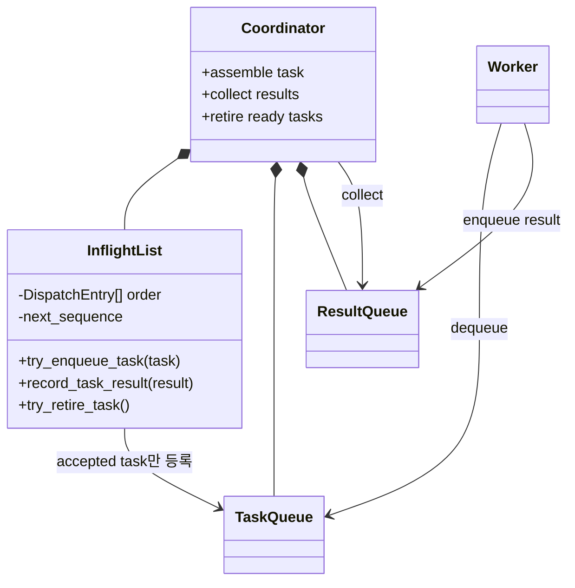

# 병렬 어플라이어 In-flight List와 순서 보장 retire

이 문서는 coordinator의 task 전달, result 수거와 dependency gate 연결을 설계한다. 공용 queue를 사용해도 task-result 대응, `LA_APPLY` 슬롯 수명, bounded outstanding과 gap-free frontier가 함께 유지되는 조건을 고정한다.

## 1. 모듈 책임



`In-flight List`는 worker를 선택하거나 dependency를 판정하지 않는다. coordinator가 실행 가능하다고 결정한 task를 공용 worker queue에 넣고, 그 task가 실제로 받아들여졌을 때만 In-flight List에 기록한다. enqueue 전 task 값은 gate pending FIFO가 계속 소유한다.

`la_coordinator`는 task queue, result queue, worker, In-flight List의 생성·시작·종료 순서를 한곳에서 관리한다. 또한 자신이 소유한 result queue를 직접 비우면서 각 결과를 In-flight List에 기록한다. In-flight List는 result queue를 알지 않고 전달받은 결과와 기존 entry만 대응시킨다. `la_coordinator_start_workers()`는 모든 worker가 READY가 될 때까지 기다리고, `la_coordinator_stop_workers()`는 task queue를 닫은 뒤 worker join을 요청한다. 각 worker는 두 queue의 비소유 포인터만 사용한다.

## 2. 배정과 결과 대응

```text
coordinator가 완성한 task
  → Gate Order에 로그 순서로 한 번 등록
  → gate pending FIFO가 task 값을 보관
  → coordinator가 다음 dispatch_sequence를 임시 지정
  → 공용 task queue try_enqueue
      ├─ FULL: pending에 유지, In-flight List 미등록, sequence 미소비
      ├─ STOPPED: 종료 오류, 재시도 pending으로 바꾸지 않음
      └─ ACCEPTED: DispatchEntry를 tail에 기록하고 sequence 확정,
                   gate pending에서 제거

worker 완료
  → result.dispatch_sequence와 함께 공용 result queue에 반환
  → coordinator가 result를 수거
  → 같은 dispatch_sequence의 DispatchEntry에 결과 기록
```

공용 queue에서는 어느 worker가 task를 가져갈지 coordinator가 미리 알 필요가 없다. `worker_index`는 실행 결과와 진단에만 사용하고, task-result 대응은 재사용되지 않는 `dispatch_sequence`로 수행한다.

Gate Order entry는 `FULL` 재시도마다 추가하지 않는다. 임시 `dispatch_sequence`도 enqueue 성공 전에는 증가시키지 않는다. 따라서 같은 task를 여러 번 재시도해도 Gate Order는 한 건이고 In-flight List는 최종 성공 시 한 건이며 sequence gap이 생기지 않는다.

`try_enqueue_task()`는 먼저 In-flight List의 빈 slot을 확인·예약한 뒤 worker queue enqueue를 시도한다. queue가 `FULL`이면 예약을 되돌리고 sequence를 소비하지 않는다. queue가 `ACCEPTED`를 반환한 뒤에는 미리 확보한 slot에 allocation 없는 확정 기록만 수행하므로, “queue에는 들어갔지만 In-flight List에는 없는 task”를 만들지 않는다.

## 3. retire 순서

worker 완료 순서는 dispatch 순서와 달라질 수 있다. result는 도착 즉시 해당 entry에 기록하지만, In-flight List head가 준비되지 않았다면 뒤의 ready result를 retire하지 않는다.

```text
dispatch: T1 → T2 → T3
result:             T3 ✓   T2 ✓   T1 ✓

T3·T2 결과 도착
  → 각 entry에는 저장
  → head T1이 미완료이므로 retire 중지

T1 결과 도착
  → T1 retire → T2 retire → T3 retire
```

retire 결과에는 worker result뿐 아니라 task가 참조하던 `LA_APPLY *`와 record type을 함께 돌려준다. coordinator는 이 시점에 commit node와 적용 슬롯을 정리한다. worker 완료 직후 슬롯을 비우면 reader가 같은 슬롯을 재사용하는 동안 In-flight List가 이전 task의 포인터를 들고 있게 되므로 금지한다.

## 4. 용량과 오류 조건

In-flight List의 `capacity`는 worker queue 크기가 아니라, queue에 전달된 뒤 아직 순서대로 retire되지 않은 entry의 최대 개수다. 따라서 queue에서 이미 빠져 실행 중인 task와 result가 도착했지만 앞선 task를 기다리는 entry도 포함한다. dependency gate 앞 pending task는 In-flight List capacity에는 포함하지 않지만 coordinator의 `total_outstanding_capacity`에는 포함한다.

다음 상태는 서로 구분한다.

- worker queue `FULL`: task를 gate pending의 `READY_BACKPRESSURED`로 유지하고 result 수거·retire 후 같은 task를 다시 시도한다.
- dispatch limit 도달: task를 `READY_BACKPRESSURED`로 유지하고 아직 retire되지 않은 task를 먼저 수거·retire한다.
- queue `STOPPED`: 종료 절차이므로 새 task를 배정하지 않는다.
- 모르는 sequence 또는 같은 result의 중복 수거: 내부 순서 상태가 깨진 오류로 처리한다.

## 5. Gate Order, pending과 backpressure 연결

COMMIT을 읽은 순서와 worker에 dispatch한 순서는 달라질 수 있으므로 Gate Order와 In-flight List를 분리한다.

- In-flight List: 실제로 worker에 보낸 task와 result의 수명 관리
- Gate Order: pending을 포함해 reader가 accept한 모든 task의 완료 여부와 gap-free frontier 계산

두 순서를 하나의 배열로 합치면 dependency에 막힌 task와 실제 dispatch된 task의 순서가 달라질 때 result 대응과 frontier 계산이 서로 얽힌다. In-flight List는 frontier를 계산하지 않고, Gate Order는 worker queue enqueue 여부로 완료를 추정하지 않는다.

```text
coordinator pump
  1. result queue를 끝까지 수거
  2. In-flight List entry에 result 기록
  3. 성공 result를 Gate Order completed set에 표시하고 frontier 전진
  4. ready In-flight List head를 순서대로 retire
  5. pending FIFO 재판정·enqueue 시도
  6. capacity가 열렸으면 reader 재개
```

앞의 `WAIT_DEPENDENCY`는 뒤의 ready 독립 task가 우회할 수 있다. 다만 ready task 사이에서는 pending 등록 순서를 유지한다. worker queue `FULL` 또는 dispatch limit으로 앞선 ready task가 실패하면 그 뒤 ready task를 먼저 보내지 않는다.

`total_outstanding_capacity`에 도달하면 reader는 새 task를 Gate Order에 등록하지 않고 해당 로그 경계에서 멈춘다. 이때 coordinator pump는 계속 실행해야 한다. result 수거와 retire를 중단한 채 queue 공간만 기다리면, 공간을 열 결과가 result queue에 이미 있어도 처리되지 않는 교착이 생길 수 있다.

## 6. 이번 단계의 검증

- 공용 queue가 받아들인 task만 In-flight List에 존재한다.
- queue `FULL` 뒤 재시도해도 sequence가 불필요하게 건너뛰지 않는다.
- queue `FULL` 재시도에서 Gate Order와 In-flight List에 같은 task가 중복 등록되지 않는다.
- 앞의 dependency-pending을 뒤 ready task가 우회하지만 ready task끼리의 상대 순서는 바뀌지 않는다.
- 전체 outstanding 포화 시 reader의 LSA는 멈추고 coordinator pump가 result를 수거해 capacity를 다시 연다.
- 모든 outstanding task가 dependency 대기라면 선행 LSA가 이미 outstanding/frontier에 있는지 검사하고, 없는 선행은 무한 read-ahead가 아니라 오류로 처리한다.
- result가 역순으로 도착해도 head 전에는 retire되지 않는다.
- 모르는 sequence와 중복 result를 거부한다.
- result 수거 후 retire가 task의 `LA_APPLY *`를 그대로 반환한다.

production `log_applier.c`는 dependency gate와 Gate Order frontier까지 연결하지만, worker별 독립 DB session
adapter가 준비되기 전에는 readiness guard로 coordinator 활성화를 막는다.
