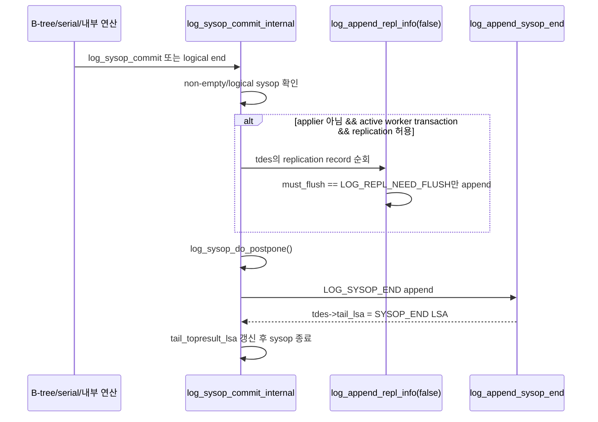
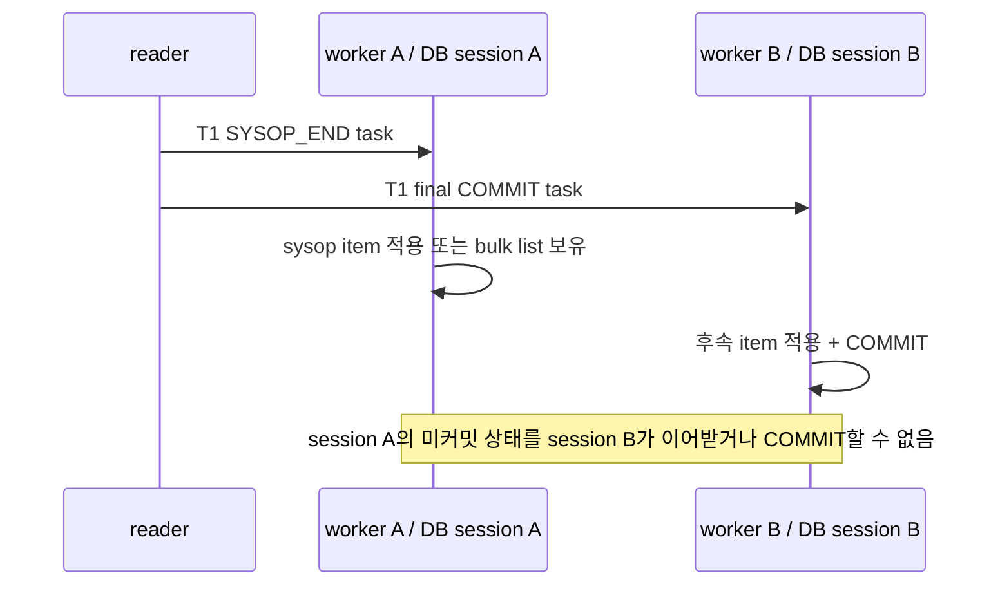

# `LOG_SYSOP_END` 조사와 병렬 적용 처리안 검증

## 0. 2026-10-02 현재 실험 기준

이번 실험의 우선 목적은 해결안을 먼저 넣는 것이 아니라, **develop의 `LOG_SYSOP_END` 처리 경로를 병렬 COMMIT 경로와 함께 실행했을 때 어떤 영향이 생기는지 관측하는 것**이다.

현재 작업 트리는 다음 상태를 기준으로 한다.

- `LOG_SYSOP_END`와 `LOG_COMMIT`은 develop처럼 같은 commit-list 진입 경로를 사용한다.
- `LOG_SYSOP_END`는 coordinator의 기존 `la_apply_commit_list()` → `la_apply_repl_log()` 경로에서 처리한다.
- 최종 `LOG_COMMIT`만 병렬 worker task로 dispatch한다.
- worker 전체 완료를 기다리는 SYSOP drain/barrier는 제거했다.
- SYSOP을 무시하거나 최종 COMMIT까지 강제로 보류하는 별도 `break`도 넣지 않았다.
- 스케줄링과 적용 의미를 바꾸지 않고 `ha_writeset_trace_level` 조건의 관찰 로그만 추가했다.

따라서 현재 코드는 최종 설계가 아니라 다음 혼합 상태를 의도적으로 재현한다.

```text
LOG_SYSOP_END
  → coordinator session에서 develop 경로로 적용

LOG_COMMIT
  → dependency gate를 거쳐 worker session에서 적용·flush·commit
```

이 상태에서 문제가 나오더라도 곧바로 drain이나 SYSOP task화를 정답으로 채택하지 않는다. 먼저 실행 순서와 데이터 결과로 영향 자체를 증명한다.

### 0.1 추가한 추적 로그

`ha_writeset_trace_level >= 1`에서 다음 로그를 남긴다.

```text
[WSET] SYSOP master ...
[WSET] SYSOP slave phase=sysop_end ...
[WSET] SYSOP slave phase=final_commit ...

[WSET] coordinator apply begin trid=... record=SYSOP_END|COMMIT|ABORT boundary_lsa=... items=...
[WSET] coordinator apply end   trid=... record=... boundary_lsa=... rows=... remaining_items=... error=...
[WSET] coordinator flush begin/end ...
[WSET] coordinator commit begin/end ...

[WSET] worker apply begin/end  trid=... worker=... dispatch=... commit_lsa=...
[WSET] worker flush begin/end  trid=... worker=... dispatch=... commit_lsa=...
[WSET] worker commit begin/end trid=... worker=... dispatch=... commit_lsa=...
```

worker는 task 하나가 하나의 DB transaction이므로 flush·commit 로그에 `trid`가 직접 들어간다. coordinator는 주기적 `la_log_commit()` 전까지 여러 SYSOP의 변경을 같은 session에 누적할 수 있다. coordinator flush·commit 로그 자체에는 단일 `trid`를 억지로 붙이지 않고, 직전에 출력된 `coordinator apply`의 `trid`와 `boundary_lsa`를 시간 순서로 연결한다. worker가 flush한 항목은 worker의 별도 session에 속하므로 coordinator commit에 포함되지 않는다.

### 0.2 이 로그로 확인할 내용

- SYSOP 경계에서 어떤 `trid`의 몇 개 item이 coordinator에 적용되는가
- SYSOP 뒤 같은 `trid`에 몇 개 item이 남아 최종 worker task로 전달되는가
- coordinator SYSOP 적용과 다른 worker의 flush·commit이 어떤 순서로 겹치는가
- 같은 `trid`가 SYSOP 부분은 coordinator, 최종 부분은 worker로 나뉘는가
- 마스터 로그 순서와 슬레이브의 실제 DB commit 순서가 어떻게 달라지는가
- 오류·`fail_counter` 증가가 어느 `trid`·경계 LSA·worker commit과 연결되는가
- `committed_lsa`가 실제 worker 완료보다 앞서 영속되는 정황이 있는가

로그만으로 정합성을 확정하지 않는다. 같은 실행의 master/slave 전체 데이터, `db_serial`, UNIQUE 중복, FK orphan, `fail_counter`, 필요하면 중간 종료·재시작 결과를 함께 판정한다.

### 0.3 현재 검증 상태

- 현재 소스의 `log_applier.c`는 위 로그를 포함하며 `cubridcs` 증분 빌드가 성공했다.
- 아직 이 바이너리를 두 HA 노드에 재배포하지 않았다.
- 기존 `parallel-mix` PASS와 `random` APPLY_ERROR 실행은 **SYSOP worker drain이 들어 있던 이전 배포 바이너리**의 결과다. 현재 no-drain 경로의 근거로 사용하면 안 된다.
- 따라서 아래 기존 조사에서 “최종 COMMIT까지 보류”를 후보로 적은 부분 역시 이번 실험의 현재 동작을 뜻하지 않는다.

## 1. 판정 상태

| 구분 | 내용 |
|---|---|
| **[검증 사실]** | `LOG_SYSOP_END`는 사용자 트랜잭션의 COMMIT이 아니라 내부 system operation의 종료·복구 경계다. |
| **[검증 사실]** | develop 슬레이브는 이 경계까지의 `LA_ITEM`을 즉시 적용 경로에 넘기지만, `SYSOP_END` 자체에서 DB COMMIT을 호출하지 않는다. |
| **[검증 사실]** | DB COMMIT은 별도 `la_log_commit()`이 `la_flush_repl_items(true)` → `_db_ha_apply_info` 갱신 → `la_commit_transaction()` 순서로 수행한다. |
| **[위험]** | `SYSOP_END`와 최종 COMMIT을 서로 무관한 worker task로 보내면 같은 DB session/transaction을 이어갈 수 없고, 같은 `trid`의 item 소유권도 경합한다. |
| **[가설: 검증 대상]** | 병렬 경로에서는 `SYSOP_END`를 관찰만 하고 item을 소비·dispatch하지 않은 뒤, 최종 COMMIT에서 같은 `trid`의 전체 item을 하나의 worker task로 보낸다. ABORT는 누적 item을 폐기한다. |
| **[검증 사실: 반례 위험]** | `serial_update_serial_object()`는 flush mark 안에서 `db_serial` UPDATE replication record를 만들고 `log_sysop_commit()`으로 끝낸다. 바깥 rollback은 `LOG_SYSOP_END_COMMIT`에서 parent LSA로 건너뛰므로 이 독립 sysop을 되돌리지 않는다. 단순히 outer ABORT에서 item을 폐기하면 슬레이브가 달라질 수 있다. |
| **[미결]** | statement·기타 특수 replication item, 실제 workload별 발생 빈도, long transaction 비용은 관찰 로그로 확인해야 한다. |

현재 정식 설계인 [[01-master-implementation-design]]과 [[02-slave-implementation-design]]은 의미 보존을 위해 **복제 item이 있는 SYSOP을 별도 task로 처리하는 안**을 기술한다. 이 문서는 더 단순한 “최종 COMMIT까지 보류” 안을 검증하기 위한 조사 기록이며, 통과 전에는 정식 설계를 바꾸지 않는다.

현재 브랜치도 함께 대조했다. `feature/CBRD-27508-parallel-applylogdb-applier`의 production `log_applier.c`는 아직 develop의 직렬 SYSOP 처리 흐름을 유지한다. 작업 트리의 `la_apply_task`/worker pool에는 `record_type` 전달 필드가 있지만 production reader와 연결되지 않았으므로, 그것만으로 SYSOP dispatch 정책이나 같은-`trid` affinity가 구현됐다고 판단하지 않는다.

## 2. `SYSOP_END`가 발생하는 이유

**[검증 사실]** `log_sysop_commit_internal()`의 주석과 `LOG_SYSOP_END_TYPE` 정의에 따르면 system operation은 내부 변경 묶음의 원자성·영속성 및 recovery undo/compensate/postpone를 표현한다.

```text
사용자 트랜잭션 T
├─ 일반 데이터 변경
├─ system operation
│  ├─ 페이지·인덱스 내부 변경
│  ├─ 필요 시 replication record
│  └─ LOG_SYSOP_END
├─ 후속 변경
└─ LOG_COMMIT 또는 LOG_ABORT
```

대표 B-tree 경로는 다음과 같다. 모든 insert/delete가 system operation을 여는 것은 아니며 overflow page, 물리 삭제, online index, undo/compensate 등 목적별 조건에서 열린다.

```text
btree_insert()
└─ btree_insert_internal()
   └─ overflow/new-key 등 조건
      ├─ log_sysop_start()
      ├─ B-tree page 변경 및 recovery log
      └─ btree_insert_sysop_end()
         ├─ log_sysop_end_logical_undo()
         ├─ log_sysop_end_logical_compensate()
         └─ log_sysop_commit()

btree delete 계열 진입점
└─ btree_delete_internal()
   └─ overflow/physical delete 등 조건
      ├─ log_sysop_start()
      ├─ B-tree page 변경 및 recovery log
      └─ btree_delete_sysop_end()
         ├─ log_sysop_end_logical_undo()
         ├─ log_sysop_end_logical_run_postpone()
         ├─ log_sysop_end_logical_compensate()
         └─ log_sysop_commit()
```

**[검증 사실]** `SYSOP_END` 발생과 replication item 존재는 같은 조건이 아니다. 빈 일반 sysop은 end record 자체가 생략될 수 있고, non-empty sysop도 `LOG_REPL_NEED_FLUSH` 항목이 없으면 `log_append_repl_info(..., false)`가 기록할 replication item은 0개다.

## 3. develop 마스터 호출 스택

기준: `origin/develop` `c63a3b9`, `src/transaction/log_manager.c:3893-3967`, `:4615-4697`.



`log_append_repl_info_internal(..., is_commit=false)`의 실제 선택 조건은 다음과 같다.

```c
(is_commit && must_flush != LOG_REPL_DONT_NEED_FLUSH)
|| must_flush == LOG_REPL_NEED_FLUSH
```

따라서 sysop 직전에는 `NEED_FLUSH`만 기록된다. 최종 COMMIT의 `is_commit=true` 호출은 index를 0으로 되돌려 아직 기록하지 않은 COMMIT 대상 item을 기록한다.

## 4. develop 슬레이브 호출 스택

기준: `origin/develop` `c63a3b9`, `src/transaction/log_applier.c:5742-5908`, `:5935`, `:6106-6290`, `:6536-6568`, `:6713-6790`.

### 4.1 SYSOP 경계까지 item 소비

```text
la_apply_log_file()
└─ la_log_record_process(lrec)
   ├─ LOG_REPLICATION_DATA / LOG_REPLICATION_STATEMENT
   │  └─ la_set_repl_log() → 같은 trid의 LA_APPLY에 LA_ITEM 추가
   └─ LOG_SYSOP_END / LOG_COMMIT
      ├─ la_add_node_into_la_commit_list(trid, lsa, type)
      └─ la_apply_commit_list()
         └─ la_apply_repl_log(trid, type, boundary_lsa)
            ├─ item.lsa <= boundary_lsa인 item 순회
            │  ├─ DATA: la_apply_update/insert/delete_log()
            │  │  ├─ la_flush_repl_items(false)
            │  │  └─ la_repl_add_object() → bulk list
            │  └─ STATEMENT: la_apply_statement_log()
            │     └─ la_flush_repl_items(true) 후 statement 실행
            ├─ 소비한 LA_ITEM 해제
            └─ SYSOP_END 뒤 item은 같은 LA_APPLY에 보존
```

`la_flush_repl_items(false)`는 `num_unflushed >= LA_MAX_UNFLUSHED_REPL_ITEMS(200)`일 때만 실제 bulk flush를 수행한다. statement 경로는 앞선 bulk item과 실행 순서를 맞추기 위해 `true`로 강제 flush한다.

`la_log_record_process()`는 처리된 commit-list node의 LSA를 메모리 `la_Info.committed_lsa`에 복사한다. 이는 아직 DB COMMIT이 끝났다는 뜻이 아니다.

### 4.2 실제 DB COMMIT

```text
la_check_time_commit()
├─ commit interval 경과 확인
├─ total_rows 변화 또는 apply-info 갱신 필요 확인
└─ la_log_commit()
   ├─ la_find_required_lsa()
   ├─ la_flush_repl_items(true)
   ├─ la_update_ha_last_applied_info()
   └─ la_commit_transaction()
      └─ db_commit_transaction()
```

role/state 전환, end-of-log, replica time-bound 등의 경로도 `la_log_commit()`을 강제로 호출한다.

```text
SYSOP_END의 의미
  = 이 경계까지 LA_ITEM을 적용/bulk 목록으로 소비하는 중간 적용 경계
  != LOG_SYSOP_END를 읽는 즉시 독립 DB COMMIT
```

## 5. 병렬 task로 그대로 분리할 때의 위험



**[검증 사실]** 현재 task queue는 어느 worker가 task를 가져갈지 보장하지 않는다. `record_type`과 `LA_APPLY *`를 전달할 수 있다는 사실만으로 같은 `trid`의 session affinity가 생기지 않는다.

독립 task화하려면 최소한 다음을 함께 해결해야 한다.

- 같은 `trid`의 SYSOP task → 다음 SYSOP/COMMIT task 순서 보장
- reader가 뒤 item을 추가하는 목록과 worker가 앞 item을 제거하는 목록의 소유권 분리
- SYSOP task 자체를 DB COMMIT할지, worker session을 최종 COMMIT까지 고정할지 결정
- 완료 표식, frontier, 재시작 시 SYSOP 단위 중복 적용 방지
- SYSOP 범위 dependency label과 history publish

## 6. 후보 해결안: 최종 COMMIT까지 누적

**[가설: 아직 구현 결정 아님]**

```text
LOG_REPLICATION_*
  → 같은 trid의 LA_APPLY에 누적

LOG_SYSOP_END
  → 관찰 로그만 기록
  → LA_ITEM 소비 안 함
  → task dispatch 안 함

LOG_COMMIT
  → 같은 trid의 전체 LA_ITEM을 한 task로 고정
  → 한 worker가 apply → flush → DB COMMIT

LOG_ABORT
  → 같은 trid의 미적용 LA_ITEM 전부 폐기
  → abort 완료 위치만 coordinator가 처리
```

장점은 한 사용자 트랜잭션을 한 worker session에서 끝내므로 worker affinity와 부분 목록 동기화가 필요 없다는 점이다. 그러나 develop이 의도적으로 SYSOP 앞 replication item을 조기에 적용하는 사례의 의미까지 보존하는지는 확인되지 않았다.

**[검증 사실]** `db_serial`은 이미 코드 수준 반례 후보다. `serial_update_serial_object()`는 `repl_start_flush_mark()` → `repl_log_insert(...RVREPL_DATA_UPDATE...)` → `repl_end_flush_mark(false)` → `log_sysop_commit()` 순서이고, `repl_log_insert()`는 `CT_SERIAL_NAME`을 `LOG_REPL_NEED_FLUSH`로 표시한다. 따라서 위 후보는 모든 SYSOP에 그대로 적용할 최종안이 아니라, “독립 sysop item이 없는 일반 경로” 또는 별도 예외 규칙의 타당성을 확인하는 안이다.

## 7. 관찰 로그 설계

로그는 `ha_writeset_trace_level >= 1`에서만 출력하고 스케줄링·적용 대상을 바꾸지 않는다. LSA는 `pageid|offset`, item type은 enum 이름과 정숫값을 함께 기록한다.

### 7.1 마스터

`log_sysop_commit_internal()`에서 replication append 전·후와 SYSOP_END append 후를 한 event id로 연결한다.

```text
MASTER_SYSOP_END
event_id, trid, sysop_depth, sysop_end_type,
parent_lsa, tail_lsa_before, sysop_end_lsa,
cur_repl_record, append_repl_recidx_before, append_repl_recidx_after,
repl_buffer_count,
eligible_need_flush_count,
actually_appended_count,
data_count, statement_count,
first_appended_repl_lsa, last_appended_repl_lsa,
rcvindex_counts
```

최종 종료점에도 다음을 남긴다.

```text
MASTER_EOT
trid, eot_type(COMMIT|ABORT), eot_lsa,
sysop_end_count,
sysop_appended_item_total,
items_added_after_last_sysop,
commit_appended_item_count,
data_count, statement_count, rcvindex_counts
```

`actually_appended_count`는 단순 `cur_repl_record`가 아니라 `log_append_repl_info_internal()`이 실제 log node를 만든 횟수여야 한다.

### 7.2 슬레이브 reader와 worker

```text
SLAVE_SYSOP_END_OBSERVED
trid, sysop_end_lsa,
apply_found, is_long_trans,
resident_item_count,
boundary_le_count, boundary_gt_count,
data_count, statement_count,
special_rcvindex_counts,
head_item_lsa, tail_item_lsa,
consumed_count, dispatched_task_count

SLAVE_EOT_ASSEMBLE
trid, eot_type, eot_lsa,
sysop_end_count,
total_item_count,
items_before_first_sysop,
items_between_sysops,
items_after_last_sysop,
data_count, statement_count,
special_rcvindex_counts,
task_item_count, discarded_item_count

SLAVE_TASK_RESULT
worker_index, dispatch_sequence, trid, record_type,
commit_lsa, task_item_count, applied_count, filtered_count,
bulk_flush_count, forced_flush_count,
db_commit_result, committed_rep_lsa
```

long transaction에서는 `resident_item_count`와 로그 재조회로 얻는 `boundary_*_count`를 구분한다. 필요하면 재조회 count를 별도 `reconstructed_item_count`로 기록한다.

### 7.3 flush와 영속 시점

```text
SLAVE_DB_COMMIT
trigger(periodic|threshold|statement|role_change|end_of_log|shutdown),
num_unflushed_before, flushed_count,
committed_lsa, committed_rep_lsa, required_lsa,
apply_info_update_result, db_commit_result
```

이 로그로 “item을 소비함”, “서버에 bulk flush함”, “DB transaction을 COMMIT함”을 서로 다른 사건으로 확인한다.

## 8. 통과·실패 기준

### 후보안 통과

다음 조건을 모두 만족해야 최종 COMMIT 누적안을 채택한다.

1. 일반 DML·B-tree workload에서 `SYSOP_END`의 `actually_appended_count`가 0이거나, append된 item이 최종 COMMIT task에 정확히 한 번 포함된다.
2. 같은 `trid`의 여러 SYSOP 전·후 item 합계가 `task_item_count`와 일치하고 누락·중복 적용이 없다.
3. `SYSOP_END` 시 `consumed_count=0`, `dispatched_task_count=0`이고 최종 COMMIT에서만 task가 1개 생성된다.
4. outer ABORT workload에서 마스터에 남아야 하는 독립 sysop 효과가 없거나, `db_serial` 같은 효과를 보존하는 별도 처리 규칙이 증명된다.
5. statement·특수 `rcvindex`가 SYSOP 경계에서 선행 flush/적용을 요구하지 않는다.
6. long transaction의 최대 `LA_ITEM` 보존량과 로그 재조회 비용이 설정한 메모리·지연 한도 안이다.
7. crash/restart 후 COMMIT task 단위 재적용에서 데이터와 `committed_lsa`가 develop 결과와 일치한다.

### 즉시 실패

다음 중 하나라도 나오면 단순 누적안을 그대로 채택하지 않는다.

- outer ABORT 뒤에도 마스터에 남는 SYSOP item이 있는데 슬레이브 ABORT가 이를 폐기한다.
- 같은 자원에 대한 후행 트랜잭션이 앞 트랜잭션의 최종 COMMIT 전에 SYSOP 결과를 관측·사용해야 한다.
- statement/DDL 또는 특수 replication item이 SYSOP 경계의 강제 flush를 전제로 한다.
- COMMIT task의 item 수가 마스터의 sysop append 합계 + commit append 합계와 다르다.
- long transaction에서 보존량·재조회 시간이 허용 한도를 넘는다.

특히 AUTO_INCREMENT/serial 갱신 후 outer ROLLBACK, `INCR()/DECR()`, checksumdb statement 복제는 필수 실패 탐지 workload다.

## 9. 미해결 사례

| 사례 | 확인할 질문 | 현재 상태 |
|---|---|---|
| `db_serial`/AUTO_INCREMENT | sysop에서 먼저 기록된 UPDATE가 outer ABORT 뒤에도 마스터에 남는가 | **[코드 검증 사실]** 독립 sysop과 `NEED_FLUSH`가 확인됐다. 로그로 실제 발생 횟수와 최종 값 대조가 필요하다. |
| `INCR()/DECR()` | 독립 sysop의 visibility와 순서가 최종 COMMIT보다 앞서야 하는가 | **[검증 필요]** |
| statement/checksumdb | `la_apply_statement_log()`의 사전 강제 flush를 COMMIT까지 미뤄도 되는가 | **[검증 필요]** |
| 특수 `rcvindex` | 일반 INSERT/UPDATE/DELETE 외 별도 순서·적용 규칙이 있는가 | **[검증 필요]** |
| long transaction | 메모리 item 수와 로그 재조회 경계가 SYSOP 미소비로 악화되는가 | **[검증 필요]** |
| restart | develop의 `last_committed_lsa`/`last_committed_rep_lsa` 부분 경계와 달라져도 정확한가 | **[검증 필요]** |

## 10. 보류·기각한 대안

| 대안 | 상태 | 이유 |
|---|---|---|
| SYSOP_END와 COMMIT을 무관한 worker task로 즉시 dispatch | **기각** | session/transaction affinity와 `LA_APPLY` 동시 소유권이 없다. |
| 같은 `trid`를 한 worker에 고정하고 최종 COMMIT까지 session 유지 | **보류** | worker 장기 점유, pending 교착 회피, 오류·role change·재시작 복구가 복잡하다. |
| SYSOP item을 별도 task로 분리하고 task마다 DB COMMIT | **보류(현재 정식 설계)** | develop 의미에는 가장 가깝지만 item 분리, 같은 `trid` 순서, SYSOP label/history, 완료 표식이 모두 필요하다. 단순 누적안이 실패하면 이 안으로 돌아간다. |
| `db_serial` 등 알려진 항목만 예외 처리 | **기각** | 숨은 statement·특수 경로를 놓치며 SYSOP의 일반 의미를 설명하지 못한다. |
| 모든 `SYSOP_END`를 무조건 task화 | **기각** | replication item이 없는 SYSOP에도 빈 task·DB COMMIT 비용이 생긴다. |
| 병렬 기능에서 SYSOP 포함 트랜잭션 전체를 직렬 coordinator 경로로 폴백 | **보류** | 안전한 단계적 도입안이지만 발생 빈도에 따라 병렬 이득이 크게 줄 수 있다. |

## 11. 검증 후 결정 기록

실측 후 아래 셋 중 하나로만 확정한다.

```text
A. 최종 COMMIT 누적안 채택
   조건: 독립 sysop item이 없거나 별도 보존 규칙 증명 + statement/long transaction/restart 통과

B. 복제 item이 있는 SYSOP만 별도 task
   조건: outer ABORT 뒤에도 보존해야 하는 item 또는 조기 visibility 확인

C. SYSOP 포함 트랜잭션 직렬 폴백
   조건: B가 필요하지만 현재 단계에서 label/history/복구 구현 비용을 수용하지 않음
```

결정할 때 workload, 마스터/슬레이브 event id, item count 대조표, crash 지점과 최종 DB 값을 이 절에 남긴다.

## 12. sysop 복제 생산자 전수 목록 (코드 정적 조사)

sysop은 CUBRID의 내부·중첩 트랜잭션이며 `tdes->topops` 스택으로 표현된다. sysop 안에서 복제 item을 만드는 지점은 `repl_start_flush_mark()` 호출부로 식별된다. 코드 정적 조사 결과 이 호출부는 3곳뿐이다. 조사 기준 커밋은 `feature/CBRD-27508-parallel-applylogdb-writeset`이고 base는 develop `c63a3b993`이다.

| 생산자 | 함수와 위치 | 대상·성질 | 단조 가능 여부 |
|---|---|---|---|
| serial / AUTO_INCREMENT | `serial_update_serial_object()` (`src/query/serial.c`, `repl_start_flush_mark` 호출 ~1178행) | serial 번호 발급 시 `db_serial` 카탈로그 행을 UPDATE하고 복제 item을 만든다. class OID가 `db_serial`이라 식별할 수 있다. | 발급 값이 단조 증가라 적용 순서를 단조(max) 갱신으로 흡수할 수 있다. 단 CYCLE serial은 단조가 아니다. |
| INCR / DECR | increment 처리 경로 (`src/query/query_executor.c`, `repl_start_flush_mark` 호출 ~15141행) | `INCR()`/`DECR()` 연산으로 클릭 카운터 같은 사용자 행을 증감한다. 이전 값에 의존한다. | 단조가 아니다. 적용 순서가 뒤바뀌면 lost update가 발생한다. |
| checksumdb | `xchksum_insert_repl_log_and_demote_table_lock()` (`src/transaction/locator_sr.c`, `repl_start_flush_mark` 호출 ~12845행) | checksumdb의 checksum을 복제한다. statement 성격이고 발생 빈도가 낮다. | 단조가 아니다. |

이 셋이 커밋 전에 미리 로그로 나가는 `NEED_FLUSH` 복제 item의 정적 전수다. 나머지 일반 DML은 locator 경로에서 커밋 시점에만 복제 item을 내보낸다. 이 셋 중 serial만 단조 성질을 가져 병렬 특수 처리가 가능하고, INCR/DECR과 checksumdb는 단조가 아니므로 보수적으로 직렬 폴백 대상이다. 런타임에 이 셋 외 다른 생산자가 나타나는지와 각 빈도는 `ha_writeset_trace_level` 추적 로그로 확인해 정적 조사를 보완한다.

슬레이브(applylogdb)는 자기 쪽에서 sysop(`topops` 스택)을 열지 않는다. 슬레이브는 마스터 로그를 재생하며 `la_apply_repl_log()`가 평범한 db API로 행을 적용할 뿐이다. 따라서 마스터의 내부 트랜잭션 원자성, 즉 바깥 ROLLBACK에도 serial이 살아남는 성질이 슬레이브에 자동으로 복제되지 않는다. 이 성질은 설계로 재현해야 한다.

## 13. sysop 처리 설계안 3종 비교

PoC는 writeset과 일반 COMMIT의 병렬만 검증했고 sysop은 범위 밖이었다. develop에서 `LOG_SYSOP_END`는 `LOG_COMMIT`과 같은 case 경로로 처리되며, 단일 스레드가 경계(`SYSOP_END`의 LSA) 이하 item을 미리 적용하고 경계 뒤 item은 보존하는 중간 적용 경계 역할을 한다. 이때 DB COMMIT은 하지 않는다. 병렬화에서 이 경계 적용이 worker 병렬 커밋과 동기화 없이 겹치면 두 가지 문제가 생긴다. 하나는 dependency가 있는 선행 트랜잭션이 아직 반영되기 전에 sysop item이 먼저 적용되는 순서 역전이다. 다른 하나는 coordinator가 적용한 serial이 미커밋인 채 worker rows가 먼저 커밋되는 failover 창이다.

### 13.1 안 1 — serial 발견 시 직렬 폴백

처리 방식은 마스터에서 sysop이 `NEED_FLUSH` 복제 item을 append하는 순간 그 트랜잭션에 `wset_overflow` 플래그를 설정하는 것이다. 이는 이미 설계·구현된 커밋오더 폴백 메커니즘이고 statement 복제가 이미 같은 경로를 쓴다. 플래그가 서면 라벨이 baseline 의존으로 나가고 `history_start` floor가 올라가 앞뒤 트랜잭션이 모두 이 트랜잭션을 기다린다. 열거가 아니라 커밋 전에 로그로 나간 item이 있는가라는 일반 조건으로 판정하므로 serial, INCR/DECR, checksumdb, 미지의 경로까지 전부 안전하게 덮는다.

정합성은 develop과 동일하게 보존되며 abort 생존도 포함한다. 비용은 마스터 플래그 한 곳으로 가장 작다. 제약은 serial을 포함한 트랜잭션이 전부 직렬화된다는 것이다. AUTO_INCREMENT PK가 흔한 스키마에서는 INSERT 위주 워크로드의 병렬 이득이 크게 줄 수 있다.

적합 상황은 구현 비용과 일정 리스크가 가장 낮아 먼저 정합성을 닫는 단계다.

### 13.2 안 2 — SYSOP_END 누적 + serial 수집 + 단조 적용

처리 방식은 다섯 요소로 구성된다. 첫째로 serial 키 수집을 추가해야 한다. `serial_update_serial_object()`는 locator를 우회해 heap을 직접 갱신하므로 현재 writeset 수집 훅인 `locator_sr.c`의 인덱스 루프에 걸리지 않는다. `repl_log_insert()`를 호출하는 그 자리에 전용 수집 호출을 넣어 `db_serial` 키를 writeset에 올려야 한다. 필요한 class OID와 key 값은 그 함수 안에 있다. 둘째로 슬레이브 reader는 `LOG_SYSOP_END`에서 item을 소비하지 않고 최종 COMMIT까지 보관해, 한 worker 세션에서 전체 item을 원자적으로 적용·커밋해야 한다. 이때 어떤 item이 abort에도 살아남아야 하는지 구분하는 플래그가 필요하며, `NEED_FLUSH` 표시나 `db_serial` class 판정으로 식별한다. 셋째로 `LOG_ABORT` 처리에서 보관 item 전체를 폐기하지 말고 생존 플래그가 붙은 item만 골라 적용해야 한다. 이는 마스터에서 sysop이 바깥 롤백에도 살아남는 의미를 재현하는 것이다. 넷째로 serial 적용은 단순 대입이 아니라 단조(max) 갱신이어야 한다. 그러면 적용 순서와 영속 시점이 달라도 최종값이 마스터와 수렴하므로 순서 역전과 늦은 커밋에 의한 값 후퇴가 모두 사라진다. 다섯째로 serial 외 `NEED_FLUSH`인 INCR/DECR 등은 단조가 성립하지 않으므로 안 1의 `wset_overflow` 폴백으로 보내야 한다. 여기에 더해 재시작 멱등은 별도 구분 기준으로 남는다. 크래시 후 재적용 시 중복 INSERT로 인한 `fail_counter` 오염을 차단하는 것이며, 최소로는 현재 미커밋 상태로 제거된 per-item `LSA_GT` 가드를 복원하고 정식으로는 커밋계획 4번의 `recovery_boundary` + 허용 오류 skip 구현으로 닫아야 한다.

정합성은 정상, abort, 동시 serial, 재시작까지 닫힌다. 제약은 세 가지다. CYCLE serial은 단조가 깨지므로 폴백으로 보내야 한다. INCR/DECR과 checksumdb는 병렬이 아니라 직렬로 처리된다. 경계 소비를 포기하므로 long transaction의 item 보존량에 상한을 두어야 한다. 병렬성을 유지하면서 worker를 특정 트랜잭션에 고정하지 않아 공용 큐 설계 원칙과 충돌하지 않는다.

적합 상황은 병렬성이 필요하고 위 제약을 수용할 수 있을 때다. 구현은 여러 요소에 걸치지만 각 요소가 작은 단위이고 메커니즘은 기존 것을 재사용한다.

안 2에서 결정해야 하는 지점이 하나 더 있다. serial을 최종 COMMIT task에 묶으면 serial 키의 probe는 sysop 시점(`SYSOP_END`)에 일어나지만 publish 좌표는 COMMIT LSA가 된다. 즉 probe 시점과 publish 시점이 벌어진다. 그 사이에 다른 트랜잭션이 같은 serial을 건드리면 순서가 샐 수 있다. 안 2는 이 시점 간극을 단조(max) 적용으로 덮는다. 적용 순서와 영속 시점이 달라도 최종값이 수렴하므로 probe와 publish 시점이 벌어져도 serial 값 자체는 틀어지지 않는다. 안 2의 단조 적용은 성능 트릭이 아니라 이 시점 간극을 메우는 정합성 장치다. 반대로 안 3은 probe와 publish를 둘 다 `SYSOP_END` 시점에 수행해 시점 간극 자체를 없애므로 단조가 필요 없다.

### 13.3 안 3 — sysop 경계에서 probe/publish (조각 독립 처리)

처리 방식은 현재 COMMIT 시점에만 하는 probe → WSET_LABEL → history publish를 `LOG_SYSOP_END` 시점에도 동일하게 한 번 더 수행하는 것이다. 새 충돌검사·해시·dependency 로직을 만들지 않고 기존 메커니즘을 같은 방식으로 재사용하되, 좌표(seq)를 COMMIT LSA 대신 `SYSOP_END`의 LSA로 쓰고 publish 시점을 `SYSOP_END` 확정 직후로 둔다. 마스터는 sysop 조각의 키를 history에 올리고 publish한 키는 바깥 writeset에서 제거해 최종 COMMIT의 두 번째 probe/publish가 중복하지 않게 해야 한다. 슬레이브 reader는 WSET_LABEL과 `LOG_SYSOP_END`를 독립 task로 조립해 바깥 리스트에서 item 소유권을 분리하고, 그 task도 COMMIT task와 같은 gate 판정을 받은 뒤 worker 세션에서 적용·커밋해야 한다. 같은 `trid`의 다음 sysop이나 최종 COMMIT은 직전 조각 task 완료를 기다리고, 바깥 ABORT는 이미 task가 된 조각을 폐기하지 않아야 한다.

정합성은 develop 의미를 가장 충실히 보존하고 병렬성도 최대다. serial 조각이 진짜 독립 단위가 되어 안 2의 단조·abort 예외·누적 제약이 모두 불필요하다. 비용은 가장 크다. 새 알고리즘이 비싼 것이 아니라 상태 관리가 늘어나는 것이다. sysop이 `tdes->topops` 스택으로 중첩·재귀되므로 어느 깊이에서 publish할지와 안쪽 sysop abort 시 조각 writeset 롤백 같은 스택 연동 상태 관리가 생긴다. 슬레이브의 완료 표식과 `committed_lsa` 전진을 트랜잭션 단위가 아니라 조각과 최종 COMMIT의 혼합 단위로 다뤄야 한다. 조각이 커밋됐으나 최종 COMMIT 전에 크래시한 경우의 재적용 판정이 트랜잭션 단위보다 까다롭다. PoC가 검증하지 않은 경로인 sysop 중첩과 조각 단위 재시작을 새로 검증해야 해 일정 리스크가 가장 높다.

적합 상황은 안 1이나 안 2로 측정한 결과 병렬 손실이 허용치를 넘어 성능 상한이 요구될 때다.

### 13.4 비교표와 처리 예시

| 구분 | 안 1 | 안 2 | 안 3 |
|---|---|---|---|
| 처리 방식 요약 | serial 포함 tx 직렬 폴백 | SYSOP_END 누적 + serial 수집 + 단조 | sysop 경계 probe/publish 조각 |
| 정합성 | develop 동일 | 정상·abort·재시작 닫힘 | develop 충실 보존 |
| 구현 비용 | 최소(플래그 1곳) | 중(reader 정책·단조·abort·수집) | 중~상(여러 모듈) |
| 검증 면적 | 거의 없음(기존 overflow 재사용) | 중(단조·abort 경로) | 상(sysop 중첩·조각 재시작) |
| 병렬성 수준 | serial tx 직렬 | serial 병렬 유지, INCR 폴백 | 최대 |
| 적합 상황 | 일정 촉박, 정합성 우선 | 병렬성 필요, 제약 수용 가능 | 성능 상한 필요, 측정이 요구할 때 |

안 2로 처리하는 구체 예시는 다음과 같다. AUTO_INCREMENT 테이블 `t`에 두 트랜잭션 T1, T2가 동시에 INSERT하는 시나리오다. 마스터 로그 순서에서 출발해, ① 수집으로 T2가 T1에 dependency를 거는 과정, ② 누적으로 `SYSOP_END`에서 소비하지 않고 COMMIT task로 묶는 과정, ③ 단조 적용으로 worker A/B의 serial 적용 순서가 뒤집혀도 최종값이 수렴하는 과정, abort 변형에서 serial만 골라 적용하는 과정, ④ item이 serial이 아니라 `INCR()`이면 `wset_overflow` 폴백으로 빠지는 과정을 단계적으로 보인다.

수집·해시 상세를 먼저 설명한다. `db_serial`의 serial 이름(예: `"seq_t"`)은 문자열이므로 `wset_string_hash` 경로를 탄다. 바이트를 그대로 해시하지 않고 콜레이션으로 정규화한 뒤 해시한다. `lang_get_collation(coll_id)`로 콜레이션 `lc`를 얻고, `lc`의 `mht2str`로 32비트 유사키(pseudo key)를 만든 뒤, FNV-1a로 class OID(`db_serial`)와 index VFID(`db_serial` PK)와 pseudo를 함께 해시해 history map의 key로 쓴다. `lc`가 필요한 이유는 `"seq_t"`와 `"SEQ_T"`가 같은 키인지를 콜레이션이 결정하기 때문이며, 그래서 바이트 그대로 해시하지 않는다. `lc` 자체는 수집·해시에만 쓰고 history map에 저장하지 않는다. 이는 마스터 불변식 10에 해당한다. history map 한 칸은 key(hash)를 기준으로 `write_seq`와 `ref_seq`를 가진다. 여기서 `seq`는 그 키를 마지막으로 만진 트랜잭션의 COMMIT LSA다. serial UPDATE는 값을 바꾸므로 WRITE이고 `write_seq`에 들어간다.

T2까지 처리한 뒤 history map 한 칸의 모양은 다음과 같다. serial 키는 참조가 아니라 쓰기만 발생하므로 `ref_seq`는 비어 있다.

| key(hash) | write_seq | ref_seq |
|---|---|---|
| 0xA3F1 | 160 | NULL |

```text
시작: history 비어 있음, slave seq_t=100
[T1] serial "seq_t"=101
  수집: lc=collation("seq_t"); hash=FNV1a(db_serial_oid, pk_vfid, lc.mht2str("seq_t"))=0xA3F1
  probe: map[0xA3F1] 없음 -> dependency 없음
  commit(LSA=100): publish map[0xA3F1].write_seq=100
[T2] serial "seq_t"=102
  수집: 같은 이름 -> 같은 lc -> 같은 hash 0xA3F1
  probe: map[0xA3F1].write_seq=100 -> dependency_seq=100
  commit(LSA=160): publish map[0xA3F1].write_seq=max(100,160)=160
[슬레이브]
  T1 task: dependency 없음 -> worker A, seq_t=max(100,101)=101, 완료등록(100)
  T2 task: 라벨 dependency=100 -> gate 가 100 완료 확인 후 worker B, seq_t=max(101,102)=102
  A/B 순서 뒤집혀도 단조라 최종 102
[abort 변형] T1 이 COMMIT 대신 ABORT
  reader 가 보관 item 중 NEED_FLUSH(serial)만 골라 max 적용, rows 폐기
  slave seq_t=max(100,101)=101 유지
[폴백] item 이 db_serial 이 아니라 INCR() 이면
  단조 불가 -> 그 트랜잭션에 wset_overflow -> 커밋오더 직렬 처리
```

세 안 모두 정합성은 보장 가능하고 차이는 병렬성과 구현·검증 비용이다. 우선 안 1이나 안 2로 정합성을 닫아 출시 가능 상태를 만들고, `ha_writeset_trace_level` 추적으로 serial 포함 트랜잭션 빈도와 경계 앞 item 생산자 분포를 실측해, 병렬 손실이 허용치를 넘고 INCR/checksumdb가 드물다고 확인되면 안 3으로 올리는 단계적 접근을 권한다. 안 2의 serial 키 수집(①)은 안 3에서도 필요한 공통 선행 작업이므로 먼저 진행해도 버려지지 않는다.

### 13.5 기존 문서와의 대응

세 안은 기존 문서에 흩어져 있던 내용을 통합 정리한 것이다. 이 파일 10장 §6 "후보 해결안: 최종 COMMIT까지 누적"은 안 2의 초안에 해당한다. 다만 §6에 적힌 ABORT 처리인 "미적용 item 전부 폐기"는 serial 생존과 단조가 빠진 미완성 버전이고, 같은 절이 `db_serial`을 반례로 이미 경고하고 있다. 안 2는 이 ABORT 처리를 생존 플래그 선별 적용과 단조 갱신으로 보완한 것이다.

[01-master-implementation-design.md](../01-master-implementation-design.md)의 §6은 안 3(조각 probe/publish)에 해당하는 정식 설계 기술이다. 그 절은 독립 top operation이 sysop 시작 시 writeset의 끝을 조각 경계로 보존하고, serial 갱신은 인덱스 키 수집 경로를 거치지 않으므로 `db_serial` 행의 serial 이름 키를 sysop 조각의 WRITE로 직접 수집하며, checksumdb처럼 statement 복제 항목이 있는 조각은 commit-order 폴백을 사용한다고 기술한다.

두 문서가 서로 다른 안을 담고 있었고, §13은 이를 세 안으로 통합한 것이다. 01-master §6의 serial 키 직접 수집과 checksumdb 폴백은 안 2와 안 3이 공통으로 쓰는 요소다.

### 13.6 구현 결정 (2026-10-02 확정)

안 3(sysop 경계에서 probe/publish 하는 serial 조각 독립 처리)을 구현 방향으로 확정한다. 안 1(serial 외 NEED_FLUSH의 커밋오더 폴백)은 안 3과 경쟁하는 대안이 아니라 안 3의 바닥 안전망으로 함께 유지한다. serial이 아닌 NEED_FLUSH 생산자(INCR/DECR, checksumdb, 순환 serial)는 조각화하지 않고 `wset_overflow` 폴백으로 보낸다. 안 2는 채택하지 않는다.

이 결정의 근거는 기존 writeset 컨셉과의 일관성이다. 안 3은 serial 조각을 작은 트랜잭션으로 보고 기존 probe·publish·dependency gate를 좌표(COMMIT LSA 대신 `SYSOP_END` LSA)만 바꿔 재사용하므로, 새 적용 의미나 예외 분기를 거의 늘리지 않는다. 순환 serial도 값 의미가 아니라 순서로 처리하므로 별도 예외가 필요 없다. 안 2의 단조 적용은 serial에 한정한 별도 규칙과 순환 예외, serial 전용 적용 분기를 들여오므로 유지보수 부담이 더 크다고 보았다.

구현은 마스터부터 시작한다. 1차 범위는 마스터 측 네 가지로, serial 키 수집(`serial_update_serial_object()`의 `repl_log_insert()` 자리), sysop 경계 probe/publish/WSET_LABEL(`log_sysop_commit_internal()`에 최종 COMMIT 경로의 3박자 이식), publish한 조각 키를 바깥 writeset에서 제거, serial 외 NEED_FLUSH는 기존 동작(coordinator 직렬) 유지다. 슬레이브 측(조각 task 조립, 같은 `trid` 순서, 조각 단위 재시작 완료 표식)은 이후 별도 패스로 진행한다.

조각 단위 재시작 멱등(조각은 커밋됐으나 최종 COMMIT task 전에 크래시한 경우)은 02-slave의 완료 표식 설계를 조각 단위로 확장해야 하는 미확정 지점으로 남는다. 중첩 sysop에서 조각이 여럿일 때 각 조각의 완료 표식 유일성 키와 안쪽 sysop abort 시 조각 writeset 롤백의 스택 연동도 슬레이브 패스에서 확정한다.

이 작업은 CS 라이브러리 이식(multi-connection sub-client, `db_restart_sub` 등)과 별개의 변경이므로 **별도 커밋**으로 분리한다. 두 작업을 한 커밋에 섞지 않는다. 현재 CS 이식분은 CS팀의 정식 코드가 나오면 통째로 교체될 임시 코드다. 그때 CS 커밋만 들어내고 serial 조각 작업은 보존해야 하므로, 두 작업의 커밋 경계가 섞이면 교체가 어려워진다. serial 조각 커밋은 CS 이식분에 의존하지 않도록 구성한다.

### 13.7 결정 변경 (2026-10-08) — commit-order 폴백을 먼저, 조각은 최적화 TODO

13.6의 안 3(조각 독립 처리) 확정을 보류하고, **안 1 계열의 commit-order 폴백을 먼저 적용한다.** 조각 처리는 아래 조건이 모두 갖춰질 때 최적화로 되살린다. 결정 근거는 세 가지다.

1. 조각 경로에서 한 달 사이 결함 세 건이 나왔다. 라벨 하향(원인 B, `writeset.cpp:879-887`), 라벨 없는 SYSOP_END와 긴 트랜잭션을 slave가 바깥 커밋에서 재생해 master의 조각 게시와 어긋나는 지연 불일치(`log_applier.c:8690-8700`), 그리고 긴 트랜잭션 INCR 조각 뒤의 wide 행 손상과 slave `cub_server` 크래시(Run 1, 원인 미규명). 경위는 [SYSOP_END 테스트 보고서](sysop-end-test-20261008.md)와 [no-sysop 보고서](no-sysop-test-20261008.md)에 있다.
2. gate 복잡도를 줄이라는 리뷰 지적과 dependency 라벨 결정(A1, [11장 11.8](11-dependency-label-design.md#118-결정-2026-10-08))에 맞춘다. 관점·연차별 리뷰 8건이 모두 "조각은 지금 출시하지 않는다"였다.
3. A1 적용과 SYSOP_END 변경을 한 번에 넣으면 문제가 났을 때 어느 쪽인지 가리기 어렵다. A1을 먼저 테스트하고 통과한 뒤 이 변경을 적용한다.

#### 13.7.1 순수 폴백만으로는 불건전하다

"SYSOP_END를 낸 트랜잭션에 commit-order 라벨을 주고 조각을 게시하지 않는다"만 하면, slave는 HEAD의 지연 경로대로 sysop 항목을 바깥 커밋에서 재생한다(`log_applier.c:8690-8700`). 여기에 결함이 둘 있다(리뷰에서 지적, 코드로 확인).

- **serial 값 후퇴.** serial 갱신은 system op 안에서(`serial.c:1174`, `:1257`) 행 전체 이미지로 복제되고(`:1184`, `:1211` `RVREPL_DATA_UPDATE`) 커밋 전에 lock을 푼다(`:1264`). T1이 SYSOP_END에서 101을 쓰고 T2가 102를 쓴 뒤 T2가 먼저 커밋하면, slave는 커밋 순서로 T2(102) → T1(101)을 적용해 최종값이 101이 된다. master는 102다. failover 뒤 NEXTVAL이 102를 다시 발급해 AUTO_INCREMENT PK가 중복된다. INCR/DECR도 같은 구조로 lost update가 된다.
- **abort 유실.** slave는 `LOG_ABORT`에서 보관 항목을 전부 버린다(`log_applier.c:8982`). master에서는 sysop 효과가 롤백 뒤에도 남는다.

develop은 SYSOP_END를 commit list에 넣어 **그 위치에서** 적용하므로(develop `log_applier.c:6187+`) 두 문제가 없다. 13.1의 "develop과 동일"은 slave 처리를 빠뜨린 서술이었다.

#### 13.7.2 채택안 — SYSOP_END를 commit-order 라벨의 독립 작업으로 (DDL과 같은 경로)

DDL(statement replication)은 이미 MySQL과 같은 방식의 "라벨로 만드는 배리어"다. master가 `wset_fallback_to_commit_order`(`replication.c:536`)로 표시하고, 커밋 때 `prev_commit_lsa`를 자기 커밋 LSA로 올린 뒤(`writeset.cpp:1103`) 그 값을 바닥으로 history를 비운다(`:1113`, `:1028`). 그래서 자기 라벨은 직전 커밋이고, 뒤 트랜잭션의 라벨은 모두 자기 커밋 LSA 이상이다. A1 gate(frontier 비교)에서 앞뒤가 모두 막힌다. MySQL은 `commit_parent`(commit-order)와 `m_writeset_history_start = sequence_number`로 같은 일을 한다(`rpl_trx_tracking.cc:313-316`).

SYSOP_END 작업을 이와 같이 처리해야 한다. 여기서 "작업"은 writeset 조각(키를 게시하는 fragment)이 아니라, 복제 항목이 있는 SYSOP_END를 slave가 별도로 적용하는 단위다.

| 항목 | 요구사항 |
|---|---|
| slave 작업 단위 | 복제 항목이 있는 SYSOP_END는 **예외 없이** SYSOP_END LSA의 독립 작업으로 분리해 적용·커밋해야 한다. 긴 트랜잭션(`is_long_trans`)도 예외가 아니다. 바깥 커밋으로 미루면 13.7.1의 결함이 돌아온다 |
| SYSOP_END 작업의 라벨 | commit-order: 직전에 게시된 LSA. serial 키는 history에 게시하지 않는다 |
| history_start | SYSOP_END LSA로 올려야 한다. 그래야 뒤 트랜잭션 전부가 이 작업을 기다린다 |
| master 기준값 | 라벨은 max(`prev_commit_lsa`, `history_start`)로 구한다. `history_start`가 SYSOP_END LSA로 올라가 있으므로 바로 앞 SYSOP_END 작업도 포함된다 |
| 플래그 | `wset_overflow`를 재사용하면 안 된다. 그 경로는 커밋마다 history 전체를 비운다(`writeset.cpp:1020`). sysop 경로의 지역 상태로 처리한다 |
| 바깥 커밋 | 나머지 항목만 가지고 보통 작업으로. 자기 writeset 라벨을 쓰되 `history_start` 바닥 때문에 자동으로 SYSOP_END 작업 뒤가 된다 |
| gate | A1 그대로. 배리어 큐 같은 새 메커니즘을 두지 않는다 |
| 파라미터 | `ha_writeset_sysop_fragment = no \| yes`, 기본 `no`(폴백). HEAD의 조각 게시 코드는 지우지 않고 `yes`에서만 켠다. 꺼진 코드는 "검증 안 됨" 표시 |
| trace | COMMIT·조각 줄에 `fallback_reason = serial \| incr \| checksum \| overflow` |

이 안은 백업 브랜치(`backup/CBRD-27508-uncommitted-20261008`)의 배리어 FIFO(`la_gate_barrier_push`, `la_gate_can_dispatch`, `is_barrier`)를 쓰지 않는다. 같은 효과를 라벨로 낸다. 긴 트랜잭션 조각의 `la_copy_repl_item` 재독 경로는 Run 1 손상의 용의 경로이므로 재사용하지 않는다.

#### 13.7.2.1 구현 (2026-10-08, 빌드 전)

- `system_parameter`: `ha_writeset_sysop_fragment` (bool, 기본 no, `PRM_FOR_SERVER | PRM_FOR_HA`).
- `writeset.cpp`: `wset_find_sysop_fallback_dependency` = max(`prev_commit_lsa`, `history_start`), `is_ref = true`. `wset_raise_history_start`는 map을 비우지 않고 바닥값만 올린다.
- `log_manager.c` `log_sysop_commit_internal`: `LOG_SYSOP_END_COMMIT`이고 복제 항목이 있으면 항상 WSET_LABEL을 붙인다. 파라미터가 yes이고 키가 수집됐으면 기존 조각 게시, 아니면 commit-order 라벨 + `history_start` 상승 + 수집 키 폐기. trace `[WSET] SYSOP master commit_order …`.
- 바깥 커밋은 자기 writeset 라벨을 그대로 쓴다. `history_start`가 SYSOP_END LSA 이상이라 라벨이 자동으로 그 뒤가 되고, slave도 `last_sysop_fragment_lsa`와의 max로 한 번 더 보장한다.
- slave: 변경 없음. 라벨이 있는 SYSOP_END는 기존 경로로 분리된다. 분리하지 못하는 경우(`is_long_trans`)는 trace `action=defer labeled= long=`으로 드러낸다. **긴 트랜잭션(항목 1,000개 초과)의 SYSOP_END는 아직 바깥 커밋에서 재생되므로 13.7.1의 결함이 남는다.** 별도 처리 대상.
- 단위 테스트 2건: 폴백 라벨 값, `history_start` 상승 뒤 후속 라벨.

#### 13.7.3 비용

Run 2 trace 재생(A1 gate, 워커 10, 백로그 포화)에서 평균 동시 워커는 조각 3.79, 폴백 1.30, 직렬 1.00이다. Run 2의 조각 497개는 serial 130, INCR 367로 INCR 부하였다. serial cache는 AUTO_INCREMENT에만 듣고 INCR에는 듣지 않는다(cache 적용 재생 1.38). AUTO_INCREMENT만 있는 부하에서는 Run 2 기준 커밋의 28%가 serial sysop을 가졌고, cache N·트랜잭션당 행 k개면 직렬화 비율은 약 min(1, k/N)이다. 명시 id 부하는 0이다.

운영 안내에 넣을 것: AUTO_INCREMENT 테이블은 serial CACHE 사용 권장(PR #7411 반영됨), 대량 적재는 명시 id, INCR과 checksumdb는 develop과 같은 직렬 처리임을 명시.

#### 13.7.4 어느 안이든 함께 둘 감시

- serial 현재값 master/slave 주기 비교. 하니스 serial 스냅샷은 `db_serial` 뷰를 읽어 비어 있었으므로 `_db_serial`을 직접 읽고, 0행이면 PASS가 아니라 실패로 처리해야 한다.
- 승격 시 AUTO_INCREMENT 테이블마다 serial ≥ max(컬럼) 검사.
- checksumdb 대상에 `db_serial` 추가.
- Run 1 wide 행 손상은 안과 무관하게 출시 차단 항목으로 유지한다.

#### 13.7.5 TODO — 조각(안 3) 복귀 조건

다음이 모두 성립할 때 `ha_writeset_sysop_fragment = yes`를 기본으로 올린다.

1. serial cache를 적용한 운영 유사 혼합 부하에서, 폴백 조각의 frontier 대기 시간 합이 apply 시간의 유의미한 비율(제안 10~20%)을 넘고 slave 지연 목표를 어긴다. 측정은 [11장 11.9-1](11-dependency-label-design.md#119-todo--개선-포인트)의 pending 계측으로 한다.
2. Run 1 wide 행 손상의 원인이 규명되고 수정됐다.
3. 13.7.2의 기준값 변경(원인 B 제거)과 같은 trid 조각 사이의 순서(9.1.1)가 끝났다.
4. 조각 단위 재시작 멱등(조각은 커밋됐으나 바깥 커밋 전에 크래시)이 설계·검증됐다. `committed_lsa`가 조각 LSA를 넘은 뒤 바깥 커밋이 조각 항목을 다시 적용하면 안 된다.
5. 조각 분류표를 테스트로 고정한다. 생산자(serial, INCR/DECR, checksumdb, 순환 serial, 긴 트랜잭션, 중첩 sysop)마다 master 라벨, slave 처리, 기대 trace를 한 행으로 적고, 행마다 진짜 slave 비교 회귀 테스트를 둔다.

#### 13.7.6 결정 기록

"복제 항목을 낸 SYSOP_END는 slave에서 그 LSA 위치의 독립 작업으로 적용한다. master는 그 조각에 commit-order 라벨을 주고 history_start를 조각 LSA로 올려, DDL과 같은 방식으로 앞뒤 순서를 라벨만으로 보장한다. 바깥 커밋으로 미루면 serial 값 후퇴와 abort 유실이 생기므로 미루지 않는다. 조각을 writeset 라벨로 독립 처리하는 안 3은 결함 세 건과 Run 1 손상이 해소되고 serial cache 적용 뒤에도 직렬 대기가 지연 목표를 넘는다는 실측이 나올 때, 기본 꺼짐 파라미터 뒤에서만 되살린다. 적용 순서는 A1 테스트 통과 뒤다."

#### 13.7.7 첫 실측 (2026-10-08)

Run 2와 같은 부하(seed 20261006)를 A1 gate + commit-order SYSOP_END 빌드로 돌린 결과는 [sysop-commit-order-test-20261008](sysop-commit-order-test-20261008.md)에 있다. 데이터 일치, 역전 0, 지름길 0, pending 미해제 0. SYSOP_END 497건 전부 commit-order 라벨. slave 반영 지연은 Run 2의 1.8초에서 62초가 됐는데, 직렬화(13.7.3의 비용)에 reader의 100ms 해제 지연(pending 작업이 reader의 결과 회수 때만 풀리고, 새 로그가 없으면 reader가 100ms 잔다)이 곱해진 값이다. 해제 지연을 없앤 뒤 다시 재야 13.7.3의 비용만 따로 보인다. long transaction·DDL·조각 경로는 아직 돌리지 않았다.

#### 13.7.8 조각 + A1 첫 실측 (2026-10-08)

같은 빌드에서 `ha_writeset_sysop_fragment=yes`로 같은 seed를 돌린 결과는 [sysop-fragment-a1-test-20261008](sysop-fragment-a1-test-20261008.md)에 있다. 데이터 일치, 역전 0, 지름길 0. slave 지연 12.9초(commit-order 62.3초). 사슬 길이는 186칸 대 683칸이지만 두 지연 모두 reader 100ms 기상 횟수(168회 대 661회)가 지배한다. 원인 B가 실제 라벨 19건(다른 트랜잭션 조각을 건너뛴 10쌍)으로 확인됐고 이번에는 타이밍 덕에 역전으로 이어지지 않았다. 13.7.5 조건 3(원인 B 제거)은 조각 복귀의 선결로 유지한다.

#### 13.7.9 reader 깨우기 수정 뒤 재측정 (2026-10-08)

slave reader가 따라잡은 상태에서 자는 자리(`log_applier.c` 메인 루프 끝 `usleep(100ms)`)를 결과 큐 조건변수 대기로 바꾸자, 같은 seed의 commit-order 실행에서 slave 지연이 62.3초에서 **0.08초**가 됐다. 사슬 길이(680칸)와 정확성(역전 0)은 그대로다. 13.7.3에서 예고한 commit-order 비용은 이 부하에서 "slave 평균 동시 작업 1.38"로 나타나며 지연으로는 나타나지 않는다. 기록은 [sysop-commit-order-test-20261008](sysop-commit-order-test-20261008.md)의 "재측정" 절. 조각 모드의 같은 빌드 재측정이 남아 있다.

#### 13.7.10 조각 경로 제거 (2026-10-08)

reader 깨우기 수정 뒤 commit-order 방식이 같은 부하에서 slave 지연 0.08초로 끝나자, 조각(안 3) 코드를 걷어냈다. 제거한 것은 파라미터 `ha_writeset_sysop_fragment`, master의 조각 라벨 분기(`wset_find_fragment_dependency`, `wset_publish_fragment_to_history`, `SYSOP master fragment` trace), 조각 단위 테스트 5건이다. 남긴 것은 SYSOP_END에서 수집 키를 버리는 `wset_discard_sysop_keys`(옛 `wset_discard_fragment`)와 slave의 독립 SYSOP 작업 조립 코드다(이름에 fragment가 남아 있으며 정리는 별도). 13.7.5의 복귀 조건은 코드 TODO로 옮겼다. 요지는 "SYSOP를 조각 단위로 처리할 수는 있으나, 라벨 없는 연산(INCR/DECR, checksumdb, overflow)이 있어 commit-order 장벽이 어차피 필요하고, 키 경로에는 원인 B·같은 trid 순서·재시작 멱등이 남아 보류"다. 되살리려면 커밋 56e757e 직전 상태(`git show 56e757e66:src/transaction/writeset.cpp`)와 [sysop-fragment-a1-test-20261008](sysop-fragment-a1-test-20261008.md)를 본다.
