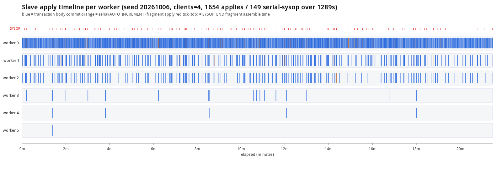
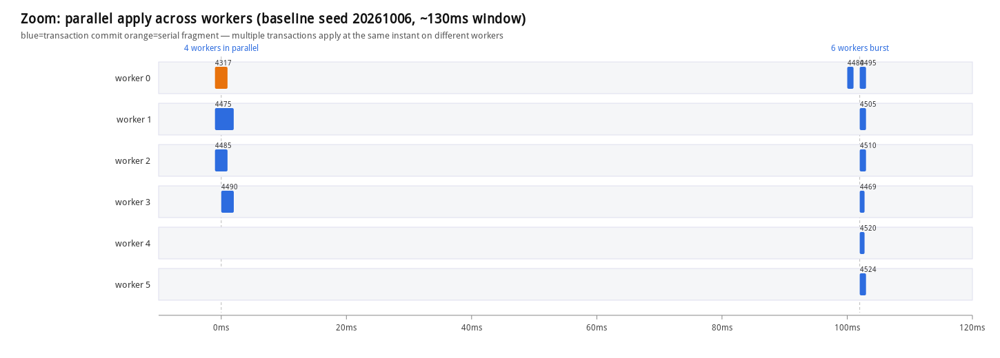

# idea-3 SYSOP_END fragment 이식 (백업 → PoC 베이스)

## 목적
PoC 베이스(log_writeset.c 마스터 + log_applier.c 단일체 슬레이브)는 SYSOP_END를 defer/skip만 했다.
serial/AUTO_INCREMENT가 병렬 적용에서 순서 보장 없이 흐르는 구멍을 닫기 위해, 백업본(모듈형)의
fragment 방식을 PoC 구조에 맞춰 이식했다. 새 파일·모듈 분리·유닛테스트는 범위에서 제외(인라인만).

## 불변식 (어제 HA 런에서 검증된 외부 동작 그대로)
1. fragment는 **SYSOP_END LSA** 좌표로 히스토리에 게시(외부 commit_lsa 아님).
2. 외부 커밋은 자기 fragment를 의존(is_ref)으로 걸어 **fragment 적용 후** 최종 행 적용.
3. 슬레이브는 fragment를 **외부 커밋보다 먼저** 적용·커밋.
4. 외부 트랜잭션 abort가 fragment를 되돌리지 않음(fragment는 독립 슬롯 + 자기 좌표 커밋).

## 백업 심볼 → PoC 심볼/삽입 지점 매핑

| 백업 심볼 | PoC 대응 | 파일:위치 |
|---|---|---|
| `wset_mark`(log_topops_addresses) | `ws_mark` (동일) | log_impl.h:360 |
| serial 수집 `wset_add_write_key`/`wset_fallback_to_commit_order` | `log_writeset_add_dbvalue` / `tdes->ws_overflow=true` | serial.c (repl_end_flush_mark 직후, SERVER_MODE) |
| `wset_find_fragment_dependency` | `log_writeset_fragment_probe` (range probe) | log_writeset.c |
| `wset_publish_fragment_to_history` | `log_writeset_publish_fragment` (range publish, prev_commit 미전진) | log_writeset.c |
| `wset_discard_fragment` | `log_writeset_discard_fragment` (tail erase) | log_writeset.c |
| `log_append_sysop_end_internal(with_lock, lsa_out)` | 동일 (PoC log_append_sysop_end 를 wrapper+internal 로 분리) | log_manager.c |
| `log_append_wset_label_and_sysop_end` | 동일 (prior_lsa_mutex 안에서 label+sysop_end 원자 append) | log_manager.c |
| 마스터 fragment 분기(log_sysop_commit_internal) | 동일 로직, PoC API 호출로 치환 | log_manager.c (log_append_sysop_end 호출부) |
| `last_sysop_fragment_lsa`(LA_APPLY) | 동일 필드 추가 | log_applier.c:300 |
| `la_detach_sysop_fragment` | 동일 (PoC la_unlink/add_repl_item 사용, PoC 필드만 init) | log_applier.c (la_log_record_process 직전) |
| `la_parallel_schedule_serial_fragment` + `la_parallel_schedule_fragment_task` | **PoC 게이트로 재작성**: 리더 SYSOP_END 분기에서 인라인 (la_gate_order_push + la_gate_is_satisfied → la_gate_dispatch_now/la_gate_enqueue_pending) | log_applier.c (case LOG_SYSOP_END) |
| 워커 `should_commit = COMMIT\|\|SYSOP_END` | flush/commit 가드 2곳에 `\|\| LOG_SYSOP_END` | log_applier.c:3482,3528 |
| retire 시 fragment 슬롯 free | retire 블록 SYSOP_END 분기에서 `la_free_all_repl_items`+`free_and_init` | log_applier.c |
| 완료집합 등록 | `mark_completed`를 COMMIT\|\|SYSOP_END 로 확장 | log_applier.c (collect) |

## range-split 설계 (log_writeset.c)
PoC의 commit_probe/commit_flush는 `tdes->ws_hashes` 벡터 **전체**를 순회한다(백업처럼 begin/end 범위가
아님). hot commit 경로를 건드리지 않기 위해, 전체 순회 함수는 그대로 두고 **range 전용 함수 3개를 신설**:
- `log_writeset_fragment_probe(begin, end=size)`: `[begin, size)` 범위만 probe, 의존을 `tdes->ws_dependency_seq`에 기록. PoC commit_probe와 동일한 선택 규칙(max over keys, prev_commit 상한, read-origin 처리).
- `log_writeset_publish_fragment(begin, fragment_lsa)`: `[begin, size)`를 fragment_lsa 좌표로 게시. 커밋이 아니므로 `log_Writeset_prev_commit_lsa`를 **전진시키지 않음**. CAP 초과 시 clear 규칙은 commit과 동일.
- `log_writeset_discard_fragment(begin)`: `ws_hashes.erase([begin,end))` — 외부 커밋이 같은 키를 재probe/재publish하지 않도록 fragment 키를 벡터에서 제거.

마스터 호출 순서(log_sysop_commit_internal, SYSOP_END_COMMIT & !overflow & size>mark):
`fragment_probe → log_append_wset_label_and_sysop_end(라벨+SYSOP_END 원자 append, sysop LSA 획득) →
publish_fragment(sysop LSA) → discard_fragment`. 이후 외부 커밋은 fragment 제거된 벡터로 평소대로 probe/flush.

## 슬레이브 조립 통합 지점 (log_applier.c)
리더 `case LOG_SYSOP_END`(committed_lsa 초과분):
- 조건: 이 trid의 WS_LABEL 대기 중(`la_ws_label_trid==trid`) + apply 리스트에 items 존재 + long 트랜잭션 아님.
- `la_detach_sysop_fragment`: `item->lsa <= sysop_lsa`인 버퍼된 serial 아이템을 독립 LA_APPLY 슬롯으로 이동(외부 슬롯엔 이후 아이템만 남김). 근거: serial sysop은 행 INSERT보다 먼저 로깅되고, 일반 DML은 COMMIT_NEED_FLUSH라 외부 커밋 시점에야 로깅되므로, serial SYSOP_END 시점의 버퍼엔 serial 아이템만 있다.
- LA_APPLY_TASK(rectype=LOG_SYSOP_END, commit_lsa=sysop_lsa, apply=fragment, dependency=라벨값) 구성 → `la_gate_order_push` → 의존충족이면 `la_gate_dispatch_now(,0)` 아니면 `la_gate_enqueue_pending`.
- 외부 슬롯에 `last_sysop_fragment_lsa=sysop_lsa` 기록, 라벨 홀더 소비(clear).
- 라벨 없음/long/빈 리스트면 기존 defer 트레이스로 폴백(하위호환: 구 마스터 로그도 그대로 적용).

외부 `case LOG_COMMIT`: 라벨 소비 후, `task.apply->last_sysop_fragment_lsa`가 설정돼 있으면
dependency를 `max(라벨의존, fragment_lsa)`로 올리고 `dependency_is_read=true`(프론티어 대기)로 설정 →
fragment가 커밋될 때까지 외부 최종 커밋이 기다린다.

워커(la_apply_Workers 루프): `LOG_SYSOP_END`도 `la_apply_repl_log`로 아이템 적용 후 flush + db_commit.
`la_apply_repl_log`의 `assert(rectype==LOG_COMMIT)`를 `COMMIT||SYSOP_END`로 확장.
collect에서 `mark_completed`를 SYSOP_END도 등록(fragment 완료가 프론티어를 전진시켜 외부 커밋의 is_ref 통과).
retire에서 SYSOP_END 엔트리는 repl_lists 슬롯이 아니라 독립 malloc 슬롯이므로 items free + 슬롯 free.

## 라벨 레코드 호환
PoC는 `LOG_DUMMY_WS_LABEL` / `LOG_REC_WS_LABEL`(dependency_seq, dependency_is_read)을 그대로 사용.
백업의 `LOG_REC_WSET_LABEL`와 필드 의미 동일. fragment 라벨도 같은 레코드 타입을 재사용하므로 별도
레코드 종류 추가 없음. 슬레이브 `la_retrieve_ws_label`(기존)이 그대로 fragment 라벨도 디코드한다.

## 빌드 결과
- release ninja(build_x86_64_release): **NINJA_EXIT=0**, 전 타깃 링크.
- 변경 6파일(serial.c, log_writeset.c/.h, log_manager.c, log_impl.h, log_applier.c) **error/warning 0**.
- 중간 검증: 마스터 그룹(serial/log_writeset/log_manager) SA 오브젝트 선빌드 EXIT=0 후 전체 빌드.

## 미결/주의 (다음 라운드)
1. **재시작 멱등 구멍**: fragment가 커밋됐으나 외부 트랜잭션 최종 커밋이 안 된 채 크래시 → 영속
   committed_lsa가 fragment 좌표보다 낮으면 재시작 시 fragment 재적용. 현재는 committed_lsa 경계만
   재사용(la_apply_repl_log의 already_committed skip). per-fragment 완료 마커(SYSOP_END LSA 키)가 설계된
   해법이나 미구현. 중첩 sysop 마커 유일성·내부 sysop abort 롤백은 미결(_impl/_notes/10-sysop-end-investigation.md 13.6).
2. **long transaction**의 serial: 현재 fragment 비적용(defer 폴백). long-tran 경로는 items가 즉시
   버퍼되지 않아 detach 전제가 깨지므로 제외. 필요 시 별도 설계.
3. 유닛테스트 미이식(범위 제외). HA sysop-random 실측으로 master=slave 정합 확인 필요(미실행).

미커밋. 배포/HA·벤치 미실행.

## 병렬 fragment 실측 (2026-10-06, seed 20261006, clients=4, 400tx)

PoC 베이스 + idea-3 fragment의 병렬 스트레스 결과. 정합성 0불일치, 크래시 0, serial fragment 149건(동일 tx 다중 9건), fragment 의존 대기 96회 전부 정상 처리(그 대기 중 다른 트랜잭션은 병렬 적용 — 국소 대기).

워커 레인별 적용(파랑=본체 커밋, 주황=serial 조각), 상단 빨간 눈금=SYSOP_END 발생 149건. worker0 집중, serial은 21분 전체 고르게 분포. 각 적용 <10ms라 간격은 주입 대기(적용부 가동률 0.013%).

### 병렬성 확대 (baseline seed 20261006, ~130ms)

최대 동시 구간 확대. 0ms에 4워커(trid 4317 serial/4475/4485/4490), +102ms에 6워커 버스트(4480·4495/4505/4510/4469/4520/4524)가 각기 다른 트랜잭션을 동시 적용 — 의존 없는 트랜잭션이 직렬 대기 없이 워커로 분산됨. 각 적용 <2ms. TBB 마스터 런 비교용 참조.
