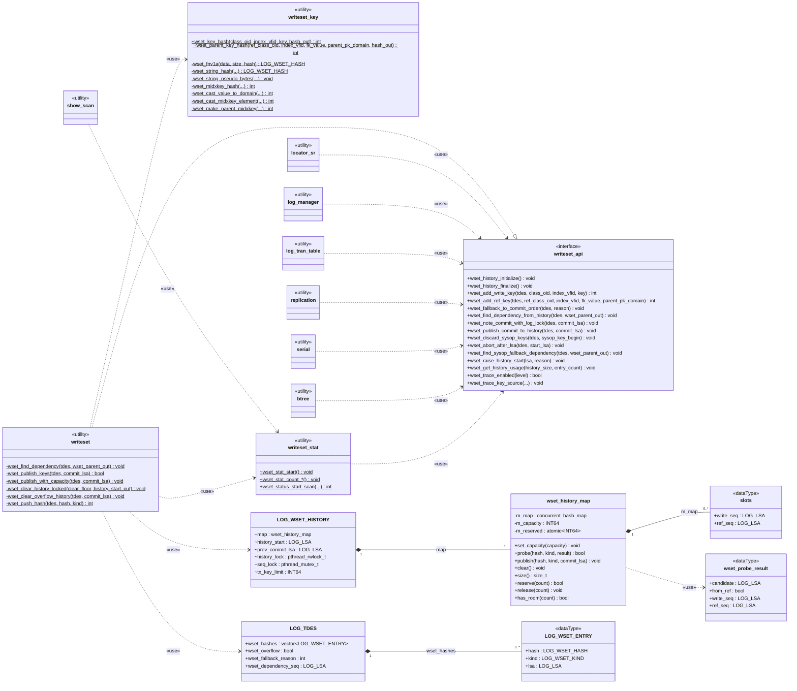

# writeset 모듈 경계 리뷰와 정리안

master writeset 모듈(`src/transaction/writeset/`)의 구조를 리뷰어 셋(설계자, 동시성 리뷰어, 유지보수자)이 따로 읽기 전용으로 검토했다. 이 문서는 세 의견과, 그 의견을 반영했을 때 자료구조와 함수가 어떻게 바뀌는지를 정리한다. 코드 기준은 `feature/CBRD-27508-on-26779` a42c43401이고, 정리안은 아직 코드에 반영하지 않은 안이다.

출발점이 된 질문은 "`LOG_WSET_HISTORY`가 너무 크고, `wset_history_map`이 그 안에 들어가 있는 것이 모듈화 실수가 아닌가"였다.

## 1. 리뷰어 의견

### 1.1 설계자

- **결론**: map을 `LOG_WSET_HISTORY` 안에 넣은 것 자체는 실수가 아니다.
  - map, `history_start`, `prev_commit_lsa`는 두 잠금에 걸친 불변식 둘로 묶여 있다.
  - 하나는 "map에서 지운 키는 `history_start`가 덮는다"이고, 다른 하나는 "조회 스냅샷과 map 조회 사이에 clear가 끼어들지 못한다"이다.
- **문제 1, 공개 범위가 넓다.**
  - 구조체 전체와 `extern wset_History`가 `writeset.hpp:45-56`에 공개돼 있다.
  - 운영 코드 중 `writeset.cpp` 밖에서 필드를 직접 쓰는 곳은 없고, 단위 시험만 쓴다.
- **문제 2, TBB 헤더가 번진다.**
  - `writeset.hpp:32` → `writeset_history_map.hpp:31`을 거쳐 `serial.c`, `replication.c`, `locator_sr.c`, `log_tran_table.c`, `log_manager.c`, `btree.c`가 모두 TBB 헤더를 읽는다.
  - `btree.c`는 `wset_trace_enabled` 하나만 쓴다.
- **문제 3, map API가 비대칭이다.**
  - `publish`는 kind를 받아 WRITE/REF 슬롯 의미를 직접 처리한다.
  - `find`는 슬롯 원본만 돌려준다. 그래서 선택 규칙 `wset_select_candidate`(`writeset.cpp:960-986`)가 map 밖에 있다.
- **문제 4, 용량 상태가 흩어져 있다.**
  - 예약 카운터 `wset_Publish_reserved`는 파일 static(`writeset.cpp:64`)이고, 용량 `history_size`는 구조체 필드다.
  - `history_size`는 트랜잭션당 키 한도(`509`)와 map 용량(`1229`, `1247`) 두 가지로 쓰인다.
- **문제 5, `writeset.cpp`에 관심사가 섞여 있다.**
  - 키 인코딩(해시, collation, MIDXKEY, FK 도메인 변환)이 약 600줄이다(`199-426`, `568-956`). history를 쓰지 않는다.
  - 같은 파일에 트랜잭션 키 버퍼, 순서와 history, trace가 있다.
- **문제 6, 쓰이지 않는 일반성이 남아 있다.**
  - `wset_find_dependency_in_range`의 `begin`은 항상 0이다(`1130`).
  - `wset_publish_with_capacity`의 `begin/end`는 항상 전체 범위다(`1396`).
- **TODO 평가**
  - `probe`로 선택 규칙을 감싸는 것과 `history_start`, `prev_commit_lsa`를 위에 두는 것은 맞다.
  - "embedding 대신 standalone"은 초점이 어긋났다. 문제는 임베딩이 아니라 공개다.
  - 빠진 것은 용량의 자리, 잠금 소유권, level 3 PROBE trace 손실이다.

### 1.2 동시성 리뷰어

- **잠금 순서**: `prior_lsa_mutex` → `seq_lock` → `history_lock`. 거꾸로 잡는 곳은 없다.
- **`seq_lock`이 지키는 것**
  - `prev_commit_lsa`. 쓰기는 `wset_note_commit_with_log_lock`(`1190-1192`) 한 곳이다.
  - `history_start`. 쓰기는 overflow 커밋(`1195-1197`), raise(`1501-1503`), clear(`1208-1210`)이다. 헤더 주석에는 빠져 있다.
  - clear 동안의 커밋 동결. clear 경로는 하한을 읽을 때부터 clear와 다시 게시가 끝날 때까지 `seq_lock`을 쥔다(`1269-1274`, `1310-1344`).
    - 동결이 없으면 하한을 읽은 뒤 새 커밋이 키를 게시하고, 그 키가 곧바로 지워진다.
    - 그러면 다음 충돌 트랜잭션이 그 커밋을 놓친다. `1079-1087`이 writeset dependency와 `prev_commit_lsa` 중 작은 쪽을 고르므로 `prev_commit_lsa`도 막아 주지 못한다.
- **`history_lock`이 지키는 것**
  - TBB `clear ()`가 동시 조회, 게시와 겹치지 않게 한다. TBB `clear ()`는 동시 접근에 안전하지 않다.
  - 조회가 "옛 하한 + 비우기 전 map"이나 "새 하한 + 비운 map" 중 하나만 보게 한다.
- **TBB 자체 잠금으로 보장되는 것**: 같은 키의 동시 접근과 단조 증가는 accessor 잠금만으로 안전하다. 공유 잠금이 필요한 이유는 clear와의 배제뿐이다.
- **분리안 평가**
  - **(a) TODO안**(저장소가 map, clear, 잠금을 가짐): `probe`마다 잠금을 따로 잡으면 스냅샷과 조회 사이에 clear가 끼어들어 dependency가 빠진다. 커밋 동결은 층 사이 약속으로 남는다.
  - **(b) 저장소가 map, `history_start`, 잠금을 가짐**: raise가 배타 잠금을 기다리게 되어 로깅이 멈춘다. `history_start`를 atomic으로 바꾸는 추가 설계가 필요하다.
  - **(c) 지금 구조에 `probe`만 추가**: 잠금 의미가 바뀌지 않아 안전하다. 다만 공개 범위 문제는 풀리지 않는다.
  - 권장은 (c)에 캡슐화(공개 범위 축소)를 더하는 것이다.
- **주석 오류**
  - `writeset.cpp:1498-1499`는 raise가 `history_lock`을 피해야 로깅이 안 멈춘다고 적었다. 하지만 clear 동안에는 `seq_lock`에서 어차피 멈춘다.
  - `writeset.hpp:51-52`는 `history_start`와 커밋 동결을 적지 않았다.

### 1.3 유지보수자

- **결론**: 이 코드베이스에서 이례적인 구조가 아니다.
  - `lk_Gl`(`lock_manager.c:424-440`)은 lock-free 해시와 mutex를 한 전역 구조체에 담는다.
  - `log_Gl`(`log_impl.h:691~`, 약 270줄)도 LSA, 잠금, MVCC 테이블을 함께 담는다.
  - `mvcctable`(`mvcc_table.hpp:64`)처럼 잠금을 숨긴 클래스도, 잠금이 여러 상태에 걸치면 결국 잠금 API를 밖에 내놓는다(`mvcc_table.hpp:92-94`).
- **변경 비용**
  - 운영 코드의 `wset_History.` 참조는 `writeset.cpp` 안에만 있고 약 75줄이다. 바깥 호출부는 API를 유지하면 바뀌지 않는다.
  - 단위 시험은 약 26줄이 필드에 직접 접근한다.
  - 가장 무거운 것은 `test_writeset.cpp:595` 이후의 잠금 순서 시험 둘이다. 두 잠금을 직접 잡고 값을 써 넣으므로, 잠금을 숨기면 다시 설계해야 한다.
  - level 3 PROBE trace(`1041-1047`)의 write_seq와 ref_seq 출력은 `probe`가 슬롯을 함께 돌려줘야 유지된다.
  - 커밋 경로는 HA 회귀로 검증을 마친 부분이라, 잠금 소유권을 옮기면 회귀를 다시 해야 한다.
- **권장 순서**
  1. 이번 PR: 주석과 TODO 문구, `wset_Publish_reserved` 위치 정리.
  2. 후속 1순위: 키 인코딩 파일 분리. 잠금 규약을 건드리지 않는다.
  3. 후속 2순위: 구조체를 내부 헤더로 숨기기.
  4. 마지막: 저장소 클래스화. 잠금 순서를 지키는 API와 시험 이전 방법이 먼저 정해져야 한다.

### 1.4 세 의견이 모이는 곳

- map을 품은 구조 자체는 문제가 아니다. 문제는 공개 범위, TBB 헤더 누수, 한 파일에 섞인 관심사다.
- `history_start`는 재시작, sysop, overflow에서도 올라가는 전역 하한이라 `prev_commit_lsa`와 같은 순서 계층(`seq_lock`)에 남는다.
- `history_lock`은 저장소로 옮기지 않는다. 옮기면 키마다 잠금을 잡는 `probe`가 생기거나, 층 사이로 잠금 API가 새어 나온다.
- 키 하나의 선택(`probe`)과 용량 계산은 map 쪽으로 옮긴다.

## 2. 정리안의 원칙

- **불변식 단위로 소유자를 정한다.**
  - 순서 계층(`writeset.cpp`)은 `prev_commit_lsa`, `history_start`, `seq_lock`, `history_lock`을 가진다. 커밋 동결과 "하한 + map" 일관성이 모두 여기서 지켜진다.
  - 저장소(`wset_history_map`)는 키별 슬롯, 선택 규칙, 용량 계산을 가진다. 잠금은 갖지 않고 "호출자가 `history_lock`을 쥐고 있다"를 전제로 한다. 지금의 map도 이 전제로 쓰이고 있다.
- **바깥에는 함수만 보인다.** 구조체, 전역 변수, TBB 헤더는 내부 헤더로 내린다.
- **키 인코딩은 history와 다른 파일에 둔다.** 둘은 `wset_push_hash` 하나로만 이어진다.

## 3. 바뀐 파일 구성

```text
src/transaction/writeset/
├─ writeset.hpp               공개 API만 (구조체·전역·TBB 없음)
├─ writeset.cpp               순서 계층: dependency, 게시, clear, sysop, 재시작 하한
├─ writeset_internal.hpp      [추가] LOG_WSET_HISTORY, wset_History (writeset.cpp와 단위 시험만 include)
├─ writeset_key.hpp / .cpp    [추가] 키 해시, collation 의사 키, MIDXKEY, FK 부모 키 변환
├─ writeset_history_map.hpp / .cpp   probe, 용량 계산 추가
├─ writeset_types.hpp         그대로
└─ writeset_stat.hpp / .cpp   그대로
```

## 4. 코드로 본 정리안

### 4.1 `writeset.hpp` (공개 API)

```cpp
#include "storage_common.h"	/* OID */
#include "log_lsa.hpp"		/* LOG_LSA */
#include "dbtype.h"		/* DB_VALUE */
#include "thread_compat.hpp"	/* THREAD_ENTRY */
#include "writeset_types.hpp"	/* LOG_WSET_KIND */
/* no writeset_history_map.hpp: TBB stays inside the writeset module */

typedef struct log_tdes LOG_TDES;
struct tp_domain;

typedef enum
{
  WSET_FALLBACK_TRANSACTION_LIMIT = 0,
  WSET_FALLBACK_STATEMENT_REPLICATION = 1
} WSET_FALLBACK_REASON;

/* lifecycle (log_tran_table.c) */
extern void wset_history_initialize (void);
extern void wset_history_finalize (void);

/* key collection (locator_sr.c, serial.c) */
extern int wset_add_write_key (LOG_TDES *tdes, const OID *class_oid, const VFID *index_vfid, DB_VALUE *key);
extern int wset_add_ref_key (LOG_TDES *tdes, const OID *ref_class_oid, const VFID *index_vfid,
			     DB_VALUE *fk_value, struct tp_domain *parent_pk_domain);
extern void wset_fallback_to_commit_order (LOG_TDES *tdes, WSET_FALLBACK_REASON reason);

/* commit path (log_manager.c) */
extern void wset_find_dependency_from_history (LOG_TDES *tdes, LOG_LSA *wset_parent_out);
extern void wset_note_commit_with_log_lock (LOG_TDES *tdes, const LOG_LSA *commit_lsa);
extern void wset_publish_commit_to_history (LOG_TDES *tdes, const LOG_LSA *commit_lsa);

/* system operations and restart (log_manager.c) */
extern void wset_discard_sysop_keys (LOG_TDES *tdes, size_t sysop_key_begin);
extern void wset_abort_after_lsa (LOG_TDES *tdes, const LOG_LSA *start_lsa);
extern void wset_find_sysop_fallback_dependency (LOG_TDES *tdes, LOG_LSA *wset_parent_out);
extern void wset_raise_history_start (const LOG_LSA *lsa, const char *reason);

/* statistics (writeset_stat.cpp) */
extern void wset_get_history_usage (INT64 *history_size, INT64 *entry_count);

/* trace (btree.c, locator_sr.c) */
extern bool wset_trace_enabled (int level);
extern void wset_trace_key_source (LOG_TDES *tdes, const char *operation, const char *image,
				   LOG_WSET_KIND kind, const OID *table_oid, const OID *row_oid,
				   const char *table_name, const char *constraint_name, const OID *key_class_oid,
				   const VFID *key_index_vfid);
```

공개 함수 목록은 지금과 같다. 바뀌는 것은 `wset_history_map.hpp` include와 구조체, 전역 변수가 빠지는 것뿐이라 바깥 호출부는 그대로다.

### 4.2 `writeset_internal.hpp` (writeset.cpp와 단위 시험만)

```cpp
#include "writeset.hpp"
#include "writeset_history_map.hpp"

#include <pthread.h>

/* Ordering state of the writeset history.
 *
 * seq_lock guards prev_commit_lsa and history_start, and freezes commits while the map is cleared:
 *   a clear reads its floor and finishes clearing and re-publishing under seq_lock, so no commit can
 *   take a label or publish a key between the floor and the clear.
 * history_lock keeps TBB clear () apart from probe and publish, and makes a reader see either the old
 *   floor with the old map or the new floor with the cleared map.
 * Lock order: prior_lsa_mutex -> seq_lock -> history_lock. */
typedef struct wset_history LOG_WSET_HISTORY;
struct wset_history
{
  wset_history_map map;		/* key -> WRITE/REF slots and the map capacity; callers hold history_lock */
  LOG_LSA history_start;	/* dependency floor for every later transaction: raised at restart, by a serial
				 * operation applied in commit order, by an overflowed commit and by a clear */
  LOG_LSA prev_commit_lsa;	/* the latest logged commit, the commit-order fallback */
  pthread_rwlock_t history_lock;
  pthread_mutex_t seq_lock;
  INT64 tx_key_limit;		/* keys one transaction may collect before falling back to commit order */
};

extern LOG_WSET_HISTORY wset_History;
```

- `history_size` 하나가 두 뜻으로 쓰이던 것을 나눈다. 트랜잭션당 한도는 `tx_key_limit`, map 용량은 map 안의 `m_capacity`다. 둘 다 같은 파라미터 `ha_writeset_history_size`로 채운다.
- 잠금 둘과 두 LSA는 지금 자리 그대로다.

### 4.3 `writeset_history_map.hpp` (저장소)

```cpp
#include "writeset_types.hpp"

#include "tbb/concurrent_hash_map.h"

#include <atomic>
#include <cstddef>

/* What one key must wait for, with both slots kept for the level 3 PROBE trace. */
struct wset_probe_result
{
  LOG_LSA candidate;		/* WRITE: the later of write_seq and ref_seq; REF: write_seq */
  bool from_ref;		/* candidate came from ref_seq */
  LOG_LSA write_seq;
  LOG_LSA ref_seq;
};

/* Key history: WRITE and REF commit slots per key hash, and the room left for new keys.
 * Not locked by itself: callers hold history_lock shared for probe, publish and reservations,
 * and exclusive for clear and for an exclusive-mode capacity check. */
class wset_history_map
{
  public:
    void set_capacity (INT64 capacity);

    bool probe (LOG_WSET_HASH hash, LOG_WSET_KIND kind, wset_probe_result &result) const;
    void publish (LOG_WSET_HASH hash, LOG_WSET_KIND kind, const LOG_LSA &commit_lsa);
    void clear ();
    std::size_t size () const;

    /* shared holders reserve room before publishing and release it before dropping the lock */
    bool reserve (std::size_t count);
    void release (std::size_t count);
    bool has_room (std::size_t count) const;	/* exclusive holder: no reservation is in flight */

  private:
    struct slots
    {
      LOG_LSA write_seq;
      LOG_LSA ref_seq;
    };
    using map_type = tbb::concurrent_hash_map<LOG_WSET_HASH, slots>;

    map_type m_map;
    INT64 m_capacity = 0;
    std::atomic<INT64> m_reserved { 0 };
};
```

- `LOG_WSET_SLOTS`는 밖에서 사라지고 클래스 안의 `slots`가 된다.
- `wset_select_candidate`는 `probe` 안으로 들어간다. 두 슬롯 읽기와 선택은 같은 `const_accessor` 아래에서 한다.
- `wset_Publish_reserved`, `wset_history_has_capacity`, `wset_history_reserve_capacity`, `wset_history_release_capacity`는 `m_reserved`, `has_room`, `reserve`, `release`가 된다.
- `probe`는 슬롯 두 값을 함께 돌려주므로 level 3 PROBE trace의 출력은 그대로 남는다.

### 4.4 `writeset_key.hpp` (키 인코딩)

```cpp
#include "writeset_types.hpp"
#include "dbtype.h"

struct tp_domain;

/* FNV-1a hash of class OID + index VFID + the packed key value, with collation-aware strings and
 * composite keys. */
extern int wset_key_hash (const OID *class_oid, const VFID *index_vfid, DB_VALUE *key, LOG_WSET_HASH *hash_out);

/* Hash of a child's foreign-key value cast to the parent primary key's domain, so it meets the
 * parent's own write in one slot. */
extern int wset_parent_key_hash (const OID *ref_class_oid, const VFID *index_vfid, DB_VALUE *fk_value,
				 struct tp_domain *parent_pk_domain, LOG_WSET_HASH *hash_out);
```

`writeset_key.cpp`로 옮기는 static 함수는 `wset_fnv1a`, `wset_string_hash`, `wset_string_pseudo_bytes`, `wset_midxkey_hash`, `wset_cast_value_to_domain`, `wset_cast_midxkey_element`, `wset_make_parent_midxkey`, `wset_error`다. `wset_add_write_key`와 `wset_add_ref_key`는 `writeset.cpp`에 남아 해시를 받은 뒤 `wset_push_hash`를 부른다.

### 4.5 `writeset.cpp` (순서 계층) 중 조회 부분

```cpp
static void
wset_find_dependency (LOG_TDES *tdes, LOG_LSA *wset_parent_out)	/* begin argument removed: always 0 */
{
  LOG_LSA prev_commit_snapshot, history_start_snapshot, wset_parent;
  wset_probe_result probe;

  /* seq_lock first, then history_lock while still holding it: a clear needs both, so the floor read here
   * and the map probed below belong to the same moment */
  pthread_mutex_lock (&wset_History.seq_lock);
  LSA_COPY (&prev_commit_snapshot, &wset_History.prev_commit_lsa);
  pthread_rwlock_rdlock (&wset_History.history_lock);
  LSA_COPY (&history_start_snapshot, &wset_History.history_start);
  pthread_mutex_unlock (&wset_History.seq_lock);

  LSA_COPY (&wset_parent, &history_start_snapshot);
  for (const LOG_WSET_ENTRY &e : tdes->wset_hashes)
    {
      if (!wset_History.map.probe (e.hash, e.kind, probe))
	{
	  continue;
	}
      /* PROBE trace prints probe.write_seq, probe.ref_seq, probe.candidate and probe.from_ref as today */
      if (!LSA_ISNULL (&probe.candidate) && LSA_GT (&probe.candidate, &wset_parent))
	{
	  LSA_COPY (&wset_parent, &probe.candidate);
	}
    }
  pthread_rwlock_unlock (&wset_History.history_lock);

  /* the smaller of the writeset result and prev_commit_lsa, raised to the floor: unchanged */
}
```

잠금을 잡는 순서와 범위는 지금 코드(`writeset.cpp:1018-1059`)와 같다. 바뀌는 것은 `find` + `wset_select_candidate`가 `probe` 한 번이 되는 것뿐이다.

## 5. UML



*그림 1. 정리안의 모듈 구조(UML 클래스 다이어그램).*

표기는 UML 규칙을 따랐다.

- **`«interface»` `writeset_api`**: `writeset.hpp`가 공개하는 operation이다. 바깥 서버 파일은 이 인터페이스에만 의존한다(`«use»` 점선 화살표).
- **`«utility»`**: 인스턴스 없이 정적 operation만 가진 단위다. C 소스 파일 하나를 이렇게 그렸다.
  - `writeset`, `writeset_key`, `writeset_stat`과 호출하는 서버 파일 일곱 개가 여기에 해당한다.
  - 정적 operation은 UML에서 밑줄로 표시한다. mermaid에서는 `$`로 쓴다.
  - 호출하는 서버 파일의 operation은 이 그림과 관계가 없어 칸을 비웠다(UML의 요소 생략).
- **실현(`..|>`, 빈 삼각형 점선)**: `writeset`이 `writeset_api`를 구현한다. 실현하는 쪽이 같은 operation을 다시 나열하는 것은 UML에서 생략할 수 있어서, `writeset` 상자에는 static 함수만 적었다.
- **가시성**
  - `+`(public): 헤더에 선언해 어느 파일에서나 부를 수 있다.
  - `~`(package): writeset 모듈 안(`writeset/` 디렉토리와 단위 시험)에서만 쓴다. `writeset_internal.hpp`, `writeset_key.hpp`의 선언과 `wset_stat_*` 카운터가 여기에 해당한다.
  - `-`(private): 그 파일이나 클래스 안에서만 쓴다. static 함수와 클래스의 private 멤버다.
- **`«dataType»`**: 식별자 없이 값으로만 쓰는 구조체다. `slots`, `wset_probe_result`, `LOG_WSET_ENTRY`가 해당한다.
- **합성(`*--`, 채운 마름모)**: 전체가 부분의 수명을 가진다. 마름모 쪽이 전체이고, 양 끝 숫자는 다중도다.
- 파일 위치
  - `writeset_api`는 `writeset.hpp`, `writeset`은 `writeset.cpp`이다.
  - `LOG_WSET_HISTORY`는 `writeset_internal.hpp`, `wset_history_map`, `slots`, `wset_probe_result`는 `writeset_history_map.hpp`이다.
  - `writeset_key`는 `writeset_key.hpp / .cpp`, `LOG_TDES`는 `log_impl.h`, `LOG_WSET_ENTRY`는 `writeset_types.hpp`이다.

## 6. 바뀌는 곳과 남는 것

- **바깥 호출부**(`locator_sr.c`, `log_manager.c`, `log_tran_table.c`, `replication.c`, `serial.c`, `btree.c`, `show_scan.c`): 바뀌지 않는다. 공개 함수가 같다.
- **`writeset.cpp`**
  - 키 인코딩 약 600줄이 `writeset_key.cpp`로 나간다.
  - 용량 함수 넷이 map으로 들어간다.
  - `wset_select_candidate`가 없어지고, `begin/end` 인자가 사라진다.
- **단위 시험**
  - 필드에 직접 접근하던 약 26줄이 `writeset_internal.hpp`를 include하도록 바뀐다.
  - 잠금 순서 시험(`test_writeset.cpp:595` 이후)은 두 잠금이 그대로 구조체에 있으므로 내부 헤더만 include하면 된다.
  - `wset_History.history_size`를 쓰던 곳은 `tx_key_limit`이나 `map.size ()`로 바뀐다.
- **빌드 파일**: `cubrid/CMakeLists.txt`, `sa/CMakeLists.txt`, `unit_tests/writeset/CMakeLists.txt`에 새 파일을 더한다. TBB include가 바깥 헤더에서 빠지므로, TBB가 필요 없어지는 파일이 생긴다.
- **잠금과 동작**: 바뀌지 않는다. 잠금 둘의 위치, 순서, 범위가 지금과 같다. 그래도 커밋 경로를 고치는 것이라 단위 시험과 HA 회귀를 다시 한다.
- **함께 고칠 주석**
  - `writeset.hpp:49`: `history_start`가 clear 밖의 경우에도 올라간다.
  - `writeset.hpp:51-52`: `seq_lock`이 `history_start`와 커밋 동결도 지킨다. 4.2의 구조체 주석으로 옮겨 적는다.
  - `writeset.cpp:1498-1499`: clear 동안에는 `seq_lock`에서도 로깅이 멈춘다.
  - `writeset_history_map.hpp:43` TODO: 이 문서의 결론으로 바꾸거나 지운다.

## 7. 미검증·추정

- 키 인코딩 코드가 history 쪽 static에 기대는 곳이 없다는 판단은 함수 위치로 본 추정이다. 실제로 떼어 빌드해 봐야 확인된다.
- TBB 헤더가 6개 파일에서 실제로 컴파일된다는 판단은 include 연쇄를 읽고 내린 것이다. 빌드 로그로 확인하지 않았다.
- `writeset_key`를 따로 떼면 해시 함수가 같은 번역 단위에 있지 않아 inline이 줄 수 있다. 커밋 경로 성능에 주는 영향은 재지 않았다(추정, 작을 것으로 본다).
- 단위 시험 26줄, 운영 참조 75줄은 줄 단위로 센 값이다.
- A'안(조회를 `prior_lsa_mutex` 밖으로 빼는 것)을 하면 4.5의 조회 부분이 다시 바뀐다. 이 정리안은 A' 결정 뒤에 하는 것을 전제로 한다.

## 8. 모듈화 재정리 목표안 (비용 무관, writeset 디렉토리만)

5절까지는 "잠금을 건드리지 않는 범위"의 정리안이었다. 여기서는 비용을 따지지 않고, 이번 기능이 추가한 `src/transaction/writeset/`만 대상으로 모듈을 다시 나누는 목표를 정한다. 바깥 서버 파일(`locator_sr.c`, `log_manager.c` 등)의 호출과 공개 함수 시그니처는 바꾸지 않는다.

### 8.1 지금 `writeset.cpp` 안의 관심사 (a42c43401 기준)

- trace: `wset_kind_name`, `wset_fallback_reason_name`, `wset_trace_collected_key`, `wset_trace_enabled`, `wset_trace_key_source`, `WSET_TRACE` 매크로, `wset_Trace_level` (105-197행)
- 키 인코딩: `wset_fnv1a`, `wset_string_hash`, `wset_string_pseudo_bytes`, `wset_midxkey_hash`, `wset_error`, `wset_cast_value_to_domain`, `wset_cast_midxkey_element`, `wset_make_parent_midxkey` (200-436, 658-845행). history와 잠금을 쓰지 않고 `wset_error`만 쓴다(확인함).
- 트랜잭션 키 모음: `wset_push_hash`, `wset_fallback_to_commit_order`, `wset_add_write_key`, `wset_add_ref_key`, `wset_discard_sysop_keys`, `wset_abort_after_lsa` (503-957, 1410-1458행). history에서는 키 한도 `history_size` 하나만 읽는다.
- 순서와 history: 초기화와 해제, dependency 결정, 커밋 기록, 게시, 용량, clear, sysop 라벨, 재시작 하한, 사용량 (438-500, 960-1408, 1459-1533행). 잠금 둘을 쓰는 코드는 모두 여기 있다.

### 8.2 목표 구조

```text
src/transaction/writeset/
├─ writeset.hpp                공개 API (바깥 서버 파일이 include). 구조체·전역·TBB 없음
├─ writeset_types.hpp          그대로: 키 해시, WRITE/REF, LOG_WSET_ENTRY
├─ writeset_keyset.cpp         [writeset.cpp에서 이름 변경] 트랜잭션 키 모음: add_write/ref_key, push_hash, 폴백, sysop 키 버리기, 롤백 키 정리
├─ writeset_key.hpp / .cpp     [추가] 키 인코딩: 해시, collation 의사 키, MIDXKEY, FK 부모 키 변환
├─ writeset_history.hpp / .cpp [추가] 순서와 history: LOG_WSET_HISTORY(내부), 잠금 둘, dependency, 커밋 기록, 게시, clear, 하한, 사용량
├─ writeset_history_map.hpp / .cpp  저장소: probe, publish, clear, size, 용량 예약. 슬롯은 클래스 안으로
├─ writeset_trace.hpp / .cpp   [추가] trace 수준, WSET_TRACE, 이름 함수, 키 출처 trace
└─ writeset_stat.hpp / .cpp    그대로
```

- **잠금은 `writeset_history.cpp` 한 파일에만 있다.** `seq_lock`, `history_lock`, `prev_commit_lsa`, `history_start`와 그 불변식(커밋 동결, 하한 + map 일관성)이 한 파일, 한 구조체에 모인다. 지금은 같은 파일 안에서 키 인코딩 코드와 섞여 있다.
- **저장소(`wset_history_map`)는 잠금을 갖지 않는다.** 호출자가 `history_lock`을 쥐고 부른다는 전제는 지금과 같고, 클래스 주석에 적는다. 키 하나의 선택(`probe`)과 용량 계산(`reserve`, `release`, `has_room`)이 들어간다.
- **`history_size`의 두 뜻을 나눈다.** 트랜잭션 키 한도는 `writeset_history.hpp`의 `wset_tx_key_limit ()`로 읽고, map 용량은 map 안에 둔다. 값은 둘 다 `ha_writeset_history_size`다.
- **내부 헤더**: `writeset_key.hpp`, `writeset_history.hpp`, `writeset_trace.hpp`, `writeset_history_map.hpp`는 writeset 디렉토리와 단위 시험만 include한다. 바깥은 `writeset.hpp`와 `writeset_stat.hpp`(`show_scan.c`), `writeset_types.hpp`(`log_impl.h`)만 본다.
- **TBB**: `writeset_history_map.hpp`만 include한다. 바깥 서버 파일에서는 빠진다.

### 8.3 커밋 순서 (각각 따로 커밋, 각각 빌드와 단위 시험)

1. 주석: `writeset.hpp:49`, `writeset.hpp:51-52`, `writeset.cpp:1498-1499`, `writeset_history_map.hpp:43` TODO. 동작 변화 없음.
2. 쓰이지 않는 인자 정리: `wset_find_dependency_in_range`의 `begin`, `wset_publish_with_capacity`의 `begin/end`.
3. trace 분리: `writeset_trace.hpp / .cpp`.
4. 키 인코딩 분리: `writeset_key.hpp / .cpp`.
5. 순서와 history 분리: `writeset_history.hpp / .cpp`로 구조체·전역·잠금·순서 함수를 옮기고, `writeset.cpp`를 `writeset_keyset.cpp`로 바꾼다. 공개 헤더에서 구조체와 TBB가 빠진다. 단위 시험은 내부 헤더를 include한다.
6. 저장소: `probe`와 용량 계산을 map으로 옮기고, `LOG_WSET_SLOTS`를 클래스 안으로 숨기고, `history_size`를 두 뜻으로 나눈다. level 3 PROBE trace 출력은 유지한다.

각 커밋마다 빌드 파일(`cubrid/`, `sa/`, `unit_tests/writeset/` CMakeLists)을 함께 고친다. 1~5는 코드를 옮기기만 하고 동작이 같다. 6은 조회와 게시 경로의 코드가 바뀌므로 단위 시험의 잠금 순서 시험(`test_writeset.cpp:595` 이후)과 HA 회귀로 확인한다.

### 8.4 바꾸지 않는 것

- 공개 함수 이름과 시그니처, 바깥 서버 파일의 호출.
- 잠금 둘의 의미, 순서, 잡는 범위.
- 로그 레코드 형식, trace 문자열, 통계.

### 8.5 확인이 필요한 것

- `wset_add_ref_key`가 FK 부모 키를 만드는 부분과 해시를 넣는 부분이 깔끔하게 갈리는지는 4번에서 실제로 나눠 보며 확인한다.
- 파일 이름 `writeset_keyset`은 안이다. `writeset_txn` 같은 다른 이름도 가능하다.
- A'안을 하면 `writeset_history.cpp`의 조회 부분이 다시 바뀐다. 이 구조에서는 그 변경이 한 파일 안에서 끝난다.
